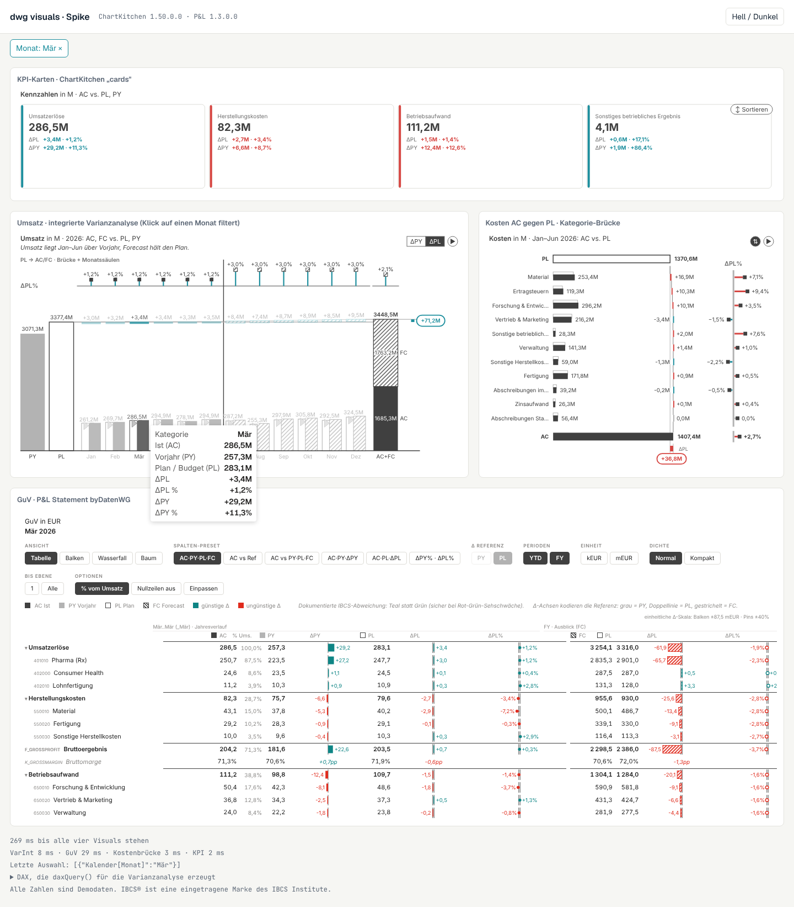

# dwg visuals

ChartKitchen und P&L Statement byDatenWG außerhalb von Power BI, z. B. in Fabric Apps (Rayfin).
Gerendert wird der **unveränderte Quellcode** der beiden Power-BI-Visuals aus diesem Repo. Der Adapter
ersetzt nur den Power-BI-Host: Er baut die DataView aus Semantikmodell-Abfragen, meldet Klicks als
Auswahl an die App und übergibt Sprache und Hell/Dunkel.

Erster Baustein der `dwg cli` (Arbeitsname), siehe [`sessions/plan-kitchen-fabric-apps.md`](../../sessions/plan-kitchen-fabric-apps.md).



## So sieht es in einer App aus

```ts
import { daxQuery, mountVisual } from "@dwg/visuals";

// 1. Rollen binden wie im Power-BI-Feldbereich, daraus entsteht die DAX-Abfrage
const q = daxQuery("chartkitchen", {
    category: "'Kalender'[Monat]",
    actual: "[Umsatz AC]", previousYear: "[Umsatz PY]", plan: "[Umsatz PL]", forecast: "[Umsatz FC]",
}, {
    sortBy: { "'Kalender'[Monat]": "'Kalender'[MonatNr]" },             // wie „Nach Spalte sortieren“
    filters: [{ column: "'Pipeline Status'[Sort Order]", values: [0] }],  // feste Filter, Querfilter
});

// 2. Abfrage über den Rayfin-Konnektor ausführen (Hook useSemanticModelQuery o. Ä.)
const table = (await connector.executeQuery({ query: q.query })).table;   // { columns, rows }

// 3. Visual einhängen
const handle = await mountVisual(el, {
    visual: "chartkitchen", table, bindings: q.bindings, displayNames: q.displayNames,
    objects: { chart: { orientation: "intwaterfall" }, ibcsTitle: { kpi: "Umsatz", period: "2026" } },
    theme: "light", locale: "de-DE",
    onSelect: keys => setFilter(keys),          // [{ "Kalender[Monat]": "Mär" }]
});

handle.update({ theme: "dark" });               // neue Daten, Theme, Objekte …
handle.clearSelection();
```

`objects` sind dieselben Formatbereich-Objekte wie in `capabilities.json` bzw. im PBIR `visual.json`.
Eine Kachel, die in Power BI so konfiguriert ist, sieht in der App gleich aus.

## API

| Funktion | Zweck |
| --- | --- |
| `daxQuery(visual, bindings, opts)` | SUMMARIZECOLUMNS-Abfrage aus der Rollenbindung. Liefert `query`, `bindings` und `displayNames` für das Ergebnis. Optionen: `filters` (TREATAS), `sortBy`, `showItemsWithNoData` (ADDMISSINGITEMS, z. B. für Formelzeilen der GuV) |
| `mountVisual(el, opts)` | lädt das Visual nach (Code-Splitting), rendert, reagiert auf Größenänderung. Rückgabe: `update`, `clearSelection`, `objects`, `lastRenderMs`, `destroy` |
| `buildDataView(visual, table, bindings)` | nur die DataView, z. B. für Tests |
| `col(table, column)` | Spaltenreferenz mit korrekt maskierten Namen |
| `ROLES`, `VERSIONS` | Datenrollen und Versionen der eingebundenen Visuals (aus `capabilities.json`/`pbiviz.json`) |

Callbacks in `mountVisual`: `onSelect`, `onPersist` (das Visual hat z. B. Sortierung oder Auf-/Zuklappen
gespeichert), `onContextMenu` (Rechtsklick/Drill, für ein Detailpanel), `onRendered`, `onError`.

**Sicherheit:** Measure-Ausdrücke in `daxQuery` werden unverändert in die Abfrage geschrieben, sie gehören
zum App-Code. Spaltenreferenzen und Filterwerte werden geprüft bzw. maskiert. Werte aus Nutzereingaben
nur über `filters` übergeben.

## Bauen und testen

```bash
npm install
npm run build      # dist/: Einstieg 12 KB, ChartKitchen- und P&L-Chunk werden erst bei Bedarf geladen
npm run demo       # Demo nach demo/build/, dann demo/index.html über einen Webserver ab Repo-Root öffnen
npm test           # Build + Unit-Tests + Browser-Test (Playwright/Chromium)
```

`demo/make-fixtures.mjs` erzeugt die Demodaten aus der Demo-GuV des P&L-Visuals (Format wie der
Semantikmodell-Konnektor).

## Spike-Ergebnis (18.10.2026)

Getestet mit `test/spike.mjs`, 17 von 17 Prüfungen grün, keine Konsolenfehler.

| Frage | Ergebnis |
| --- | --- |
| Rendern die Original-Visuals ohne Änderung am Visual-Code? | ja, ChartKitchen (Karten, integrierte Varianzanalyse, Kategorie-Brücke) und P&L (GuV mit Formel- und KPI-Zeilen) |
| Kommt ein Klick als Querfilter in der App an? | ja, `onSelect` liefert `[{"Kalender[Monat]":"Mär"}]`, GuV und Karten filtern, Filter-Chip, zweiter Klick hebt auf (wie Power BI) |
| Tooltip, Dark Mode, Größenänderung | ja, Dark Mode über den Berichtshintergrund (beide Visuals erkennen ihn), Neurendern über ResizeObserver |
| Renderzeit | 210–480 ms bis alle vier Visuals stehen (inkl. Nachladen), einzelnes Rendern 2–170 ms (GuV am teuersten) |
| Bundle-Größe | ChartKitchen 751 KB (218 KB gzip), P&L 470 KB (139 KB gzip), Adapter 12 KB. Globalize-Kulturdaten auf DE/EN/ES/JA gekürzt (vorher 1,47 MB) |

**Urteil: Go.** Der Ansatz trägt, ohne den Visual-Code anzufassen.

Offene Punkte aus dem Spike:

1. **Toolbars der Visuals:** Die GuV zeigt ihre Toolbar (Ansicht, Spalten-Preset, Perioden …) auch im
   Lesemodus. In der App ist das teils gewollt, auf schmalen Kacheln nimmt es viel Platz. Prüfen, ob ein
   Objekt-Schalter reicht oder das Visual einen kleinen Hook braucht.
2. **Einheiten-Kürzel:** ChartKitchen schreibt `bn`/`M` auch bei `de-DE`. Verhalten wie in Power BI, für
   deutsche Apps evtl. `Mrd.`/`Mio.` gewünscht (Visual-Thema, nicht Adapter).
3. **Sprachressourcen:** alle vier Sprachen stecken im Chunk (~260 KB ungezippt bei ChartKitchen). Je Sprache
   nachladen spart Platz.
4. **Nicht im Spike geprüft:** Kontextmenü/Drill-through, `persistProperties` im Live-Betrieb (Sortierung,
   Auf-/Zuklappen; Logik ist per Unit-Test geprüft), echte Abfrage gegen ein Semantikmodell in Fabric,
   Einbau in eine Rayfin-App (React-Hülle), Hochkontrast.

Alle Zahlen in Demo und Screenshots sind Demodaten. IBCS® ist eine eingetragene Marke des IBCS Institute;
die Kitchen-Visuals sind an IBCS angelehnt.
