# ChartKitchen byDatenWG — Dokumentation

> Markdown-Fassung von [chartkitchen-doku.html](../chartkitchen-doku.html) · https://datenwgknowledgekitchen.com/chartkitchen-doku.html · generiert mit scripts/build_md.py — bei Abweichungen gilt die HTML-Fassung.

Power-BI-Visual · Enddokumentation

Ein IBCS-inspiriertes Chart-Deck für Power BI: 13 Diagramm-Modi in einem einzigen Visual, mit einheitlicher Szenario-Notation (AC ausgefüllt, PY grau, PL umrandet, FC schraffiert) und mitgedachten Varianzen. Diese Dokumentation führt vom Import über die 13 Modi und die wichtigsten Funktionen bis zur vollständigen Einstellungs-Referenz.

Version · **1.52.1.0** · Stand · **2026-10-20** · IBCS-inspired

## Inhalt

1. [Was ist ChartKitchen?](#intro)
2. [Die Produktfamilie](#family)
3. [Der Start-Hub](#hub)
4. [Schnellstart](#quickstart)
5. [Die 13 Modi](#modes)
6. [ChartKitchen im Einsatz](#inaction)
7. [Funktionen im Detail](#features)
8. [Einstellungs-Referenz](#settings)
9. [FAQ & Troubleshooting](#faq)

## 01 · Was ist ChartKitchen?

**ChartKitchen byDatenWG** ist ein einzelnes Power-BI-Custom-Visual, das 13 Diagramm-Modi vereint — von Säulen, Balken und Linien über Wasserfall- und Brücken-Darstellungen bis zu IBCS-Tabelle (mit Matrix-Variante), KPI-Karten, einem vollständigen GuV-Statement und einem Scatter/Bubble-Plot für Korrelationen. Statt für jede Fragestellung ein eigenes Visual zu wählen, stellst du die Ausrichtung um und behältst dieselbe Notation, Farbwelt und Skalenlogik bei. Für die GuV in der Tiefe gibt es das Schwester-Visual [P&L Statement byDatenWG](../pnl-doku.html) — gleiche Notation, gleicher Start-Hub; wie beide zusammenspielen, zeigt Kapitel 02 „Die Produktfamilie“.

Die Gestaltung ist von den **IBCS®-Prinzipien** (International Business Communication Standards) inspiriert: eine einheitliche Szenario-Notation — **AC** (Ist) ausgefüllt, **PY** (Vorjahr) grau, **PL** (Plan) umrandet, **FC** (Forecast) schraffiert — und Abweichungen, die immer mitgedacht sind: absolute und relative Varianz-Panels stehen automatisch neben oder über dem Basis-Chart. So liest sich jede Grafik nach denselben Regeln, egal welcher Modus.

Diese Anleitung beschreibt den Stand der Version **1.52.1.0**. Gezählt wird wie im Visual selbst: 13 Chart-Typen — die Matrix ist dabei kein eigener Typ, sondern die Tabelle mit gefüllter Spalten-Rolle; sie bekommt in Kapitel 05 trotzdem eine eigene Karte. Neu seit 1.48: der Start-Hub für den Einstieg (Kapitel 03), die IBCS-Vorlagen C01–C13, das Nachladen bis 30.000 Zeilen, Lesezeichen, die die Auswahl wiederherstellen, gesperrte statt stummer Chips, wählbare Leer-Zustände und echter Hochkontrast (Kapitel 07). Seit 1.52 skaliert das Visual nach IBCS 2.0 / ISO 24896 (Kapitel 07, „Skalierung nach IBCS 2.0 / ISO 24896“).

## 02 · Die Produktfamilie

ChartKitchen und P&L Statement sind zwei Visuals aus einer Küche: dieselbe IBCS-Notation, dieselbe Bedienung, derselbe Start-Hub. Sie konkurrieren nicht, sie ergänzen sich — ChartKitchen deckt die **Breite** der Diagrammformen ab, P&L Statement die **Tiefe** der Ergebnisrechnung.

### Wofür welches Visual?

Breite · 13 Chart-Modi

#### ChartKitchen byDatenWG

Ein Visual für jede Frage nach Verlauf, Struktur und Zusammenhang — „Wie entwickelt sich …?“, „Wer treibt …?“.

- **Zeitreihen:** Säulen und Linie, die integrierte Brücke PY → AC über die Monate, Forecast schraffiert, YTD per Klick.
- **Strukturen:** Balken, Kategorie-Brücke, Pareto, Dumbbell und Slope, dazu IBCS-Tabelle und Matrix.
- **Scatter & Bubble:** zwei Kennzahlen gegeneinander, mit Quadranten, Trendlinie, Bewegungspfeilen und Play-Modus.
- **KPI-Karten:** Monitoring-Kacheln mit Ampel, Bullet gegen Benchmark und Trend-Sparkline.
- **Small Multiples:** eine Kachel je Region oder Produkt, alle auf derselben Skala, mit Σ- und Top-N-Kachel.

✓ Diese Dokumentation

Tiefe · Tabellen & Statements

#### P&L Statement byDatenWG

Die Ergebnisrechnung Zeile für Zeile — „Was steht in der GuV, und warum weicht sie ab?“.

- **Mega-Table:** die IBCS-Tabellen-Templates T01–T04 sowie 12A, 12G und 12H — Wert-Kaskaden, Δ-Wasserfälle, Pins, Schwellen.
- **Formel-Engine:** Hierarchie, Zwischensummen, Formel- und Margenzeilen direkt aus der Kontendimension (Ebenen-Spalten oder Parent-Child).
- **Werttreiberbaum:** der Formel-Graph als DuPont-Baum mit Mini-Charts auf jeder Karte und Kachel-Zoom je Knoten.
- **Perioden-Blöcke:** Monat · YTD · FY-Ausblick nebeneinander; Leser schalten Spalten, Referenz und Einheit in der Toolbar.
- **Struktur-Bars & Zeilen-Waterfall:** dieselben GuV-Zeilen als Größenbalken oder als Kaskade mit Ergebnisankern.

[Zur P&L-Doku →](../pnl-doku.html#family)

> **Die typische Berichtsseite nutzt beide nebeneinander** — links die GuV aus P&L Statement, rechts ChartKitchen mit Monatsverlauf, Treiber-Brücke oder KPI-Karten. Mit `fixedMax` teilen sie den Maßstab: denselben Betrag in ChartKitchen unter *Skala & Referenzlinie → Skalen-Mindest-Maximum* und im P&L Statement unter *Zahlen → Skalen-Mindestmaximum (Werte)* eintragen — gleiche Beträge ergeben dann gleich lange Balken (IBCS: identische Skalen).

### Gemeinsame Bedienung

Wer eines der beiden Visuals bedienen kann, kann auch das andere: Einstieg, Vorlagen und Darstellung folgen einer gemeinsamen Spezifikation. Die Tabelle nennt, was gleich ist, und wo es im jeweiligen Visual sitzt.

| Gemeinsam | ChartKitchen | P&L Statement |
| --- | --- | --- |
| **Start-Hub** 🚀 Loslegen plus vier Knöpfe: Tour · Vorlagen-Galerie · Demo · Felder erklären — nur im Bearbeitungsmodus. | Tour mit 11 Karten, Demo = Galerie der 13 Chart-Typen, Feld-Intro mit allen 19 Rollen. | Tour mit 7 Karten (echte Mini-Renderings), Demo = Beispiel-GuV, Feld-Intro mit allen 20 Rollen. |
| **Vorlagen als Presets** Galerie nach Zweck; ein Klick setzt alle Schalter, danach ist alles frei. „↺ Zum Template zurück“ stellt den Vorlagen-Stand wieder her. | 11 IBCS-Chart-Vorlagen C01–C13 (ohne C07/C11) in vier Gruppen; ↺ unten links im Chart. | 17 IBCS-Tabellen-Templates T01A–12H plus klassische Tabelle in vier Gruppen; ↺ neben dem Template-Dropdown. |
| **Schriftgröße HD · Full HD · UHD** Leiste unten auf jeder Hub-Seite, rechts daneben „📖 Doku öffnen“. | Speichert *Datenbeschriftungen → Größen-Preset* (im Formatbereich Kompakt · Full HD · Präsentation; ×1 · ×1,5 · ×2). | Speichert *Stil → Schriftgrößen-Preset* (HD · Full HD · UHD; ×1 · ×1,25 · ×1,6). |
| **IBCS-Notation, Teal als Standard** AC voll, PY grau, PL Rahmen, FC schraffiert; günstige Abweichungen Teal statt Grün — lesbar bei Rot-Grün-Schwäche. | Teal #1E8F9E · Rot #D64541; Farbpreset Blau/Orange. | Teal #0E8585 · Rot #E02B1D; Presets IBCS-Grün und Blau/Orange. |
| **Vier Sprachen** Deutsch, Englisch, Spanisch, Japanisch — folgt der Berichtssprache, auch im Hub. | Formatbereich, Chart-Texte und Hub. | Formatbereich, Toolbar, Statement und Hub. |
| **Dark Mode & Hochkontrast** „Auto“ erkennt dunkle Berichts-Themes; im Hochkontrast tragen Muster statt Farben die Aussage. | *IBCS-Farben → Erscheinungsbild*. | *Stil → Erscheinungsbild*. |
| **Tastatur** Alle Knöpfe per Tab, Enter oder Leertaste lösen aus, Esc geht eine Ebene zurück bzw. schließt. | Tour: ‹ ›, Pfeiltasten, Pos1/Ende. | Hub: Ziffern 1–4 öffnen die Knöpfe; Tour: ‹ › und Pfeiltasten. |
| **Leser-Landing** Ohne Daten sehen Leser und Exporte eine ruhige Karte ohne Knöpfe; der eigene Leer-Zustand-Text gewinnt. | Seit 1.51.1. | Seit 1.4.1. |

## 03 · Der Start-Hub

Wer ChartKitchen leer auf die Berichtsseite zieht, landet nicht vor einer Fehlermeldung, sondern im **Start-Hub** (seit 1.50, für den Self-Service von Controllern poliert in 1.51 und 1.51.1). Er ist ein Werkzeug für Autoren: Er erscheint nur im Bearbeitungsmodus, solange keine Daten dargestellt werden — oder auf Knopfdruck über ☰ Start. Leser und Exporte sehen ihn nie, und nichts von der Navigation im Hub wird im Bericht gespeichert.

### Die Startseite: Loslegen und vier Knöpfe

Oben stehen der Produktname und die Zeile „Start — womit möchtest du beginnen?“, darunter über die volle Breite der Teal-Knopf **🚀 Loslegen** und vier große Einstiegs-Kacheln:

- **Was kann das Visual?** — eine Feature-Tour in 11 Karten mit Mini-Vorschau: die 13 Chart-Modi in vier Gruppen (Zeitreihen, Struktur, Brücken & GuV, Analyse), Varianz-Panels, Small Multiples, Kommentare, Dark Mode & Hochkontrast, Play & Animation, YTD/Wesentlichkeit/Exceptions sowie Vorlagen & Smart-Start. Blättern mit ‹ ›, den Pfeiltasten oder Pos1/Ende; „Vorlagen öffnen →“ springt in die Galerie, die letzte Karte führt mit „← Zurück zum Start“ heim.
- **Templates** — die Vorlagen-Galerie nach Zweck (siehe unten).
- **Demo ansehen** — die Galerie aller 13 Chart-Typen mit Mini-Vorschau und den je Modus benötigten Feldern; ein Klick wählt den Modus. Bis 1.49 war das die Startseite.
- **Felder erklären** — alle 19 Datenrollen in vier Abschnitten (Pflicht & Achse · Szenarien · Gliederung · Spezial), je mit kurzem Zweck und ✓, sobald gebunden. Dazu zwei Prämissen-Boxen: *IBCS-Notation* (AC voll · PY grau · PL Rahmen · FC schraffiert, gut/schlecht) und *Zeit vs. Struktur* („Zeit läuft horizontal, Struktur vertikal“). Was nicht auf eine Seite passt, blättert mit ‹ n / N ›.

Jede Unterseite trägt oben links die Pille **„← Zurück“**; Esc führt ebenfalls zurück. Alle Knöpfe sind per Tab erreichbar und lösen mit Enter oder Leertaste aus. Dark Mode und Hochkontrast gelten auch im Hub.

### Die Vorlagen-Galerie nach Zweck

Die elf IBCS-Vorlagen (Kapitel 07) stehen als Kacheln mit Vorschau in vier Gruppen. Jede Kachel nennt den Zweck in Finance-Sprache, darunter eine Nutzen-Zeile; die C-Nummer steht als kleines Badge in der Vorschau. Gruppen, die nebeneinander passen, teilen sich eine Reihe; bei wenig Platz blättert die Galerie reihenweise.

| Gruppe | Vorlage | Kachel-Titel | Nutzen-Zeile |
| --- | --- | --- | --- |
| **Zeitverlauf** | C01 | Säulen gestapelt nach Segment | Umsatzmix je Monat |
|  | C03 | Säulen mit Vorjahres-Abweichung | Monatsbericht AC vs. PY |
|  | C05 | Integrierte Jahresbrücke | PY → AC/FC über die Monate |
|  | C08 | Linie für lange Reihen | Wochen- oder Tagestrend vs. PY |
| **Struktur** | C02 | Balken gestapelt nach Segment | Kostenstruktur je Bereich |
|  | C04 | Balken mit Plan-Abweichung | Regionen oder Produkte AC vs. PL |
|  | C06 | Treiber-Brücke je Kategorie | Welche Bereiche erklären ΔPY? |
| **Korrelation** | C09 | Streudiagramm mit Quadranten | Umsatz vs. Marge je Kunde |
|  | C10 | Blasendiagramm | Plus Volumen als Blasengröße |
| **Brücken & Mehrfach** | C12 | Wasserfall / GuV-Brücke | Umsatz → EBIT in Stufen |
|  | C13 | Small Multiples | Ein Chart je Region, gleiche Skala |

- **Klick = anwenden.** Die Kachel schreibt dasselbe wie das Dropdown im Formatbereich — die Vorlage und alle ihre Einstellungen in einem Speichervorgang. Die aktive Vorlage trägt „✓ aktiv“ und einen kräftigen Rahmen; ein erneuter Klick darauf wendet sie noch einmal an.
- **Ohne Felder** wird die Wahl gespeichert („✓ C03 gespeichert — wird aktiv, sobald Felder gebunden sind“) und greift beim Binden. Braucht eine Vorlage ein weiteres Feld (Stack-Serie, Blasengröße, Small Multiples), nennt die Kachel es.
- **Im Overlay** (über ☰ Start) wendet ein Klick die Vorlage an und schließt das Overlay, damit du das Ergebnis sofort siehst.

### 🚀 Loslegen — die ersten drei Minuten

Der hervorgehobene Knopf öffnet eine geführte Checkliste. Die Häkchen gehen live mit, gespeichert wird davon nichts.

1. **Felder binden** — ✓ je Rolle: Ist (AC) ist Pflicht, Kategorie, Vorjahr (PY) und Plan (PL) sind empfohlen; ein Hinweis zeigt, wo die Feldbereiche sitzen.
2. **Template wählen** — Sprung in die Vorlagen-Galerie; ✓, sobald eine Vorlage gesetzt ist.
3. **Feinschliff** — Vergleich & Abweichung, IBCS-Titel und Größen-Preset.

### Die untere Leiste: Schriftgröße und Doku

Jede Hub-Seite — Start, Loslegen, Tour, Vorlagen, Demo, Felder — endet in derselben Leiste:

- **Aa · HD · Full HD · UHD** — drei Pillen, die aktive Teal gefüllt, daneben der Hinweis „Schriftgröße — HD für Laptops · Full HD für Monitore · UHD für Beamer & 4K“. Ein Klick speichert sofort das Größen-Preset (HD = Kompakt ×1, Full HD ×1,5, UHD = Präsentation ×2) und zeichnet den Hub in der neuen Größe; im Overlay erscheint der Chart beim Schließen in der neuen Größe.
- **📖 Doku öffnen** — rechts als umrandete Pille: öffnet diese Seite im Browser, bei deutscher Berichtssprache die deutsche, sonst die englische Fassung.
- Darunter steht mittig die Signatur „made by Daten-WG“.

### Mit Daten: ☰ Start und ↺ Zum Template zurück

- **☰ Start** sitzt im Bearbeitungsmodus unten links über dem fertigen Chart — dezent halb transparent, beim Überfahren oder per Tab-Fokus voll sichtbar. Liegt dort Text des Charts (etwa die erste Achsenbeschriftung), rückt die Chip-Leiste eine Stufe nach oben. Der Knopf öffnet denselben Hub als Overlay; der Chart wird darunter nur verborgen, „✕ Schließen“ oder Esc zeigt ihn exakt wie vorher.
- **↺ Zum Template zurück** erscheint daneben, sobald eine Vorlage gesetzt ist und eine ihrer Einstellungen davon abweicht. Ein Klick stellt den Vorlagen-Stand wieder her, alle anderen Einstellungen bleiben. Wer die Änderungen behalten will, stellt die Vorlage im Formatbereich auf „Aus“.

### Was Leser sehen

Leser im Lesemodus und Exporte (PDF, PowerPoint, Abos) sehen weder Hub noch Chips noch Leiste. Hat das Visual für sie keine Daten, zeigt es seit 1.51.1 eine **ruhige Landing-Karte**: den Produktnamen, darunter „Dieses Visual hat noch keine Daten — Felder werden im Bearbeitungsmodus gebunden.“ und drei statische Mini-Schemata — keine Knöpfe, keine Pillen, kein Doku-Link. Hast du in der Karte *Leer-Zustand* einen eigenen Titel oder Text hinterlegt, stehen diese an ihrer Stelle (dann ohne Schemata). Dieselbe Regel gilt im Schwester-Visual P&L Statement.

> Es geht auch ohne Hub: *Leer-Zustand → Leer-Zustand im Bearbeitungsmodus* bietet die Demo-Galerie (Verhalten bis 1.49), das Feld-Intro oder eine eigene Nachricht (Kapitel 07, „Leer-Zustand“). Visuals unter 300 × 220 px zeigen auch beim Bearbeiten die Demo-Galerie statt des Hubs. Für PBIR-Autoren: `emptyState.mode = "demo"` stellt die alte Galerie wieder her.

## 04 · Schnellstart

### 1 · Visual importieren

1. Lade die Datei [`chartkitchen-byDatenWG-latest.pbiviz`](../downloads/chartkitchen-byDatenWG-latest.pbiviz) herunter (Endung `.pbiviz`) — der Link liefert immer die aktuelle Version, derzeit 1.52.1.0.
2. In Power BI Desktop: im Bereich *Visualisierungen* auf *… (Weitere Optionen)* → *Visual aus Datei importieren* klicken und die `.pbiviz` auswählen.
3. Das ChartKitchen-Icon erscheint im Visualisierungsbereich. Ziehe es auf die Berichtsseite.

### 2 · Minimal-Setup

1. Weise der Rolle **Kategorie** deine Achse zu — eine Zeitachse (Monate, Quartale) oder eine Struktur (Regionen, Produkte, Konten).
2. Weise der Rolle **Ist (AC)** deine Hauptkennzahl zu. Mit nur diesen beiden Feldern zeichnet das Visual bereits Säulen mit Beschriftung, Titel und Σ-Kopfzeile.
3. Solange Felder fehlen, zeigt ChartKitchen im Bearbeitungsmodus den **Start-Hub** (Kapitel 03): „🚀 Loslegen“ führt mit Häkchen durch Felder, Vorlage und Feinschliff, „Templates“ setzt eine IBCS-Vorlage mit einem Klick, „Demo ansehen“ zeigt die Kachel-Galerie aller Modi mit den je Modus benötigten Feldern.

### Feldrollen

| Feldrolle | Typ | Wofür |
| --- | --- | --- |
| Kategorie | Gruppierung | Zeitachse (Monate) oder Struktur (z. B. Länder, Produkte). Eine zweite Kategorie bildet eine Hierarchie in der Tabelle — seit 1.47 klappt sie dort automatisch zum Zeilenbaum auf. Seit 1.41 optional: ohne Kategorie rendert das Visual eine einzelne KPI-Kachel mit dem Namen der AC-Measure. |
| Ist (AC) | Kennzahl | Ist-Wert — die Hauptkennzahl, ausgefüllt gezeichnet. Pflichtfeld. |
| Vorjahr (PY) | Kennzahl | Vorjahreswert, grau gezeichnet. Basis für die ΔPY-Varianz-Panels. |
| Plan / Budget (PL) | Kennzahl | Plan- oder Budgetwert, als Umriss gezeichnet. Basis für die ΔPL-Varianz-Panels. |
| Forecast (FC) | Kennzahl | Forecast-Wert — wird automatisch schraffiert dargestellt. |
| Benchmark (BM) | Kennzahl | Vergleichswert je Kategorie (z. B. Marktdurchschnitt, Ziel) — als Querstrich-Marker; Basis für die KPI-Karten-Ampel und das Bullet. |
| FC Vormonat (Revision) | Kennzahl | Forecast des vorherigen Zyklus — als Abweichungsbasis wählbar (FC-Revision: was hat sich seit dem letzten Forecast verschoben?). |
| Linie (Kombi) | Kennzahl | Zweite Kennzahl als Linie über den Säulen (z. B. Marge %) mit eigener Skala rechts. Nur im Columns-Modus. |
| Stack-Serie (Gestapelt) | Gruppierung | Feld gefüllt = Säulen/Balken stapeln sich nach dieser Serie (AC je Serie, mit Legende und Summen-Label). |
| Spalten (Matrix) | Gruppierung | Nur Tabelle: pivotiert die Werte in Spaltengruppen (z. B. Quartal → Monat, max. 2 Ebenen) — mit klappbarer Spalten-Hierarchie wie in der Power-BI-Matrix. |
| Filter-Info (Fußzeile) | Kennzahl | Text-Measure mit dem aktuellen Filterkontext (z. B. via CONCATENATEX/SELECTEDVALUE) — erscheint als zweite Fußzeile, wenn die Filter-Fußzeile aktiv ist. |
| Kommentare | Kennzahl | Text-Measure: Kategorien mit Kommentar bekommen einen nummerierten Marker, der Text steht im Tooltip und in der Kommentarliste. |
| Small Multiples | Gruppierung | Teilt das Chart in kleine Kacheln pro Gruppe — mit identischer Skalierung (IBCS Small Multiples). |
| Waterfall-Typ (sum/delta) | Gruppierung | Nur Wasserfall/GuV: „sum“ = absolute Zwischensumme, „delta“ = Bewegung (GuV-Wasserfall). |
| Forecast-Flag (0=Ist · 1=FC · 2=vorläufig) | Gruppierung | Alternative zur FC-Measure: eine 1/0-Spalte — Zeilen mit 1 werden als Forecast (schraffiert) dargestellt, die AC-Measure läuft durch. |
| X-Achse (Scatter) | Kennzahl | Nur Scatter/Bubble (seit 1.47): Kennzahl für die X-Achse — die Y-Achse bleibt AC. |
| X-Achse VJ (Scatter) | Kennzahl | Nur Scatter/Bubble, optional (seit 1.48, max. 1 Feld): Vorjahreswert zur X-Achse. Mit Vorjahr (PY) und aktivierten Bewegungspfeilen zeigen die Pfeile echte 2D-Bewegungen von (X-VJ, PY) zur AC-Position — ohne dieses Feld bewegt sich nur die Y-Achse. |
| Blasengröße | Kennzahl | Nur Scatter/Bubble, optional: skaliert die Punktfläche proportional zum Wert (3–22 px) — aus dem Scatter wird ein Bubble-Chart. |
| Trend (Zeit) | Gruppierung | Nur KPI-Karten (seit 1.47): ein Zeitfeld macht jede Karte zur Zeitreihe mit Mini-Chart (Sparkline oder Säulen). Andere Modi ignorieren die Rolle und aggregieren die Zeilen. |

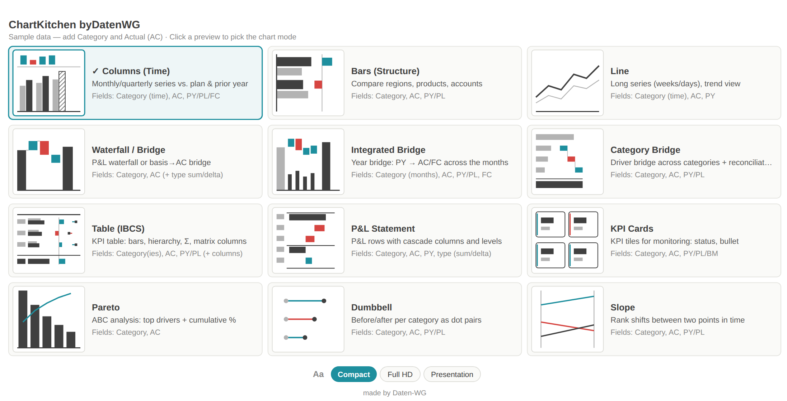

### 3 · Erster Vergleich mit PY

1. Füge der Rolle **Vorjahr (PY)** die entsprechende Kennzahl hinzu. Sofort erscheinen über dem Basis-Chart die Varianz-Panels *ΔPY absolut* und *ΔPY %* — grün, wenn besser, rot, wenn schlechter.
2. Für einen Plan-Vergleich bindest du zusätzlich **Plan / Budget (PL)**; über *Chart → Abweichungsbasis* wählst du, wogegen die Panels rechnen (Auto nimmt PL, sonst PY).
3. Von hier aus änderst du über *Chart → Chart-Typ* den Modus — seit 1.45 ist die Chart-Karte die erste Karte im Formatbereich. Alle folgenden Kapitel bauen darauf auf.
4. Abkürzung: Eine IBCS-Vorlage setzt Modus, Basis und Panels in einem Schritt — etwa *C03 · Säulen + Varianzen (PY)* unter Chart → IBCS-Chart-Vorlage oder per Klick in der Vorlagen-Galerie des Start-Hubs.

## 05 · Die 13 Modi

ChartKitchen zählt 13 Chart-Typen — so, wie sie auch die Demo-Galerie im Start-Hub zeigt. Die Matrix ist dabei kein eigener Typ, sondern die Tabellen-Variante mit gefüllter Spalten-Rolle; sie wird hier als Karte 07b beschrieben.

### 01 · Säulen

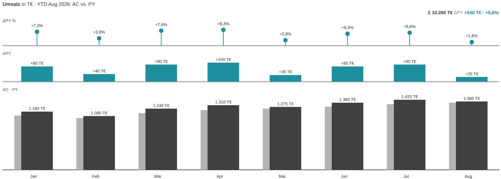

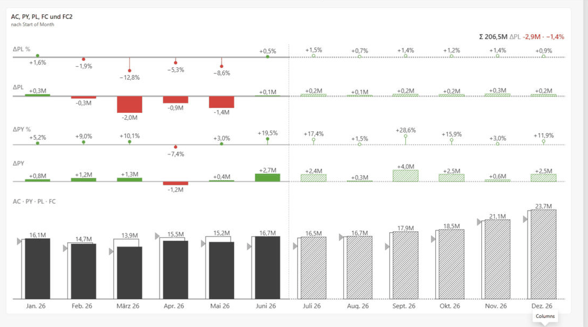

Der Standard für Zeitreihen: Monate oder Quartale als Säulen, AC ausgefüllt, PY grau (oder als Dreieck, wenn zusätzlich PL gebunden ist). Über den Säulen liegen die Varianz-Panels ΔPY absolut und in Prozent. Nimm diesen Modus, wenn die Zeitachse überschaubar ist (bis etwa 24 Punkte) und die Abweichung je Periode zählt.

### 02 · Balken

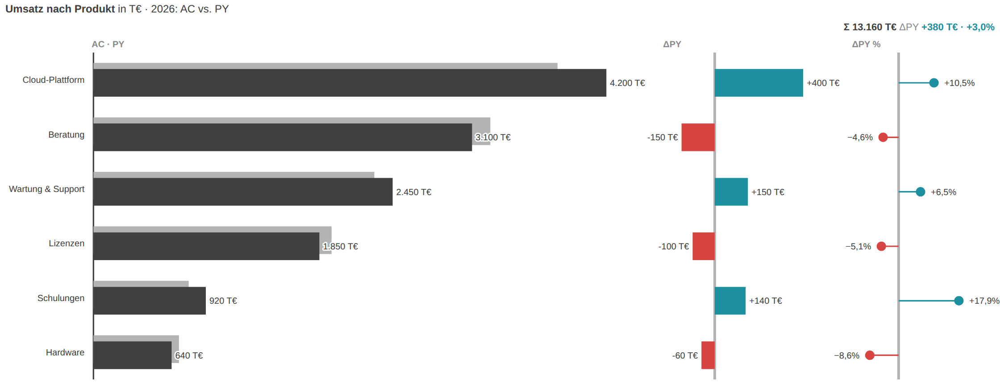

Für Strukturvergleiche ohne Zeitbezug — Produkte, Regionen, Konten. Die Kategorien stehen als waagerechte Balken untereinander, standardmäßig nach AC absteigend, mit seitlichen ΔPY- und ΔPY-%-Panels. Ideal, wenn Kategorienamen lang sind oder es viele Ausprägungen gibt.

### 03 · Linie

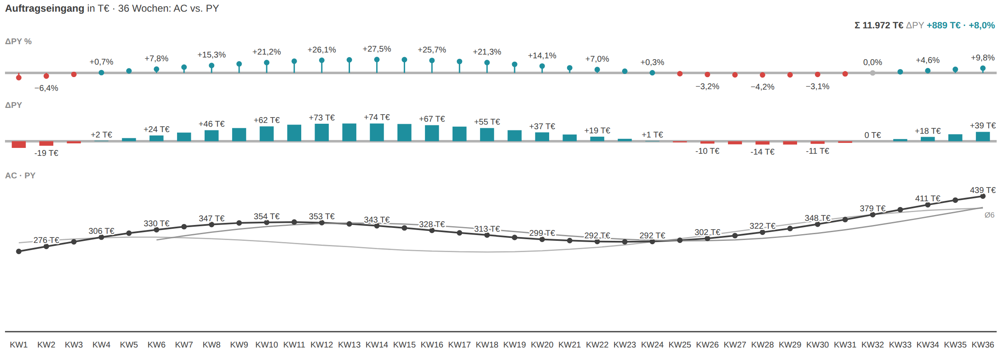

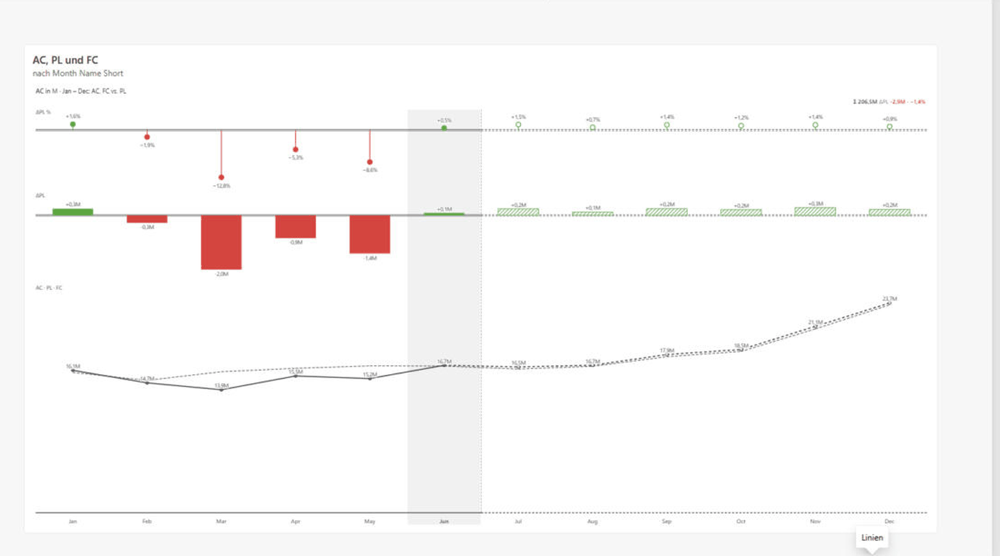

Für lange Zeitreihen mit vielen Datenpunkten (Wochen, Tage), bei denen Säulen zu dicht würden. Alle absoluten Linien haben dieselbe Stärke: AC dunkel, PY hellgrau, PL hohl, nur FC gestrichelt; optional ein gleitender Durchschnitt über N Perioden für den Trend. Der Fokus liegt auf Verlauf und Wendepunkten, nicht auf der Einzelperiode.

### 04 · Wasserfall

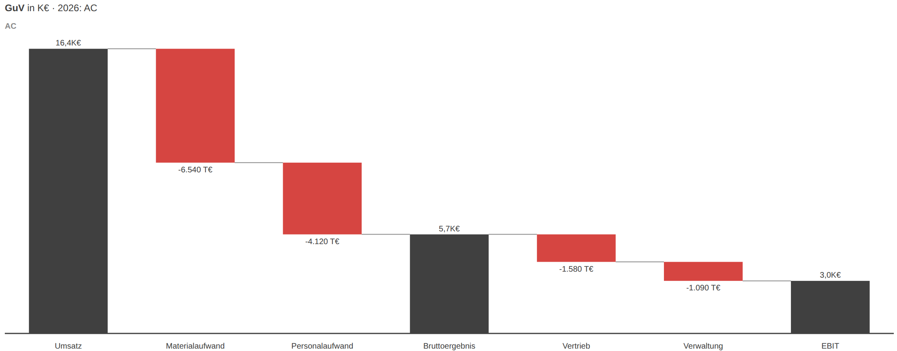

Die klassische GuV-Kaskade: über die Rolle „Waterfall-Typ“ (sum/delta) werden Zwischensummen als volle Säulen und Bewegungen als schwebende Brückenglieder gezeichnet — von Umsatz bis EBIT. Auch als reine Basis→AC-Brücke nutzbar. Nimm ihn, wenn sich ein Ergebnis additiv aus Beiträgen zusammensetzt.

### 05 · Integrierte Brücke

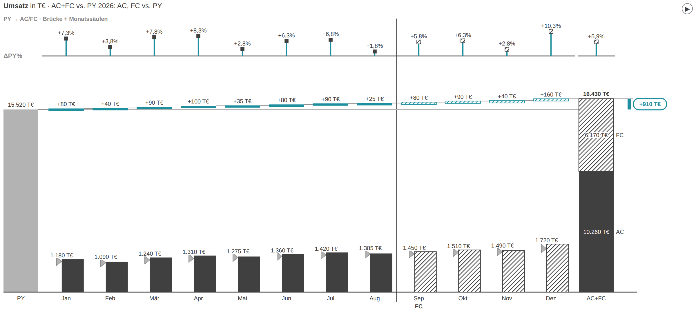

Die Jahresbrücke: links die PY-Totalsäule, in der Mitte die ΔPY-Kaskade über die Monate, rechts die gestapelte AC+FC-Totalsäule. Sie beantwortet „Wie kommen wir vom Vorjahr zum aktuellen Stand?“ über die Zeit. Braucht PY oder PL als Basis und verträgt keine rein negativen Werte.

### 06 · Kategorie-Brücke

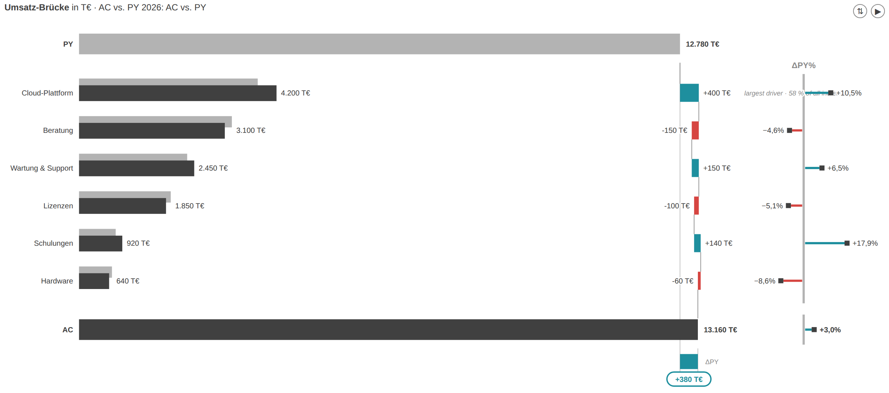

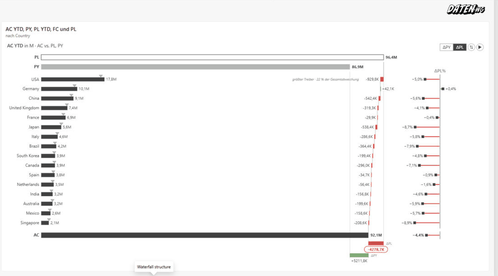

Die Treiber-Brücke über Kategorien: PY-Zeile oben, je Treiber ein AC-PY-Balken plus Kaskadenglied und ΔPY-%-Pin, AC-Zeile als Überleitung unten. So sieht man auf einen Blick, welche Kategorie die Gesamtabweichung treibt. Der größte Treiber wird automatisch mit einer Notiz markiert. Seit 1.47 ist die Ausrichtung wählbar (Chart → Brücke): „Automatisch“, „Balken“ (wie bisher) oder „Säulen“ — eine vertikale Säulen-Kaskade vom PY-Anker über die Treiber zu AC, mit Δ%-Pins oben.

### 07 · Tabelle

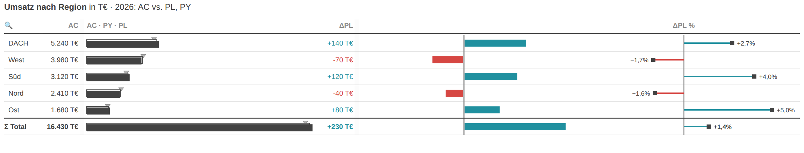

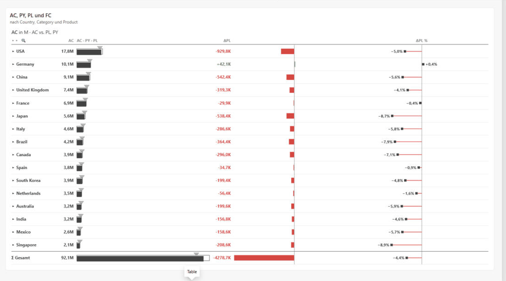

Die flache IBCS-Wertetabelle: je Zeile der AC-PY-Balken, eine ΔBasis-Balkenspalte, ΔBasis-%-Pins und eine Σ-Gesamtzeile. Sie verbindet Zahlengenauigkeit mit IBCS-Grafik in der Zelle und ist die Grundlage für Hierarchien, Ergebnis-/Skip-Zeilen und die Matrix. Ideal für board- und drucktaugliche Kennzahlenblätter. Mehrere Kategorie-Felder klappen seit 1.47 automatisch als Zeilenbaum auf (Schalter „Hierarchie automatisch aufklappen“, Standard an).

### 07b · Matrix

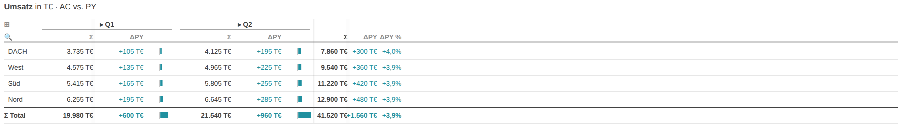

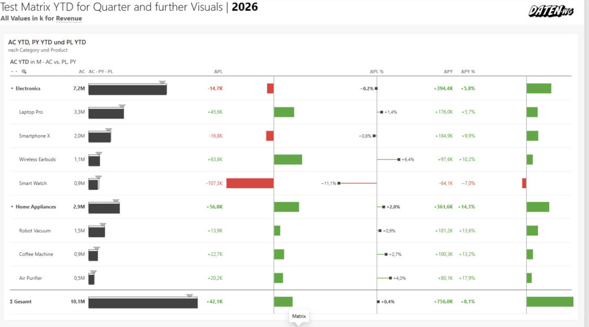

Die Tabellen-Variante mit gefüllter Spalten-Rolle (kein eigener Chart-Typ): Zeilen-Kategorien gegen eine Spaltenhierarchie (z. B. Quartal → Monat, max. 2 Ebenen), je Block Wert und ΔBasis, rechts ein fixierter Σ-Block. Spaltengruppen lassen sich auf- und zuklappen, breite Matrizen horizontal scrollen. Für Kennzahlen über zwei Dimensionen gleichzeitig.

### 08 · Pareto

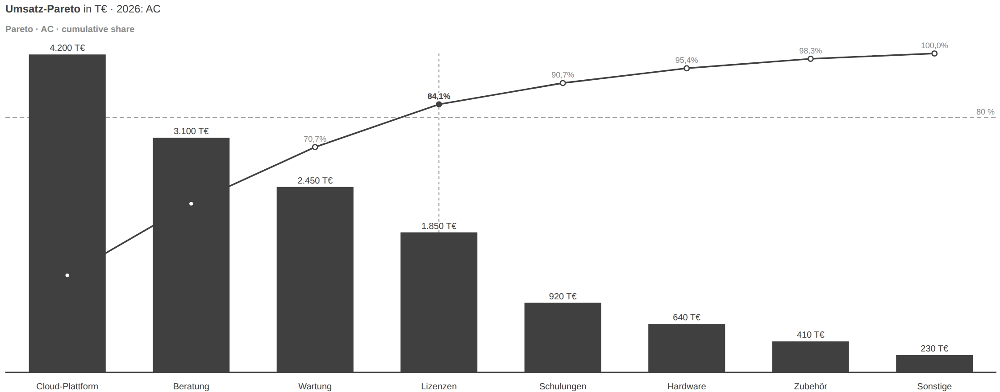

Die ABC-Analyse: AC-Säulen absteigend mit kumulierter Prozentlinie und 80-%-Referenzmarke. Man erkennt sofort, welche wenigen Kategorien den Großteil ausmachen. Nimm ihn für Sortiments-, Kunden- oder Fehlerursachen-Analysen.

### 09 · Dumbbell

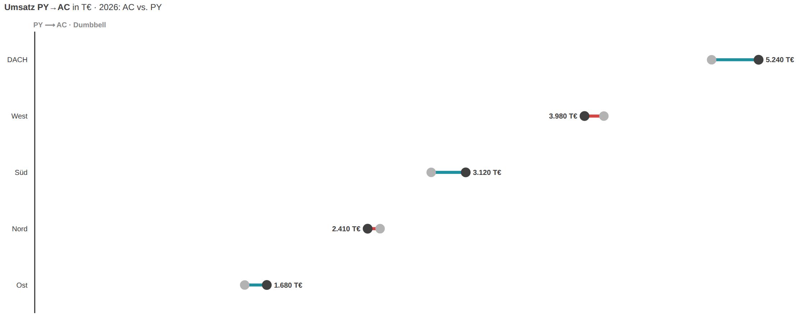

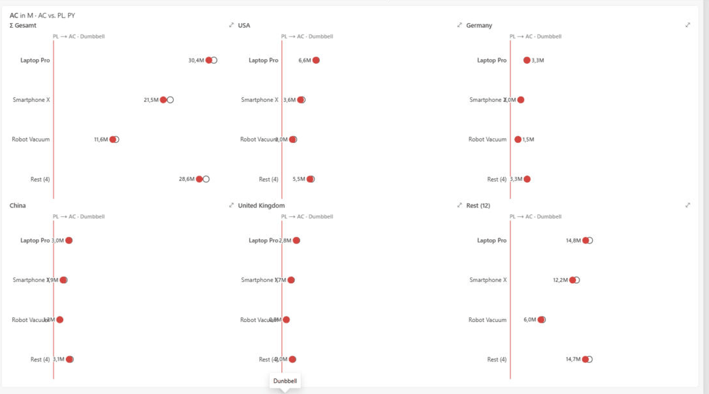

Vorher/Nachher je Kategorie als Punktpaar: ein PY- und ein AC-Punkt, der farbige Verbinder zeigt Richtung und Größe der Veränderung. Ruhiger als zwei Balkenreihen, wenn nur zwei Szenarien verglichen werden. Braucht AC und PY/PL je Kategorie.

### 10 · Slope

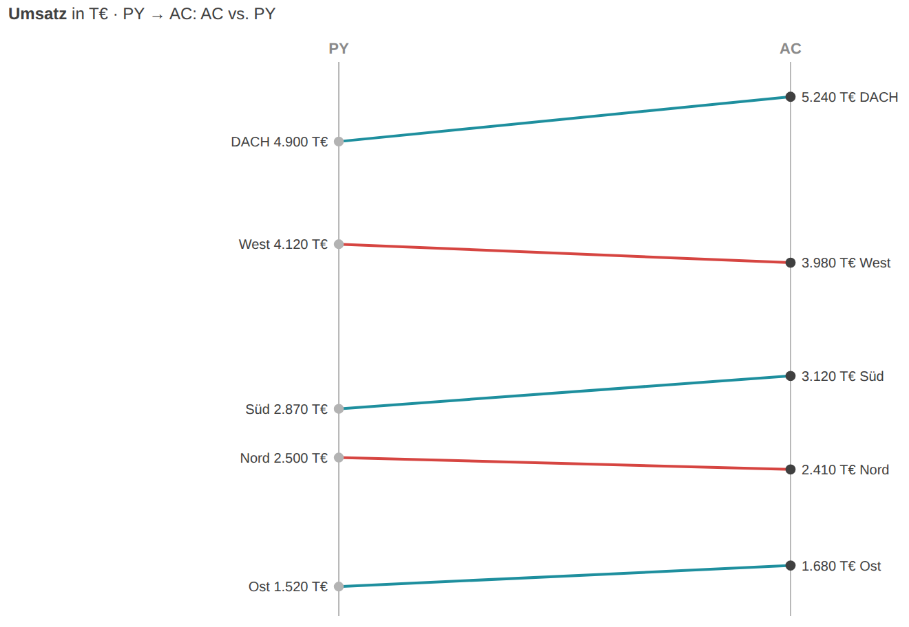

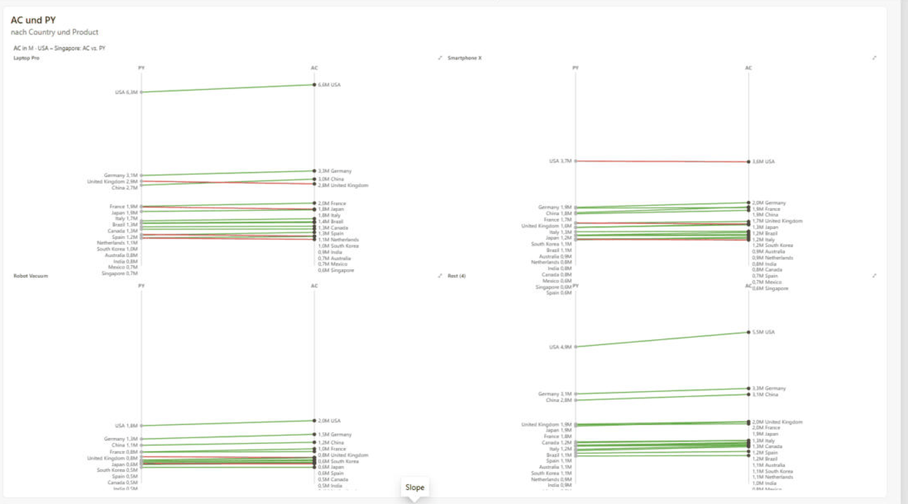

Rangwechsel zwischen zwei Zeitpunkten: PY links, AC rechts, je Kategorie eine Linie — Steigung und Farbe zeigen Auf- und Absteiger. Ideal, um Positionsverschiebungen in einem Ranking zu erzählen. Braucht AC und PY/PL je Kategorie.

### 11 · KPI-Karten

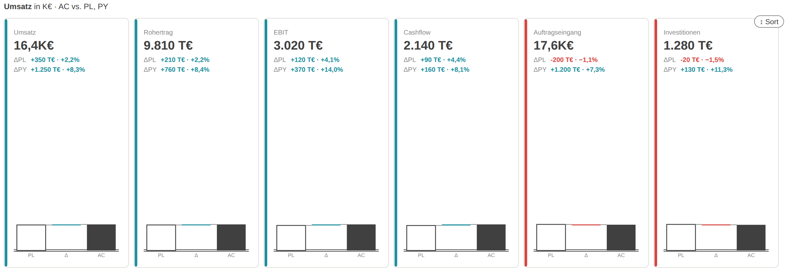

KPI-Kacheln fürs Monitoring: je Kennzahl eine Karte mit großem AC-Wert, ΔPL- und ΔPY-Zeilen und einer Mini-Brücke PL→Δ→AC. Optional mit Status-Ampel, Hintergrund-Färbung und Bullet gegen die Benchmark. Für Überblicks-Seiten und Kontrollraum-Wände. Mit einem Zeitfeld in der Rolle „Trend (Zeit)“ wird jede Karte zur Zeitreihe — Sparkline mit PY-Geisterlinie oder nullbasierte Säulen, Kartenwert „Letzter Wert“ oder „Summe“ (seit 1.47).

### 12 · GuV-Statement

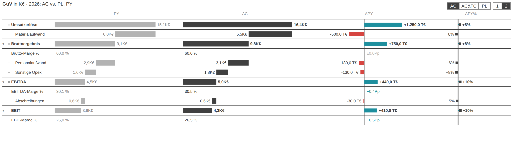

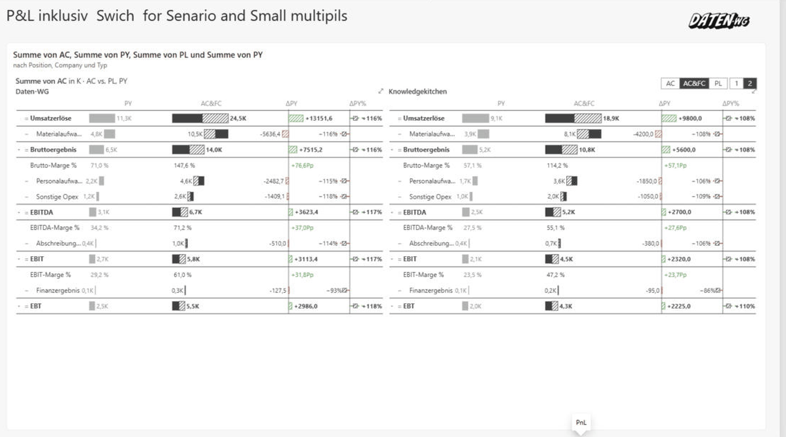

Das vollständige GuV-Statement: Ergebnisrechnung mit Summen-, Delta- und Margen-Zeilen, PY-/AC-Kaskadenspalten und ΔPY plus ΔPY-%-Pins. Ebenen (nur Zwischensummen / alle Positionen) und Ansichten (AC / AC+FC / PL) sind per Button umschaltbar. Der Abschluss-Modus für die formale Berichterstattung. Braucht PY (oder PL) als Referenz.

### 13 · Scatter / Bubble (Korrelation)

Der Korrelations-Modus (neu in 1.47): jede Kategorie als Punkt, Y-Achse = AC, X-Achse = die neue Rolle „X-Achse (Scatter)“; mit gefüllter Rolle „Blasengröße“ wird daraus ein Bubble-Chart (Punktfläche proportional, 3–22 px). Quadranten-Linien lassen sich auf Mittelwert oder Median legen — gesetzte Referenzlinien (auch die neue X-Referenzlinie) übersteuern sie. Die Achsen zeigen maximal 5 runde Ticks mit der Einheit im Achsentitel; Labels weichen Kollisionen automatisch aus (hervorgehobene Kategorien vor größten Blasen vor Extrempunkten). Optional färbt eine Status-Färbung die Punkte nach ΔPY/ΔPL inklusive Wesentlichkeitsschwelle. Hervorhebung (EMPHASIZE), FC-Schraffur, Kommentare, Crossfilter, Dark Mode und Hochkontrast funktionieren wie in den übrigen Modi.

Seit 1.48 ist der Modus deutlich ausgebaut: Ein Feld in der Small-Multiples-Rolle erzeugt jetzt echte Scatter-Kacheln mit gemeinsamer X/Y-Skala — Quadranten-Linien, Referenzlinien und Blasenskala gelten für alle Kacheln gleich; die Σ- und die Top-N-Rest-Kachel sind im Scatter bewusst aus (keine Summen über Quoten). Die Punkt-Färbung „Nach Gruppe/Serie“ nutzt sechs gedeckte Farben ohne Rot und Grün (die bleiben für gut/schlecht reserviert) und zeigt eine Legende oben — ab der 7. Gruppe mit „+n weitere“. Die neue Rolle „X-Achse VJ (Scatter)“ macht aus den PY→AC-Bewegungspfeilen echte 2D-Bewegungen. Und der Play-Modus (Rosling-Animation) macht die Kategorie zur Zeitachse: je Frame ein Punkt pro Serie, die laufende Periode steht als großes Wasserzeichen im Hintergrund, ohne Abspielen zeigt der Chart die letzte Periode — nur für die einzelne Punktwolke, nicht bei Kacheln. Dazu kommen Trendlinie mit R²-Label, Größen-Legende, Punktformen je Gruppe, Quadranten-Ecklabels, fixierbare Achsen und Log-Skalen (Einstellungs-Referenz, Kapitel 08).

## 06 · ChartKitchen im Einsatz

Die folgenden Aufnahmen stammen direkt aus Power BI Desktop, mit Beispieldaten aus einem echten Bericht. Die übrigen Abbildungen dieser Dokumentation sind mit demselben Renderer erzeugt — hier siehst du das Visual so, wie es im Berichtsalltag zusammenspielt.

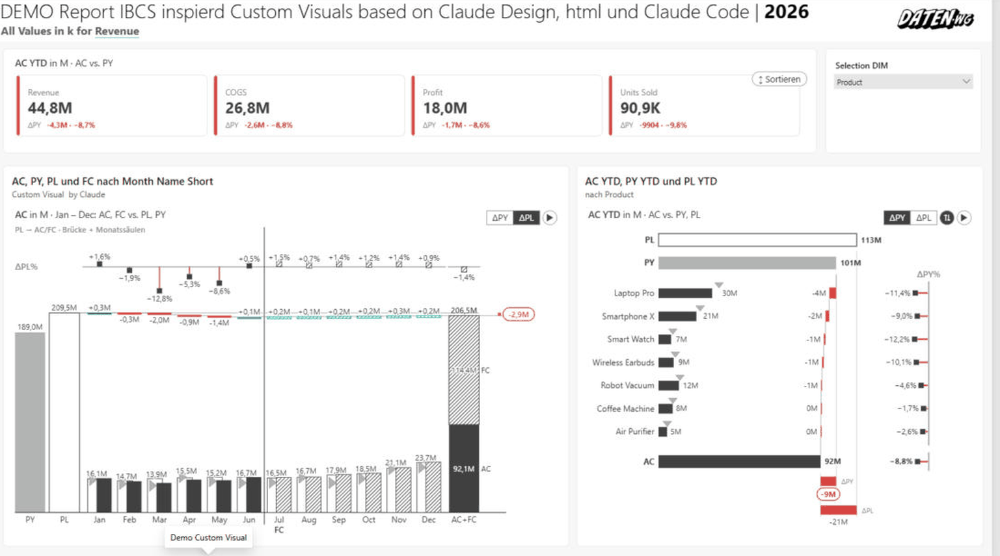

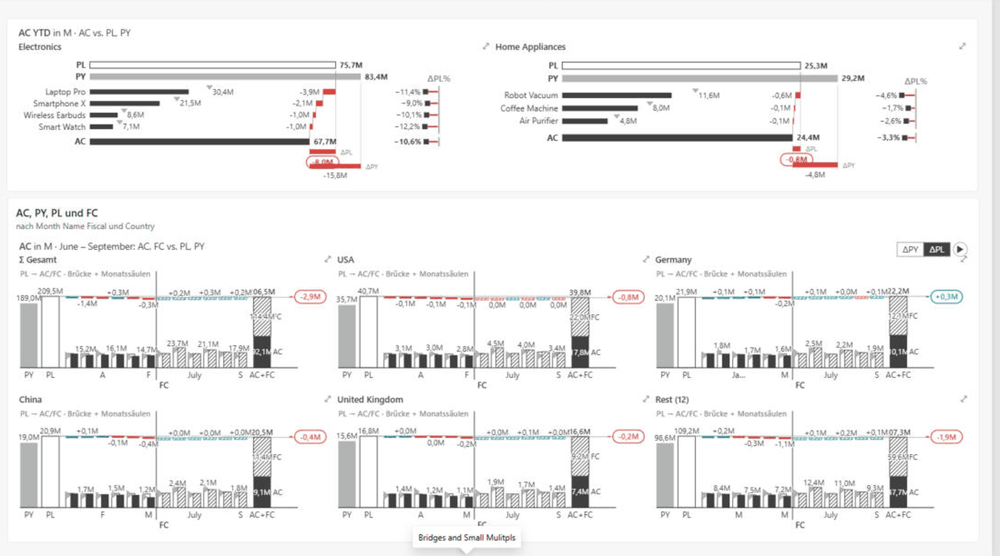

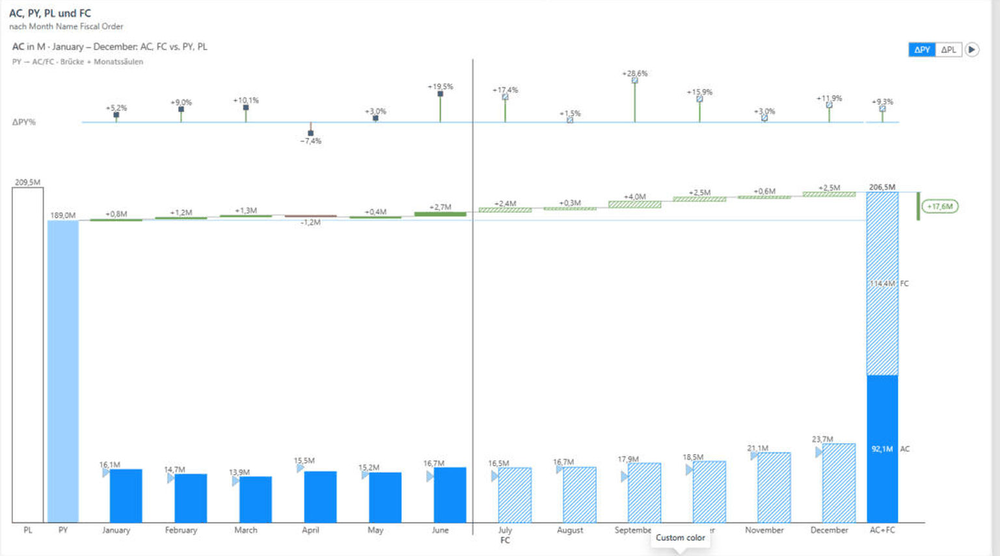

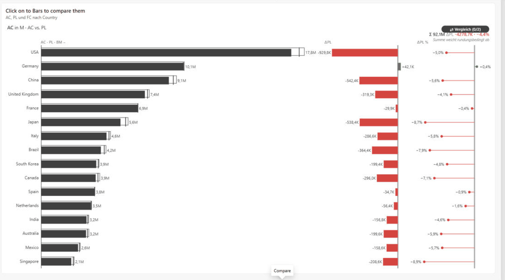

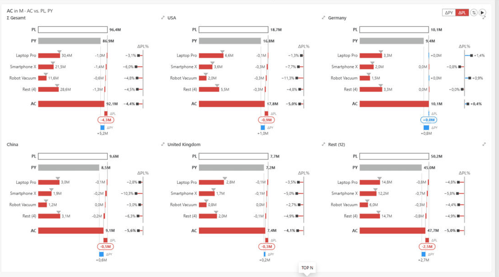

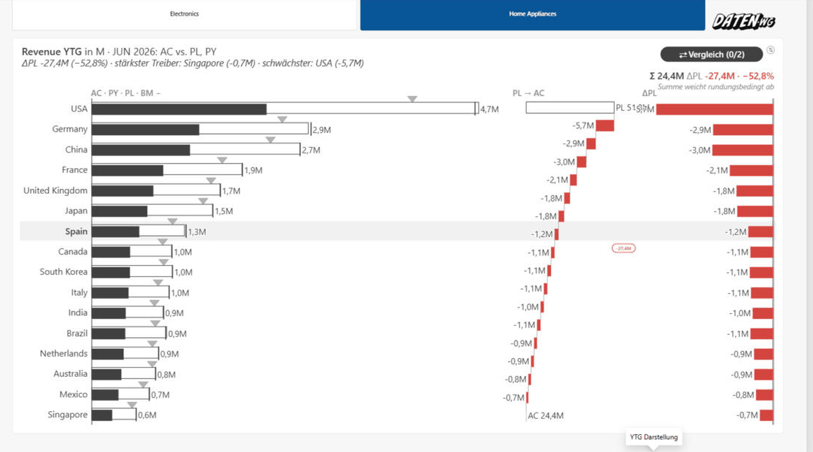

## 07 · Funktionen im Detail

### IBCS-Vorlagen C01–C13

Seit 1.49 bringt ChartKitchen die IBCS-Chart-Templates als **Presets** mit — dasselbe Muster wie die Tabellen-Templates im Schwester-Visual P&L Statement. Eine Vorlage ist nur ein Startpunkt: Sie setzt Chart-Typ, Vergleichsbasis, Abweichungs-Panels und die passenden Schalter in einem Speichervorgang, danach ist jede Einstellung frei änderbar.

1. Formatbereich → *Chart* → Gruppe *Chart-Typ* → *IBCS-Chart-Vorlage* (erste Position der Chart-Karte, Standard „Aus“) — oder ein Klick auf eine Kachel der Vorlagen-Galerie im Start-Hub (Kapitel 03).
2. Weicht danach eine Einstellung der Vorlage ab, erscheint im Bearbeitungsmodus unten links **„↺ Zum Template zurück“**: Ein Klick stellt den Vorlagen-Stand wieder her, alle übrigen Einstellungen bleiben.
3. Dieselbe Vorlage erneut anwenden: in der Galerie die aktive Kachel klicken — das Dropdown im Formatbereich kann einen bereits gewählten Eintrag nicht noch einmal melden.
4. C07 (Fläche) und C11 (Verteilung) gibt es im Visual nicht; sie fehlen deshalb in der Liste.

| Vorlage | Was sie setzt | Dazu binden |
| --- | --- | --- |
| C01 · Gestapelte Säulen | Säulen, Abweichungsbasis Auto, ohne Abweichungs-Panels | Stack-Serie |
| C02 · Gestapelte Balken | wie C01, als Balken | Stack-Serie |
| C03 · Säulen + Varianzen (PY) | Säulen, Basis Vorjahr, Abweichung absolut und in % | Vorjahr (PY) |
| C04 · Balken + Varianzen (PL) | Balken, Basis Plan, Abweichung absolut und in % | Plan (PL) |
| C05 · Integrierte Brücke | Integrierte Brücke, Basis Vorjahr, Abweichung absolut und in % | Vorjahr (PY) |
| C06 · Kategorie-Brücke vertikal | Kategorie-Brücke als Säulen-Kaskade, Basis Vorjahr | Vorjahr (PY) |
| C08 · Linie | Linie, Basis Auto, Abweichung absolut | — |
| C09 · Scatter | Scatter, Quadranten am Mittelwert, einfarbig | X-Achse (Scatter) |
| C10 · Bubble | wie C09, dazu die Größen-Legende | X-Achse + Blasengröße |
| C12 · Waterfall / Brücke | Wasserfall, Basis Auto, Abweichung absolut und in % | Waterfall-Typ empfohlen |
| C13 · Small Multiples | Σ-Gesamt-Kachel und gleiche Skala; der Chart-Typ bleibt | Small Multiples |

Für PBIR-Autoren: `chart.template` und die versteckte Property `chart.templateApplied` auf denselben Wert setzen — sonst wendet das Visual die Vorlage beim ersten Rendern an (Details im [AGENT-GUIDE](https://github.com/Losveratos/PowerBI-Kitchen-/blob/main/ibcsInspiredChartDeck/AGENT-GUIDE.md)).

### Szenarien, Forecast-Schraffur & Benchmark

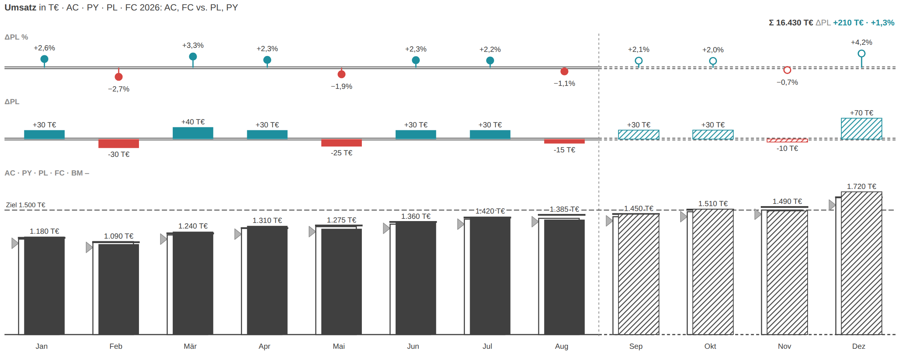

1. Binde AC, PY, PL und FC in die jeweiligen Feldrollen — alle vier erscheinen in einem Chart.
2. FC wird automatisch schraffiert gezeichnet. Alternativ zur FC-Measure kannst du eine 1/0-Spalte in die Rolle „Forecast-Flag“ binden.
3. Bei drei Szenarien (AC + PY + PL) zeigt IBCS PY als graues Dreieck an der Säule. Über Chart → „PY als Dreieck“ schaltest du das aus. In der Integrierten Brücke (C05) ist PY bei nur zwei Szenarien (AC&FC + PY) eine graue Säule.
4. Für einen Zielwert je Kategorie füllst du die Benchmark-Rolle — sie erscheint als Querstrich-Marker (Dreieck).
5. Eine feste Ziel- oder Schwellenlinie ziehst du stattdessen über Skala → Referenzlinie (Wert + Beschriftung).

### Small Multiples

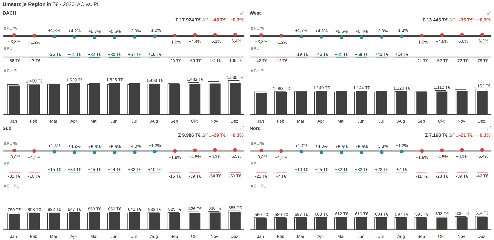

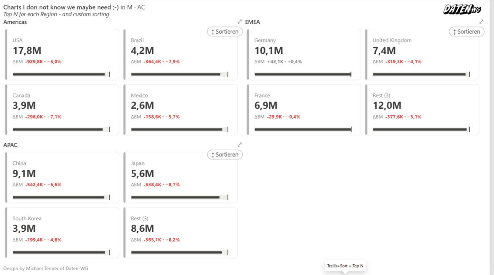

1. Ziehe ein Gruppierungsfeld (z. B. Region) in die Rolle „Small Multiples“. Das Visual zerlegt sich in eine Kachel je Gruppe auf gemeinsamer Skala (IBCS).
2. Unter Chart → Small Multiples steuerst du eine vorangestellte „Σ Gesamt“-Kachel, Top-N-Kacheln (der Rest wird zu „Rest“ aggregiert) und eine größere erste Kachel.
3. Für die Brücken-Modi (Integrierte/Kategorie-Brücke) erzwingst du mit „Brücken: gleiche Skala für alle Kacheln“ eine identische Skala; Säulen, Balken und Wasserfall teilen sie ohnehin.
4. Ein Klick auf das Zoom-Symbol einer Kachel vergrößert sie temporär. Seit 1.52 steht neben dem Gruppennamen, wie stark die Skala gegenüber der Übersicht vergrößert ist („Skala ×3,5 zur Übersicht“).

### Matrix: Spaltengruppen, Drill & horizontales Scrollen

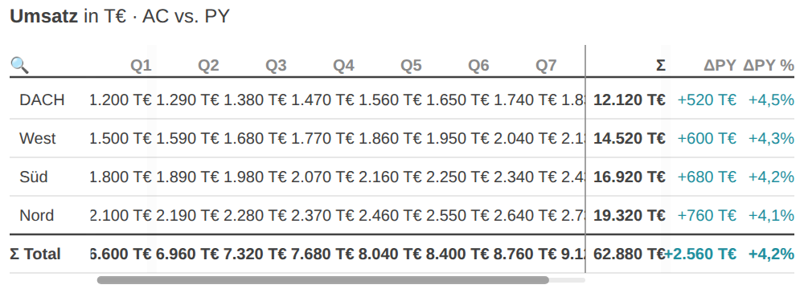

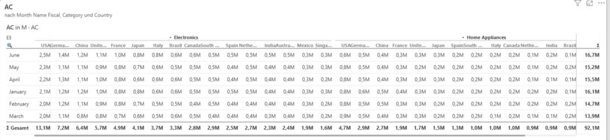

1. Fülle zusätzlich zur Kategorie die Rolle „Spalten (Matrix)“ mit bis zu zwei Ebenen (z. B. Quartal, Monat).
2. Spaltengruppen klappst du per Klick auf die Kopfzeile auf und zu; mit dem ⊞/⊟-Knopf im Kopf öffnest oder schließt du alle Spaltengruppen auf einmal, mit dem Doppelchevron alle Zeilen.
3. Wird die Matrix breiter als die Kachel, wird der Blockstreifen horizontal scrollbar (Shift + Mausrad oder der Scrollbalken unten). Namensspalte links und Σ-Block rechts bleiben fixiert.
4. Spaltenbreiten ziehst du am Griff an der rechten Kante; ein Doppelklick passt die Spalte an den längsten sichtbaren Inhalt an (Auto-Fit). Die Breiten werden im Bericht gespeichert.
5. Beim Export/Druck bleibt es beim „… +n“-Hinweis, da ein Standbild nicht scrollbar ist.

### Zwei-Zeilen-Kompaktmodus

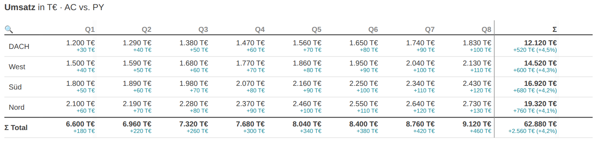

1. Unter Chart → Tabelle → „Zellen-Layout (Matrix)“ wählst du „Zwei Zeilen“: der Wert steht groß oben, die kleinere Δ-Zahl direkt darunter in derselben Zelle.
2. Die Matrix wird dadurch etwa halb so breit und passt oft ohne horizontales Scrollen.
3. Der Δ-Minibalken entfällt in diesem Layout; Werte-Spalten (AC · PY · PL) bleiben als eigene Spalten neben dem Wert erhalten.

### Werte-Spalten

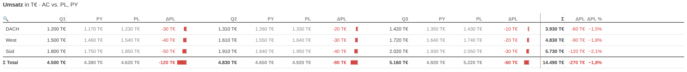

1. Unter Chart → Tabelle → „Werte-Spalten“ schaltest du zwischen „Nur AC“, „AC + Varianzbasis“ und „AC · PY · PL“.
2. Die bezifferten Referenzwerte stehen dann neben der ΔBasis-Balkenspalte und dem Σ-Block — für druck- und boardtaugliche Tabellen ohne Balken-Interpretation.

### Position der Σ-Zeile

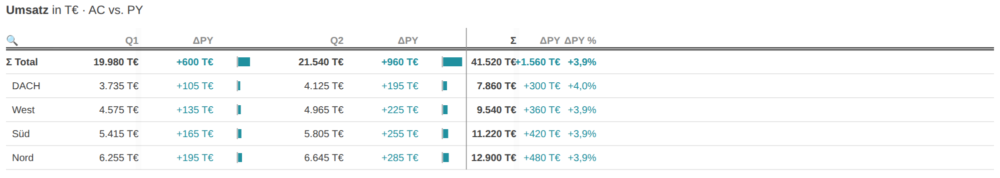

1. Unter Chart → Tabelle → „Position der Σ-Zeile“ wählst du „Oben“ (direkt unter dem Kopf, IBCS) oder „Unten“ (Standard, deutsche GuV-Lesart).
2. In beiden Fällen bleibt die Σ-Zeile beim vertikalen Scrollen fixiert.

### Tabellen-Komfort: Zebra, Gitter, Dichte, Suche, Sortierung

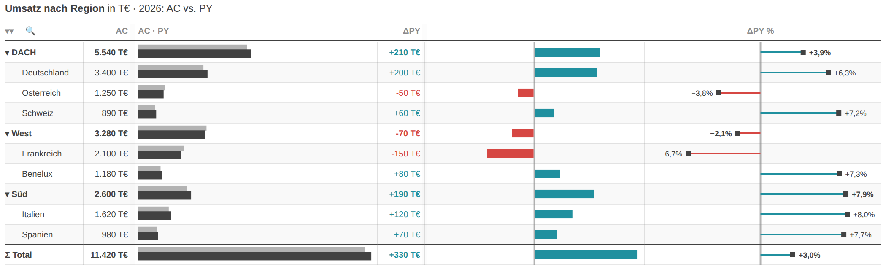

1. Unter Chart → Tabelle stellst du Zebra-Streifen, Zeilenhöhe (kompakt/normal/luftig) und Gitterlinien (horizontal/keine/beide) ein.
2. Mit einem zweiten Kategorie-Feld entsteht eine Hierarchie (z. B. Region → Land): per Chevron klappst du einzelne Zeilen auf, mit dem Doppelchevron ⇕ im Kopf alle.
3. Über das Lupen-Symbol durchsuchst du die Zeilennamen; ein Klick auf eine Spaltenüberschrift sortiert nach dieser Spalte (erneut: aufsteigend / aus).

### GuV-Statement & Zeilentypen

1. Im Modus „GuV-Statement“ (oder Wasserfall) legst du über die Rolle „Waterfall-Typ“ je Zeile fest: „sum“ = Zwischensumme, „delta“ = Bewegung.
2. Ohne diese Rolle strukturierst du per Listen in Chart → Tabelle: Ergebniszeilen (fett, Anker), Zeilen aus Summen ausnehmen, ausblenden, einrücken (davon), Grafik nur für gelistete Zeilen.
3. Formelzeilen (z. B. „Marge = EBIT / Umsatz“) und Zahlenformate pro Zeile (z. B. „Marge = 0,0 %“) ergänzen berechnete bzw. gemischte €-/%-/Stück-Zeilen.
4. Der Struktur-Modus (Chart → Tabelle → „Zeilen-Struktur bearbeiten“) setzt diese Eigenschaften per Klick auf eine Zeile; die Wahl wird in den Listen persistiert.

### Kommentare

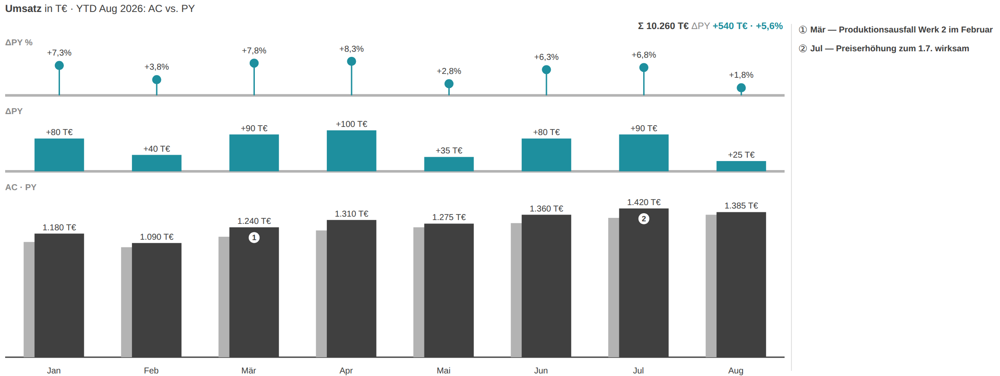

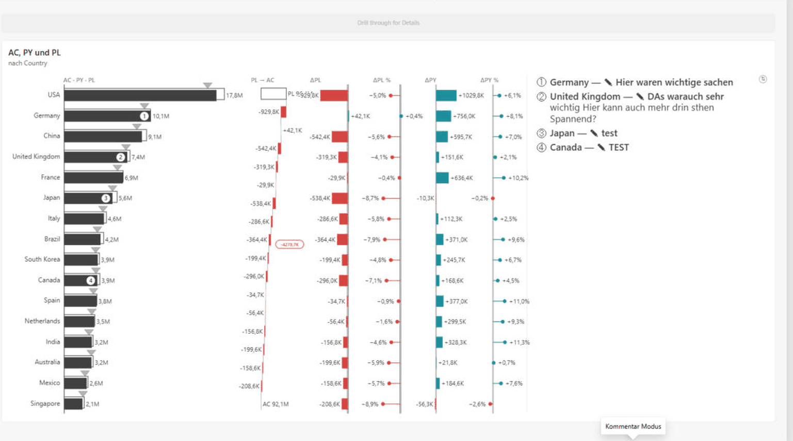

1. Binde eine Text-Measure in die Rolle „Kommentare“ — Kategorien mit Text bekommen einen nummerierten Marker ① ②, die Liste steht rechts neben dem Chart und bleibt im Export sichtbar.
2. Alternativ aktivierst du unter Kommentare → „Kommentare im Chart erfassen“ den Kommentar-Modus: ein Klick auf eine Kategorie öffnet ein Eingabefeld, der Text wird im Bericht gespeichert (bookmark-fähig, wandert mit der PBIX).
3. Kommentarliste ein-/ausblenden und die Schriftgröße stellst du in derselben Karte „Kommentare“ ein.

### Finance-Format

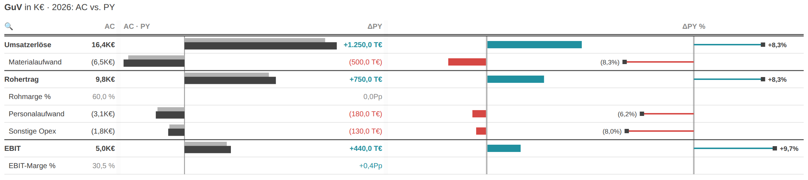

1. Unter Datenbeschriftungen → „Finance-Format (Klammern)“ werden negative Werte in Klammern statt mit Minuszeichen dargestellt — (1.234) — und Null als „–“.
2. Das gilt für Wert- und Δ-Beschriftungen inklusive Δ % und passt zu den GuV-Zeilentypen Summe, Delta und Marge.

### IBCS-Titel, Fußzeilen & Beschriftungen

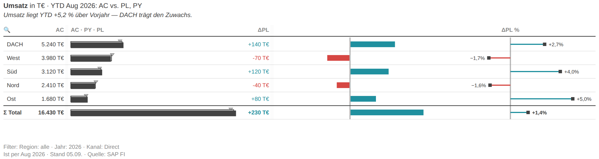

1. Der IBCS-Titel („KPI · Einheit · Zeitraum: Szenarien“) entsteht automatisch; KPI-Name und Zeitraum überschreibst du in der Karte „IBCS-Titel“. Seit 1.52.1 nennt er die Einheit einmal in Langform („in Mio. EUR“) und hängt kein Szenario-Suffix an, wenn der Zeitraum schon Szenariokürzel nennt (Abschnitt „Skalierung nach IBCS 2.0 / ISO 24896“).
2. Eine Botschaftszeile (IBCS: SAY) trägst du oben ein oder lässt sie über „Automatische Botschaft“ aus Gesamtabweichung und größten Treibern erzeugen.
3. Zwei Fußzeilen sind möglich: „Fußzeile (Datenstand · Quelle)“ unten links und die Filter-Fußzeile mit der gebundenen Filter-Info-Measure plus dem Anzeige-Zustand (YTD, Top-N, Sortierung …).
4. Alle Schriften skalierst du zentral über Datenbeschriftungen → Größen-Preset (Kompakt/Full HD/Präsentation — im Start-Hub als HD · Full HD · UHD) und den Faktor „Alle Beschriftungen skalieren %“; die Beschriftungs-Dichte steuert das Ausdünnen.

### Monitoring-Karten (Ampel & Bullet)

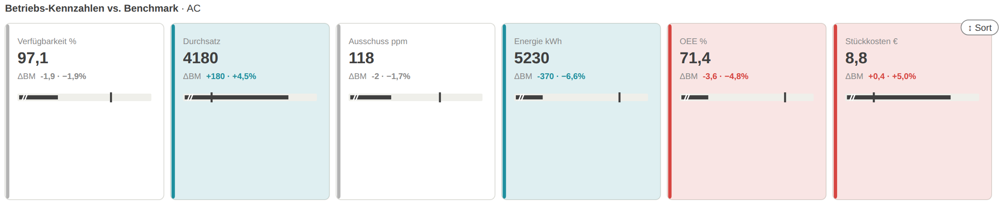

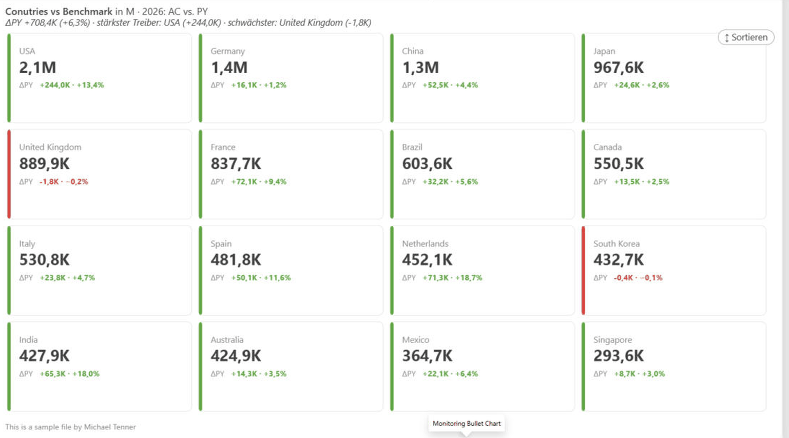

1. Im KPI-Karten-Modus steuerst du unter Chart → KPI-Karten die Status-Basis: gegen die Abweichungsbasis (ΔPL/ΔPY) oder gegen die gebundene Benchmark-Measure.
2. Die Hintergrund-Färbung (Ampel) samt Intensität und die Highlight-Richtung (beide / nur schlecht / nur gut) bewerten AC gegen diese Basis.
3. Das Bullet gegen die Benchmark (optional mit Zoom auf den Zielbereich) und die Mini-Brücke zeigst du je nach Bedarf; mit „Karten: gleiche Skala“ teilen alle Mini-Brücken einen Maßstab; sortieren kannst du nach Abweichung (größte oben-links).
4. Für die Benchmark-Bewertung muss die Benchmark-Rolle gefüllt sein.

### Trend-Karten: KPI-Karten mit Zeitreihe

1. Ziehe zusätzlich zur Kategorie ein Zeitfeld in die Rolle „Trend (Zeit)“ — jede KPI-Karte wird zur Serie (seit 1.47).
2. Unter Chart → KPI-Karten wählst du das Mini-Chart: Sparkline (mit PY-Geisterlinie, FC gestrichelt, letzter Ist-Punkt beschriftet) oder nullbasierte Säulen (Negative unter der Nulllinie, FC schraffiert) — oder Aus.
3. Der Kartenwert zeigt „Letzter Wert“ (Standard — Δ-Zeilen und Ampel beziehen sich konsistent auf dieselbe Periode) oder „Summe“.
4. Ohne Trend-Feld bleibt alles exakt wie bisher; andere Modi ignorieren die Rolle (die Zeilen werden re-aggregiert).

### Dark Mode (Erscheinungsbild)

1. Unter IBCS-Farben → „Erscheinungsbild“ wählst du Auto · Hell · Dunkel (seit 1.43). „Auto“ erkennt dunkle Berichts-Themes an der Luminanz der Theme-Hintergrundfarbe; für manuell dunkel eingefärbte Seiten ohne dunkles Theme gibt es „Dunkel“ als expliziten Schalter.
2. Im Dark Mode wechseln Tinte, Papier und Sekundärgrau auf helle Töne; Halos und hohle Marker füllen mit dem dunklen Seitenhintergrund, damit sie mit der Seite verschmelzen.
3. Farbwähler, die noch auf ihrem hellen Standard stehen (AC/PL, PY, Gut, Schlecht), werden automatisch durch die helle Entsprechung ersetzt — selbst gewählte Farben bleiben unangetastet. Auch das Blau/Orange-Preset hellt analog auf.
4. Start-Hub, Demo-Galerie und HTML-Overlays (Zeilensuche, Struktur-Menü, Kommentar-Editor) folgen dem Erscheinungsbild; der Hochkontrast-Modus bleibt ein eigener Pfad.
5. Seit 1.44 zeichnet das Visual im Dark Mode auch den Hover-Tooltip selbst: dunkler Kasten, helle Schrift, Kategorie als Header — im hellen Modus bleibt der native Power-BI-Tooltip.

### Große Datenmengen: Nachladen bis 30.000 Zeilen

1. Power BI liefert einem Visual die Daten in Fenstern zu 1.000 Kategoriezeilen. Bis 1.48 blieb es still beim ersten Fenster; seit 1.49 lädt ChartKitchen die weiteren Segmente nach.
2. Während des Ladens steht unten rechts dezent „⏳ n Zeilen geladen …“. Gezeichnet wird zuerst das erste Fenster und, sobald alles da ist, einmal der vollständige Bestand.
3. Verweigert Power BI weitere Segmente (Speichergrenze des Hosts, rund 100 MB) oder greift die Sicherheitsgrenze von 30.000 Kategoriezeilen, sagt ein Hinweis im Chart, dass die Daten unvollständig sind — eine stille Kappung gibt es nicht mehr.
4. Bis 1.000 Zeilen ändert sich nichts.

### Gesperrte statt stummer Chips

1. Knöpfe im Chart, die im aktuellen Zustand nichts bewirken würden, sind seit 1.49 gedimmt und nicht klickbar; der Tooltip nennt den Grund. Ein Klick darauf speichert nichts.
2. Typische Fälle: YTD auf GuV-Zeilen oder bei nur einer Periode · ⇅, wenn die Reihenfolge schon der Wirkungs-Sortierung entspricht · ⚠, wenn nichts zu verdichten ist (z. B. Benchmark-Karten ohne ΔPY/ΔPL) · die Karten-Sortierung ohne Vergleichswert · ▶, ⇅ und ΔPY|ΔPL einer Brücke, die nur ihren Hinweis zeigt.
3. Das P&L Statement sperrt seine Toolbar-Knöpfe nach derselben Regel.

### Hochkontrast: Muster statt Farbe

1. Im Windows-Hochkontrastmodus übernimmt ChartKitchen seit 1.49 die Farben der Host-Palette — Vordergrund, Hintergrund und `foregroundSelected` für Hervorhebung und Hover.
2. Der Status steckt dann im Muster statt in der Farbe: gut gefüllt, schlecht hohl, unwesentlich gestrichelt — auch in den KPI-Karten (Statusstreifen, Mini-Brücke) und im Scatter-Status. Die PY-Linie im Linienmodus ist gestrichelt.
3. Start-Hub und Feld-Intro nutzen dieselbe Palette. Ohne Hochkontrast bleibt alles unverändert.

### Leer-Zustand: Start-Hub, Demo, Feld-Intro oder eigene Nachricht

1. In der Karte *Leer-Zustand* legt „Leer-Zustand im Bearbeitungsmodus“ fest, was du als Autor siehst, solange keine Daten dargestellt werden: **Start-Hub** (Standard seit 1.50, Kapitel 03) · **Demo-Galerie** (Chart-Typ wählen, das Verhalten bis 1.49) · **Feld-Intro** (welches Feld wohin, ✓ an gebundenen Rollen) · **Eigene Nachricht** (Titel und Text darunter).
2. Feld-Intro und eigene Nachricht tragen Umschalt-Knöpfe, darunter „☰ Start-Hub“; ein Klick darauf speichert den gewählten Modus.
3. Eigener Titel und eigener Text (seit 1.44) ersetzen das „ChartKitchen byDatenWG“-Branding, wenn keine Daten dargestellt werden (Felder leer oder Auswahl ohne Zeilen).
4. Leser und Exporte sehen nie Hub, Galerie oder Knöpfe, sondern seit 1.51.1 die ruhige Landing-Karte — mit deinem Titel und Text, falls gesetzt.

### Skalierung nach IBCS 2.0 / ISO 24896

Seit 1.52 skaliert ChartKitchen in allen Chart-Typen nach IBCS 2.0 / ISO 24896: eine Einheit, eine Skala über alle Panels einer Grafik, sonst ein sichtbarer Faktor. IBCS dient dabei als Bezug, das Visual ist nicht zertifiziert.

> **Bestehende Berichte ändern ihr Bild.** Das ist gewollt und nicht abschaltbar: Δ-Panels werden flacher, weil sie die wahre Größe der Abweichung zeigen, Säulen und Balken etwas breiter, Δ-Zahlen kürzer. Seiten mit festen Erwartungen an Panel-Höhen (Screenshots, Abo-PDFs) nach dem Update neu ansehen.

1. **Δ in der Skala der Basis.** Absolute Δ-Panels (ΔPY, ΔPL, Doppel-Varianz, die ΔPY-Stufe über dem GuV-Wasserfall) zeichnen im selben Maßstab (px je Einheit) wie das Basis-Chart. Ihre Höhe bei Säulen bzw. Breite bei Balken ergibt sich aus der Δ-Spanne plus Platz für die Beschriftung; feste Höhenanteile gibt es nicht mehr. Ebenso laufen die Δ-Balken der Tabelle im Maßstab der AC·PY-Balkenspalte und die Δ-Spalte des GuV-Statements im Maßstab der Kaskade. Δ%-Pins behalten eine eigene Skala, weil sie eine andere Einheit zeigen.
2. **Lupe statt stiller Vergrößerung.** Wäre die größte Abweichung im Basismaßstab zu klein zum Lesen, vergrößert das Visual das Δ-Panel um einen runden Faktor (2, 4, 5, 10, 20 …) und weist ihn aus: Titel „ΔPY ×4“ und ein hellblaues Skalenband auf derselben Zahl in Basis- und Δ-Panel. Tabelle und GuV-Statement nennen einen Faktor im Spaltenkopf („×0,5“, „×4“), das Brücken-Panel von Säulen/Balken mit Wasserfall-Brücke im Titel („PL → AC ×0,025“). Unmarkiert wird nichts vergrößert.
3. **Breiten.** Säulen und Balken für absolute Werte nehmen 2/3 der Kategorie ein, in allen Modi mit Slots (Säulen, Balken, Brücken-Panel, Wasserfall, Kategorie-Brücke senkrecht, Pareto, gestapelt). Δ-Säulen unter einer Linie sind so breit wie der Slot.
4. **Höchstens drei Ziffern.** Zahlen in Grafiken haben höchstens drei Ziffern, gezählt nach dem Runden („161,8K“ wird „162K“, „99,96“ wird „100“). Die größte Abweichung bestimmt die Nachkommastellen der Δ-Beschriftungen; kleine Werte, die sonst auf null fielen, bekommen Stellen dazu („+0,04M“). Werte unter der Darstellungsgrenze zeigen „0“ ohne Einheit und Vorzeichen, negative Δ das echte Minus. KPI-Karten derselben Einheit geben Wert und Δ dieselben Dezimalen. Tabelle und GuV-Statement behalten ihre Dezimalen. Mit „Σ-treue Rundung der Beschriftungen“ gilt eine Präzision für Beschriftungen und Σ, damit die Summe aufgeht.
5. **Gleiche Skala über Small Multiples und Karten.** Small Multiples teilen Wertebereich und Lupenfaktor. Der ⤢-Zoom einer Kachel nennt neben dem Gruppennamen seinen Maßstab gegenüber der Übersicht („Skala ×3,5 zur Übersicht“), die Δ-Panels folgen der vergrößerten Basis. Für KPI-Karten schaltet Chart → KPI-Karten → „Karten: gleiche Skala“ (`chart.cardSameScale`, seit 1.51.2, Standard aus) einen gemeinsamen Maßstab für alle Mini-Brücken ein: gleiche Beträge ergeben gleich hohe Balken. Gedacht für Karten derselben Kennzahl je Kategorie, bei verschiedenen Einheiten aus lassen.
6. **Integrierte Brücke (C05).** Anker, Brückensteine und Monatspaare sind gleich breit (2/3 der Kategorie), die Monatssäulen stehen auf der Ankerskala. Nur wenn sie in die Kaskade ragen oder unlesbar klein wären, bekommen sie einen runden Faktor, ausgewiesen als „Monatssäulen ×0,5“ in der Überschrift plus Skalenband. Die Brückenstufen zeichnen in echter Höhe mit einer 1-px-Haarlinie darunter, eine Mindesthöhe gibt es nicht mehr. Bei AC&FC und PY (zwei Szenarien) ist PY eine graue, versetzte Säule wie in C03; das PY-Dreieck erscheint nur beim dritten Szenario (AC + PY + PL).
7. **Gekürzte Brückenanker.** Chart → Brücke → „Anker kürzen (Achsenbruch)“ (`chart.bridgeBreak`, Standard aus) kürzt die Summen-Anker mit sichtbarem ⫽, die Stufen laufen darüber in einer linearen Skala und werden lesbar hoch. C05: Monatssäulen im unteren Band mit ausgewiesenem Faktor, der Schnitt steht im Titel („Achse ab 45,0M geschnitten“). C06 senkrecht: Anker PY, PL und AC mit ⫽. C12: schaltet den Achsenschnitt unter Skala → Wasserfall-Achse ein, solange dieser auf „Aus“ steht. Gekürzt wird nur, wenn alle Stände über dem Schnitt liegen; Small Multiples mit gleicher Skala bleiben nullbasiert.
8. **Einheit einmal im Titel.** Der Titel nennt Größenordnung und Einheit in Langform („Nettoumsatz in Mio. EUR je Kanal“, „in Tsd. hl“), nie „M“ oder „K“. Steht keine Einheit im Kennzahlnamen, ergänzt das Visual sie aus dem Formatstring. Scatter und Bubble tragen die Einheiten an den Achsentiteln. Schaltest du Datenbeschriftungen → „Einheit an jeder Beschriftung“ aus (`labels.unitSuffix`, Standard an), zeigen die Beschriftungen nur die Zahl („18,5“), und KPI-Karten nehmen eine gemeinsame Einheit für alle Karten. Die Abkürzung bleibt „K“ wie in Power BI.
9. **Szenario-Suffix ohne Dopplung.** Nennt der Zeitraum in der Karte IBCS-Titel schon Szenariokürzel (AC, PY, PL, BU, FC), hängt das Visual nichts an. Sonst bildet es den Suffix aus Abweichungsbasis und gebundenen Rollen; der Ist-Wert heißt „AC&FC“, wenn ein Forecast-Anteil gezeigt wird. Wasserfall, Kategorie-Brücke, Pareto, Dumbbell und Slope nennen nur die Basis.
10. **Linien-Notation (C08).** Alle absoluten Linien haben dieselbe Stärke: AC dunkel durchgezogen, PY hellgrau durchgezogen, PL hohl (Rand mit hellem Kern), nur FC gestrichelt. Die AC-Beschriftung steht über dem Punkt, wenn AC oben liegt, und darunter, wenn AC unten liegt.
11. **Stapellegende am Stapel.** Bei gestapelten Säulen und Balken (C01/C02) stehen die Seriennamen direkt am Stapel: bei Säulen rechts neben der letzten Säule, bei Balken über dem ersten Balken. Passen sie nicht (Serie fehlt dort, Überlappung, negative Segmente, Small Multiples), bleibt der Schlüssel oben. Schalter: Chart → Darstellung → „Stapellegende am Stapel“ (`chart.stackLegendDirect`, Standard an). Ein Stapel aus nur einem beschrifteten Segment zeigt den Wert einmal.
12. **Bedienmenü ☰.** Chart → Interaktion im Bericht → „Bedienleisten einklappen (☰)“ (`chart.chipMenu`, Standard aus) legt die Bedienelemente im Chart (Sortieren ⇅, YTD, ⫽ Achse, ΔPY|ΔPL, ▶, Ausnahme-Chip, Modus-Chips, Karten-Sortierung, Scatter-Play, GuV-Ansicht) hinter ein kleines ☰ oben rechts. Ein Klick klappt sie auf, ✕ wieder zu; gespeichert wird nichts. Aus: alles wie bisher sichtbar.

### Skalierungs-Garantien & Achsenschnitt (Wasserfall)

1. Seit 1.45 gelten harte Skalen-Garantien: ΔPY- und ΔPL-Panels teilen EINE Skala (absolut und %), Brücken nehmen alle Kaskaden-Zwischenstände in die Skala, gestapelte Small Multiples teilen eine gemeinsame Skala, und Werte wie Varianzen nutzen EINEN Einheitenmaßstab — kein „K€ neben T€“ mehr. Formate mit eigenem Präfix („#,0 T€“, „Mio €“) schalten die Auto-Einheit ab.
2. „Skalen-Mindest-Maximum“ und die Ausreißer-Kappung wirken jetzt auch im Wasserfall; der ⫽-Marker sitzt an jedem gekappten Element (PY, PL, BM, Linie).
3. Δ% zeigt „n.a.“ bei Basis 0 oder Vorzeichenwechsel zwischen Basis und Ist — statt irreführender Werte wie „−250 %“. GuV-Kostenzeilen mit durchgängig negativer Basis behalten ihre Prozente.
4. Achsenschnitt im Wasserfall (IBCS UN 5.3, seit 1.45): Unter Skala → „Wasserfall-Achse“ stellst du den Schnitt auf Aus · Auto · An; geschnitten wird nur, wenn alle Anker und Deltas vollständig über dem Schnitt liegen. Anker werden zu Stummeln mit ⫽ über die volle Balkenbreite; Titel-Suffix und Export-Fußzeile weisen den Schnitt aus, Small Multiples teilen EINEN Schnitt. Für Integrierte Brücke und senkrechte Kategorie-Brücke gibt es seit 1.52.1 „Anker kürzen (Achsenbruch)“ unter Chart → Brücke.
5. Alternativ klickst du den In-Chart-Chip „⫽ Achse“: Er schaltet den Schnitt an/aus, hebt sich bei Auto-Vorschlag hervor und ist bei unzulässigem Schnitt deaktiviert — der Tooltip nennt den Grund bzw. die blockierende Kachel.

### Cross-Filter, Tooltips & Bookmarks

1. Ein Klick auf eine Kategorie filtert die übrigen Visuals der Seite (Cross-Filter). Ausnahmen: solange Kommentar-, Vergleich- oder Struktur-Modus aktiv sind, filtern Klicks nicht quer.
2. In der Gegenrichtung gilt seit 1.46: Eine Auswahl in einem anderen Visual **filtert** ChartKitchen immer — die Wechselwirkung „Hervorheben“ bietet Power BI für dieses Visual gar nicht mehr an. Σ-Kopf und Skalen rechnen damit bei Cross-Interaktion konsistent auf dem gefilterten Datenbestand; die eigene Selektion im Visual (Klick, Strg = Mehrfachauswahl) dimmt weiterhin lokal.
3. Im Scatter/Bubble-Modus gibt es seit 1.48 zusätzlich die Rechteck-Auswahl: Ziehst du auf leerer Plotfläche ein Rechteck auf, werden alle enthaltenen Punkte als EINE Mehrfachauswahl selektiert und filtern die übrigen Visuals (Crossfilter). Ein Klick auf leere Fläche setzt die Auswahl wie bisher zurück.
4. Beim Überfahren zeigen Standard- und Canvas-Tooltips Werte, Abweichungen, Serie und Kommentar; Canvas-Tooltips (Report-Page-Tooltips) werden unterstützt. Im Dark Mode zeichnet das Visual den Hover-Tooltip selbst (dunkler Kasten mit Kategorie-Header).
5. Interaktive Zustände sind bookmark-fähig: die Varianz-Basis, die YTD-Sicht, die In-Chart-Sortierung, aufgeklappte Zeilen/Spalten, erfasste Kommentare und Spaltenbreiten wandern mit dem Bericht bzw. dem Lesezeichen.
6. Seit 1.49 stellen Lesezeichen auch die **Auswahl** wieder her: Ein Lesezeichen mit ausgewählten Kategorien (ebenso eine Auswahl, die ein anderes Visual setzt) dimmt die übrigen Marken wie nach einem Klick; ein Lesezeichen ohne Auswahl hebt die Dimmung auf.

## 08 · Einstellungs-Referenz

Die folgenden Darstellungen zeigen Aufbau und Reihenfolge des Formatbereichs (Schema — Benennung wie in Power BI). Jede Karte und Untergruppe erscheint als schematische Skizze neben ihrer Einstellungstabelle, sodass du Schalter und Auswahlfelder direkt im Pane wiederfindest.

Seit 1.45 führt der Formatbereich nach Arbeitslogik: Die Chart-Karte steht an Position 1, „Ausrichtung“ heißt jetzt „Chart-Typ“, und die Kartenreihenfolge ist Chart → IBCS-Titel → Datenbeschriftungen → Kategorienachse → IBCS-Farben → Skala & Referenzlinie → Kommentare → Leer-Zustand. Die Skizzen zeigen die Karten schematisch (Stand vor dem Panel-Umbau); alle Einstellungsnamen und -wirkungen sind unverändert.

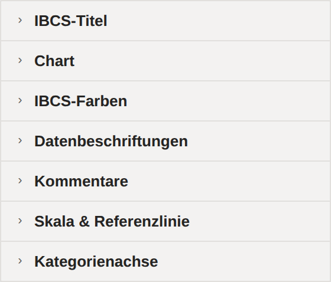

> Die folgenden Tabellen listen alle Einstellungen des Formatbereichs, gegliedert nach Karten und Gruppen. Seit 1.45 ist die Chart-Karte neu gruppiert (Chart-Typ · Vergleich & Abweichung · Daten & Zeit · Interaktion im Bericht · Darstellung · Small Multiples · Brücke · Tabelle · KPI-Karten) — eine reine Anzeige-Umsortierung, Namen und Wirkung der Einstellungen sind unverändert. Die Karte „Chart“ bündelt die meisten Einstellungen; viele wirken nur in bestimmten Modi (z. B. die Gruppen „Tabelle“, „Small Multiples“, „Brücke“, „KPI-Karten“).

### Chart

#### Layout

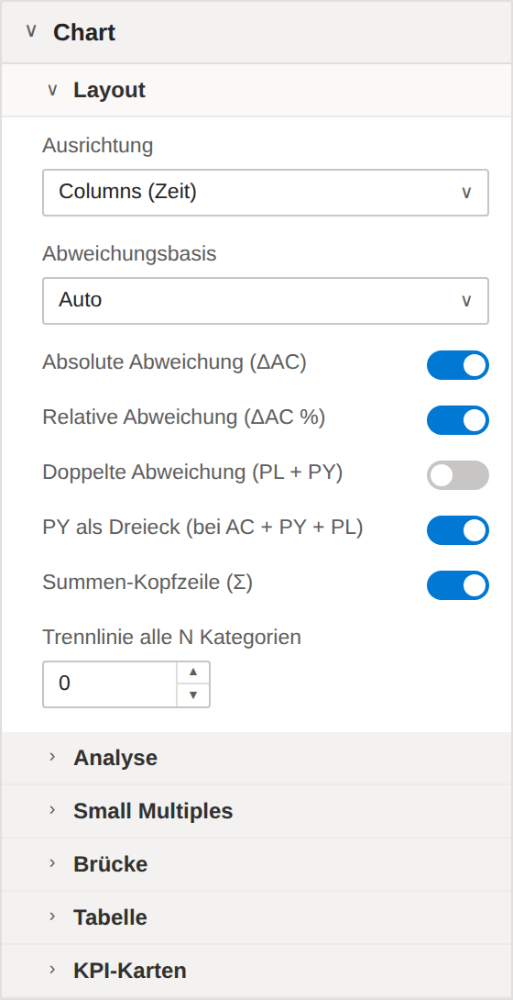

| Einstellung | Beschreibung | Optionen / Standard |
| --- | --- | --- |
| IBCS-Chart-Vorlage | Seit 1.49, erste Position der Chart-Karte (Gruppe Chart-Typ): Startpunkt nach den IBCS-Chart-Templates — setzt Chart-Typ, Vergleichsbasis, Abweichungs-Panels und die passenden Schalter in einem Schritt, danach ist jede Einstellung frei änderbar. C01/C02 stapeln über das Feld „Stack-Serie“, C10 braucht zusätzlich „Blasengröße“, C13 behält den Chart-Typ und braucht „Small Multiples“. Nicht enthalten: C07 (Fläche) und C11. | Optionen: Aus (keine Vorlage) \| C01 · Gestapelte Säulen (Serie) \| C02 · Gestapelte Balken (Serie) \| C03 · Säulen + Varianzen (PY) \| C04 · Balken + Varianzen (PL) \| C05 · Integrierte Brücke (Zeit) \| C06 · Kategorie-Brücke vertikal \| C08 · Linie (lange Zeitreihe) \| C09 · Scatter \| C10 · Bubble (Scatter + Größe) \| C12 · Waterfall / Brücke \| C13 · Small Multiples · Standard „Aus (keine Vorlage)“ |
| Chart-Typ | Der Diagramm-Modus — hieß bis 1.45 „Ausrichtung“ und steht seitdem ganz oben in der ersten Karte des Formatbereichs. | Optionen: Columns (Zeit) \| Bars (Struktur) \| Line (Zeit, viele Punkte) \| Waterfall / Brücke \| Integrierte Brücke (Zeit) \| Kategorie-Brücke (Struktur) \| Tabelle (IBCS) \| Pareto (Struktur) \| Dumbbell (Struktur) \| Slope · Vorher/Nachher \| KPI-Karten (Kacheln) \| GuV-Statement (IBCS) \| Scatter / Bubble (Korrelation) · Standard „Columns (Zeit)“ |
| Smart-Start-Vorschläge | Zeigt einen dezenten Vorschlags-Chip oben links im Chart, wenn die gebundenen Felder eindeutig auf einen passenderen Modus hindeuten (z. B. Datum + AC + PL → Säulen mit ΔPL). Nur im Bearbeitungsmodus sichtbar, nie in der Leseansicht oder in Exporten. | An / Aus · Standard An |
| Abweichungsbasis | Basis für die Abweichungs-Panels. Auto: PL wenn vorhanden, sonst PY. | Optionen: Auto \| Vorjahr (PY) \| Plan (PL) \| FC Vormonat (Revision) · Standard „Auto“ |
| Absolute Abweichung (ΔAC) | — | An / Aus · Standard An |
| Relative Abweichung (ΔAC %) | — | An / Aus · Standard An |
| Doppelte Abweichung (PL + PY) | Zeigt zusätzlich die Abweichungs-Panels zur zweiten Basis — ΔPL und ΔPY gleichzeitig (benötigt PY und PL). | An / Aus · Standard Aus |
| PY als Dreieck (bei AC + PY + PL) | IBCS-Notation bei drei Szenarien: Sind AC, PY und PL gebunden, wird das Vorjahr als graues Dreieck (▶) am Säulen-/Balkenrand auf PY-Höhe gezeigt statt als dritte Säule — weniger überladen. Aus = PY wieder als graue Säule. In der Integrierten Brücke (C05) erscheint das Dreieck seit 1.52 nur beim dritten Szenario; bei AC&FC + PY ist PY eine graue, versetzte Säule. | An / Aus · Standard An |
| Summen-Kopfzeile (Σ) | Zeigt Summe und Gesamtabweichung als Kopfzeile. | An / Aus · Standard An |
| Trennlinie alle N Kategorien | Zeichnet eine dünne Trennlinie nach jeweils N Kategorien, quer durch alle Panels — für Struktur-Vergleiche mit natürlichen Untergruppen (z. B. Regionen). 0 = aus. | 0–50 · Standard 0 |

#### Analyse

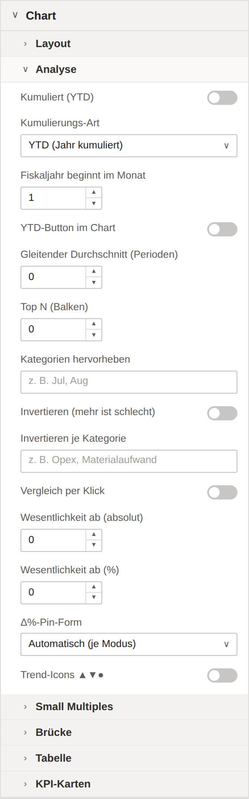

| Einstellung | Beschreibung | Optionen / Standard |
| --- | --- | --- |
| Kumuliert (YTD) | Schaltet alle Panels auf kumulierte Sicht: Säulen, ΔBasis und ΔBasis % zeigen Year-to-Date-Werte. | An / Aus · Standard Aus |
| Kumulierungs-Art | YTD setzt am Fiskaljahres-Beginn zurück, QTD an jedem Quartalsstart, R12 summiert rollierend die letzten 12 Perioden. Monats-Erkennung über die Kategorie-Labels (Jan…Dez, 01…12). | Optionen: YTD (Jahr kumuliert) \| QTD (Quartal kumuliert) \| R12 (rollierende 12 Perioden) · Standard „YTD (Jahr kumuliert)“ |
| Fiskaljahr beginnt im Monat | 1 = Januar … 12 = Dezember. Bestimmt, wo YTD/QTD zurücksetzen (z. B. 4 für ein Fiskaljahr ab April). | 1–12 · Standard 1 |
| YTD-Button im Chart | Zeigt einen klickbaren „YTD"-Button oben rechts im Chart (Columns/Line) — der Enduser schaltet die kumulierte Sicht direkt im Bericht um; die Wahl wird persistiert. Standard aus. | An / Aus · Standard Aus |
| Gleitender Durchschnitt (Perioden) | Dünne Overlay-Linie mit gleitendem Durchschnitt über N Perioden (Columns/Line). 0 = aus. | 0–24 · Standard 0 |
| Top N (Balken) | Struktur-Modi (Bars, Kategorie-Brücke, Tabelle, Dumbbell, KPI-Karten): zeigt die N größten Kategorien, der Rest wird aggregiert. 0 = alle. | 0–50 · Standard 0 |
| Kategorien hervorheben | Kommagetrennte Kategorie-Namen, die hervorgehoben werden (IBCS EMPHASIZE), z. B. der aktuelle Monat. | Freitext · z. B. Jul, Aug |
| Invertieren (mehr ist schlecht) | Für Kosten-KPIs: Mehrwert ist schlecht (rot), Minderwert ist gut (grün). | An / Aus · Standard Aus |
| Invertieren je Kategorie | Kommagetrennte Kategorien, deren Wertung umgekehrt wird (z. B. Kosten-Zeilen neben Umsatz-Zeilen in KPI-Karten oder der GuV-Tabelle). Wirkt zusätzlich zum globalen Invert-Schalter. | Freitext · z. B. Opex, Materialaufwand |
| Vergleich per Klick | Nur Columns/Bars: zwei Säulen/Balken anklicken zeigt die Differenz (absolut + %) als Overlay — Klicks filtern dann nicht mehr quer. Klick ins Leere setzt zurück. Standard aus. | An / Aus · Standard Aus |
| Wesentlichkeit ab (absolut) | Wesentlichkeits-Schwelle: Abweichungen unter diesem absoluten Betrag werden grau statt rot/grün dargestellt (Panels, Wasserfall-Stufen, Tabelle). 0 = aus. | ab 0 · Standard 0 |
| Wesentlichkeit ab (%) | Wesentlichkeits-Schwelle in Prozent: Abweichungen unter diesem Δ % werden grau dargestellt. Sind beide Schwellen gesetzt, muss eine Abweichung beide überschreiten, um farbig zu sein. 0 = aus. | 0–100 · Standard 0 |
| Δ%-Pin-Form | Form des Lollipop-Kopfes der Δ%-Pins. „Automatisch" behält den bisherigen Stil je Modus (Säulen/Balken/Wasserfall rund, Brücken und Tabelle quadratisch); „Rund" oder „Quadratisch" vereinheitlichen alle Modi. | Optionen: Automatisch (je Modus) \| Rund \| Quadratisch · Standard „Automatisch (je Modus)“ |
| Trend-Icons ▲▼● | Stellt den Δ-Werten in Tabelle und KPI-Karten Richtungspfeile voran: ▲ Anstieg, ▼ Rückgang, ● unwesentlich (unter der Materialitätsschwelle). Lesbar auch in Schwarzweiß-Druck und für Farbenblinde — die Farbe bewertet weiterhin gut/schlecht. | An / Aus · Standard Aus |
| Stapellegende am Stapel | Gruppe Darstellung, seit 1.52.1 (Property `chart.stackLegendDirect`): Gestapelte Säulen und Balken zeigen die Seriennamen direkt am Stapel (Säulen: rechts neben der letzten Säule, Balken: über dem ersten Balken) statt als Schlüssel oben. Passen sie nicht, bleibt der Schlüssel. Aus = immer Schlüssel oben. | An / Aus · Standard An |

#### Small Multiples

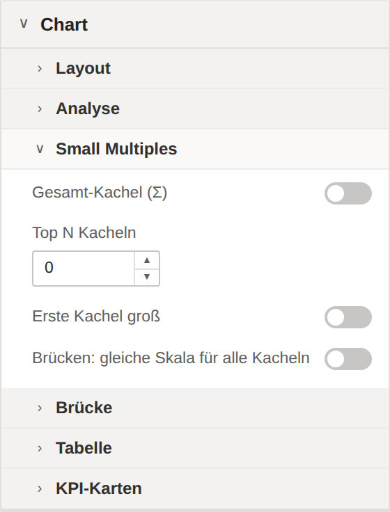

| Einstellung | Beschreibung | Optionen / Standard |
| --- | --- | --- |
| Gesamt-Kachel (Σ) | Stellt eine „Σ Gesamt"-Kachel voran — Summe über alle Gruppen, auf derselben Skala (IBCS). | An / Aus · Standard Aus |
| Top N Kacheln | Zeigt nur die N größten Gruppen (nach Summe AC) als Kacheln — die übrigen werden zu einer „Rest"-Kachel aggregiert. 0 = alle. | 0–24 · Standard 0 |
| Erste Kachel groß | Gibt der ersten Kachel (z. B. „Σ Gesamt" oder der größten Gruppe) mehr Platz — alle Kacheln behalten dieselbe Skala (IBCS CT 13). | An / Aus · Standard Aus |
| Brücken: gleiche Skala für alle Kacheln | Skaliert auch die Brücken-Modi (Integrierte Brücke, Kategorie-Brücke) über alle Kacheln identisch (IBCS). Standard: aus — jede Brücken-Kachel skaliert für sich. Säulen, Balken und Wasserfall teilen sich die Skala immer. | An / Aus · Standard Aus |

#### Brücke

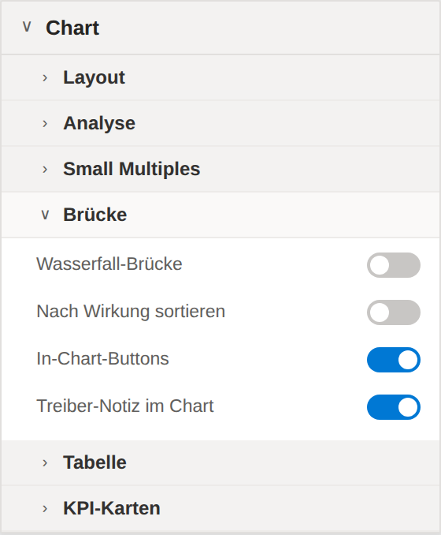

| Einstellung | Beschreibung | Optionen / Standard |
| --- | --- | --- |
| Wasserfall-Brücke | Nur Columns/Bars: zeigt die Kategorien als Wasserfall-Brücke von der Basis (PY/PL) zu AC mit Verbindungslinien, statt als einzelne Balken. Optional — Standard ist aus. | An / Aus · Standard Aus |
| Nach Wirkung sortieren | Nur bei Waterfall bridge: sortiert die Kategorien nach Abweichungsgröße (größter Treiber zuerst). Eine Top-N-Rest-Zeile bleibt am Ende. Auch per Klick auf das ⇅-Symbol im Chart umschaltbar. | An / Aus · Standard Aus |
| In-Chart-Buttons | Integrierte/Kategorie-Brücke: zeigt klickbare Buttons oben rechts im Chart — ΔPY/ΔPL-Referenz-Umschalter, ⇅ Sortierung und ▶ Aufbau-Animation. Der Enduser kann die Varianz-Basis direkt im Bericht wechseln; die Wahl wird persistiert. | An / Aus · Standard An |
| Bedienleisten einklappen (☰) | Gruppe Interaktion im Bericht, seit 1.52 (Property `chart.chipMenu`): Klappt die Bedienelemente im Chart (Sortieren ⇅, YTD, ⫽ Achse, ΔPY\|ΔPL, ▶, Ausnahme-Chip, Modus-Chips, Karten-Sortierung, Scatter-Play, GuV-Ansicht) hinter ein kleines ☰ oben rechts. Ein Klick klappt sie auf, ✕ wieder zu; gespeichert wird nichts. Aus: wie bisher immer sichtbar. | An / Aus · Standard Aus |
| Treiber-Notiz im Chart | Kategorie-Brücke: kursive Notiz am größten Treiber („größter Treiber · n % der Gesamtabweichung“) — überlagert den Zeilenbereich, hier abschaltbar. | An / Aus · Standard An |
| Brücke: Ausrichtung | Kategorie-Brücke (seit 1.47): „Automatisch“ wählt wie bisher, „Balken“ erzwingt die horizontale Brücke, „Säulen“ die vertikale Säulen-Kaskade (PY-Anker → Treiber → AC mit ΔBasis-Überleitung, Δ%-Pins oben). Hervorhebung, Treiber-Notiz, n.a.-Regel und Small-Multiples-Skala gelten auch dort. | Optionen: Automatisch \| Balken \| Säulen · Standard „Automatisch“ |
| Anker kürzen (Achsenbruch) | Seit 1.52.1 (Property `chart.bridgeBreak`): Integrierte Brücke, Kategorie-Brücke (Säulen) und Wasserfall kürzen die Summen-Anker mit sichtbarem ⫽, damit die Brückenstufen in echter Höhe lesbar werden; alle Stufen bleiben in einer linearen Skala. Gekürzt wird nur, wenn alle Stände über dem Schnitt liegen. Im Wasserfall schaltet die Option den Achsenschnitt (Skala → Wasserfall-Achse) ein, solange dieser auf „Aus“ steht. | An / Aus · Standard Aus |

#### Tabelle

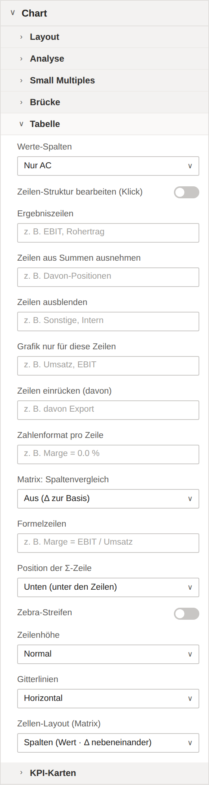

| Einstellung | Beschreibung | Optionen / Standard |
| --- | --- | --- |
| Werte-Spalten | Zusätzliche Zahlenspalten neben AC: die Varianzbasis (PY oder PL, je nach Abweichungsbasis) oder beide Referenzszenarien — für druck- und boardtaugliche Tabellen ohne Balken-Interpretation. | Optionen: Nur AC \| AC + Varianzbasis \| AC · PY · PL · Standard „Nur AC“ |
| Zeilen-Struktur bearbeiten (Klick) | Bearbeitungsmodus: Klick auf eine Zeile öffnet ein kleines Menü mit „Invertieren“, „Ergebniszeile“ und „Aus Summen ausnehmen“ — die Ein-Klick-GuV ohne Datenmodell-Änderung. Die Wahl wird in den Listen unten persistiert; zum Berichten wieder ausschalten. | An / Aus · Standard Aus |
| Ergebniszeilen | Kommagetrennte Zeilennamen, die als Ergebniszeilen formatiert werden (fett, Trennlinie, vom Σ ausgenommen; im Wasserfall als Anker) — Alternative zur Waterfall-Typ-Rolle. | Freitext · z. B. EBIT, Rohertrag |
| Zeilen aus Summen ausnehmen | Kommagetrennte Zeilennamen, die nicht in Σ-Zeile, Skalen und Wasserfall-Kaskade einfließen (z. B. nachrichtliche Positionen). Die Zeile bleibt sichtbar, wird aber dezent dargestellt. | Freitext · z. B. Davon-Positionen |
| Zeilen ausblenden | Kommagetrennte Zeilennamen, die nur ausgeblendet werden — Σ-Zeile, Skalen und Formeln rechnen weiter mit ihnen (anders als „Aus Summen ausnehmen“). Auch per Klick im Struktur-Modus setzbar. | Freitext · z. B. Sonstige, Intern |
| Grafik nur für diese Zeilen | Kommagetrennte Zeilennamen: Wenn befüllt, zeigen nur diese Zeilen die Balken-/Pin-Grafiken — alle anderen bleiben reine Zahlenzeilen. Leer = Grafiken überall. Die Σ-Zeile behält ihre Grafik immer. | Freitext · z. B. Umsatz, EBIT |
| Zeilen einrücken (davon) | Kommagetrennte Zeilennamen, die als „davon:“-Positionen eingerückt und dezent dargestellt werden — ohne Hierarchie-Feld. Meist kombiniert mit „Aus Summen ausnehmen“. | Freitext · z. B. davon Export |
| Zahlenformat pro Zeile | Zahlenformat pro Zeile, mit Semikolon getrennt: „Marge = 0.0 %; Menge = #,0“. Prozent multipliziert mit 100; Werte erscheinen unskaliert (keine T€-Teilung) — für gemischte €-, %- und Stück-Zeilen. | Freitext · z. B. Marge = 0.0 % |
| Matrix: Spaltenvergleich | Vergleich innerhalb der Matrix-Spalten: „Δ vs. Vorspalte“ ersetzt das ΔBasis je Block durch die Veränderung zur vorherigen Spalte (Periodenvergleich Q2 vs. Q1, Mär vs. Feb …). | Optionen: Aus (Δ zur Basis) \| Δ zur Vorspalte · Standard „Aus (Δ zur Basis)“ |
| Formelzeilen | Berechnete Zeilen, mit Semikolon getrennt: „EBIT = Umsatz - Kosten“ ergänzt eine Summenzeile, „Marge = EBIT / Umsatz“ eine %-Zeile. Operanden sind Zeilennamen; Operatoren bitte mit Leerzeichen umgeben. Formelzeilen fließen nicht in die Σ-Zeile ein. | Freitext · z. B. Marge = EBIT / Umsatz |
| Position der Σ-Zeile | Wo die Σ-Gesamtzeile steht: „Unten“ (Standard, deutsche GuV-Lesart) unter allen Zeilen, „Oben“ direkt unter dem Kopf (IBCS). Bleibt beim Scrollen fixiert. | Optionen: Unten (unter den Zeilen) \| Oben (unter dem Kopf) · Standard „Unten (unter den Zeilen)“ |
| Zebra-Streifen | Legt jede zweite Datenzeile mit einem sehr dezenten Hintergrund an — leichtere Zeilenverfolgung in breiten Tabellen. Im Hochkontrast-Modus aus. Standard aus. | An / Aus · Standard Aus |
| Zeilenhöhe | Zeilenhöhe: „Kompakt“ für dichte Tabellen, „Normal“ (Standard) wie bisher, „Luftig“ für mehr Weißraum. Skaliert nur die Obergrenze; sehr hohe Visuals bleiben gedeckelt. | Optionen: Kompakt \| Normal \| Luftig · Standard „Kompakt“ |
| Gitterlinien | Trennlinien-Stil: „Horizontal“ (Standard) nur Zeilenlinien, „Keine“ für ein ruhiges Bild, „Horizontal + vertikal“ ergänzt dezente Spalten-/Blocktrenner. | Optionen: Horizontal \| Keine \| Horizontal + vertikal · Standard „Horizontal“ |
| Zellen-Layout (Matrix) | Nur Matrix: „Spalten“ (Standard) zeigt Wert und ΔBasis nebeneinander. „Zwei Zeilen“ setzt den Wert groß nach oben und die kleinere Δ-Zahl direkt darunter in dieselbe Zelle — die Matrix wird etwa halb so breit. Der Δ-Minibalken entfällt dabei; Referenzspalten bleiben eigene Spalten neben dem Wert. | Optionen: Spalten (Wert · Δ nebeneinander) \| Zwei Zeilen: Wert oben, Δ darunter · Standard „Spalten (Wert · Δ nebeneinander)“ |
| Hierarchie automatisch aufklappen | Mehrere Felder in der Kategorie-Rolle (Tabelle/GuV): Das Visual klappt die Drill-Hierarchie automatisch zum klickbaren Zeilenbaum auf — je Feld-Konstellation einmal; manuelles Zuklappen bleibt erhalten. Seit 1.47. | An / Aus · Standard An |

#### KPI-Karten

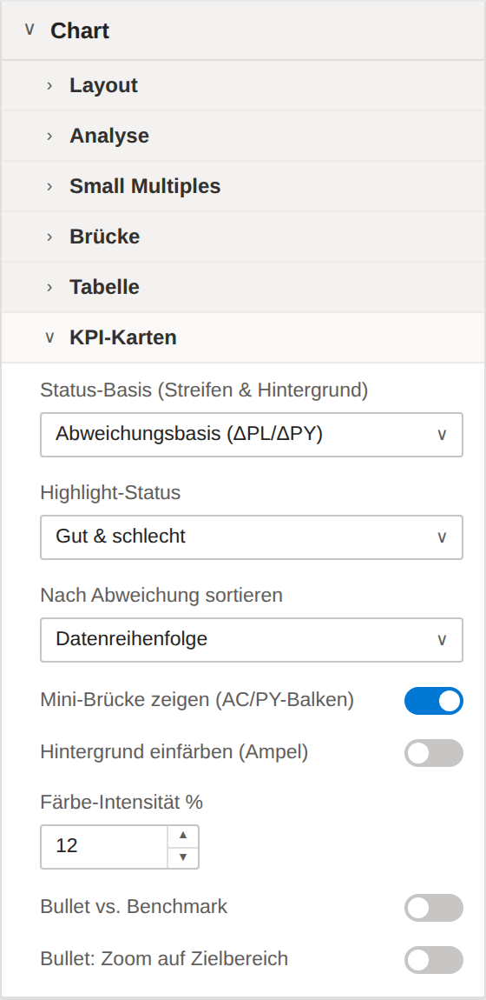

| Einstellung | Beschreibung | Optionen / Standard |
| --- | --- | --- |
| Status-Basis (Streifen & Hintergrund) | Wogegen Streifen und Hintergrund-Ampel bewerten: gegen die Abweichungsbasis (ΔPL bzw. ΔPY) oder gegen die gebundene Benchmark-Measure — für Monitoring gegen Zielwerte/Schwellen. | Optionen: Abweichungsbasis (ΔPL/ΔPY) \| Benchmark (BM) · Standard „Abweichungsbasis (ΔPL/ΔPY)“ |
| Highlight-Status | Welche Richtung farbig hervorgehoben wird: beide (Ampel), nur schlechte (Problem-Monitoring — Positives bleibt neutral) oder nur gute (Erfolgs-Board). Gilt für Streifen, Hintergrund, Δ-Zeilen und Bullet. | Optionen: Gut & schlecht \| Nur schlechte \| Nur gute · Standard „Gut & schlecht“ |
| Nach Abweichung sortieren | Ordnet die Karten nach der farbrelevanten Abweichung (Benchmark bzw. ΔPL/ΔPY, je nach Status-Basis): größte Abweichung oben-links — für maximalen Fokus. „Datenreihenfolge“ lässt sie wie im Modell. | Optionen: Datenreihenfolge \| Größte Abweichung zuerst \| Schlechteste zuerst (oben) \| Beste zuerst (oben) · Standard „Datenreihenfolge“ |
| Mini-Brücke zeigen (AC/PY-Balken) | Zeigt die kleine Balken-Brücke Basis → Δ → AC unten auf der Karte. Aus: reine Zahlen-Karte (großer Wert + Δ-Zeilen), ruhiger für dichte KPI-Wände. | An / Aus · Standard An |
| Karten: gleiche Skala | Seit 1.51.2 (Property `chart.cardSameScale`): Alle Mini-Brücken teilen einen Maßstab über alle Karten, gleiche Beträge ergeben gleich hohe Balken (IBCS: identische Skalen). Für Karten derselben Kennzahl je Kategorie (z. B. Umsatz je Kanal). Aus: jede Karte skaliert für sich, nötig bei Karten mit verschiedenen Einheiten. | An / Aus · Standard Aus |
| Hintergrund einfärben (Ampel) | Färbt den Karten-Hintergrund dezent: leicht grün wenn besser, leicht rot wenn schlechter als die Status-Basis — neutral (unterhalb der Wesentlichkeit) bleibt ohne Farbe. Für Monitoring-Wände; im Hochkontrast-Modus aus. | An / Aus · Standard Aus |
| Färbe-Intensität % | Deckkraft der Hintergrund-Färbung in Prozent (4–40). Standard 12 — kräftiger für Kontrollraum-Monitore, dezenter für Board-Reports. | 4–40 · Standard 12 |
| Bullet vs. Benchmark | Kleines Bullet-Chart auf der Karte: AC-Balken auf hellem Band, Benchmark als Tick — unter der Zahl (Stapel-Layout) bzw. neben den Δ-Zeilen (flaches Layout). Braucht die Benchmark-Rolle. | An / Aus · Standard Aus |
| Bullet: Zoom auf Zielbereich | Spreizt das Bullet auf den Bereich um AC und Benchmark statt bei Null zu starten — KPIs nahe am Ziel (97 vs. 99) werden unterscheidbar. Der Achsenbruch am linken Balkenende kennzeichnet die gekappte Skala. | An / Aus · Standard Aus |
| Referenzwerte anzeigen | Zeigt zusätzlich zu den Δ-Zeilen die Vergleichswerte selbst: „Basiswert“ blendet die Vergleichsbasis als eigene Zeile ein, „Alle gebundenen Szenarien“ zusätzlich VJ, Plan, Prognose und Benchmark — in Tinte über den farbigen Δ-Zeilen, die Abweichung behält das optische Gewicht. Seit 1.41. | Optionen: Nur Abweichungen \| Basiswert \| Alle gebundenen Szenarien · Standard „Nur Abweichungen“ |
| Mini-Chart (Trend) | Nur mit Zeitfeld in der Rolle „Trend (Zeit)“ (seit 1.47): Mini-Chart je Karte — Sparkline mit PY-Geisterlinie, FC gestrichelt und beschriftetem letzten Ist-Punkt, oder nullbasierte Säulen (Negative unter der Nulllinie, FC schraffiert). | Optionen: Aus \| Sparkline \| Säulen |
| Kartenwert (mit Trend) | „Letzter Wert“ zeigt den jüngsten Wert der Serie — Δ-Zeilen und Ampel beziehen sich konsistent auf dieselbe Periode. „Summe“ aggregiert die Serie. | Optionen: Letzter Wert \| Summe · Standard „Letzter Wert“ |

#### Scatter / Bubble

| Einstellung | Beschreibung | Optionen / Standard |
| --- | --- | --- |
| Quadranten-Linien | Scatter/Bubble (seit 1.47): legt Quadranten-Linien auf Mittelwert oder Median beider Achsen. Gesetzte Referenzlinien (Skala) übersteuern die Quadranten. | Optionen: Aus \| Mittelwert \| Median · Standard „Mittelwert“ |
| Punkt-Färbung | „Status“ färbt die Punkte nach der Abweichungsbasis (ΔPY/ΔPL) gut/schlecht, inklusive Wesentlichkeitsschwelle. „Nach Gruppe/Serie“ (seit 1.48) färbt je Wert des Serie-Felds — sechs gedeckte Farben ohne Rot/Grün (bleiben für gut/schlecht reserviert), Legende oben mit „+n weitere“ ab der 7. Gruppe; ohne Serie-Feld einfarbig, im Hochkontrast ohne Wirkung. | Optionen: Einfarbig (AC) \| Status (ΔBasis) \| Nach Gruppe/Serie · Standard „Einfarbig“ |
| Form je Gruppe | Nur bei Punkt-Färbung „Nach Gruppe/Serie“ (seit 1.48): jede Gruppe bekommt zusätzlich eine eigene Punktform (Kreis · Quadrat · Dreieck · Raute, flächen-angeglichen) — auch in der Legende. Lesbar im Schwarzweiß-Druck und bei Farbfehlsicht; im Hochkontrast als Umriss-Formen. | An / Aus · Standard Aus |
| Bewegungspfeile PY → AC | Nur mit Vorjahr (PY), seit 1.48: dünner Pfeil vom kleinen grauen PY-Startpunkt zur AC-Markerkante jedes Punkts. Mit der Rolle „X-Achse VJ (Scatter)“ echte 2D-Bewegung, sonst bewegt sich nur Y; der Tooltip nennt Δ je Achse, die Achsen schließen die PY-Positionen mit ein. | An / Aus · Standard Aus |
| Trendlinie | Lineare Regression über die sichtbaren Punkte (seit 1.48) als dünne gepunktete Linie über die Plotbreite, bei Small Multiples je Kachel; bei Log-Achsen im logarithmischen Raum gerechnet — die Gerade bleibt gerade. Mindestens 3 Punkte. | Optionen: Aus \| Linear · Standard „Aus“ |
| R² anzeigen | Nur bei aktiver Trendlinie: beschriftet das Linienende mit dem Bestimmtheitsmaß („R² = 0,87“). | An / Aus · Standard Aus |
| Größen-Legende | Nur bei gebundener Blasengröße: drei genestete Referenzkreise (klein · mittel · groß, auf runde Werte gerundet) kompakt in der ersten freien Plot-Ecke; bei Small Multiples genau einmal. | An / Aus · Standard An |
| Quadranten-Text oben rechts | Nur bei aktiven Quadranten-Linien (seit 1.48): dezente Ecklabel-Beschriftung (z. B. „Stars“ oben rechts), weicht Punkten nach Möglichkeit aus. Leer = aus. | Freitext · leer = aus |
| Quadranten-Text oben links | — | Freitext · leer = aus |
| Quadranten-Text unten links | — | Freitext · leer = aus |
| Quadranten-Text unten rechts | — | Freitext · leer = aus |
| Play-Button (Animation) | Nur Scatter ohne Small Multiples (seit 1.48): blendet einen ▶-Button ein (Rosling-Modus) — die Kategorie wird zur Zeitachse, je Frame ein Punkt pro Serie, die Periode steht als großes Wasserzeichen im Hintergrund (Klick = zurück zum Anfang). Achsen, Quadranten und Blasenskala bleiben über alle Frames fix; ohne Abspielen zeigt der Chart die letzte Periode, Exporte rendern die volle Punktwolke. Der Laufzustand wird nicht gespeichert. | An / Aus · Standard Aus |

### IBCS-Titel

| Einstellung | Beschreibung | Optionen / Standard |
| --- | --- | --- |
| Beschriftungen anzeigen | — | An / Aus · Standard An |
| KPI-Name (leer = automatisch) | — | Freitext · z. B. Umsatz |
| Zeitraum (leer = automatisch) | — | Freitext · z. B. 2026 |
| Botschafts-Zeile | — | Freitext · Kernbotschaft der Grafik (IBCS: SAY) |
| Automatische Botschaft | Erzeugt die Botschafts-Zeile (Treiber-Text) automatisch aus Gesamtabweichung und größten Treibern, wenn keine eigene Botschaft eingegeben ist. Standard aus. | An / Aus · Standard Aus |
| Fußzeile (Datenstand · Quelle) | Fußzeile unten links — z. B. Datenstand und Quelle: „Ist per Jun 2026 · Stand 05.07. · Quelle: SAP FI". | Freitext · z. B. Ist per Jun 2026 · Stand 05.07. |
| Filter-Fußzeile anzeigen | Zweite Fußzeile mit dem Filterkontext: zeigt die gebundene „Filter-Info“-Text-Measure (Report-Filter sind für Custom Visuals nicht per API sichtbar) plus den Anzeige-Zustand des Visuals selbst — YTD, Top-N, In-Chart-Sortierung, Σ-Ausschlüsse, Vergleich. | An / Aus · Standard Aus |

### Datenbeschriftungen

| Einstellung | Beschreibung | Optionen / Standard |
| --- | --- | --- |
| Beschriftungen anzeigen | — | An / Aus · Standard An |
| Beschriftungs-Dichte | Steuert die Ausdünnung der Wertbeschriftungen: „Automatisch" blendet bei Platzmangel aus (bisheriges Verhalten), „Alle" beschriftet jeden Punkt (kann überlappen), „Anfang · Ende · Extrema" zeigt nur ersten/letzten Wert sowie Minimum und Maximum. | Optionen: Automatisch (ausdünnen) \| Alle \| Anfang · Ende · Extrema · Standard „Automatisch (ausdünnen)“ |
| Größen-Preset | Skaliert alle Schriften im Visual auf einmal: Kompakt ×1 (Standard) · Full HD ×1,5 (empfohlen für 1080p-Berichte) · Präsentation ×2. Im Start-Hub steht dieselbe Einstellung als Leiste HD · Full HD · UHD (HD = Kompakt, UHD = Präsentation). | Optionen: Kompakt (Dashboard-Kachel) \| Full HD (1080p) \| Präsentation (4K / Beamer) · Standard „Kompakt (Dashboard-Kachel)“ |
| Alle Beschriftungen skalieren % | Vergrößert bzw. verkleinert ALLE Beschriftungen zusätzlich zum Preset um einen freien Faktor (50–300 %). 100 = neutral. Preset × Faktor ergibt die effektive Schriftgröße. | 50–300 · Standard 100 |
| Textgröße | — | 6–24 · Standard 10 |
| Dezimalstellen | Gilt unverändert für Tabelle und GuV-Statement. In Grafiken hat jede Zahl seit 1.52.1 höchstens drei Ziffern: ab 10 der Anzeige-Einheit höchstens eine Nachkommastelle, ab 100 keine. | 0–3 · Standard 1 |
| Einheiten | — | Optionen: Auto \| Keine \| Tausend (k) \| Millionen (M) \| Milliarden (B) · Standard „Auto“ |
| Finance-Format (Klammern) | Finanzkonvention für Zahlen: negative Werte in Klammern statt Minuszeichen — (1.234) — und Null als „–". Gilt für Wert- und Δ-Beschriftungen inkl. Δ %. | An / Aus · Standard Aus |
| Σ-treue Rundung der Beschriftungen | Rundet die Wertbeschriftungen nach dem Restwertverfahren so, dass sie exakt auf die Σ-Kopfzeile aufaddieren — keine Rundungsdifferenz-Nachfragen mehr. Aus = mathematisch exakte Einzelrundung, dafür erscheint bei Abweichung ein Rundungshinweis unter der Σ-Zeile. Seit 1.52.1 gilt mit der Option eine Präzision für Beschriftungen und Σ, gesetzt von der größten Zahl; ohne die Option vergleicht der Rundungshinweis die gedruckten Zahlen. | An / Aus · Standard Aus |
| Einheit an jeder Beschriftung | Seit 1.52.1 (Property `labels.unitSuffix`): An = jede Beschriftung trägt Größenordnung und Einheit („18,5M“). Aus = nur die Zahl („18,5“), die Einheit steht einmal im Titel („Nettoumsatz in Mio. EUR“), wie es IBCS empfiehlt; KPI-Karten nehmen dann eine gemeinsame Einheit. Die Abkürzung bleibt „K“ wie in Power BI. | An / Aus · Standard An |

### Kategorienachse

| Einstellung | Beschreibung | Optionen / Standard |
| --- | --- | --- |
| Textgröße | — | 6–24 · Standard 10 |

### IBCS-Farben

| Einstellung | Beschreibung | Optionen / Standard |
| --- | --- | --- |
| Theme-Farben des Berichts verwenden | Übernimmt Good/Bad und Neutralfarben aus dem Berichtsdesign (Theme) statt der Farbwähler unten. | An / Aus · Standard Aus |
| Erscheinungsbild | Seit 1.43: „Auto“ erkennt dunkle Berichts-Themes an der Luminanz der Theme-Hintergrundfarbe und stellt Tinte, Achsen und Flächen auf helle Töne um; „Dunkel“ erzwingt das für manuell dunkel eingefärbte Seiten. Farbwähler auf hellem Standard werden automatisch durch die helle Entsprechung ersetzt, eigene Farben bleiben. Im Dark Mode zeichnet das Visual auch den Hover-Tooltip selbst (seit 1.44). | Optionen: Auto \| Hell \| Dunkel · Standard „Auto“ |
| Farbpreset | „Blau/Orange“ (ColorBrewer #2C7BB6/#E66101) übersteuert die Good/Bad-Farbwähler — auch bei Achromatopsie und im S/W-Druck über die Helligkeit unterscheidbar; im Dark Mode automatisch aufgehellt. | Optionen: Eigene Farben \| Blau/Orange · Standard „Eigene Farben“ |
| Ist (AC) | — | Standard #404040 |
| Vorjahr (PY) | — | Standard #B3B3B3 |
| Plan-Umriss (PL) | — | Standard #404040 |
| Gute Abweichung | Standard ist das DatenWG-Teal (#1E8F9E) statt klassischem Grün — durch den Blauanteil bleibt „gut“ auch bei Rot-Grün-Schwäche klar vom Rot unterscheidbar. Hier übersteuerbar. | Standard #1E8F9E |
| Schlechte Abweichung | — | Standard #D64541 |

### Skala & Referenzlinie

#### Skalen-Sync

| Einstellung | Beschreibung | Optionen / Standard |
| --- | --- | --- |
| Skalen-Mindest-Maximum | Skaliert das Basis-Chart mindestens bis zu diesem Wert — für identische Skalen über mehrere Visuals (IBCS). 0 = automatisch. Größere Datenwerte erweitern die Skala weiterhin. Wirkt seit 1.45 auch im Wasserfall. | ab 0 · Standard 0 |
| Abweichungs-Mindest-Maximum | Wie oben, für die Abweichungs-Panels (symmetrisch ±). 0 = automatisch. Seit 1.45 teilen ΔPY- und ΔPL-Panel EINE Skala — der Wert wirkt auf beide. Seit 1.52 laufen die Δ-Panels im Maßstab der Basis; der Wert wirkt als Untergrenze der Δ-Spanne. | ab 0 · Standard 0 |
| Ausreißer am Maximum kappen | Macht das Skalen-Maximum hart: größere Werte werden gekappt und mit ⫽-Doppelstrich markiert (Label zeigt den echten Wert). Seit 1.45 trägt jedes gekappte Element den Marker (auch PY, PL, BM und Linien); eine Ziellinie über dem Cap dehnt die Achse nicht mehr. | An / Aus · Standard Aus |

#### Scatter-Achsen

| Einstellung | Beschreibung | Optionen / Standard |
| --- | --- | --- |
| X-Achse Minimum | Nur Scatter-Modus (seit 1.48): fixiert die Achsengrenze — für identische Achsen über mehrere Scatter-Visuals einer Seite. Leer = automatisch, 0 ist ein gültiger Wert, k/M/B-Suffixe wie bei der Referenzlinie (z. B. „50k“). Punkte außerhalb der fixierten Grenzen werden nicht gezeichnet, sondern gezählt („n außerhalb der Achsen“). | Freitext · leer = automatisch |
| X-Achse Maximum | Wie oben — fixiert die obere X-Grenze. | Freitext · leer = automatisch |
| Y-Achse Minimum | Wie oben, für die Y-Achse (AC). | Freitext · leer = automatisch |
| Y-Achse Maximum | Wie oben, für die Y-Achse (AC). | Freitext · leer = automatisch |
| X-Achse logarithmisch | Nur Scatter-Modus (seit 1.48): logarithmische X-Achse mit Dekaden-Ticks (1-2-5-Schritte bei enger Spanne). Greift nur, wenn alle X-Werte inklusive Referenzlinie und fixierter Grenzen größer 0 sind — sonst bleibt die Achse linear, mit Hinweis im Bearbeitungsmodus. Bei Small Multiples eine deckweite Entscheidung; die Trendlinie regressiert im Log-Raum. | An / Aus · Standard Aus |
| Y-Achse logarithmisch | Wie oben, für die Y-Achse (AC): nur wenn alle Y-Werte größer 0 sind, sonst linear mit Hinweis. | An / Aus · Standard Aus |

#### Referenzlinie

| Einstellung | Beschreibung | Optionen / Standard |
| --- | --- | --- |
| Referenzlinie (Wert) | Zeichnet eine Ziel-/Schwellenlinie bei diesem Wert quer durch das Basis-Chart. Leer = aus. | Freitext · z. B. 1200000 |
| Referenzlinie (Beschriftung) | — | Freitext · z. B. Ziel |
| X-Referenzlinie (Scatter) | Vertikale Referenzlinie auf der X-Achse im Scatter/Bubble-Modus (seit 1.47); übersteuert zusammen mit der Referenzlinie die Quadranten-Linien. | Freitext · leer = aus |

#### Wasserfall-Achse

| Einstellung | Beschreibung | Optionen / Standard |
| --- | --- | --- |
| Achsenschnitt | IBCS-Achsenschnitt im Wasserfall (seit 1.45): Anker werden zu Stummeln mit ⫽ über die volle Balkenbreite. Geschnitten wird nur, wenn alle Anker und Deltas vollständig über dem Schnitt liegen; Titel-Suffix und Export-Fußzeile weisen den Schnitt aus, Small Multiples teilen EINEN Schnitt. „Auto“ hebt den In-Chart-Chip „⫽ Achse“ hervor — geschnitten wird erst per Klick. „Anker kürzen (Achsenbruch)“ unter Chart → Brücke schaltet den Schnitt ein, solange er auf „Aus“ steht. | Optionen: Aus \| Auto \| An · Standard „Aus“ |
| Schnitt bei Wert | Manueller Schnittwert; 0 = automatisch (runder Wert unter dem tiefsten Kaskaden-Stand). | ab 0 · Standard 0 |

### Kommentare

| Einstellung | Beschreibung | Optionen / Standard |
| --- | --- | --- |
| Kommentarliste anzeigen | Zeigt die Kommentare als nummerierte Liste rechts neben dem Chart — bleibt auch im PDF/PowerPoint-Export sichtbar. | An / Aus · Standard An |
| Kommentar-Schriftgröße | Schriftgröße der Kommentar-Liste in pt (8–24). Wird zusätzlich mit dem Schrift-Preset und dem Skalierungs-Faktor multipliziert, skaliert also mit dem Rest des Visuals mit. | 8–24 · Standard 10 |
| Kommentare im Chart erfassen | Kommentar-Modus: Klick auf eine Kategorie öffnet ein Eingabefeld — der Kommentar wird im Bericht gespeichert (bookmark-fähig, wandert mit der PBIX). Solange der Modus an ist, filtern Klicks nicht quer. Standard aus. | An / Aus · Standard Aus |

### Leer-Zustand

| Einstellung | Beschreibung | Optionen / Standard |
| --- | --- | --- |
| Leer-Zustand im Bearbeitungsmodus | Was der Bericht-Autor sieht, solange keine Daten dargestellt werden: der Start-Hub (Checkliste „Loslegen“, Feature-Tour, IBCS-Vorlagen nach Zweck, Demo-Galerie, Feld-Intro mit allen Rollen; unten HD · Full HD · UHD und die Doku), nur die Demo-Galerie zur Chart-Typ-Wahl (Verhalten bis 1.49), das Feld-Intro oder die eigene Nachricht aus Titel/Text darunter. Seit 1.49, Start-Hub seit 1.50. Leser und Exporte sehen unabhängig davon die ruhige Landing-Karte. | Optionen: Start-Hub (Loslegen, Tour, Vorlagen, Demo, Felder) \| Demo-Galerie (Chart-Typ wählen) \| Feld-Intro (welches Feld wohin) \| Eigene Nachricht (Titel / Text unten) · Standard „Start-Hub (Loslegen, Tour, Vorlagen, Demo, Felder)“ |
| Eigener Titel | Ersetzt im Leer-Zustand (keine Felder gebunden oder Auswahl ohne Zeilen) die Überschrift „ChartKitchen byDatenWG“ — für Leser und Exporte auf der ruhigen Landing-Karte (seit 1.51.1), beim Bearbeiten im Modus „Eigene Nachricht“. Seit 1.44. | Freitext · leer = Standard |
| Eigener Text | Eigener Text unter dem Titel — z. B. ein Hinweis, welche Felder zu binden sind oder warum die Auswahl leer ist. | Freitext · leer = Standard |

## 09 · FAQ & Troubleshooting

### Das Visual zeigt nur einen Hinweis wie „benötigt PY oder PL“.

Die Modi Integrierte Brücke, Kategorie-Brücke, GuV-Statement, Dumbbell und Slope brauchen eine Vergleichsbasis. Binde eine Kennzahl in die Rolle Vorjahr (PY) oder Plan (PL). Bei rein negativen Summen wechselst du auf Waterfall oder Columns mit Wasserfall-Brücke.

### Warum gibt es keine Laufsumme (YTD) in der Matrix?

Die Kumulierung ist in der Matrix bewusst deaktiviert: sie würde über die flache Zeilenliste kumulieren und die Spaltengruppen (z. B. Quartale) doppelt zählen. Nutze YTD im Columns- oder Line-Modus, oder rechne die Laufsumme als Measure im Datenmodell.

### Die Brücke bricht bei negativen Summen.

Integrierte und Kategorie-Brücke unterstützen keine rein negativen Summen — das Visual zeigt dann einen Hinweis statt einer kaputten Grafik. Nimm den Wasserfall-Modus oder Columns/Bars mit aktivierter Wasserfall-Brücke.

### Die Zahlen erscheinen in K€ statt T€.

Die Anzeigeeinheiten stehen auf Auto oder Tausend (k). Stelle Datenbeschriftungen → Einheiten auf die gewünschte Stufe; die Einheit erscheint im Titel. Für gemischte €-/%-/Stück-Zeilen nutzt du „Zahlenformat pro Zeile“ in der Tabelle.

### Beim PDF-/PowerPoint-Export fehlt das horizontale Scrollen der Matrix.

Ein Standbild ist nicht scrollbar, daher greift im Export der „… +n“-Hinweis. Verschmälere die Matrix vorher: Zwei-Zeilen-Kompaktmodus, Werte-Spalten reduzieren, Spaltenbreiten anpassen oder Spaltengruppen zuklappen.

### PY erscheint als Dreieck statt als Säule.

Bei drei gebundenen Szenarien (AC + PY + PL) zeigt das Visual PY nach IBCS als graues Dreieck, um die Säule nicht zu überladen. Abschalten über Chart → „PY als Dreieck“.

### Die Farben „gut/schlecht“ passen nicht zu meiner KPI (z. B. Kosten).

Für Kosten ist ein höherer Wert schlecht. Aktiviere Chart → „Invertieren“ global oder „Invertieren je Kategorie“ für einzelne Zeilen (z. B. Aufwandspositionen neben Umsatz).

### Der Filterkontext steht nicht in der Fußzeile.

Report-Filter sind für Custom Visuals nicht per API sichtbar. Binde eine Text-Measure (z. B. via SELECTEDVALUE/CONCATENATEX) in die Rolle „Filter-Info“ und aktiviere die Filter-Fußzeile in der Karte „IBCS-Titel“.

### Unter der Σ-Zeile erscheint ein Rundungshinweis.

Aktiviere Datenbeschriftungen → „Σ-treue Rundung der Beschriftungen“. Dann werden die Einzelbeschriftungen nach dem Restwertverfahren so gerundet, dass sie exakt auf die Σ-Kopfzeile aufaddieren.

### Δ% zeigt „n.a.“ — warum?

Seit 1.45 bewusst so: Bei Basis 0 oder einem Vorzeichenwechsel zwischen Basis und Ist wäre jede Prozentzahl irreführend (z. B. „−250 %“ bei einer Verbesserung). Das Visual zeigt dann „n.a.“ — überall: Labels, Pins, Tooltips, Tabelle, Karten, Σ-Kopf und GuV-Statement. GuV-Kostenzeilen mit durchgängig negativer Basis behalten ihre Prozente.

### Ein Klick in einem anderen Visual filtert ChartKitchen, statt hervorzuheben.

Gewollt (seit 1.46): Die Visual-Wechselwirkung steht für ChartKitchen immer auf „Filtern“ — Power BI bietet „Hervorheben“ für dieses Visual gar nicht mehr an. So arbeiten Σ-Kopf, Skalen und alle Modi bei Cross-Interaktion konsistent auf dem gefilterten Datenbestand. Die eigene Selektion im Visual (Klick auf Balken/Zeile/Karte, Strg = Mehrfachauswahl) dimmt weiterhin lokal.

### Auf dunklen Berichtsseiten ist die Schrift kaum lesbar.

Stelle IBCS-Farben → „Erscheinungsbild“ auf „Auto“ (erkennt dunkle Themes an der Hintergrund-Luminanz) oder explizit auf „Dunkel“ — Tinte, Achsen, Flächen und seit 1.44 auch der Hover-Tooltip wechseln dann auf dunkle Darstellung mit heller Schrift.

### Statt der Modus-Galerie erscheint ein Start-Hub mit großen Knöpfen.

Seit 1.50 der Standard für Autoren (Kapitel 03). Die bisherige Galerie steckt hinter „Demo ansehen“; wer sie direkt sehen will, stellt Leer-Zustand → „Leer-Zustand im Bearbeitungsmodus“ auf „Demo-Galerie“. Leser sehen den Hub nie.

### Unten rechts steht „⏳ n Zeilen geladen …“ oder ein Hinweis auf unvollständige Daten.

Das Visual lädt seit 1.49 mehr als 1.000 Kategoriezeilen nach. Der Hinweis auf unvollständige Daten erscheint, wenn Power BI keine weiteren Segmente liefert oder die Grenze von 30.000 Zeilen greift — dann die Kategorie verdichten oder die Seite filtern.

### Ein Knopf im Chart ist grau und reagiert nicht.

Er ist gesperrt, weil er im aktuellen Zustand nichts bewirken würde; der Tooltip nennt den Grund (Kapitel 07, „Gesperrte statt stummer Chips“).

### Unten links steht „↺ Zum Template zurück“.

Eine IBCS-Vorlage ist gesetzt, und mindestens eine ihrer Einstellungen wurde geändert. Ein Klick stellt den Vorlagen-Stand wieder her; wer die Änderungen behalten will, stellt Chart → IBCS-Chart-Vorlage auf „Aus“. Leser und Exporte sehen den Chip nie.

**ChartKitchen byDatenWG** · Version 1.52.1.0

Download: [chartkitchen-byDatenWG-latest.pbiviz](../downloads/chartkitchen-byDatenWG-latest.pbiviz) (immer die aktuelle Version) · Schwester-Visual: [P&L Statement byDatenWG – Dokumentation](../pnl-doku.html)

Kontakt: Michael Tenner · [michael.tenner84@gmail.com](mailto:michael.tenner84@gmail.com)

Ein Änderungsprotokoll (Changelog) liegt der Visual-Auslieferung bei.

> IBCS® ist eine eingetragene Marke der IBCS Association. Dieses Visual ist von den IBCS-Prinzipien inspiriert und steht in keiner Verbindung zur IBCS Association.

---

## Weitere Fassungen dieser Seite

- HTML (maßgeblich): https://datenwgknowledgekitchen.com/chartkitchen-doku.html
- PDF: [chartkitchen-doku.pdf](../chartkitchen-doku.pdf)
- Englisch: [chartkitchen-doku_en.html](../chartkitchen-doku_en.html) · [chartkitchen-doku_en.md](chartkitchen-doku_en.md)
- Schnellstart: [chartkitchen-schnellstart.html](../chartkitchen-schnellstart.html) · [chartkitchen-schnellstart.md](chartkitchen-schnellstart.md)
- Referenz für KI-Agenten (Datenvertrag, alle Format-Properties): [ibcsInspiredChartDeck/AGENT-GUIDE.md](../ibcsInspiredChartDeck/AGENT-GUIDE.md)
