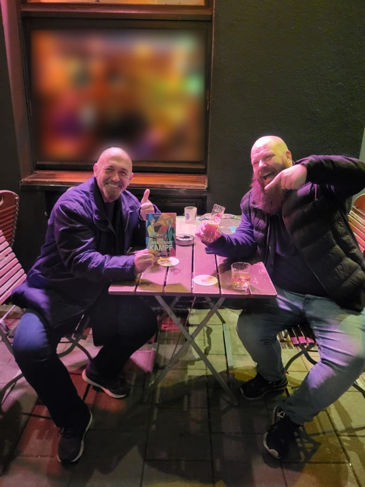
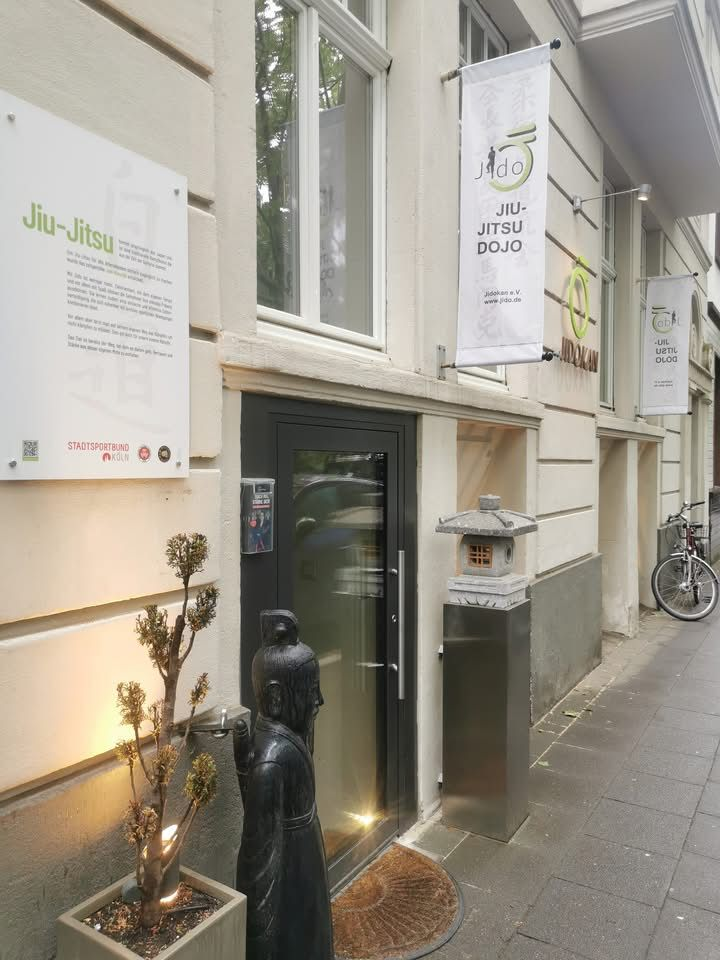
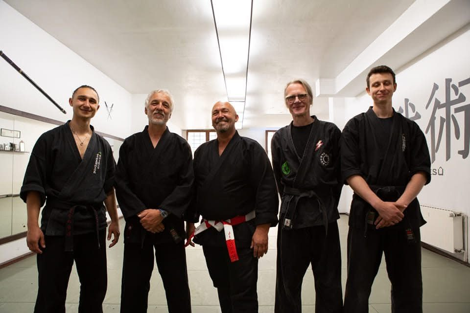

# Der unsichtbare Kampf — Interview mit Michael Thomanek (Entwurf)

> Markdown-Fassung von [der-unsichtbare-kampf-post.html](../der-unsichtbare-kampf-post.html) · https://datenwgknowledgekitchen.com/der-unsichtbare-kampf-post.html · generiert mit scripts/build_md.py — bei Abweichungen gilt die HTML-Fassung.

*Cover mit freundlicher Genehmigung von Michael Thomanek.*

Interview · Persönliche Entwicklung

Wie inneres Kämpfen dich wandelt. Auf der Matte und im Alltag.

Michael Tenner im Gespräch mit Michael Thomanek, „Micha“, über sein Buch, über persönliche Entwicklung und über die Frage, was davon im Projektalltag von Datenleuten trägt.

Interview · Persönliche Entwicklung · Lesezeit ca. 12 Min. · Entwurf

> **Entwurf, nicht veröffentlicht.** Diese Seite ist noch nirgends verlinkt und für Suchmaschinen gesperrt. Stellen mit [Entwurf] sind Platzhalter zum Überarbeiten, die Antworten von Micha folgen nach dem Gespräch.

## Warum dieses Buch in der Kitchen?

In der Kitchen geht es sonst um Datenmodelle, Reports und Werkzeuge. Dieses Gespräch fing anders an: an einem kalten Oktoberabend in Köln, an einem Klapptisch vor unserer Lieblingsbar, ein Kölsch auf dem Tisch. Micha zündet sich erst mal eine an. Dazu später mehr.

Micha und ich kennen uns seit ein paar Jahren. Damals habe ich ihm erzählt, dass ich mal Judo gemacht habe, und versprochen, in seiner Kampfschule vorbeizukommen. Zum Training war ich bis heute nicht da. Im Dojo saß ich trotzdem, aber aus einem ganz anderen Grund: Wir haben versucht, sein Buch aus einem Handy zu retten. Die Geschichte steht unten.

Warum das Ganze hier steht: Druck vor dem Go-Live, Widerstand im Projekt, die Frage, ob man im Meeting wirklich da ist oder nur reagiert, und wer man im Job eigentlich sein will. Das kennen viele von uns. Micha hat dazu nach über vierzig Jahren auf der Matte eine sehr eigene Sicht. Danke, dass wir Cover und Klappentext zeigen dürfen.

*Wo dieses Gespräch entstanden ist: Micha und Michael Tenner mit dem Buch im Coellner. Das Fenster im Hintergrund ist unscharf gemacht.*

## Das Buch in drei Sätzen

1. Der eigentliche Kampf findet nicht draußen statt, sondern in uns: in unseren Gedanken, unseren Geschichten und dem Bild, das wir von uns selbst und der Welt haben.
2. Michael Thomanek nimmt, was in über vierzig Jahren Kampfkunst auf der Matte sichtbar wurde, und überträgt es auf diesen inneren Kampf.
3. Es geht nicht darum, nicht mehr zu kämpfen, sondern zu verstehen, woher der Kampf kommt und wie aus innerer Reibung wieder Stimmigkeit entsteht.

> Was wäre, wenn der eigentliche Kampf nicht auf der Straße stattfindet – sondern in uns?
>
> Michael Thomanek schöpft aus über vierzig Jahren Erfahrung in der Kampfkunst. Er zeigt, was auf der Matte sichtbar wird – und überträgt es auf einen Kampf, den jeder Mensch kennt: den inneren Kampf. Widerstand, Anspannung und Reibung entstehen in unseren Gedanken, unseren Geschichten und in dem Bild, das wir von uns selbst und der Welt haben.
>
> In der Mitte dieses Buches liegt zugleich sein philosophisches Herzstück: die Frage, von welchem Standpunkt aus wir uns selbst und die Welt überhaupt erleben. Es geht nicht darum, nicht mehr zu kämpfen, sondern zu verstehen, woher der Kampf kommt – und wie aus innerer Reibung wieder Stimmigkeit entstehen kann.
>
> Ein Buch über Präsenz. Über Identität. Über Integration. Und über die stille Kraft, die entsteht, wenn wir aufhören, gegen uns selbst zu arbeiten.

Klappentext · *Der unsichtbare Kampf*, Kenamo Verlag

## Über Micha

Michael Thomanek, von allen Micha genannt, schöpft aus **über vierzig Jahren Erfahrung in der Kampfkunst**. Mit *Der unsichtbare Kampf* überträgt er, was auf der Matte sichtbar wird, auf den inneren Kampf, den jeder Mensch kennt. Das Buch ist im Kenamo Verlag erschienen.

- **Sensei:** So nennen ihn Freunde. Im Japanischen heißt das Trainer oder Lehrer der Kampfkunst, „hat aber auch was vom großen Bruder“. Nach rund dreißig Jahren ist es für ihn ein Spitzname geworden, so wie früher Micha für Michael.
- **Jiu-Jitsu seit über 40 Jahren,** seit rund 30 Jahren hauptberuflich als Trainer für Kampfkunst und Selbstverteidigung. Einige seiner Schüler trainieren seit 1995 bei ihm.
- **Rund 5.000 Menschen** hat er nach eigener Schätzung trainiert, eigene Gruppen, Lehrgänge und Seminare in Deutschland zusammengenommen.
- **Das Buch:** 240 Seiten, ein Jahr Arbeit, gefühlt 700 Stunden. Der Impuls liegt 27 Jahre zurück.

Sein Dojo ist der **Jidokan e.V.** in der Kölner Südstadt. Jido verbindet Elemente des Jiu-Jitsu mit Selbstverteidigung. Mehr zum Training: [jido.de](https://jido.de/)

*Der Eingang zum Jidokan in Köln.*

*Micha (Mitte) mit Trainern im Dojo.*

## Das Interview

Aufgenommen im Oktober 2026 in Köln, an einem Klapptisch vor der Bar. Das Gespräch ist gekürzt und sprachlich geglättet. Die Antworten sind Michas Worte, verdichtet auf das Wesentliche.

### Frage 1 · Wer bist du eigentlich?

Jetzt werden ein paar Leute denken: Was unterhält sich der Tenner da mit irgendeinem anderen Michael? Also: Ich bin Michael Thomanek. Freunde nennen mich Sensei. Das kommt aus dem Japanischen und heißt so viel wie Trainer, Lehrer der Kampfkunst. Es hat aber auch was vom großen Bruder.

Für mich ist das nach rund dreißig Jahren hauptberuflich in Selbstverteidigung und Kampfkunst eine Art Spitzname geworden. Sensei ist für mich so etwas wie früher der Micha vom Michael.

### Frage 2 · Wie kommt man auf die Idee, sich wochenlang hinzusetzen und seine Gedanken aufzuschreiben?

Da muss ich weit ausholen. Ich habe vor über vierzig Jahren mit Jiu-Jitsu angefangen und setze mich seitdem mit dem Kämpfen auseinander. Lange stand Selbstverteidigung im Vordergrund. Über die Auseinandersetzung mit dem Kämpfen habe ich irgendwann geschnallt, dass man auch in sich mit sich selbst kämpft.

Über diesen Kampf hatte ich vor 27 Jahren eine sehr tiefgreifende Erfahrung. Ich finde dafür nur die Worte unendliche Liebe und Geist. Das war ein Zustand, der nicht von dieser Welt ist, und in dem war ich eine längere Zeit konstant. Man kann da hineindeuten, was man will. Es gibt aber viele Zeugnisse von Menschen, gerade aus der Kunst, nehmen wir David Lynch oder große Musiker, die von anderen Bewusstseinszuständen sprechen. Da würde ich mich eher einordnen.

Ich habe danach Menschen gefunden, die von ähnlichen Erfahrungen sprechen. Der eine hatte einen Unfall, der andere hat einfach gekämpft, bis er an seine Grenzen kam, und dann hat sich etwas geöffnet. Es gibt Taucher, die ihren Herzschlag fast bis zum Stillstand herunterfahren können. Diese Art Verfügung hatte ich auch: Man wird sich bewusst, wie stark der Geist den Körper beeinflusst. Das war der Impuls für das Buch.

### Frage 3 · Und dann lag das Buch jahrelang in einem Handy.

Ich habe mehr als 2.000 Seiten in die Memo-App meines Huawei-Handys geschrieben und gesprochen. Immer wieder gespeichert, gelöscht, korrigiert. Man kann tatsächlich sagen: Das ganze Buch ist auf einem Huawei entstanden.

In diesem Tagebuch habe ich mich Tag für Tag um ein und dasselbe Thema gedreht: Wie kann ich Menschen das Thema Präsenz näherbringen?

Michael Tenner erzählt

Irgendwann kam der Anruf: „Tenner, komm mal her, du musst mir helfen. Wir müssen den Text aus dem Huawei rauskopieren.“ Klar, wird schon gehen. Das war eine grandiose Selbstüberschätzung und eine noch grandiosere Unterschätzung, wie bescheuert Handysysteme sein können. Wir haben es mit KI versucht, mit allen möglichen Tools, am Rechner im Dojo, mit dem Support. Einen Export aller Notizen auf einmal gab es nicht, und die gesicherten Dateien waren verschlüsselt. Huawei hat am Ende selbst gesagt: Da geht nichts. Wie viele Stunden und wie viele Bierchen das waren, weiß keiner mehr. Den Rest hat Micha einzeln herausgeschrieben. Rückblickend war genau das vielleicht gut: noch mal ein bewusster Durchgang durch alle Gedanken.

### Frage 4 · Was meinst du mit Präsenz?

Präsenz ist Gegenwärtigkeit, und die wohnt jedem Menschen inne. Ich beschreibe sie als höheres Selbst, im Grunde die Quelle unseres Ich. Hier und jetzt, das kennt jeder, dazu gibt es eine ganze Reihe Bücher. Aber man muss es leben, nicht nur wissen. Mein Lieblingsspruch: Nur zu wissen, dass es Schirme gibt, schützt nicht vor Regen.

Präsenz erlaubt mir zu wählen: zu agieren, statt bloß auf die Schnelle zu reagieren. Aus der Präsenz heraus bekomme ich Abstand zu meiner Automatik. Das braucht auch ein Kampfkünstler, gerade wenn es in einer Selbstverteidigungssituation darum geht zu deeskalieren. Dafür braucht es Ruhe. Diese Ruhe ist nicht einfach das Gegenteil von Unruhe, sie ist die Quelle der mentalen Stärke. Und sie kann sich über die Jahre im Training ausdehnen.

Wenn in einer Kneipe jemand Stress macht, gibt es immer einen, der sofort darauf reagiert, das Falsche sagt, das Falsche tut, und schon ist er in diesem Streit gefangen. Andere haben Abstand und eine Ruhe, die schon da ist. Dafür muss man nicht unbedingt Kampfkunst machen.

„Nur zu wissen, dass es Schirme gibt, schützt nicht vor Regen.“

### Frage 5 · Warum ist der Kampf unsichtbar?

Das meiste stellen wir uns nur vor. Und was wir uns vorstellen, läuft wie auf einer Leinwand in unserem Kopf. Das ist aber oft nur die Wiederholung eines Hintergrundfilms, eines Films aus dem Unterbewusstsein. Im Buch nenne ich ihn nicht so, aber das Bild trifft es. Dieser Hintergrundfilm ist für uns in der Regel nicht sichtbar.

Ein Wort zieht sich durch das ganze Buch, vor allem durch den philosophischen Teil in der Mitte: Gewahrsein. Wir Menschen kämpfen innerlich alle, mehr oder weniger. Die innere Spannung zeigt sich als Widerstand, und Widerstand raubt uns Energie. Man kennt das aus der Physik: Je größer der Widerstand, desto weniger Strom fließt. Je geringer der Widerstand, desto mehr kann fließen. Bei uns Menschen ist das ähnlich. Ich habe herausgefunden, dass man den Widerstand wegnehmen kann, und dann fließt die Energie wieder.

Ein typisches Beispiel: „Ach, ich muss zur Arbeit, ich hab keinen Bock, aber ich muss ja.“ Ich mache etwas, obwohl ich keine Lust habe. Da sitzt der Knoten schon.

„Je größer der Widerstand, desto weniger Strom fließt.“

### Frage 6 · Was passiert auf der Matte, das im Kopf ankommt?

Jenseits von Selbstverteidigung kommt man durch die Übungen in einen Fluss. Das Wichtigste zuerst: Dem Trainer gelingt es oft, den Kopf auszuschalten. Wie bei einem Kind, das hingefallen ist und gleich anfängt zu weinen. Man klatscht in die Hände, sagt „guck mal, da oben“, und das Kind ist ganz woanders. Ähnlich ist es mit Schülern auf der Matte. Werden die Bewegungen fließend geübt, werden sie mit der Wiederholung widerstandslos. Und genau das überträgt sich auf das Innere, auf das Mentale.

Ich habe meine Schüler immer so ernst genommen wie mich selbst und versucht, Blockaden zu lösen, die mir aufgefallen sind. Es gibt Menschen, die laufen steif, und genauso steif tanzen sie auch. Nach einer Zeit im Training werden sie insgesamt runder, auch beim Tanzen.

Wichtig ist mir die Unterscheidung zwischen Kampfkunst, Selbstverteidigung und Kampfsport. Das sind drei Paar Schuhe, die die meisten vermischen. MMA zum Beispiel ist ganz klar Kampfsport, vor allem Wettkampfsport. Bei uns lernt man realistische, sehr effektive Techniken, aber die Leute kommen nicht, weil an der nächsten Haltestelle ein Feind wartet. Die wichtigste „Technik“ ist für mich eine Einstellung: Offenheit. Wer offen ist, nimmt mehr wahr. Wer mehr wahrnimmt, erkennt Gefahren früher, kann sie vermeiden, oft gar nicht erst entstehen lassen, notfalls abwenden und erst ganz zuletzt sich verteidigen. Offen sein heißt dabei nicht, keine Grenzen zu haben.

### Frage 7 · Warum sollte jemand, der nächste Woche Leuten kündigen muss, dein Buch lesen?

Ich glaube, dass wir Menschen uns mit der Vorstellung von uns selbst verwechseln. Wir nehmen eine Rolle ein: Vater, Bruder, Freund, Mutter, Trainer und so weiter. Irgendwann sind wir diese Rolle, leben als diese Rolle und merken nicht mehr, dass wir sie nur leben. Ich glaube, dass wir darüber hinaus mehr sind. Mit diesem Mehr erkennt man auch das Potenzial.

Von diesem Standpunkt aus kann man besser differenzieren und gerät nicht so leicht in einen inneren Konflikt. Dann kann ich abwägen und einem Menschen auch sachlich kündigen, ohne selbst ein emotionales Problem damit zu haben.

Hilft das gegen den mentalen Overload, den gerade so viele spüren? Es kann helfen, wenn man es ernst meint und sich darauf einlässt. Im Grunde ist es eine ganz langweilige Stille oder Meditation, die auf sich selbst zurückführt. Und der Blick darauf, wogegen wir eigentlich ständig sind: gegen das System, gegen andere, gegen uns selbst. Das sind erst mal nur Geschichten, die sich in unserem Kopf zeigen. Wir suchen gern etwas, damit wir uns nicht für uns selbst verantworten müssen. Das tun die meisten Menschen.

„Wir verwechseln uns mit der Vorstellung von uns selbst.“

### Frage 8 · Was sollen Leser aus dem Buch mitnehmen, und was kommt als Nächstes?

Drei Dinge. Erstens: Wer sich für Kampfkunst interessiert, kann sich danach klar einordnen. Interessiere ich mich mehr für Kampfsport, für Selbstverteidigung oder für Kampfkunst? Daraus entsteht innere Stärke, immer mehr Angstfreiheit, immer mehr Bei-sich-Sein. Zweitens die Verwechslung: dass wir uns mit unseren Vorstellungen und Rollen von uns selbst verwechseln. Drittens schließt sich am Ende der Kreis mit der Frage, wie man einen eigenen Weg gestalten kann, mit universellen Beispielen, die man für sich nutzen kann. Oder man lässt es.

Ganz praktisch: In Kapitel 7 gibt es eine Anleitung, mit der man Dinge zu Hause auf dem Stuhl oder im Bett ausprobieren und im Alltag anwenden kann.

Ich bin kein Verkäufer, und ich habe das Buch nicht geschrieben, um Geld zu verdienen. Ich wollte Menschen erreichen. In meinen Trainingsgruppen sind meist zehn Leute, und von denen erreiche ich viele. Wenn du zehn erreichst, kannst du auch tausend erreichen. Die müssen nur zuhören oder eben ein Buch lesen. Gefehlt hat lange die Zeit. Am Ende habe ich mir drei Monate auf Fuerteventura genommen, eine Struktur erarbeitet und geschrieben. Das war verdammt anstrengend, und ich habe mir ein paarmal gewünscht, ich hätte es mir nicht vorgenommen. Gerade arbeite ich an einer Kinderversion. Diesmal ohne Deadline.

## Was ich für mich mitnehme

[Entwurf, bitte prüfen] Am meisten hängen geblieben ist bei mir das Bild vom Widerstand. In Projekten sehe ich das ständig: Die Energie geht nicht in die Arbeit, sondern in das Dagegen-Sein. Gegen die Anforderung, gegen den Stakeholder, gegen das Datenmodell, das man geerbt hat. Weniger Widerstand heißt nicht, alles hinzunehmen. Es heißt, die Energie dahin fließen zu lassen, wo sie etwas bewegt.

[Entwurf, bitte prüfen] Das zweite ist der Unterschied zwischen agieren und reagieren. Im Meeting, in der Eskalation, in der Mail um 23 Uhr: Kurz Abstand zur eigenen Automatik zu bekommen, ist oft der ganze Unterschied. Und das Thema Schuld kenne ich von mir selbst. Als ich sechs Wochen allein unterwegs war, hatte ich alles selbst geplant, gebucht und entschieden. Da gab es niemanden mehr, dem ich die Schuld geben konnte. Das war unbequem und sehr lehrreich.

[Entwurf, bitte prüfen] Ob man dafür vierzig Jahre auf die Matte muss? Micha sagt: nein. Aber das Buch ist ein guter Anfang. Und zum Training komme ich jetzt wirklich mal vorbei.

### Der unsichtbare Kampf

Wie inneres Kämpfen dich wandelt. Auf der Matte und im Alltag

- **Autor:** Michael Thomanek
- **Verlag:** Kenamo Verlag
- **ISBN:** 978-3-9829397-0-4

[Zum Buch](https://amzn.eu/d/05hubGrY) Bei Amazon · öffnet in einem neuen Tab

## Weiter in der Kitchen

- [Übersicht: Alle Beiträge der Kitchen](../beitraege.html)
- [Daten-WG-Folgen: Karriere & Community](../index.html#bucket-7)

---

## Weiterlesen

- HTML (maßgeblich): https://datenwgknowledgekitchen.com/der-unsichtbare-kampf-post.html
- Alle Beiträge: [beitraege.html](../beitraege.html)
