# Microsoft Fabric — Einsteiger-Guide

> Markdown-Fassung von [fabric_einsteiger_guide_v1.html](../fabric_einsteiger_guide_v1.html) · https://datenwgknowledgekitchen.com/fabric_einsteiger_guide_v1.html · generiert mit scripts/build_md.py — bei Abweichungen gilt die HTML-Fassung.

EINSTEIGER-GUIDE · MICROSOFT FABRIC · END-TO-END

Für alle, die Power BI kennen und jetzt verstehen wollen, was Microsoft Fabric darunter aufbaut — von OneLake über Lakehouse, Warehouse, Pipelines und Notebooks bis zum Direct-Lake-Modell im Power-BI-Bericht. Mit einem End-to-End-Beispiel und Tiefenfokus auf Direct Lake und Snowflake-Integration.

**v 1 · Einsteiger** · Beta · Stand Oktober 2026 · DE · 6 Sektionen · 41 klickbare Detail-Karten

Michael Tenner · Power BI · Microsoft Fabric · Daten-WG · [LinkedIn](https://www.linkedin.com/in/michael-tenner-5b885970/)

## Wo soll ich anfangen?

Dieser Guide ist **kein Buch**, das du von vorn nach hinten liest. Es ist eine Klick-Erkundung: sechs Sektionen, je 6–10 anklickbare Karten, jede führt zu einem Detail-Fenster mit Erklärung, Schritt-für-Schritt und Original-Screenshots aus Microsoft Learn.

Wenn du **aus der Power-BI-Welt** kommst, ist der rote Faden: Sektion **1 → 2 → 3** baut das mentale Modell (Was ist Fabric? → Welche Bausteine gibt es? → Wie kommt daraus ein Power-BI-Bericht?). Sektion **4** macht es einmal komplett praktisch durch. Sektion 5 (Snowflake) und 6 (Architektur-Entscheidungen) sind Vertiefung für konkrete Projektfragen.

Wenn du eine Karte anklickst, öffnet sich ein Modal. Mit `Esc` schließen, oder neben das Fenster klicken.

## Die Reise durch Microsoft Fabric

Sechs Etappen, von der Einordnung bis zur Architektur-Entscheidung. Klick führt direkt zur Sektion.

- **Einordnung** — 01 · ORIENTIERUNG
- **Architektur & Komponenten** — 02 · PLATTFORM
- **Semantik & Direct Lake** — 03 · MODELLE
- **End-to-End-Beispiel** — 04 · PRAXIS
- **Snowflake-Daten** — 05 · SPEZIAL
- **Entscheidungen** — 06 · STRATEGIE

## 01 · Einordnung von *Microsoft Fabric*

Microsoft Fabric ist kein weiteres Azure-Tool, sondern der Versuch, den kompletten Analytics-Stack — Integration, Engineering, Warehousing, Streaming, BI — als eine SaaS-Plattform zu bündeln. Wer versteht, warum es Fabric gibt und wie Power BI hineinpasst, kann jede weitere Detail-Frage einsortieren.

> Als erstes: **„Was ist Microsoft Fabric?" und „Fabric & Power BI"** lesen — das ist die Grundorientierung. Danach „Workloads & Experiences" für den Überblick, was alles dazugehört.

**1** — Plattform · Datensee · Datenkopie

**Das Kernversprechen von Fabric:** Eine SaaS-Plattform statt vieler einzeln zu konfigurierender PaaS-Dienste, ein logischer Data Lake (OneLake) für den ganzen Tenant, und eine einzige Kopie der Daten, auf der alle Engines arbeiten — Spark, T-SQL, KQL und Power BI.

**Vorher:** Azure Data Factory für Integration, Synapse für Warehouse und Spark, Event Hubs + Stream Analytics für Streaming, Power BI für Reporting — vier Dienste, vier Sicherheitsmodelle, viele Datenkopien.

**Mit Fabric:** dieselben Fähigkeiten als Workloads einer Plattform, mit gemeinsamem Speicher (OneLake), gemeinsamer Governance (Purview) und gemeinsamer Abrechnung (Capacity Units).

### Was ist Microsoft Fabric?

*EINORDNUNG · GRUNDLAGEN*

Eine End-to-End-Analytics-Plattform: Datenintegration, Data Engineering, Warehousing, Real-Time-Streaming, Data Science und Power BI — als ein SaaS-Produkt statt vieler Einzeldienste.

#### Was ist das?

Microsoft Fabric bündelt den kompletten Analytics-Lebenszyklus — vom Laden der Rohdaten bis zum fertigen Bericht — in einer Plattform. Der entscheidende Unterschied zu klassischen Azure-Diensten ist das **SaaS-Fundament**: Sicherheit, Compliance, Governance und Infrastruktur sind eingebaut („no setup or minimal setup"), statt pro Dienst konfiguriert werden zu müssen. Du legst keinen Cluster, kein Storage-Konto und keine Netzwerk-Regeln an — du legst einen Workspace an und arbeitest.

#### Die drei Plattform-Schichten unter den Workloads

- **OneLake** — ein logischer Data Lake für den ganzen Tenant, alle Engines lesen und schreiben dieselben Daten
- **Copilot & KI** — eingebettete KI-Assistenz quer durch alle Workloads
- **Governance** — eingebaut über den OneLake catalog (Explore, Govern, Secure: Domains, Endorsement, Lineage, OneLake Security), ergänzt durch Microsoft Purview für Sensitivity Labels, DLP und Audit

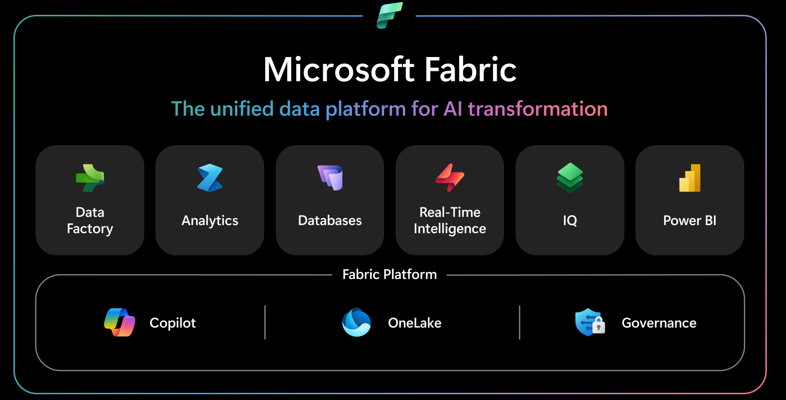

**Abb. · Die Fabric-Architektur** Alle Workloads teilen sich Speicher (OneLake), KI (Copilot) und Governance (Purview). Quelle: [What is Microsoft Fabric? · Microsoft Learn](https://learn.microsoft.com/fabric/fundamentals/microsoft-fabric-overview)

> **In einem Satz für Power-BI-Menschen:** Fabric ist das, was passiert, wenn man den Power-BI-Service nimmt und den kompletten Daten-Backend-Stack (Data Factory, Synapse, Streaming) in dieselbe Oberfläche, denselben Speicher und dasselbe Lizenzmodell integriert.

> **Kostenlos ausprobieren:** Die Fabric-Trial läuft 60 Tage — je nach Tenant mit 4 oder 64 Capacity Units (F4- bzw. F64-Niveau) und bis zu 1 TB OneLake-Speicher. Das reicht, um alle Übungen dieses Guides nachzubauen; nur Copilot und Fabric Data Agents brauchen eine bezahlte Kapazität (Stand Oktober 2026).

**Weiterlesen:** [What is Microsoft Fabric? · Microsoft Learn](https://learn.microsoft.com/fabric/fundamentals/microsoft-fabric-overview) · [Lernpfad: Get started with Microsoft Fabric](https://learn.microsoft.com/training/paths/get-started-fabric/)

**Daten-WG dazu:**

- **[Starting with Microsoft Fabric — the skills you need](https://youtu.be/m3xNYfVih0Q)** · Talk · 50 min · EN · [Knowledge Kitchen](../index.html#ep-m3xNYfVih0Q)

### Warum wurde Fabric entwickelt?

*EINORDNUNG · MOTIVATION*

Weil der klassische Analytics-Stack aus vier, fünf getrennten Diensten bestand — mit getrennten Sicherheitsmodellen, getrennter Abrechnung und vor allem: vielen Kopien derselben Daten.

#### Das Problem davor

Ein typisches Azure-BI-Projekt vor Fabric: Azure Data Factory lädt Daten in einen Data Lake (ADLS Gen2), Synapse Spark bereitet sie auf, Synapse Dedicated Pool hält das Warehouse, Power BI importiert die Daten *noch einmal* in sein eigenes Modell. Ergebnis: dieselben Daten liegen drei- bis viermal vor, jede Station hat eigene Berechtigungen, eigenes Monitoring, eigene Kostenstelle — und jede Übergabe ist eine Fehlerquelle.

#### Die Fabric-Antwort

- **Ein Speicher:** OneLake im offenen Delta-Parquet-Format — alle Engines arbeiten auf derselben Kopie („One Copy")
- **Ein Sicherheits- und Governance-Modell:** einmal definiert, gilt überall (Purview-Integration)
- **Eine Abrechnung:** Capacity Units, die sich alle Workloads teilen — kein Dienst-für-Dienst-Einkauf
- **Eine Oberfläche:** Data Engineer, Analyst und Business-User arbeiten im selben Portal in denselben Workspaces

> **Praxis-Beispiel:** Vor Fabric: Der Data Engineer exportiert nachts Parquet-Dateien, der BI-Entwickler importiert sie morgens ins Power-BI-Modell — zwei Refreshes, vier Stunden Latenz. In Fabric schreibt das Notebook eine Delta-Tabelle, das Direct-Lake-Modell sieht sie nach dem nächsten Framing — ohne zweiten Datenimport.

**Weiterlesen:** [Microsoft Fabric Overview · Microsoft Learn](https://learn.microsoft.com/fabric/fundamentals/microsoft-fabric-overview) · [James Serra: Benefits of migrating from Synapse to Fabric](https://www.jamesserra.com/archive/2024/11/fabric-benefits-over-synapse/)

### Einordnung: Synapse · ADF · Power BI

*EINORDNUNG · MICROSOFT-STACK*

Fabric ist der Nachfolger des „Modern Data Warehouse"-Stacks aus Azure Synapse, Azure Data Factory und Power BI Premium — als SaaS neu zusammengesetzt.

#### Wer geht wo auf?

- **Azure Data Factory** → Fabric **Data Factory** (Pipelines + Dataflows Gen2). Die Konzepte sind fast identisch; Unterschiede im Detail: die Fabric-Pipeline kennt z. B. Dataflow- und Notebook-Activities, „Execute Pipeline" heißt „Invoke Pipeline"
- **Synapse SQL Pools** → Fabric **Data Warehouse** (T-SQL auf OneLake, ohne dedizierte Cluster)
- **Synapse Spark** → Fabric **Data Engineering** (Notebooks, Spark Job Definitions, Lakehouse)
- **Azure Data Explorer / Stream Analytics** → Fabric **Real-Time Intelligence** (Eventstream, Eventhouse/KQL, Activator)
- **Power BI Premium** → **Fabric-Kapazitäten** (F-SKUs); der Power-BI-Service ist heute Teil des Fabric-Portals

#### Was Fabric nicht ersetzt

Operative Azure-Dienste laufen weiter: Azure SQL Database als OLTP-Quelle, Event Hubs als Messaging-Backbone, ADLS Gen2 als bestehender Data Lake (den man per Shortcut einbindet statt migriert). Auch bestehende ADF- und Synapse-Umgebungen laufen weiter — es gibt aber keinen automatischen Upgrade-Pfad, Migration ist ein Projekt.

> **Für die Architektur-Diskussion:** Die Kernfrage ist nicht „Fabric oder Azure?", sondern: Welche bestehenden Azure-Bausteine bleiben Quelle (per Shortcut/Mirroring angebunden) — und welche Verarbeitungsschritte ziehen nach Fabric um?

**Weiterlesen:** [ADF vs. Fabric Data Factory · Microsoft Learn](https://learn.microsoft.com/fabric/data-factory/compare-fabric-data-factory-and-azure-data-factory) · [endjin: Synapse vs. Fabric side-by-side](https://endjin.com/blog/2023/05/azure-synapse-analytics-versus-microsoft-fabric-a-side-by-side-comparison) · [James Serra: Fabric reference architecture](https://www.jamesserra.com/archive/2024/08/microsoft-fabric-reference-architecture/)

### Fabric & Power BI

*EINORDNUNG · BEZIEHUNG*

Power BI ist nicht „kompatibel mit" Fabric — es ist eine der Fabric-Experiences. Microsoft formuliert es offiziell: „Power BI Premium is now part of Fabric."

#### Was das konkret heißt

- **Workspaces sind Fabric-Workspaces:** Derselbe Workspace, der deine Berichte enthält, kann Lakehouses, Pipelines und Notebooks enthalten
- **Kapazitäten sind F-SKUs:** Die alte Premium-P1 entspricht von der Rechenleistung her einer F64; die Abrechnung läuft über Capacity Units, die sich Power BI mit allen anderen Workloads teilt
- **Semantische Modelle sind Fabric-Items:** Sie liegen im Workspace neben den Daten, auf denen sie basieren — und können mit Direct Lake direkt auf OneLake-Tabellen zeigen
- **Der Service ist das Portal:** app.powerbi.com und app.fabric.microsoft.com führen in dieselbe Oberfläche, nur mit anderem Workload-Fokus

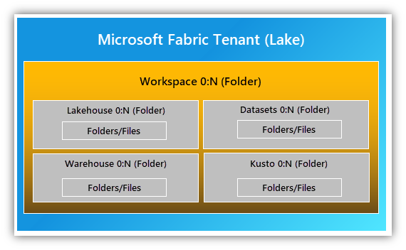

**Abb. · Tenant → Kapazität → Workspace → Items** Berichte, Modelle und Lakehouses sind gleichberechtigte Items in derselben Hierarchie. Quelle: [Microsoft Fabric Overview · Microsoft Learn](https://learn.microsoft.com/fabric/fundamentals/microsoft-fabric-overview)

#### Was sich für Power-BI-Teams ändert

Kurzfristig: wenig — Berichte, Apps, RLS und Deployment funktionieren wie bisher. Mittelfristig: Das Team bekommt Zugriff auf den Daten-Layer. Statt auf den nächtlichen DWH-Export zu warten, kann ein Power-BI-Team eigene Dataflows Gen2, Lakehouses und Direct-Lake-Modelle bauen. Wer das nicht will, kann das Anlegen von Fabric-Items per Tenant-Setting deaktivieren („Users can create Fabric items").

> **Lizenz-Merksatz:** Zum *Erstellen* von Power-BI-Inhalten braucht es weiterhin eine Pro-Lizenz. Ab F64 dürfen Free-User Inhalte auf der Kapazität *konsumieren* — für Nicht-Power-BI-Items (Lakehouse, Notebook, Pipeline) braucht es gar keine Pro-Lizenz.

**Weiterlesen:** [Power BI Premium FAQ · Microsoft Learn](https://learn.microsoft.com/fabric/enterprise/powerbi/service-premium-faq) · [Build Power BI reports in Microsoft Fabric](https://learn.microsoft.com/power-bi/fundamentals/fabric-get-started)

**Daten-WG dazu:**

- **[#011 · Power BI ohne Fabric? Absolut!](https://youtu.be/gMYj9UTWeWk)** · Short · 33 s · DE · [Knowledge Kitchen](../index.html#ep-gMYj9UTWeWk)

### Workloads & Experiences

*EINORDNUNG · ÜBERBLICK*

Fabric organisiert sich in Workloads (auch „Experiences"): fachliche Sichten auf dieselbe Plattform, jede mit eigenen Item-Typen — aber alle auf demselben OneLake.

#### Die Workload-Landkarte (Stand Oktober 2026)

- **Data Factory** — Pipelines, Copy job, Dataflow Gen2, Mirroring, dazu Apache-Airflow- und dbt-Jobs: Daten bewegen und orchestrieren
- **Data Engineering** — Lakehouse, Notebooks, Spark Job Definitions, Materialized Lake Views, User Data Functions: Daten mit Spark verarbeiten und Logik kapseln
- **Data Warehouse** — Warehouse-Items: T-SQL-Modellierung und -Transformation
- **Data Science** — ML-Modelle, Experimente (MLflow) und **Fabric Data Agents** (Fragen in natürlicher Sprache an deine Daten)
- **Real-Time Intelligence** — Real-Time Hub, Eventstream, Eventhouse/KQL-Datenbank, Real-Time Dashboards, Activator
- **Databases** — SQL database in Fabric (OLTP) und Cosmos DB in Fabric (NoSQL), beide automatisch nach OneLake gespiegelt
- **Power BI** — semantische Modelle, Berichte, Apps — inklusive **Translytical Task Flows** (seit März 2026 GA): Buttons im Bericht rufen User Data Functions auf und schreiben z. B. in eine SQL database zurück
- **Fabric IQ** — Geschäftskontext für KI: Ontologien, Planning und der Fabric-IQ-MCP-Server (siehe Karte „Copilot, Data Agents & MCP")

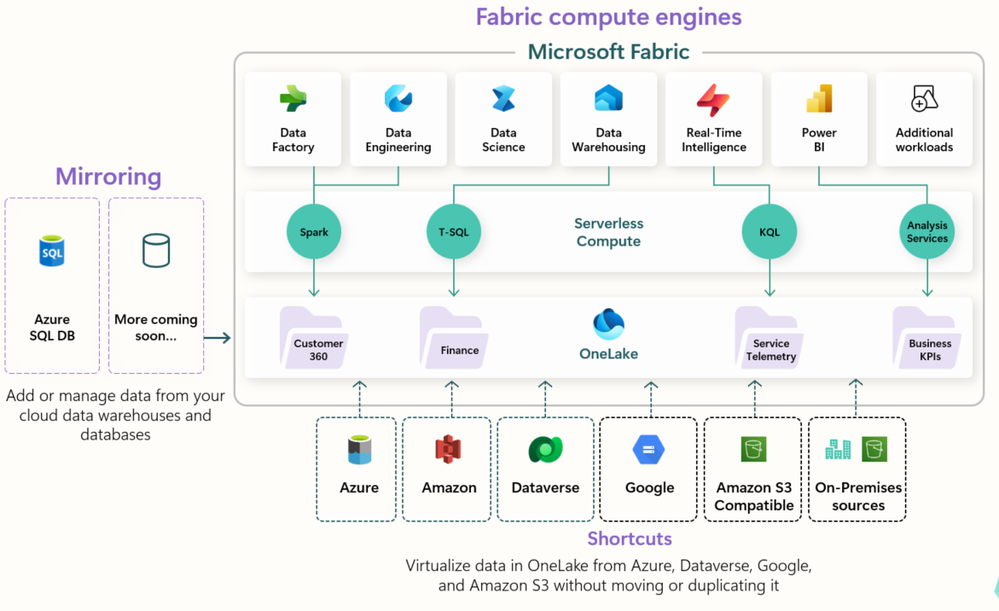

**Abb. · Viele Engines, ein Speicher** Jeder Workload rechnet mit eigener Engine, aber alle lesen und schreiben OneLake. Quelle: [Microsoft Fabric Overview · Microsoft Learn](https://learn.microsoft.com/fabric/fundamentals/microsoft-fabric-overview)

> **Warum das für dich zählt:** Du musst nicht alle Workloads lernen. Ein typischer BI-Pfad braucht genau drei: Data Factory (Daten holen) → Data Engineering oder Warehouse (strukturieren) → Power BI (modellieren und berichten). Die Karten dieses Guides folgen diesem Pfad.

> **Neu und noch Preview: Fabric Apps:** Mit Fabric Apps (Rayfin SDK, TypeScript) entstehen eigene Daten-Apps als Fabric-Item — Backend mit SQL database in Fabric, GraphQL-API, Entra-SSO und Hosting inklusive. Braucht eine Fabric-Kapazität und eine Freigabe im Tenant. Für klassische BI-Teams ein Ausblick, kein Pflichtstoff.

**Weiterlesen:** [Fabric terminology · Microsoft Learn](https://learn.microsoft.com/fabric/fundamentals/fabric-terminology) · [Translytical task flows · Microsoft Learn](https://learn.microsoft.com/power-bi/create-reports/translytical-task-flow-overview) · [Fabric Apps (Preview) · Microsoft Learn](https://learn.microsoft.com/fabric/apps/overview)

### Capacities, F-SKUs & Lizenzen

*EINORDNUNG · LIZENZEN*

Fabric rechnet in Capacity Units (CU) ab: Eine Kapazität (F-SKU) ist ein Pool an Rechenleistung, den sich alle Workloads eines oder mehrerer Workspaces teilen.

#### Das Modell in drei Sätzen

(1) Der Tenant kauft eine oder mehrere **F-SKUs** in Azure — von F2 (2 CU) über F64 (64 CU, Rechenleistung der alten Premium P1) bis F8192. (2) Workspaces werden einer Kapazität zugeordnet; alles, was darin rechnet (Refresh, Spark-Job, SQL-Query, Bericht, Copilot), verbraucht CUs. (3) Dazu kommen **Per-User-Lizenzen**: Free, Pro, Premium-per-User — wie aus Power BI bekannt.

#### Die wichtigsten Regeln (Stand Oktober 2026)

- **F-SKUs** laufen Pay-as-you-go (sekundengenau abgerechnet, mindestens eine Minute), lassen sich pausieren und jederzeit skalieren — oder als Reservierung günstiger. Die Preise unterscheiden sich je Azure-Region
- **Bursting & Smoothing:** Ein Job darf kurzfristig mehr Leistung ziehen, als die SKU hat; der Verbrauch wird über die Zeit verteilt (Background-Jobs über 24 Stunden). Erst anhaltende Überlast führt zu **Throttling** — erst Verzögerung, dann Ablehnung. Auswege: hochskalieren, pausieren und fortsetzen (rechnet die aufgelaufene Last sofort ab), Capacity Overage (zum dreifachen Tarif) oder Surge Protection für Background-Jobs
- **P-SKU-Auslauf:** Premium-P-SKUs gibt es nicht mehr neu; jede läuft zum Ende ihrer Vertragslaufzeit aus (aktive Enterprise Agreements können bis Vertragsende verlängern). Danach 30 Tage Grace, Tag 31–90 gedrosselt, ab Tag 91 werden alle Operationen abgelehnt. Die Migration ist manuell: F-SKU kaufen, Workspaces umhängen, dann P-SKU kündigen. Pro, PPU und Embedded-SKUs (A/EM) sind nicht betroffen
- **Ab F64** können Free-User mit Viewer-Rolle Power-BI-Inhalte konsumieren; von F2 bis F32 braucht jeder Berichts-Konsument Pro oder PPU
- **Fabric-Items ohne Pro:** Lakehouses, Notebooks, Pipelines kann jeder mit Free-Lizenz in F- oder Trial-Workspaces anlegen — Pro braucht nur, wer Power-BI-Inhalte erstellt und teilt. PPU stellt *keine* Fabric-Kapazität bereit
- **Trial:** 60 Tage, je nach Tenant mit 4 oder 64 CU (F4/F64) — Admins können eine F4-Trial unter Umständen auf 64 CU erhöhen. Bis 1 TB OneLake; Copilot, Data Agents, AI Functions und Private Link sind im Trial nicht enthalten
- **KI braucht bezahlte Kapazität:** Copilot und Fabric Data Agents setzen F2+ (oder P1+) voraus. Eine *Fabric Copilot capacity* bündelt den Copilot-Verbrauch einer Nutzergruppe — auch aus Power BI Desktop und Pro-/PPU-Workspaces

> **Betriebs-Tipp:** CU-Verbrauch überwacht man mit der **Fabric Capacity Metrics App** — Pflicht, sobald mehr als ein Team auf derselben Kapazität arbeitet. Schwere Background-Jobs (Spark, große Refreshes) von interaktiven BI-Lasten trennen, sonst bremsen sie sich gegenseitig aus. Surge Protection hilft, ersetzt aber keine passende Kapazitätsgröße.

**Weiterlesen:** [Understand Microsoft Fabric licenses · Microsoft Learn](https://learn.microsoft.com/fabric/enterprise/licenses) · [Throttling-Policy · Microsoft Learn](https://learn.microsoft.com/fabric/enterprise/throttling) · [FAQ: P-SKU → F-SKU · Microsoft Learn](https://learn.microsoft.com/power-bi/support/premium-migration-faq) · [Fabric-Trial · Microsoft Learn](https://learn.microsoft.com/fabric/fundamentals/fabric-trial)

Weiter vertiefen Sektion 01: Einordnung, Lizenzen & Kapazität

Daten-WG · Sprung ins Video

- [01:33 These: Für wen ist Microsoft Fabric?](https://www.youtube.com/watch?v=mTVeZzshLzE&t=93s)Microsoft Fabric — braucht das wirklich jemand? · [Karte in der Kitchen](../index.html#ep-mTVeZzshLzE)
- [36:01 Wann braucht man Fabric wirklich — zwischen Excel und Warehouse?](https://www.youtube.com/watch?v=mTVeZzshLzE&t=2161s)Microsoft Fabric — braucht das wirklich jemand? · [Karte in der Kitchen](../index.html#ep-mTVeZzshLzE)
- [05:02 Vom Dashboard-Bauer zum Datendienstleister](https://www.youtube.com/watch?v=YzfcMurbWNc&t=302s) Power BI-Teams werden Fabric-Datendienstleister · [Karte in der Kitchen](../index.html#ep-YzfcMurbWNc)
- [01:18 Capacities und Regionen: wo Fabric-Daten physisch liegen](https://www.youtube.com/watch?v=ZVVSPQj9dlc&t=78s) Wo liegen meine Daten wirklich im OneLake? · [Karte in der Kitchen](../index.html#ep-ZVVSPQj9dlc)
- [11:13 Bursting & Smoothing: warum eine F4 kurz „zu viel“ CU verbraucht](https://www.youtube.com/watch?v=z51gWRc0zVc&t=673s) Dataflow Gen2 Kosten verstehen · [Karte in der Kitchen](../index.html#ep-z51gWRc0zVc)

DatenWG Library · Themen

- [Microsoft Fabric](../wissensgraph/thema/microsoft-fabric.html)
- [Fabric Capacity](../wissensgraph/thema/fabric-capacity.html)
- [Lizenzen](../wissensgraph/thema/lizenzen.html)

Microsoft Learn · Doku & Training

- [Fabric-Lizenzen & Kapazitäten (F2–F8192)](https://learn.microsoft.com/fabric/enterprise/licenses)
- [Throttling, Bursting & Smoothing](https://learn.microsoft.com/fabric/enterprise/throttling)
- [FAQ: Migration P-SKU → F-SKU](https://learn.microsoft.com/power-bi/support/premium-migration-faq)
- [Lernpfad: Get started with Microsoft Fabric](https://learn.microsoft.com/training/paths/get-started-fabric/)
- [Study Guide DP-600 (Fabric Analytics Engineer)](https://learn.microsoft.com/credentials/certifications/resources/study-guides/dp-600)

## 02 · Architektur & *zentrale Komponenten*

Alles in Fabric folgt demselben Muster: Daten liegen einmal in OneLake (Delta Parquet), verschiedene Engines rechnen darauf, und Shortcuts holen externe Daten dazu, ohne sie zu kopieren. Wer diese Bausteine kennt, kann jede Fabric-Architektur lesen.

> Als erstes: **„OneLake" öffnen** — ohne OneLake ergibt der Rest keinen Sinn. Danach **„Lakehouse" und „Warehouse"** im Vergleich, dann „Medallion" für das Zusammenspiel.

### OneLake — der Datensee des Tenants

*KOMPONENTEN · SPEICHER*

„OneDrive für Daten": Jeder Fabric-Tenant hat automatisch genau einen OneLake. Alle Workloads speichern ihre Daten dort — im offenen Delta-Parquet-Format.

#### Was ist das?

OneLake ist ein logischer Data Lake auf Basis von Azure Data Lake Storage Gen2. „Logisch", weil du ihn nicht anlegst oder konfigurierst — er ist einfach da, so wie OneDrive bei Microsoft 365. Jeder Workspace ist ein Container darin, jedes Item (Lakehouse, Warehouse, Eventhouse) speichert seine Tabellen als **Delta Parquet** — ein offenes Format, das auch Spark, Databricks oder DuckDB lesen können. Kein Vendor-Lock-in auf Dateiebene.

#### Das „One Copy"-Prinzip

Der Kerngedanke: Daten liegen *einmal* in OneLake, und alle Engines arbeiten darauf — Spark schreibt eine Delta-Tabelle, T-SQL fragt sie ab, das Direct-Lake-Modell liest sie in den Bericht. Keine Export-Import-Ketten, keine nächtlichen Kopier-Jobs zwischen Diensten.

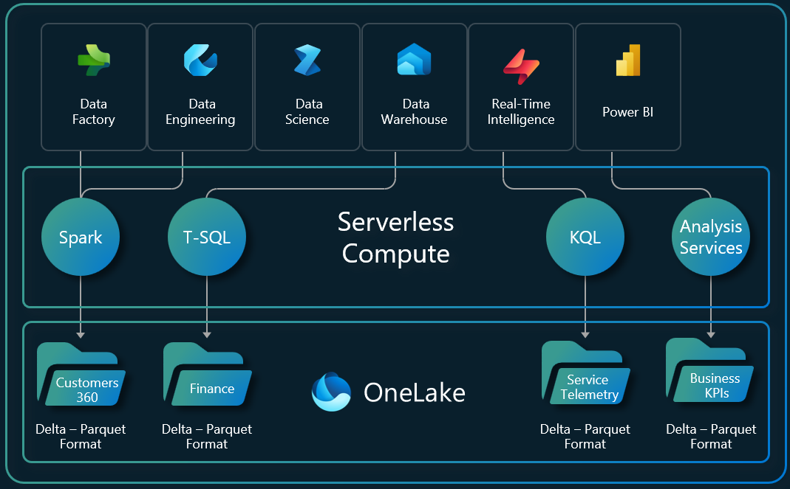

**Abb. · One Copy of Data** Laden mit Spark, Abfragen mit T-SQL, Anzeigen in Power BI — dieselbe Datenkopie. Quelle: [What is OneLake? · Microsoft Learn](https://learn.microsoft.com/fabric/onelake/onelake-overview)

> **Praxis-Beispiel:** Du kannst OneLake wie ein Laufwerk behandeln: Der **OneLake-Explorer für Windows** bindet ihn in den Datei-Explorer ein, und jedes Tool, das ADLS Gen2 spricht (Azure Storage Explorer, azcopy), erreicht ihn über die URL onelake.dfs.fabric.microsoft.com.

> **Wo liegen meine Daten wirklich?** Physisch liegt OneLake in der Azure-Region der Kapazität — relevant für Datenschutz-Diskussionen. Die Daten-WG-Folge unten zeigt, wie man das nachprüft.

**Weiterlesen:** [What is OneLake? · Microsoft Learn](https://learn.microsoft.com/fabric/onelake/onelake-overview) · [DatenPioniere: OneLake — Datensilos auflösen (DE)](https://www.datenpioniere.de/blog/fabric-onelake)

### Medallion: Bronze · Silber · Gold

*KOMPONENTEN · ZUSAMMENSPIEL*

Die Medallion-Architektur ist das Standard-Muster, wie die Fabric-Komponenten zusammenspielen: Rohdaten (Bronze) werden schrittweise zu bereinigten (Silber) und report-fertigen Daten (Gold) veredelt.

#### Die drei Schichten

- **Bronze — Raw:** Daten im Originalformat, unverändert. Offizieller Rat: bestehende Quellen per **Shortcut referenzieren** statt kopieren
- **Silber — Enriched:** bereinigt, dedupliziert, standardisierte Formate — als Delta-Tabellen
- **Gold — Curated:** aggregiert und modelliert fürs Reporting (Sternschema), Basis für semantische Modelle

#### Wie die Komponenten die Schichten bedienen

**Pipelines, Copy jobs, Mirroring oder Shortcuts** füllen Bronze. **Notebooks, Dataflows oder Materialized Lake Views** transformieren Bronze → Silber → Gold. **Lakehouse oder Warehouse** speichern die Schichten — Microsoft dokumentiert zwei Muster: alle drei Layer als Lakehouses, oder Bronze+Silber als Lakehouse und **Gold als Warehouse** (für SQL-Teams). Auf Gold sitzt das **semantische Modell**, darauf der Power-BI-Bericht.

#### Snippet · Gold-Schicht deklarativ als Materialized Lake View

```dax
-- Spark SQL im Notebook; Schema gold muss im Lakehouse existieren
CREATE MATERIALIZED LAKE VIEW IF NOT EXISTS gold.umsatz_tag_stadt AS
SELECT s.InvoiceDateKey,
       c.City,
       SUM(s.TotalExcludingTax) AS UmsatzNetto,
       SUM(s.Profit)            AS Gewinn
FROM dbo.fact_sale s
JOIN dbo.dimension_city c ON s.CityKey = c.CityKey
GROUP BY s.InvoiceDateKey, c.City
```

Das Ergebnis ist eine Delta-Tabelle (Direct-Lake-tauglich). Aktualisiert wird nicht per Notebook, sondern über *Materialized lake views → Manage*: Lineage und Zeitplan, Refresh in Abhängigkeitsreihenfolge, wo möglich inkrementell.

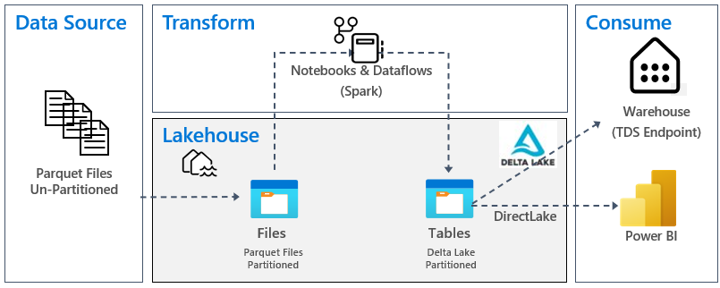

**Abb. · Bronze → Silber → Gold** Der Transformationsfluss aus dem offiziellen Lakehouse-Tutorial. Quelle: [Lakehouse end-to-end scenario · Microsoft Learn](https://learn.microsoft.com/fabric/data-engineering/tutorial-lakehouse-introduction)

> **Governance-Empfehlung:** Pro Schicht ein eigenes Lakehouse (oder Schema), idealerweise in eigenen Workspaces — so lassen sich Berechtigungen sauber trennen (Analysten sehen Gold, Engineers alles). Gold-Tabellen mit V-Order schreiben (in neuen Workspaces für Spark nicht mehr Standard, siehe Karte „Notebooks & Spark"), damit Direct Lake maximal profitiert.

> **Muss es immer Medallion sein?** Nein — für kleine Lösungen reicht oft ein Lakehouse mit Schemas bronze/silver/gold. Wichtig ist das Prinzip: Rohdaten unangetastet lassen, Veredelung nachvollziehbar in Stufen.

**Weiterlesen:** [Medallion-Architektur · Microsoft Learn](https://learn.microsoft.com/fabric/onelake/onelake-medallion-lakehouse-architecture) · [Spark-SQL-Referenz Materialized Lake Views · Microsoft Learn](https://learn.microsoft.com/fabric/data-engineering/materialized-lake-views/create-materialized-lake-view) · [Modul: Medallion-Architektur in Fabric](https://learn.microsoft.com/training/modules/describe-medallion-architecture/) · [phData: Medallion & skalierbares Modeling](https://www.phdata.io/blog/medallion-architecture-and-scalable-data-modeling-in-microsoft-fabric/)

### Rolle des semantischen Modells

*SEMANTIK · BUSINESS-SCHICHT*

Zwischen Delta-Tabellen und Bericht gehört eine kuratierte Schicht: das semantische Modell. Es übersetzt Datenstrukturen in Business-Begriffe — Measures, Hierarchien, Beziehungen.

#### Warum nicht direkt auf die Tabellen berichten?

Weil sonst jeder Bericht seine eigene Logik mitbringt: Drei Analysten definieren „Umsatz" dreimal unterschiedlich. Das semantische Modell zentralisiert diese Logik — **eine** Definition von Umsatz, Marge und Kundenzahl, die von allen Berichten, Excel-Pivots und zunehmend auch Copilot/AI-Agents genutzt wird. In Fabric ist das Modell ein eigenes Workspace-Item neben Lakehouse und Warehouse.

#### Was ins Modell gehört

- **Beziehungen** — das Sternschema zwischen Fakten und Dimensionen
- **Measures** — DAX-Kennzahlen als „single source of truth"
- **Metadaten** — Formatierungen, Beschreibungen, Anzeige-Ordner, Synonyme (auch für Copilot relevant)
- **Sicherheitslogik** — Row-Level Security auf Modell-Ebene

> **Self-Service-Effekt:** Ein gutes Gold-Layer-Modell macht aus „Kannst du mir einen Report bauen?" ein „Bau dir den Report selbst" — Fachbereiche verbinden sich mit dem zertifizierten Modell und ziehen ihre eigenen Auswertungen, ohne SQL oder DAX zu schreiben.

> **Kein Default-Modell mehr:** Seit dem 5. September 2025 erzeugen neue Lakehouses, Warehouses und Mirrored Databases kein automatisches Default-Semantic-Model mehr; alte Default-Modelle wurden bis 30. November 2025 zu eigenständigen Modellen entkoppelt. Das ist gut so: Modelle entstehen jetzt bewusst, mit ausgewählten Tabellen statt „alles rein". Und weil Copilot und Data Agents ihre Antworten aus diesen Modellen ziehen, zahlt sich jede gepflegte Beschreibung doppelt aus (Karte „Copilot, Data Agents & MCP").

**Weiterlesen:** [Store data in Microsoft Fabric · Microsoft Learn](https://learn.microsoft.com/fabric/fundamentals/store-data) · [Semantic model modes · Microsoft Learn](https://learn.microsoft.com/power-bi/connect-data/service-dataset-modes-understand)

### OneLake — der Datensee des Tenants

Siehe den gleichnamigen Abschnitt weiter oben.

### Shortcuts — einbinden statt kopieren

*KOMPONENTEN · ZERO-COPY*

Ein Shortcut ist eine Referenz auf Daten, die woanders liegen — im Nachbar-Workspace, in ADLS Gen2, Amazon S3 oder Dataverse. Die Daten erscheinen in OneLake, ohne bewegt zu werden.

#### Was ist das?

Shortcuts funktionieren wie symbolische Links: Im Lakehouse sieht der Shortcut aus wie ein normaler Ordner oder eine normale Tabelle, tatsächlich zeigt er auf den Quell-Speicherort. Alle Fabric-Engines können durch ihn hindurch lesen — ohne ETL-Strecke, ohne Duplikat, ohne Latenz durch Kopier-Jobs. Änderungen an der Quelle sind sofort sichtbar.

#### Wohin Shortcuts zeigen können

- **Fabric-intern:** andere Lakehouses, Warehouses, KQL-Datenbanken, Mirrored Databases — auch workspace-übergreifend
- **Extern:** ADLS Gen2, Azure Blob, Amazon S3 (und S3-kompatibel), Google Cloud Storage, Dataverse, OneDrive/SharePoint, Iceberg-Quellen — On-Premises-Quellen via Data Gateway

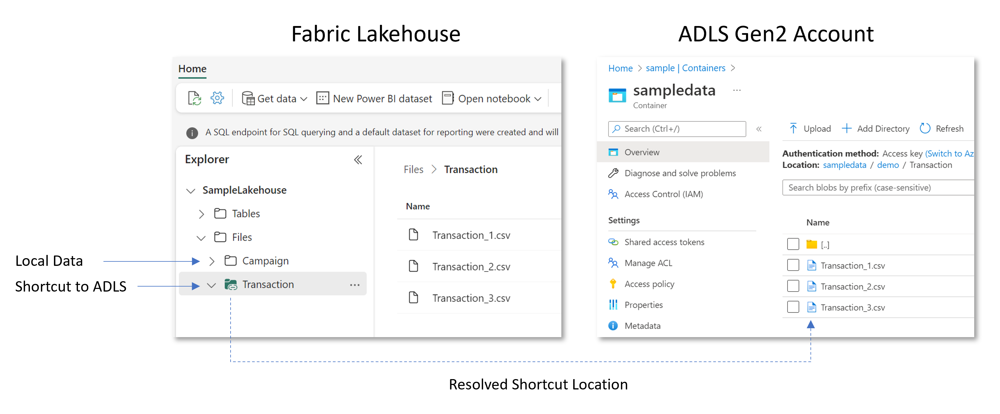

**Abb. · Shortcut-Prinzip** Der Shortcut erscheint als Teil des Lakehouse, die Daten bleiben an der Quelle. Quelle: [OneLake shortcuts · Microsoft Learn](https://learn.microsoft.com/fabric/onelake/onelake-shortcuts)

#### Shortcut-Transformationen: aus Dateien werden Tabellen

Ein Table-Shortcut kann Dateien automatisch in eine Delta-Tabelle umwandeln: **CSV, Parquet und JSON** (GA) sowie **Excel** (Preview). Fabric prüft die Quelle alle zwei Minuten und hält die Tabelle synchron — ideal für SharePoint-, OneDrive- oder S3-Ordner als Bronze-Quelle. Die Zieltabelle ist lese-optimiert (kein `MERGE`/`DELETE`), alle Dateien eines Ordners brauchen dasselbe Schema. Für `.txt`-Dateien gibt es zusätzlich KI-Transformationen (Preview: Zusammenfassung, Sentiment, PII-Schwärzung).

#### Sicherheit & Kosten

Interne Shortcuts autorisieren mit der Identität des abfragenden Users (Berechtigungen der Quelle gelten weiter). Externe Shortcuts nutzen eine hinterlegte Cloud-Connection — für firewall-geschützte ADLS-Konten auch per Workspace Identity (Trusted Workspace Access). Bei Cross-Cloud-Zugriff (z. B. S3) reduziert intelligentes Caching die Egress-Kosten.

> **Erste Architektur-Regel:** Bestehende Data Lakes nicht migrieren, sondern per Shortcut einbinden — das ist der offizielle Bronze-Layer-Ratschlag der Medallion-Doku („reference statt copy").

**Weiterlesen:** [OneLake shortcuts · Microsoft Learn](https://learn.microsoft.com/fabric/onelake/onelake-shortcuts) · [Nikola Ilic: OneLake Shortcuts — everything you need to know](https://datamozart.substack.com/p/onelake-shortcuts-everything-you) · [DatenPioniere: Shortcut-Anleitung inkl. Security (DE)](https://www.datenpioniere.de/blog/microsoft-fabric-onelake-shortcut)

### Lakehouse

*KOMPONENTEN · FILES + TABLES*

Das Lakehouse ist der flexible Speicher- und Modellierungsansatz in Fabric: Delta-Tabellen für strukturierte Daten plus ein Files-Bereich für alles andere — verarbeitet wird primär mit Spark.

#### Was ist das?

Ein Lakehouse kombiniert Data-Lake-Flexibilität mit Warehouse-Ordnung. Es hat zwei Zonen: **Tables** (verwaltete Delta-Tabellen — automatisch registriert und für alle Engines sichtbar) und **Files** (beliebige Dateien: CSV, JSON, Parquet, Bilder). Neue Lakehouses haben **Schemas** standardmäßig aktiviert — Tabellen liegen dann z. B. unter `dbo.fact_sale` oder `gold.umsatz`. Geschrieben wird über Spark-Notebooks, Pipelines, Copy jobs, Dataflows, Shortcut-Transformationen oder Upload; gelesen über Spark, den automatischen SQL Analytics Endpoint und Direct Lake.

#### Typische Nutzung

- Rohdaten in **Files** ablegen (oder per Shortcut referenzieren)
- Mit Notebooks bereinigen und als **Delta-Tabellen** in Tables schreiben — oder Silber/Gold deklarativ als **Materialized Lake Views** (Spark SQL) definieren, die Fabric in Abhängigkeitsreihenfolge aktualisiert
- Per **SQL Analytics Endpoint** mit T-SQL abfragen — oder ein Direct-Lake-Modell daraufsetzen

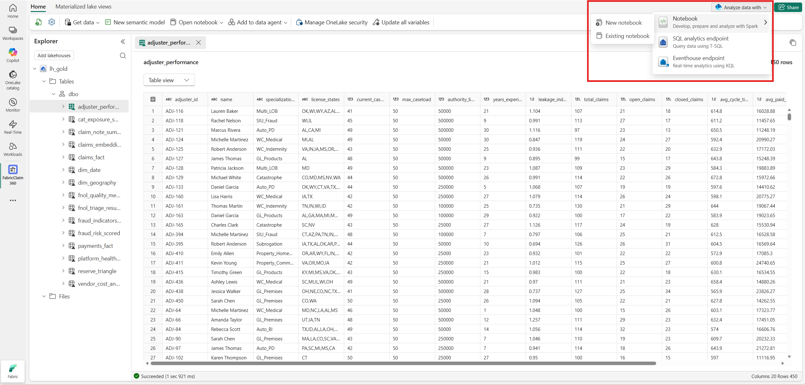

**Abb. · Lakehouse-UI** Ein Lakehouse lässt sich direkt aus der Oberfläche mit SQL-Endpoint oder Notebook analysieren. Quelle: [What is a lakehouse? · Microsoft Learn](https://learn.microsoft.com/fabric/data-engineering/lakehouse-overview)

> **Wann Lakehouse statt Warehouse?** Offizielle Regel: Wenn dein Team Spark kann, wenn un- oder semi-strukturierte Daten dabei sind — oder wenn du unsicher bist. Das Lakehouse ist der „safe default", denn den SQL-Zugang gibt es über den Endpoint gratis dazu.

> **Kein Default-Semantic-Model mehr:** Seit dem 5. September 2025 erzeugt ein neues Lakehouse (wie Warehouse und Mirrored Database) *kein* Default-Semantic-Model mehr; bestehende Default-Modelle wurden bis 30. November 2025 entkoppelt und sind seitdem eigenständige Modelle. Semantische Modelle legst du bewusst selbst an (Sektion 03).

**Weiterlesen:** [What is a lakehouse? · Microsoft Learn](https://learn.microsoft.com/fabric/data-engineering/lakehouse-overview) · [Materialized lake views · Microsoft Learn](https://learn.microsoft.com/fabric/data-engineering/materialized-lake-views/overview-materialized-lake-view) · [Mainzer Datenfabrik: OneLake vs. Lakehouse vs. Warehouse (DE)](https://www.madafa.de/blog/microsoft-fabric-onelake-vs-lakehouse-vs-warehouse)

### Warehouse

*KOMPONENTEN · T-SQL*

Das Fabric Data Warehouse ist das relationale Gegenstück zum Lakehouse: volle T-SQL-Unterstützung inklusive DDL, DML und Multi-Table-Transaktionen — gespeichert wird trotzdem offen in OneLake.

#### Was ist das?

Ein Warehouse fühlt sich an wie eine SQL-Server-Datenbank: Du legst Schemas, Tabellen, Views und Prozeduren mit T-SQL an, lädst per `COPY INTO`, `CTAS`, Pipelines oder Copy job, und transformierst mit Stored Procedures. Unter der Haube speichert es — wie alles in Fabric — Delta Parquet in OneLake, standardmäßig mit V-Order. Die SQL-Engine ist dieselbe, die auch den SQL Analytics Endpoint des Lakehouse bedient.

#### Was das Warehouse exklusiv kann

- **Multi-Table-Transaktionen** — mehrere Tabellen atomar ändern (im Lakehouse nicht möglich)
- **Volle DML/DDL per T-SQL** — INSERT, UPDATE, DELETE, MERGE; der Lakehouse-Endpoint ist read-only
- **SQL-Governance-Features** — granulare GRANTs, RLS/CLS und Dynamic Data Masking auf SQL-Ebene, Time Travel, Zero-Copy-Clones

#### Snippet · Gold-Tabelle per CTAS aus dem Lakehouse

Cross-Database-Queries mit dreiteiligen Namen verbinden Warehouse und Lakehouse im selben Workspace — ohne Kopier-Pipeline:

```dax
-- Im Warehouse ausführen: Lakehouse-Tabellen lesen, physische Gold-Tabelle schreiben
CREATE TABLE dbo.gold_umsatz_monat
AS
SELECT d.CalendarYear,
       d.CalendarMonthNumber,
       c.SalesTerritory,
       SUM(s.TotalExcludingTax) AS UmsatzNetto,
       SUM(s.Profit)            AS Gewinn
FROM wwilakehouse.dbo.fact_sale      AS s
JOIN wwilakehouse.dbo.dimension_date AS d ON s.InvoiceDateKey = d.[Date]
JOIN wwilakehouse.dbo.dimension_city AS c ON s.CityKey = c.CityKey
GROUP BY d.CalendarYear, d.CalendarMonthNumber, c.SalesTerritory;
```

Warum CTAS statt View? Das Ergebnis ist eine echte Delta-Tabelle — Direct Lake kann sie lesen. Eine View würde ein Direct-Lake-Modell in den DirectQuery-Fallback (on SQL) zwingen oder gar nicht erst zulassen (on OneLake).

> **Wann Warehouse statt Lakehouse?** Wenn dein Team aus SQL-Entwicklern besteht, die Daten strukturiert sind und du klassische DWH-Muster brauchst (Stored-Procedure-ELT, transaktionale Konsistenz über mehrere Tabellen). Typisch: der Gold-Layer einer Medallion-Architektur als Warehouse, während Bronze/Silber im Lakehouse liegen — oder, wie in der Daten-WG-Runde zu Fabric-Architekturen diskutiert, auch umgekehrt.

**Weiterlesen:** [What is Fabric Data Warehouse? · Microsoft Learn](https://learn.microsoft.com/fabric/data-warehouse/data-warehousing) · [V-Order im Warehouse · Microsoft Learn](https://learn.microsoft.com/fabric/data-warehouse/v-order) · [Lernpfad: Implement a data warehouse with Microsoft Fabric](https://learn.microsoft.com/training/paths/work-with-data-warehouses-using-microsoft-fabric/) · [Koen Verbeeck: Choosing between Lakehouse and Warehouse](https://www.red-gate.com/simple-talk/databases/sql-server/bi-sql-server/choosing-between-the-lakehouse-and-warehouse-in-microsoft-fabric/)

### SQL Analytics Endpoint

*KOMPONENTEN · LESE-ZUGRIFF*

Jedes Lakehouse bekommt automatisch einen SQL Analytics Endpoint: read-only T-SQL über alle Delta-Tabellen — ohne dass jemand etwas konfiguriert.

#### Was ist das?

Der Endpoint ist ein TDS-Endpunkt (wie ein SQL Server): Du kannst dich mit SSMS, der MSSQL-Erweiterung für VS Code, Power BI oder jedem SQL-Client verbinden und die Lakehouse-Tabellen mit T-SQL abfragen — Views, Inline-Funktionen und Prozeduren anlegen inklusive. Es ist dieselbe Engine wie im Fabric Warehouse, nur im Lese-Modus: **Daten schreiben geht im Lakehouse über Spark, Pipelines & Co., nicht über den Endpoint.** Sichtbar sind nur Delta-Tabellen (auch per Shortcut) — CSV oder Parquet im Files-Bereich nicht.

#### Die zwei Dinge, die man wissen muss

- **Read-only:** Kein INSERT/UPDATE/DELETE auf Daten — der Endpoint ist die Konsum-Schicht des Lakehouse, nicht sein Schreibweg
- **Sync-Latenz:** Neue Delta-Tabellen und -Daten erscheinen im Endpoint über einen Hintergrund-Sync — unter normalen Bedingungen in unter einer Minute. Wer in einer Pipeline schreibt und sofort per SQL liest, sollte den Metadaten-Refresh als Schritt einplanen

#### Snippet · View für Ad-hoc-Analysen

```dax
-- Im SQL analytics endpoint des Lakehouse (Schema dbo)
CREATE VIEW dbo.vw_umsatz_territory
AS
SELECT c.SalesTerritory,
       d.CalendarYear,
       SUM(s.TotalExcludingTax) AS UmsatzNetto,
       COUNT_BIG(*)             AS Positionen
FROM dbo.fact_sale      AS s
JOIN dbo.dimension_city AS c ON s.CityKey = c.CityKey
JOIN dbo.dimension_date AS d ON s.InvoiceDateKey = d.[Date]
GROUP BY c.SalesTerritory, d.CalendarYear;
```

Gut für SQL-Analysten, Excel und Import-Modelle. **Nicht** als Quelle für Direct Lake: *Direct Lake on OneLake* kann nicht-materialisierte Views nicht nutzen, *Direct Lake on SQL* fällt dafür in DirectQuery zurück. Für Direct Lake: Materialized Lake View oder echte Tabelle (CTAS, Karte „Warehouse").

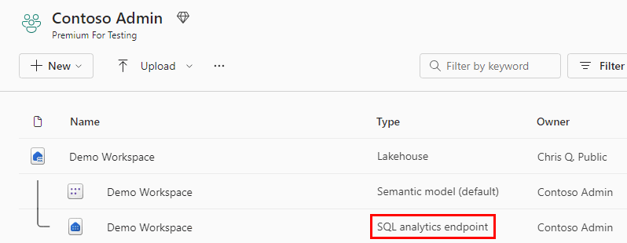

**Abb. · Automatisch erzeugtes Item** Der SQL analytics endpoint erscheint als eigenes Item neben jedem Lakehouse. Quelle: [Fabric Data Warehouse Doku · Microsoft Learn](https://learn.microsoft.com/fabric/data-warehouse/data-warehousing)

> **Für Power-BI-Menschen: Achtung bei SQL-Security:** Der Endpoint ist der Weg, ein Lakehouse per Import oder DirectQuery anzubinden — und die Grundlage von „Direct Lake on SQL". Am Endpoint definierte RLS, OLS oder Dynamic Data Masking zwingen *Direct Lake on SQL* in den DirectQuery-Fallback. *Direct Lake on OneLake* liest dagegen direkt aus OneLake und wendet SQL-RLS **nicht** an — dort gehört die Zeilensicherheit in OneLake Security oder ins semantische Modell.

**Weiterlesen:** [SQL analytics endpoint · Microsoft Learn](https://learn.microsoft.com/fabric/data-engineering/lakehouse-sql-analytics-endpoint) · [Direct Lake security integration · Microsoft Learn](https://learn.microsoft.com/fabric/fundamentals/direct-lake-security-integration)

### Pipelines & Copy — Datenintegration

*KOMPONENTEN · DATA FACTORY*

Pipelines sind das Orchestrierungs-Werkzeug von Fabric Data Factory: Daten kopieren, Notebooks und Prozeduren aufrufen, Abläufe steuern — per Zeitplan, Event oder auf Abruf. Für reine Datenbewegung gibt es zusätzlich den Copy job.

#### Die Bausteine

- **Copy Activity** — der Arbeits-Baustein in Pipelines (Item-Typ heißt heute schlicht „Pipeline"): kopiert Daten aus Dutzenden Quellen nach Lakehouse/Warehouse, skaliert bis in den Petabyte-Bereich, mit leichten Transformationen (Mapping, Format)
- **Copy job** — Datenbewegung ohne Pipeline-Bau: Full Copy, inkrementell per Watermark oder per CDC (inkl. Deletes); Schreibmodi Append, Merge, Overwrite und **SCD Typ 2** (Preview, mit `Valid_From`/`Valid_To`/`Is_Current`); optional Audit-Spalten und Auto-Partitionierung
- **Control Flow** — ForEach, Lookup, If, Invoke Pipeline: verschachtelte Orchestrierung wie in Azure Data Factory
- **Transformation-Activities** — Notebook, Dataflow Gen2, Stored Procedure, Script, User Data Function: die eigentliche Verarbeitung delegieren
- **Trigger** — Schedule, Event-basiert (z. B. „neue Datei im Storage") oder on demand

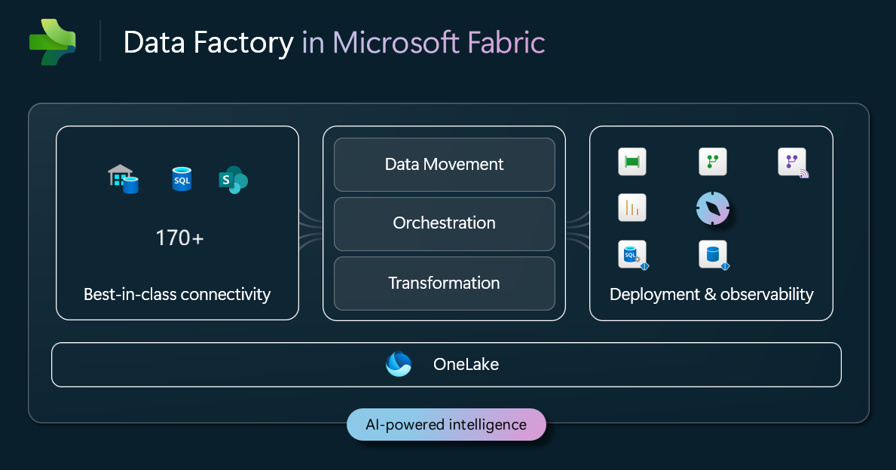

**Abb. · Der Data-Factory-Stack** Konnektoren → Movement/Orchestrierung/Transformation → Analytics, alles auf OneLake. Quelle: [What is Data Factory? · Microsoft Learn](https://learn.microsoft.com/fabric/data-factory/data-factory-overview)

> **Leistungs-Referenz:** Microsofts offizielle FAQ-Benchmark: Ein 1-TB-TPC-DI-Datensatz (Parquet) landet in rund 5 Minuten im Lakehouse/Warehouse — eine Milliarde Zeilen in unter einer Minute. Echte Durchsätze hängen an Quelle, Ziel und Netzwerk.

> **On-Premises-Quellen:** Für lokale Datenbanken braucht es das On-Premises Data Gateway — oder man dreht die Richtung um und *pusht* von on-prem nach Fabric (z. B. aus SSIS heraus, siehe Daten-WG-Folgen unten). Für ganze Datenbanken lohnt außerdem der Blick auf Mirroring (SQL Server, Oracle, SAP u. a.).

**Weiterlesen:** [What is Data Factory? · Microsoft Learn](https://learn.microsoft.com/fabric/data-factory/data-factory-overview) · [Copy Activity · Microsoft Learn](https://learn.microsoft.com/fabric/data-factory/copy-data-activity) · [What is Copy job? · Microsoft Learn](https://learn.microsoft.com/fabric/data-factory/what-is-copy-job) · [CDC & SCD Typ 2 im Copy job · Microsoft Learn](https://learn.microsoft.com/fabric/data-factory/cdc-copy-job)

### Dataflow Gen2

*KOMPONENTEN · LOW-CODE ETL*

Dataflow Gen2 ist Power Query als Fabric-Service: dieselbe Oberfläche, die jeder Power-BI-Entwickler kennt — aber das Ergebnis landet als Delta-Tabelle im Lakehouse oder Warehouse.

#### Was ist das?

Ein Dataflow Gen2 verbindet sich mit Hunderten Quellen, transformiert mit über 300 Power-Query-Funktionen (M-Engine) und schreibt in ein konfigurierbares **Ziel**: Lakehouse, Warehouse, Eventhouse (KQL) oder Azure SQL. Damit ist er die natürliche Brücke für Power-BI-Teams: bekannte Oberfläche, neues Ziel — statt ins eigene Modell hinein transformiert man in die Plattform hinein, wo alle das Ergebnis nutzen können.

#### Gen2 vs. Gen1 (Power-BI-Dataflows)

- **Output Destinations:** Gen1 speicherte nur in den eigenen internen Storage; Gen2 schreibt echte Delta-Tabellen in Lakehouse/Warehouse
- **Fast Copy & Co.:** Große Ladevorgänge nutzen die Copy-Infrastruktur. Microsofts Benchmark (August 2026): Bulk-Load mit Fast Copy rund **11× schneller als Gen1** (9:08 min statt 1:38 h) bei 83 % weniger CU. Modern Evaluator, „Optimized copy to Lakehouse" und Partitioned Compute (Preview) beschleunigen weitere Muster
- **CI/CD & Pipelines:** Seit April 2026 entstehen neue Dataflow Gen2 immer mit Git- und Deployment-Pipeline-Unterstützung; Dataflows lassen sich als Pipeline-Activity orchestrieren und parametrisieren
- **Gen1 auslaufen lassen:** Microsoft empfiehlt, Gen1-Dataflows nach Gen2 zu migrieren (z. B. per „Save As")

> **Wann Dataflow, wann Notebook?** Offizielle Personas: Dataflow Gen2 für Business-Analysten und „Citizen Engineers" (Low-Code), Notebooks für Data Engineers (Code-First, komplexe Logik, unstrukturierte Daten). Beide schreiben am Ende dieselben Delta-Tabellen — die Wahl ist eine Team-Frage, keine Architektur-Frage.

> **Kosten im Blick:** Standard-Compute kostet 12 CU pro Sekunde in den ersten 10 Minuten, danach 1,5 CU pro Sekunde; Fast Copy wird separat nach Kern-Sekunden abgerechnet. Kurze Dataflows profitieren deshalb weniger als lange — Verbrauch in der Capacity Metrics App prüfen (das Daten-WG-Tutorial unten rechnet es durch).

**Weiterlesen:** [What is Dataflow Gen2? · Microsoft Learn](https://learn.microsoft.com/fabric/data-factory/dataflows-gen2-overview) · [Dataflow Gen2: Benchmarks & CU-Kosten · Microsoft Learn](https://learn.microsoft.com/fabric/data-factory/dataflow-gen2-cost-performance-benchmarks) · [Migration Gen1 → Gen2 · Microsoft Learn](https://learn.microsoft.com/fabric/data-factory/dataflow-gen2-migrate-from-dataflow-gen1)

**Daten-WG dazu:**

- **[Microsoft Fabric Dataflow Gen2 Kosten verstehen — CU-Verbrauch einfach erklärt](https://youtu.be/z51gWRc0zVc)** · Tutorial · 14 min · DE · [Knowledge Kitchen](../index.html#ep-z51gWRc0zVc)

### Notebooks & Spark

*KOMPONENTEN · CODE-FIRST*

Fabric-Notebooks sind die Code-First-Werkbank: PySpark, Spark SQL, Scala und R in Zellen, direkt verdrahtet mit dem Lakehouse — für Transformation, Analyse und Machine Learning.

#### Was ist das?

Ein Notebook läuft auf dem verwalteten Fabric-Spark-Pool (kein Cluster-Management, die Session startet in Sekunden) und mischt Code, Markdown und Ergebnisse. Links hängt der **Lakehouse-Explorer**: Dateien und Tabellen des angehefteten Lakehouse sind per Drag-and-drop oder Kontextmenü direkt als DataFrame ladbar. Sprachen wechselt man per Magic Command (`%%pyspark`, `%%sql`, …), Bibliotheken installiert man mit `%pip`.

#### Snippet · Gold-Tabelle für Direct Lake schreiben

```
from pyspark.sql.functions import col

# Silber lesen (Lakehouse mit Schemas: schema.tabelle)
df = spark.read.table("dbo.fact_sale")

# Gold: nur gültige Zeilen und nur die Spalten, die der Bericht braucht
gold = (df
    .filter(col("Quantity") > 0)
    .select("SaleKey", "InvoiceDateKey", "CityKey", "CustomerKey",
            "StockItemKey", "SalespersonKey",
            "Quantity", "TotalExcludingTax", "Profit"))

(gold.write
    .format("delta")
    .mode("overwrite")
    .option("parquet.vorder.enabled", "true")   # V-Order für diesen Write
    .saveAsTable("dbo.gold_fact_sale"))

# Viele kleine Dateien zusammenfassen und V-Order anwenden
spark.sql("OPTIMIZE dbo.gold_fact_sale VORDER")
```

Schmale Gold-Tabellen sparen Speicher im Direct-Lake-Modell (es lädt nur benötigte Spalten), `OPTIMIZE` hält die Parquet-Dateien unter den Guardrails (Sektion 03).

#### NotebookUtils — der Werkzeugkasten

- **notebookutils.fs** — Dateisystem-Operationen auf OneLake (kopieren, verschieben, auflisten)
- **notebookutils.notebook.run / exit** — Notebooks orchestrieren, auch parallel und workspace-übergreifend
- **Credentials/Secrets** — Zugriff auf Azure Key Vault ohne Klartext-Passwörter im Code
- Achtung: der alte Namespace `mssparkutils` ist abgekündigt — neuer Code nutzt `notebookutils`

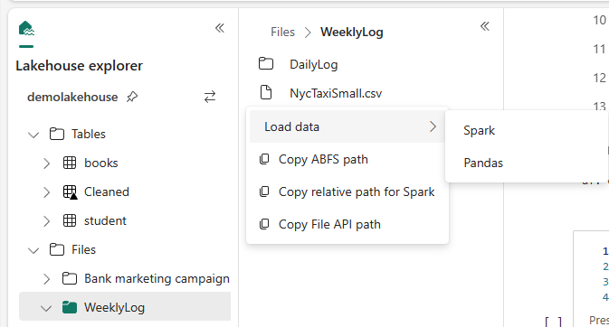

**Abb. · Notebook + Lakehouse** Dateien aus dem Lakehouse-Explorer direkt als DataFrame laden. Quelle: [Fabric Notebooks · Microsoft Learn](https://learn.microsoft.com/fabric/data-engineering/author-execute-notebook)

> **V-Order ist für Spark nicht mehr Standard:** Neue Workspaces starten mit dem Resource Profile `writeHeavy` — V-Order ist dort *aus*, weil Schreiben Vorrang hat. Für Tabellen, die Direct Lake liest, V-Order bewusst einschalten: pro Write (wie oben), per Tabellen-Property `delta.parquet.vorder.enabled` oder per Profil `spark.conf.set("spark.fabric.resourceProfile", "readHeavyForPBI")`.

**Weiterlesen:** [Notebooks entwickeln & ausführen · Microsoft Learn](https://learn.microsoft.com/fabric/data-engineering/author-execute-notebook) · [Delta-Optimierung & V-Order · Microsoft Learn](https://learn.microsoft.com/fabric/data-engineering/delta-optimization-and-v-order) · [Resource Profiles · Microsoft Learn](https://learn.microsoft.com/fabric/data-engineering/resource-profiles-overview) · [NotebookUtils · Microsoft Learn](https://learn.microsoft.com/fabric/data-engineering/notebook-utilities)

**Daten-WG dazu:**

- **[SSIS: Fabric Notebook per REST API starten](https://youtu.be/NvtZ-ehiTrg)** · Tutorial · 7 min · DE · [Knowledge Kitchen](../index.html#ep-NvtZ-ehiTrg)

### Eventhouse & Real-Time Intelligence

*KOMPONENTEN · STREAMING*

Für Event- und Streamingdaten hat Fabric einen eigenen Pfad: Eventstream nimmt Ereignisse auf, das Eventhouse speichert und analysiert sie mit KQL, Activator löst Aktionen aus.

#### Die Real-Time-Kette

- **Eventstream** — No-Code-Ingestion: Quellen wie Azure Event Hubs, IoT Hub, Kafka, CDC-Feeds aus Datenbanken oder Fabric-eigene Events; unterwegs filtern, aggregieren, routen
- **Eventhouse** — der Speicher: Container für eine oder mehrere **KQL-Datenbanken**, optimiert für Zeitreihen und hohe Event-Raten („query billions of events in seconds"); abfragbar per KQL *und* T-SQL
- **Real-Time Dashboards / KQL Querysets** — Analyse und Visualisierung mit Sekunden-Latenz
- **Activator** — No-Code-Regeln: „Wenn Sensorwert über X, dann Teams-Nachricht / E-Mail / Pipeline starten"

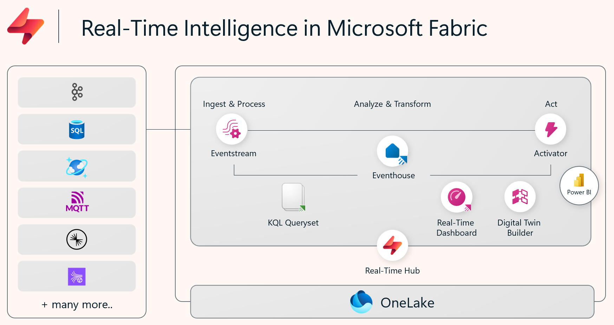

**Abb. · Real-Time Intelligence** Vom Event über Eventstream und Eventhouse bis zu Dashboard und Aktion. Quelle: [What is Real-Time Intelligence? · Microsoft Learn](https://learn.microsoft.com/fabric/real-time-intelligence/overview)

#### Anschluss an die BI-Welt

Eventhouse-Daten lassen sich in OneLake verfügbar machen (OneLake Availability) — dann können auch Spark, SQL und Power BI darauf zugreifen. Für klassische BI-Teams ist das der Punkt, an dem Streaming- und Batch-Welt zusammenlaufen.

> **Wann brauche ich das?** IoT-Telemetrie, Clickstreams, Log-Analysen, Bewegungsdaten — überall, wo Ereignisse pro Sekunde statt Zeilen pro Nacht ankommen und die Frage „was passiert gerade?" lautet. Für klassisches Finanz-Reporting: gar nicht.

**Weiterlesen:** [Real-Time Intelligence · Microsoft Learn](https://learn.microsoft.com/fabric/real-time-intelligence/overview) · [Eventhouse overview · Microsoft Learn](https://learn.microsoft.com/fabric/real-time-intelligence/eventhouse)

### Medallion: Bronze · Silber · Gold

Siehe den gleichnamigen Abschnitt weiter oben.

Weiter vertiefen Sektion 02: OneLake, Lakehouse, Warehouse & Data Factory

Daten-WG · Sprung ins Video

- [25:06 Shortcuts als Killer-Feature des Lakehouse](https://www.youtube.com/watch?v=mTVeZzshLzE&t=1506s) Microsoft Fabric — braucht das wirklich jemand? · [Karte in der Kitchen](../index.html#ep-mTVeZzshLzE)
- [05:04 Shortcut Transformation: warum die ganze Partition ersetzt wird](https://www.youtube.com/watch?v=Z6RZjkn_6lY&t=304s) Shortcut Transformation erklärt · [Karte in der Kitchen](../index.html#ep-Z6RZjkn_6lY)
- [02:10 Blick ins Delta Log — Grundlage für Time Travel](https://www.youtube.com/watch?v=_AxvdCW0ST4&t=130s) Microsoft Fabric Time Travel erklärt · [Karte in der Kitchen](../index.html#ep-_AxvdCW0ST4)
- [17:21 Immer drei Layer — und die sind nicht diskutabel](https://www.youtube.com/watch?v=J-lN5JN-F5I&t=1041s) Daten-WG Life-Update · Fabric Architekturen · [Karte in der Kitchen](../index.html#ep-J-lN5JN-F5I)
- [21:26 SCD Typ 2 im Copy Job (Preview)](https://www.youtube.com/watch?v=pTTYySb0Cyg&t=1286s)Fabric & Power BI Quarterly · 2026-2 · [Karte in der Kitchen](../index.html#ep-pTTYySb0Cyg)

DatenWG Library · Themen

- [OneLake](../wissensgraph/thema/onelake.html)
- [Lakehouse](../wissensgraph/thema/lakehouse.html)
- [Delta Lake](../wissensgraph/thema/delta-lake.html)
- [Data Pipeline](../wissensgraph/thema/data-pipeline.html)
- [Notebook](../wissensgraph/thema/notebook.html)

Microsoft Learn · Doku & Training

- [Shortcut-Transformationen (CSV/Parquet/JSON → Delta)](https://learn.microsoft.com/fabric/onelake/shortcuts/transformations)
- [Was ist ein Copy job?](https://learn.microsoft.com/fabric/data-factory/what-is-copy-job)
- [Delta-Optimierung & V-Order](https://learn.microsoft.com/fabric/data-engineering/delta-optimization-and-v-order)
- [Lernpfad: Implement a Lakehouse with Microsoft Fabric](https://learn.microsoft.com/training/paths/implement-lakehouse-microsoft-fabric/)
- [Lernpfad: Implement a data warehouse with Microsoft Fabric](https://learn.microsoft.com/training/paths/work-with-data-warehouses-using-microsoft-fabric/)

## 03 · Semantische Modelle & *Direct Lake*

Das semantische Modell ist die Brücke zwischen Fabric und Power BI: Measures, Beziehungen und Business-Logik über den Delta-Tabellen. Neu in Fabric ist Direct Lake — ein Storage Mode, der Import-Performance mit DirectQuery-Frische kombiniert, weil er Delta-Dateien direkt aus OneLake liest. Und weil Copilot, Fabric Data Agents und MCP-Clients ihre Antworten aus genau diesen Modellen ziehen, ist ein sauberes Modell heute auch die Grundlage für KI.

> Als erstes: **„Direct Lake verstehen"** — das ist der Grund, warum sich Fabric für Power-BI-Teams lohnt. Danach **„Import · DirectQuery · Direct Lake"** für die Einordnung gegen die bekannten Modi.

**0** — Datenkopien & klassische Refreshes

**Direct Lake importiert nichts:** Das Modell lädt Spalten bei Bedarf direkt aus den Delta-Parquet-Dateien in OneLake in den Speicher. Ein „Refresh" ist nur noch eine Metadaten-Operation (Framing) — Sekunden statt Stunden, auch bei Milliarden Zeilen.

**Warum das funktioniert:** Delta-Parquet mit V-Order-Kompression ist so organisiert, dass die VertiPaq-Engine die Daten fast direkt verarbeiten kann (Transcoding statt Import). Abfragen laufen In-Memory wie im Import Mode.

**Der Haken:** Guardrails pro F-SKU (Zeilen, Dateien, Row Groups, Speicher) — bei *Direct Lake on SQL* ein möglicher Fallback auf DirectQuery, bei *Direct Lake on OneLake* ein fehlschlagendes Framing. Details in den Karten.

### Rolle des semantischen Modells

Siehe den gleichnamigen Abschnitt weiter oben.

### Fabric Semantic Model erstellen

*SEMANTIK · AUFBAU*

Ein semantisches Modell auf Lakehouse- oder Warehouse-Tabellen ist in Minuten angelegt — modelliert wird direkt im Browser oder per Live-Editing in Power BI Desktop. Das Modell liegt dabei immer im Workspace, nicht auf deinem Rechner.

#### Modell anlegen — drei Wege

**Im Browser:** *Create → OneLake catalog* → Lakehouse/Warehouse wählen (oder im Item *New semantic model*) → Name, Workspace, Tabellen → Modell im Modus **Direct Lake on OneLake**. **In Power BI Desktop:** *OneLake catalog* → Lakehouse/Warehouse → *Connect* → das Modell entsteht im Workspace, Desktop editiert es live (ebenfalls Direct Lake on OneLake). **Über den SQL analytics endpoint:** *New semantic model* → hier wählst du zwischen Direct Lake on OneLake und on SQL. In allen Fällen: nur Gold-Tabellen auswählen, nicht „alles rein".

#### Beziehungen definieren

Im Model View (Browser: Modell öffnen → *Editing*) Fakten mit Dimensionen verbinden — per Drag-and-drop wie in Desktop. Ziel ist das Sternschema: n:1 von der Fakten- zur Dimensionstabelle, Single-Direction-Filter, bei sauberen Schlüsseln „Assume referential integrity". Achtung: Die Datentypen der Schlüsselspalten müssen übereinstimmen, und die 1-Seite muss eindeutig sein — sonst schlagen Abfragen fehl.

#### Measures schreiben

DAX-Measures direkt im Browser anlegen — oder in Power BI Desktop: *OneLake catalog* → semantisches Modell → *Connect ▾ → Edit*. TMDL-Ansicht und DAX-Abfrageansicht funktionieren auch beim Live-Editing; pro Sitzung legt Fabric einen Eintrag in der Versionshistorie an. Ein komplettes Measure-Set für das Beispielmodell steht in Sektion 04 („Semantisches Modell aufbauen").

#### Einstellungen prüfen

In den Modell-Settings: **„Keep your Direct Lake data up to date"** (automatisches Framing bei Datenänderungen, Standard: an), bei *Direct Lake on SQL* zusätzlich das Fallback-Verhalten (`DirectLakeBehavior`), bei RLS eine Cloud-Connection mit fester Identität (von Microsoft dringend empfohlen) und Endorsement (Promoted/Certified) für Self-Service-Nutzer.

> **Profi-Weg: XMLA & Tools:** Fabric-Modelle sprechen das XMLA-Protokoll — Tabular Editor, SSMS und CI/CD über TMDL funktionieren wie bei Premium-Datasets; für Direct-Lake-Metadaten braucht das Tool Compatibility Level 1604 oder höher. Wer aus der Enterprise-Power-BI-Welt kommt, nimmt seinen Werkzeugkasten mit (Karte „Nutzung in Power BI & XMLA").

**Weiterlesen:** [Develop Direct Lake semantic models · Microsoft Learn](https://learn.microsoft.com/fabric/fundamentals/direct-lake-develop) · [Direct Lake in Power BI Desktop · Microsoft Learn](https://learn.microsoft.com/fabric/fundamentals/direct-lake-power-bi-desktop) · [Direct Lake im Web-Modeling · Microsoft Learn](https://learn.microsoft.com/fabric/fundamentals/direct-lake-web-modeling)

### Direct Lake verstehen

*SEMANTIK · DEEP DIVE*

Direct Lake ist der dritte Storage Mode neben Import und DirectQuery — und der Grund, warum Fabric für Power-BI-Teams strategisch ist: Import-Performance ohne Import.

#### Wie es funktioniert

Ein Direct-Lake-Modell lädt **keine Daten beim Refresh**. Stattdessen lädt die VertiPaq-Engine einzelne **Spalten on-demand** direkt aus den Delta-Parquet-Dateien in OneLake in den Speicher — genau die Spalten, die die aktuelle Abfrage braucht (plus die für Beziehungen und Measures). Dieses Umkodieren heißt **Transcoding** und ist besonders schnell, wenn die Dateien mit **V-Order** geschrieben wurden. Das Warehouse tut das standardmäßig; Spark in neuen Workspaces *nicht* (Resource Profile `writeHeavy`) — dort schaltest du V-Order für Gold-Tabellen bewusst ein. Einmal geladene Spalten bleiben im Speicher — Folgeabfragen laufen In-Memory wie im Import Mode.

#### Framing — der neue „Refresh"

Ein Refresh ist bei Direct Lake nur noch eine **Metadaten-Operation in Sekunden**: Das Modell „rahmt" sich auf die neueste Version der Delta-Tabelle (Framing). Abfragen zeigen immer den Stand des letzten Framings — mit der Einstellung „Keep your Direct Lake data up to date" (Standard: an) passiert das automatisch, sobald sich Daten ändern. Inkrementelles Framing verwirft dabei nur die Spaltensegmente, die sich geändert haben; Wörterbücher bleiben meist erhalten, der Rest bleibt warm im Speicher. Für ETL-Strecken kann man die Automatik abschalten und erst nach dem Laden gezielt framen.

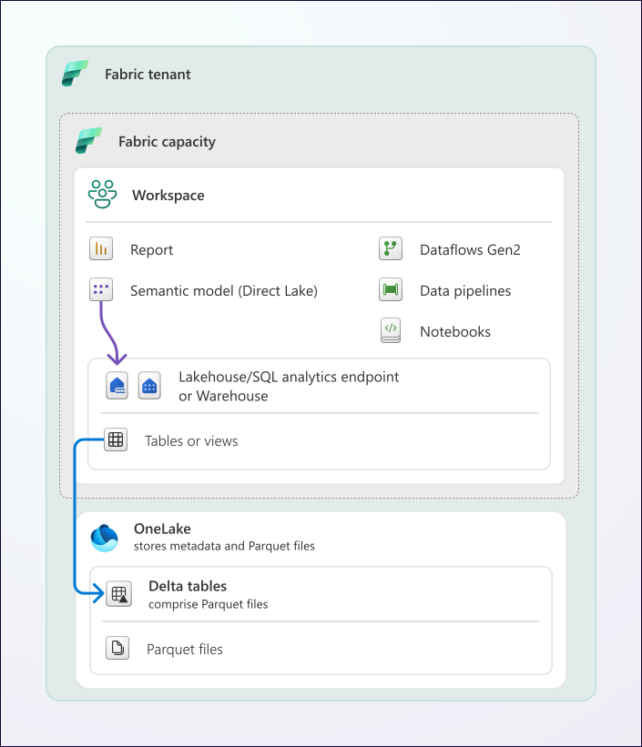

**Abb. · Direct Lake vs. Import vs. DirectQuery** Direct Lake liest die Delta-Dateien direkt — kein Import-Duplikat, keine Quell-Query pro Visual. Quelle: [Direct Lake overview · Microsoft Learn](https://learn.microsoft.com/fabric/fundamentals/direct-lake-overview)

#### Zwei Varianten — die wichtigste Unterscheidung

- **Direct Lake on OneLake** — die für neue Modelle empfohlene Variante (Standard beim Anlegen aus OneLake catalog und Power BI Desktop): liest direkt aus OneLake, kann Tabellen aus *mehreren* Fabric-Quellen kombinieren und Import-Tabellen dazunehmen, effizientere Abfragepläne, integriert mit OneLake Security. Läuft immer „DirectLakeOnly" — **kein DirectQuery-Fallback**; SQL-RLS am Endpoint wird hier nicht angewendet
- **Direct Lake on SQL endpoints** — die erste Generation: genau eine Quelle, Tabellen- und Berechtigungsprüfung über den SQL Analytics Endpoint, kann bei Views, SQL-Security oder Guardrail-Verletzung in **DirectQuery zurückfallen**

Quellen für beide Varianten: Lakehouse, Warehouse, SQL database in Fabric, Mirrored Databases, Mirrored Azure Databricks Catalog und das Snowflake-database-Item; nur „on OneLake" zusätzlich Cosmos DB in Fabric und KQL-Datenbanken (mit OneLake Availability).

> **Performance-Grundregeln:** V-Order für Gold-Tabellen aktiv, Integer-Keys statt Strings, Delta-Tabellen regelmäßig mit OPTIMIZE kompaktieren, nur benötigte Spalten ins Modell, Kardinalität niedrig halten. Das meiste davon ist ohnehin Sternschema-Hygiene.

**Weiterlesen:** [How Direct Lake works · Microsoft Learn](https://learn.microsoft.com/fabric/fundamentals/direct-lake-how-it-works) · [Direct Lake overview (Varianten & Quellen) · Microsoft Learn](https://learn.microsoft.com/fabric/fundamentals/direct-lake-overview) · [Nikola Ilic: A tale of two Direct Lakes](https://data-mozart.com/a-tale-of-two-direct-lakes-in-microsoft-fabric/) · [Sandeep Pawar: Incremental framing effect](https://fabric.guru/direct-lake-incremental-framing-effect)

**Daten-WG dazu:**

- **[#010 · Import vs. DirectQuery vs. Direct Lake — was ist schneller?](https://youtu.be/9u9YbdMUU-s)** · Short · 28 s · DE · [Knowledge Kitchen](../index.html#ep-9u9YbdMUU-s)

### Guardrails & DirectQuery-Fallback

*SEMANTIK · GRENZEN*

Direct Lake hat harte Obergrenzen pro F-SKU — die Guardrails. Wer sie überschreitet, landet je nach Variante im DirectQuery-Fallback oder im Framing-Fehler. Beides sollte man kennen, bevor es passiert.

#### Die Guardrails (offizielle Tabelle, Stand Oktober 2026)

| Fabric SKU | Parquet-Dateien / Tabelle¹ | Zeilen / Tabelle | Modellgröße auf Disk/OneLake | Max Memory² |
| --- | --- | --- | --- | --- |
| F2–F8 | 1.000 | 300 Mio. | 10 GB | 3 GB |
| F16 | 1.000 | 300 Mio. | 20 GB | 5 GB |
| F32 | 1.000 | 300 Mio. | 40 GB | 10 GB |
| **F64** (≙ alte P1) | 5.000 | 1,5 Mrd. | unbegrenzt | 25 GB |
| F128 | 5.000 | 3 Mrd. | unbegrenzt | 50 GB |
| F256 | 5.000 | 6 Mrd. | unbegrenzt | 100 GB |
| F512 | 10.000 | 12 Mrd. | unbegrenzt | 200 GB |
| F1024–F8192 | 10.000 | 24 Mrd. | unbegrenzt | 400 GB |

¹ Dasselbe Limit gilt zusätzlich für *Row Groups* pro Tabelle. ² Max Memory ist laut Microsoft **kein Guardrail**, sondern die Obergrenze, wie viel Modelldaten gleichzeitig im Speicher gehalten werden — wird sie eng, lagert die Engine Spalten aus und lädt sie neu (Paging), was Abfragen verlangsamt, aber keinen Fallback auslöst. Die Modellgröße auf Disk wird auf Modellebene geprüft, alle übrigen Guardrails pro Abfrage.

Wichtig: **Eine einzige Tabelle über dem Limit** betrifft das ganze Modell. Häufigster Auslöser sind übrigens nicht die Zeilen, sondern zu viele kleine Parquet-Dateien bzw. Row Groups — Abhilfe: `OPTIMIZE` (Kompaktierung) und `VACUUM` auf der Delta-Tabelle; erst wenn das nicht reicht, ist die größere SKU dran.

#### Was den Fallback auslöst (nur Direct Lake on SQL)

- Guardrail-Überschreitung (Zeilen, Dateien, Row Groups)
- RLS, OLS oder Dynamic Data Masking, die am SQL-Endpoint (statt im Modell) definiert sind
- Nicht-materialisierte SQL-Views als Modell-Quelle
- Tabellen, die nach dem Anlegen oder Ändern noch nicht geframt (refresht) wurden

Im Fallback beantwortet DirectQuery die Abfrage — der Refresh gelingt mit Warnung, der Bericht funktioniert weiter, wird aber spürbar langsamer. **Direct Lake on OneLake** kennt keinen Fallback: Bei einer Guardrail-Verletzung schlägt der Refresh fehl wie im Import Mode, und das Modell ist erst wieder abfragbar, wenn die Delta-Tabellen unter die Limits optimiert sind. Laut, aber ehrlich.

#### Fallback steuern (Direct Lake on SQL)

Modell-Property `DirectLakeBehavior` (Model View → Eigenschaften → „Direct Lake behavior"): **Automatic** (Standard, stiller Fallback — Microsofts Empfehlung für Produktion, damit Berichte verfügbar bleiben), **DirectLakeOnly** (Abfrage schlägt fehl — Empfehlung für die Entwicklung, damit Probleme sichtbar werden) oder **DirectQueryOnly** (zum Messen der Fallback-Performance).

#### Diagnose per DAX-Abfrageansicht

```dax
// Läuft jede Tabelle wirklich in Direct Lake?
// Spalte [DirectLakeFallbackInfo]: "None" = alles gut, sonst steht der Grund da
EVALUATE
    TABLETRAITS ()
```

Ergänzend im Performance Analyzer oder in DAX Studio prüfen, ob Queries als DirectQuery ankommen. Fehlgeschlagene Framings listet die Refresh-Historie im Tab „Direct Lake".

**Weiterlesen:** [Direct Lake overview (Guardrail-Tabelle) · Microsoft Learn](https://learn.microsoft.com/fabric/fundamentals/direct-lake-overview) · [DirectQuery fallback & DirectLakeBehavior · Microsoft Learn](https://learn.microsoft.com/fabric/fundamentals/direct-lake-how-it-works) · [Chris Webb: What happens when models hit guardrails?](https://blog.crossjoin.co.uk/2025/09/07/what-happens-when-power-bi-direct-lake-semantic-models-hit-guardrails/) · [Sandeep Pawar: Controlling fallback behavior](https://fabric.guru/controlling-direct-lake-fallback-behavior)

### Import · DirectQuery · Direct Lake

*SEMANTIK · STORAGE MODES*

Drei Modi, drei Trade-offs. Die offizielle Kurzformel: Import = schnellste Abfragen, DirectQuery = frischeste Daten, Direct Lake = beides — sofern die Daten als Delta in OneLake liegen.

#### Der Vergleich

- **Import** — Daten werden ins Modell kopiert und komprimiert. Schnellste Abfragen, volle DAX/Feature-Unterstützung, mit jeder Lizenz nutzbar. Preis: Refresh-Latenz, Duplikat, Refresh-Dauer wächst mit den Daten
- **DirectQuery** — jede Visual-Interaktion wird zur Quell-Query. Immer aktuell, kein Duplikat. Preis: Performance hängt an der Quelle, eingeschränkte DAX-Features, Last auf der Quelle
- **Direct Lake** — liest Delta-Parquet direkt aus OneLake in den Speicher. Import-nahe Performance, Aktualität per Framing in Sekunden, kein Duplikat. Preis: nur mit Fabric-Kapazität und nur für Daten in OneLake, Guardrails pro SKU, Feature-Lücken: keine Hybrid Tables, keine benutzerdefinierten Aggregationen, keine Modell-Partitionen (partitioniert wird in der Delta-Tabelle). Calculated Columns (nur User Context) und Calculated Tables gibt es nur in der OneLake-Variante — als Preview

#### Composite: Direct Lake + Import

**Direct Lake on OneLake** lässt sich mit Import-Tabellen beliebiger Quellen kombinieren (im Web-Modeling) und per XMLA-Tools auch mit DirectQuery-Tabellen. **Direct Lake on SQL** erlaubt im selben Modell keine anderen Storage Modes — dort bleibt nur ein Composite-Modell *auf* dem Direct-Lake-Modell in Desktop.

#### Wann welcher Modus?

- **Import:** kleine bis mittlere Modelle, externe Quellen ohne Fabric, maximale Feature-Tiefe, Self-Service mit Power Query im Modell
- **DirectQuery:** operatives Reporting auf transaktionalen Systemen, wenn Sekunden-Frische wichtiger ist als Antwortzeit — oder Quell-RLS greifen soll (z. B. Snowflake-SSO)
- **Direct Lake:** große Datenmengen, die ohnehin in Fabric liegen — Microsofts Empfehlung für lake-zentrierte, IT-getriebene Analytics; ideal als Gold-Schicht der Medallion-Architektur

> **Community-Faustregel (Marco Russo, SQLBI):** Nicht dogmatisch entscheiden: Große Faktentabellen profitieren von Direct Lake, kleine, stabile Dimensionen oder Sonderquellen können importiert bleiben — die Kombination Direct Lake on OneLake + Import ist oft der Sweet Spot.

**Weiterlesen:** [Direct Lake overview (Vergleichstabelle) · Microsoft Learn](https://learn.microsoft.com/fabric/fundamentals/direct-lake-overview) · [Semantic model modes · Microsoft Learn](https://learn.microsoft.com/power-bi/connect-data/service-dataset-modes-understand) · [SQLBI: Direct Lake vs Import vs Direct Lake+Import](https://www.sqlbi.com/blog/marco/2025/05/13/direct-lake-vs-import-vs-direct-lakeimport-fabric-semantic-models-may-2025/)

**Daten-WG dazu:**

- **[#013 · Import, DirectQuery, Direct Lake oder Dual Mode — was ist eigentlich was?](https://youtu.be/u5JMKAM8GB0)** · Short · 85 s · DE · [Knowledge Kitchen](../index.html#ep-u5JMKAM8GB0)

### Nutzung in Power BI & XMLA

*SEMANTIK · KONSUM*

Ein Fabric-Modell konsumiert man wie jedes Power-BI-Modell: Live-Verbindung aus Desktop oder Web, Excel-Pivot, oder — für Profis — über den XMLA-Endpoint mit Tabular Editor & Co.

#### Die Konsum-Wege

- **Power BI Desktop, Bericht bauen:** *OneLake catalog* → semantisches Modell → *Connect* = Live-Verbindung (mindestens Build-Berechtigung). Report-Measures sind möglich, ohne das Modell zu ändern
- **Power BI Desktop, Modell ändern:** *Connect ▾ → Edit* öffnet das Direct-Lake-Modell zum Live-Editing — Änderungen wirken sofort im Workspace (kein Publish), inklusive TMDL-Ansicht und DAX-Abfrageansicht. Über PBIP lassen sich die Metadaten (ohne Daten) lokal und in Git ablegen
- **Im Browser:** Bericht direkt im Service auf dem Modell anlegen — für schnelle Explorationen oft der kürzeste Weg
- **Excel:** „Analyze in Excel" liefert Pivot-Zugriff auf dieselben Measures; bei Direct-Lake-Tabellen gelten DirectQuery-ähnliche MDX-Einschränkungen (z. B. keine sitzungsbezogenen Named Sets, keine benutzerdefinierten Hierarchien auf Direct-Lake-Tabellen)
- **Import/DirectQuery klassisch:** Wer will, verbindet Desktop auch über den SQL Analytics Endpoint und baut ein klassisches Import-Modell

#### XMLA — der Enterprise-Zugang

Fabric-Workspaces sprechen das XMLA-Protokoll der Analysis-Services-Engine (Verbindung: `powerbi://api.powerbi.com/v1.0/myorg/<workspace>`). Damit funktionieren **Tabular Editor** (Modell-Entwicklung, Calculation Groups, Best Practice Analyzer), **SSMS** (Verwaltung, Profiler), **DAX Studio** (Performance) und CI/CD über TMDL/TMSL — für Direct-Lake-Metadaten mit Compatibility Level 1604+. Read/Write muss in den Kapazitäts-Einstellungen aktiviert sein. Auch der lokale Power-BI-Modeling-MCP-Server nutzt diesen Weg (Karte „Copilot, Data Agents & MCP").

> **Aktualität im Bericht prüfen:** Bei Direct-Lake-Berichten zeigt „Datenaktualisierung" das letzte Framing. Wenn ein Bericht scheinbar alte Daten zeigt: Framing prüfen (Refresh-Historie, Tab „Direct Lake" — dort stehen vor allem Fehlschläge) und ob die automatische Aktualisierung nach einem Fehler pausiert wurde, nicht am Bericht suchen.

**Weiterlesen:** [Berichte auf Direct-Lake-Modellen bauen · Microsoft Learn](https://learn.microsoft.com/fabric/fundamentals/building-reports) · [XMLA endpoint · Microsoft Learn](https://learn.microsoft.com/fabric/enterprise/powerbi/service-premium-connect-tools) · [Direct Lake security integration · Microsoft Learn](https://learn.microsoft.com/fabric/fundamentals/direct-lake-security-integration)

### Copilot, Data Agents & MCP

*SEMANTIK · KI & AGENTS*

Drei Begriffe, die oft durcheinandergehen: **Copilot** ist der eingebaute Assistent in jedem Workload, ein **Fabric Data Agent** ist ein selbst konfigurierter Frage-Antwort-Agent über deine Daten, und **MCP-Server** sind die Schnittstelle, über die externe Agenten (GitHub Copilot, Claude & Co.) mit Fabric und Power BI arbeiten. Alle drei sind nur so gut wie das Modell darunter.

#### Copilot in Fabric

Jeder Workload hat seinen eigenen Copilot: Notebook-Code, SQL-Abfragen, Dataflow-Schritte, Power-BI-Seiten und -Zusammenfassungen. Voraussetzung: eine bezahlte Kapazität ab **F2** (oder P1) — im Trial nicht verfügbar —, die Copilot-Tenant-Settings und außerhalb von USA/EU die Freigabe zur Verarbeitung außerhalb der Region. Copilot verbraucht CUs der Kapazität; eine *Fabric Copilot capacity* bündelt die Abrechnung.

#### Fabric Data Agents (GA)

- **Was:** ein Item, das Fragen in natürlicher Sprache in SQL, DAX oder KQL übersetzt (NL2SQL, NL2DAX, NL2KQL), ausführt und als Antwort zusammenfasst
- **Quellen:** bis zu fünf aus Lakehouse, Warehouse, semantischem Modell, KQL-Datenbank, Mirrored Database, Ontologie und Microsoft Graph
- **Sicherheit:** strikt lesend, mit den Rechten des Fragenden — RLS/CLS im Modell gelten, Purview-Richtlinien (DLP, Zugriffsbeschränkungen) auch
- **Steuerung:** Instructions und Beispiel-Abfragen (bis 100 je Quelle; für semantische Modelle keine Beispielpaare)
- **Grenzen:** Antworten maximal 25 Zeilen × 25 Spalten, Fragen und Instructions derzeit am besten auf Englisch, keine PDFs/Word-Dateien, Quelle und Agent müssen in derselben Region liegen
- **Wo nutzbar:** im Fabric-Portal, in Microsoft 365 Copilot, Copilot Studio, Teams, Azure AI Foundry — und als MCP-Server; Git-Integration und Deployment Pipelines werden unterstützt

#### MCP-Server rund um Fabric (Stand Oktober 2026)

| Server | Wofür | Betrieb |
| --- | --- | --- |
| **Fabric IQ MCP** (GA) | Berichte und Modelle finden, Metadaten lesen, DAX ausführen — read-only, mit deinen Rechten (RLS/OLS greifen). Erste Wahl für Fragen an Power-BI-Daten | remote |
| **Power BI Authoring MCP** | Modelle bauen und ändern: Tabellen, Measures, Beziehungen, Calculation Groups, Rollen, Doku | remote gehostet oder lokal (XMLA Read/Write) |
| **Fabric Core MCP** / Fabric MCP Server | Fabric-REST-APIs (Workspaces, Items, Berechtigungen) als Tools; lokal zusätzlich OneLake- und Data-Factory-Tools | remote bzw. lokal |
| **Data Agent als MCP-Server** | einen veröffentlichten Data Agent aus jedem MCP-Client befragen | remote |

#### Snippet · gehosteten Authoring-Server in VS Code eintragen

```json
{
  "servers": {
    "powerbi-authoring-remote": {
      "type": "http",
      "url": "https://api.fabric.microsoft.com/v1/mcp/powerbi/authoring"
    }
  }
}
```

Voraussetzungen: Tenant-Setting „Users can use the Power BI Model Context Protocol server endpoint", Write-Berechtigung auf dem Modell (mit Build nur DAX-Abfragen), ein MCP-Client im Agent-Modus. Beim ersten Tool-Aufruf meldest du dich mit Entra ID an; der Server handelt mit deinen Rechten.

> **Agent oder Modell?** Ein Agent, der Kennzahlen „on the fly" aus Tabellen errechnet, kann sie jedes Mal leicht anders berechnen. Verbindliche Kennzahlen gehören deshalb als Measure ins semantische Modell — mit Beschreibungen, Synonymen und den „Prep data for AI"-Einstellungen. Dann greifen Copilot, Data Agent und MCP-Clients auf dieselbe Definition zu.

**Weiterlesen:** [What is Copilot in Fabric? · Microsoft Learn](https://learn.microsoft.com/fabric/fundamentals/copilot-fabric-overview) · [Fabric data agent concepts · Microsoft Learn](https://learn.microsoft.com/fabric/data-science/concept-data-agent) · [Choose a Fabric MCP server · Microsoft Learn](https://learn.microsoft.com/rest/api/fabric/articles/mcp-servers/fabric-mcp-servers-list) · [Fabric IQ MCP · Microsoft Learn](https://learn.microsoft.com/fabric/iq/connectors/fabric-iq-mcp) · [Power BI Authoring MCP · Microsoft Learn](https://learn.microsoft.com/power-bi/developer/mcp/power-bi-authoring-mcp) · [Modelle für KI vorbereiten · Microsoft Learn](https://learn.microsoft.com/power-bi/create-reports/copilot-prepare-data-ai)

Weiter vertiefen Sektion 03: Semantische Modelle, Direct Lake & KI

Daten-WG · Sprung ins Video

- [13:40 Semantisches Modell (Direct Lake) erstellen](https://www.youtube.com/watch?v=c-LWoo-O5PQ&t=820s) SharePoint direkt in Microsoft Fabric nutzen · [Karte in der Kitchen](../index.html#ep-c-LWoo-O5PQ)
- [38:58 Composite Models mit Direct Lake](https://www.youtube.com/watch?v=lZvpCBMKASM&t=2338s) Fabric & Power BI Quarterly · 2025 Q3 · [Karte in der Kitchen](../index.html#ep-lZvpCBMKASM)
- [28:04 Fabric-Komplexität: Direct Lake, SQL Endpoint & Co.](https://www.youtube.com/watch?v=mTVeZzshLzE&t=1684s)Microsoft Fabric — braucht das wirklich jemand? · [Karte in der Kitchen](../index.html#ep-mTVeZzshLzE)
- [13:04 Fabric Copilot im Item versus Agent Hub über Items hinweg](https://www.youtube.com/watch?v=e50qKdVn-24&t=784s) Fabric Workload Demo (Korn & Obst) · [Karte in der Kitchen](../index.html#ep-e50qKdVn-24)
- [23:36 Kennzahlen on the fly: Agent oder semantisches Modell?](https://www.youtube.com/watch?v=d3HdhRe_nK8&t=1416s)Life-Update · State of Power BI, Fabric & AI-Tools · [Karte in der Kitchen](../index.html#ep-d3HdhRe_nK8)

DatenWG Library · Themen

- [Direct Lake](../wissensgraph/thema/direct-lake.html)
- [Semantic Model](../wissensgraph/thema/semantic-model.html)
- [Data Agent](../wissensgraph/thema/data-agent.html)
- [Copilot](../wissensgraph/thema/copilot.html)

Microsoft Learn · Doku & Training

- [How Direct Lake works (Framing, Fallback)](https://learn.microsoft.com/fabric/fundamentals/direct-lake-how-it-works)
- [Direct Lake in Power BI Desktop (Live-Editing)](https://learn.microsoft.com/fabric/fundamentals/direct-lake-power-bi-desktop)
- [Fabric data agent concepts](https://learn.microsoft.com/fabric/data-science/concept-data-agent)
- [Welcher Fabric-MCP-Server wofür?](https://learn.microsoft.com/rest/api/fabric/articles/mcp-servers/fabric-mcp-servers-list)
- [Lernpfad: Work with semantic models in Microsoft Fabric](https://learn.microsoft.com/training/paths/work-semantic-models-microsoft-fabric/)

## 04 · End-to-End: *von Daten zum Bericht*

Einmal komplett durch: Beispieldaten nach OneLake bringen, mit Pipeline oder Notebook transformieren, im Lakehouse strukturieren, ein semantisches Modell bauen, einen Power-BI-Bericht veröffentlichen. Die Karten folgen dem offiziellen Lakehouse-Tutorial von Microsoft (Wide World Importers) — mit einer Fabric-Trial-Kapazität komplett kostenlos nachbaubar.

> Als erstes: **Die Karten in Reihenfolge 1 → 6 lesen** — sie sind als Etappen eines durchgängigen Beispiels geschrieben, mit PySpark-, T-SQL- und DAX-Snippets zum Nachbauen. Wer mitbauen will: Fabric-Trial aktivieren (60 Tage) und das verlinkte Original-Tutorial parallel öffnen.

### Workspace & Lakehouse anlegen

*END-TO-END · SCHRITT 1*

Das Fundament steht in fünf Minuten: Kapazität aktivieren, Workspace anlegen, Lakehouse erstellen. Ab hier ist alles weitere Fleißarbeit auf einer sauberen Basis.

#### Kapazität sicherstellen

Für Übungen: **Fabric-Trial** aktivieren (app.fabric.microsoft.com → Account-Menü → *Start trial*, Region wählen) — 60 Tage, je nach Tenant mit 4 oder 64 CU; für dieses Tutorial reicht beides. Copilot und Data Agents sind im Trial nicht dabei. Im Unternehmen: bestehende F-SKU nutzen oder eine kleine Pay-as-you-go-Kapazität (F2/F4) im Azure-Portal anlegen — und außerhalb der Arbeitszeit pausieren.

#### Workspace anlegen

Neuer Workspace (z. B. „Fabric Lernprojekt"), in den Workspace-Settings unter **Workspace type** (früher „License mode") die Fabric-Kapazität oder *Fabric Trial* wählen. Ohne Kapazitäts-Zuordnung lassen sich keine Fabric-Items anlegen. Die Region der Kapazität bestimmt, wo die Daten liegen — ein späterer Regionswechsel mit Fabric-Items ist aufwendig.

#### Lakehouse erstellen

Im Workspace: **New item → Lakehouse**, Namen vergeben (z. B. „wwilakehouse" — nur Buchstaben, Ziffern, Unterstriche). Die Option **Lakehouse schemas** ist standardmäßig aktiv und bleibt an — das aktuelle Tutorial setzt Schemas voraus. Fabric erzeugt automatisch das Lakehouse samt SQL Analytics Endpoint, aber *kein* semantisches Modell mehr.

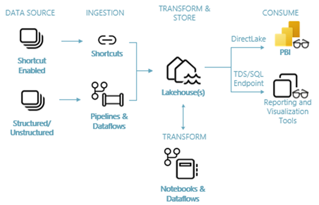

**Abb. · Das Ziel-Bild dieses End-to-End-Beispiels** Quellen → Ingest → Transform & Store → Consume. Genau diesen Fluss bauen die Karten 1–6 nach. Quelle: [Lakehouse end-to-end scenario · Microsoft Learn](https://learn.microsoft.com/fabric/data-engineering/tutorial-lakehouse-introduction)

> **Das Original zum Mitbauen:** Diese Sektion folgt dem offiziellen Wide-World-Importers-Tutorial (Retail-Szenario). Link unten — parallel öffnen und mitklicken ist der schnellste Lernweg.

**Weiterlesen:** [Tutorial: Create a Fabric workspace · Microsoft Learn](https://learn.microsoft.com/fabric/data-engineering/tutorial-lakehouse-get-started) · [Create a lakehouse · Microsoft Learn](https://learn.microsoft.com/fabric/data-engineering/create-lakehouse) · [Fabric-Trial · Microsoft Learn](https://learn.microsoft.com/fabric/fundamentals/fabric-trial)

**Daten-WG dazu:**

- **[Fabric Planning unboxing](https://youtu.be/xCzKEIB4W5I)** · WG Special · 90 min · DE · [Knowledge Kitchen](../index.html#ep-xCzKEIB4W5I)
- **[Fabric Planning Hands-On](https://youtu.be/YRoJ_6t3VrE)** · Hands-On · 66 min · DE · [Knowledge Kitchen](../index.html#ep-YRoJ_6t3VrE)

### Daten nach OneLake bringen

*END-TO-END · SCHRITT 2*

Mehrere Wege führen zu Beispieldaten in OneLake: manueller Upload (schnellster Start), Pipeline mit Copy Activity (der Tutorial-Weg) oder Shortcut (wenn die Daten schon irgendwo liegen).

#### Weg A · Upload für den Schnellstart

Im Lakehouse-Explorer: Files → Upload. CSV- oder Parquet-Dateien direkt hochladen — für erste Experimente völlig ausreichend. (Auch der OneLake-Explorer für Windows funktioniert: Dateien einfach ins OneLake-„Laufwerk" kopieren.)

#### Weg B · Pipeline mit Copy Activity (Tutorial-Weg)

**New item → Pipeline** (Name z. B. „IngestDataFromSourceToLakehouse") → *Pipeline activity → Copy data*. Quelle: der öffentliche Azure-Blob-Container `https://fabrictutorialdata.blob.core.windows.net/sampledata/` (anonym) mit dem Ordner `WideWorldImportersDW/parquet`, Format *Binary*, rekursiv. Ziel: das Lakehouse, Root folder *Files*, Ordner `wwi-raw-data`. *Save* und *Run* — nach etwa einer Minute liegt der Bronze-Layer im Files-Bereich.

#### Weg C · Shortcut, wenn Daten schon existieren

Liegen die Daten bereits in ADLS Gen2, S3, SharePoint/OneDrive oder einem anderen Fabric-Workspace: Tables/Files → New shortcut. Keine Kopie, sofort verfügbar. Mit einer **Shortcut-Transformation** werden CSV-, Parquet- oder JSON-Ordner sogar automatisch zu einer synchron gehaltenen Delta-Tabelle — in echten Projekten oft der richtige Bronze-Ansatz.

> **Kontrolle:** Nach dem Lauf sollten die Parquet-Ordner unter `Files/wwi-raw-data` sichtbar sein (Lakehouse-Explorer, ggf. *Refresh*). Pipeline-Monitoring: Tab *Output* bzw. „View run details" mit Dauer, Durchsatz und Fehlern pro Activity — vertraut für alle, die ADF kennen.

**Weiterlesen:** [Tutorial: Ingest data into the lakehouse · Microsoft Learn](https://learn.microsoft.com/fabric/data-engineering/tutorial-lakehouse-data-ingestion) · [Shortcut-Transformationen · Microsoft Learn](https://learn.microsoft.com/fabric/onelake/shortcuts/transformations)

### Transformieren: Notebook oder Dataflow

*END-TO-END · SCHRITT 3*

Aus Rohdateien werden saubere Tabellen. Das Tutorial nutzt Notebooks (PySpark oder Spark SQL) — wer lieber klickt, erreicht dasselbe mit Dataflow Gen2 und Power Query.

#### Notebook-Weg (Code-First, Tutorial)

Die Tutorial-Notebooks aus dem GitHub-Repo *fabric-samples* importieren (*Import → Notebook → From this computer*), aus dem Lakehouse heraus öffnen, damit es angeheftet ist. Die Kernzelle für die Faktentabelle — Rohdaten lesen, Datumsteile ergänzen, als partitionierte Delta-Tabelle ins Schema `dbo` schreiben:

```
from pyspark.sql.functions import col, year, quarter, month

df = spark.read.format("parquet").load("Files/wwi-raw-data/full/fact_sale_1y_full")
df = (df.withColumn("Year", year(col("InvoiceDateKey")))
        .withColumn("Quarter", quarter(col("InvoiceDateKey")))
        .withColumn("Month", month(col("InvoiceDateKey"))))

(df.write.mode("overwrite")
   .format("delta")
   .partitionBy("Year", "Quarter")
   .save("Tables/dbo/fact_sale"))
```

Analog entstehen die Dimensionen (`dimension_city`, `dimension_customer`, `dimension_date`, `dimension_employee`, `dimension_stock_item`) und zwei Aggregat-Tabellen. Dazwischen liegt die eigentliche Arbeit: Datentypen korrigieren, Duplikate entfernen, Spalten ableiten — klassisches Silber-Layer-Handwerk.

#### Dataflow-Weg (Low-Code)

New item → Dataflow Gen2: Quelle wählen, in Power Query transformieren (bekannte Oberfläche!), als **Data destination** das Lakehouse angeben. Das Einstiegs-Tutorial „Create a lakehouse" lädt so die Kundendimension (`dimension_customer.csv`) — gut zu sehen: beide Wege koexistieren im selben Projekt.

#### Inkrementelle Läufe

Die Tutorial-Übersicht beschreibt das Alltagsmuster: Historie einmal voll laden, danach geänderte Monate per Merge einarbeiten. Die aktuellen Notebook-Schritte laden der Einfachheit halber die Vollhistorie; im Projekt übernehmen das ein **Copy job** (Watermark oder CDC, Merge bzw. SCD Typ 2) oder `MERGE INTO` in Spark.

> **Team-Regel statt Dogma:** Notebook vs. Dataflow ist eine Skill-Frage: SQL/Python-Menschen nehmen Notebooks, Power-Query-Menschen Dataflows. Beide erzeugen dieselben Delta-Tabellen — mischen ist ausdrücklich okay.

**Weiterlesen:** [Tutorial: Prepare and transform data · Microsoft Learn](https://learn.microsoft.com/fabric/data-engineering/tutorial-lakehouse-data-preparation) · [Tutorial: Create a lakehouse (Dataflow-Weg) · Microsoft Learn](https://learn.microsoft.com/fabric/data-engineering/tutorial-build-lakehouse) · [Inkrementell mit Copy job · Microsoft Learn](https://learn.microsoft.com/fabric/data-factory/incremental-copy-job)

### Delta-Tabellen im Lakehouse strukturieren

*END-TO-END · SCHRITT 4*

Der Gold-Layer entscheidet über die Berichts-Qualität: ein Sternschema aus Fakten und Dimensionen, als optimierte Delta-Tabellen im Tables-Bereich.

#### Das Ziel-Schema

Das Tutorial modelliert die Wide-World-Importers-Daten als klassisches Sternschema: **fact_sale** in der Mitte, außen **dimension_customer, dimension_date, dimension_city, dimension_employee, dimension_stock_item** — alle im Schema `dbo`. Genau die Struktur, die Power BI (und Direct Lake) am liebsten mag — die Sternschema-Regeln aus dem Power-BI-Guide gelten hier 1:1.

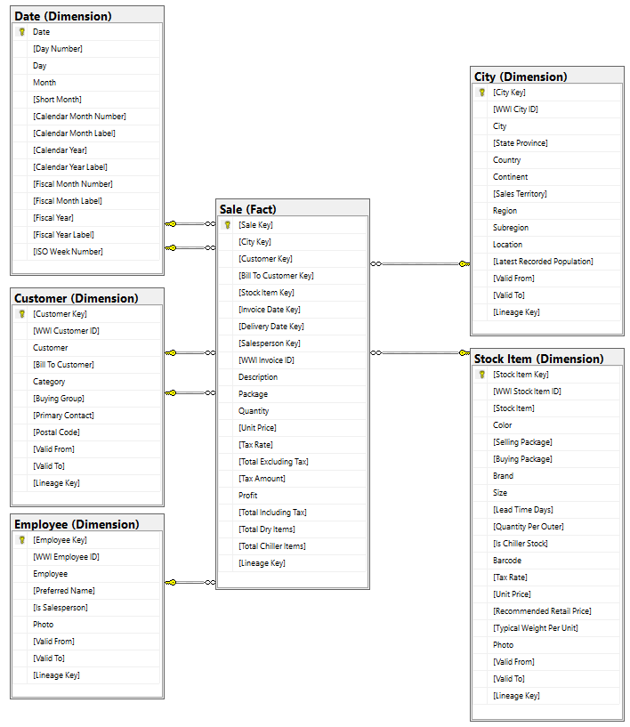

**Abb. · WWI-Sternschema** Fakten und Dimensionen des End-to-End-Tutorials. Quelle: [Lakehouse end-to-end scenario · Microsoft Learn](https://learn.microsoft.com/fabric/data-engineering/tutorial-lakehouse-introduction)

#### Delta-Hygiene für Direct Lake

- **V-Order** für Tabellen, die Direct Lake liest: In neuen Workspaces ist V-Order für Spark standardmäßig *aus* — das Tutorial schaltet es in der ersten Notebook-Zelle ein; alternativ Resource Profile `readHeavyForPBI` oder Tabellen-Property
- **OPTIMIZE** regelmäßig ausführen (kompaktiert viele kleine Parquet-Dateien zu wenigen großen — wichtig wegen der Datei- und Row-Group-Guardrails), z. B. `OPTIMIZE dbo.fact_sale VORDER`
- **Datentypen:** Integer-Schlüssel statt GUIDs/Strings (Binary und GUID unterstützt Direct Lake gar nicht), keine überflüssigen Spalten ins Gold
- **Partitionierung** nur bei Bedarf und mit niedriger Kardinalität (unter ~100–200 Werten) — das Tutorial partitioniert `fact_sale` nach Jahr und Quartal

> **Kontrolle per SQL:** Über den SQL Analytics Endpoint das Schema gegenprüfen: `SELECT TOP 100 * FROM dbo.fact_sale;` und `SELECT COUNT_BIG(*) FROM dbo.fact_sale;` — wenn das sauber aussieht und die Row-Counts stimmen, ist der Daten-Layer fertig. Tabellen fehlen? Den Endpoint mit dem Refresh-Symbol neu synchronisieren.

**Weiterlesen:** [Medallion-Architektur · Microsoft Learn](https://learn.microsoft.com/fabric/onelake/onelake-medallion-lakehouse-architecture) · [Tabellen-Kompaktierung · Microsoft Learn](https://learn.microsoft.com/fabric/data-engineering/table-compaction) · [Cross-Workload-Tabellenpflege · Microsoft Learn](https://learn.microsoft.com/fabric/fundamentals/table-maintenance-optimization)

### Semantisches Modell aufbauen

*END-TO-END · SCHRITT 5*

Jetzt wird aus Tabellen ein Modell: Direct-Lake-Semantic-Model auf den Gold-Tabellen, Beziehungen ziehen, Datumstabelle markieren, Measures schreiben.

#### Modell anlegen

Tutorial-Weg: Lakehouse öffnen → oben rechts im Dropdown *SQL analytics endpoint* → **New semantic model** → Name (z. B. „WWI Sales Model"), Workspace, die Sternschema-Tabellen auswählen → *Confirm*. Gleichwertig: *Create → OneLake catalog* im Browser oder Power BI Desktop (beides Direct Lake on OneLake). Nicht den Files-Bereich, keine Staging-Tabellen — nur Gold.

#### Beziehungen definieren

Modell öffnen → *Open* → oben rechts *Editing*. Von `fact_sale` aus ziehen: `CityKey` → `dimension_city[CityKey]`, `StockItemKey` → `dimension_stock_item[StockItemKey]`, `SalespersonKey` → `dimension_employee[EmployeeKey]`, `CustomerKey` → `dimension_customer[CustomerKey]`, `InvoiceDateKey` → `dimension_date[Date]`. Jeweils *Many to one*, *Single*, „Assume referential integrity" an.

#### Datumstabelle markieren

`dimension_date` als Datumstabelle markieren (Spalte `Date`). Das ist die Grundlage für Zeitintelligenz — bei Direct Lake on SQL gibt es kein Auto Date/Time, und auch sonst ist eine eigene Datumstabelle die saubere Lösung.

#### Measures schreiben

Ein Direct-Lake-taugliches Grund-Set: ausschließlich Measures, keine berechneten Spalten (die gibt es in Direct Lake on SQL gar nicht, in Direct Lake on OneLake nur als Preview):

```dax
// Basis-Measures: explizit statt impliziter Summen
Umsatz netto = SUM ( fact_sale[TotalExcludingTax] )
Gewinn       = SUM ( fact_sale[Profit] )
Menge        = SUM ( fact_sale[Quantity] )

// Verhältnis: DIVIDE fängt Division durch 0/BLANK ab
Marge % =
DIVIDE ( [Gewinn], [Umsatz netto] )

// Zeitintelligenz: braucht die markierte Datumstabelle
Umsatz YTD =
TOTALYTD ( [Umsatz netto], dimension_date[Date] )

Umsatz VJ =
CALCULATE ( [Umsatz netto], SAMEPERIODLASTYEAR ( dimension_date[Date] ) )

Δ Umsatz VJ % =
VAR _vj = [Umsatz VJ]
RETURN
    IF ( NOT ISBLANK ( _vj ), DIVIDE ( [Umsatz netto] - _vj, _vj ) )

// Anteil an dem, was im Bericht gerade ausgewählt ist
Anteil an Auswahl % =
DIVIDE (
    [Umsatz netto],
    CALCULATE ( [Umsatz netto], ALLSELECTED ( dimension_city ) )
)
```

**Wann was?** `DIVIDE` statt `/` überall, wo der Nenner leer sein kann. `VAR` berechnet das Vorjahr einmal und macht die Formel lesbar. Weil die Tutorial-Daten nur ein Jahr umfassen, bleibt „Umsatz VJ" leer — „Δ VJ %" zeigt dann bewusst nichts statt −100 %. `ALLSELECTED` entfernt nur den Filter des Visuals, nicht den der Slicer — der Anteil bezieht sich also auf die aktuelle Auswahl. **Typischer Fehler:** Zeitintelligenz über eine Datumsspalte mit Uhrzeit oder ohne markierte Datumstabelle — dann liefern YTD und VJ falsche oder leere Werte.

#### Modell-Settings

„Keep your Direct Lake data up to date" an lassen (automatisches Framing), Endorsement vergeben, wenn andere das Modell nutzen sollen. Nur bei Direct Lake on SQL: `DirectLakeBehavior` bewusst setzen.

> **Der Aha-Moment:** Lade neue Daten per Notebook in `fact_sale` und beobachte: kein Refresh-Job, kein Warten — nach dem automatischen Framing (Sekunden) zeigt der Bericht die neuen Zahlen. Das ist der Direct-Lake-Effekt, den man einmal selbst gesehen haben muss.

**Weiterlesen:** [Tutorial: Create a semantic model and report · Microsoft Learn](https://learn.microsoft.com/fabric/data-engineering/tutorial-lakehouse-build-report) · [DAX: TOTALYTD · Microsoft Learn](https://learn.microsoft.com/dax/totalytd-function-dax) · [DAX: SAMEPERIODLASTYEAR · Microsoft Learn](https://learn.microsoft.com/dax/sameperiodlastyear-function-dax) · [DAX: ALLSELECTED · Microsoft Learn](https://learn.microsoft.com/dax/allselected-function-dax)

### Power-BI-Bericht erstellen

*END-TO-END · SCHRITT 6*

Der letzte Schritt ist der vertrauteste: ein Power-BI-Bericht auf dem semantischen Modell — im Browser oder in Desktop, veröffentlicht und geteilt wie immer.

#### Bericht anlegen

Direkt auf dem Modell: **New report** im Service (schnell, für Standard-Visuals) — oder Power BI Desktop mit Live-Verbindung über den OneLake-Katalog (voller Funktionsumfang, IBCS-taugliche Gestaltung).

#### Visuals bauen

Das Tutorial baut eine Sales-Analyse über mehrere Dimensionen: Umsatz nach Stadt, Zeitverlauf, Top-Artikel. Ab hier gilt alles aus dem [Power-BI-Einsteiger-Guide](../power_bi_einsteiger_guide_v4.html) — Visualisierung, Interaktivität, IBCS.

#### Veröffentlichen & teilen

Bericht im Workspace speichern, per App oder Link teilen. Ab F64-Kapazität können auch Free-User konsumieren; darunter brauchen Konsumenten Pro. RLS definierst du im Modell — wie gewohnt.

#### Aktualität verifizieren

Ende-zu-Ende-Test: neue Zeile in die Quelldaten → Pipeline/Notebook laufen lassen → Framing abwarten (Sekunden) → Bericht aktualisieren. Wenn die Zahl durchläuft, steht die Strecke.

> **Was du jetzt gebaut hast:** Quelle → Pipeline (Bronze) → Notebook/Dataflow (Silber/Gold) → Direct-Lake-Modell → Bericht. Eine komplette, refreshbare Analytics-Strecke ohne eine einzige Datenkopie außerhalb von OneLake — und jede Etappe einzeln austauschbar.

**Weiterlesen:** [Tutorial: Build a report · Microsoft Learn](https://learn.microsoft.com/fabric/data-engineering/tutorial-lakehouse-build-report) · [Build Power BI reports in Microsoft Fabric](https://learn.microsoft.com/power-bi/fundamentals/fabric-get-started)

Weiter vertiefen Sektion 04: das End-to-End-Beispiel

Daten-WG · Sprung ins Video

- [05:35 Lakehouse anlegen](https://www.youtube.com/watch?v=c-LWoo-O5PQ&t=335s) SharePoint direkt in Microsoft Fabric nutzen · [Karte in der Kitchen](../index.html#ep-c-LWoo-O5PQ)
- [11:20 Daten im Lakehouse und per SQL analysieren](https://www.youtube.com/watch?v=c-LWoo-O5PQ&t=680s) SharePoint direkt in Microsoft Fabric nutzen · [Karte in der Kitchen](../index.html#ep-c-LWoo-O5PQ)
- [20:50 Automatische Aktualisierung — neue Daten ohne Refresh-Job](https://www.youtube.com/watch?v=c-LWoo-O5PQ&t=1250s) SharePoint direkt in Microsoft Fabric nutzen · [Karte in der Kitchen](../index.html#ep-c-LWoo-O5PQ)
- [08:45 On-Prem-Daten per Lakehouse-Shortcut einbinden](https://www.youtube.com/watch?v=5HhNQZlB-1E&t=525s) Push statt Pull: On-Prem-Daten mit SSIS nach Fabric · [Karte in der Kitchen](../index.html#ep-5HhNQZlB-1E)
- [05:39 Notebook per REST API starten](https://www.youtube.com/watch?v=NvtZ-ehiTrg&t=339s) SSIS: Fabric Notebook per REST API starten · [Karte in der Kitchen](../index.html#ep-NvtZ-ehiTrg)

DatenWG Library · Themen

- [Lakehouse](../wissensgraph/thema/lakehouse.html)
- [Spark](../wissensgraph/thema/spark.html)
- [SQL Endpoint](../wissensgraph/thema/sql-endpoint.html)

Microsoft Learn · Doku & Training

- [Lakehouse end-to-end scenario (WWI)](https://learn.microsoft.com/fabric/data-engineering/tutorial-lakehouse-introduction)
- [Modul: Get started with lakehouses in Microsoft Fabric](https://learn.microsoft.com/training/modules/get-started-lakehouses/)
- [Modul: Organize a Fabric lakehouse using medallion architecture](https://learn.microsoft.com/training/modules/describe-medallion-architecture/)
- [Modul: Work with Delta Lake tables in Microsoft Fabric](https://learn.microsoft.com/training/modules/work-delta-lake-tables-fabric/)

## 05 · Sonderthema: *Snowflake-Daten* in Fabric

Viele Unternehmen haben ihr Warehouse in Snowflake und ihr Reporting in Power BI. Fabric bietet dafür drei sehr unterschiedliche Integrationswege: Mirroring (Replikation nach OneLake), Iceberg-Interoperabilität (Zero-Copy — per Shortcut oder mit dem Item „Snowflake database“, das Iceberg-Tabellen direkt in OneLake ablegt) und den klassischen Connector (Import/DirectQuery). Die Wahl bestimmt Architektur, Latenz, Kosten und Governance.

> Als erstes: **„Mirroring"** lesen — der von Microsoft empfohlene Standardweg mit kostenloser Replikation. Dann **„Die drei Ansätze im Vergleich"**, bevor du dich festlegst.

### Snowflake im Unternehmen

*SNOWFLAKE · AUSGANGSLAGE*

Die realistische Ausgangslage vieler Unternehmen: Das Data Warehouse läuft in Snowflake, das Reporting soll (weiter) mit Power BI laufen. Die Frage ist nicht „Snowflake oder Fabric?", sondern: Wie kommen die Daten am besten zusammen?

#### Warum Koexistenz statt Migration?

Snowflake-Umgebungen sind oft über Jahre gewachsen — mit ELT-Strecken (häufig DBT), Berechtigungskonzepten und angeschlossenen Systemen. Eine Migration ist selten die erste Wahl. Fabric ist dafür gebaut, **fremde Datenplattformen anzubinden statt zu ersetzen**: Mirroring, Shortcuts und offene Formate (Delta, Iceberg) sind genau für diese Koexistenz da.

#### Die drei Integrationswege im Überblick

- **Mirroring** — Fabric repliziert Snowflake-Tabellen kontinuierlich nach OneLake (Delta). Abfragen laufen danach in Fabric
- **Iceberg-Shortcuts** — Zero-Copy: Snowflake schreibt Iceberg, OneLake virtualisiert die Tabellen als Delta. Eine Datenkopie für beide Welten
- **Connector** — der klassische Weg: Power BI verbindet sich per Import oder DirectQuery direkt mit Snowflake

> **Die Leitfrage:** Wo soll die Abfrage-Last laufen (und bezahlt werden) — in Snowflake oder in Fabric? Und: Wer besitzt die Daten-Governance? Die Antworten sortieren die drei Wege fast von selbst (Karte „Die drei Ansätze im Vergleich").

**Weiterlesen:** [James Serra: Three ways to use Snowflake data in Microsoft Fabric](https://www.jamesserra.com/archive/2026/01/three-ways-to-use-snowflake-data-in-microsoft-fabric/)

### Snowflake Mirroring

*SNOWFLAKE · REPLIKATION*

Mirroring repliziert Snowflake-Tabellen kontinuierlich und near-real-time nach OneLake — als Delta-Tabellen, ohne selbstgebautes ETL. Die Replikation selbst ist kostenlos.

#### Wie es funktioniert

Beim Anlegen einer **Mirrored Database** wählst du Snowflake-Datenbank und Tabellen aus; Fabric richtet die Replikation ein — technisch basierend auf **Snowflake Streams** (der Snowflake-User braucht u. a. `CREATE STREAM`). Änderungen fließen fortlaufend nach OneLake und werden dort als Delta Parquet abgelegt. Ohne Quell-Änderungen drosselt der Replikator sein Polling automatisch und beschleunigt wieder, sobald Daten kommen. **Iceberg-Tabellen** aus Snowflake lassen sich ebenfalls spiegeln: Fabric übernimmt dann nur die Metadaten per Shortcut auf den Iceberg-Speicher (dafür ist eine Storage-Connection nötig).

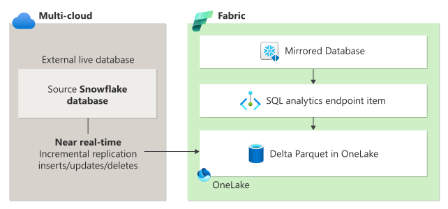

**Abb. · Snowflake-Mirroring** Snowflake → Replikation → Delta-Tabellen in OneLake, mit SQL-Endpoint obendrauf. Quelle: [Mirroring Snowflake · Microsoft Learn](https://learn.microsoft.com/fabric/mirroring/snowflake)

#### Die Konditionen (Stand Oktober 2026)

- **Replikations-Compute: kostenlos** — verbraucht keine Fabric-CUs; Abfragen per SQL, Spark oder Power BI kosten normal
- **Mirroring-Storage: frei bis 1 TB pro Capacity Unit** (eine F64 hat also 64 TB freien Mirror-Speicher); darüber oder bei pausierter Kapazität fällt OneLake-Storage an — und eine pausierte Kapazität stoppt die Replikation
- **Snowflake-Seite kostet:** Das Virtual Warehouse läuft, wenn geänderte Daten gelesen werden — plus Cloud-Services-Kosten für Metadaten-Checks. Tipp von Microsoft: dasselbe Warehouse wie die Ladestrecken nutzen und nur benötigte Tabellen spiegeln
- **Extended Capabilities kosten extra:** Delta Change Data Feed und das Spiegeln von Views (beide Preview) werden nach Nutzung abgerechnet — Core-Mirroring bleibt kostenlos
- **Erzeugt wird:** die Mirrored Database + automatisch ein SQL Analytics Endpoint; die Delta-Tabellen sind Direct-Lake-tauglich (beide Varianten)

#### Grenzen, die man kennen muss

- Views und Materialized Views synchronisieren nur alle 12 Stunden (kostenpflichtige Extended Capability); External, Transient, Temporary und Dynamic Tables gar nicht
- **Snowflake-Berechtigungen werden laut Learn nicht übernommen** — granulare Sicherheit muss in Fabric neu definiert werden (SQL-Berechtigungen, OneLake Security oder Modell-RLS). Die Daten-WG-Quarterly 2026-4 berichtet von einer Ankündigung zur Übernahme von Snowflake-Security-Rollen; vor Projektstart den aktuellen Stand prüfen
- Schemaänderungen (z. B. durch dbt-Deployments) können **Reseeds** auslösen — volle Neuladung der Tabelle, mit entsprechenden Snowflake-Compute-Kosten
- Mirroring läuft kontinuierlich — es gibt kein Scheduling („nur nachts spiegeln" geht nicht)
- Authentifizierung per Benutzer/Passwort, Entra-ID-SSO oder Key Pair (keine Workspace Identity); hinter einer Firewall über VNet- oder On-Premises-Gateway — direkter Private Link noch nicht
- Standard-Retention gespiegelter Daten: 1 Tag (Time-Travel-Fenster), in den Einstellungen anpassbar

**Weiterlesen:** [Mirroring Snowflake · Microsoft Learn](https://learn.microsoft.com/fabric/mirroring/snowflake) · [Tutorial: Mirrored database konfigurieren](https://learn.microsoft.com/fabric/mirroring/snowflake-tutorial) · [Extended capabilities · Microsoft Learn](https://learn.microsoft.com/fabric/mirroring/extended-capabilities) · [Limitations · Microsoft Learn](https://learn.microsoft.com/fabric/mirroring/snowflake-limitations)

### Iceberg & Zero-Copy

*SNOWFLAKE · ZERO-COPY*

Der eleganteste Weg, wenn er möglich ist: Snowflake und Fabric arbeiten auf *derselben* Kopie im offenen Iceberg-Format. OneLake virtualisiert Iceberg automatisch als Delta — und umgekehrt.

#### Weg 1 · Iceberg-Tabelle per Shortcut einbinden

Liegt eine Snowflake-**Iceberg-Tabelle** in ADLS, S3, GCS oder OneLake, genügt ein **Table-Shortcut auf den Iceberg-Ordner** (metadata + data). OneLakes **Metadata Virtualization** erzeugt automatisch virtuelle Delta-Metadaten — die Tabelle ist sofort für alle Fabric-Engines lesbar, ohne Konvertierung, ohne Kopie. Den Speicherort einer Iceberg-Tabelle verrät Snowflake per `SYSTEM$GET_ICEBERG_TABLE_INFORMATION('<table>')`.

#### Weg 2 · Snowflake schreibt direkt in OneLake

Mit dem Fabric-Item **Snowflake database** wird eine (neue oder bestehende) Snowflake-Datenbank so konfiguriert, dass Iceberg-Tabellen standardmäßig in OneLake landen — ein External Volume zeigt auf das Item, Fabric-Kapazität und Snowflake-on-Azure-Account liegen in derselben Region, die Verbindung läuft über das öffentliche Netz. In Snowflake reicht dann:

```
-- In Snowflake: landet automatisch im Fabric-Item "Snowflake database"
CREATE ICEBERG TABLE SnowflakeFabricIcebergDB.PUBLIC.SampleIcebergTable (
  id   INT,
  name STRING
)
CATALOG = 'SNOWFLAKE';
```

In Fabric liest der SQL Analytics Endpoint des Items dieselbe Tabelle — und ein Direct-Lake-Modell kann das Snowflake-database-Item als Quelle nutzen.

#### Weg 3 · Snowflake liest Fabric-Daten

Fabric-Delta-Tabellen bekommen auf Wunsch virtuelle Iceberg-Metadaten (Tenant- oder Workspace-Einstellung). Snowflake referenziert sie über ein External Volume und eine Catalog Integration — oder über den **Iceberg-REST-Catalog-Endpunkt von OneLake** (`onelake.table.fabric.microsoft.com`), mit dem eine catalog-linked Database Schemas und Tabellen automatisch entdeckt. Microsofts Formulierung: „Both Fabric and Snowflake can work with the same copy of data."

#### Voraussetzungen & Trade-offs

- Die Tabellen müssen als **Iceberg** vorliegen — klassische Snowflake-Managed-Tables brauchen eine Umstellung (oder Mirroring)
- Updates sind **sofort sichtbar** (keine Replikations-Latenz), die Daten bleiben unter Snowflake-Kontrolle
- Snowflake erreicht OneLake nur über das öffentliche Netz — Workspaces mit Private Link oder Netzwerkbeschränkung werden nicht unterstützt
- Abfrage-Latenz hängt am Quellspeicher; Cross-Cloud-Zugriffe puffert OneLake-Caching

> **Wann dieser Weg?** Wenn das Snowflake-Team ohnehin auf Iceberg setzt (Open-Table-Format-Strategie) und Governance bei Snowflake bleiben soll — dann ist Zero-Copy dem Mirroring vorzuziehen: keine zweite Datenhaltung, kein Sync-Monitoring.

**Weiterlesen:** [Iceberg-Tabellen mit OneLake · Microsoft Learn](https://learn.microsoft.com/fabric/onelake/onelake-iceberg-tables) · [Snowflake database item · Microsoft Learn](https://learn.microsoft.com/fabric/onelake/snowflake/create-snowflake-database-item) · [Snowflake + Iceberg in OneLake · Microsoft Learn](https://learn.microsoft.com/fabric/onelake/onelake-iceberg-snowflake) · [OneLake Iceberg REST Catalog · Microsoft Learn](https://learn.microsoft.com/fabric/onelake/table-apis/iceberg-table-apis-overview)

### Der Snowflake-Connector

*SNOWFLAKE · KLASSIKER*

Vor Mirroring und Shortcuts gab es nur ihn — und er bleibt für viele Szenarien richtig: der Power-BI-Connector für Snowflake, mit Import oder DirectQuery.

#### Was er kann

- **Import:** Daten werden ins Power-BI-Modell kopiert — schnellste Berichte, aber Refresh-Zyklen und Duplikat
- **DirectQuery:** jede Visual-Interaktion wird zur Snowflake-Query — immer aktuell, und per **Entra-ID-SSO** greifen Snowflakes eigene RLS-Regeln pro User
- **Kein Gateway nötig** — Snowflake ist eine Cloud-Quelle
- Seit Juli 2025 ist **„Implementation 2.0"** auf Basis des Snowflake-**ADBC**-Treibers GA; neue Verbindungen in Power BI Desktop nutzen sie automatisch (bei Key-Pair-Authentifizierung immer). Admins können den ADBC-Standard per Tenant- bzw. Workspace-Einstellung steuern; wer `Implementation` im M-Code fest setzt, behält seinen Treiber

#### Die ehrlichen Nachteile

- **DirectQuery:** Performance hängt komplett an Snowflake — und jede Berichts-Interaktion weckt das Virtual Warehouse (Kosten!)
- **Import:** bei großen Datenmengen lange Refreshes, und die Daten liegen doppelt (Snowflake + Modell)
- Kein OneLake-Effekt: andere Fabric-Workloads (Spark, SQL) haben nichts von den Daten

> **Wann der Connector die richtige Wahl bleibt:** (1) Kleine bis mittlere Datenmengen, die als Import problemlos laufen. (2) Harte Anforderung, dass Snowflake-RLS pro User greift → DirectQuery mit SSO. (3) Kein Fabric-Buy-in im Unternehmen — der Connector braucht nur Power BI.

**Weiterlesen:** [Snowflake-Connector · Microsoft Learn](https://learn.microsoft.com/power-query/connectors/snowflake) · [Snowflake mit SSO im Service · Microsoft Learn](https://learn.microsoft.com/power-bi/connect-data/service-connect-snowflake)

### Die drei Ansätze im Vergleich

*SNOWFLAKE · ENTSCHEIDUNG*

Mirroring, Iceberg-Shortcut oder Connector? Die Entscheidung fällt entlang von vier Fragen: Wo läuft die Last, wie frisch müssen die Daten sein, wer besitzt die Governance — und welches Format liegt vor?

#### Der Vergleich

- **Mirroring** — Kopie in OneLake (Delta), near-real-time. Abfragen treffen Fabric, *nicht* Snowflake → keine Snowflake-Compute-Kosten pro Bericht. Replikation kostenlos, 1 TB Storage/CU frei. Governance/RLS muss in Fabric neu aufgebaut werden. Ideal: BI-Workloads mit Direct Lake auf Snowflake-Daten
- **Iceberg-Shortcut** — Zero-Copy, Daten bleiben unter Snowflake-Kontrolle, Updates sofort sichtbar. Voraussetzung: Iceberg-Format. Latenz hängt am Quellspeicher. Ideal: Open-Format-Strategien, bei denen beide Plattformen dieselbe Kopie nutzen sollen
- **Connector Import** — schnellste Abfragen, aber Refresh-Latenz und Modell-Duplikat. Ideal: kleinere Datenmengen, kein Fabric nötig
- **Connector DirectQuery** — maximale Frische und Snowflake-RLS via SSO, aber jede Interaktion kostet Snowflake-Compute und Performance hängt an Snowflake. Ideal: operative Berichte mit Quell-Security

#### Governance-Perspektive

Mirroring verschiebt die Konsum-Governance nach Fabric (OneLake-Berechtigungen, Modell-RLS, Purview) — sauber für BI-Self-Service, aber ein zweites Regelwerk. Shortcut und DirectQuery lassen Snowflake die Kontrolle. Diese Frage vor der technischen Wahl klären — sie ist meist die eigentliche Entscheidung.

> **Pragmatischer Default 2026:** Für Power-BI-Reporting auf Snowflake-Beständen: Mirroring zuerst prüfen — kostenlose Replikation, Direct-Lake-Performance, minimaler Aufwand. Iceberg-Shortcuts, wenn die Format-Strategie es hergibt. Connector für Spezialfälle (SSO-RLS, kein Fabric).

**Weiterlesen:** [James Serra: Three ways to use Snowflake data in Fabric](https://www.jamesserra.com/archive/2026/01/three-ways-to-use-snowflake-data-in-microsoft-fabric/) · [What is Mirroring? · Microsoft Learn](https://learn.microsoft.com/fabric/mirroring/overview)

### Berichte auf Snowflake-Daten

*SNOWFLAKE · POWER BI*

Das Endprodukt aller drei Wege ist dasselbe: ein Power-BI-Bericht. Der Unterschied liegt darin, wie sich das Modell dahinter anfühlt — und was jede Interaktion kostet.

#### Der Mirroring-Pfad (empfohlen für BI)

Gespiegelte Tabellen liegen als Delta in OneLake → darauf ein **Direct-Lake-Modell** bauen (Sektion 03 gilt 1:1): Beziehungen, Measures, ggf. RLS im Modell. Ergebnis: Import-nahe Performance auf near-real-time Snowflake-Daten, ohne dass Berichts-Nutzung Snowflake-Kosten erzeugt. Über den SQL Analytics Endpoint der Mirrored Database lassen sich die Daten zusätzlich per T-SQL abfragen und mit anderen Lakehouses joinen.

#### Der Shortcut-Pfad

Iceberg-Shortcuts erscheinen als Tabellen im Lakehouse — von dort derselbe Weg: semantisches Modell, Direct Lake, Bericht. Achtung bei sehr großen Tabellen: Guardrails gelten auch hier.

#### Der Connector-Pfad

Klassisch in Desktop: Get Data → Snowflake → Import oder DirectQuery. Kein OneLake beteiligt — das Modell lebt für sich.

> **Kombinieren erlaubt:** Ein realistisches Muster: Die großen Fakten kommen per Mirroring (Direct Lake), sensible Detail-Berichte mit Snowflake-RLS laufen als separater DirectQuery-Bericht mit SSO. Zwei Wege, ein Portal — die Nutzer merken den Unterschied nur an der Antwortzeit.

**Weiterlesen:** [Snowflake-Mirroring-Tutorial (inkl. Report-Schritt) · Microsoft Learn](https://learn.microsoft.com/fabric/mirroring/snowflake-tutorial)

Weiter vertiefen Sektion 05: Snowflake & Mirroring

Daten-WG · Sprung ins Video

- [24:00 Mirroring für Oracle, Snowflake, SAP](https://www.youtube.com/watch?v=9TsHkV8sIRo&t=1440s) Fabric & Power BI Quarterly · 2025 Q4 · [Karte in der Kitchen](../index.html#ep-9TsHkV8sIRo)
- [24:38 Snowflake und Databricks bidirektional](https://www.youtube.com/watch?v=pTTYySb0Cyg&t=1478s) Fabric & Power BI Quarterly · 2026-2 · [Karte in der Kitchen](../index.html#ep-pTTYySb0Cyg)
- [35:25 Mirroring mit Security-Rollen aus Snowflake](https://www.youtube.com/watch?v=0QZD26KPBcU&t=2125s) Fabric & Power BI Quarterly · 2026-4 · [Karte in der Kitchen](../index.html#ep-0QZD26KPBcU)
- [02:39 Mirroring-Kostenmodell: Storage & Compute](https://www.youtube.com/watch?v=7j34Ndng0Os&t=159s) Open Mirroring in Microsoft Fabric · [Karte in der Kitchen](../index.html#ep-7j34Ndng0Os)
- [15:49 Data-Mesh-Ansatz bei Snowflake als Alternative](https://www.youtube.com/watch?v=mTVeZzshLzE&t=949s) Microsoft Fabric — braucht das wirklich jemand? · [Karte in der Kitchen](../index.html#ep-mTVeZzshLzE)

DatenWG Library · Themen

- [Snowflake](../wissensgraph/thema/snowflake.html)
- [Mirroring](../wissensgraph/thema/mirroring.html)

Microsoft Learn · Doku & Training

- [Mirroring Snowflake (Objekttypen, Kosten, Security)](https://learn.microsoft.com/fabric/mirroring/snowflake)
- [Extended capabilities: CDF & Mirroring Views](https://learn.microsoft.com/fabric/mirroring/extended-capabilities)
- [Snowflake database item: Iceberg direkt in OneLake](https://learn.microsoft.com/fabric/onelake/snowflake/create-snowflake-database-item)
- [Connector-Umstieg ODBC → ADBC](https://learn.microsoft.com/power-query/transition-to-adbc)

## 06 · Zusammenfassung & *typische Architekturen*

Am Ende laufen alle Fabric-Fragen auf wenige Entscheidungen zusammen: Lakehouse oder Warehouse? Copy, Dataflow oder Spark? Import oder Direct Lake? Microsoft dokumentiert dafür offizielle Decision Guides — diese Sektion fasst sie zusammen und zeigt typische Referenzarchitekturen.

> Als erstes: **„Lakehouse oder Warehouse?"** — die häufigste Frage, mit der offiziellen Drei-Fragen-Regel. Danach **„Import oder Direct Lake?"** für die Modell-Seite.

### Lakehouse oder Warehouse?

*ENTSCHEIDUNGEN · DATENSPEICHER*

Die häufigste Fabric-Frage hat einen offiziellen Decision Guide — und der reduziert sie auf drei Fragen: Welche Skills? Welche Transaktionen? Welche Datentypen?

#### Die Drei-Fragen-Regel

- **Womit entwickelt dein Team?** Spark/Python → Lakehouse · T-SQL → Warehouse
- **Brauchst du Multi-Table-Transaktionen?** Ja → Warehouse (das Lakehouse kann sie nicht)
- **Welche Daten?** Un-/semi-strukturiert oder gemischt → Lakehouse · nur strukturiert → Warehouse · unsicher → Lakehouse

Beruhigend: Beide speichern Delta in OneLake und teilen sich dieselbe SQL-Engine — man kann später das jeweils andere ergänzen, ohne Daten zu migrieren.

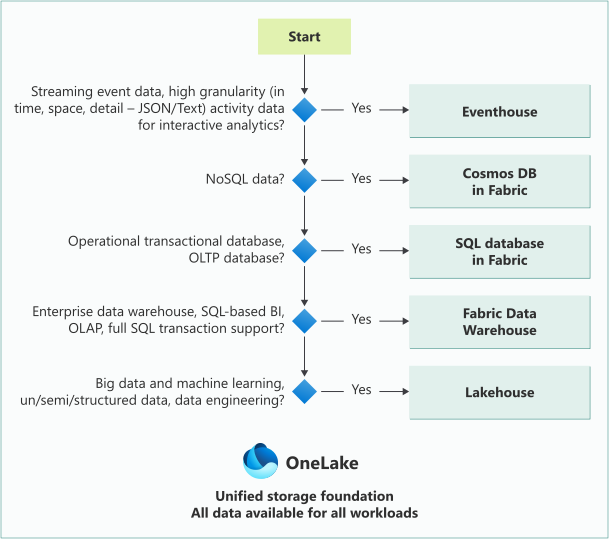

**Abb. · Der offizielle Entscheidungsbaum** Alle Fabric-Datenspeicher nach Ideal-Use-Case. Quelle: [Decision guide: choose a data store · Microsoft Learn](https://learn.microsoft.com/fabric/fundamentals/decision-guide-data-store)

#### Und die anderen Speicher?

- **Eventhouse** — Streaming/Events mit hoher Rate (Sektion 02)
- **SQL database in Fabric** — OLTP, selektive Lookups im Millisekunden-Bereich
- **Cosmos DB in Fabric** — NoSQL, AI-/Vektor-Szenarien

> **Das verbreitetste Muster:** Bronze + Silber als Lakehouse (Spark-Transformationen), Gold wahlweise als Lakehouse (BI-Teams, Direct Lake) oder Warehouse (SQL-Teams, Prozedur-ELT). Beides ist offiziell dokumentiert — es gibt kein „falsch", nur „passt nicht zum Team".

**Weiterlesen:** [Decision guide: Warehouse vs. Lakehouse · Microsoft Learn](https://learn.microsoft.com/fabric/fundamentals/decision-guide-lakehouse-warehouse) · [Reitse Eskens: Warehouse vs. Lakehouse Benchmark](https://sqlreitse.com/2024/05/31/testing-azure-fabric-capacity-data-warehouse-vs-lakehouse-performance/)

**Daten-WG dazu:**

- **[600 SQL-Tabellen in Fabric](https://youtu.be/RtUiF1J5XEg)** · Talk · 35 min · DE · [Knowledge Kitchen](../index.html#ep-RtUiF1J5XEg)

### Copy · Dataflow · Spark · Eventstream

*ENTSCHEIDUNGEN · INGESTION*

Fünf Wege, Daten nach Fabric zu bewegen — der offizielle Decision Guide sortiert sie nach Persona, Datenvolumen und Transformationsbedarf.

#### Die fünf Optionen

- **Copy Activity (Pipeline)** — Migration und Ingestion bis in den Petabyte-Bereich, 50+ Konnektoren, nur leichte Transformationen. Persona: Data Engineer / Integrator
- **Copy job** — Datenbewegung ohne Pipeline-Bau: Bulk, inkrementell (Watermark) oder CDC, schreibend als Append, Merge, Overwrite oder SCD Typ 2 (Preview) — der unkomplizierte Mittelweg
- **Dataflow Gen2** — 150+ Konnektoren, 300+ Transformationen, Power-Query-Oberfläche. Persona: Business Analyst / Citizen Engineer
- **Eventstream** — kontinuierliche Event-Ingestion (Kafka, Event Hubs, CDC-Feeds), No-Code-Routing an Eventhouse/Lakehouse/Activator
- **Spark (Notebook/Job)** — Code-First, beliebig komplexe Transformationen, strukturiert + unstrukturiert. Persona: Data Engineer

#### Schnell-Heuristik

- „Ich will nur Daten von A nach B" → **Copy Job**, bei Orchestrierungsbedarf **Copy Activity** in einer Pipeline
- „Ich will transformieren und kann Power Query" → **Dataflow Gen2**
- „Ich will transformieren und kann Python/SQL" → **Notebook**
- „Es sind Events, keine Batches" → **Eventstream**
- „Die Quelle ist eine ganze Datenbank, ich will sie einfach aktuell haben" → **Mirroring** (kostenlos, aber fixes Verhalten, read-only-Ziel)

> **Nicht überdenken:** Alle Wege erzeugen dieselben Delta-Tabellen. Die Wahl ist selten irreversibel — ein Dataflow lässt sich später durch ein Notebook ersetzen, ohne dass Modell oder Bericht es merken.

**Weiterlesen:** [Decision guide: Copy, Dataflow, Eventstream oder Spark · Microsoft Learn](https://learn.microsoft.com/fabric/fundamentals/decision-guide-pipeline-dataflow-spark) · [Decision guide: Data movement · Microsoft Learn](https://learn.microsoft.com/fabric/data-factory/decision-guide-data-movement)

### Import oder Direct Lake?

*ENTSCHEIDUNGEN · MODELL-MODUS*

Die Modell-Frage stellt sich in jedem Fabric-BI-Projekt neu. Offizielle Leitlinie: Direct Lake für Large-Scale-Analytics auf Fabric-Daten — aber Import ist nicht tot, im Gegenteil.

#### Wann Direct Lake gewinnt

- Daten liegen ohnehin als Delta in OneLake (Lakehouse, Warehouse, Mirrored DB)
- Große Fakten (Hunderte Millionen+ Zeilen), bei denen Import-Refreshes zu lange dauern oder das Speicherlimit sprengen
- Frische zählt: Daten sollen Sekunden nach dem Schreiben im Bericht sichtbar sein (Framing statt Refresh)
- Neue Modelle: **Direct Lake on OneLake** wählen — die von Microsoft empfohlene Variante

#### Wann Import (noch) gewinnt

- Quellen außerhalb von Fabric (SaaS-APIs, Excel, On-Prem ohne Fabric-Strecke)
- Feature-Bedarf, den Direct Lake (noch) nicht deckt: Hybrid Tables, benutzerdefinierte Aggregationstabellen, uneingeschränkte Calculated Columns/Tables
- Kleine, stabile Modelle — der Direct-Lake-Vorteil ist bei 2 Mio. Zeilen schlicht irrelevant
- Kapazität unter F64 mit vielen parallelen Nutzern: Import puffert Lastspitzen im Modell ab

> **Der Composite-Mittelweg:** Direct Lake + Import lassen sich kombinieren (via Web-Modeling): große Fakten als Direct Lake, kleine Dimensionen oder Sonderquellen als Import. SQLBI empfiehlt genau dieses Muster als pragmatischen Default für gemischte Landschaften.

> **Migrationspfad:** Bestehende Import-Modelle nicht panisch umbauen. Sinnvolle Reihenfolge: neue große Modelle in Direct Lake starten; Import-Modelle erst migrieren, wenn Refresh-Dauer oder Speicher wirklich schmerzen.

**Weiterlesen:** [Direct Lake overview · Microsoft Learn](https://learn.microsoft.com/fabric/fundamentals/direct-lake-overview) · [SQLBI: Direct Lake vs Import — die Entscheidungshilfe](https://www.sqlbi.com/blog/marco/2025/05/13/direct-lake-vs-import-vs-direct-lakeimport-fabric-semantic-models-may-2025/)

**Daten-WG dazu:**

- **[#010 · Import vs. DirectQuery vs. Direct Lake — was ist schneller?](https://youtu.be/9u9YbdMUU-s)** · Short · 28 s · DE · [Knowledge Kitchen](../index.html#ep-9u9YbdMUU-s)

### Typische Referenzarchitekturen

*ENTSCHEIDUNGEN · BLAUPAUSEN*

Man muss Fabric-Architekturen nicht erfinden — Microsoft dokumentiert die Muster. Drei Blaupausen decken die meisten Projekte ab.

#### 1 · Medallion-Lakehouse (der BI-Standard)

Quellen → Pipelines/Shortcuts → Bronze-Lakehouse (raw) → Notebooks → Silber-Lakehouse (clean) → Gold-Lakehouse oder -Warehouse (Sternschema) → Direct-Lake-Modell → Power BI. Genau das Muster aus Sektion 04 — skaliert auf getrennte Workspaces pro Layer für saubere Governance.


**Abb. · Medallion-Referenzarchitektur** Die offizielle End-to-End-Blaupause. Quelle: [Lakehouse end-to-end scenario · Microsoft Learn](https://learn.microsoft.com/fabric/data-engineering/tutorial-lakehouse-introduction)

#### 2 · Enterprise BI mit Warehouse

Für SQL-geprägte Organisationen: Pipelines laden ins Warehouse, Stored Procedures transformieren (klassisches ELT), semantische Modelle und Berichte obendrauf. Das Azure Architecture Center dokumentiert dieses Muster als „Enterprise BI with Microsoft Fabric" — inklusive Deployment- und Netzwerk-Empfehlungen.

#### 3 · Real-Time-Pfad

Eventstream → Eventhouse (KQL) → Real-Time Dashboard + Activator; parallel OneLake-Availability, damit Batch-Analytics und Power BI dieselben Events nutzen. Referenz: „Analytics end-to-end with Microsoft Fabric".

> **Hybrid ist normal:** Reale Architekturen mischen: Medallion für Batch, Real-Time-Pfad für Telemetrie, Mirroring für die Snowflake-Bestände — alles im selben OneLake, alles im selben Modell-Layer zusammenführbar.

**Weiterlesen:** [Analytics end-to-end with Fabric · Architecture Center](https://learn.microsoft.com/azure/architecture/example-scenario/dataplate2e/data-platform-end-to-end) · [Enterprise BI mit Fabric · Architecture Center](https://learn.microsoft.com/azure/architecture/example-scenario/analytics/enterprise-bi-microsoft-fabric) · [James Serra: Fabric reference architecture](https://www.jamesserra.com/archive/2024/08/microsoft-fabric-reference-architecture/)

### Kapazität, Governance & Team

*ENTSCHEIDUNGEN · BETRIEB*

Die technisch beste Architektur scheitert an weichen Faktoren: CU-Haushalt, Workspace-Schnitt, Deployment und Team-Skills entscheiden öfter über Erfolg als Lakehouse-vs.-Warehouse.

#### Kapazitäts-Haushalt

- Alle Workloads teilen sich die CUs einer Kapazität — ein außer Kontrolle geratener Spark-Job bremst die Berichte des Vorstands
- **Fabric Capacity Metrics App** installieren, Benachrichtigungen bei hoher Auslastung einrichten — Pflicht ab dem ersten Produktiv-Workspace
- Bewährt: Dev/Test/Prod und schwere Background-Lasten auf getrennte Kapazitäten; **Surge Protection** begrenzt Background-Jobs, wenn interaktive Berichte leiden; eine pausierte „Rettungs-Kapazität" fängt Spitzen ab
- Copilot-Verbrauch über eine Fabric Copilot capacity bündeln, damit KI-Nutzung nicht unbemerkt die Berichts-Kapazität auffrisst

#### Workspace-Schnitt & Lifecycle

- Pro Medallion-Layer ein Workspace (Bronze/Silber: Engineers, Gold: BI-Team, Berichte: Fachbereich) — Berechtigungen folgen dem Datenfluss; **Domains** gruppieren Workspaces nach Geschäftsbereich
- **Git-Integration** (Azure DevOps, GitHub, GitHub Enterprise — jeweils Cloud) versioniert Lakehouses, Notebooks, Pipelines, Dataflows Gen2, Copy jobs, semantische Modelle, Berichte, Data Agents u. v. m. auf Workspace-Ebene
- **Deployment Pipelines** (Dev → Test → Prod) für Fabric-Items wie für Power-BI-Inhalte, ergänzt um **Variable Libraries** (Umgebungswerte statt hart codierter Verbindungen) und **Deployment Plans** (Reihenfolge und Aktionsschritte)
- Endorsement (Promoted/Certified), Lineage und der **OneLake catalog** machen die „richtigen" Datenprodukte auffindbar — dessen Bereich *Govern* bündelt inzwischen auch Tenant-Settings, Kapazitäten und Domains

#### Sicherheit & Compliance

- **Workspace-Rollen** (Admin, Member, Contributor, Viewer) plus Item-Berechtigungen; feingranular per **OneLake Security**: Rollen mit Tabellen-, Ordner-, Zeilen- und Spaltensicherheit, die Spark, SQL Endpoint und semantische Modelle gleichermaßen durchsetzen. Achtung: Admins, Member und Contributors schränkt OneLake Security nicht ein
- **Workspace Identity** (GA): von Fabric verwalteter Service Principal pro Workspace — z. B. für Shortcuts auf firewall-geschützte ADLS-Konten, ohne Passwörter zu pflegen
- **Microsoft Purview** ergänzt Sensitivity Labels, DLP-Richtlinien, Audit und Insider Risk Management (Labels und DLP erfordern Purview-Lizenzen)

#### Team & Skills

Die ehrliche Frage: Hat das Team Spark-Kompetenz — oder ist es ein Power-Query/SQL-Team? Fabric bedient beide (Dataflows + Warehouse vs. Notebooks + Lakehouse), aber eine Architektur gegen die Team-Skills ist ein Wartungs-Albtraum. Governance-Rollen früh klären: Wer darf Fabric-Items anlegen (Tenant-Setting), wer administriert Kapazitäten, wer zertifiziert Modelle, wer pflegt Data Agents.

> **Well-Architected:** Microsoft hat die fünf Well-Architected-Säulen (Reliability, Security, Cost, Operational Excellence, Performance) für Fabric ausformuliert — als Checkliste für Architektur-Reviews sehr brauchbar.

**Weiterlesen:** [Well-Architected für Fabric · Microsoft Learn](https://learn.microsoft.com/azure/well-architected/microsoft-fabric/overview) · [Fabric CI/CD: Konzepte & Best Practices · Microsoft Learn](https://learn.microsoft.com/fabric/fundamentals/understand-best-practices-fabric-cicd) · [Data security in OneLake · Microsoft Learn](https://learn.microsoft.com/fabric/onelake/security/get-started-security) · [Workspace identity · Microsoft Learn](https://learn.microsoft.com/fabric/security/workspace-identity) · [Purview & Fabric · Microsoft Learn](https://learn.microsoft.com/fabric/governance/microsoft-purview-fabric) · [Capacity-Planning-Guide · Microsoft Learn](https://learn.microsoft.com/fabric/enterprise/capacity-planning-overview)

### Die Entscheidungs-Checkliste

*ENTSCHEIDUNGEN · ZUSAMMENFASSUNG*

Alle Kernentscheidungen dieses Guides auf einer Karte — in der Reihenfolge, in der sie im Projekt anstehen.

#### Plattform-Frage

Brauchen wir Fabric — oder reicht Power BI Pro? Sobald eigene Daten-Pipelines, große Modelle (Direct Lake) oder Streaming ins Spiel kommen: Fabric. Nur Berichte auf fertigen Quellen: Pro reicht. Kapazität: Trial → F2/F4 zum Entwickeln → F64+, wenn Free-User konsumieren sollen.

#### Speicher-Frage

Lakehouse (Spark-Team, gemischte Daten, unsicher) oder Warehouse (SQL-Team, Multi-Table-Transaktionen)? Streaming → Eventhouse. Bestehende Lakes → Shortcuts statt Migration.

#### Ingestion-Frage

Copy Job (einfach bewegen) · Pipeline/Copy Activity (orchestriert, Petabyte) · Dataflow Gen2 (Power-Query-Team) · Notebook (Code-Team) · Eventstream (Events) · Mirroring (ganze DBs, z. B. Snowflake — Replikation kostenlos).

#### Struktur-Frage

Medallion: Bronze roh (oder Shortcut), Silber bereinigt, Gold als Sternschema. Pro Layer ein Lakehouse (oder Schema), bei Governance-Bedarf eigene Workspaces. V-Order für Gold-Tabellen bewusst einschalten (für Spark nicht mehr Standard), OPTIMIZE regelmäßig.

#### Modell-Frage

Direct Lake (on OneLake) für große Fabric-Daten · Import für kleine Modelle und externe Quellen · DirectQuery für Quell-RLS und operative Frische · Composite als Mittelweg. Guardrails der Ziel-SKU vorher prüfen.

#### KI-Frage

Sollen Copilot, Fabric Data Agents oder externe Agents (MCP) auf die Daten? Dann: bezahlte Kapazität ab F2, verbindliche Kennzahlen als Measures mit Beschreibungen im Modell, Data Agents nur auf kuratierte Gold-Quellen, Copilot-Verbrauch über eine Copilot capacity im Blick.

#### Betriebs-Frage

Capacity Metrics App installiert? Workspace-Schnitt und Berechtigungen definiert (Workspace-Rollen, OneLake Security)? Git-Integration und Deployment-Pipeline eingerichtet? Modelle endorsed? — Dann ist die Architektur komplett.

> **Merksatz zum Schluss:** Fast jede Fabric-Entscheidung ist reversibel, weil alles auf denselben Delta-Tabellen in OneLake basiert. Lieber mit dem einfachsten passenden Baustein starten und wachsen — als die perfekte Architektur zu planen, die nie live geht.

**Weiterlesen:** [Alle Decision Guides · Microsoft Learn](https://learn.microsoft.com/fabric/fundamentals/decision-guide-data-store) · [Lernpfad: Get started with Microsoft Fabric](https://learn.microsoft.com/training/paths/get-started-fabric/)

Weiter vertiefen Sektion 06: Entscheidungen, Betrieb & Governance

Daten-WG · Sprung ins Video

- [19:45 Lakehouse vs. Warehouse — versteckte Fallstricke](https://www.youtube.com/watch?v=mTVeZzshLzE&t=1185s) Microsoft Fabric — braucht das wirklich jemand? · [Karte in der Kitchen](../index.html#ep-mTVeZzshLzE)
- [10:45 Architekturen entstehen aus Menschen, nicht aus Vorsystemen](https://www.youtube.com/watch?v=J-lN5JN-F5I&t=645s) Daten-WG Life-Update · Fabric Architekturen · [Karte in der Kitchen](../index.html#ep-J-lN5JN-F5I)
- [39:00 Eine F2 am Limit und der Umstieg auf Stored Procedures](https://www.youtube.com/watch?v=J-lN5JN-F5I&t=2340s) Daten-WG Life-Update · Fabric Architekturen · [Karte in der Kitchen](../index.html#ep-J-lN5JN-F5I)
- [21:17 Drei DevOps-Strategien für Fabric](https://www.youtube.com/watch?v=RtUiF1J5XEg&t=1277s) 600 SQL-Tabellen in Fabric · [Karte in der Kitchen](../index.html#ep-RtUiF1J5XEg)
- [12:04 Kapazitätsmanagement: Praxislösungen](https://www.youtube.com/watch?v=YzfcMurbWNc&t=724s) Power BI-Teams werden Fabric-Datendienstleister · [Karte in der Kitchen](../index.html#ep-YzfcMurbWNc)

DatenWG Library · Themen

- [Governance](../wissensgraph/thema/governance.html)
- [Deployment Pipelines](../wissensgraph/thema/deployment-pipelines.html)
- [Git](../wissensgraph/thema/git.html)

Microsoft Learn · Doku & Training

- [Fabric CI/CD: Konzepte & Best Practices](https://learn.microsoft.com/fabric/fundamentals/understand-best-practices-fabric-cicd)
- [Git-Integration: unterstützte Items](https://learn.microsoft.com/fabric/cicd/git-integration/intro-to-git-integration)
- [Governance & Compliance in Fabric](https://learn.microsoft.com/fabric/governance/governance-compliance-overview)
- [Study Guide DP-700 (Fabric Data Engineer)](https://learn.microsoft.com/credentials/certifications/resources/study-guides/dp-700)

## Quellen & *weiterführende Literatur*

Dieser Guide stützt sich auf die offizielle Microsoft-Learn-Dokumentation zu Microsoft Fabric und auf etablierte Community-Quellen (SQLBI/Marco Russo, Chris Webb, Sandeep Pawar, Nikola Ilic, James Serra u. a.). Jede zitierte Zahl ist hier rückverfolgbar. **Quellen-Validierung Oktober 2026:** F-SKU-Staffelung (F2–F8192), Trial (F4/F64), P-SKU-Auslauf (30 Tage Grace, dann Drosselung, ab Tag 91 Sperre), Direct-Lake-Guardrails inkl. Row Groups, Direct Lake on OneLake vs. on SQL samt `DirectLakeBehavior`, V-Order-Default (in neuen Workspaces für Spark aus), Snowflake-Mirroring (Iceberg-Tabellen, kostenpflichtige Extended Capabilities), Snowflake database item, Copilot/Data-Agent-Voraussetzungen, MCP-Server und die Decision-Guide-Kriterien wurden gegen Microsoft Learn verifiziert. **Screenshots:** Die in den Modal-Karten eingebetteten Abbildungen stammen direkt vom Microsoft-Learn-CDN und stehen unter der Microsoft-Dokumentations-Lizenz (CC BY 4.0) zur Nutzung mit Quellenangabe. Fabric entwickelt sich monatlich weiter — im Zweifel die jeweils verlinkte Quell-Seite konsultieren.

### Microsoft Learn · Fabric Grundlagen

- [What is Microsoft Fabric? — Übersicht](https://learn.microsoft.com/fabric/fundamentals/microsoft-fabric-overview)
- [Fabric terminology — Begriffe von Capacity bis Workspace](https://learn.microsoft.com/fabric/fundamentals/fabric-terminology)
- [Understand Microsoft Fabric licenses — F-SKUs, Free/Pro/PPU](https://learn.microsoft.com/fabric/enterprise/licenses)
- [Power BI Premium FAQ — P-SKU-Retirement & Übergang zu Fabric](https://learn.microsoft.com/fabric/enterprise/powerbi/service-premium-faq)
- [Migration P-SKU → F-SKU: FAQ mit Zeitplan (Grace, Drosselung, Sperre)](https://learn.microsoft.com/power-bi/support/premium-migration-faq)
- [Throttling-Policy: Bursting, Smoothing, Overage](https://learn.microsoft.com/fabric/enterprise/throttling)
- [Fabric-Trial: Umfang & Einschränkungen](https://learn.microsoft.com/fabric/fundamentals/fabric-trial)
- [Unterschiede Azure Data Factory vs. Fabric Data Factory](https://learn.microsoft.com/fabric/data-factory/compare-fabric-data-factory-and-azure-data-factory)
- [Well-Architected Framework für Microsoft Fabric](https://learn.microsoft.com/azure/well-architected/microsoft-fabric/overview)

### Microsoft Learn · OneLake & Komponenten

- [What is OneLake?](https://learn.microsoft.com/fabric/onelake/onelake-overview)
- [OneLake shortcuts](https://learn.microsoft.com/fabric/onelake/onelake-shortcuts)
- [Shortcut-Transformationen (Dateien → Delta)](https://learn.microsoft.com/fabric/onelake/shortcuts/transformations)
- [What is a lakehouse in Microsoft Fabric?](https://learn.microsoft.com/fabric/data-engineering/lakehouse-overview)
- [SQL analytics endpoint für Lakehouses](https://learn.microsoft.com/fabric/data-engineering/lakehouse-sql-analytics-endpoint)
- [What is Fabric Data Warehouse?](https://learn.microsoft.com/fabric/data-warehouse/data-warehousing)
- [What is Data Factory in Microsoft Fabric?](https://learn.microsoft.com/fabric/data-factory/data-factory-overview)
- [What is Dataflow Gen2?](https://learn.microsoft.com/fabric/data-factory/dataflows-gen2-overview)
- [Copy Activity — Daten kopieren in Pipelines](https://learn.microsoft.com/fabric/data-factory/copy-data-activity)
- [Copy job — Bulk, inkrementell, CDC, SCD Typ 2](https://learn.microsoft.com/fabric/data-factory/what-is-copy-job)
- [Dataflow Gen2: Benchmarks & CU-Kosten (Aug. 2026)](https://learn.microsoft.com/fabric/data-factory/dataflow-gen2-cost-performance-benchmarks)
- [Delta-Optimierung & V-Order (Default in neuen Workspaces)](https://learn.microsoft.com/fabric/data-engineering/delta-optimization-and-v-order)
- [Materialized Lake Views](https://learn.microsoft.com/fabric/data-engineering/materialized-lake-views/overview-materialized-lake-view)
- [Fabric Notebooks entwickeln und ausführen](https://learn.microsoft.com/fabric/data-engineering/author-execute-notebook)
- [NotebookUtils — Dateisystem, Secrets, Orchestrierung](https://learn.microsoft.com/fabric/data-engineering/notebook-utilities)
- [What is Real-Time Intelligence?](https://learn.microsoft.com/fabric/real-time-intelligence/overview)
- [Eventhouse overview](https://learn.microsoft.com/fabric/real-time-intelligence/eventhouse)
- [Fabric Eventstreams — Übersicht](https://learn.microsoft.com/fabric/real-time-intelligence/event-streams/overview)
- [Medallion-Lakehouse-Architektur mit OneLake](https://learn.microsoft.com/fabric/onelake/onelake-medallion-lakehouse-architecture)

### Microsoft Learn · Direct Lake & Semantische Modelle

- [Direct Lake overview](https://learn.microsoft.com/fabric/fundamentals/direct-lake-overview)
- [How Direct Lake works — Framing & Transcoding](https://learn.microsoft.com/fabric/fundamentals/direct-lake-how-it-works)
- [Direct Lake query performance verstehen](https://learn.microsoft.com/fabric/fundamentals/direct-lake-understand-storage)
- [Direct Lake security integration](https://learn.microsoft.com/fabric/fundamentals/direct-lake-security-integration)
- [Semantic model modes — Import, DirectQuery, Direct Lake](https://learn.microsoft.com/power-bi/connect-data/service-dataset-modes-understand)
- [Semantisches Modell aus Warehouse/SQL-Endpoint erstellen](https://learn.microsoft.com/fabric/data-warehouse/create-semantic-model)
- [Direct-Lake-Modelle entwickeln (OneLake vs. SQL)](https://learn.microsoft.com/fabric/fundamentals/direct-lake-develop)
- [Direct Lake in Power BI Desktop (Live-Editing)](https://learn.microsoft.com/fabric/fundamentals/direct-lake-power-bi-desktop)
- [XMLA-Endpoint — Tools-Anbindung (SSMS, Tabular Editor)](https://learn.microsoft.com/fabric/enterprise/powerbi/service-premium-connect-tools)

### Microsoft Learn · End-to-End-Tutorials & Lernpfade

- [Lakehouse end-to-end scenario — Overview & Architektur](https://learn.microsoft.com/fabric/data-engineering/tutorial-lakehouse-introduction)
- [Tutorial Schritt 1 — Fabric-Workspace anlegen](https://learn.microsoft.com/fabric/data-engineering/tutorial-lakehouse-get-started)
- [Tutorial Schritt 2 — Lakehouse anlegen, Daten laden, Bericht bauen](https://learn.microsoft.com/fabric/data-engineering/tutorial-build-lakehouse)
- [Tutorial Schritt 3 — Daten ingestieren (Pipeline + Copy)](https://learn.microsoft.com/fabric/data-engineering/tutorial-lakehouse-data-ingestion)
- [Tutorial Schritt 4 — Daten transformieren (Notebooks)](https://learn.microsoft.com/fabric/data-engineering/tutorial-lakehouse-data-preparation)
- [Tutorial Schritt 5 — Semantisches Modell & Report](https://learn.microsoft.com/fabric/data-engineering/tutorial-lakehouse-build-report)
- [Alle offiziellen End-to-End-Tutorials (DW, Data Science, RTI …)](https://learn.microsoft.com/fabric/fundamentals/end-to-end-tutorials)
- [Lernpfad: Get started with Microsoft Fabric (10 Module)](https://learn.microsoft.com/training/paths/get-started-fabric/)
- [Lernpfad: Implement a Lakehouse with Microsoft Fabric (7 Module)](https://learn.microsoft.com/training/paths/implement-lakehouse-microsoft-fabric/)
- [Lernpfad: Ingest data with Microsoft Fabric (6 Module)](https://learn.microsoft.com/training/paths/ingest-data-with-microsoft-fabric/)
- [Build Power BI reports in Microsoft Fabric (Dataflows + Direct Lake)](https://learn.microsoft.com/power-bi/fundamentals/fabric-get-started)
- [Lernpfad: Work with semantic models in Microsoft Fabric (4 Module)](https://learn.microsoft.com/training/paths/work-semantic-models-microsoft-fabric/)
- [Lernpfad: Implement a data warehouse with Microsoft Fabric (6 Module)](https://learn.microsoft.com/training/paths/work-with-data-warehouses-using-microsoft-fabric/)
- [Lernpfad: Implement Real-Time Intelligence with Microsoft Fabric (4 Module)](https://learn.microsoft.com/training/paths/explore-real-time-analytics-microsoft-fabric/)
- [Study Guide DP-600: Fabric Analytics Engineer (Skills ab 19.10.2026)](https://learn.microsoft.com/credentials/certifications/resources/study-guides/dp-600)
- [Study Guide DP-700: Fabric Data Engineer (Skills ab 19.10.2026)](https://learn.microsoft.com/credentials/certifications/resources/study-guides/dp-700)

### Microsoft Learn · Snowflake & Mirroring

- [What is Mirroring in Fabric?](https://learn.microsoft.com/fabric/mirroring/overview)
- [Mirroring Snowflake — Funktionsweise & Kosten](https://learn.microsoft.com/fabric/mirroring/snowflake)
- [Tutorial: Mirrored database from Snowflake konfigurieren](https://learn.microsoft.com/fabric/mirroring/snowflake-tutorial)
- [Limitations — Snowflake Mirroring](https://learn.microsoft.com/fabric/mirroring/snowflake-limitations)
- [Iceberg-Tabellen mit OneLake nutzen](https://learn.microsoft.com/fabric/onelake/onelake-iceberg-tables)
- [Snowflake mit Iceberg-Tabellen in OneLake](https://learn.microsoft.com/fabric/onelake/onelake-iceberg-snowflake)
- [Snowflake database item — Iceberg direkt in OneLake schreiben](https://learn.microsoft.com/fabric/onelake/snowflake/create-snowflake-database-item)
- [Mirroring Extended Capabilities (CDF, Views) & Abrechnung](https://learn.microsoft.com/fabric/mirroring/extended-capabilities)
- [OneLake Iceberg REST Catalog API](https://learn.microsoft.com/fabric/onelake/table-apis/iceberg-table-apis-overview)
- [Snowflake-Connector — Referenz (Import/DirectQuery)](https://learn.microsoft.com/power-query/connectors/snowflake)
- [Snowflake im Power BI Service verbinden (SSO)](https://learn.microsoft.com/power-bi/connect-data/service-connect-snowflake)
- [Umstieg ODBC → ADBC (Snowflake, Databricks, BigQuery)](https://learn.microsoft.com/power-query/transition-to-adbc)

### Microsoft Learn · Decision Guides & Referenzarchitekturen

- [Decision guide: choose a data store](https://learn.microsoft.com/fabric/fundamentals/decision-guide-data-store)
- [Decision guide: Warehouse vs. Lakehouse](https://learn.microsoft.com/fabric/fundamentals/decision-guide-lakehouse-warehouse)
- [Decision guide: Copy Activity, Copy Job, Dataflow, Eventstream oder Spark](https://learn.microsoft.com/fabric/fundamentals/decision-guide-pipeline-dataflow-spark)
- [Decision guide: Data-Movement-Strategie](https://learn.microsoft.com/fabric/data-factory/decision-guide-data-movement)
- [Choose an analytical data store in Fabric (Architecture Center)](https://learn.microsoft.com/azure/architecture/data-guide/technology-choices/fabric-analytical-data-stores)
- [Analytics end-to-end with Microsoft Fabric (Referenzarchitektur)](https://learn.microsoft.com/azure/architecture/example-scenario/dataplate2e/data-platform-end-to-end)
- [Enterprise-BI-Lösung mit Microsoft Fabric designen](https://learn.microsoft.com/azure/architecture/example-scenario/analytics/enterprise-bi-microsoft-fabric)

### Microsoft Learn · KI, Agents & MCP

- [What is Copilot in Fabric?](https://learn.microsoft.com/fabric/fundamentals/copilot-fabric-overview)
- [Copilot in Fabric aktivieren (F2+/P1+, Tenant-Settings)](https://learn.microsoft.com/fabric/fundamentals/copilot-enable-fabric)
- [Fabric Copilot capacity](https://learn.microsoft.com/fabric/enterprise/fabric-copilot-capacity)
- [Fabric data agent concepts](https://learn.microsoft.com/fabric/data-science/concept-data-agent)
- [Choose a Microsoft Fabric MCP server](https://learn.microsoft.com/rest/api/fabric/articles/mcp-servers/fabric-mcp-servers-list)
- [Fabric IQ MCP server](https://learn.microsoft.com/fabric/iq/connectors/fabric-iq-mcp)
- [Power BI MCP servers overview](https://learn.microsoft.com/power-bi/developer/mcp/mcp-servers-overview)
- [Power BI Authoring MCP server](https://learn.microsoft.com/power-bi/developer/mcp/power-bi-authoring-mcp)
- [Translytical task flows (Write-back aus Berichten)](https://learn.microsoft.com/power-bi/create-reports/translytical-task-flow-overview)

### Microsoft Learn · Betrieb, CI/CD & Governance

- [Fabric CI/CD: Konzepte & Best Practices](https://learn.microsoft.com/fabric/fundamentals/understand-best-practices-fabric-cicd)
- [Git-Integration: Provider & unterstützte Items](https://learn.microsoft.com/fabric/cicd/git-integration/intro-to-git-integration)
- [Governance & Compliance in Fabric (OneLake catalog, Domains)](https://learn.microsoft.com/fabric/governance/governance-compliance-overview)
- [Microsoft Purview & Fabric](https://learn.microsoft.com/fabric/governance/microsoft-purview-fabric)
- [Data security in OneLake (OneLake Security)](https://learn.microsoft.com/fabric/onelake/security/get-started-security)
- [Workspace identity](https://learn.microsoft.com/fabric/security/workspace-identity)
- [Capacity-Planning-Guide (4 Teile)](https://learn.microsoft.com/fabric/enterprise/capacity-planning-overview)

### Community · Blogs, Benchmarks & Bücher

- [Marco Russo (SQLBI): Direct Lake vs Import vs Direct Lake+Import](https://www.sqlbi.com/blog/marco/2025/05/13/direct-lake-vs-import-vs-direct-lakeimport-fabric-semantic-models-may-2025/)
- [Chris Webb: What happens when Direct Lake models hit guardrails?](https://blog.crossjoin.co.uk/2025/09/07/what-happens-when-power-bi-direct-lake-semantic-models-hit-guardrails/)
- [Sandeep Pawar: Controlling Direct Lake fallback behavior](https://fabric.guru/controlling-direct-lake-fallback-behavior)
- [Sandeep Pawar: Direct Lake incremental framing effect](https://fabric.guru/direct-lake-incremental-framing-effect)
- [Nikola Ilic: A tale of two Direct Lakes (OneLake vs. SQL-Endpoint)](https://data-mozart.com/a-tale-of-two-direct-lakes-in-microsoft-fabric/)
- [Nikola Ilic: OneLake Shortcuts — everything you need to know](https://datamozart.substack.com/p/onelake-shortcuts-everything-you)
- [James Serra: Microsoft Fabric reference architecture](https://www.jamesserra.com/archive/2024/08/microsoft-fabric-reference-architecture/)
- [James Serra: Three ways to use Snowflake data in Microsoft Fabric](https://www.jamesserra.com/archive/2026/01/three-ways-to-use-snowflake-data-in-microsoft-fabric/)
- [endjin: Azure Synapse vs Microsoft Fabric — side-by-side](https://endjin.com/blog/2023/05/azure-synapse-analytics-versus-microsoft-fabric-a-side-by-side-comparison)
- [Koen Verbeeck: Choosing between Lakehouse and Warehouse](https://www.red-gate.com/simple-talk/databases/sql-server/bi-sql-server/choosing-between-the-lakehouse-and-warehouse-in-microsoft-fabric/)
- [Reitse Eskens: Warehouse vs Lakehouse — Kapazitäts-Benchmark F2–F64](https://sqlreitse.com/2024/05/31/testing-azure-fabric-capacity-data-warehouse-vs-lakehouse-performance/)
- [Fabric Blog: Snowflake-Iceberg-Daten in OneLake via Shortcuts](https://blog.fabric.microsoft.com/en-US/blog/store-and-use-your-snowflake-iceberg-data-in-onelake/)
- [Buch: Fundamentals of Microsoft Fabric (Ilic & Weissman, O'Reilly 2025)](https://www.oreilly.com/library/view/fundamentals-of-microsoft/9781098172916/)

### Community · Deutschsprachig & Video

- [DatenPioniere: Fabric OneLake — Datensilos sauber auflösen (DE)](https://www.datenpioniere.de/blog/fabric-onelake)
- [DatenPioniere: OneLake Shortcuts — Nutzen, Security & Anleitung (DE)](https://www.datenpioniere.de/blog/microsoft-fabric-onelake-shortcut)
- [Mainzer Datenfabrik: OneLake vs. Lakehouse vs. Warehouse (DE)](https://www.madafa.de/blog/microsoft-fabric-onelake-vs-lakehouse-vs-warehouse)
- [BI or DIE — deutschsprachige Community zu Power BI, Fabric & AI](https://www.biordie.com/)
- [Will Needham: Learn Microsoft Fabric (YouTube, EN)](https://www.youtube.com/@LearnMicrosoftFabric)
- [Daten-WG — der Kanal hinter dieser Knowledge Kitchen (DE)](https://www.youtube.com/@Daten-WG)

**Microsoft Fabric End-to-End · Einsteiger-Guide · v 1** VON MICHAEL TENNER · DEUTSCH · 6 SEKTIONEN · 41 DETAIL-KARTEN

BASIEREND AUF MICROSOFT LEARN & COMMUNITY-QUELLEN

[← Zurück zur Knowledge Kitchen](../index.html) · [Power-BI-Einsteiger-Guide](../power_bi_einsteiger_guide_v4.html) · [Impressum](../impressum.html) · [Datenschutz](../datenschutz.html)

Privates Projekt von Michael Tenner · derzeit in der Beta-Phase · inhaltlich verbunden mit der [Daten-WG-Community](https://www.daten-wg.com).

---

## Weiter

- HTML (maßgeblich): https://datenwgknowledgekitchen.com/fabric_einsteiger_guide_v1.html
- Grundlagen-Guide: [power_bi_einsteiger_guide_v4.html](../power_bi_einsteiger_guide_v4.html) · [power_bi_einsteiger_guide_v4.md](power_bi_einsteiger_guide_v4.md)
