# P&L Statement byDatenWG — Dokumentation

> Markdown-Fassung von [pnl-doku.html](../pnl-doku.html) · https://datenwgknowledgekitchen.com/pnl-doku.html · generiert mit scripts/build_md.py — bei Abweichungen gilt die HTML-Fassung.

Power-BI-Visual · Enddokumentation

Das IBCS-inspirierte GuV-Visual für Power BI: ein Statement direkt aus deiner Kontendimension — als klassische Tabelle oder als Mega-Table mit den IBCS-Templates T01–T04, 12A, 12G und 12H sowie Bilanz und Cashflow (T05A/T05B), dazu Struktur-Bars, Zeilen-Waterfall, Werttreiberbaum, Sankey und Kachel-Zoom. Diese Dokumentation führt vom Import über Datenmodell, Ansichten und Templates bis zur vollständigen Einstellungs-Referenz.

Version · **1.7.0.0** · Stand · **2026-10-31** · IBCS-inspired

## Inhalt

1. [Was ist das Visual?](#intro)
2. [Die Produktfamilie](#family)
3. [Der Start-Hub](#hub)
4. [Schnellstart & Import](#quickstart)
5. [Datenmodell & Rollen](#data)
6. [Die Ansichten](#views)
7. [IBCS-Templates](#templates)
8. [Einstellungs-Referenz](#settings)
9. [Interaktion](#interaction)
10. [Abweichungen von den IBCS-Blättern](#deviations)
11. [Troubleshooting](#faq)
12. [Versionshinweis 1.7.0.0](#version)

## 01 · Was ist das Visual?

**P&L Statement byDatenWG** ist ein eigenständiges Power-BI-Custom-Visual für die Gewinn- und Verlustrechnung und jede andere Kontenhierarchie — das Schwester-Visual von [ChartKitchen](../chartkitchen-doku.html); beide bilden eine Produktfamilie mit gemeinsamer Notation und Bedienung (Kapitel 02). Es liest die Hierarchie aus deiner Dimensionstabelle (Sternschema-Ebenen L1..Ln oder Parent-Child), rechnet Zwischensummen, Formel- und Margenzeilen selbst und zeigt die Szenarien **AC** (Ist), **PY** (Vorjahr), **PL** (Plan) und **FC** (Forecast) mit ihren Abweichungen.

Aus *einer* Datenbindung entstehen fünf Ansichten, umgeschaltet in der Toolbar über dem Statement — Leser brauchen dafür keinen Formatbereich; welche davon angeboten werden, bestimmt der Autor (Kapitel 08):

- **GuV-Statement (Tabelle):** Konten, Zwischensummen, Formel- und Margenzeilen mit den Perioden-Blöcken MTD · YTD · FY-Ausblick, Δ-Balken und Δ%-Pins auf einer Skala je Einheit über alle Zeilen und Blöcke.
- **Mega-Table:** dieselbe Tabellen-Ansicht als IBCS-Tabelle — Wert- und Δ-Spalten frei kombinierbar, Δ als Zahl, Balken, Pin oder integrierter Wasserfall, Wert-Kaskaden, zwei Perioden-Blöcke, Schwellen mit Fußzeile. Ein Template (T01A … 12H, T05A/T05B) setzt alle Schalter auf einmal.
- **Struktur-Bars und Zeilen-Waterfall:** dieselben Zeilen als Größenbalken gegen die Referenz bzw. als Kaskade, in der die Ergebniszeilen auf der Nulllinie ankern.
- **Werttreiberbaum mit Kacheln:** der Formel-Graph als DuPont-Baum (oder, ohne Formelzeilen, die reine Hierarchie) mit Mini-Charts auf jeder Karte; ein Klick öffnet die Kachel-Ansicht des Knotens mit Kombi-Chart, Szenario-Grid und Treibern.
- **Sankey (seit 1.6):** derselbe Graph als Fluss von links nach rechts — Umsatz-Komponenten grau in den Umsatz, der Gewinn-Strang günstig nach rechts, Kosten ungünstig nach rechts unten in Endknoten; Band-Höhe proportional zum AC-YTD. Bewusst außerhalb der IBCS-Notation; der Kachel-Zoom daraus bleibt IBCS.

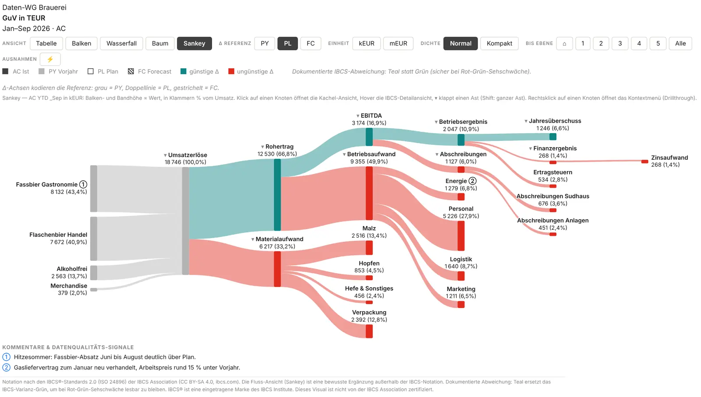

*Sankey — die GuV als Fluss, Band-Höhe proportional zum AC (bewusst außerhalb der IBCS-Notation).*

Alle Bilder: Demo-Daten der fiktiven Daten-WG Brauerei, gerendert mit Version 1.7.0.0 in derselben Breite (1050 px) ohne „Ganze Kachel nutzen“ — gleicher Maßstab in jedem Bild.

Die Notation folgt den **IBCS®-Prinzipien**: AC ausgefüllt in Dunkelgrau (#404040), PY grau, PL weiß mit Rahmen, FC schraffiert; Beschriftungen außen mit explizitem „+“, eine Skala je Einheit über alle Zeilen und Perioden-Blöcke (nach IBCS 2.0 / ISO 24896), Margenzeilen mit Δ in Prozentpunkten, keine Gitterlinien. Die Oberfläche spricht Deutsch, Englisch, Spanisch und Japanisch (sie folgt der Berichtssprache), kennt einen Dunkelmodus und Hochkontrast und begrüßt Autoren beim Hineinziehen mit einem Start-Hub (Kapitel 03). Das Visual macht keine externen Aufrufe, speichert nichts außerhalb des Berichts und sendet keine Telemetrie.

> **Dokumentierte Abweichung: Teal statt Grün.** Günstige Abweichungen sind standardmäßig Teal (#0E8585), ungünstige Rot (#E02B1D) — statt des IBCS-Grüns #8CB400 / Rot #FF2600. So bleiben die Abweichungen bei Rot-Grün-Sehschwäche lesbar; Legende und Fußzeile nennen die Abweichung. Umschaltbar unter Stil → Abweichungsfarben (IBCS-Grün klassisch) oder per Abweichungsfarben-Preset Blau / Orange (ColorBrewer #2C7BB6 / #E66101, auch ohne Farbsehen und im Schwarzweiß-Druck unterscheidbar). Im Dunkelmodus gilt das ChartKitchen-Paar #3FB3C2 / #E4635F.

> **Danke an IBCS.** Das Visual ist stark von den Ideen der IBCS® – International Business Communication Standards inspiriert. Ohne ihre großartigen Ressourcen, die außergewöhnlichen Inhalte und vor allem die bahnbrechende konzeptionelle Arbeit wäre so etwas wie dieses Visual nicht möglich gewesen. Dafür: Danke. Nicht gesponsert, nicht lizenziert und nicht mit der IBCS Association verbunden.

Diese Anleitung beschreibt den Stand der Version **1.7.0.0**. Alle Standardwerte der Einstellungs-Referenz sind gegen das Settings-Modell des Visuals geprüft. Neu in 1.7: **Bestand & Fluss** mit den Templates T05A Bilanz und T05B Cashflow (Kapitel 05 und 07), **⚡ Nur Ausnahmen** (Kapitel 09), die Karten **Fläche** und **Toolbar-Farben** (Kapitel 08) sowie **Cross-Highlight** im Sankey (Kapitel 06 und 09). Neu in 1.6: die fünfte Ansicht Sankey (Kapitel 06) und die Schalter „Ansichten anbieten“ (Kapitel 08). Neu seit 1.5: die Skalierung nach IBCS 2.0 / ISO 24896 als Standard in allen Ansichten (eine Skala je Einheit, Ausreißerzone, Skalenhinweis; Kapitel 06), einklappbare Bedienleisten (☰, Kapitel 08) und die Auto-Headline als ganzer Satz. Seit 1.3 und 1.4: der Start-Hub (Kapitel 03) mit Template-Galerie nach Zweck, „🚀 Loslegen“, Schriftgrößen-Leiste HD · Full HD · UHD und Doku-Knopf, ☰ Start als erster Toolbar-Knopf, „↺ Zum Template zurück“ samt Wiederanwenden und die ruhige Landing-Karte für Leser.

## 02 · Die Produktfamilie

ChartKitchen und P&L Statement sind zwei Visuals aus einer Küche: dieselbe IBCS-Notation, dieselbe Bedienung, derselbe Start-Hub. Sie konkurrieren nicht, sie ergänzen sich — ChartKitchen deckt die **Breite** der Diagrammformen ab, P&L Statement die **Tiefe** der Ergebnisrechnung.

### Wofür welches Visual?

Breite · 13 Chart-Modi

#### ChartKitchen byDatenWG

Ein Visual für jede Frage nach Verlauf, Struktur und Zusammenhang — „Wie entwickelt sich …?“, „Wer treibt …?“.

- **Zeitreihen:** Säulen und Linie, die integrierte Brücke PY → AC über die Monate, Forecast schraffiert, YTD per Klick.
- **Strukturen:** Balken, Kategorie-Brücke, Pareto, Dumbbell und Slope, dazu IBCS-Tabelle und Matrix.
- **Scatter & Bubble:** zwei Kennzahlen gegeneinander, mit Quadranten, Trendlinie, Bewegungspfeilen und Play-Modus.
- **KPI-Karten:** Monitoring-Kacheln mit Ampel, Bullet gegen Benchmark und Trend-Sparkline.
- **Small Multiples:** eine Kachel je Region oder Produkt, alle auf derselben Skala, mit Σ- und Top-N-Kachel.

[Zur ChartKitchen-Doku →](../chartkitchen-doku.html#family)

Tiefe · Tabellen & Statements

#### P&L Statement byDatenWG

Die Ergebnisrechnung Zeile für Zeile — „Was steht in der GuV, und warum weicht sie ab?“.

- **Mega-Table:** die IBCS-Tabellen-Templates T01–T04 sowie 12A, 12G und 12H — Wert-Kaskaden, Δ-Wasserfälle, Pins, Schwellen.
- **Bilanz & Cashflow:** Bestände zum Stichtag statt Monatssummen — die Templates T05A Bilanz und T05B Cashflow-Brücke neben der GuV. Dazu **⚡ Nur Ausnahmen**: farbig ist nur, was zählt.
- **Formel-Engine:** Hierarchie, Zwischensummen, Formel- und Margenzeilen direkt aus der Kontendimension (Ebenen-Spalten oder Parent-Child).
- **Werttreiberbaum:** der Formel-Graph als DuPont-Baum mit Mini-Charts auf jeder Karte und Kachel-Zoom je Knoten.
- **Sankey:** derselbe Graph als Fluss von links nach rechts — bewusst außerhalb der IBCS-Notation; der Kachel-Zoom bleibt IBCS.
- **Perioden-Blöcke:** Monat · YTD · FY-Ausblick nebeneinander; Leser schalten Spalten, Referenz und Einheit in der Toolbar.
- **Struktur-Bars & Zeilen-Waterfall:** dieselben GuV-Zeilen als Größenbalken oder als Kaskade mit Ergebnisankern.

✓ Diese Dokumentation

> **Die typische Berichtsseite nutzt beide nebeneinander** — links die GuV aus P&L Statement, rechts ChartKitchen mit Monatsverlauf, Treiber-Brücke oder KPI-Karten. Mit `fixedMax` teilen sie den Maßstab: denselben Betrag in ChartKitchen unter *Skala & Referenzlinie → Skalen-Mindest-Maximum* und im P&L Statement unter *Zahlen → Skalen-Mindestmaximum (Werte)* eintragen — gleiche Beträge ergeben dann gleich lange Balken (IBCS: identische Skalen).

### Gemeinsame Bedienung

Wer eines der beiden Visuals bedienen kann, kann auch das andere: Einstieg, Vorlagen und Darstellung folgen einer gemeinsamen Spezifikation. Die Tabelle nennt, was gleich ist, und wo es im jeweiligen Visual sitzt.

| Gemeinsam | ChartKitchen | P&L Statement |
| --- | --- | --- |
| **Start-Hub** 🚀 Loslegen plus vier Knöpfe: Tour · Vorlagen-Galerie · Demo · Felder erklären — nur im Bearbeitungsmodus. | Tour mit 11 Karten, Demo = Galerie der 13 Chart-Typen, Feld-Intro mit allen 19 Rollen. | Tour mit 8 Karten (echte Mini-Renderings), Demo = Beispiel-GuV, Feld-Intro mit allen 20 Rollen. |
| **Vorlagen als Presets** Galerie nach Zweck; ein Klick setzt alle Schalter, danach ist alles frei. „↺ Zum Template zurück“ stellt den Vorlagen-Stand wieder her. | 11 IBCS-Chart-Vorlagen C01–C13 (ohne C07/C11) in vier Gruppen; ↺ unten links im Chart. | 19 IBCS-Tabellen-Templates T01A–12H und T05A/T05B plus klassische Tabelle in fünf Gruppen; ↺ neben dem Template-Dropdown. |
| **Schriftgröße HD · Full HD · UHD** Leiste unten auf jeder Hub-Seite, rechts daneben „📖 Doku öffnen“. | Speichert *Datenbeschriftungen → Größen-Preset* (im Formatbereich Kompakt · Full HD · Präsentation; ×1 · ×1,5 · ×2). | Speichert *Stil → Schriftgrößen-Preset* (HD · Full HD · UHD; ×1 · ×1,25 · ×1,6). |
| **IBCS-Notation, Teal als Standard** AC voll, PY grau, PL Rahmen, FC schraffiert; günstige Abweichungen Teal statt Grün — lesbar bei Rot-Grün-Schwäche. | Teal #1E8F9E · Rot #D64541; Farbpreset Blau/Orange. | Teal #0E8585 · Rot #E02B1D; Presets IBCS-Grün und Blau/Orange. |
| **Vier Sprachen** Deutsch, Englisch, Spanisch, Japanisch — folgt der Berichtssprache, auch im Hub. | Formatbereich, Chart-Texte und Hub. | Formatbereich, Toolbar, Statement und Hub. |
| **Dark Mode & Hochkontrast** „Auto“ erkennt dunkle Berichts-Themes; im Hochkontrast tragen Muster statt Farben die Aussage. | *IBCS-Farben → Erscheinungsbild*. | *Stil → Erscheinungsbild*. |
| **Tastatur** Alle Knöpfe per Tab, Enter oder Leertaste lösen aus, Esc geht eine Ebene zurück bzw. schließt. | Tour: ‹ ›, Pfeiltasten, Pos1/Ende. | Hub: Ziffern 1–4 öffnen die Knöpfe; Tour: ‹ › und Pfeiltasten. |
| **Leser-Landing** Ohne Daten sehen Leser und Exporte eine ruhige Karte ohne Knöpfe; der eigene Leer-Zustand-Text gewinnt. | Seit 1.51.1. | Seit 1.4.1. |

## 03 · Der Start-Hub

Wer das P&L Statement leer auf die Berichtsseite zieht, sieht seit 1.3 keine Demo-Tabelle mehr, sondern den **Start-Hub** — erst entdecken, dann Felder binden. Seit 1.4 ist er auf den Self-Service von Controllern zugeschnitten, seit 1.4.1 sieht er aus wie im Schwester-Visual ChartKitchen. Der Hub ist ein Werkzeug für Autoren: Er erscheint nur im Bearbeitungsmodus, solange Felder fehlen — oder auf Knopfdruck über ☰ Start. Die Navigation im Hub ist lokaler Zustand; gespeichert wird davon nichts.

### Die Startseite: Loslegen und vier Knöpfe

Oben steht der Produktname mit dem Untertitel „Entdecke das Visual, bevor du Felder bindest — oder leg gleich los.“, darunter über die volle Breite der Teal-Knopf **🚀 Loslegen** und vier große Kacheln. Die Ziffern 1–4 öffnen die Kacheln direkt.

- **Was kann das Visual?** — eine Tour in 8 Karten: GuV als Tabelle, Mega-Table mit IBCS-Templates, Werttreiberbaum, Struktur-Balken, Zeilen-Waterfall, Kacheln, Dunkel & Hochkontrast und — Karte 8 — „Sankey: wohin das Geld fließt“ (mit dem Hinweis, dass er außerhalb der IBCS-Notation liegt). Jede Karte zeigt ein echtes, verkleinertes Rendering des Visuals über der eingebauten Demo — keine Bilder. Blättern mit ‹ › oder den Pfeiltasten.
- **Templates** — die Template-Galerie nach Zweck (siehe unten).
- **Demo ansehen** — die Beispiel-GuV mit Pharma-Daten (Smart Start), auf der Ansichten, Toolbar und Templates schon funktionieren.
- **Felder erklären** — alle 20 Datenrollen in vier Gruppen („Pflicht · Struktur und Ist“, „Szenarien und Zeit“, „Statement-Logik“, „Extras“), je mit einem Satz Zweck und ✓, sobald gebunden. Dazu zwei Prämissen: *IBCS-Notation* (AC voll · PY grau · PL Rahmen bzw. Doppellinie · FC schraffiert; Regel „Minuend → Füllung, Referenz → Achse“) und *Struktur vs. Zeit* (Konten laufen vertikal in Zeilen, die Zeit horizontal in Blöcken Monat | _YTD | FY).

Jede Unterseite und Ebene trägt oben links die Pille **„← Zurück“**; Esc geht eine Ebene zurück, der Fokus kehrt auf die Kachel bzw. den Loslegen-Knopf zurück. Alles sind native Buttons (Tab · Enter · Leertaste); Dark Mode und Hochkontrast gelten auch im Hub.

### Die Template-Galerie nach Zweck

20 Kacheln — die klassische Tabelle und die 19 IBCS-Templates (Kapitel 07) — stehen in fünf Gruppen, jede mit einem Satz Zweck. Jede Kachel trägt einen Finance-Titel, eine Nutzen-Zeile und die T-Nummer als kleines Badge auf der Vorschau; Templates, die den Forecast analysieren, zeigen eine Vorschau mit simuliertem FC.

| Gruppe | Template | Kachel-Titel | Nutzen-Zeile |
| --- | --- | --- | --- |
| **Struktur-Vergleich** Regionen, Produkte, Kostenstellen nebeneinander — wer liegt über, wer unter Plan? | T01A | Regionen mit Plan-Abweichung | Werte und Δ als Zahlen, Monat \| YTD; Schwellen färben Ausreißer rot. |
|  | T01B | Regionen mit Zwischensummen | Wie T01A, gegliedert in Zwischensummen-Blöcke je Bereich — für Konzern- und Segmentsichten. |
|  | T02A | Plan-Abweichung als Balken | ΔPL-Balken und -Pins: welcher Bereich über, welcher unter Plan liegt — auf einen Blick. |
|  | T02B | Ranking nach Ist (YTD) | T02A nach AC sortiert: die größten Bereiche oben — für Top-/Flop-Listen. |
|  | T02C | Ranking nach Abweichung (Monat) | T02A nach Δ des Monats sortiert: die größten Baustellen zuerst — für die Monatsbesprechung. |
| **Forecast** Die Erwartungsrechnung (FC) gegen Plan und Vorjahr — schraffiert nach IBCS. | T02E | Forecast gegen Vorjahr | FC schraffiert, ΔPY-Balken und -Pins, nach Abweichung sortiert — wächst der Bereich? |
|  | T02F | Forecast gegen Plan | Landet der Bereich im Budget? ΔPL-Balken und -Pins zum Forecast, größte Lücken zuerst. |
|  | T03B | Forecast-GuV mit Δ zu Vorjahr und Plan | Die Erwartungsrechnung als Statement: PY · PL · FC und beide Abweichungen als Zahlen. |
|  | T04D | Forecast-GuV mit Plan-Wasserfall | Wie der Forecast vom Plan zum Ergebnis kommt: ΔPL-Wasserfall Zeile für Zeile. |
|  | T04E | Forecast-GuV mit Vorjahres-Wasserfall | Was treibt das erwartete Ergebnis gegenüber dem Vorjahr? ΔPY-Wasserfall mit Pins. |
| **GuV-Statement** Die Ergebnisrechnung Zeile für Zeile — Abweichungen als Zahl, Balken oder Wasserfall. | T03A | GuV mit Abweichung zu Vorjahr und Plan | Das Standard-Statement für den Monatsbericht: PY · PL · AC, ΔPY und ΔPL als Zahlen. |
|  | T04A | GuV mit Plan-Abweichungsbalken | Jede Zeile mit ΔPL-Balken und -Pins — Kosten- und Erlösabweichungen werden sichtbar. |
|  | T04B | GuV mit Δ-Wasserfall | Vom Plan- zum Ist-Ergebnis: der integrierte ΔPL-Wasserfall zeigt, was jede Zeile beiträgt. |
|  | T04C | GuV mit Vorjahres-Wasserfall | Die Ergebnisbrücke zum Vorjahr: ΔPY-Wasserfall auf grauer Achse, Pins für Δ %. |
| **Bilanz & Cashflow** Bestände zum Stichtag statt Monatssummen — Bilanz und die Brücke vom Anfangs- zum Endbestand. | T05A | Bilanz zum Stichtag | Aktiva und Passiva mit Bilanzsumme (Doppelstrich), Stand gegen Vorjahresstichtag mit ΔPY und ΔPY %. |
|  | T05B | Cashflow-Brücke | Anfangsbestand → operativ · investiv · finanziell → Endbestand als Kaskade, Monat und YTD, Bestände als Anker. |
| **Report-Ansichten** Kaskaden, Jahresausblick, Planrechnung — und die klassische Tabelle. | 12A | Wert-Kaskaden Vorjahr und Ist | PY- und AC-Kaskade nebeneinander, ΔPY-Balken und -Pins — die Ergebnisrechnung als Bild. |
|  | 12G | Jahresausblick (FY) | Ist + Forecast als Gesamtjahr gegen Vorjahr: YTD voll, Restjahr schraffiert, mit Headline. |
|  | 12H | Planrechnung gegen Vorjahr | Für die Budgetrunde: PL umrandet gegen Vorjahr, Abweichungen umrandet, Headline-Slot. |
|  | Aus | Klassische GuV-Tabelle | Spalten-Presets, Sparklines und Perioden-Blöcke — Leser schalten selbst in der Toolbar. |

- **Klick = anwenden.** Die Kachel schreibt dasselbe wie das Toolbar-Dropdown: Template, alle Schalter, Dezimalstellen und gegebenenfalls den Headline-Slot in einem Speichervorgang. Die aktive Kachel trägt „✓ aktiv“, einen Akzentrahmen und getönten Grund; ein erneuter Klick wendet das Template noch einmal an.
- **Ohne Felder** wird die Wahl gespeichert („Gespeichert: T03A — wird aktiv, sobald Felder gebunden sind.“) und greift beim Binden.
- **Im Overlay** (über ☰ Start) wendet ein Klick das Template an, stellt die Ansicht Tabelle ein — auch aus Balken, Waterfall, Baum oder Sankey — und schließt das Overlay auf dem Ergebnis.

### 🚀 Loslegen — die ersten drei Minuten

Drei Schritte von leeren Feldbereichen zur fertigen GuV: eine geführte Checkliste, deren Häkchen live mitgehen. Gespeichert wird davon nichts.

1. **Felder binden** — der schnelle Weg zuerst. Pflicht: Ebenen-Spalten L1..Ln (oder Konto-ID + Parent-ID) und AC. Empfohlen: PY und/oder PL (Abweichungen), Periode (Blöcke Monat | YTD) sowie Zeilentyp + Rechenvorzeichen (Ergebnis- und Margenzeilen). „Alle Felder erklärt →“ springt ins Feld-Intro.
2. **Template wählen** — zeigt den Stand („Gewählt: …“ oder noch die klassische Tabelle) und springt mit „Zur Template-Galerie →“ in die Galerie.
3. **Feinschliff** — im Formatbereich, in dieser Reihenfolge: Hausbegriffe (Szenario-Begriffe → AC = „Ist“, PL = „Budget“), Schwellen (Spalten & Mega-Table → Δ rot unter Schwelle · Wesentlichkeit ab) und Dezimalen (Zahlen → Dezimalstellen) — mit ✓, sobald gesetzt.

### Die untere Leiste: Schriftgröße und Doku

Eine feste Leiste schließt jede Hub-Seite ab — Startseite, Loslegen, Tour, Galerie, Demo, Felder und alle Seiten im Overlay:

- **Aa · HD · Full HD · UHD** — die drei Pillen schreiben *Stil → Schriftgrößen-Preset* (×1 · ×1,25 · ×1,6), die aktive ist Teal gefüllt; daneben der Hinweis „Schriftgröße — HD für Laptops · Full HD für Monitore · UHD für Beamer & 4K“, der als Einziges bei Platzmangel weicht. Ein Klick speichert und zeichnet sofort neu — im Overlay auch die GuV darunter.
- **📖 Doku öffnen** — rechts als umrandete Pille: öffnet diese Seite im Browser (bei deutscher Berichtssprache diese Fassung, sonst die englische). Das ist der einzige Aufruf nach außen — nur auf Klick und nur im Bearbeitungsmodus.
- Darunter steht mittig die Signatur „made by Daten-WG“.

### Mit Daten: ☰ Start und ↺ Zum Template zurück

- **☰ Start** ist im Bearbeitungsmodus das *erste* Element der Toolbar — vor der Template-Auswahl, mit Akzentrahmen und fetter Schrift. Er öffnet den Hub als Overlay über der GuV; „✕ Schließen“ oder Esc entfernt die Schicht, die Ansicht darunter ist exakt wie zuvor (samt Scroll-Position), der Fokus kehrt auf den Knopf zurück. Wechselt der Host in die Leseansicht, schließt sich das Overlay.
- **↺ Zum Template zurück** steht neben dem Template-Dropdown (Bearbeitungsmodus, Ansicht Tabelle), sobald ein Template gesetzt ist und mindestens ein Template-Schalter (Spalten, Headline) abweicht. Ein Klick stellt den Template-Stand wieder her — alle Schalter und Dezimalstellen. Geänderte Dezimalstellen allein gelten nicht als Abweichung.

### Was Leser sehen

Leser, PDF-Export und Abos sehen nie Hub, Overlay oder Leiste. Ohne Daten zeigt das Visual ihnen seit 1.4.1 eine ruhige **Landing-Karte**: den Produktnamen fett, darunter „Dieses Visual hat noch keine Daten — Felder werden im Bearbeitungsmodus gebunden.“ und eine statische Reihe aus drei Chart-Schemata — keine Buttons, keine Pillen, kein Doku-Link. Ein eigener Leer-Zustand-Text des Autors gewinnt weiterhin. Dieselbe Regel gilt in ChartKitchen.

> Es geht auch ohne Hub: *Leer-Zustand → Solange Felder fehlen (Bearbeitungsmodus)* bietet die Demo-GuV (Smart Start), das Feld-Intro oder eine eigene Nachricht (Kapitel 08). Berichte, die `demo` oder `fields` gespeichert haben, ändern sich nicht. Visuals unter 300 × 220 px zeigen auch beim Bearbeiten nur den Hinweistext statt des Hubs.

## 04 · Schnellstart & Import

### 1 · Visual importieren

1. Lade die Datei [`pnlByDatenWG…1.7.0.0.pbiviz`](https://raw.githubusercontent.com/Losveratos/PowerBI-Kitchen-/main/pnlByDatenWG/dist/pnlByDatenWG3F9A7D2C51E64B08A1C4E7F0B92D6358.1.7.0.0.pbiviz) herunter (Endung `.pbiviz`, auch über den Button oben rechts).
2. In Power BI Desktop: *Visualisierungen* → *⋯* → *Visual aus einer Datei importieren* und die `.pbiviz` wählen. Eine ältere Version wird dabei ersetzt.
3. Das Visual großzügig aufziehen (mindestens etwa 1200 × 800 px) — Toolbar und zwei Spaltenblöcke brauchen Breite. Frisch auf der Seite zeigt es im Bearbeitungsmodus den **Start-Hub** (Kapitel 03): „🚀 Loslegen“ führt mit Häkchen durch Felder, Template und Feinschliff, „Demo ansehen“ öffnet die Beispiel-GuV, auf der Ansichten, Toolbar und Templates schon funktionieren.

### 2 · Minimal-Setup

1. Ziehe die Ebenen deiner Hierarchie in **Ebenen-Spalten (L1..Ln)** — in der Reihenfolge von oben nach unten. Alternative: **Konto-ID (Key)** + **Parent-Konto-ID**.
2. Binde deine Hauptkennzahl an **AC (Ist)**. Sobald AC und eine Hierarchie gebunden sind, verschwindet der Start-Hub und das Statement erscheint.
3. Stelle alle Gruppierungsfelder auf **„Nicht zusammenfassen“** — sonst aggregiert Power BI sie und das Visual bekommt leere Werte.

### 3 · Ausbau

1. **PY · PL · FC** binden — jedes gebundene Szenario schaltet seine Δ-Spalten frei.
2. **Periode (Monat)** binden — für Monats- und YTD-Block, Sparklines und Monatskarten.
3. Für eine echte GuV: **Zeilentyp**, **Formeldefinition** und das **Vorzeichen-Trio** (Kapitel 05); für den Ganzjahres-Ausblick **FC Gesamtjahr** und **PL Gesamtjahr** als `MAX`-Measures.
4. Für eine Bilanz oder einen Cashflow: im **Zeilentyp** das Token `stock` bzw. `opening` setzen (`Account stock`) oder unter *Bestand & Fluss* „Alle Zeilen Bestand (Bilanz)“ wählen — Kapitel 05. Fertige Layouts: T05A und T05B.
5. Optional ein IBCS-Template wählen: per Klick in der Template-Galerie des Start-Hubs (☰ Start), im Bearbeitungsmodus über das Dropdown **Template** gleich nach ☰ Start in der Toolbar (Ansicht Tabelle) oder über Formatbereich → *Spalten & Mega-Table* → *Template* (Kapitel 07).

> Beide Wege Schritt für Schritt — die normale Hierarchie in zwei Minuten und die volle GuV mit Formelzeilen —, eine Beispiel-Kontendimension und die Pharma-Demodaten zum Mitspielen stehen auf der [Schnellstart-Seite](../pnl-schnellstart.html).

## 05 · Datenmodell & Rollen

Das Visual braucht eine Kontendimension — eine Zeile je GuV-Zeile — und eine Faktentabelle mit den Measures. Für die Hierarchie gibt es zwei voll unterstützte Eingabemodi:

- **Sternschema (Ebenen-Spalten, primärer Modus):** L1..Ln in Ziehreihenfolge, höchstens 8. Das Visual baut den Baum selbst. Ragged-Äste nach beiden üblichen Konventionen: Ist eine tiefere Ebene leer, ist die letzte gefüllte Ebene das Blatt; wiederholt eine Ebene den Text der vorigen (L2 = L1), endet der Pfad dort. Zeilen mit gleichem Pfad werden aggregiert; Aggregat-Zeilen (z. B. PY nur auf L1) wirken als Szenario-Fallback.
- **Parent-Child:** Konto-ID + Parent-Konto-ID, beliebig tief und unbalanciert. Waisen landen sichtbar in „Nicht zugeordnet“ statt still zu verschwinden. Sind Ebenen-Spalten und Parent-ID gebunden, gewinnt Parent-Child.

Zwischensummen entstehen synthetisch aus den Ebenen-Pfaden; eine synthetische Zwischensumme erbt *Anzeige invertieren* und *Abweichungsfarbe drehen*, wenn alle Kinder einheitlich sind. Formelzeilen referenzieren andere Zeilen über ihren eindeutigen Namen.

### Feldrollen (Reihenfolge wie im Feldbereich)

Je Rolle höchstens ein Feld, die Ebenen-Spalten höchstens acht. Das Visual liest jede Spalte über ihre Rolle, nie über ihre Position — seit 1.2 steht die Feldliste in der gewohnten Reihenfolge Ebenen → Schlüssel → AC · PY · PL · FC → Periode → Spezialrollen.

| Feldrolle | Typ | Wofür |
| --- | --- | --- |
| Ebenen-Spalten (L1..Ln) | Gruppierung · bis 8 | Sternschema-Hierarchie in Ziehreihenfolge — der primäre Modus. Ragged-Regeln siehe oben. |
| Konto-ID (Key) | Gruppierung | Eindeutiger, stabiler Kontoschlüssel. Pflicht im Parent-Child-Modus, im Ebenen-Modus optional (Blatt-ID). Basis der Selektion und des Drillthroughs. Ohne Ebenen-Spalten und Konto-ID zeigt das Visual den Leer-Zustand (im Bearbeitungsmodus den Start-Hub). |
| Kontoname | Gruppierung | Anzeigename der Zeile. Ohne Feld zeigt das Visual die Konto-ID bzw. im Ebenen-Modus den Text der letzten gefüllten Ebene. |
| Parent-Konto-ID | Gruppierung | Parent-Child-Verknüpfung; unbalancierte Hierarchien sind erlaubt. Gewinnt, wenn zusätzlich Ebenen-Spalten gebunden sind. |
| AC (Ist) | Kennzahl · Pflicht | Ist-Wert — die zentrale Kennzahl, ausgefüllt gezeichnet. |
| PY (Vorjahr) | Kennzahl | Vorjahreswert, grau gezeichnet — Basis für ΔPY. |
| PL (Plan / Budget) | Kennzahl | Plan- bzw. Budgetwert, umrandet gezeichnet — Basis für ΔPL; im Mega-Table auch analysiertes Szenario (Planrechnung, 12H). |
| FC (Forecast) | Kennzahl | Forecast-Wert, schraffiert gezeichnet; kann im Mega-Table das analysierte Szenario sein (T02E/F, T03B, T04D/E). |
| Periode (Monat) | Gruppierung | Monatsspalte für Sparklines, Monats- und YTD-Block, den zweiten Perioden-Block und die Monatskarten. Gelesen werden JJJJ-MM, JJJJ-MM-TT, ISO-Zeitstempel, JJJJ/MM, Datumsspalten, deutsche und englische Monatsnamen (lang/kurz, mit Jahr) und Zahlen 1–12. „Monat“ ist der letzte Monat *mit AC-Daten*; YTD ist das periodengleiche Fenster bis dorthin. |
| Spalten-Kategorie | Gruppierung · 1.2 | Optional, nur klassische Tabelle: Der Spaltensatz des YTD-Blocks wiederholt sich je Wert dieses Felds (z. B. Segment oder Quartal) unter einer Gruppen-Kopfzeile, danach folgt der Gesamt-Block. Mega-Table, Balken und Waterfall ignorieren das Feld. |
| Zeilentyp | Gruppierung | `Account` · `Subtotal` · `Formula` · `KPI` · `Separator` (Groß-/Kleinschreibung egal). KPI ist eine Margenzeile: %-Anzeige, Δ in Prozentpunkten. Seit 1.7 darf in derselben Zelle ein Token folgen: `stock` (Bestand) oder `opening` (Anfangsbestand), z. B. `Account stock` — siehe „Bestand & Fluss“ unten. |
| Formeldefinition | Gruppierung | Für Formel- und KPI-Zeilen, z. B. `[EBITDA]/[Umsatz]`: `+ − * /` und Klammern, Verweis per eindeutigem Zeilennamen, Formel auf Formel erlaubt. Ein Zirkelbezug erscheint als Fehler an der Zeile. |
| Rechenvorzeichen (±1) | Gruppierung | Vorzeichen, mit dem die Zeile rechnet: Erlöse `1`, Kosten `-1`. Eine Zwischensumme ist Vorzeichen × Summe der Kinder. |
| Anzeige invertieren | Gruppierung | Positiv anzeigen, obwohl der gerechnete Wert negativ ist (Kostenzeilen). Ändert nur die Anzeige, nicht die Rechnung. |
| Abweichungsfarbe drehen | Gruppierung | Dreht die Bewertung günstig / ungünstig einer Zeile. |
| Sortierung | Gruppierung | Zahl je Zeile, die die GuV-Reihenfolge innerhalb des Elternknotens festlegt (z. B. 10, 20, 30). |
| Kommentar | Gruppierung | Kommentartext je Zeile — erscheint als nummerierter Marker (①, ②) mit Fußnote und im Tooltip. |
| Filter-Info (Fußzeile) | Kennzahl (Text) | Text-Measure mit dem aktuellen Filterkontext (z. B. per `CONCATENATEX`/`SELECTEDVALUE`) — erscheint als zweite Fußzeile, wenn die Filter-Fußzeile aktiv ist. Berichtsfilter sind für Custom Visuals sonst unsichtbar. |
| FC Gesamtjahr (Ausblick) | Kennzahl | Forecast fürs Gesamtjahr (AC&FC) als Einzelwert, auf jeder Monatszeile wiederholt; der erste Wert gilt, nie summiert. Schaltet den FY-Ausblick frei (Mega-Table Block-Art FY, Template 12G). |
| PL Gesamtjahr | Kennzahl | Plan fürs Gesamtjahr als Einzelwert für den Ausblicks-Block. Der FY-Block der klassischen Tabelle braucht beide FY-Felder. |

### Das Vorzeichen-Trio

Drei Felder der Kontendimension steuern, wie eine Zeile rechnet, wie sie aussieht und wie ihre Abweichung bewertet wird. Sie sind voneinander unabhängig — die Vorzeichenlogik läuft über die Dimension, im Visual wird nichts „verbogen“.

| Feld | Frage | Wirkung |
| --- | --- | --- |
| Rechenvorzeichen (±1) | Wie geht die Zeile in Summen und Formeln ein? | Der gebuchte Wert wird mit ±1 multipliziert. Positiv gebuchte Kosten mit `-1` gehen negativ in die Summe ein, sodass `[Umsatz]+[Herstellungskosten]` das Bruttoergebnis ergibt. |
| Anzeige invertieren | Wie wird die Zeile gezeigt? | Dreht das Vorzeichen nur für die Anzeige: −50 gerechnet, 50 gezeigt. Δ und Δ % folgen im Mega-Table den gezeigten Werten. |
| Abweichungsfarbe drehen | Ist „mehr“ gut oder schlecht? | Bewertet wird die Abweichung des *gerechneten* Werts: ein Plus ist günstig. Der Schalter dreht diese Bewertung für Zeilen, deren Vorzeichen nicht über die Dimension kommt. |

> **Beispiel — Kostenzeile „Material“, AC 50 gegen PL 60.** Die Kosten sind in der Faktentabelle positiv gebucht. Mit Rechenvorzeichen `-1` rechnet das Visual −50 gegen −60; die Abweichung des gerechneten Werts ist +10, also *günstig* (Teal) — weniger Kosten als geplant. *Anzeige invertieren* = `true` zeigt die Zeile als 50 und 60. Ergebnis für die typische Kostenzeile (so auch in der Pharma-Demo): `-1` · `true` · `false`.
>
> **Die andere Konvention:** Werden Kosten positiv und ohne Rechenvorzeichen (`1`) geliefert und erst per Formel abgezogen, wäre „mehr Kosten“ rechnerisch ein Plus. Dann setzt du *Abweichungsfarbe drehen* = `true` — dasselbe Beispiel ergibt dasselbe Bild: 10 unter Plan, günstig. Kombiniere `-1` nicht zusätzlich mit *Abweichungsfarbe drehen*, außer höhere Werte dieser Zeile sind tatsächlich gut: die Bewertung kippt sonst, und eine Kostenüberschreitung erscheint günstig.

### Bestand & Fluss (1.7)

Eine GuV besteht aus **Flüssen**: Umsatz und Kosten der Monate addieren sich zu YTD und Gesamtjahr. Bilanzposten, Kasse, Working Capital oder Headcount sind dagegen **Bestände** — ein Stand zum Stichtag, der über die Monate nie summiert wird (die Kasse von Januar bis März ist nicht die Summe dreier Kassenstände). Seit 1.7 unterscheidet das Visual beides, damit Bilanz und Cashflow-Brücke neben der GuV stehen können. Die Art legst du in der Rolle *Zeilentyp* mit einem Token fest, das in derselben Zelle hinter dem Zeilentyp steht (getrennt durch Leerzeichen, Komma, Semikolon oder `|`, z. B. `Account stock`, `Formula; stock`):

| Token | Bedeutung | Aliasse |
| --- | --- | --- |
| `stock` | Bestand: Stand am Periodenende (Bilanzposten, Kasse, Endbestand). | bestand · balance · stichtag · point |
| `opening` | Anfangsbestand: Stand am Periodenanfang (Kassen-Anfangsbestand einer Cashflow-Brücke). | anfangsbestand · eröffnung · open · begin |
| `flow` | Fluss — das ist ohne Token ohnehin der Fall; das Token legt es ausdrücklich fest (z. B. für eine Mischung). | fluss · bewegung · movement |

Zellen ohne Token liest das Visual wie vor 1.7 (ein Zeilentyp wie „net margin“ bleibt ein Account). So wirken die Arten in den Blöcken:

| Fluss vs. Bestand | Monat | YTD | FY-Ausblick | Δ und Δ % |
| --- | --- | --- | --- | --- |
| Fluss (ohne Token) | Wert des Monats | Summe der Monate bis zum Stichtag | Σ Ist + Vorschau bzw. das gebundene FY-Feld | Δ der Summen |
| Bestand (`stock`) | Stand am Monatsende | Stand der letzten Periode (letzter Ist-Monat), nicht summiert | Endstand der Vorschau bzw. das gebundene FY-Feld direkt | Stand gegen Stand zum selben Stichtag (PY = Vorjahresstichtag, im FY-Block das Vorjahres-Endstand) |
| Anfangsbestand (`opening`) | Stand zu Beginn des Monats | Stand im ersten Monat des Fensters | Stand zu Jahresbeginn | wie Bestand |

- **Vererbung:** Eine Summe ohne Token ist Bestand, wenn alle ihre Kinder Bestand sind; Formeln und KPIs ebenso, wenn alle Operanden Bestand sind. Eine gemischte Formel (Anfangsbestand + Cashflows = Endbestand) folgt dem *ersten* Operanden und zeigt dann den Stand am Ende; eine gemischte Summe bleibt Fluss.
- **Hinweis bei Mischung:** Mischt eine Formel oder Summe Bestand und Fluss, ohne dass ein Token die Art festlegt, nennt im Bearbeitungsmodus ein Hinweis unter der Tabelle die Zeilen („Bestand und Fluss gemischt …“). Leser sehen ihn nicht. Abhilfe: `stock` oder `flow` im Zeilentyp setzen.
- **Globaler Schalter:** Formatbereich → *Bestand & Fluss* → *Bestand vs. Fluss*: *Auto (Token im Zeilentyp)* · *Alle Zeilen Bestand (Bilanz)* für eine reine Bilanz ohne Token-Spalte · *Alle Zeilen Fluss (wie vor 1.7)* ignoriert die Token. Standard Auto; ohne Token rendert ein Bericht wie in 1.6.
- **Darstellung:** Der Mega-Table zeigt Bestands-Summen als „=“-Ketten mit Doppellinie; in Δ-Wasserfall, Wert-Kaskade und Zeilen-Waterfall ankern Bestände auf der Nulllinie, Flüsse floaten dazwischen; 12G zeigt einen Bestand als schraffierten FC-Balken (Endstand, kein YTD-Anteil); der Sankey zeichnet Bestände als graue Anker. Die Σ-treue Rundung addiert nie Bestände mit Bewegungen.
- **Datenmodell:** Bestände als **Monatsstände (ultimo)** liefern, nie kumuliert. Passiva aus einer Saldenliste (Haben-Salden negativ geliefert) mit Rechenvorzeichen `-1` und *Anzeige invertieren* = `false`; *Abweichungsfarbe drehen* nach Fachlogik (Verbindlichkeiten, Rückstellungen: `true`). Den Entwurf und die Prüfung eines solchen Modells übernimmt der Claude-Skill `finance-data-model` (sein `validate_model.py` kennt Bestandszeilen).
- **Beispieldaten:** `pnlByDatenWG/demoData/bilanz-dim-konten.csv` + `bilanz-fact.csv` und `cashflow-dim-konten.csv` + `cashflow-fact.csv` (Daten-WG Brauerei 2026, kEUR) — dazu die Templates T05A und T05B (Kapitel 07).

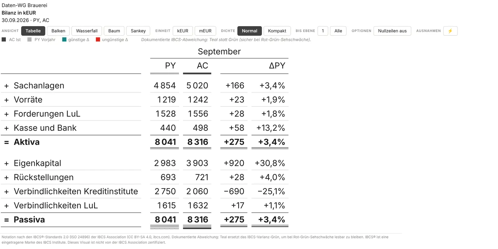

*Bestände zum Stichtag: T05A Bilanz, Summen mit Doppelstrich, ΔPY gegen den Vorjahresstichtag.*

### Spalten-Kategorie (1.2)

Ein Feld wie Segment oder Quartal in **Spalten-Kategorie** lässt die klassische Tabelle ihren Spaltensatz je Kategoriewert wiederholen — der Spaltensatz des YTD-Blocks (sonst des ersten Blocks) steht unter einer Gruppen-Kopfzeile je Wert, danach folgen die bisherigen Blöcke als „Gesamt“. Jede Kategorie rechnet vollständig, auch Formeln und Margen; die Monate liegen auf dem Kalender des Gesamtmodells, ein einheitlicher Δ-Maßstab gilt über alle Blöcke. Höchstens 24 Kategorien, weitere Werte nennt eine Fußnote. „% vom Umsatz“ und Σ-treue Rundung bleiben im Gesamt-Block. Die Measures müssen additiv sein (Gesamt = Summe der Kategorien), sonst zeigt der Gesamt-Block die Summe statt des Modellwerts. Mega-Table, Balken und Waterfall ignorieren die Rolle; im Bearbeitungsmodus steht dann ein Hinweis unter der Tabelle.

> **DAX-Regeln, an denen Modelle scheitern:** FY-Measures mit `MAX` statt `SUM` (die Jahreswerte stehen auf jeder Monatszeile); ein Berichtsjahr filtern, sonst summieren AC/PY/PL/FC über Jahre; Measures, die für nicht existierende Konto-/Perioden-Kombinationen einen Wert liefern (`COALESCE(x, 0)`, `+0`), erzeugen Geisterzeilen — Wächter-Muster `IF(COUNTROWS('Fakt') > 0, …)`. Zeitintelligenz, Währungsumrechnung und Row-Level Security bleiben im Modell: das Visual verrechnet ausschließlich die gelieferten Daten.

## 06 · Die Ansichten

Die Toolbar-Gruppe *Ansicht* schaltet zwischen Tabelle, Balken, Wasserfall, Baum und Sankey. Der Mega-Table ist keine eigene Ansicht, sondern ein Modus der Tabellen-Ansicht; die Kachel-Ansicht öffnet sich aus dem Baum oder dem Sankey. Welche dieser Ansichten Leser überhaupt angeboten bekommen, legt der Autor fest (Kapitel 08, „Ansichten anbieten“). Die gewählte Ansicht ist ein Leser-Zustand und wird mit dem Bericht und in Lesezeichen gespeichert.

### 01 · Tabelle (klassisch)

Das Statement: Konten, Zwischensummen, Formel- und Margenzeilen mit Auf- und Zuklappen je Zeile. Die Spalten kommen aus dem **Spalten-Preset** — *AC·PY·PL·FC (voll)* (AC, % vom Umsatz, PY mit ΔPY-Balken, PL mit ΔPL-Balken und ΔPL%-Pin), *AC vs. Referenz*, *AC vs. PY·PL·FC* (Δ-Balken und Δ%-Pin je gebundener Referenz), *AC·PY·ΔPY*, *AC·PL·ΔPL*, *ΔPY% · ΔPL%* (nur Pins) und seit 1.2 *Eigene Auswahl* (AC, PY, PL, FC und Δ als einzelne Schalter). Drei Perioden-Blöcke: **MTD** (AC gegen die Δ-Referenz), **YTD** und der **FY-Ausblick** (AC&FC gegen PL Gesamtjahr, mit beiden FY-Feldern, im vollen Preset und in der eigenen Auswahl). Alle Δ-Balken teilen eine Skala über alle Zeilen und Perioden-Blöcke. Liegt ein Δ%-Pin über ±40 %, nehmen ±40 % die inneren 80 % der Spur ein; der Ausreißer läuft in die äußere Zone, ein Bruchzeichen trennt ihn, ein Dreieck zeigt in Wuchsrichtung (seit 1.5). Mit gebundener Periode schaltet ein Chip je Zeile eine Monats-Sparkline auf; Kommentare erscheinen als nummerierte Marker mit Fußnote.

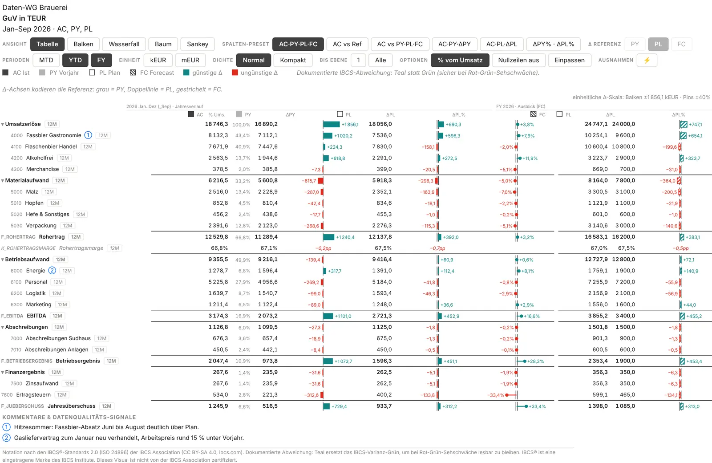

*Klassische Tabelle auf Ebene 1 mit Leser-Toolbar: Ansicht, Spalten-Preset, Δ-Referenz, Perioden, Einheit, Dichte, Ebene, Optionen, ⚡.*

### 02 · Mega-Table

Sobald in der Tabellen-Ansicht ein Spalten-Schalter des Mega-Tables an ist (Wertspalte PY, PL oder AC/FC, eine ΔPY-/ΔPL-Darstellung), zeichnet das Visual die IBCS-Tabelle; alle Schalter aus = klassische Tabelle. Wertspalten und Δ-Spalten sind frei kombinierbar: Δ als Zahl, als Balken auf einer Nulllinie, als **integrierter Wasserfall** (jeder Δ-Balken beginnt am Ende des vorigen, „=“-Zeilen setzen an der Nulllinie neu an), Δ % als Zahl oder Pin; Wertspalten optional als **Wert-Kaskaden** (12A). Ein oder zwei **Perioden-Blöcke** (Monat · YTD · FY-Ausblick) auf einer gemeinsamen Skala, **Schwellen** („Δ rot, wenn …“) mit Fußzeile, Margenzeilen kursiv mit Δ in Prozentpunkten (pp) statt Δ %, Szenario-Unterstreichungen in Kopf und Schlusszeile. Bei Strukturdaten (Regionen statt GuV) gibt es Zwischensummen-Blöcke mit Leerzeile und eine Sortierung mit „(↓)“ am sortierenden Kopf, die Zeilen je Block und die Blöcke selbst in derselben Richtung (seit 1.5.2, Einkindgruppen wie Blöcke); Zeilen namens „Other …“/„Sonstige …“ bleiben unten; eine Leerzeile folgt jedem Element der obersten sichtbaren Ebene, auch zwischen zwei Einzelzeilen, und eine Gruppe mit genau einem gezeigten Kind steht als eine Zeile („Deutschland · Sachsen“) ohne wiederholte Zwischensumme (1.5.1). Pins kappen Ausreißer automatisch (Tukey-Zaun Q3 + 4 × IQR, eine Grenze für die ganze Tabelle); das gekappte Element läuft in eine Ausreißerzone, getrennt durch ein Bruchzeichen, mit Dreieck und der Zahl außen. Ab 150 sichtbaren Zeilen zeichnet der Mega-Table nur das Fenster um den Viewport; der Export zeichnet immer alles. Im Mega-Modus blendet die Toolbar Spalten-Preset, Δ-Referenz, Perioden und Einpassen aus — die Spalten kommen aus dem Formatbereich.

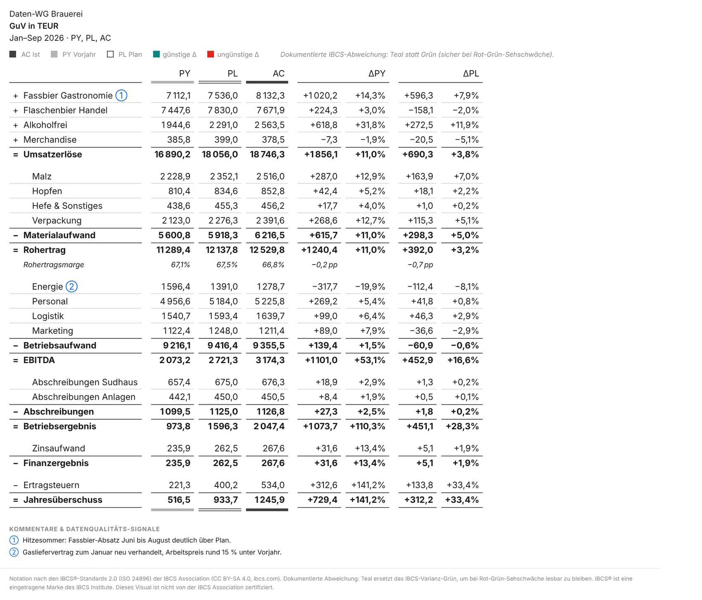

*T03A — das Standard-Statement: PY · PL · AC, ΔPY und ΔPL als Zahlen, Margenzeile in Prozentpunkten.*

> **Skalierung nach IBCS 2.0 / ISO 24896 (seit 1.5):** Gleiche Einheit, gleiche Skala. Alle Δ-Balken und Δ-Wasserfälle aller Perioden-Blöcke (Monat, YTD, FY) teilen einen Maßstab, alle Δ%-Pins einen zweiten; zwischen den Blöcken gibt es keinen Faktor, auch wenn der Monat dabei kurz wird (1.5.1). In 12A, 12G und 12H zeichnen die Δ-Balken in der Skala der Wert-Kaskaden. Nur wenn sie dort unter die Mindest-Datenfläche fielen, gilt ein runder Faktor (2, 5, 10, 20 …) für alle Δ-Spalten der Tabelle: Der Spaltenkopf nennt ihn („ΔPY ×5“), und über der Tabelle steht rechtsbündig ein Skalenhinweis. Still umskaliert wird nie. Gekappte Ausreißer laufen in eine Ausreißerzone (12 % der Spalte) mit Bruchzeichen, Dreieck und Zahl außen. Kommentar-Fußnoten bleiben immer sichtbar: Reicht der Platz nicht, setzt das Visual sie mehrspaltig, verringert dann die Zeilenhöhe und lässt den Block zuletzt am unteren Rand stehen, während die Tabelle dahinter scrollt.

### 03 · Struktur-Bars

Dieselben Zeilen mit einem Größenbalken je Zeile: AC gegen die Δ-Referenz, dazu ΔRef-Balken und ΔRef%-Pin — der Blick auf die Struktur des Ergebnisses, ohne die Zahlen aufzugeben. Blöcke: YTD und (mit beiden FY-Feldern) der FY-Ausblick. Standard ist ein schmaler AC-Balken im vollen Referenzband. Seit 1.2 gibt es die **ChartKitchen-Notation** als Schalter (Spalten & Mega-Table → Tabelle): *Szenario-Balken überlappt* legt AC in voller Stärke nach vorn und die Referenz gleich hoch, leicht versetzt dahinter (PY grau, PL umrandet, FC schraffiert); *Dreieck-Marker* setzen kleine Dreiecke am Wert jedes weiteren gebundenen Szenarios über die Balken — PY grau gefüllt, PL hohl umrandet, FC schraffiert. Die Notation hängt an der Form, nicht nur an der Farbe; die Marker gehen in den Wertmaßstab ein und werden nie abgeschnitten. Beide Schalter stehen standardmäßig aus, die Ansicht bleibt dann pixelgleich zu 1.1. Seit 1.5 zeichnen die Δ-Balken in der Skala der Wertbalken: Reichen sie über die Spalte, wird sie breiter; blieben sie unter einer halben Spalte, gilt ein runder Faktor, den Spaltenkopf („ΔPL ×5“) und Skalenhinweis nennen.

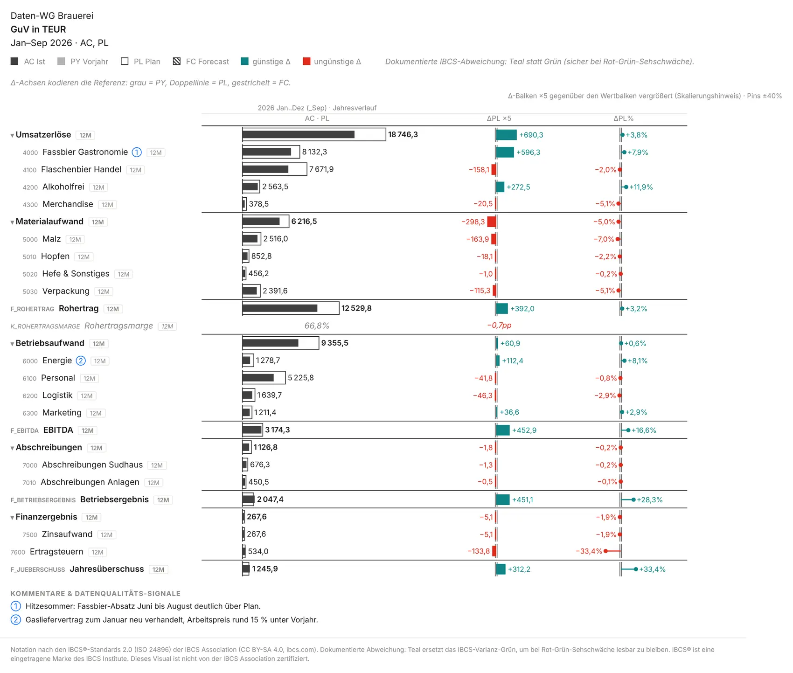

*Struktur-Bars — AC gegen die Referenz, ΔPL-Balken und Δ%-Pins auf einer Skala je Einheit.*

### 04 · Zeilen-Waterfall

Die GuV als Kaskade auf der Wurzelebene der Hierarchie: Beiträge kaskadieren, Summen ankern — Ergebnisanker wie Umsatz, Bruttoergebnis, EBITDA, EBIT, EBT und Jahresüberschuss stehen auf der Nulllinie, die Kostenblöcke floaten dazwischen. Je Block eine Kaskade für die Referenz und eine für AC, dazu ΔRef-Balken und ΔRef%-Pin; Blöcke MTD, YTD und FY-Ausblick. Die Kaskaden-Geometrie ist dieselbe Funktion wie im integrierten Δ-Wasserfall des Mega-Tables. Bestände (seit 1.7) ankern wie Ergebniszeilen auf der Nulllinie. Seit 1.5 zeichnen die Δ-Balken in der Skala der Kaskaden, sonst mit rundem Faktor und Hinweis wie in der Balken-Ansicht.

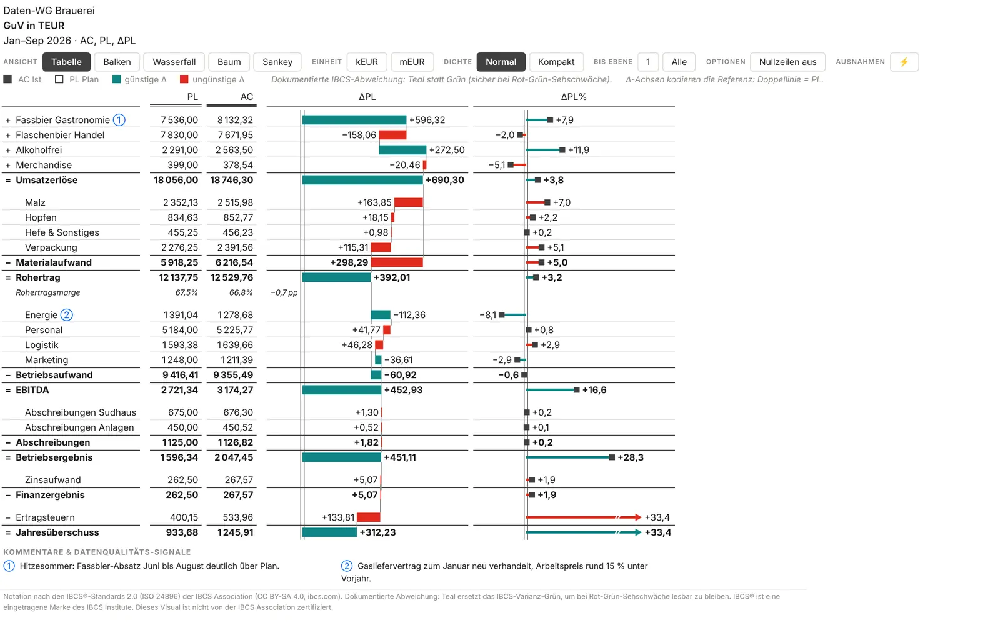

*Kaskade mit Ergebnisankern; hier als Mega-Table-Template T04B mit ΔPL-Wasserfall und Pins.*

### 05 · Werttreiberbaum

Der Ergebnisbaum als DuPont-Graph: Wurzel ist die letzte Formel-/KPI-Zeile mit Operanden (oder die im Formatbereich genannte Wurzelzeile), die Kanten tragen die Operatoren ÷ × + − als Kreise. Ohne Formelzeilen wächst der Baum direkt aus der Hierarchie — bei genau einer Wurzel ist sie die Baum-Wurzel, bei mehreren trägt eine virtuelle **Gesamt-Wurzel** sie als Kinder; die Kanten tragen dann das Rechenvorzeichen. Tidy-Layout mit einer Spalte je Ebene, Kompakt-Karten in der Tiefe. Jede Karte zeigt ein Mini-Chart nach Wahl — *Monatssäulen* (AC solide, Referenz dahinter), *Abweichungssäulen* (AC − Referenz je Monat) oder *Mini-Brücke* (Referenz → Δ → AC, YTD) — und optional einen Status-Rand in der Abweichungsfarbe. ▾ klappt einen Knoten auf und zu (Shift: der ganze Ast), ⌖ macht eine Karte zur Wurzel, die Breadcrumb und ⌂ führen zurück; der Hover über einer Karte öffnet die IBCS-Detailansicht. Wird das Kartenbudget erreicht, nennt ein Hinweis die nicht gezeichneten Zweige. Seit 1.5 zeichnen alle Karten derselben Einheit (Beträge; Prozent-Kennzahlen getrennt) in einem Maßstab; bedeckte eine Karte damit weniger als ein Viertel ihrer Fläche, zeichnet sie mit rundem Faktor vergrößert und trägt „×5“ oben rechts, der Tooltip erklärt es. Die Hover-Detailansicht hat bewusst eine eigene Skala und sagt das („Lupe“). Mega-Table- und Finance-Schalter wirken im Baum nicht; er hat seinen eigenen Klapp-Zustand.

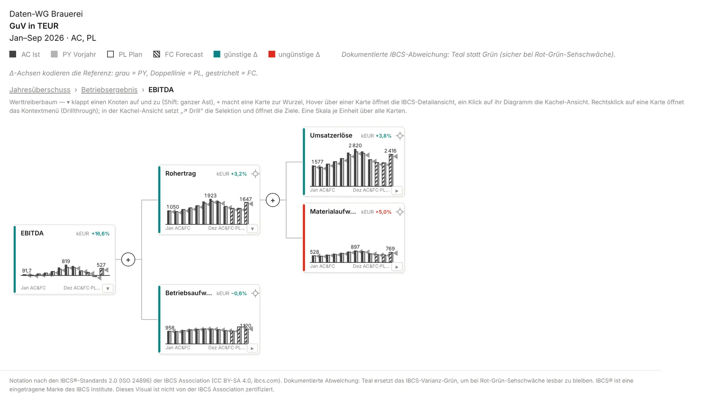

*EBITDA als Wurzel (⌖), Rohertrag und Betriebsaufwand als Treiber; Karten mit Monatssäulen und Δ% gegen Plan, eine Skala je Einheit.*

### 06 · Sankey (seit 1.6)

Die GuV als **Fluss von links nach rechts** — auf demselben Graphen wie der Werttreiberbaum (gleiche Wurzel, gleiche Start-Tiefe, gleicher Klapp-Zustand), nur als Bänder statt als Karten gezeichnet. Die Umsatz-Komponenten fließen **grau** in den Umsatz; der Gewinn-Strang (Gross profit → EBITDA → EBIT → EBT → Net income) läuft in der **günstigen Farbe** nach rechts durch; Kosten zweigen in der **ungünstigen Farbe** nach rechts unten in eigene Endknoten ab. Balken- und Bandhöhe sind proportional zum periodengerechten **AC-YTD**, auf einer gemeinsamen Skala für die ganze Ansicht. Die Labels stehen außen am Knoten mit Name, Wert und % vom Umsatz (Basis: die Umsatzzeile, bei reiner Hierarchie die Fluss-Wurzel); der Platz dafür ist im Layout reserviert, nichts wird abgeschnitten. Die Flussfläche ist mindestens 240 px hoch (skaliert mit dem Schriftgrößen-Preset).

*Umsatz-Komponenten grau in den Umsatz, der Gewinn-Strang günstig nach rechts, Kosten ungünstig in Endknoten.*

**Fluss-Regel:** Beiträge mit dem Vorzeichen des Knotens fließen von links zu. Gegenbeiträge (Kosten) stehen in seiner Spalte darunter und werden aus demselben Zufluss gespeist; weil jeder Anschluss eines Knotens gestapelt zugeordnet ist, addieren sich seine Bänder zur Knotenhöhe. Ein graues Band *„Sonstige (nicht aufgeschlüsselt)“* erscheint nur bei inkonsistenten Daten, etwa wenn ein Summenknoten einen eigenen Wert trägt oder eine Formel eine Konstante enthält. Eine KPI-Wurzel (Net margin) gibt den Fluss an ihren ersten Wert-Operanden ab; Multiplikation und Division beenden den Fluss, und eine Quote ohne Wertzeile darunter lässt sich nicht als Fluss zeichnen (das Visual nennt dann den Grund).

- **Klick** auf einen Knoten oder sein Label öffnet den Kachel-Zoom (Ansicht 07); „← Zurück zum Sankey“ führt zurück.
- **Hover** zeigt das IBCS-Detail-Panel und blendet fremde Bänder ab; der Tooltip nennt Wert, Anteil und Δ zur Referenz in den Hausbegriffen.
- **Rechtsklick** auf einen Knoten öffnet das Kontextmenü mit Selektion und Drillthrough.
- **▾ / ▸** am Label klappt einen Ast auf und zu, mit `Shift` den ganzen Ast. Klapp-Zustand, Wurzel (⌖ im Baum, Formatbereich) und ⌂ sind dieselben wie im Baum: ein im Sankey zugeklappter Ast ist auch im Baum zu. In sehr vollen Spalten behalten nur die größten Knoten ihr Label, der Rest bleibt über den Tooltip erreichbar.
- **Toolbar** im Sankey: Ansicht, Δ-Referenz, Einheit, Dichte, Bis Ebene und die Gruppe Ausnahmen (⚡; Kapitel 09). Mit ⚡ färbt der Sankey Abweichungen statt Fluss-Familien: nur die Ströme der Ausnahmen in der Abweichungsfarbe ihres Δ, der Rest grau; ⊘ bündelt ruhige Ströme eines Knotens zu einem grauen Band „übrige (n)“.
- **Bestände** (seit 1.7, Kapitel 05) sind neutrale Anker: grauer Knoten, graue Bänder, nie Gewinn-Strang oder Kosten.
- **Dark Mode und Hochkontrast:** Im Dunkelmodus sinken die Bänder ins dunkle Papier. Im Hochkontrast tragen Muster statt Farben die Aussage — Gewinn gefüllt, Kosten umrandet bzw. schraffiert, Zuflüsse gestrichelt.
- **Markierungen aus anderen Visuals (Cross-Highlight, seit 1.7):** Markiert ein Leser in einem anderen Visual einen Teil der Daten (Balken, Karte, Slicer-Visual), zeigt der Sankey die Auswahl *im Gesamt*: Knoten und Bänder stehen exakt wie ohne Markierung, das Ganze wird **grau**, und darin erscheint der markierte Teil in den Fluss-Farben — Knoten von oben gefüllt, als **farbige Innen-Bänder** in den Bändern. Die Labels nennen beides („923 von 1 685“), der Tooltip den Anteil („Markiert … (54,8 %)“). Eine Fußzeile sagt es in einem Satz, auch im Export: „◐ Markierte Auswahl aus einem anderen Visual: die Zahlen zeigen den markierten Teil · Net revenue 923 von 1 685 EUR gesamt (54,8 %) · farbig = markierter Teil, grau = Gesamt“. Hochkontrast: das Ganze gestrichelt ohne Muster, der markierte Teil mit Muster. Ohne Markierung rendert der Sankey unverändert. Alle anderen Ansichten verhalten sich bei einer Markierung wie gefiltert (Kapitel 09).
- **Export und Abos** drucken den Sankey ohne Toolbar, mit dem gespeicherten Klapp-Zustand.

> **Bewusst außerhalb der IBCS-Notation.** Ein Sankey ist keine IBCS-Chartform: Bandbreiten, Farbflächen und Knotenlabels folgen nicht der Szenario-Notation (AC voll · PY grau · PL Rahmen · FC schraffiert) und nicht der Skalenregel „eine Skala je Einheit, Δ gegen eine Referenz“. Der Footer der Ansicht sagt das ausdrücklich. Der Kachel-Zoom, in den man aus dem Sankey springt, bleibt dagegen IBCS. Wer streng nach IBCS berichtet, schaltet den Sankey unter Darstellung & Toolbar ab (Ansicht: Sankey anbieten, Kapitel 08).

### 07 · Kacheln (Kachel-Ansicht)

Ein Klick auf das Diagramm einer Baum-Karte (im Sankey: auf einen Knoten oder sein Label) zoomt den Knoten auf die ganze Fläche: Kombi-Chart aus Monatssäulen (Referenz versetzt hinter AC) und Brücke, darunter das Szenario-Grid, daneben die Mikro-Karten „Zahlt ein auf“ und „Getrieben von“ (bei vielen Treibern blätterbar). Die Seite passt sich in den Viewport ein — das Diagramm ist das elastische Element, das Grid wird bei knapper Höhe kompakter. „← Zurück zum Baum“ (aus dem Sankey: „← Zurück zum Sankey“) und die Breadcrumb führen heraus; „↗ Drill“ setzt die Selektion des Knotens und öffnet das Kontextmenü mit den Drillthrough-Zielen in einem Griff. Quotenzeilen (Margen) zeigen keine Brücke, weil Prozente nicht additiv sind. Die Mikro-Karten einer Spalte teilen eine Skala je Einheit (×n markiert), das Hauptchart ist als Lupe mit eigener Skala gekennzeichnet. In der Toolbar bleiben nur Δ-Referenz und Einheit.

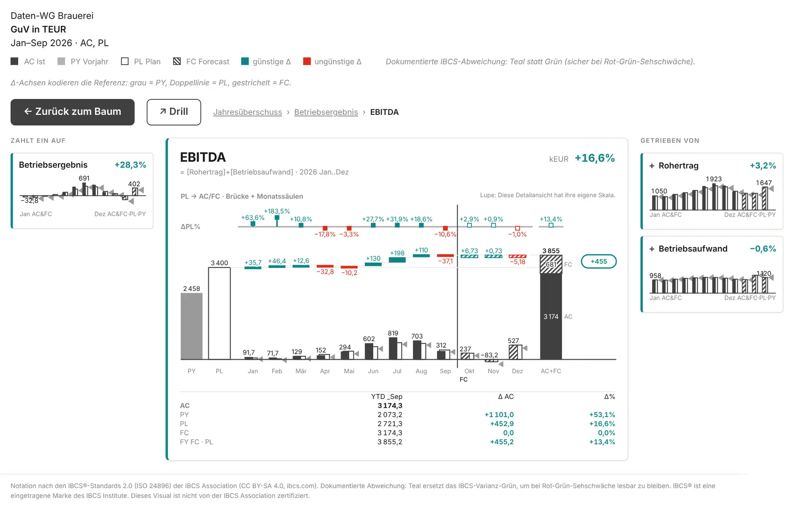

*Kachel-Zoom auf EBITDA: Brücke PL → AC/FC über die Monate, Szenario-Grid, Treiber und Empfänger.*

## 07 · IBCS-Templates

Der Mega-Table stellt die offiziellen IBCS-Templates T01A–T04E sowie die Report-Varianten 12A, 12G und 12H nach; seit 1.7 kommen die Bestands-Templates T05A (Bilanz) und T05B (Cashflow) dazu. Ein Template ist nur ein **Preset**: Es setzt alle Schalter der Gruppe Mega-Table und die Dezimalstellen (12G und 12H zusätzlich den Headline-Slot) in *einem* Speichervorgang — danach ist jeder Schalter frei, du kannst jedes Element einzeln ein- und ausblenden. Templates wirken nur in der Ansicht *Tabelle*; *Aus (klassische Tabelle)* stellt alle Mega-Schalter zurück.

- **Template-Galerie (seit 1.3, am anschaulichsten):** Im Start-Hub bzw. über ☰ Start stehen alle Templates als Kacheln mit Vorschau, nach Zweck gruppiert (Kapitel 03); ein Klick wendet an, auch erneut.
- **Toolbar (seit 1.2, am schnellsten):** Im Bearbeitungsmodus steht gleich nach ☰ Start das Dropdown *Template* (nur Ansicht Tabelle). Es schreibt dieselben Einstellungen wie der Formatbereich; Leser und Export sehen es nie. Abschaltbar über Darstellung & Toolbar → *Template-Auswahl im Bearbeitungsmodus*.
- **Formatbereich:** Karte *Spalten & Mega-Table* → erste Gruppe *Mega-Table (IBCS-Templates)* → *Template (IBCS-Tabelle)*.

> **Szenario-Regel (eine Regel für alle Elemente):** Der **Minuend** — das analysierte Szenario — bestimmt die **Füllung**: AC voll, FC schraffiert, PL umrandet, auch die Δ-Elemente (rot/grün umrandet auf Papier, Planrechnung; seit 1.5.1). Die **Referenz** bestimmt die **Achse**: PY = graue Achse, PL = Doppellinie. Dieselbe Kennung steht als Unterstreichung unter den Spaltenköpfen (AC voll, PY grau, PL doppelt, FC schraffiert). Im FY-Block ist der Minuend AC&FC — überwiegend Forecast, deshalb sind dessen Δ-Elemente schraffiert.

| Template | Was es zeigt | Daten-Voraussetzung | Schalter des Presets | Dezimalen (Werte / Δ %) |
| --- | --- | --- | --- | --- |
| T01A | Struktur flach: PY · PL · AC, ΔPY / ΔPY % / ΔPL / ΔPL % als Zahlen, Monat \| _YTD, Schwellen-Rot mit Fußzeile | Struktur + Periode + AC / PY / PL | Minuend AC · Wertspalten PY, PL, AC · ΔPY + ΔPY % als Zahl · ΔPL + ΔPL % als Zahl · zweiter Block · Zwischensummen aus · Schwellen an | 0 / 1 |
| T01B | wie T01A mit Zwischensummen-Blöcken (z. B. Europe / Americas / RoW) | Hierarchie-Ebenen | wie T01A · Zwischensummen-Blöcke an | 0 / 1 |
| T02A | PL · AC mit ΔPL-Balken und ΔPL %-Pins, zwei Blöcke | AC / PL (+ Periode) | Minuend AC · Wertspalten PL, AC · ΔPL-Balken + ΔPL %-Pins · zweiter Block · Zwischensummen an | 0 / 1 |
| T02B | wie T02A, sortiert nach AC absteigend („(↓)“ im Kopf) | wie T02A | wie T02A · Sortierung AC/FC absteigend · sortierender Block YTD | 0 / 1 |
| T02C | wie T02A, sortiert nach ΔPL absteigend | wie T02A | wie T02A · Sortierung Δ absteigend · sortierender Block Monat | 0 / 1 |
| T02E | FC statt AC (schraffierte Balken), Referenz PY mit grauer Achse | FC + PY | Minuend FC · Wertspalten PY, FC · ΔPY-Balken + ΔPY %-Pins · zweiter Block · Sortierung Δ absteigend (YTD) | 0 / 1 |
| T02F | FC statt AC, Referenz PL mit Doppellinien-Achse | FC + PL | Minuend FC · Wertspalten PL, FC · ΔPL-Balken + ΔPL %-Pins · zweiter Block · Sortierung Δ absteigend (YTD) | 0 / 1 |
| T03A | GuV-Statement: + / − / =-Zeilen, PY · PL · AC und Δ-Zahlenspalten, Margenzeile in pp | Kontendimension mit Zeilentyp | Minuend AC · Wertspalten PY, PL, AC · ΔPY + ΔPY % · ΔPL + ΔPL % als Zahl · ein Block | 1 / 1 |
| T03B | wie T03A mit FC als analysiertem Szenario | wie T03A + FC | wie T03A · Minuend FC | 1 / 1 |
| T04A | Statement mit ΔPL-Balken und ΔPL %-Pins | wie T03A | Minuend AC · Wertspalten PL, AC · ΔPL-Balken + ΔPL %-Pins | 1 / 1 |
| T04B | Statement mit integriertem ΔPL-Wasserfall (kaskadierende Balken, =-Anker) und Pins | wie T03A | Minuend AC · Wertspalten PL, AC · ΔPL-Wasserfall + ΔPL %-Pins | 2 / 1 |
| T04C | Statement mit integriertem ΔPY-Wasserfall und Pins | wie T03A | Minuend AC · Wertspalten PY, AC · ΔPY-Wasserfall + ΔPY %-Pins | 2 / 1 |
| T04D | wie T04B mit FC (schraffiert) | wie T03A + FC | wie T04B · Minuend FC | 2 / 1 |
| T04E | wie T04C mit FC (schraffiert) | wie T03A + FC | wie T04C · Minuend FC | 2 / 1 |
| 12A | PY- und AC-Wert-Kaskaden als eigene Spalten, dazu ΔPY-Balken und Pins | wie T03A | Minuend AC · Wertspalten PY, AC als Wert-Kaskaden · ΔPY-Balken + ΔPY %-Pins · Margenzeilen aus | 0 / 1 |
| 12G | FY-Ausblick: YTD voll und Restjahr schraffiert im selben Balken, Δ aufs Jahr gegen das ganze Vorjahr | wie T03A + FC Gesamtjahr (+ Periode) | Minuend AC (FY-Block: AC&FC) · Wertspalten PY, AC als Wert-Kaskaden · ΔPY-Balken + ΔPY %-Pins · Perioden-Block FY · Headline-Slot an | 0 / 1 |
| 12H | Planrechnung: PL-Kaskade umrandet, Kostenzeilen auf blassem Grund, ΔPY-Balken rot/grün umrandet | wie T03A + PL als Minuend | Minuend PL · Wertspalten PY, PL als Wert-Kaskaden · ΔPY-Balken + ΔPY %-Pins · Margenzeilen aus · Headline-Slot an | 0 / 1 |
| T05A | Bilanz zum Stichtag: PY (Vorjahresstichtag) · AC · ΔPY · ΔPY % als Zahlen, ein Block mit dem Stichtag-Monat als Titel; Aktiva und Passiva als „=“-Summen mit Doppelstrich | Monatsstände (ultimo), Periode, AC / PY; Token `stock` oder Bestand & Fluss = „Alle Zeilen Bestand“ | Minuend AC · Wertspalten PY, AC · ΔPY + ΔPY % als Zahl · ein Block · setzt Bestand & Fluss auf „Alle Zeilen Bestand“, wenn die Daten kein Token tragen (sonst Auto) | 0 / 1 |
| T05B | Cashflow-Brücke: Anfangsbestand → operativ · investiv · finanziell → Endbestand als PY- und AC-Wert-Kaskaden (Bestände ankern, Flüsse floaten), ΔPY · ΔPY %, Monat \| YTD | Token `opening` / `stock`, Periode, AC / PY (FC Gesamtjahr für den FY-Ausblick) | Minuend AC · Wertspalten PY, AC als Wert-Kaskaden · ΔPY + ΔPY % als Zahl · zweiter Block · Bestand & Fluss = Auto | 0 / 1 |

Für alle Templates gilt: Dezimalstellen Δ % = 1 (seit 1.5 einheitlich; gespeicherte Berichte behalten ihren Wert, bis das Template erneut angewendet wird), Szenario-Unterstreichungen und Zahlen an Balken / Pins / Kaskaden an, Ausreißer-Pfeile für Δ-Balken aus, Perioden-Block YTD (außer 12G: FY), zweiter Block links = Monat; nicht genannte Schalter stehen aus. Der zweite Perioden-Block braucht das Periodenfeld — ohne Periode fallen „Monat“ und der zweite Block still auf einen YTD-Block zurück, ohne FC Gesamtjahr fällt FY auf YTD zurück.

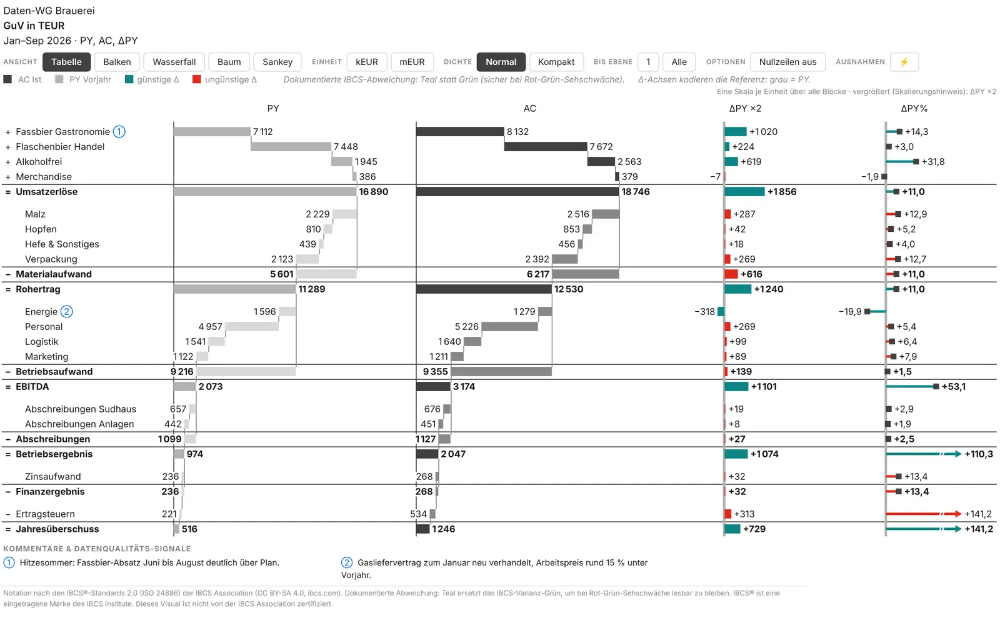

*12A — PY- und AC-Wert-Kaskaden nebeneinander, ΔPY-Balken mit Skalierungshinweis ×2.*

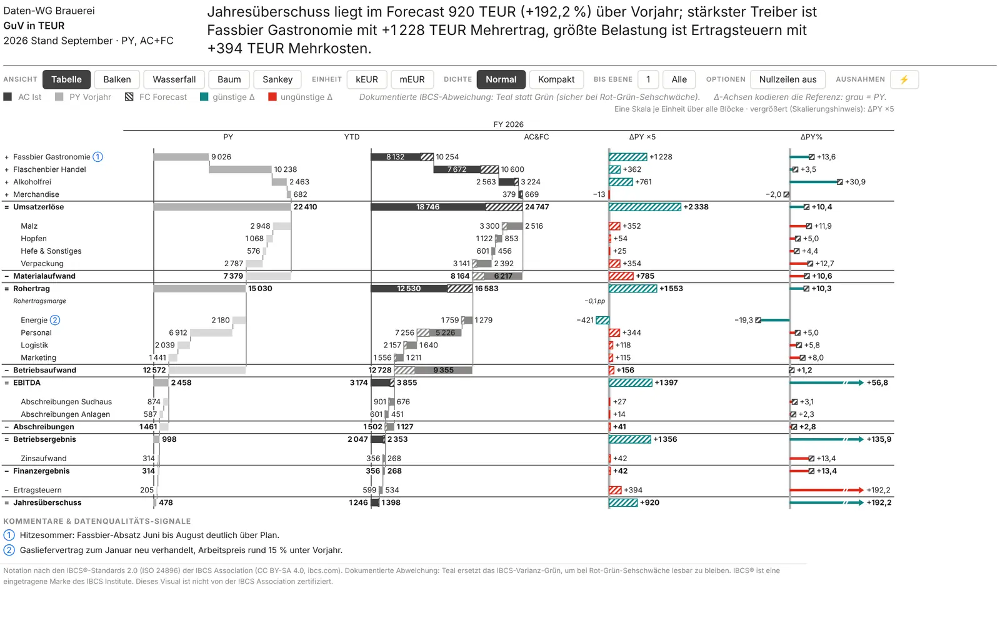

*12G — Jahresausblick: YTD voll, Restjahr schraffiert, Auto-Headline als ganzer Satz.*

### T05A Bilanz · T05B Cashflow (1.7)

Die beiden Bestands-Templates stehen in der Galerie-Gruppe **Bilanz & Cashflow** (zwischen GuV-Statement und Report-Ansichten, Kapitel 03) und im Template-Dropdown hinter 12H. Sie arbeiten mit Beständen als Monatsständen (Kapitel 05, „Bestand & Fluss“); die Vorschau in der Galerie zeigt eine Beispiel-Bilanz bzw. einen Beispiel-Cashflow.

- **T05A · Bilanz zum Stichtag:** PY (der Stand ein Jahr früher) · AC · ΔPY · ΔPY % in einem Block, dessen Titel der Stichtag-Monat ist. Aktiva und Passiva stehen als „=“-Summen mit Doppelstrich unter der Bilanzsumme. PL lässt sich bei Bedarf über die Wertspalte PL und ΔPL dazuschalten.
- **T05B · Cashflow-Brücke:** Anfangsbestand → operativ · investiv · finanziell → Endbestand als PY- und AC-Wert-Kaskaden — die Bestände ankern auf der Nulllinie, die Flüsse floaten dazwischen —, dazu ΔPY · ΔPY % und die Blöcke Monat | YTD. Der FY-Ausblick ist über die Block-Art FY zuschaltbar (ohne FY-Measures zeigt er den FC-Endstand). Anfangs- und Endbestand müssen per Token markiert sein: `Account opening` bzw. `Formula stock` mit `[Anfangsbestand]+[Operativ]+[Investiv]+[Finanzierung]`.
- **Wann der Bestandsmodus gesetzt wird:** T05A setzt *Bestand & Fluss* auf „Alle Zeilen Bestand (Bilanz)“, wenn die Daten kein Token tragen — eine Bilanz ohne Zeilentyp-Spalte funktioniert also —, sonst auf Auto. T05B setzt immer Auto. Jedes andere Template nimmt ein „Alle Zeilen Bestand“ von T05A beim Anwenden wieder auf Auto zurück; „↺ Zum Template zurück“ erscheint auch, wenn der Bestandsmodus vom Template abweicht.
- **Daten:** Monatsstände ultimo, nie kumuliert; Passiva aus einer Saldenliste mit Rechenvorzeichen `-1` (Kapitel 05). Beispiel: `demoData/bilanz-*.csv` und `cashflow-*.csv`; Modell prüfen mit dem Skill `finance-data-model` (`validate_model.py`).

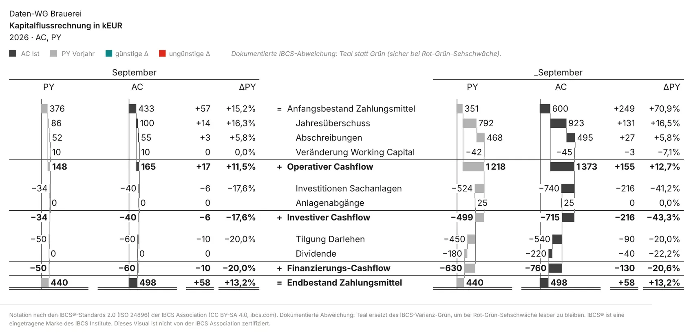

*T05B — Anfangsbestand → operativ · investiv · finanziell → Endbestand, Bestände als Anker.*

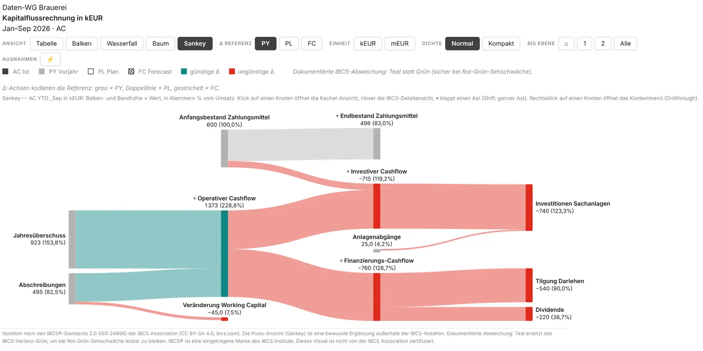

*Dieselbe Kapitalflussrechnung als Sankey: Bestände als graue Anker, Mittelabflüsse ungünstig.*

> Dasselbe Template erneut anwenden geht seit 1.3: ein Klick auf die aktive Kachel der Galerie oder „↺ Zum Template zurück“ neben dem Toolbar-Dropdown stellt den Template-Stand wieder her — das native Dropdown selbst kann einen schon gewählten Eintrag nicht noch einmal melden. Wer Berichte per PBIR schreibt, setzt `columns.template` und `columns.templateApplied` auf denselben Wert, sonst wendet das Visual das Template beim ersten Rendern an und überschreibt die mitgeschriebenen Schalter (siehe [AGENT-GUIDE](https://github.com/Losveratos/PowerBI-Kitchen-/blob/main/pnlByDatenWG/AGENT-GUIDE.md)). Die Referenzblätter im Vergleich: [TEMPLATE-GUIDE](https://github.com/Losveratos/PowerBI-Kitchen-/blob/main/pnlByDatenWG/TEMPLATE-GUIDE.md) und der HTML-Prototyp `pnlByDatenWG/prototype/megatable.html`.

## 08 · Einstellungs-Referenz

Der Formatbereich hat zwölf Karten in dieser Reihenfolge: **Spalten & Mega-Table** → **Darstellung & Toolbar** → **Ausnahmen** (1.7) → **Toolbar-Farben** (1.7) → **Zahlen** → **Szenario-Begriffe** → **Stil** → **Fläche** (1.7) → **Titelblock** → **Hierarchie** → **Bestand & Fluss** (1.7) → **Leer-Zustand**. Die Tabellen listen alle Einstellungen mit Optionen und Standardwert; die Namen entsprechen der deutschen Oberfläche.

> **Sichtbarkeit:** Der Formatbereich zeigt nur, was zur aktuellen Ansicht und zu den gebundenen Feldern passt — die Mega-Table-Gruppe nur in der Ansicht Tabelle, die Werttreiberbaum-Gruppe nur in Baum und Sankey, ΔPY-Schalter nur mit PY, Schwellen-Felder nur bei eingeschalteten Schwellen. Ein ausgeblendeter Schalter behält seinen Wert; die Ausblendung ändert nie, was gerendert wird. Ohne Daten (und in der Demo) bleibt alles sichtbar. Die Hinweise „Sichtbar …“ in den Tabellen nennen diese Bedingungen.

### Spalten & Mega-Table

#### Mega-Table (IBCS-Templates)

Seit 1.2 die erste Gruppe der Karte. Sichtbar in der Ansicht Tabelle. Jeder Schalter wirkt einzeln; das Template schreibt nur ihre Vorgaben.

| Einstellung | Beschreibung | Optionen / Standard |
| --- | --- | --- |
| Template (IBCS-Tabelle) | Setzt die Schalter darunter auf die Template-Vorgaben — danach ist jeder Schalter frei. | Optionen: Aus (klassische Tabelle) \| T01A \| T01B \| T02A \| T02B \| T02C \| T02E \| T02F \| T03A \| T03B \| T04A \| T04B \| T04C \| T04D \| T04E \| 12A \| 12G \| 12H \| T05A \| T05B · Standard „Aus (klassische Tabelle)“ |
| Analysiertes Szenario (Minuend) | AC gefüllt, FC schraffiert, PL umrandet; die Δ-Balken folgen dem Minuenden (bei PL rot/grün umrandet, Planrechnung 12H). Die Δ-Spalten vergleichen es mit PY / PL. FC und PL brauchen ihr Feld. Bei PL gibt es kein ΔPL; Wertspalte PL und Wertspalte AC/FC ergeben dann eine PL-Spalte. Sichtbar mit gebundenem FC oder PL. | Optionen: AC (Ist) \| FC (Forecast) \| PL (Planrechnung) · Standard „AC (Ist)“ |
| Wertspalte PY | Vorjahreswerte als Zahlenspalte. Sichtbar mit gebundenem PY. | An / Aus · Standard Aus |
| Wertspalte PL | Planwerte als Zahlenspalte. Sichtbar mit gebundenem PL. | An / Aus · Standard Aus |
| Wertspalte AC / FC | Werte des analysierten Szenarios als Zahlenspalte. | An / Aus · Standard Aus |
| Wertspalten als Wert-Kaskaden (12A) | Jedes gezeigte Szenario wird zur Kaskaden-Diagrammspalte: Schritte auf der laufenden Summe, =-Zeilen ab null, Kostenzeilen hell. Sichtbar, sobald eine Wertspalte an ist. | An / Aus · Standard Aus |
| ΔPY als Zahl | Absolute Abweichung zum Vorjahr. Sichtbar mit gebundenem PY (gilt für alle ΔPY-Schalter). | An / Aus · Standard Aus |
| ΔPY als Balken | Abweichungsbalken auf einer Nulllinie, graue PY-Achse. | An / Aus · Standard Aus |
| ΔPY als integrierter Wasserfall | Jeder Δ-Balken beginnt am Ende des vorigen; =-Zeilen setzen an der Nulllinie neu an (T04C/E). | An / Aus · Standard Aus |
| ΔPY% als Zahl | Relative Abweichung zum Vorjahr. | An / Aus · Standard Aus |
| ΔPY% als Pins | Relative Abweichung als Pins (Lollipops). | An / Aus · Standard Aus |
| ΔPL als Zahl | Absolute Abweichung zum Plan. Sichtbar mit gebundenem PL (gilt für alle ΔPL-Schalter). | An / Aus · Standard Aus |
| ΔPL als Balken | Abweichungsbalken auf einer Nulllinie, doppelte PL-Achse. | An / Aus · Standard Aus |
| ΔPL als integrierter Wasserfall | Jeder Δ-Balken beginnt am Ende des vorigen; =-Zeilen setzen an der Nulllinie neu an (T04B/D). | An / Aus · Standard Aus |
| ΔPL% als Zahl | Relative Abweichung zum Plan. | An / Aus · Standard Aus |
| ΔPL% als Pins | Relative Abweichung als Pins (Lollipops). | An / Aus · Standard Aus |
| Spalte % vom Umsatz | Anteil jeder Zeile an der Umsatz-Basiszeile (Gruppe Tabelle), rechts neben den Wertspalten. | An / Aus · Standard Aus |
| Zweiter Perioden-Block (Monat \| _YTD) | Links der Monat der letzten Ist-Daten, rechts der Jahresverlauf. Sichtbar mit gebundener Periode. | An / Aus · Standard Aus |
| Perioden-Block | Monat der letzten Ist-Daten, Jahr bis dato oder FY-Ausblick (AC&FC vs. PL, braucht die FY-Felder); mit zweitem Block der rechte. Sichtbar mit Periode oder FY-Feldern. | Optionen: Monat \| YTD \| FY-Ausblick (AC&FC vs PL) · Standard „YTD“ |
| Zweiter Block (links) | Periode des Blocks links vom Perioden-Block, wenn der zweite Block an ist. Sichtbar mit Periode und eingeschaltetem zweitem Block. | Optionen: Monat \| YTD \| FY-Ausblick (AC&FC vs PL) · Standard „Monat“ |
| Zwischensummen-Blöcke (Strukturdaten) | Regionen / Strukturhierarchien: Zwischensummen-Blöcke mit Leerzeile; aus = nur Blätter + Gesamtsumme. Sichtbar bei Strukturdaten (ohne GuV-Zeilentypen). | An / Aus · Standard An |
| Margen-/%-Zeilen | KPI-Zeilen (Margen) kursiv, ihre Δ in Prozentpunkten („+8,6 pp“), ohne relatives Δ %; Margen mit den Dezimalstellen für Δ %. Gilt für T03 und T04 gleich, in T04 steht die pp-Zahl an der Achse der Δ-Balken bzw. des Δ-Wasserfalls. Sichtbar bei GuV-Daten. | An / Aus · Standard An |
| Δ rot unter Schwelle (+ Fußzeile) | Δ-Zahlen unter den Schwellen werden rot; eine Fußzeile nennt die Regel. Sichtbar, sobald eine Δ-Zahlenspalte (ΔPY/ΔPL als Zahl oder Δ% als Zahl) an ist. | An / Aus · Standard Aus |
| Schwelle Δ (Monat / einziger Block) | In Anzeige-Einheiten (nach k/m-Skalierung). Der Standard −20 meint Tausender und wird bei Mio.- und Mrd.-Skalierung umgerechnet (Mio.: −0,02); ein gesetzter Wert gilt wie eingetippt. Sichtbar bei eingeschalteten Schwellen. | Zahl · Standard −20 (Tsd.) |
| Schwelle Δ% (Monat / einziger Block) | In ganzen Prozent. Sichtbar bei eingeschalteten Schwellen. | Zahl · Standard −10 |
| Schwelle Δ (_YTD-Block) | Schwelle des zweiten Blocks, in Anzeige-Einheiten. Der Standard −220 meint Tausender und wird bei Mio.- und Mrd.-Skalierung umgerechnet (Mio.: −0,22). Sichtbar bei Schwellen, zweitem Block und Periode. | Zahl · Standard −220 (Tsd.) |
| Schwelle Δ% (_YTD-Block) | Schwelle des zweiten Blocks, in ganzen Prozent. Sichtbar bei Schwellen, zweitem Block und Periode. | Zahl · Standard −10 |
| Szenario-Unterstreichungen (Kopf + Schluss) | AC voll, PY grau, PL doppelt, FC schraffiert unter den Spaltenköpfen. | An / Aus · Standard An |
| Zahlen an Balken / Pins / Kaskaden | Wertbeschriftung an jedem Diagramm-Element. Sichtbar, sobald eine Diagrammspalte (Δ-Balken, -Pins, -Wasserfall oder Wert-Kaskade) an ist. | An / Aus · Standard An |
| Ausreißer-Pfeile auch für Δ-Balken | Pins kappen Ausreißer immer (Q3 + 4 × IQR); dies erweitert es auf die Δ-Balken. Gekappte Elemente laufen über das reguläre Maximum in eine Ausreißerzone, ein Bruchzeichen trennt sie, ein Dreieck zeigt in Wuchsrichtung, die Zahl steht außen (seit 1.5). Sichtbar mit ΔPY- oder ΔPL-Balken. | An / Aus · Standard Aus |
| Sortierung (Strukturdaten) | Je Zwischensummen-Block; Zeilen namens Sonstige … bleiben unten. Sichtbar bei Strukturdaten. | Optionen: Kategoriereihenfolge \| AC/FC absteigend \| Δ absteigend · Standard „Kategoriereihenfolge“ |
| Sortierender Block | Welcher Perioden-Block die Reihenfolge bestimmt. Sichtbar bei Strukturdaten, zweitem Block, Periode und einer Sortierung außer Kategoriereihenfolge. | Optionen: Monats-Block \| YTD-Block · Standard „YTD-Block“ |

#### Tabelle

Klassische Tabelle, Balken und Wasserfall. Die Vorgaben dieser Gruppe gelten beim Öffnen des Berichts; Leser schalten vieles davon in der Toolbar um. Eine im Formatbereich *geänderte* Vorgabe gewinnt gegen den gespeicherten Leser-Zustand (nur die geänderte).

| Einstellung | Beschreibung | Optionen / Standard |
| --- | --- | --- |
| Standard-Spalten-Preset | Spaltensatz der klassischen Tabelle beim Öffnen des Berichts; Leser schalten ihn in der Toolbar um. „Eigene Auswahl“ (1.2) baut die Spalten aus den fünf Schaltern darunter. | Optionen: AC·PY·PL·FC (voll) \| AC vs. Referenz \| AC vs. PY·PL·FC \| AC·PY·ΔPY \| AC·PL·ΔPL \| ΔPY% · ΔPL% \| Eigene Auswahl (Schalter darunter) · Standard „AC·PY·PL·FC (voll)“ |
| Eigene Auswahl: Spalte AC | Istwerte als Zahlenspalte (mit % vom Umsatz, falls an). Sichtbar beim Preset „Eigene Auswahl“. | An / Aus · Standard An |
| Eigene Auswahl: Spalte PY | Vorjahreswerte als Zahlenspalte. Sichtbar bei „Eigene Auswahl“ und gebundenem PY. | An / Aus · Standard An |
| Eigene Auswahl: Spalte PL | Planwerte als Zahlenspalte. Sichtbar bei „Eigene Auswahl“ und gebundenem PL. | An / Aus · Standard An |
| Eigene Auswahl: Spalte FC | Forecastwerte als Zahlenspalte. Sichtbar bei „Eigene Auswahl“ und gebundenem FC. | An / Aus · Standard Aus |
| Eigene Auswahl: Δ-Balken + Δ%-Pin | Abweichung von AC zur Δ-Referenz als Balken und Pin. Sichtbar beim Preset „Eigene Auswahl“. | An / Aus · Standard An |
| Standard-Δ-Referenz | Basis der Δ-Spalten, -Balken und Baumkarten. Auto nimmt PL, sonst PY. | Optionen: Auto (PL, sonst PY) \| Vorjahr (PY) \| Plan (PL) \| Forecast (FC) · Standard „Auto (PL, sonst PY)“ |
| Balken-Ansicht: Szenario-Balken überlappt | AC vorn in voller Stärke, die Referenz (PY grau / PL umrandet / FC schraffiert) dahinter, leicht versetzt — die ChartKitchen-Notation. Sichtbar in der Ansicht Balken. | An / Aus · Standard Aus |
| Balken-Ansicht: Dreieck-Marker weiterer Szenarien | Kleine Dreiecke über den Balken am Wert jedes weiteren gebundenen Szenarios (PY grau, PL umrandet, FC schraffiert). Sichtbar in der Ansicht Balken. | An / Aus · Standard Aus |
| Perioden-Sortierung | Automatisch liest JJJJ-MM-Schlüssel, Datumswerte und Monatsnamen; Datenreihenfolge behält die Reihenfolge des Modells (Fiskaljahre); Kalenderjahr erzwingt Jan..Dez. Sichtbar mit gebundener Periode. | Optionen: Automatisch \| Datenreihenfolge (Fiskaljahr) \| Kalenderjahr · Standard „Automatisch“ |
| %-vom-Umsatz-Spalte | Anteil jeder Zeile an der Umsatz-Basiszeile, neben AC. | An / Aus · Standard An |
| Umsatz-Basiszeile (ID oder Name) | Zeile, auf die sich % vom Umsatz bezieht. Leer = erste Zeile der obersten Ebene. Sichtbar, wenn eine der beiden %-vom-Umsatz-Spalten an ist. | Text · Standard leer |
| Nullzeilen ausblenden (Standard) | Zeilen ohne jeden Wert verschwinden; Leser schalten es in der Toolbar um. | An / Aus · Standard Aus |
| Tabelle auf Breite einpassen (Standard) | Staucht die Diagramm-Spalten, bis die Tabelle in den Viewport passt — kein Querscrollen. | An / Aus · Standard Aus |
| Export: alle Zeilen aufklappen | PDF-/PowerPoint-Export und Abonnements drucken jede Zeile aufgeklappt, egal was am Bildschirm zugeklappt ist. | An / Aus · Standard An |
| Zeilen hervorheben | Kommagetrennte Zeilennamen (oder IDs), ohne Groß-/Kleinschreibung: ein dezentes Band läuft über alle Spalten dieser Zeilen (IBCS EMPHASIZE). Leer = aus. | Text · Standard leer |
| Wesentlichkeit ab (absolut) | Abweichungen unter diesem absoluten Betrag (Dateneinheiten, vor k/m-Skalierung) werden in sanftem Grau statt in den Abweichungsfarben dargestellt — Zahlen, Balken, Pins und Wasserfall-Stufen. 0 = aus. Die Toolbar-Gruppe Ausnahmen (⚡) bietet diesen Wert als absolute Schwelle an (Kapitel 09). | ≥ 0 · Standard 0 |
| Wesentlichkeit ab (%) | Abweichungen unter diesem Δ % werden in sanftem Grau dargestellt. Sind beide Schwellen gesetzt, muss eine Abweichung beide überschreiten, um farbig zu sein. 0 = aus. | 0–100 · Standard 0 |

#### Werttreiberbaum

Start der Baum- und der Sankey-Ansicht. Sichtbar in den Ansichten Baum und Sankey. Der Sankey liest davon Wurzelzeile und Start-Tiefe; Karten-Diagramm und Status-Indikator wirken nur im Baum.

| Einstellung | Beschreibung | Optionen / Standard |
| --- | --- | --- |
| Wurzelzeile Treiberbaum (ID, Name oder Kategorie) | Leer = letzte Formel-/KPI-Zeile mit Operanden, sonst die Modell-Wurzel. | Text · Standard leer |
| Start-Tiefe Treiberbaum (0 = ganzer Baum) | Wie viele Ebenen des Baums beim Start offen sind. | 0–8 · Standard 0 |
| Karten-Diagramm im Treiberbaum | Mini-Diagramm auf jeder Karte: Monatssäulen, Abweichungssäulen oder Mini-Brücke. | Optionen: Monatssäulen (AC vs. PL) \| Abweichungssäulen (Δ vs. Referenz) \| Mini-Brücke (REF → Δ → AC) · Standard „Monatssäulen (AC vs. PL)“ |
| Status-Indikator der Karten (Δ-Farbe) | Kartenrand und Δ% im Kartenkopf in der Abweichungsfarbe. | An / Aus · Standard An |

### Darstellung & Toolbar

Was Leser über dem Statement sehen und selbst umschalten dürfen. Eine ausgeblendete Gruppe nimmt Lesern nur den Knopf — die Vorgabe aus dem Formatbereich wirkt weiter.

| Einstellung | Beschreibung | Optionen / Standard |
| --- | --- | --- |
| Toolbar anzeigen (Leser können umschalten) | Knöpfe über dem Statement: Ansicht, Spalten, Einheit, Dichte, Ebenen. | An / Aus · Standard An |
| Szenario-Legende anzeigen | Chips für AC · PY · PL · FC sowie günstige / ungünstige Δ unter der Toolbar. | An / Aus · Standard An |
| Gruppe: Ansicht | Tabelle · Balken · Wasserfall · Baum · Sankey — nur die darunter angebotenen Ansichten. Sichtbar bei eingeschalteter Toolbar (gilt für alle Gruppen-Schalter). | An / Aus · Standard An |
| Ansicht: Tabelle anbieten | Leser dürfen zur Tabelle wechseln (klassisch oder Mega-Table). Property `viewTable`. Sichtbar bei eingeschalteter Toolbar und Gruppe Ansicht (gilt für alle fünf Schalter). | An / Aus · Standard An |
| Ansicht: Balken anbieten | Leser dürfen zu den Struktur-Balken wechseln. Property `viewBars`. | An / Aus · Standard An |
| Ansicht: Wasserfall anbieten | Leser dürfen zum Zeilen-Wasserfall wechseln. Property `viewWaterfall`. | An / Aus · Standard An |
| Ansicht: Treiberbaum anbieten | Leser dürfen zum Werttreiberbaum wechseln. Aus: Eine gespeicherte Kachel-Ansicht öffnet nur noch aus dem Sankey. Property `viewTree`. | An / Aus · Standard An |
| Ansicht: Sankey anbieten | Leser dürfen zur Fluss-Ansicht (Sankey) wechseln — eine bewusste Ergänzung außerhalb der IBCS-Notation. Property `viewSankey`. | An / Aus · Standard An |
| Gruppe: Spalten-Presets | Spaltensätze der klassischen Tabelle. | An / Aus · Standard An |
| Gruppe: Δ-Referenz | PY · PL · FC als Basis jeder Δ. | An / Aus · Standard An |
| Gruppe: Perioden (MTD/YTD/FY) | Perioden-Blöcke der klassischen Tabelle. | An / Aus · Standard An |
| Gruppe: Einheit | Umschalten zwischen Tausend und Millionen. | An / Aus · Standard An |
| Gruppe: Dichte | Normale oder kompakte Zeilen. | An / Aus · Standard An |
| Gruppe: Aufklapp-Ebene | Hierarchie bis Ebene 1, 2 … oder ganz öffnen. | An / Aus · Standard An |
| Gruppe: Optionen | % vom Umsatz, Nullzeilen ausblenden, auf Breite einpassen. | An / Aus · Standard An |
| Gruppe: Szenario (Mega-Table) | Leser schalten das analysierte Szenario AC / FC und die Referenz-Sicht ΔPY · ΔPL · beide des Mega-Tables um. | An / Aus · Standard Aus |
| Gruppe: Wertspalten (Szenarien einzeln) | Leser kombinieren die Wertspalten frei — AC, PY, PL, FC und Δ gegen die Δ-Referenz (klassische Tabelle), analysiertes Szenario · PY · PL (Mega-Table). Die Spalten-Presets bleiben als Schnellwahl. | An / Aus · Standard Aus |
| Gruppe: Ausnahmen (⚡) | Leser färben nur die Ausnahmen — Zeilen, deren Δ gegen die Referenz eine Schwelle erreicht — und grauen den Rest aus oder blenden ihn aus. Dieselben Einstellungen wie die Karte Ausnahmen. Die Gruppe steht zuletzt in der Toolbar-Zeile und entfällt in der Kachel-Ansicht und ohne gebundenes PY, PL oder FC. Seit 1.7. | An / Aus · Standard An |
| Template-Auswahl im Bearbeitungsmodus | Kompaktes Template-Dropdown vorn in der Toolbar, direkt nach ☰ Start, solange du den Bericht bearbeitest (Ansicht Tabelle). Leser und Export sehen es nie. | An / Aus · Standard An |
| Bedienleisten einklappbar (☰) | Toolbar, Legende und Hinweiszeilen (Skalenhinweis, Baum-Hinweis) klappen hinter einen kleinen ☰-Knopf; eingeklappt bleibt eine schmale Zeile. Für kleine Kacheln. Titel, Spaltenköpfe mit Skalierungsfaktor und die ×n-Marken der Karten bleiben sichtbar; Exporte drucken die Legende immer. Seit 1.5. | An / Aus · Standard Aus |
| Startzustand eingeklappt | Das Visual öffnet eingeklappt, Leser klappen mit ☰ auf. Die Wahl des Lesers gilt zur Laufzeit und wird nicht gespeichert. Seit 1.5. Sichtbar bei einklappbaren Bedienleisten. | An / Aus · Standard An |

> **Ansichten anbieten (seit 1.6):** Die fünf Schalter (`toolbar.viewTable`, `viewBars`, `viewWaterfall`, `viewTree`, `viewSankey`; alle Standard *an*, damit sich bestehende Berichte nicht ändern) legen fest, welche Ansichten Leser angeboten bekommen.
>
> - **Nur angebotene Knöpfe** erscheinen in der Ansichts-Gruppe, in der Reihenfolge Tabelle · Balken · Wasserfall · Baum · Sankey. Bleibt genau eine Ansicht übrig, entfällt die Gruppe ganz.
> - **Stiller Fallback:** Zeigt ein gespeicherter Zustand oder ein Lesezeichen auf eine abgeschaltete Ansicht, zeichnet das Visual die erste angebotene — ohne den gespeicherten Zustand zu überschreiben. Schaltet der Autor die Ansicht wieder ein, ist sie für diesen Leser wieder da.
> - **Kachel-Zoom** öffnet nur mit aktiver Trägeransicht (Baum oder Sankey). Ist der Baum abgeschaltet, erreicht man die Kachel nur über den Sankey.
> - **Alle fünf aus** = die Tabelle bleibt. Die **Mega-Table** ist keine eigene Ansicht, sondern ein Template der Tabelle; *Tabelle anbieten* gilt für beide.
> - **Für Berichte mit fester Ansicht** (z. B. per PBIR-Datei erzeugt) genügt es, die anderen vier Schalter auszuschalten; der Zustand der Leser muss dafür nicht geschrieben werden.

### Ausnahmen (1.7)

Die Vorgaben für ⚡ *Nur Ausnahmen* — Regel, Modi und das Verhalten je Ansicht stehen in Kapitel 09. Ein Klick des Lesers in der Toolbar schreibt dieselben Werte (Spiegel im Formatbereich); eine echte Änderung im Formatbereich gewinnt wie jede Vorgabe. Templates und Hub schreiben diese Karte nie; mit ⚡ aus rendert jeder Bericht wie bisher.

| Einstellung | Beschreibung | Optionen / Standard |
| --- | --- | --- |
| Nur Ausnahmen (⚡) | Nur Zeilen, deren Δ gegen die Referenz die Schwelle erreicht, behalten ihre Farbe in Δ-Balken, Pins, Δ-Zahlen, Baumkarten und Sankey-Strömen; der Rest ist grau. Leser schalten es in der Toolbar um. | An / Aus · Standard Aus |
| Schwelle Δ% (ab) | Ausnahme ab diesem \|Δ%\|, in ganzen Prozent (Margenzeilen: Prozentpunkte). 0 = nur die absolute Schwelle. Der Stepper der Toolbar deckt 1 … 100 % ab. | 0–1000 · Standard 5 |
| Schwelle Δ absolut (ab) | Auch Ausnahme ab diesem \|Δ\|, in Dateneinheiten (vor k/m-Skalierung) — eine der beiden Schwellen reicht. 0 = aus; die Toolbar bietet den Wert von „Wesentlichkeit ab (absolut)“ an. | ≥ 0 · Standard 0 |
| Referenz | Gegen welches Szenario Δ gemessen wird. Auto folgt der Δ-Referenz der Ansicht (Mega-Table: seinen Δ-Spalten). | Optionen: Auto (Δ-Referenz der Ansicht) \| Vorjahr (PY) \| Plan (PL) \| Forecast (FC) · Standard „Auto (Δ-Referenz der Ansicht)“ |
| Richtung | Vorzeichen von Δ gegen die Referenz: darüber, darunter oder beides — nicht günstig/ungünstig, die Bewertung behält ihre Farben. | Optionen: ▲▼ darüber und darunter \| ▲ über der Referenz \| ▼ unter der Referenz · Standard „▲▼ darüber und darunter“ |
| Rest | Grau: alle Zeilen bleiben, nur die Ausnahmen behalten ihre Farbe. Ausblenden: der Rest tritt in jeder Ansicht zurück (Tabelle in Kapitel 09). Zwischensummen und Ergebniszeilen bleiben immer; eine Fußzeile zählt, was ausgeblendet oder zusammengefasst wurde. | Optionen: ⬚ Rest ausgrauen \| ⊘ Rest ausblenden / zusammenfassen · Standard „⬚ Rest ausgrauen“ |

### Toolbar-Farben (1.7)

Die Knöpfe der Berichts-Toolbar in deinen Farben. Alle Farben leer = **automatisch**: genau das Aussehen vor 1.7, hell wie dunkel.

| Einstellung | Beschreibung | Optionen / Standard |
| --- | --- | --- |
| Knopf-Hintergrund | Füllung der nicht gedrückten Knöpfe. Leer = automatisch (Papier des Visuals, im Dunkelmodus dunkel). | Farbe · Standard leer |
| Knopf-Text | Beschriftungsfarbe der nicht gedrückten Knöpfe. Leer = automatisch (Tinte des Visuals). | Farbe · Standard leer |
| Aktiver Knopf: Hintergrund | Füllung eines gedrückten Knopfs (aktuelle Ansicht, Einheit, ⚡ …). Leer = automatisch: die Akzentfarbe der Karte Stil (#404040). | Farbe · Standard leer |
| Aktiver Knopf: Text | Beschriftungsfarbe eines gedrückten Knopfs. Leer = automatisch: weiß auf dunkler, dunkle Tinte (#1E1E1E) auf heller Füllung. | Farbe · Standard leer |
| Rahmen (Knöpfe und Gruppen) | Umriss der Knöpfe, des Template-Dropdowns und des ☰-Knopfs sowie die Trennstriche in einer Gruppe. Leer = automatisch (helles Grau, im Dunkelmodus dunkel). | Farbe · Standard leer |

> **Grenzen:** Die Karte gilt nur für die **Berichts-Toolbar** — Knöpfe, ☰, Template-Dropdown und Trennstriche (auch die der Gruppe ⚡). Der Hover tönt die eigene Farbe. Der Start-Hub und sein „☰ Start“-Knopf behalten den Familien-Look. Im **Hochkontrast** ignoriert das Visual die Karte in jeder Ansicht. Leer ist byte-gleich zu einem Bericht ohne die Karte.

### Zahlen

| Einstellung | Beschreibung | Optionen / Standard |
| --- | --- | --- |
| Skalierung | Auto schaltet ab 50.000 auf k, ab 50 Mio. auf m und ab 50 Mrd. auf b. Leser schalten die Einheit in der Toolbar um (b nur, wenn die Daten es brauchen). | Optionen: Auto \| Keine \| Tausend (k) \| Millionen (m) \| Milliarden (b) · Standard „Auto“ |
| Einheit (z. B. EUR) | Folgt auf k / m in Titel, Skalen-Hinweis und Karten. | Text · Standard „EUR“ |
| Dezimalstellen (Werte) | Nachkommastellen von Werten und Δ. Ein Template setzt sie mit. | 0–3 · Standard 1 |
| Dezimalstellen (Δ%) | Nachkommastellen von Δ% und Margen. Ein Template setzt sie mit (seit 1.5 jedes Template auf 1). | 0–2 · Standard 1 |
| Finance-Format (Klammern) | Finanzkonvention: negative Werte in Klammern statt Minuszeichen — (1 234) — und Null als „–“. Gilt für Werte, Δ und Δ %; positive Δ behalten ihr „+“. | An / Aus · Standard Aus |
| Σ-treue Rundung | Rundet die Wertspalten nach dem Restwertverfahren, sodass die gedruckten Kinder exakt ihre gedruckte Zwischensumme ergeben (Formel- und Margenzeilen behalten die exakte Rundung). Die Δ-Zahl ist dann die Differenz der gedruckten Werte. | An / Aus · Standard Aus |
| Skalen-Mindestmaximum (Werte) | Wertbalken und Wert-Kaskaden reichen mindestens bis zu diesem Betrag — gleiche Skalen über mehrere Visuals (IBCS), auch neben ChartKitchen. Dateneinheiten, k / m / b erlaubt (z. B. 1.5m). Der Text gilt in Dateneinheiten vor der k/m/b-Skalierung (Komma oder Punkt). Es ist ein Mindest-Maximum: Größere Werte erweitern die Skala weiterhin. Hält die Wert-Kaskaden (12A, 12G, 12H) bei [0, max]; Δ%-Pins bleiben immer automatisch. Im Bearbeitungsmodus steht „Skala fixiert“ unter der Tabelle, für Leser und im Export nennt der Skalenhinweis des Mega-Tables die fixierte Skala. | Text · Standard leer (automatisch) |
| Skalen-Mindestmaximum (Δ) | Dasselbe für Δ-Balken und integrierte Δ-Wasserfälle (symmetrisch ±max). Dateneinheiten vor der Skalierung, k / m / b erlaubt. In 12A, 12G und 12H sind Kaskade und Δ eine Einheit: beide Werte setzen, sonst kann ein Reiter „ΔPY ×5“ bekommen und ein anderer nicht. Gleiche Pixel je Betrag über Reiter einer Seitengruppe gibt es bei gleich großen Kacheln, gleichem Template-Spaltensatz und gleicher Schriftgröße, solange kein Reiter über die Werte hinausgeht. | Text · Standard leer (automatisch) |

### Szenario-Begriffe

Hausbegriffe für AC, PY, PL und FC — etwa „Ist“, „VJ“ oder „Budget“. Sie erscheinen in Toolbar, Legende, Spaltenköpfen (auch ΔPY/ΔPL), Tooltips, Titel und Fußzeilen.

| Einstellung | Beschreibung | Optionen / Standard |
| --- | --- | --- |
| AC umbenennen | Eigener Begriff für AC (z. B. „Ist“). Leer = AC. | Text · Standard leer (AC) |
| PY umbenennen | Eigener Begriff für PY, auch in den ΔPY-Köpfen (z. B. „Vorjahr“). Leer = PY. | Text · Standard leer (PY) |
| PL umbenennen | Eigener Begriff für PL, auch in den ΔPL-Köpfen (z. B. „Budget“). Leer = PL. | Text · Standard leer (PL) |
| FC umbenennen | Eigener Begriff für FC (z. B. „Prognose“). Leer = FC. | Text · Standard leer (FC) |

### Stil

#### Farben & Erscheinungsbild

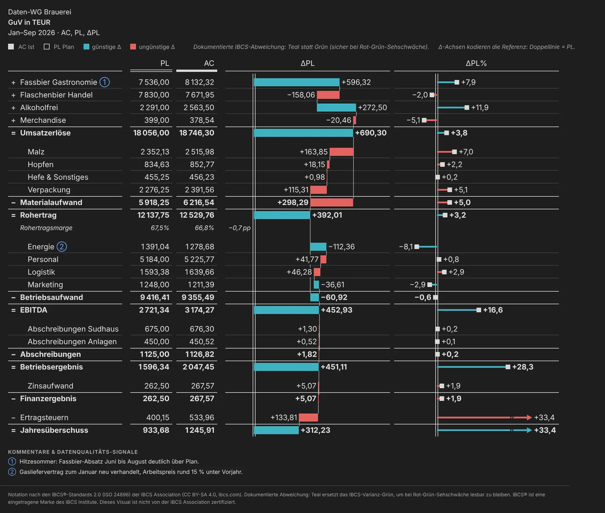

*Erscheinungsbild Dunkel (T04B): das ChartKitchen-Paar #3FB3C2 / #E4635F auf dunklem Papier.*

| Einstellung | Beschreibung | Optionen / Standard |
| --- | --- | --- |
| Erscheinungsbild | Dark Mode: „Auto“ erkennt dunkle Berichts-Themes an der Hintergrundfarbe (Luminanz unter 0,35) und stellt Tinte, Achsen und Flächen auf helle Töne um; von Hand dunkel gefärbte Seiten brauchen „Dunkel“. Im hellen Bericht rendert Auto identisch zu Hell. | Optionen: Auto (Berichtsthema folgen) \| Hell \| Dunkel · Standard „Auto (Berichtsthema folgen)“ |
| Abweichungsfarben-Preset | Blau / Orange ist das ColorBrewer-Paar #2C7BB6 / #E66101 (dunkel #5BA3DC / #F0821E) — auch bei vollständiger Farbenblindheit und im Schwarzweiß-Druck unterscheidbar. Auto behält die Abweichungsfarben darunter. Die beiden Farbwähler übersteuern weiterhin. | Optionen: Wie Abweichungsfarben (Teal / IBCS) \| Teal / Rot (farbfehlsicht-tauglich) \| IBCS Grün / Rot \| Blau / Orange (ColorBrewer) · Standard „Wie Abweichungsfarben (Teal / IBCS)“ |
| Abweichungsfarben | Teal ersetzt IBCS-Grün, damit es bei Rot-Grün-Sehschwäche lesbar bleibt (dokumentierte Abweichung). Sichtbar, solange das Preset auf „Wie Abweichungsfarben“ steht. | Optionen: Teal-Abweichung (farbfehlsichtig-tauglich) \| IBCS-Grün klassisch · Standard „Teal-Abweichung“ |
| Farbe günstige Δ (Überschreibung) | Leer = Farbe des Abweichungsmodus. | Farbe · Standard leer |
| Farbe ungünstige Δ (Überschreibung) | Leer = Farbe des Abweichungsmodus. | Farbe · Standard leer |
| Akzentfarbe Bedienelemente | Aktive Toolbar-Knöpfe, Zurück-Knopf und Breadcrumb-Hover — nie Datenmarken oder Achsen. | Farbe · Standard #404040 |
| Hintergrund Seite | Grund des Statements, des Baums und der Kachel-Ansicht (im Dunkelmodus dunkel). | Farbe · Standard #FFFFFF |
| Hintergrund Kacheln | Füllung der Baumkarten, Kacheln und des Hover-Panels (im Dunkelmodus dunkel). | Farbe · Standard #FFFFFF |

#### Schrift & Zeilen

| Einstellung | Beschreibung | Optionen / Standard |
| --- | --- | --- |
| Schriftgrößen-Preset | Skaliert alle Beschriftungen auf einmal: HD ×1 · Full HD ×1,25 · UHD ×1,6. Seit 1.4 auch über die Leiste HD · Full HD · UHD unten im Start-Hub; seit 1.4.1 heißen die Einträge auch im Formatbereich nur noch HD, Full HD und UHD (gespeicherte Werte `hd` · `fullhd` · `uhd` unverändert). | Optionen: HD \| Full HD \| UHD · Standard „HD“ |
| Schrift-Feinskalierung (%) | Zusätzlich zum Preset (100 = Preset unverändert). Das Produkt aus Preset und Feinskalierung ist bei 2,2 gedeckelt. | 80–160 · Standard 100 |
| Schriftgröße Kopfzeilen (px, 0 = automatisch) | 0 = automatisch (eingebaute Größen), sonst 7–20 px; wirkt auch auf die Köpfe des Mega-Tables. | 0–20 · Standard 0 |
| Schriftfarbe Kopfzeilen (Überschreibung) | Leer = eingebautes weiches Grau. | Farbe · Standard leer |
| Standard-Dichte | Zeilenhöhe beim Öffnen des Berichts; Leser schalten sie in der Toolbar um. | Optionen: Normal \| Kompakt · Standard „Normal“ |

#### Verhalten

| Einstellung | Beschreibung | Optionen / Standard |
| --- | --- | --- |
| Kopfbereich fixieren | Titel, Toolbar, Legende und Spaltenköpfe bleiben oben, während die Zeilen scrollen. | An / Aus · Standard An |
| Selektion & Kontextmenü aktiv | Klick setzt die Seiten-Selektion (Kreuzfilterung, Drillthrough), Rechtsklick öffnet das native Menü. Aus = reine Anzeige ohne Klick-Handler. | An / Aus · Standard An |

> Im Windows-Hochkontrastmodus ignoriert der Mega-Table alle Farbeinstellungen und unterscheidet die Szenarien über Muster statt Farbe; die klassischen Ansichten behalten ihre Palette.

### Fläche (1.7)

Wie viel der Kachel das Statement nutzt. Der Schalter steht standardmäßig aus; ein bestehender Bericht behält jedes Pixel. Templates setzen ihn nie — es ist eine Entscheidung je Kachel.

| Einstellung | Beschreibung | Optionen / Standard |
| --- | --- | --- |
| Ganze Kachel nutzen (maximieren) | Minimale Außenränder, eine Toolbar nur so hoch wie nötig (Gruppennamen neben den Knöpfen), kompakte Kopf- und Fußzeilen. Tabelle, Mega-Table und Balken skalieren Schrift und Zeilen auf die Kachelhöhe; Baum und Sankey füllen die Kachel. | An / Aus · Standard Aus |

> **Verhalten und Grenzen:**
>
> - **Ränder und Kopf:** 4 px statt 14 px (Tabelle: 2 px); die Toolbar setzt die Gruppennamen neben die Knöpfe, je Gruppe eine Zeile mit engen Abständen — typisch ein bis zwei Zeilen statt drei bis vier. Titel, Legende, Fußnoten und Fuß werden kompakt.
> - **Tabelle, Mega-Table, Balken, Wasserfall:** Schrift und Zeilen wachsen mit der Kachelhöhe, bis die Seite die Kachel füllt — höchstens ×1,6, nach unten bis 9 px Körperschrift, darunter wird gescrollt. Ein Körper, der schon breiter als die Kachel ist, wächst nicht.
> - **Baum und Sankey:** Die Karten des Baums wachsen (×0,8 bis ×1,6), bis Breite oder Höhe gefüllt sind; im Sankey geht die gemessene Resthöhe in die Flusshöhe (Mindesthöhe 240 px bleibt).
> - Die Kachel-Ansicht und der Start-Hub bleiben im Familien-Look unverändert.

### Titelblock

Der dreizeilige IBCS-Titel (Berichtseinheit · Kennzahl + Einheit · Zeitraum + Szenarien) mit Botschaft, Headline und Fußzeilen. Alle Felder außer dem Hauptschalter sind nur bei eingeschaltetem Titelblock sichtbar.

| Einstellung | Beschreibung | Optionen / Standard |
| --- | --- | --- |
| Titelblock anzeigen | IBCS-Titel: Berichtseinheit · Kennzahl + Einheit · Zeitraum + Szenarien. | An / Aus · Standard An |
| Zeile 1 · Berichtseinheit | Wer berichtet — Unternehmen, Segment, Konsolidierungskreis. | Text · Standard leer |
| Zeile 2 · Kennzahl + Einheit | Leer = „GuV (P&L) in <Einheit>“ aus den Daten. | Text · Standard leer (automatisch) |
| Zeile 3 · Zeitraum + Szenarien | Leer = Zeitraum und Szenarien aus den Daten (mit „_Monat“-Statusmarker des letzten Ist-Monats). | Text · Standard leer (automatisch) |
| Message-Zeile (Interpretation) | Die Erkenntnis in einem Satz, fett über dem Titel (IBCS SAY). | Text · Standard leer |
| Automatische Botschaft | Erzeugt die Botschafts-Zeile aus der Abweichung der Ergebniszeile und dem stärksten / schwächsten Treiber, wenn keine eigene Botschaft eingegeben ist. Seit 1.5 ein ganzer Satz, z. B. „EBIT liegt 691 Tsd. EUR (−29 %) unter Vorjahr; stärkster Treiber ist Lizenzen mit +120 Tsd. EUR Mehrertrag, größte Belastung ist Logistik mit +813 Tsd. EUR Mehrkosten.“ Die Einheit kommt aus der zweiten Titelzeile („… in Mio. EUR“), sonst aus Skalierung und Einheit; ist der Minuend nicht AC, steht das Szenario im Satz („liegt im Plan …“). | An / Aus · Standard Aus |
| Headline-Slot (große Botschaft) | Zeigt die Botschaft als große Headline neben dem Titel (Layout der IBCS-12er-Serie); ohne eigene Botschaft die generierte Auto-Botschaft. 12G und 12H schalten ihn an. | An / Aus · Standard Aus |
| Fußzeile (Datenstand · Quelle) | Fußzeile unter dem Statement — z. B. Datenstand und Quelle; wird auch im Export gedruckt. | Text · Standard leer |
| Filter-Fußzeile anzeigen | Zweite Fußzeile mit dem Filterkontext: die gebundene „Filter-Info“-Text-Measure (Report-Filter sind für Custom Visuals nicht sichtbar) plus der eigene Zustand des Visuals — ausgeblendete Nullzeilen, Szenario-Sicht des Lesers. | An / Aus · Standard Aus |

### Hierarchie

| Einstellung | Beschreibung | Optionen / Standard |
| --- | --- | --- |
| Standard-Aufklapp-Ebene | Wie tief das Statement aufklappt. 0 = alles aufklappen. | 0–8 · Standard 2 |
| Einrückung je Ebene (px) | Einrückung der Zeilenbeschriftung je Hierarchie-Ebene. | 6–32 · Standard 16 |

### Bestand & Fluss (1.7)

Bilanzposten, Kasse, Working Capital und Headcount als Bestände: der Stand statt der Summe der Monate. Die Art einzelner Zeilen kommt aus dem Zeilentyp-Token (Kapitel 05); diese Karte setzt sie global.

| Einstellung | Beschreibung | Optionen / Standard |
| --- | --- | --- |
| Bestand vs. Fluss | Auto: Zeilen mit dem Token stock / Bestand (Stand am Periodenende) oder opening / Anfangsbestand (Stand am Periodenanfang) sind Bestände; Summen und Formeln über Beständen erben das. Alle Zeilen Bestand: reine Bilanz ohne Token-Spalte. Alle Zeilen Fluss: Verhalten vor 1.7. Bestände zeigen im YTD-Block den Stand der letzten Periode, im FY-Ausblick den FC-Endstand und Δ zum selben Stichtag. | Optionen: Auto (Token im Zeilentyp) \| Alle Zeilen Bestand (Bilanz) \| Alle Zeilen Fluss (wie vor 1.7) · Standard „Auto (Token im Zeilentyp)“ |

> Die Templates T05A (Bilanz) und T05B (Cashflow) setzen diesen Schalter mit (Kapitel 07); jedes andere Template nimmt „Alle Zeilen Bestand“ beim Anwenden zurück auf Auto.

### Leer-Zustand

Was das Visual zeigt, wenn nichts darzustellen ist. Start-Hub, Demo und Feld-Intro erscheinen nur im Bearbeitungsmodus; Leser, PDF-Export und Abos sehen die ruhige Landing-Karte (seit 1.4.1) oder die eigene Nachricht, nie Demo-Zahlen.

| Einstellung | Beschreibung | Optionen / Standard |
| --- | --- | --- |
| Solange Felder fehlen (Bearbeitungsmodus) | Start-Hub = große Knöpfe für Loslegen, Feature-Tour, Template-Galerie, Demo und Feld-Intro, unten HD · Full HD · UHD und die Doku (Kapitel 03; Standard seit 1.3) · Demo = Beispiel-GuV (Smart Start) · Feld-Intro = welches Feld wohin, minimal und im Ausbau, mit ✓ für gebundene Rollen · Eigene Nachricht = Titel und Text darunter. Umschalten auch per Knopf direkt im Leer-Zustand („Felder erklären“ / „Demo ansehen“). | Optionen: Start-Hub (Tour, Templates, Demo, Felder) \| Demo-GuV (Smart Start) \| Feld-Intro (welches Feld wohin) \| Eigene Nachricht (Titel / Text darunter) · Standard „Start-Hub (Tour, Templates, Demo, Felder)“ |
| Eigener Titel | Ersetzt die Überschrift, wenn nichts dargestellt wird (im Lesemodus keine Felder gebunden oder Auswahl ohne Zeilen). Leer = Standardtext. | Text · Standard leer |
| Eigener Text | Textkörper unter dem Titel im Leer-Zustand — z. B. ein Hinweis, welche Filter der Leser prüfen soll. Leer = Standardtext. | Text · Standard leer |

> Zwei Properties stehen nicht im Formatbereich: `columns.templateApplied` (zuletzt angewendetes Template, Echo-Guard) und `state.uiState` (der Leser-Zustand der Toolbar als JSON, lesezeichenfähig). Property-Namen, Typen und das Schema für das PBIR-Authoring stehen im [AGENT-GUIDE](https://github.com/Losveratos/PowerBI-Kitchen-/blob/main/pnlByDatenWG/AGENT-GUIDE.md).

## 09 · Interaktion

### Toolbar

Die Toolbar über dem Statement zeigt je Ansicht nur die Gruppen, die dort etwas bewirken. Darunter steht die Szenario-Legende mit den Chips AC · PY · PL · FC, günstiger und ungünstiger Δ und dem Hinweis, wie die Δ-Achsen die Referenz kodieren. Über dem Mega-Table steht rechtsbündig der Skalenhinweis, sobald etwas von der einen Skala abweicht (Faktor ×n oder fixierte Skala). Mit „Bedienleisten einklappbar“ verschwinden Toolbar, Legende und Hinweiszeilen hinter einem kleinen ☰-Knopf.

| Gruppe | Wann sichtbar | Was sie schaltet |
| --- | --- | --- |
| ☰ Start | Bearbeitungsmodus, immer als erstes Element | Öffnet den Start-Hub als Overlay: Loslegen, Tour, Templates, Demo, Felder, Doku (Kapitel 03). |
| Template | Bearbeitungsmodus, Ansicht Tabelle | Dropdown aller IBCS-Templates; schreibt Template und Schalter in einem Speichervorgang. |
| ↺ Zum Template zurück | Bearbeitungsmodus, Ansicht Tabelle, sobald ein Template-Schalter abweicht | Stellt alle Schalter und Dezimalstellen des gewählten Templates wieder her. |
| Ansicht | immer, außer in der Kachel-Ansicht und wenn nur eine Ansicht angeboten wird | Tabelle · Balken · Wasserfall · Baum · Sankey — nur die angebotenen (Kapitel 08). |
| Spalten-Preset | klassische Tabelle | Die sechs Presets als Schnellwahl. |
| Wertspalten | klassische Tabelle oder Mega-Table, mit „Gruppe: Wertspalten“ | Klassisch: AC · PY · PL · FC · ΔRef als einzelne Knöpfe. Mega-Table: analysiertes Szenario · PY · PL. |
| Δ-Referenz | klassische Ansichten, Baum, Sankey, Kachel | PY · PL · FC — nur gebundene Szenarien bekommen einen Knopf. |
| Perioden | klassische Ansichten, ab zwei Blöcken | MTD · YTD · FY. MTD nicht in Balken, FY nur mit beiden FY-Feldern. |
| Einheit | immer | kEUR · mEUR (bEUR nur ab 50 Mrd. oder wenn der Formatbereich b wählt). |
| Dichte | außer Kachel-Ansicht | Normal · Kompakt. |
| Karten | Baum | Monate · Δ · Brücke als Karten-Diagramm, dazu Status (farbiger Kartenrand). |
| Bis Ebene | Tabellen-Ansichten, Baum und Sankey | 1 · 2 · … · Alle; im Baum und Sankey zusätzlich ⌂ (zurück zur obersten Wurzel, ganzer Baum offen). |
| Szenario · Referenz-Sicht | Mega-Table, mit „Gruppe: Szenario“ | Szenario AC · FC (nur mit FC-Feld), Referenz-Sicht ΔPY · ΔPL · beide. |
| Optionen | klassische Ansichten bzw. Mega-Table | Klassisch: % vom Umsatz (nur Tabelle), Nullzeilen aus, Einpassen. Mega-Table: Nullzeilen aus. |
| Ausnahmen (⚡) | alle Ansichten außer der Kachel-Ansicht, mit gebundenem PY, PL oder FC und „Gruppe: Ausnahmen“ (seit 1.7) | ⚡ Nur Ausnahmen an/aus; daneben Schwellen-Stepper \|Δ%\|, „\|Δ\| ≥ …“, Referenz Auto · PY · PL · FC, Richtung ▲ · ▼ · ▲▼ und Modus ⬚ grau · ⊘ ausblenden (Abschnitt unten). |
| ☰ Bedienleisten | mit „Bedienleisten einklappbar“ (seit 1.5) | Klappt Toolbar, Legende und Hinweiszeilen ein und aus; aufgeklappt führt ☰ die Toolbar an. |

### Wertspalten- und Szenario-Gruppe

- **Klassische Tabelle:** Ein Klick auf einen Wertspalten-Knopf macht aus dem aktuellen Spaltensatz die *Eigene Auswahl* und kippt genau diesen Schalter — so entsteht z. B. AC + PL + FC. Die Presets bleiben Schnellwahl und setzen die Knöpfe wieder; aus „AC·PY·ΔPY“ und „AC·PL·ΔPL“ heraus bleibt die Referenz erhalten. Der MTD- und der FY-Block folgen denselben Schaltern.
- **Mega-Table:** Dieselbe Gruppe schaltet analysiertes Szenario, PY und PL als Leser-Schicht über den Formatbereich-Schaltern. Die letzte Spalte ist gesperrt, damit der Mega-Table nie per Klick in die klassische Tabelle zurückfällt. Ändert der Autor die Wertspalten im Formatbereich, endet die Leser-Wahl.
- **Gruppe Szenario:** Leser wechseln das analysierte Szenario AC / FC und die Referenz-Sicht ΔPY · ΔPL · beide. Die Filter-Fußzeile nennt die gewählte Sicht.

### ⚡ Nur Ausnahmen (1.7)

In einer GuV mit sechzig Zeilen ist Farbe nur dann eine Aussage, wenn sie selten ist. Die Toolbar-Gruppe **Ausnahmen** mit dem Knopf **⚡** färbt nur Zeilen, deren Abweichung zählt; der Rest wird grau oder tritt zurück. Leser bedienen sie selbst; Autoren geben Vorgaben in der Formatkarte *Ausnahmen* (Kapitel 08) oder blenden die Gruppe unter Darstellung & Toolbar aus. Standard ist ⚡ aus — dann rendert jeder Bericht wie bisher.

- **Regel:** Eine Zeile ist Ausnahme, wenn |Δ%| ≥ Schwelle (Standard 5 %, Stepper − / + in Stufen von 1 bis 100 %) *oder* |Δ| ≥ absolute Schwelle — eins von beiden reicht. Der Knopf „|Δ| ≥ …“ erscheint, sobald „Wesentlichkeit ab (absolut)“ gesetzt ist, und übernimmt diesen Wert. **Margenzeilen** (KPI) messen in Prozentpunkten; die absolute Schwelle gilt für sie nicht.
- **Ein Block reicht:** Ist irgendein sichtbares Δ der Zeile (jeder Perioden-Block, jede Referenz) über der Schwelle, behalten *alle* ihre Δ-Elemente die Farbe.
- **Referenz:** *Auto* folgt der Δ-Referenz der Ansicht (im Mega-Table seinen Δ-Spalten), *PY*, *PL* und *FC* messen fest gegen dieses Szenario (nur gebundene Szenarien bekommen einen Knopf). Baum und Sankey messen AC gegen die Referenz im periodengerechten YTD. Bestände vergleichen Stand gegen Stand.
- **Richtung:** ▲ darüber · ▼ darunter · ▲▼ beide — nach dem Vorzeichen von Δ in Anzeige-Orientierung, *nicht* nach günstig/ungünstig. Die Bewertung behält ihre Farben: Eine Ausnahme ist Teal oder Rot wie sonst auch.
- **Modus:** ⬚ *grau* lässt alle Zeilen stehen, nur die Ausnahmen behalten ihre Farbe. ⊘ *ausblenden* lässt den Rest in jeder Ansicht zurücktreten (Tabelle unten).

| Ansicht | ⬚ grau | ⊘ ausblenden |
| --- | --- | --- |
| Tabelle, Mega-Table (ohne Kaskade), Balken | Δ-Zahlen, Balken und Pins der Nicht-Ausnahmen sanft grau. | Ruhige Detailzeilen verschwinden — auch zugeklappte Gruppen, unter denen keine Ausnahme liegt. Fußzeile: „n Zeilen unter der Schwelle ausgeblendet“. |
| Zeilen-Waterfall und Kaskaden-Templates (T04B–E, 12A, 12G, 12H) | Wasserfall-Stufen grau. | Je Abschnitt werden mindestens zwei ruhige Schritte zu *einer* Zeile „übrige (n)“ zusammengefasst (grau, kursiv, die Mitglieder im Tooltip). Summe und Kaskade bleiben geschlossen; ein einzelner ruhiger Schritt bleibt, grau. |
| Werttreiberbaum | Karte halbtransparent, Status-Rand und Δ % grau. | Ruhige Äste klappen zu einer grauen, gestrichelten Karte „+n“ ein; der Pfad von der Wurzel zu jeder Ausnahme bleibt. |
| Sankey | Färbt Abweichungen statt Fluss-Familien: nur die Ströme der Ausnahmen in der Farbe ihres Δ, der Rest grau. | Ruhige Ströme eines Knotens (ab zwei) werden zu *einem* grauen Sammelband „übrige (n)“ gebündelt; die Knoten-Summen stimmen weiter. |
| Kachel-Ansicht | Kennt kein ⚡ — die Gruppe entfällt dort. |  |

- **Was immer bleibt:** Zwischensummen, Ergebnis-, Formel-, Margen- und Trennzeilen. Eine offene Gruppe bleibt als Summenzeile stehen, auch wenn alle Kinder zurücktreten; zugeklappte Blöcke der obersten Ebene ebenso.
- **Fußzeile:** Je Ansicht nennt sie die Regel („⚡ Farbig nur Ausnahmen: |Δ%| ≥ 5 % …“) und zählt, was ausgeblendet oder zusammengefasst wurde — auch im Export.
- **Lesezeichen und Export:** Der Zustand von ⚡ ist lesezeichenfähig und wirkt sofort; der Export druckt den gespeicherten Zustand ohne Toolbar. Derselbe Zustand steht gespiegelt in der Formatkarte *Ausnahmen*.
- **Abgrenzung zur Wesentlichkeit:** Die Wesentlichkeit (Spalten & Mega-Table → „Wesentlichkeit ab …“) bleibt unabhängig und immer aktiv — sie graut Abweichungen, die *beide* ihrer Schwellen nicht überschreiten. ⚡ graut, was *keine* seiner Schwellen erreicht. Sind beide an, wird eine Zeile grau, sobald einer der beiden Gründe greift.
- **Hochkontrast:** Nicht-Ausnahmen erscheinen gestrichelt ohne Füllung und Muster statt grau (Mega-Table, Sankey).
- **Für PBIR-Berichte** mit festem ⚡ genügt das Objekt `exceptions` (`enabled: true` …); ohne Leser-Schalter `toolbar.showExceptions` ausschalten.

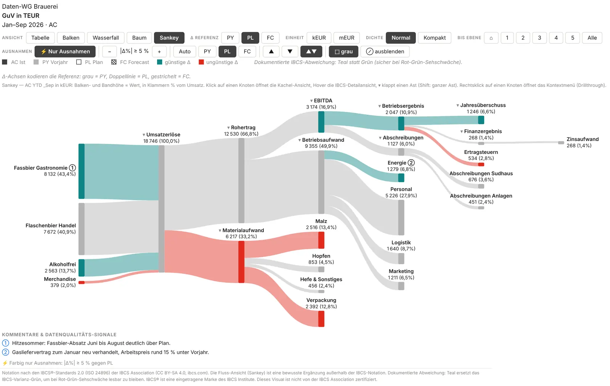

*⚡ im Sankey: nur Ströme mit |ΔPL%| ≥ 5 % tragen ihre Abweichungsfarbe, der Rest bleibt grau.*

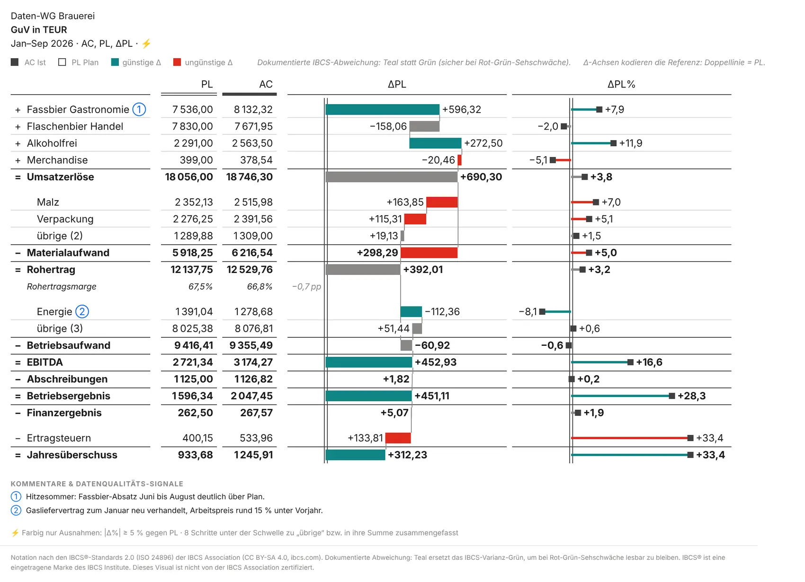

*Modus ⊘ ausblenden: ruhige Schritte werden je Abschnitt zu „übrige (n)“, die Kaskade bleibt geschlossen.*

### Gesperrte Buttons

Ein Knopf, der im aktuellen Zustand nichts ändern würde, ist **gesperrt**: gedimmt, ohne Hover, mit einem Tooltip, der sagt, wo er wirkt — ein Klick speichert nichts. Ob ein Knopf wirkt, prüft die Toolbar gegen die tatsächlich erzeugten Spalten. Typische Fälle: die Δ-Referenz unter dem Preset „AC·PY·PL·FC“ (das seine Referenzen fest zeigt), der FY-Block außerhalb der Presets, die ihn tragen, „% vom Umsatz“ bei ausgeblendetem YTD-Block, der letzte sichtbare Perioden-Block, die letzte Wertspalte oder Δ ohne Referenzfeld, und im Mega-Table eine Szenario-Wahl, die seine Spalten nicht nutzen. Die Perioden-Knöpfe zeigen, was auf dem Bildschirm steht — ein erzwungener YTD-Block liest sich als „an“.

### Selektion, Crossfilter & Drillthrough

- **Linksklick** auf eine Wert- oder Diagrammspalte einer Zeile (Tabelle, Mega-Table, Balken, Waterfall) oder auf den Kopf der Kachel setzt die Power-BI-Selektion dieser Zeile — mit allen Quellzeilen des Kontos (z. B. alle Monate). Zwischensummen selektieren die Blätter darunter, Formelzeilen die Blätter ihrer Operanden. Ein zweiter Klick oder ein Klick auf freie Fläche hebt die Selektion auf.
- **Crossfilter:** Die Selektion filtert die übrige Berichtsseite; die Drillthrough-Schaltflächen der Seite werden mit genau diesem Kontext aktiv. Markiert ein anderes Visual dagegen nur einen Teil der Daten (Hervorheben), gilt der Abschnitt „Markierungen anderer Visuals“ unten.
- **Rechtsklick** auf eine Zeile, Baum-Karte, Sankey-Knoten, Mikro-Karte oder die große Kachel öffnet das native Kontextmenü mit den Drillthrough-Zielen der Seite; in der Kachel-Ansicht erledigt „↗ Drill“ Selektion und Menü in einem Griff.
- Die Markierung sitzt nur auf dem gewählten Element (blasser Akzent-Waschton und 2 px Unterstrich); andere Zeilen werden nicht abgedunkelt. Je Knoten werden höchstens 2.000 Quellzeilen selektiert; wo der Deckel greift, sagt es der Tooltip.
- Der Name einer Zeile klappt, das Chevron klappt, ein Klick auf eine Baum-Karte oder einen Sankey-Knoten öffnet die Kachel — selektiert wird über die Wert- und Diagrammspalten. Abschaltbar über Stil → *Selektion & Kontextmenü aktiv*; im Export und in Abos gibt es keine Interaktion.

1. **Zielseite:** neue Seite anlegen (z. B. „Konto-Detail“) und unter *Visualisierungen → Seite auf Detailsuche filtern* genau die Spalte einziehen, die im Visual als *Konto-ID (Key)* gebunden ist — ohne Konto-ID die erste Ebenen-Spalte (L1).
2. **Schaltfläche:** auf der Quellseite *Einfügen → Schaltflächen → Leer*, dann *Aktion → Ein*, *Typ = Detailsuche*, *Ziel = Konto-Detail*.
3. **Benutzen:** im Visual eine Wertspalte anklicken — die Schaltfläche wird aktiv. Alternativ Rechtsklick oder „↗ Drill“ in der Kachel-Ansicht.

### Markierungen anderer Visuals (Cross-Highlight, 1.7)

Seit 1.7 versteht das Visual das *Hervorheben*. Klickt ein Leser in einem anderen Visual (Balken, Karte, Slicer-Visual) auf ein Element, schickt Power BI die ungefilterte Abfrage samt markiertem Anteil:

- **Sankey:** zeigt die Auswahl im Gesamt — das Ganze grau, der markierte Teil als farbige Innen-Bänder, „923 von 1 685“ an den Knoten, Hinweis in der Fußzeile (Kapitel 06).
- **Alle anderen Ansichten** (Tabelle, Mega-Table, Balken, Wasserfall, Baum, Kachel-Ansicht) verhalten sich **wie gefiltert**: Zeilen ohne markierten Wert verschwinden; Periodenfenster, Skalen, % vom Umsatz, Δ, Wesentlichkeit und ⚡ rechnen auf der Auswahl; es gibt keine Fußzeile.
- **Hinweis für Autoren:** Die Standard-Interaktion anderer Visuals auf die GuV wird damit *Hervorheben* statt Filtern. Außerhalb des Sankey sieht der Leser dasselbe wie vorher, bestehende Berichte brauchen keine Änderung. Wer ausdrücklich *Filtern* will — auch im Sankey —, stellt es in Power BI Desktop unter Format → *Interaktionen bearbeiten* am auslösenden Visual über das Filter-Symbol der GuV um.
- Ein Klick in der GuV selbst erzeugt nach Power-BI-Verhalten keine Markierung in der GuV; ihre Selektion (siehe oben) bleibt unberührt. Ohne Markierung rendert jeder Bericht unverändert; Export und Abos drucken das Filter-Bild bzw. den Sankey mit Fußzeile.

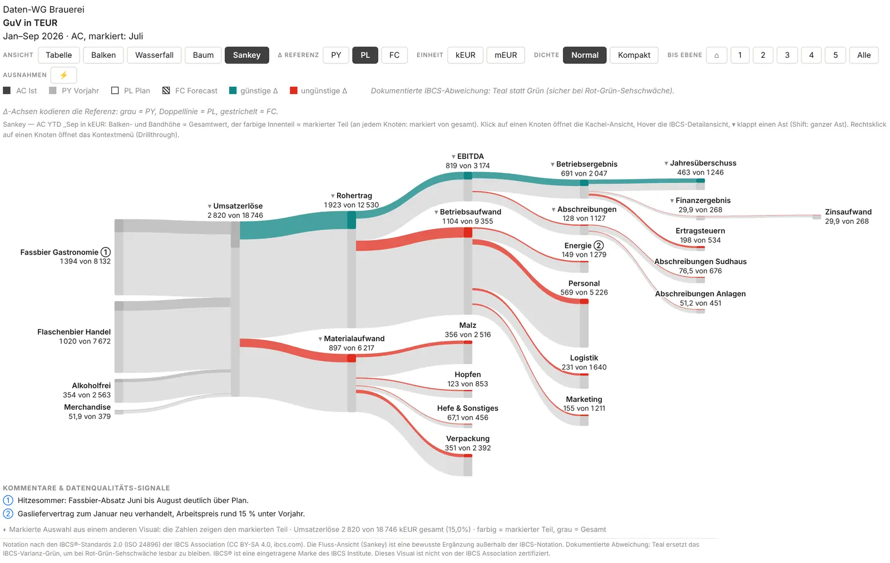

*Ein anderes Visual markiert Juli: der Sankey zeigt den markierten Teil farbig im grauen Gesamt.*

### Lesezeichen (Bookmarks)

Alle Toolbar-Zustände sind im Bericht gespeichert und lesezeichenfähig: Ansicht, Spalten-Preset und Wertspalten, Δ-Referenz, Einheit, Dichte, Optionen, Perioden-Blöcke, zugeklappte Zeilen und offene Sparklines, Wurzel, Faltung, Karten-Diagramm, Status und Zoom des Baums (der Sankey teilt Wurzel, Faltung und Zoom) sowie die Leser-Sicht des Mega-Tables und der Zustand von ⚡ Nur Ausnahmen (Schalter, Schwellen, Referenz, Richtung, Modus). Ein Lesezeichen mit einem fremden Zustand wirkt sofort. Eine im Formatbereich geänderte Vorgabe gewinnt nur für die geänderte Einstellung, die übrigen Leser-Entscheidungen bleiben. Ein Lesezeichen mit Selektion stellt den Filter über Power BI wieder her; die Markierung im Visual wird dabei nicht nachgezeichnet, ein Lesezeichen ohne Selektion entfernt sie. Zeigt ein Lesezeichen auf eine inzwischen nicht mehr angebotene Ansicht, erscheint die erste angebotene (Kapitel 08).

### Tooltips

In Tabelle, Mega-Table, Balken und Waterfall zeigen Zeilen, Zellen, Balken, Pins und Kaskaden einen Tooltip mit Zeilenname, den gebundenen Szenarien des Blocks (mit Einheit), der Abweichung je Referenz absolut und in Prozent (Margen in %p), dem Wesentlichkeits-Hinweis, dem Kommentar und gegebenenfalls der Selektions-Kappung. Im hellen Modus ist es der native Power-BI-Tooltip, im Dunkelmodus ein eigener dunkler Kasten. Der Werttreiberbaum nutzt seine Detailansicht beim Hover und SVG-Titel; im Sankey zeigt der Hover das IBCS-Detail-Panel, und der Tooltip nennt Wert, Anteil und Δ zur Referenz.

### Tastatur

Toolbar-Knöpfe und die Auf-/Zuklapp-Elemente der Zeilen sind per `Tab` erreichbar; `Enter` oder `Leertaste` löst aus bzw. klappt auf und zu. Der Fokus ist als Ring sichtbar — auch auf nachgezeichneten Zeilen langer Mega-Tables. Im Start-Hub öffnen die Ziffern 1–4 die vier Kacheln, ‹ › und die Pfeiltasten blättern die Tour, Esc geht eine Ebene zurück bzw. schließt das Overlay.

## 10 · Bekannte Abweichungen von den IBCS-Blättern

Das Visual stellt die Referenzblätter so genau wie möglich nach, baut aber deren Inkonsistenzen und Druckfehler bewusst nicht nach. Vier Abweichungen sind dokumentiert (vollständig in [SPEC-MEGATABLE.md](https://github.com/Losveratos/PowerBI-Kitchen-/blob/main/pnlByDatenWG/SPEC-MEGATABLE.md), Abschnitt „Bewusst offen / Abweichungen“):

1. **T01A/B — Dezimale im YTD-Block:** Die YTD-ΔPY-Spalte des Originals druckt eine Dezimale (+431.0) bei sonst ganzzahligen Spalten. Das ist eine Inkonsistenz der Referenz; das Visual hat eine Dezimalregel je Tabelle und druckt einheitlich (+431).
2. **T02F — frühe Kappung:** Das Original kappt Δ%-Pins schon bei einem Sprung von 1,35×. Die Tukey-Automatik des Visuals (Q3 + 4 × IQR) kappt dort nicht — jede Regel, die T02F träfe, würde in T02A fälschlich kappen.
3. **T03A — Druckfehler der Blätter:** Das Original druckt in ΔPY des Group result versehentlich den ΔPL-Wert (+162.5); das Visual rechnet korrekt (+186.2). Ebenso der Financial-income-Pin in T04C/E (das Visual zeichnet vorzeichenrichtig −9.59) und das Operating result in 12H.
4. **12A — Pfeilspitzen:** Mehrfach-Pfeilspitzen gekappter Werte (+983 →→→) sind im Visual eine einfache Spitze; der Wert steht ohnehin als Zahl am Element.

Davon unabhängig ist die Teal-Farbgebung eine bewusste, dokumentierte Abweichung (Kapitel 01). Ebenfalls außerhalb der IBCS-Notation, aber keine Abweichung von einem Blatt, liegt die Sankey-Ansicht (Kapitel 06).

## 11 · Troubleshooting

### Buttons wirken „tot“.

Seit 1.0.1 sind wirkungslose Knöpfe gedimmt und der Tooltip sagt warum — etwa die Δ-Referenz unter dem vollen Preset. Ein Template wirkt nur in der Ansicht *Tabelle*.

### Die ΔPL-Spalten bleiben leer.

Die PL-Rolle ist nicht gebunden — der Formatbereich blendet die ΔPL-Schalter dann aus. Ein FC-Minuend braucht die FC-Rolle, PL als Minuend die PL-Rolle.

### Die Schwellen färben nicht.

Schwellen gelten in **Anzeige-Einheiten**, also nach der k/m-Skalierung. Die Standardwerte −20 / −220 meinen Tausender und werden seit 1.5.1 bei Mio.- und Mrd.-Skalierung umgerechnet (−0,02 / −0,22 Mio.); ein selbst gesetzter Wert gilt wie eingetippt, −20 heißt bei Mio. dann −20 Mio. Außerdem brauchen sie eine Δ-Zahlenspalte.

### Im Spaltenkopf steht „ΔPY ×5“.

Ein Skalierungshinweis nach IBCS 2.0 / ISO 24896: In 12A, 12G und 12H zeichnen die Δ-Balken in der Skala der Wert-Kaskaden; wären sie dort zu klein, vergrößert das Visual sie um einen runden Faktor und nennt ihn im Kopf und im Skalenhinweis über der Tabelle. Dasselbe gilt in Balken- und Wasserfall-Ansicht. Wer mehrere Reiter gleich skalieren will, setzt beide Skalen-Mindestmaxima (Kapitel 08).

### Seit 1.5 wirken die Monatsbalken viel kürzer.

Gewollt: Monat, YTD und FY teilen eine Skala je Einheit; bis 1.4 hatte jeder Block seine eigene, ohne Hinweis. Kleine Monatsabweichungen sind jetzt so kurz, wie sie im Verhältnis zum YTD sind.

### Toolbar und Legende nehmen in einer kleinen Kachel zu viel Platz.

Darstellung & Toolbar → Bedienleisten einklappbar (☰) einschalten (seit 1.5). Eingeklappt bleibt eine schmale Zeile; Leser klappen mit ☰ auf.

### Dasselbe Template noch einmal gewählt — nichts passiert.

Ein natives Dropdown kann den schon gewählten Eintrag nicht erneut melden. Seit 1.3 wendet ein Klick auf die aktive Kachel der Template-Galerie (Start-Hub bzw. ☰ Start) das Template erneut an; weichen Schalter ab, stellt „↺ Zum Template zurück“ neben dem Dropdown den Template-Stand wieder her.

### Statt der Demo-GuV erscheint ein Start-Hub.

Seit 1.3 der Standard für Autoren (Kapitel 03); die Demo-GuV steckt hinter „Demo ansehen“. Wer sie direkt sehen will, stellt Leer-Zustand → *Solange Felder fehlen* auf „Demo-GuV (Smart Start)“. Leser und Exporte sehen den Hub nie.

### Sehen Leser „☰ Start“ oder „↺ Zum Template zurück“?

Nein. ☰ Start, die Template-Auswahl und ↺ erscheinen nur im Bearbeitungsmodus; Leser, Export und Abos sehen sie nie.

### In der Toolbar fehlt das Template-Dropdown.

Es erscheint nur im Bearbeitungsmodus und in der Ansicht *Tabelle*. Den Schalter Darstellung & Toolbar → *Template-Auswahl im Bearbeitungsmodus* prüfen.

### Spalten-Kategorie gebunden, aber keine Blöcke.

Der Mega-Table ignoriert die Spalten-Kategorie (Hinweis unter der Tabelle im Bearbeitungsmodus). Sie wirkt in der klassischen Tabelle, also mit Template „Aus“.

### Export/PDF sieht anders aus als der Bildschirm.

Gewollt: Der Export druckt ohne Toolbar und voll aufgeklappt (Schalter *Export: alle Zeilen aufklappen*), ohne Virtualisierung und ohne die Autoren-Notiz „Skala fixiert“ unter der Tabelle; eine fixierte Skala nennt im Mega-Table der Skalenhinweis.

### Alle Werte sind leer.

Die Gruppierungsfelder stehen auf „Zusammenfassen“ statt „Nicht zusammenfassen“.

### Die FY-Spalten sind um ein Vielfaches zu groß.

Das FY-Measure ist als `SUM` statt `MAX` (oder `AVERAGE`) definiert; der Jahreswert steht auf jeder Monatszeile.

### Die Monate stehen in falscher Reihenfolge.

Das Perioden-Label ist nicht lesbar oder es ist ein Fiskaljahr — Spalten & Mega-Table → Tabelle → *Perioden-Sortierung* auf „Datenreihenfolge (Fiskaljahr)“ stellen.

### Eine Zeile zeigt „·“ oder „⚠ Zyklus“.

„·“: Der Referenzname der Formel ist nicht eindeutig oder das Szenario hat keine Daten. „⚠ Zyklus“: Zirkelbezug in der Formeldefinition oder in Parent-Child.

### „Nicht zugeordnet“ erscheint rot mit ⚠.

Ein Parent- oder Ebenen-Pfad zeigt ins Leere. Das ist ein gewolltes Datenqualitäts-Signal: das Visual verschluckt keine Konten.

### Die Kosten erscheinen günstig, obwohl sie über Plan liegen.

Die Kostenzeile trägt Rechenvorzeichen `-1` *und* Abweichungsfarbe drehen = `true` — die beiden Mechanismen heben sich auf. Bei `-1` die Abweichungsfarbe nicht zusätzlich drehen (Kapitel 05).

### Ist der Sankey IBCS-konform?

Nein, bewusst nicht. Der Sankey (seit 1.6) ist eine Fluss-Ansicht außerhalb der IBCS-Notation; der Footer nennt das, und die Kachel-Ansicht, die ein Klick darin öffnet, bleibt IBCS. Sinnvoll ist er für das Gespräch über die Struktur: wohin fließt der Umsatz, wie viel davon bleibt als Ergebnis, welche Kostenblöcke zehren ihn auf. Für Plan-Ist-Vergleiche, Abweichungsanalysen und den Monatsbericht sind Tabelle, Mega-Table, Balken und Wasserfall die richtige Wahl. Lässt eure Berichtsrichtlinie nur IBCS zu, schaltet ihr den Sankey ab (nächste Frage).

### Wie verstecke ich eine Ansicht vor Lesern?

Formatbereich → Darstellung & Toolbar → die fünf Schalter *Ansicht: Tabelle / Balken / Wasserfall / Treiberbaum / Sankey anbieten* (Standard alle an); Details und Property-Namen in Kapitel 08. Eine ausgeschaltete Ansicht verliert ihren Knopf. Bleibt nur eine Ansicht übrig, entfällt die ganze Ansichts-Gruppe — so lässt sich ein Bericht auf genau eine Ansicht festlegen. Zeigt ein gespeicherter Zustand oder ein Lesezeichen auf eine abgeschaltete Ansicht, erscheint still die erste angebotene; der gespeicherte Zustand wird dabei nicht überschrieben. Die Gruppe selbst blendet *Gruppe: Ansicht* aus.

### Im Sankey erscheint ein graues Band „Sonstige“.

Die Zahlen eines Knotens gehen nicht in seinen Teilen auf, etwa weil ein Summenknoten einen eigenen Wert trägt oder eine Formel eine Konstante enthält. Das Band macht die Lücke sichtbar, statt sie zu verstecken; bei konsistenten Daten erscheint es nie.

### Kann ich eine Bilanz zeigen?

Ja, seit 1.7. Liefere die Bilanzposten als **Monatsstände (ultimo)** und kennzeichne sie im *Zeilentyp* mit dem Token `stock` (`Account stock`) — oder wähle, wenn die Kontendimension keine Zeilentyp-Spalte hat, Formatbereich → *Bestand & Fluss* → „Alle Zeilen Bestand (Bilanz)“. Das Template **T05A · Bilanz** (Galerie-Gruppe „Bilanz & Cashflow“) setzt das Layout und, ohne Token, den Schalter gleich mit; für die Brücke vom Anfangs- zum Endbestand gibt es T05B. Details: Kapitel 05 („Bestand & Fluss“) und Kapitel 07.

### Die YTD- oder FY-Zahlen meiner Bilanz sind um ein Vielfaches zu groß.

Die Bestände werden wie Flüsse über die Monate summiert. Setze das Token `stock` bzw. `opening` im Zeilentyp oder wähle *Bestand & Fluss* → „Alle Zeilen Bestand (Bilanz)“. Auch ein Bestands-Measure, das schon kumuliert, ist falsch: geliefert werden Monatsstände.

### Unter der Tabelle steht „Bestand und Fluss gemischt“.

Nur im Bearbeitungsmodus: Eine Formel oder Summe mischt Bestände und Flüsse, ohne dass ein Token die Art festlegt. Eine Formel folgt dem ersten Operanden, eine gemischte Summe bleibt Fluss. Lege die Art mit `stock` oder `flow` im Zeilentyp fest.

### Warum verschwindet nichts, wenn ich „ausblenden“ wähle?

⊘ blendet *ruhige Detailzeilen* aus: Konten und Gruppen, die keine Kinder zeigen (Blatt oder zugeklappt, unterhalb der obersten Ebene) und in sich und darunter keine Ausnahme tragen. Seit 1.7 verschwinden dabei auch **zugeklappte Gruppen ohne Ausnahme darunter** — auf der Standard-Aufklappebene fiel früher oft nichts weg. Es bleiben immer Zwischensummen, offene Gruppen als Summenzeile, Ergebnis-, Formel-, Margen- und Trennzeilen. Verschwindet trotzdem nichts: Der Modus steht noch auf ⬚ grau, die Schwelle ist so niedrig, dass jede Zeile Ausnahme ist (Standard 5 %), die Gruppe fehlt mangels gebundenem PY, PL oder FC, oder du bist in der Kachel-Ansicht, die kein ⚡ kennt.

### Klicke ich in einem anderen Visual, wird der Sankey grau.

Gewollt (Cross-Highlight, seit 1.7): Der Sankey zeigt die Markierung im Gesamt — das Ganze grau, der markierte Teil farbig, in der Fußzeile „… 923 von 1 685 …“. Alle anderen Ansichten verhalten sich wie gefiltert. Soll auch der Sankey filtern, stelle die Interaktion in Power BI Desktop unter Format → *Interaktionen bearbeiten* am auslösenden Visual auf das Filter-Symbol um (Kapitel 09).

## 12 · Versionshinweis 1.7.0.0

Diese Dokumentation beschreibt **Version 1.7.0.0** vom 29.10.2026 (GUID `pnlByDatenWG3F9A7D2C51E64B08A1C4E7F0B92D6358`). Das Visual ist nicht im Microsoft AppSource gelistet und damit nicht von Microsoft zertifiziert. Feldrollen, Property-Namen und der gespeicherte Toolbar-Zustand sind seit 1.0 stabil; jede neue Einstellung steht per Standard aus oder verhält sich wie bisher. Standard-Änderungen seit 1.2: Im Bearbeitungsmodus ohne Felder erscheint der Start-Hub statt der Demo-GuV (1.3); seit 1.5 gilt die Skalierung nach IBCS 2.0 / ISO 24896 als Standard, bestehende Berichte ändern dadurch ihr Bild.

- **1.7.0.0 · Bestand & Fluss, Nur Ausnahmen, Fläche, Toolbar-Farben, Cross-Highlight im Sankey:** Zeilentyp-Token `stock`/`opening` und Formatkarte „Bestand & Fluss“ — Bestände werden in YTD und FY nicht summiert, sondern als Stand zum Stichtag gezeigt (FY = Forecast-Endstand), Δ vergleicht Stände desselben Stichtags; neue Templates **T05A Bilanz** und **T05B Cashflow** in der Galerie-Gruppe „Bilanz & Cashflow“, Beispieldaten `demoData/bilanz-*.csv`, `cashflow-*.csv`. Toolbar-Gruppe **⚡ Nur Ausnahmen**: nur Zeilen mit |Δ%| ≥ Schwelle (oder |Δ| ≥ absolut) gegen PY/PL/FC behalten ihre Farbe, Richtung ▲/▼/▲▼, Rest grau oder ausgeblendet — Ausblenden wirkt in jeder Ansicht (Kaskaden fassen ruhige Schritte zu „übrige (n)“ zusammen, Baum klappt ruhige Äste zu „+n“, Sankey bündelt ruhige Ströme), lesezeichenfähig, Formatkarte „Ausnahmen“. Formatkarte **Toolbar-Farben** (leer = automatisch). Schalter **Fläche → Ganze Kachel nutzen**: schmale Ränder, kompakte Toolbar, Tabellen skalieren auf die Kachelhöhe, Baum und Sankey füllen die Kachel. **Cross-Highlight**: Markierungen aus anderen Visuals zeigt nur der Sankey als farbigen Teil im grauen Ganzen; alle anderen Ansichten verhalten sich wie gefiltert.
- **1.6.0.0 · Sankey-Ansicht und „Ansichten anbieten“:** Fünfte Ansicht „Sankey“ — die GuV als Fluss von links nach rechts über dem Graphen des Werttreiberbaums (Gewinnstrang günstig, Kosten zweigen ungünstig ab, Band-Höhe proportional zum AC-YTD), mit Kachel-Zoom, Hover-Panel, Kontextmenü und Äste-Klappen wie im Baum; bewusst außerhalb der IBCS-Notation (der Footer sagt es). Neu unter Darstellung & Toolbar: fünf Schalter, welche Ansichten Leser angeboten bekommen (Tabelle, Baum, Bars, Wasserfall, Sankey); zeigt ein gespeicherter Zustand auf eine abgeschaltete Ansicht, erscheint still die erste angebotene. Hub-Tour mit Karte 8 „Sankey“, vier Sprachen, Dark Mode und Hochkontrast (Muster statt Farbe).
- **1.5.3.0 · Spaltenkopf auf skalierter Bühne:** In einer Fabric App (Bühne per CSS-Transform skaliert) saß der haftende Spaltenkopf um den Bühnenfaktor zu tief und verdeckte Zeilen; das Visual misst jetzt in Layoutpixeln. In niedrigen Kacheln haften die Fußnoten nur, solange Zeilen sichtbar bleiben; die IBCS-Notationszeile läuft über alle Fußnotenspalten. In Power BI ändert sich nichts.
- **1.5.2.0 · kosmetische Restpunkte:** IBCS-Notationszeile im Fuß bleibt mit Kommentarblock in der Kachel; Markenhinweis „IBCS Institute“; 12G-Headline „im Forecast“; 12G-YTD-Zahlen vor dem Balken, wenn sie innen nicht passen; Tooltip „pp“; Blöcke und Einkindgruppen in derselben Richtung sortiert wie die Zeilen (T02E/T02F); Verbindungslinien im Δ-Wasserfall an Zahlen unterbrochen; Δ, das auf null rundet, mit Vorzeichen („+0,00“).
- **1.5.1.0 — Restpunkte der Skalen-Messung:** kein Faktor mehr zwischen Perioden-Blöcken, Skalierungshinweis ×n nur noch für Δ gegen die Wert-Kaskade (ein Faktor je Tabelle); Headline mit dem Δ des Treibers samt Wirkung in Worten („Mehrkosten“) und Einheit „Mio. EUR“; Margenzeilen ohne Δ %, Δ in pp mit den Δ%-Dezimalen; Schwellen-Standard bei Mio. umgerechnet; Leerzeile nach jedem Element der obersten Ebene, Einkindgruppen ohne doppelte Zwischensumme; Kommentar-Fußnoten mehrspaltig und immer sichtbar; Δ-Balken bei Minuend PL rot/grün umrandet; lesbare YTD-Zahlen in 12G; echtes Minuszeichen „−“.
- **1.5.0.0 — Skalierung nach IBCS 2.0 / ISO 24896 als Standard:** eine Δ-Skala über alle Perioden-Blöcke, Δ in der Skala der Wert-Kaskaden, Ausreißerzone mit Bruchzeichen und Dreieck, Skalenhinweis über der Tabelle; dieselbe Regel in Balken-, Wasserfall- und Baum-Ansicht (Hover-Lupe als eigene Skala gekennzeichnet); Auto-Headline als ganzer Satz; Δ % mit einer Dezimale in jedem Template; einklappbare Bedienleisten (☰, Standard aus); Fußnote nennt IBCS 2.0 (ISO 24896).
- **1.4.2.0 — Korrektur:** GuV-Reihenfolge im Ebenen-Modus mit Sortierspalte; erzeugte Zwischenebenen erben die kleinste Sortierung ihrer Kinder, Formelzeilen stehen wieder an ihrem Platz.
- **1.4.1.0 — Familien-Hub:** ein Look mit dem Schwester-Visual ChartKitchen — untere Leiste mit HD · Full HD · UHD und „📖 Doku öffnen“, „← Zurück“ als Pille, Loslegen in Teal über die volle Breite, Galerie-Gruppen als Eyebrow; Preset-Namen HD · Full HD · UHD auch im Formatbereich; ruhige Landing-Karte für Leser und Exporte ohne Daten.
- **1.4.0.0 — Hub-Polish für Controller:** Template-Galerie nach Zweck (vier Gruppen, Finance-Titel, Nutzen-Zeile), „🚀 Loslegen“-Checkliste, Feld-Intro mit allen 20 Rollen und zwei Prämissen, Schriftgrößen-Leiste und Doku-Knopf auf jeder Hub-Seite, „← Zurück“ überall, ☰ Start als erstes Toolbar-Element.
- **1.3.0.0 — Start-Hub:** vier Knöpfe statt Demo-Tabelle (Tour, Templates, Demo, Felder), ☰ Start als Overlay über der GuV, Template erneut anwenden, „↺ Zum Template zurück“.
- **1.2.0.0 — Ease of Use:** Wertspalten frei kombinieren (Preset „Eigene Auswahl“, Toolbar-Gruppe Wertspalten, auch im Mega-Table), Template-Auswahl in der Toolbar, Template-Gruppe zuerst im Formatbereich, Leer-Zustand mit Feld-Intro, Feldliste in gewohnter Reihenfolge, Balken-Ansicht wie ChartKitchen (überlappt, Dreiecke), Spalten-Kategorie.
- **1.1.0.0:** 12G, 12H und Headline-Slot, Skalen-Sync, Blau/Orange, Virtualisierung langer Mega-Tables; Finance-Handwerk aus ChartKitchen (Tooltips, Σ-treue Rundung, Klammern, Mrd., Hausbegriffe, Auto-Botschaft, Fußzeilen, Hervorheben, Wesentlichkeit, Leser-Szenario, Leer-Zustand, Tastatur); Block-Arten Monat · YTD · FY.
- **1.0.1.0:** Toolbar-Knöpfe wirken in jeder Ansicht, gesperrte Knöpfe mit Tooltip, Formatbereich-Vorgaben gewinnen nach Änderung, Echo-Guard für den Toolbar-Zustand.
- **1.0.0.0:** Mega-Table (T01–T04, 12A), vier Sprachen, Smart Start, Dark Mode, Formatbereich mit Sichtbarkeits-Regeln.
- **0.17.0.0:** Selektion, Cross-Filtering und natives Kontextmenü mit Drillthrough.

Die vollständige Versionshistorie steht im [CHANGELOG](https://github.com/Losveratos/PowerBI-Kitchen-/blob/main/pnlByDatenWG/CHANGELOG.md).

**P&L Statement byDatenWG** · Version 1.7.0.0

Schwester-Visual: [ChartKitchen byDatenWG – Dokumentation](../chartkitchen-doku.html) · Für IT & Admins: [Sicherheit & Betrieb](../visuals-sicherheit.html)

Kontakt: Michael Tenner · [michael.tenner84@gmail.com](mailto:michael.tenner84@gmail.com)

Schnellstart: [pnl-schnellstart.html](../pnl-schnellstart.html) · Download: [.pbiviz 1.7.0.0](https://raw.githubusercontent.com/Losveratos/PowerBI-Kitchen-/main/pnlByDatenWG/dist/pnlByDatenWG3F9A7D2C51E64B08A1C4E7F0B92D6358.1.7.0.0.pbiviz) · Quellcode und Änderungsprotokoll: [pnlByDatenWG im Repository](https://github.com/Losveratos/PowerBI-Kitchen-/tree/main/pnlByDatenWG) · Für KI-Agenten: [AGENT-GUIDE](https://github.com/Losveratos/PowerBI-Kitchen-/blob/main/pnlByDatenWG/AGENT-GUIDE.md)

> Notation nach den IBCS®-Standards 2.0 (ISO 24896) der IBCS Association (CC BY-SA 4.0, ibcs.com). Dokumentierte Abweichung: Teal ersetzt das IBCS-Varianz-Grün, um bei Rot-Grün-Sehschwäche lesbar zu bleiben. IBCS® ist eine eingetragene Marke des IBCS Institute. Dieses Visual ist nicht von der IBCS Association zertifiziert und steht in keiner Verbindung zu ihr.

---

## Weitere Fassungen dieser Seite

- HTML (maßgeblich): https://datenwgknowledgekitchen.com/pnl-doku.html
- Englisch: [pnl-doku_en.html](../pnl-doku_en.html) · [pnl-doku_en.md](pnl-doku_en.md)
- Schnellstart: [pnl-schnellstart.html](../pnl-schnellstart.html)
- Referenz für KI-Agenten (Datenvertrag, alle Format-Properties): [pnlByDatenWG/AGENT-GUIDE.md](../pnlByDatenWG/AGENT-GUIDE.md)
