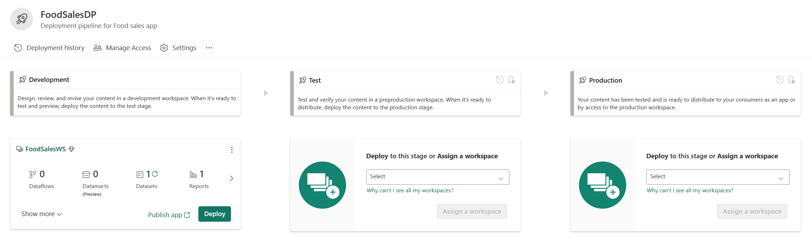
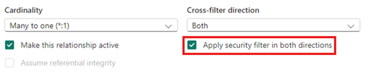

# Power BI von A bis Z — Einsteiger-Guide (End-to-End)

> Markdown-Fassung von [power_bi_einsteiger_guide_v4.html](../power_bi_einsteiger_guide_v4.html) · https://datenwgknowledgekitchen.com/power_bi_einsteiger_guide_v4.html · generiert mit scripts/build_md.py — bei Abweichungen gilt die HTML-Fassung.

EINSTEIGER-GUIDE · POWER BI · END-TO-END

Für alle, die Power BI seit ein bis zwei Jahren nutzen und jetzt den ganzen Weg verstehen wollen — von der Datenanbindung bis zum Sharing. Mit Schritt-für-Schritt-Anleitungen, konkreten Beispielen, und Tiefenfokus auf Query Folding und IBCS.

**v 4 · Einsteiger** · Beta · Stand Oktober 2026 · DE · 10 Sektionen · 102 klickbare Detail-Karten

Michael Tenner · Power BI · Data Engineering · Daten-WG · [LinkedIn](https://www.linkedin.com/in/michael-tenner-5b885970/)

## Wo soll ich anfangen?

Dieser Guide ist **kein Buch**, das du von vorn nach hinten liest. Es ist eine Klick-Erkundung: zehn Sektionen mit jeweils mehreren anklickbaren Karten, jede führt zu einem Detail-Fenster mit Schritt-für-Schritt, Beispielen und Anfänger-Fallen.

Wenn du **1–2 Jahre Power BI** gemacht hast, kennst du die Oberfläche, aber wahrscheinlich noch nicht das *Warum* dahinter. Genau das schließen wir hier. Empfohlene Reihenfolge: **Sektion 1 → 2 → 4 → 5 → 6** abdecken die Kern-Workflows; Sektion 3, 7–10 sind Vertiefung.

Wenn du eine Karte anklickst, öffnet sich ein Modal. Mit `Esc` schließen, oder neben das Fenster klicken.

## Die Reise durch Power BI

Zehn Etappen, von der Datenanbindung bis zum Sharing. Klick führt direkt zur Sektion.

- **Architektur** — 01 · INFRASTRUKTUR
- **Power Query** — 02 · ETL
- **Query Folding** — 03 · DEEP DIVE
- **Datenmodell** — 04 · DESIGN
- **DAX** — 05 · LOGIK
- **Viz & IBCS** — 06 · DEEP DIVE
- **Interaktivität** — 07 · UX
- **Service & Sharing** — 08 · DEPLOY
- **RLS** — 09 · GOVERNANCE
- **Tools** — 10 · ERWEITERT

## 01 · Architektur & *Komponenten*

Power BI ist nicht eine einzelne App, sondern ein verteiltes System: Authoring-Tool auf deinem Rechner, Cloud-Service, On-Prem-Brücken, Lizenzschichten. Wer das nicht früh versteht, trifft teure Architektur-Entscheidungen rückwirkend.

> Als erstes: **Lies "Desktop", "Service" und "Storage Modes"** in dieser Reihenfolge — das ist das mentale Modell. Den Rest klickst du, wenn du konkret damit zu tun hast.

### Power BI Desktop

*ARCHITEKTUR · AUTHORING*

Das kostenfreie Authoring-Tool. Hier entstehen Datenmodelle, Measures und Berichte. Nur für Windows.

#### Was ist das?

Power BI Desktop ist die App, die du auf deinem Windows-Rechner installierst. Sie kombiniert Power Query (Datenaufbereitung) mit fünf Ansichten: Report, Table, Model, DAX query und TMDL view. Gespeichert wird klassisch als `.pbix`-Datei — sie enthält alles: Mashup-Code, Datenmodell und Visuals — oder als Power BI Project (`.pbip`) in Textdateien.

#### Was wo entsteht

- **Power Query Editor** — Datenanbindung und Transformation in M-Code
- **Table view** (früher „Data view“) — geladene Tabellen ansehen, Datentypen ändern, berechnete Spalten anlegen
- **Model view** — Beziehungen, Hierarchien, Display Folders, Calculation Groups; Rollen (RLS) über Modeling → Manage roles
- **Report view** — Visuals platzieren, formatieren, interaktiv verknüpfen
- **DAX query view** — DAX-Abfragen schreiben und testen, Measures prüfen, ohne ein Visual zu bauen
- **TMDL view** — das Modell als Code (TMDL) scripten und Änderungen gesammelt anwenden; seit September 2025 generally available

#### Einstellungen, die du sofort ändern solltest

File → Options and Settings → Options → Data Load. Hier findest du Defaults, die für Produktiv-Arbeit ungünstig sind.

#### Auto Date/Time deaktivieren

Power BI erzeugt sonst für jede Datums-Spalte eine versteckte Datums-Hierarchie und bläht das Modell auf. **Current File → Auto Date/Time → Haken raus.** Stattdessen eine echte Datums-Dimension verwenden.


**Abb. · File → Options → Data Load** "Auto date/time" pro Datei oder global deaktivierbar. Quelle: [Auto date/time · Microsoft Learn](https://learn.microsoft.com/power-bi/transform-model/desktop-auto-date-time)

#### Updates monatlich installieren

Microsoft veröffentlicht jeden Monat ein Desktop-Update. Wer Updates auslässt, verpasst Features (zuletzt z. B. TMDL view, PBIR als Standardformat, Visual Calculations) und Bugfixes. Microsoft supportet nur die jeweils aktuelle Desktop-Version.

#### Externe Tools aktivieren

Wenn du Tabular Editor 2 und DAX Studio installierst, erscheinen sie im "External Tools"-Tab in Desktop und sind nahtlos integriert (siehe Sektion 10).

> **Praxis-Beispiel:** Du öffnest Desktop, wählst "Get Data" → "SQL Server", verbindest dich. Power Query Editor öffnet sich (das ist Phase 1: Aufbereitung). Du machst deine Transformationen, klickst "Close & Apply". Jetzt bist du im Table view / Report view und kannst Visualisierungen bauen.

> **Format PBIP · PBIR · TMDL (Stand Oktober 2026):** Über File → Save as → *Power BI Project (.pbip)* speichert Desktop Bericht und Modell als Ordner mit Textdateien statt einer binären `.pbix` — kein Preview-Schalter mehr nötig. Das Modell liegt dann als TMDL vor, der Bericht im Enhanced Report Format **PBIR**. PBIR ist generally available und Standard-Berichtsformat; ältere Berichte (PBIR-Legacy) werden beim Bearbeiten und Speichern automatisch konvertiert (Desktop legt vorher 30 Tage lang ein Backup an). Vorteil: Git-Versionskontrolle, Code-Review, Änderungen per Skript oder KI-Agent. Einschränkung: Sensitivity Labels werden in PBIP nicht unterstützt.

**Lizenzhinweis:** Desktop ist immer kostenfrei. Erst das Teilen im Service braucht eine Pro- oder PPU-Lizenz (oder eine Fabric-Kapazität ab F64 für reine Konsumenten).

**Daten-WG dazu:**

- **[Fabric & Power BI Quarterly 2026-1 — PBIR/PBIP & „Code First“](https://youtu.be/TYp5xCAU2AU)** · Talk · 58 min · [Knowledge Kitchen](../index.html#ep-TYp5xCAU2AU)
- **[Power BI Update August 2026 — PBIP direkt in VS Code öffnen](https://youtu.be/GWCHNmLs72M)** · Update · 9 min · [Knowledge Kitchen](../index.html#ep-GWCHNmLs72M)

### Power BI Service

*ARCHITEKTUR · CLOUD*

Der Cloud-Service ist das, was aus einer .pbix-Datei eine Lösung macht. Ohne ihn ist Power BI ein Einzelplatztool.

#### Was ist das?

Der Service läuft auf Microsoft-Servern (erreichbar unter app.powerbi.com). Hier werden Inhalte in Workspaces organisiert, automatisch aktualisiert, mit RLS abgesichert, in Apps gebündelt und an Endnutzer verteilt. Seit November 2023 läuft der Service als Teil von Microsoft Fabric. Aus „Datasets“ wurden dabei **semantische Modelle** (Semantic Models) — gleiche Sache, neuer Name.

#### Was nur im Service geht

- **Geplante Aktualisierung** — semantische Modelle refreshen sich von selbst (8 mal/Tag mit Pro, 48 mit PPU oder Fabric-Kapazität)
- **Apps und Audiences** — verpackter Inhalt für Konsumenten (Workspace-App oder Org-Apps)
- **RLS-Rollenzuweisung** — die Filter-Logik kommt aus Desktop, die Mitglieder werden im Service zugewiesen
- **Deployment Pipelines & Git-Integration** — DEV/TEST/PROD-Trennung mit Auto-Binding
- **Embedding** — Berichte in eigene Anwendungen, Teams, SharePoint oder PowerPoint einbetten
- **Subscriptions** — periodische E-Mail-Snapshots

Modellieren geht inzwischen auch im Browser: Die Web-Modellierung für Import- und Direct-Lake-Modelle ist generally available; Power Query lässt sich für Import-Modelle inzwischen ebenfalls im Browser bearbeiten.

#### Bericht in den Service hochladen

In Desktop: Home → Publish → Workspace auswählen. Der Service erstellt automatisch ein semantisches Modell und einen Bericht — beide getrennte Objekte.

#### Refresh einrichten

Im Service am semantischen Modell → Settings → "Data source credentials" hinterlegen → unter "Refresh" die Refresh-Zeiten festlegen.

#### App aus Workspace publizieren

Wenn Berichte fertig sind: Workspace → "Create app" → Audiences definieren → Publish. Konsumenten greifen über die App zu, nicht über den Workspace.

#### Workspace-Typen

- **My Workspace** — persönlich, nicht teilbar; nur für Experimente
- **Standard-Workspace** — gemeinsamer Container für Inhalte und Apps
- **PPU-Workspace** — Premium-Funktionen pro Nutzer; jeder Konsument braucht ebenfalls PPU
- **Fabric-Workspace** — auf einer Fabric-Kapazität (F-SKU), mit allen Fabric-Workloads; ab F64 dürfen auch Free-Nutzer Power-BI-Inhalte ansehen

> **Anfänger-Falle:** Bericht ist publiziert, aber Refresh schlägt fehl. Häufigste Ursache: Datenquellen-Credentials nicht hinterlegt oder Gateway nicht eingerichtet (bei On-Prem-Quellen). Im Service am semantischen Modell unter "Settings" → "Data source credentials" prüfen.

### Web · Mobil · Embedded

*ARCHITEKTUR · KONSUM*

Wo Power BI tatsächlich konsumiert wird. Drei Kanäle, jeder mit eigenen Stärken.

#### Power BI Web (Browser)

Der Hauptkanal. Vollständige Funktionalität: Filter, Drill, Bookmarks, Personal Bookmarks, Subscriptions. Beste Erfahrung für Analyse-Arbeit.

#### Power BI Mobile Apps

iOS und Android. Berichte können mit **Phone Layout** speziell für mobile Bildschirme aufbereitet werden. Push-Benachrichtigungen für Data Alerts.

#### Phone Layout erstellen

In Desktop: View → Mobile Layout. Es öffnet sich eine vertikale Smartphone-Ansicht. Visuals aus dem normalen Layout-Pane reinziehen und für Mobile arrangieren.

#### Welche Visuals mobile-tauglich machen

Nicht alle. KPI-Karten, Säulen-Charts mit wenigen Werten, kurze Tabellen — ja. Komplexe Matrizen mit vielen Spalten — nein, die taugen nur für Desktop/Web.

#### Embedded

- **Embed for Customers** — externe Nutzer ohne Power-BI-Lizenz, App-Owns-Data-Modell. Voraussetzung: eine Kapazität — jede Fabric-F-SKU deckt Embedding ab, alternativ Embedded-SKUs (A/EM)
- **Embed for Organization** — interne Nutzer mit Power-BI-Lizenz, User-Owns-Data
- **PowerPoint-Add-In** — Live-Berichte direkt in Folien einbetten
- **SharePoint Online** — Bericht oder einzelnes Visual per Webpart einbetten
- **Teams-Integration** — Berichte als Tab oder im Chat anzeigen

> **Tipp:** Phone Layout früh planen, nicht nachträglich. Visuals und Slicer skalieren auf kleinen Screens schlecht, wenn das Layout nicht explizit angepasst ist. Bei Berichten, die viel mobil konsumiert werden: gleich beim Design parallel ein Phone Layout aufbauen.

### On-Premises Data Gateway

*ARCHITEKTUR · GATEWAY*

Die Brücke zwischen Cloud-Service und On-Premises-Datenquellen. Ohne Gateway erreicht der Service keine SQL-Server hinter der Firewall.

#### Wann brauche ich ein Gateway?

Immer wenn der Service Daten aus einer Quelle holen muss, die nicht direkt aus der Cloud erreichbar ist:

- SQL Server, Oracle, MySQL on-prem
- SharePoint on-prem, Network Shares
- Excel-Dateien auf File-Servern
- SAP-Systeme im internen Netzwerk

**Kein Gateway nötig:** Cloud-Quellen wie Azure SQL, Snowflake, Salesforce, OneDrive for Business — der Service erreicht sie direkt.

#### Zwei Gateway-Modi — plus VNet-Variante

| Modus | Verwendung |
| --- | --- |
| **Personal Mode** | Läuft im User-Kontext, nur für Einzelnutzer und nur für Power BI, keine Skalierung. **Nicht für Produktion.** |
| **Standard Mode** | Service-Konto, mehrere User, Cluster-fähig, zentral verwaltet, auch für Dataflows und Fabric-Pipelines. Die richtige Wahl für Unternehmen. |
| **VNet Data Gateway** | Von Microsoft betrieben, ohne eigenen Server: verbindet Quellen in einem Azure Virtual Network. Für Azure-Quellen hinter Private Endpoints statt On-Prem-Gateway. |

#### Gateway installieren

Download von `powerbi.microsoft.com/gateway`. Auf einem dedizierten Server installieren — nicht auf einem User-Rechner. Standard Mode wählen.

#### Verbindung anlegen

Im Service: Settings → Manage connections and gateways → New connection (On-premises). Gateway-Cluster wählen, Server, Datenbank, Anmeldedaten eintragen. Die Verbindung ist jetzt für alle semantischen Modelle nutzbar, die diesen Server ansprechen und denen du sie freigibst.

#### Cluster bilden

Auf einem zweiten Server denselben Cluster-Namen verwenden. Microsoft empfiehlt mindestens zwei Gateway-Instanzen für Hochverfügbarkeit. Recovery Key sicher dokumentieren — ohne ihn lässt sich das Gateway nicht wiederherstellen oder umziehen.

#### Updates einplanen

Microsoft veröffentlicht jeden Monat ein Gateway-Update und supportet nur die **letzten sechs Versionen**. Updates laufen nicht automatisch — der Gateway-Admin muss sie einspielen, im Cluster am besten Knoten für Knoten.

> **Beispiel-Setup:** Du hast einen on-prem SQL Server mit Verkaufsdaten. Im Büro stehen zwei Windows Server: srv-bi-gw01 und srv-bi-gw02. Auf beiden Standard Gateway installieren, gleicher Cluster-Name "Production-GW". Im Service die SQL-Datenquelle einmal anlegen, Cluster auswählen. Beide Server teilen sich die Last automatisch — fällt einer aus, übernimmt der andere.

> **Anfänger-Falle:** Personal Mode auf dem eigenen Laptop installieren und glücklich sein. Funktioniert beim Tester, fällt bei Urlaub/Krankheit/Rechnerwechsel aus. Für Produktion immer Standard Mode auf einem Server.

**Daten-WG dazu:**

- **[Fabric Architekturen — Navision, Data Gateway & Medaillon](https://youtu.be/J-lN5JN-F5I)** · Talk · 51 min · [Knowledge Kitchen](../index.html#ep-J-lN5JN-F5I)
- **[Push statt Pull: On-Prem-Daten mit SSIS nach Fabric (ohne Gateway)](https://youtu.be/5HhNQZlB-1E)** · Tutorial · 12 min · [Knowledge Kitchen](../index.html#ep-5HhNQZlB-1E)

### Free · Pro · PPU · Fabric-Kapazität

*ARCHITEKTUR · LIZENZEN*

Die Lizenzierung ist eines der häufigsten Stolper-Themen. Wer welche Lizenz braucht, hängt davon ab, was er mit den Inhalten tut — und in welchem Workspace-Typ sie liegen. Stand: Oktober 2026.

#### Pro-Nutzer-Lizenzen und Kapazität

| Option | Was geht | Wer konsumiert |
| --- | --- | --- |
| **Free** | Desktop lokal, eigener My Workspace. Zum Lernen. | Nur Inhalte auf Kapazität ab F64 |
| **Pro** | Service, Sharing, Workspaces; max. 1 GB pro Modell, 8 Refreshes/Tag | Andere Pro-/PPU-Nutzer |
| **PPU** | Pro + die meisten Premium-Features; 100 GB, 48 Refreshes/Tag | Nur andere PPU-Nutzer |
| **F-SKU** | Fabric-Kapazität: alle Workloads, dedizierte Compute, Embedding | Ab F64 auch Free-Nutzer (Viewer) |

#### Die wichtigsten Regeln

- **Pro reicht meistens** — Pro-User können Inhalte erstellen und mit anderen Pro-Usern teilen; auch inkrementelle Aktualisierung geht mit Pro (nur die Echtzeit-Partition per DirectQuery braucht Premium/PPU)
- **Erst ab F64 entfällt die Pro-Lizenz für Konsumenten** — auf F2 bis F32 brauchen alle Berichtsleser weiterhin Pro oder PPU. Autoren brauchen immer Pro oder PPU
- **PPU ist Pro mit Premium-Features** — aber jeder, der Inhalte aus einem PPU-Workspace sieht, braucht ebenfalls PPU
- **Premium-Kapazität (P-SKUs) läuft aus** — Microsoft verkauft keine neuen P-SKUs mehr; bestehende enden mit der jeweiligen Vertragslaufzeit. Danach: 30 Tage Kulanz, ab Tag 31 gedrosselt, ab Tag 91 blockiert. Workspaces werden nicht automatisch migriert — F-SKU kaufen, Workspaces zuweisen, dann P-SKU kündigen. Pro, PPU und Embedded-SKUs (A/EM) sind nicht betroffen
- **F-SKUs werden in Azure gekauft** — Pay-as-you-go oder günstiger per Reservierung, skalier- und pausierbar
- **Copilot** braucht eine bezahlte Kapazität ab F2 (oder P1) — Pro oder PPU allein reichen nicht (Details in Sektion 10)

> **Lizenz-Kalkulation für 100 Konsumenten (Richtwerte):** Option A: 100 × Pro à rund 14 USD/Monat (Listenpreis seit April 2025) ≈ 1.400 USD/Monat. Option B: Fabric F64 — mit Reservierung grob 5.000 USD/Monat, im Pay-as-you-go-Modell deutlich mehr. Rein über gesparte Pro-Lizenzen rechnet sich F64 also erst bei mehreren hundert Konsumenten. Lohnend wird sie früher, wenn du die Kapazität ohnehin brauchst: Fabric-Workloads (Lakehouse, Direct Lake), große Modelle, viele Refreshes, Embedding. Preise unterscheiden sich je Region und Vertrag — vor der Entscheidung aktuell rechnen.

> **Anfänger-Falle:** Eine kleine F-SKU (z. B. F8) kaufen und erwarten, dass Free-Nutzer damit Berichte sehen dürfen. Das gilt erst ab F64 — darunter brauchen alle Konsumenten Pro oder PPU. Zweite Falle: Kapazität nach Auslastung dimensionieren, ohne die Fabric Capacity Metrics App anzusehen.

**Daten-WG dazu:**

- **[More than PBIX — warum kleine F-SKUs Teams helfen](https://youtu.be/c90oD4zR1Aw)** · Talk · 40 min · [Knowledge Kitchen](../index.html#ep-c90oD4zR1Aw)
- **[Fabric Architekturen — F64 wegen der Lizenzen, 2 % Auslastung](https://youtu.be/J-lN5JN-F5I)** · Talk · 51 min · [Knowledge Kitchen](../index.html#ep-J-lN5JN-F5I)

### Microsoft Fabric & OneLake

*ARCHITEKTUR · FABRIC*

Microsoft Fabric ist die Plattform-Erweiterung des klassischen Power BI Service. Neben Power BI gehören Data Factory, Data Engineering, Data Warehouse, Data Science, Databases (SQL-Datenbank, Mirroring), Real-Time Intelligence und Fabric IQ dazu — alles im selben Workspace-Konzept.

#### Was ist OneLake?

"OneDrive for Data". Ein logischer Storage über alle Fabric-Workloads — Tabellen liegen einmal im Delta-Parquet-Format und werden von allen Workloads gelesen, ohne Kopien.

#### Was Power-BI-Nutzer wissen müssen

- **Workspaces sind dieselben** — liegt ein Workspace auf einer F-SKU, stehen dort alle Fabric-Items zur Verfügung
- **Direct Lake Mode** — Power BI lädt Spalten direkt aus Delta-Tabellen im OneLake in den Speicher, ohne Import-Refresh und ohne DirectQuery-Latenz
- **Lakehouse** — eine OneLake-basierte Tabellen-Sammlung; ersetzt für viele Szenarien die klassische Import-Pipeline
- **Notebooks** — Spark-Notebooks für ETL und Data Science direkt im Workspace
- **Shortcuts** — Daten anderer Quellen ohne Kopie referenzieren (z. B. ADLS, S3)

#### Fabric vs. klassisches Power BI

Power BI im klassischen Service läuft weiter — es wird nicht abgekündigt. Aber neue Investitionen fließen in Fabric. Wer heute neue Modelle baut, sollte Direct Lake und Lakehouse als Optionen kennen, auch wenn das Projekt zunächst klassisch aufgesetzt wird.

> **Tipp für Einsteiger:** Du musst Fabric nicht sofort lernen. Aber: wenn dein Unternehmen eine F-SKU-Capacity hat, schau dir Direct Lake an — das ändert die Storage-Mode-Wahl für viele Szenarien fundamental.

**Status:** Fabric ist seit November 2023 GA. Die Plattform entwickelt sich monatlich weiter — vor Produktiv-Entscheidungen den aktuellen Release Plan prüfen.

> **Tiefer einsteigen:** Dieser Guide bleibt bewusst an der Oberfläche von Fabric — Power BI ist hier der Fokus. Für OneLake, Lakehouse vs. Warehouse, Direct Lake im Detail, ein komplettes End-to-End-Beispiel und Snowflake-Integration: [Microsoft-Fabric-Einsteiger-Guide →](../fabric_einsteiger_guide_v1.html)

**Daten-WG dazu:**

- **[Wo liegen meine Daten wirklich im OneLake?](https://youtu.be/ZVVSPQj9dlc)** · Tutorial · 5 min · [Knowledge Kitchen](../index.html#ep-ZVVSPQj9dlc)
- **[Microsoft Fabric — braucht das wirklich jemand?](https://youtu.be/mTVeZzshLzE)** · Talk · 48 min · [Knowledge Kitchen](../index.html#ep-mTVeZzshLzE)

### Import · DirectQuery · Dual · Direct Lake

*ARCHITEKTUR · STORAGE MODES*

Vier Storage-Modi, vier verschiedene Trade-offs zwischen Performance, Aktualität und Datenmenge.

#### Import (Default)

- Daten werden ins VertiPaq-Modell geladen und komprimiert
- **Pro:** schnellste Abfragen, alle DAX-Funktionen verfügbar, offline-fähig
- **Contra:** begrenzte Modellgröße (Pro: 1 GB komprimiert pro semantischem Modell, PPU: 100 GB, Fabric je nach F-SKU), Daten so aktuell wie der letzte Refresh

#### DirectQuery

- Jede Visual-Interaktion erzeugt eine Live-Query an die Quelle
- **Pro:** immer aktuell, beliebig große Datenmengen, RLS am Quellsystem möglich
- **Contra:** langsamer, eingeschränkte Power-Query- und DAX-Funktionalität, Quellsystem muss schnell sein; max. 1 Mio. Zeilen pro Ergebnis an die Quelle
- Folding ist bei DirectQuery **Pflicht** — alle Schritte müssen folden, sonst lehnt Power Query den Schritt ab

#### Dual

- Kombination — der Service entscheidet pro Abfrage, ob die Tabelle aus dem Cache (Import) oder per DirectQuery bedient wird
- Typisch für Dimensionstabellen in Composite Models; hält Beziehungen zu DirectQuery-Fakten „regular“ statt „limited“

#### Direct Lake (Fabric) — zwei Varianten

- Power BI lädt Spalten direkt aus Delta-Tabellen im OneLake in den VertiPaq-Speicher — ohne Import-Refresh. Ein „Refresh“ ist nur *Framing*: Metadaten auf den neuesten Delta-Stand setzen, dauert Sekunden
- **Direct Lake on OneLake** — liest aus einem oder mehreren Fabric-Items, fällt **nie** auf DirectQuery zurück und lässt sich mit Import-Tabellen zu einem Composite Model kombinieren. Für neue Modelle die empfohlene Variante
- **Direct Lake on SQL endpoints** — liest über den SQL-Analytics-Endpunkt eines einzelnen Lakehouse/Warehouse; bei SQL-Views, SQL-basierter RLS/OLS oder überschrittenen Guardrails fällt sie auf DirectQuery zurück (steuerbar über die Eigenschaft *Direct Lake behavior*)
- **Pro:** Performance nahe an Import, große Datenmengen ohne Refresh-Kopie
- **Contra:** braucht eine Fabric-Kapazität (F-SKU); Guardrails pro SKU (Zeilen, Parquet-Dateien, Modellgröße) — ab einer Grenze greift Fallback (SQL) bzw. schlägt die Abfrage fehl (OneLake)

#### Composite Models

Tabellen mit unterschiedlichen Storage Modes in einem Modell — z. B. Fakten in DirectQuery, Dimensionen in Dual, oder große Direct-Lake-Fakten plus eine kleine Import-Tabelle mit Planwerten. Import + Direct Lake on OneLake kombinierst du (Stand Oktober 2026) in der Web-Modellierung; Desktop kann solche Modelle live bearbeiten.

Framing, Guardrails pro F-SKU und die zwei Direct-Lake-Varianten im Detail: [Fabric-Guide → Sektion „Semantik & Direct Lake"](../fabric_einsteiger_guide_v1.html)

> **Entscheidungs-Beispiel:** Tagesumsatz-Bericht aus on-prem SQL, Daten der letzten 5 Jahre. Volumen: 80 Millionen Zeilen, wird einmal nachts aktualisiert. → **Import.**
>
> Echtzeit-Lager-Bestand-Dashboard, Zahlen müssen aktuell auf die Sekunde stimmen. → **DirectQuery.**
>
> Modell mit 500-Millionen-Zeilen-Faktentabelle plus kleinen Dimensionen. → **Composite**: Fakt in DirectQuery, Dimensionen in Dual. Liegen die Daten als Delta-Tabellen im OneLake: **Direct Lake on OneLake** für die Fakten, bei Bedarf ergänzt um Import-Tabellen.

**Faustregel:** Im Zweifel Import. DirectQuery nur, wenn Aktualität oder Datenmenge es erzwingen. Direct Lake (on OneLake), wenn die Daten ohnehin als Delta-Tabellen in Fabric liegen.

> **Anfänger-Falle:** DirectQuery wählen, weil "es klingt moderner". DirectQuery ist deutlich langsamer als Import in Bezug auf Reaktionszeit der Visuals. Nur einsetzen, wenn die Trade-offs (Aktualität, Datenmenge) bewusst akzeptiert werden.

**Daten-WG dazu:**

- **[Power BI Update Mai 2025 — Import + Direct Lake kombinieren](https://youtu.be/zkfdfc5fo-E)** · Update · 15 min · [Knowledge Kitchen](../index.html#ep-zkfdfc5fo-E)
- **[Fabric & Power BI Quarterly 2025 Q3 — Composite Models mit Direct Lake](https://youtu.be/lZvpCBMKASM)** · Talk · 57 min · [Knowledge Kitchen](../index.html#ep-lZvpCBMKASM)

### Weiter vertiefen · Lizenzen, Kapazität und Storage Modes in der Praxis

Wann eine F64 wegen der Lizenzen gekauft wird, warum kleine F-SKUs Teams helfen und wie Import und Direct Lake zusammenspielen. Klick auf die Zeile öffnet die Folgen-Karte mit Kapiteln, der Zeitstempel springt direkt an die Stelle auf YouTube.

- **Warum Fabric F2 für kleine Teams zählt** · Ab 12:22 · More than PBIX · [Knowledge Kitchen](../index.html#ep-c90oD4zR1Aw)
- **F64 wegen der Lizenzen – bei 2 % Auslastung** · Ab 4:16 · Daten-WG Life-Update · Fabric Architekturen · [Knowledge Kitchen](../index.html#ep-J-lN5JN-F5I)
- **Navision, Data Gateway und Medaillon-Architektur** · Ab 6:11 · Daten-WG Life-Update · Fabric Architekturen · [Knowledge Kitchen](../index.html#ep-J-lN5JN-F5I)
- **Import + Direct Lake in einem Modell kombinieren** · Ab 11:20 · Power BI Update Mai 2025 · [Knowledge Kitchen](../index.html#ep-zkfdfc5fo-E)
- **Composite Models mit Direct Lake** · Ab 38:58 · Fabric & Power BI Quarterly · 2025 Q3 · [Knowledge Kitchen](../index.html#ep-lZvpCBMKASM)

Microsoft Learn · Doku

- [Pro · PPU · Fabric-Kapazität im Vergleich](https://learn.microsoft.com/power-bi/guidance/powerbi-implementation-planning-subscriptions-licenses-trials)
- [P-SKU-Abkündigung und Migration zu F-SKUs](https://learn.microsoft.com/power-bi/support/premium-migration-overview)
- [Direct Lake: Überblick und beide Varianten](https://learn.microsoft.com/fabric/fundamentals/direct-lake-overview)
- [On-Premises Data Gateway](https://learn.microsoft.com/data-integration/gateway/service-gateway-onprem)
- [Power BI Desktop projects (PBIP)](https://learn.microsoft.com/power-bi/developer/projects/projects-overview)

Microsoft Learn · Training

- [Choose a Power BI model framework](https://learn.microsoft.com/en-us/training/modules/choose-power-bi-model-framework/)
- [Lernpfad: Prepare data for analysis with Power BI](https://learn.microsoft.com/training/paths/prepare-data-power-bi/)

DatenWG Library

- [Thema: Lizenzen](../wissensgraph/thema/lizenzen.html)
- [Thema: Fabric-Kapazität](../wissensgraph/thema/fabric-capacity.html)
- [Thema: Direct Lake](../wissensgraph/thema/direct-lake.html)
- [Thema: Gateway](../wissensgraph/thema/gateway.html)

## 02 · Power Query *Workflow*

70 % der BI-Arbeitszeit fließt typischerweise in Datenaufbereitung. Sauber gemachte Power Query spart später Stunden bei Modellierung und Performance.

> Als erstes: **Verstehe die drei Spalten: Quellen → Staging → Modell.** Das Trennprinzip ist wichtiger als jeder einzelne Klick. Dann klick "Datentypen früh setzen" — das ist der wichtigste Einzeltipp.

### 01 · EXTRACT · Quellen

Rohdaten aus heterogenen Systemen. Power Query hat für jeden Typ einen Connector.

#### Datei-Quellen · CSV · Excel · JSON · Parquet

*POWER QUERY · QUELLEN*

Die häufigste Quellart in Einsteiger-Projekten. CSVs aus Exporten, Excel-Listen aus Fachabteilungen, JSON von Web-APIs.

##### Was ist das?

Power Query hat für jeden Dateityp einen nativen Connector — er weiß, wie er CSV-Trennzeichen erkennt, Excel-Sheets auflistet oder JSON-Strukturen aufdröselt. Die Funktion heißt im M-Code immer `<Format>.Document`: `Csv.Document`, `Excel.Workbook`, `Json.Document`.

##### Wichtige Connectors

- **CSV** — `Csv.Document`: Trennzeichen, Encoding, Quoting
- **Excel** — `Excel.Workbook`: Sheets, benannte Bereiche, Tabellen
- **JSON** — `Json.Document`: oft mit Pagination und Auth
- **Parquet** — `Parquet.Document`: spaltenorientiert, sehr effizient
- **Ordner** — `Folder.Files`: für mehrere Dateien gleichzeitig

##### CSV richtig laden

Encoding und Trennzeichen explizit setzen. Power Query rät meist richtig, aber bei Sonderzeichen oder Komma-/Semikolon-Mischungen kann es zu Fehlern kommen. `UTF-8` entspricht Encoding-Code `65001`.

```powerquery
let
  Source = Csv.Document(
    File.Contents("C:\Daten\verkauf.csv"),
    [Delimiter=";", Columns=18,
     Encoding=65001, QuoteStyle=QuoteStyle.None]
  ),
  Headers = Table.PromoteHeaders(Source)
in Headers
```

##### Excel mit mehreren Sheets

Bei Excel zeigt Power Query alle Sheets und Tabellen an. **Benannte Tabellen sind vorzuziehen** (in Excel: Einfügen → Tabelle). Sie sind robuster gegen Layoutänderungen als Sheet-Bereiche.

##### Ordner-Quelle für viele gleiche Dateien

"Get Data → Folder" — Power Query liest alle Dateien im Ordner. Ideal für monatliche Exporte: neue Datei reinkopieren, Refresh klicken, automatisch ergänzt.

> **Praxis-Beispiel:** Du bekommst monatlich eine CSV von der Buchhaltung in einen SharePoint-Ordner. Statt jeden Monat manuell zu laden: SharePoint-Folder-Connector verwenden, alle CSVs werden automatisch kombiniert. Refresh erkennt neue Dateien automatisch.

> **Anfänger-Falle:** Excel-Datei mit verbundenen Zellen oder ohne Header laden. Power Query erwartet eine Tabellenstruktur. Verbundene Zellen werden zu NULL-Wüsten, fehlende Header zu Spalten "Column1, Column2". Vor dem Laden in Excel: Tabelle erzeugen, Header definieren.

#### Web- & API-Quellen

*POWER QUERY · QUELLEN*

Daten direkt aus Web-APIs oder HTML-Tabellen ziehen. Mächtig, aber mit Stolperfallen bei Authentifizierung und Pagination.

##### Drei Arten von Web-Quellen

- **HTML-Tabellen** — Power Query erkennt `<table>`-Elemente auf Webseiten automatisch (z. B. Wikipedia)
- **REST APIs** — JSON oder XML über HTTP, oft mit Auth-Header oder API-Key
- **OData-Feeds** — strukturierte API-Feeds mit eigenem Connector (`OData.Feed`)

##### Einfacher Web-Connector

Get Data → Web → URL eintragen. Power Query analysiert die Seite und zeigt alle erkannten Tabellen. Für statische HTML-Tabellen reicht das.

##### REST API mit Authentifizierung

Über `Web.Contents` mit `RelativePath` und `Headers`:

```powerquery
let
  Source = Json.Document(
    Web.Contents(
      "https://api.example.com",
      [RelativePath="v1/orders",
        Headers=[#"Authorization"="Bearer xyz123"]]
    )
  )
in Source
```

##### Pagination handhaben

Viele APIs liefern Daten paginiert (Seite 1, 2, 3, ...). In M-Code mit `List.Generate` alle Seiten holen und kombinieren:

```powerquery
List.Generate(
  () => [page=1, data=GetPage(1)],
  each [data][has_more] = true,
  each [page=[page]+1, data=GetPage([page]+1)]
)
```

> **Praxis-Beispiel:** Wikipedia-Tabelle "Liste deutscher Großstädte" laden: Get Data → Web → URL der Wikipedia-Seite → Power Query zeigt mehrere Tabellen → die richtige auswählen. Hat 80 Zeilen, ist nach Bevölkerung sortiert, kann ohne weitere Logik importiert werden.

> **Anfänger-Falle:** API-Key direkt in den M-Code schreiben. Sieht im Editor harmlos aus, aber: wenn die `.pbix` geteilt wird, ist der Key sichtbar. Stattdessen: bei Web.Contents die Auth über die Power-Query-Anmeldedaten setzen, oder mit Parametern arbeiten.

> **Rate Limits:** Viele APIs haben Rate Limits (z. B. 100 Requests/Minute). Power Query macht keine eigene Drosselung. Bei großen Datenmengen oder häufigem Refresh: in der Doku der API nach Limits suchen.

#### Datenbank-Quellen · der Folding-Hebel

*POWER QUERY · QUELLEN*

SQL Server, Oracle, PostgreSQL, Snowflake, MySQL — alle Datenbank-Connectors unterstützen Query Folding. Das ist der Hauptgrund, warum DB-Quellen den Datei-Quellen vorzuziehen sind, wenn die Wahl besteht.

##### Was ist das Besondere?

Bei einer Datei muss Power Query immer die **ganze Datei** einlesen, dann transformieren. Bei einer Datenbank kann es Filter, Joins und Aggregationen **an die Datenbank delegieren** — und nur das gefilterte Ergebnis kommt zurück. Das nennt sich **Query Folding** (siehe Sektion 3).

##### Wichtige Connectors

- **SQL Server** — Microsoft-eigener Connector, beste Integration
- **Azure SQL / Synapse** — Cloud, schnellster Folding-Hebel
- **Oracle, PostgreSQL, MySQL** — etablierte Connectors
- **Snowflake, BigQuery, Databricks** — moderne Cloud-DWHs, native Connectors
- **SAP HANA, SAP BW** — SAP-Welt
- **ODBC** — Notbehelf, foldet schlechter; immer nativen Connector bevorzugen

##### Verbindung herstellen

Get Data → SQL Server → Server-Name und Datenbank eintragen. **Import-Modus wählen**, nicht DirectQuery (es sei denn, du brauchst Live-Daten).

##### Authentifizierung

Drei Optionen: Windows-Authentifizierung (Default in Firmennetzen), Datenbank-Authentifizierung (User/Passwort), Microsoft-Konto (für Azure-Quellen).

##### Navigator: was laden?

Power Query zeigt alle Tabellen und Views. **Nur die wirklich benötigten Tabellen anhaken** — jede zusätzliche Tabelle bedeutet mehr Speicher und Komplexität.

##### Views vs. Tabellen

Wenn die Datenbank-Admins Views bereitstellen, diese bevorzugen. Views sind oft schon optimiert und enthalten Joins/Filter, die der DBA für Reports vorbereitet hat.

> **Praxis-Beispiel mit Folding-Effekt:** Faktentabelle mit 200 Millionen Zeilen. Du brauchst nur Daten der letzten 12 Monate.
>
> **Falsch:** Tabelle komplett laden, dann mit `Table.SelectRows` filtern. Ergebnis: 200 Mio Zeilen werden übertragen, dann lokal gefiltert. Refresh dauert ewig.
>
> **Richtig:** Tabelle laden, sofort filtern. Power Query erkennt den Filter, schickt das SQL `WHERE Datum >= ...` an die Datenbank, nur 30 Mio Zeilen werden übertragen.

> **Tipp:** Bei großen Quellen ist eine **Native Query** (handgeschriebenes SQL) die letzte Option. Über den Dialog eingegeben, foldet danach kein weiterer Schritt mehr. Mit `Value.NativeQuery(…, [EnableFolding = true])` können nachfolgende Schritte bei SQL Server, PostgreSQL, Snowflake, BigQuery, Redshift, SAP HANA und Dataverse weiter folden (siehe Sektion 3). Besser noch: eine View in der Datenbank.

> **Anfänger-Falle:** DirectQuery ausprobieren, weil "es immer aktuell ist". DirectQuery bei großen Faktentabellen ohne saubere Indizes ist eine Performance-Katastrophe. Im Zweifel Import wählen.

#### In M generiert · Datums- & Zeit-Dimensionen

*POWER QUERY · QUELLEN*

Die wichtigste Dimension im Modell — die Datums-Tabelle — wird nicht aus Quelldaten abgeleitet, sondern in M-Code generiert. Vollständig, konsistent, unabhängig vom Datenstand.

##### Warum generieren statt extrahieren?

- **Vollständigkeit** — auch Tage ohne Bewegung sind enthalten (z. B. Sonntage, Feiertage)
- **Konsistenz** — gleicher Aufbau über alle Modelle der Organisation
- **Unabhängigkeit** — keine Abhängigkeit von Quellsystem-Zeitstempeln
- **Vorausschauend** — kann Zukunfts-Daten enthalten (für Plan-Werte)

##### Datums-Liste erzeugen

Mit `List.Dates` alle Tage zwischen Start und Ende generieren:

```powerquery
let
  StartDatum = #date(2020, 1, 1),
  EndDatum    = #date(2030, 12, 31),
  Tage = List.Dates(
    StartDatum,
    Duration.Days(EndDatum - StartDatum) + 1,
    #duration(1, 0, 0, 0)
  ),
  Tabelle = Table.FromList(Tage,
    Splitter.SplitByNothing(), {"Datum"})
in Tabelle
```

##### Spalten ergänzen

Aus dem Datum alle relevanten Attribute ableiten: Jahr, Quartal, Monat, Monatsname (mit Sortier-Spalte), Wochentag, KW, Feiertag-Flag. M kennt keinen Pipe-Operator — jeder Schritt bekommt einen eigenen Namen im `let`-Block:

```powerquery
let
  Basis      = Tabelle,
  Typisiert  = Table.TransformColumnTypes(Basis, {{"Datum", type date}}),
  Jahr       = Table.AddColumn(Typisiert, "Jahr", each Date.Year([Datum]), Int64.Type),
  Quartal    = Table.AddColumn(Jahr, "Quartal", each "Q" & Text.From(Date.QuarterOfYear([Datum])), type text),
  Monat      = Table.AddColumn(Quartal, "Monat", each Date.Month([Datum]), Int64.Type),
  Monatsname = Table.AddColumn(Monat, "Monatsname", each Date.MonthName([Datum], "de-DE"), type text),
  Wochentag  = Table.AddColumn(Monatsname, "Wochentag", each Date.DayOfWeek([Datum], Day.Monday) + 1, Int64.Type)
in
  Wochentag
```

`Date.DayOfWeek` zählt ab 0 — mit `+ 1` wird Montag = 1, Sonntag = 7.

##### Tabelle als Datums-Tabelle markieren

In Desktop: Tabelle im Data-Pane rechtsklicken → Mark as date table → Datums-Spalte auswählen. **Pflicht für die klassischen Time-Intelligence-Funktionen** (TOTALYTD, SAMEPERIODLASTYEAR …), wenn die Beziehung nicht direkt über eine Date-Spalte läuft (z. B. Integer-DateKey `20241231`) — in der Praxis: immer markieren. Die neue kalenderbasierte Time Intelligence (Preview, Stand Oktober 2026) arbeitet mit definierten Kalendern statt der Markierung.

##### Pflicht-Spalten

- **DateKey** — eindeutiger Datums-Primärschlüssel
- **Jahr, Quartal, Monat** — Hierarchie-Ebenen
- **Monatsname** + **Sortier-Spalte** (sonst alphabetisch sortiert: April, August, ...)
- **Wochentag** als Zahl und als Name
- **Kalenderwoche** (ISO-Standard)
- Optional: Geschäftsjahr, Feiertag-Flag, Arbeitstag-Flag, Relative-Date-Spalten

> **Use Case · Geschäftsjahr:** Dein Unternehmen hat ein Geschäftsjahr Juli–Juni. Standard-DAX-Funktionen rechnen aber kalendarisch. In der Datums-Dimension eine Spalte "Geschäftsjahr" mit M-Logik erzeugen: wenn Monat >= 7, dann Jahr, sonst Jahr-1. Time Intelligence darauf abstützen.

> **Anfänger-Falle:** Vergessen, die Tabelle als Datums-Tabelle zu markieren — oder Lücken im Datumsbereich lassen. Folge: TOTALYTD, SAMEPERIODLASTYEAR und andere klassische Time-Intelligence-Funktionen liefern falsche Ergebnisse, nichts oder einen Fehler. Die Datumsspalte muss eindeutig, lückenlos und ohne Leerwerte sein und ganze Jahre abdecken.

### 02 · TRANSFORM · Staging (Power Query)

Staging-Queries bereinigen, standardisieren und formen. Die Modelltabellen verweisen ausschließlich darauf.

#### Datentypen früh setzen

*POWER QUERY · STAGING*

Der wichtigste Einzelschritt in Power Query — und der, der bei Einsteigern am häufigsten verschlampt wird.

##### Warum so wichtig?

- **Folding** — bei Datenbank-Quellen werden Filter und Joins korrekt übersetzt nur mit korrekten Typen
- **Beziehungen** — funktionieren nur zwischen kompatiblen Typen
- **Sortierung & Aggregation** — Text-Datumsangaben werden alphabetisch sortiert (April, August, Dezember…), nicht chronologisch
- **Berechnungen** — Text + Text gibt nicht "Summe", sondern Stringverknüpfung

##### Schritt 1: Header promoten

Erster Schritt nach dem Laden: Home → "Use First Row as Headers". Erzeugt einen Schritt `Table.PromoteHeaders`.

##### Schritt 2: Datentypen manuell setzen

Den automatisch erzeugten "Changed Type"-Schritt entfernen (er rät oft falsch) und manuell typisieren:

```powerquery
let
  Source = …,
  Headers = Table.PromoteHeaders(Source),
  Typed = Table.TransformColumnTypes(Headers, {
    {"Datum",         type date},
    {"Bestellnr",    type text},
    {"Menge",         Int64.Type},
    {"Preis",         Currency.Type},
    {"Erstellt am", type datetime}
  })
in Typed
```

##### Schritt 3: Lokalisierung beachten

Bei Datum-Texten mit "01.05.2024" musst du Power Query mitteilen, dass das deutsches Format ist — sonst wird es als 5. Januar interpretiert:

```powerquery
Table.TransformColumnTypes(t,
  {{"Datum", type date}},
  "de-DE")
```

##### Häufige Power-Query-Typen

| Typ | Verwendung |
| --- | --- |
| `Int64.Type` | Ganzzahlen (Mengen, Anzahlen, IDs) |
| `Currency.Type` | Beträge mit fester Dezimalstellen-Genauigkeit |
| `type number` | Dezimalzahlen (Quoten, Faktoren) |
| `type date` | Reines Datum (ohne Uhrzeit) |
| `type datetime` | Datum + Uhrzeit |
| `type text` | Strings, IDs, Schlüssel |
| `type logical` | true / false |

> **Anfänger-Falle:** Den automatisch eingefügten "Changed Type"-Schritt akzeptieren. Power Query macht oft schlechte Vermutungen — typisiert IDs als Number (führende Nullen verloren), Datumsangaben als Text (chronologische Sortierung kaputt). Schritt entfernen und manuell typisieren.

#### Schlüssel bereinigen

*POWER QUERY · STAGING*

Vor jedem Join müssen die Verbindungs-Spalten konsistent sein. "Berlin" ≠ "Berlin " ≠ "berlin" ≠ "BERLIN" — ohne Bereinigung entstehen Mismatches, die als NULL durchschlüpfen.

##### Die fünf typischen Probleme

- **Whitespace** — Leerzeichen am Anfang/Ende
- **Schreibweise** — Groß-/Kleinschreibung uneinheitlich
- **Unsichtbare Zeichen** — Non-Breaking Spaces, Tabs
- **Synonyme** — "DE" vs. "Deutschland" vs. "Germany"
- **Format-Inkonsistenz** — "12345" vs. "012345" vs. "12.345"

##### Trim und Clean

`Text.Trim` entfernt Whitespace am Anfang und Ende. `Text.Clean` entfernt nicht-druckbare Zeichen.

```powerquery
Table.TransformColumns(t, {
  {"Stadt", each Text.Trim(Text.Clean(_)), type text}
})
```

##### Schreibweise vereinheitlichen

Für Schlüssel: `Text.Lower` oder `Text.Upper` — egal welches, Hauptsache konsistent.

```powerquery
Table.TransformColumns(t, {
  {"PLZ", Text.Upper, type text}
})
```

##### Synonyme harmonisieren

Mit `Table.ReplaceValue` für einzelne Ersetzungen oder einer Mapping-Tabelle mit Merge für viele.

```powerquery
Table.ReplaceValue(t,
  "Germany", "DE",
  Replacer.ReplaceText,
  {"Land"})
```

##### Padding bei fester Länge

PLZ in Deutschland 5-stellig, in der CSV manchmal als "1234" geliefert (führende Null verloren):

```powerquery
Table.TransformColumns(t, {
  {"PLZ", each Text.PadStart(_, 5, "0"), type text}
})
```

> **Praxis-Beispiel:** Faktentabelle hat "Stadt"-Spalte: "Berlin", "berlin", " Berlin", "Berlín". Dimension hat: "Berlin". Ohne Bereinigung match nur "Berlin" — die anderen drei Zeilen werden im Join zu NULL. Mit Trim + Lower + Replace ("Berlín" → "Berlin") gleichen sich alle 4 ab.

> **Tipp:** Nach jedem Join die Match-Quote prüfen. Wenn mehr als ein paar Prozent NULL nach Expand, dann ist die Bereinigung unvollständig. `Table.RowCount(Table.SelectRows(t, each [Land]=null))` liefert die Mismatches.

> **Anfänger-Falle:** "Sieht doch alles gleich aus." Power Query unterscheidet zwischen sichtbar gleichen Strings mit unterschiedlichen Unicode-Zeichen. Excel-Exporte enthalten oft Non-Breaking Spaces (Unicode U+00A0), die wie normale Leerzeichen aussehen — mitten im Text bleiben sie nach `Text.Trim` stehen und verhindern Matches. Lösung: vorher explizit ersetzen, `Text.Replace(_, "#(00A0)", " ")`, dann trimmen.

#### Joins (Merges) · Tabellen verknüpfen

*POWER QUERY · STAGING*

Power Query nennt SQL-Joins "Merges". Sechs Varianten, jede für einen anderen Zweck — die falsche Wahl produziert falsche Berichte, ohne Warnung.

##### Die sechs Join-Typen

| Typ | Verhalten | Use Case |
| --- | --- | --- |
| **Left Outer** | Alle linken Zeilen, passende rechte | Default · meist richtig |
| **Inner** | Nur passende Zeilen | Vorsicht — verliert ungematche |
| **Full Outer** | Alle Zeilen aus beiden | Abgleichs-Reports |
| **Left Anti** | Nur linke ohne Match | Fehlende Stammdaten finden |
| **Right Anti** | Nur rechte ohne Match | Ungenutzte Stammdaten finden |
| **Right Outer** | Spiegelung Left Outer | Selten — Tabellen-Reihenfolge tauschen klarer |

##### Merge starten

Im Power Query Editor: linke Tabelle auswählen → Home-Tab → Merge Queries. Es öffnet sich ein Dialog mit beiden Tabellen und der Join-Vorschau.

##### Schlüsselspalten auswählen

In beiden Tabellen die Verknüpfungsspalte anklicken. Wenn der Schlüssel aus mehreren Spalten besteht: Strg+Klick für Mehrfachauswahl. Beide Seiten müssen denselben Datentyp haben.

##### Join-Typ wählen

"Join Kind" unten im Dialog. Default ist Left Outer. Unten zeigt Power Query die Match-Statistik: "X aus Y rows match" — das ist deine Qualitätskontrolle.

##### Expand

Nach OK erscheint eine neue Spalte mit verschachtelten Tabellen. Auf das Doppelpfeil-Icon klicken → die gewünschten Spalten aus der rechten Tabelle auswählen → "Use original column name" deaktivieren (sonst Präfixe).

> **Praxis-Beispiel:** Faktentabelle `Verkauf` hat `KundenID`, Dimension `Kunde` hat `KundenID` + `Stadt`. Left Outer Join auf KundenID, Stadt expandieren. Ergebnis: `Verkauf` hat jetzt eine Stadt-Spalte. Wenn 5 Verkäufe einen unbekannten Kunden haben (Tippfehler in der ID), bleibt Stadt dort NULL — sichtbarer Hinweis, dass Stammdaten unvollständig sind.

> **Anfänger-Falle:** **Inner Join statt Left Outer** wählen, ohne es zu merken. Inner verliert ungematche Zeilen still und leise. Wenn du dachtest, die Faktentabelle hat 1 Mio Zeilen, und sie hat nach dem Join nur noch 950 Tsd — Inner Join hat 50 Tsd Zeilen entfernt, weil sie keinen Match in der Dimension hatten.

> **Anfänger-Falle 2:** Wenn die rechte Tabelle Duplikate enthält (Schlüssel nicht eindeutig), multipliziert der Join die linken Zeilen. Aus 1 Mio werden plötzlich 1,5 Mio — Summen sind falsch. Lösung: vor dem Join auf der rechten Seite Duplikate prüfen und entfernen — `Table.Distinct(t, {"KundenID"})` (in der Oberfläche: Remove Rows → Remove Duplicates).

#### Dimensionen extrahieren

*POWER QUERY · STAGING*

Wenn deine Quelle eine einzige breite Tabelle ist (alles in einer CSV), brauchst du Power Query um daraus Stern-Schema-Tabellen zu bauen.

##### Warum Dimensionen rausziehen?

- **Speicher** — Texte werden in der Faktentabelle nur als IDs gespeichert, in der Dimension einmal
- **Performance** — VertiPaq komprimiert kleinere Dimensions-Tabellen besser
- **Konsistenz** — Stammdaten an einer Stelle, nicht in Millionen Faktzeilen
- **Modellierung** — Stern-Schema setzt Dimensionen voraus

##### Original-Query duplizieren

Rechtsklick auf die Quell-Query → "Reference". Das ist der Ausgangspunkt für die Dimension. Die Faktentabelle nimmt einen eigenen Reference-Pfad.

##### Dimension reduzieren

In der Dimensions-Query: nur die relevanten Spalten behalten (`Table.SelectColumns`), dann Duplikate entfernen (`Table.Distinct`).

```powerquery
let
  Source = stg_verkauf,
  Selected = Table.SelectColumns(Source,
    {"ProduktID", "Produkt", "Kategorie", "Hersteller"}),
  Distinct = Table.Distinct(Selected)
in Distinct
```

##### Surrogate Key vergeben

Optional, aber empfohlen: `Table.AddIndexColumn` erzeugt einen aufsteigenden Integer-Schlüssel. In der Dimension als PK, in der Faktentabelle wird der Business-Key durch den Surrogate ersetzt.

##### Spalten in der Faktentabelle entfernen

Die jetzt in der Dimension stehenden Spalten (Produkt, Kategorie, Hersteller) aus der Faktentabelle entfernen. Nur die Schlüssel-Spalte (ProduktID) bleibt.

> **Praxis-Beispiel:** Quelle: CSV mit 5 Mio Zeilen, Spalten `BestellNr, Datum, KundenID, Kundenname, Stadt, Land, ProduktID, Produkt, Kategorie, Menge, Preis`.
>
> **Nach Extraktion:**
>
> - `fact_verkauf` — 5 Mio Zeilen: BestellNr, Datum, KundenID, ProduktID, Menge, Preis (6 Spalten)
> - `dim_kunde` — ~10 000 Zeilen: KundenID, Kundenname, Stadt, Land
> - `dim_produkt` — ~5 000 Zeilen: ProduktID, Produkt, Kategorie
>
> Speicherbedarf des Modells sinkt drastisch, Performance steigt, Modell ist verständlich.

> **Tipp:** Wenn dieselbe Information in der Quelle mehrfach pro Schlüssel auftaucht (z. B. "Müller GmbH" vs "Müller Gmbh" für dieselbe KundenID), entstehen Duplikate in der Dimension. Vor `Table.Distinct` die Texte bereinigen (Trim, Lower, etc.).

#### Klassifizierungen ableiten

*POWER QUERY · STAGING*

Aus Rohwerten Kategorien machen — Umsatz-Buckets, Status-Flags, Altersgruppen. Wenn die Klassifizierung stabil ist, gehört sie in Power Query, nicht in DAX.

##### Warum in Power Query, nicht in DAX?

- **Performance** — einmal beim Refresh berechnet, nicht bei jeder Query neu
- **Filterbar** — eine Spalte aus Power Query ist wie jede andere Spalte als Slicer/Filter nutzbar (eine DAX-Calculated-Column auch, kostet aber Rechenzeit beim Refresh und komprimiert oft schlechter)
- **Sichtbar im Modell** — kein Geheimwissen im DAX

##### Vier typische Klassifizierungs-Pattern

1. **Buckets aus numerischen Werten** — "Umsatz < 1000 = klein, sonst groß"
2. **Flags aus Spalten** — "ist Geschenk?" basierend auf Produktgruppe
3. **Mapping über Lookup-Tabelle** — Region aus PLZ ableiten
4. **Berechnete Kennzahlen** — Umsatz = Menge × Preis

##### Conditional Column

Add Column → Conditional Column. Visueller Editor für einfache if/then/else-Logik. Erzeugt M-Code:

```powerquery
Table.AddColumn(t, "Größe", each
  if [Umsatz] < 1000 then "klein"
  else if [Umsatz] < 10000 then "mittel"
  else "groß")
```

##### Custom Column für Komplexes

Wenn die Logik mehr als simple if/else hat — z. B. mehrere Spalten kombinieren — Custom Column verwenden:

```powerquery
Table.AddColumn(t, "Wert-Status", each
  if [Menge] = 0 then "Storniert"
  else if [Datum] >= Date.From(DateTime.LocalNow())
        then "Geplant"
  else "Realisiert")
```

##### Berechnete Kennzahlen früh

Umsatz = Menge × Preis. Wenn das stabil ist und immer gebraucht wird → in Power Query, nicht in DAX:

```powerquery
Table.AddColumn(t, "Umsatz", each
  [Menge] * [Preis], Currency.Type)
```

> **Praxis-Beispiel · Altersgruppen:** Quelle hat `Geburtstag`. Du brauchst Altersgruppen "0-17, 18-29, 30-49, 50+". In Power Query: Custom Column mit `Date.Year(DateTime.LocalNow()) - Date.Year([Geburtstag])` für Alter, dann Conditional Column für die Gruppen. Beide Spalten im Modell verfügbar — die Altersgruppe ist als Slicer nutzbar.

> **Tipp:** Bei komplexen Mappings (z. B. PLZ → Region mit 200 Einträgen): Mapping als eigene Tabelle (CSV oder Excel-Sheet) anlegen und per Merge anschließen. Wartbarer als ein 200-zeiliges if/else.

> **Anfänger-Falle:** Klassifizierungen, die ständig wechseln (z. B. "Top-10-Kunden") in Power Query implementieren. Nicht praktikabel — Top-10 hängt vom Filter-Kontext im Bericht ab. Das gehört in DAX als Measure.

### 03 · LOAD · Datenmodell

Das Datenmodell ist ein Stern-Schema — Faktentabelle in der Mitte, Dimensionen außen.

#### 1 Faktentabelle

*POWER QUERY · MODELL*

Im Stern-Schema gibt es eine zentrale Faktentabelle. Sie enthält die **Kennzahlen** (was gemessen wird) plus die **Fremdschlüssel** zu allen Dimensionen.

##### Was gehört rein?

- **Fremdschlüssel (FK)** — Verweise auf Dimensionen: DateKey, ProduktKey, KundenKey, ...
- **Kennzahlen (Measures-Quellen)** — Menge, Preis, Betrag, Dauer, ...
- **Optional: Degenerate Dimensions** — Identifikatoren ohne eigene Dimensions-Tabelle (z. B. Bestellnummer)

##### Was NICHT rein gehört

- **Beschreibende Attribute** — Produktname, Stadt, Kundenname — die gehören in Dimensionen
- **Vorberechnete Aggregate** — Monats-/Jahressummen vermischt mit Tageswerten (Granularitäts-Bruch)
- **Daten anderer Granularität** — wenn Bestellpositionen die Granularität sind, keine Bestellsummen reinmischen

##### Faktentabelle benennen

Konvention: `fact_*` oder `F_*`. In Power Query Editor klar erkennbar machen.

##### Schlüsselspalten verifizieren

Jeder Fremdschlüssel muss einen Match in der entsprechenden Dimension haben. Im Modell View entstehen sonst Beziehungs-Konflikte.

##### Spalten-Datentypen prüfen

Kennzahlen als `Currency.Type` oder `Int64.Type`, Schlüssel als gleicher Typ wie in der Dimension.

##### Granularität dokumentieren

Im Description-Feld der Tabelle: "Eine Zeile pro Bestellposition" — damit das Team später weiß, was eine Zeile bedeutet.

> **Praxis-Beispiel:**
>
> `fact_verkauf` · Granularität: eine Zeile pro Bestellposition
>
> - DateKey (FK)
> - KundenKey (FK)
> - ProduktKey (FK)
> - BestellNr (degenerate dim)
> - Menge (int)
> - Einzelpreis (currency)
> - Rabatt (currency)
>
> Umsatz wird als DAX-Measure berechnet: `SUMX(fact_verkauf, fact_verkauf[Menge] * fact_verkauf[Einzelpreis] - fact_verkauf[Rabatt])`.

> **Anfänger-Falle:** **Mehrere Granularitäten in einer Faktentabelle.** Beispiel: Tagesumsätze und Monatssummen in derselben Tabelle. Bei `SUM([Umsatz])` wird alles addiert — Tageswerte werden doppelt gezählt, weil die Monatssumme schon enthalten ist. Eine Granularität pro Faktentabelle. Wenn beide gebraucht: zwei getrennte Faktentabellen.

#### 5+ Dimensionstabellen

*POWER QUERY · MODELL*

Dimensionen sind die "Wer / Was / Wann / Wo" — sie beantworten, wie man die Kennzahlen filtern und gruppieren kann.

##### Welche Dimensionen braucht jedes Modell?

1. **Datum** (immer) — Pflicht für Zeitreihen-Analyse
2. **Zeit** (oft) — wenn Stunden-/Minuten-Granularität gefragt ist
3. **Geschäftsobjekte** — Produkt, Kunde, Verkäufer, Filiale, ...
4. **Klassifizierungen** — Kategorie, Status, Region

##### Was gehört in eine Dimension?

- **Primärschlüssel** — eindeutig, idealerweise Integer (Surrogate Key)
- **Business Key** — der externe Schlüssel aus dem Quellsystem (ProduktID, KundenID, ...)
- **Beschreibende Attribute** — Name, Kategorie, Adresse, alle textuellen Eigenschaften
- **Hierarchie-Ebenen** — Kategorie > Unterkategorie > Produkt
- **Optional: Sort-By-Spalten** — z. B. Monatsname mit numerischer Sortier-Spalte

##### Pro Dimension eine eigene Query

Mehrere Dimensionen NICHT in einer Tabelle vermischen. Jede Dimension hat ihre eigene Query in Power Query, ihre eigene Tabelle im Modell.

##### Distinct sicherstellen

Eine Dimensions-Zeile pro Wert. Vor dem Laden mit `Table.Distinct` (optional mit Schlüsselspalte als zweitem Argument) sicherstellen, dass kein Schlüssel doppelt vorkommt — sonst lässt sich keine 1:n-Beziehung anlegen.

##### Beziehung im Modell View

Nach dem Laden: Modell View → Dimensions-Schlüssel auf Faktentabellen-Schlüssel ziehen. Power BI erkennt 1:n automatisch.

##### Star-Schema-Regel

Microsoft Learn: *"The 'one' side is always a dimension table while the 'many' side is always a fact table."*

Mit anderen Worten: **Dimensionen sind auf der 1-Seite, Faktentabelle auf der n-Seite**. Wenn die Beziehung anders gepolt ist, ist eine der Tabellen falsch klassifiziert.

> **Anfänger-Falle:** Dimensions-Attribute (z. B. Stadt, Land) in der Faktentabelle lassen. Bequem ("ist ja schon da"), aber unsauber — Speicherverschwendung, schwerer wartbar, blockiert sauberes Star-Schema.

#### Beziehungen 1:n

*POWER QUERY · MODELL*

Die Beziehung zwischen Faktentabelle und Dimensionen ist immer 1:n — eine Zeile in der Dimension, viele in der Faktentabelle. Diese Beziehungen sind das Rückgrat des Stern-Schemas.

##### Was passiert bei einer Beziehung?

Filter propagieren über Beziehungen. Wenn du die Region "Süd" in der Region-Dimension filterst, propagiert dieser Filter über die 1:n-Beziehung in die Faktentabelle — und alle DAX-Measures berücksichtigen nur Süd-Daten.

##### Beziehung erstellen

Modell View → Spalte von Dimension auf entsprechende Spalte in Faktentabelle ziehen. Power BI erstellt automatisch die Beziehung mit korrekter Kardinalität.

##### Beziehung prüfen

Doppelklick auf die Beziehung. Wichtige Eigenschaften:

- **Cardinality**: 1:n (Dimension : Fakt) — Default
- **Cross filter direction**: Single (von 1 nach n) — Default und sicher
- **Make this relationship active**: aktiv (durchgezogen) oder inaktiv (gestrichelt)

##### Aktive vs. inaktive Beziehung

Pro Tabellen-Paar kann nur **eine** Beziehung aktiv sein. Bei mehreren Datums-Spalten in der Faktentabelle (Bestelldatum + Lieferdatum) eine Beziehung aktiv, andere inaktiv. In DAX mit `USERELATIONSHIP` aktivieren bei Bedarf.

##### Filterrichtungen

| Richtung | Verwendung |
| --- | --- |
| **Single (1 → n)** | Default. Filter fließt von Dimension zur Faktentabelle. Sicher. |
| **Both (1 ↔ n)** | Filter fließt in beide Richtungen. Mächtig, aber gefährlich — kann zu Mehrdeutigkeiten und Performance-Problemen führen. |

> **Praxis-Beispiel mit zwei Datums-Beziehungen:** Faktentabelle hat `BestellDatum` und `LieferDatum`, beide zeigen auf dieselbe Datums-Dimension (Role-Playing-Dimension). Du machst Bestelldatum aktiv, Lieferdatum inaktiv. Default-Measures verwenden Bestelldatum. Für Auswertungen nach Lieferdatum aktivierst du die andere Beziehung nur für die Dauer der Berechnung:

```dax
// Basis-Measure (nutzt die aktive Beziehung BestellDatum)
Umsatz =
SUMX(
    fact_verkauf,
    fact_verkauf[Menge] * fact_verkauf[Einzelpreis] - fact_verkauf[Rabatt]
)

// Gleiche Logik, aber gefiltert über das Lieferdatum
Umsatz nach Lieferdatum =
CALCULATE(
    [Umsatz],
    USERELATIONSHIP( fact_verkauf[LieferDatum], dim_datum[Datum] )
)

// Offene Lieferungen: bestellt im Zeitraum, aber noch nicht geliefert
Offene Positionen =
CALCULATE(
    COUNTROWS( fact_verkauf ),
    ISBLANK( fact_verkauf[LieferDatum] )
)
```

**Wichtig:** `USERELATIONSHIP` funktioniert nur als Filterargument (z. B. in `CALCULATE`, `TOTALYTD`) und nur für eine Beziehung, die im Modell existiert. Liegt auf der beteiligten Dimension eine RLS-Regel, wirft die Funktion einen Fehler. Und: User-defined Aggregations werden über inaktive Beziehungen nicht getroffen — dort laut Learn `TREATAS` statt `USERELATIONSHIP` nutzen.

> **Anfänger-Falle:** **Falsche Kardinalität aus Versehen**. Desktop erkennt Beziehungen beim Laden automatisch ("Autodetect new relationships after data is loaded"). Hat die Beispieldaten zufällig nur einen Verkauf pro Tag, entsteht schnell eine 1:1-Beziehung — und 1:1 ist immer bidirektional. Nach dem Laden alle Beziehungen im Model view prüfen: Fakt → Dimension muss **n:1, Single** sein.

**Daten-WG dazu:**

- **[BI Thinkers Talk: Data Modeling — Fakten, Dimensionen, Role-Playing](https://youtu.be/uxYFqwe_Wiw)** · Talk · 85 min · [Knowledge Kitchen](../index.html#ep-uxYFqwe_Wiw)

#### Modell schlank halten

*POWER QUERY · MODELL*

Power Query Editor zeigt oft 20+ Queries — Quellen, Staging, Zwischenschritte, Dimensionen. Nur die Modell-Tabellen sollen am Ende geladen werden.

##### Was bedeutet "Laden aktivieren / deaktivieren"?

Jede Query in Power Query hat eine Eigenschaft "Enable load":

- **Enabled (Default)** — Query wird als Tabelle ins Modell geladen
- **Disabled** — Query existiert nur als Helfer, wird nicht ins Modell geladen

##### Welche Queries sollten NICHT geladen werden?

- `src_*` — Quell-Queries (Anschluss an Quelle)
- `stg_*` — Staging-Queries (Bereinigung)
- Helper-Queries (Mapping-Tabellen, die per Merge konsumiert werden)
- Parameter-Queries

##### Welche Queries SOLLEN geladen werden?

- `dim_*` — Dimensions-Tabellen
- `fact_*` — Faktentabellen

##### Laden deaktivieren

Im Power Query Editor: Rechtsklick auf Query → "Enable Load" abwählen. Die Query erscheint im Editor kursiv und wird beim Close & Apply nicht als Modell-Tabelle erzeugt.

##### Queries in Ordner gruppieren

Rechtsklick im Query-Pane → "New Group". Empfohlene Ordner: **1. Quellen**, **2. Staging**, **3. Modell**, **4. Helfer**. Bei größeren Modellen unverzichtbar.

##### Naming Convention konsequent

`src_` für Quellen, `stg_` für Staging, `dim_` für Dimensionen, `fact_` für Fakten. Wer das durchhält, hat in 6 Monaten noch Übersicht.

> **Praxis-Beispiel · saubere Struktur:**
>
> - 📁 **1. Quellen** (Laden deaktiviert)
>   - src_csv_verkauf
>   - src_sql_kunde
>   - src_excel_produkte
> - 📁 **2. Staging** (Laden deaktiviert)
>   - stg_verkauf
>   - stg_kunde
> - 📁 **3. Modell** (Laden aktiviert)
>   - fact_verkauf
>   - dim_kunde
>   - dim_produkt
>   - dim_datum
>
> Im Power BI Modell erscheinen nur die 4 Modell-Tabellen.

> **Tipp:** Nach dem Close & Apply im Modell View prüfen: sind nur die Modell-Tabellen sichtbar? Wenn Staging-Tabellen auftauchen, hast du irgendwo "Enable Load" vergessen.

### Weiter vertiefen · Power Query aus dem Kanal

Power Query im Web, Dataflows für Citizen Developer und der Weg vom M-Code zum SQL-Statement. Klick auf die Zeile öffnet die Folgen-Karte mit Kapiteln, der Zeitstempel springt direkt an die Stelle auf YouTube.

- **Power Query im Web – das Gamechanger-Feature?** · Ab 0:00 · Power BI Update Juni 2025 · [Knowledge Kitchen](../index.html#ep-LnNoXBIG7Lc)
- **Power Query im Web für Import-Modelle** · Ab 0:34 · Power BI Update August 2025 · [Knowledge Kitchen](../index.html#ep-jTXo4aEr07o)
- **Dataflows für Citizen Developer – und wo die Aufteilung wehtut** · Ab 13:57 · Daten-WG Life-Update · Fabric Architekturen · [Knowledge Kitchen](../index.html#ep-J-lN5JN-F5I)
- **Pivot, Unpivot & Co.: wofür Dataflows stark bleiben** · Ab 18:22 · 600 SQL-Tabellen in Fabric · [Knowledge Kitchen](../index.html#ep-RtUiF1J5XEg)

Microsoft Learn · Doku

- [Best Practices in Power Query](https://learn.microsoft.com/power-query/best-practices)
- [Date-Tabellen: Design-Guidance](https://learn.microsoft.com/power-bi/guidance/model-date-tables)
- [Star-Schema und Surrogate Keys](https://learn.microsoft.com/power-bi/guidance/star-schema)

Microsoft Learn · Training

- [Clean, transform, and load data in Power BI](https://learn.microsoft.com/training/modules/clean-data-power-bi/)
- [Get data in Power BI](https://learn.microsoft.com/training/modules/get-data/)

DatenWG Library

- [Thema: Power Query](../wissensgraph/thema/power-query.html)
- [Thema: Dataflow](../wissensgraph/thema/dataflow.html)
- [Thema: Datenqualität](../wissensgraph/thema/datenqualitat.html)

## 03 · Deep Dive: *Query Folding*

Das Thema, das den Unterschied macht zwischen einem Refresh in 30 Sekunden und einem in sechs Minuten. Microsoft Learn dokumentiert: Vollständig gefoldete Queries sind ca. 12-mal schneller als nicht-gefoldete (Benchmark auf Azure Synapse).

> Als erstes: **"Was ist Query Folding?"** öffnen — das Konzept. Dann **"View Native Query"** — die schnellste Diagnose in Power BI Desktop. Die Folding-Indikatoren und den Query Plan gibt es in Power Query Online (z. B. Dataflow Gen2).

**~12×** — Performance-Faktor

**361 Sekunden** ohne Folding versus **31 Sekunden** mit vollständigem Folding — gemessen von Microsoft auf Azure Synapse (DW2000c) mit identischer Datenmenge. Faktor ~12 schneller. Der einzige Unterschied: ob die Engine die Transformation an die Datenquelle delegieren konnte oder selbst durchführen musste.

**Was passiert beim Folding?** Power Query übersetzt deine Schritte in eine native Quell-Query — bei SQL Server in ein einziges `SELECT`-Statement. Filter, Joins und Gruppierungen werden auf der Datenbank ausgeführt, nicht in der Mashup-Engine.

**Was bricht Folding?** Schritte ohne SQL-Äquivalent. Sobald einer drin ist, foldet in der Regel alles dahinter nicht mehr. Die Reihenfolge entscheidet.

### Was ist Query Folding?

*QUERY FOLDING · GRUNDLAGE*

Query Folding ist die Fähigkeit der Power-Query-Engine, mehrere M-Schritte in eine einzige native Quell-Query zu übersetzen — bei SQL Server in ein einziges `SELECT`-Statement.

#### Wie funktioniert das?

Du klickst in Power Query: "Filter Region = Süd" → "Spalten Menge und Datum behalten" → "Sortieren nach Datum". Power Query erzeugt M-Code. Wenn die Quelle eine Datenbank ist, übersetzt Power Query diese drei Schritte intern in:

```sql
SELECT Menge, Datum
FROM Verkauf
WHERE Region = 'Süd'
ORDER BY Datum
```

Die Datenbank führt die Operation aus, nur das gefilterte Ergebnis kommt zurück.

#### Warum ist das wichtig?

Datenbanken sind für Filter, Joins und Aggregationen **massiv optimiert** — sie haben Indizes, Statistiken, parallele Verarbeitung. Power Query muss das alles in der Mashup-Engine emulieren, einzeln pro Zeile. Bei großen Datenmengen ist die Datenbank typischerweise um Größenordnungen schneller.

#### Microsoft-Benchmark

| Szenario | Dauer |
| --- | --- |
| Kein Folding (alles in der Mashup-Engine) | 361 Sekunden |
| Teilweises Folding | 184 Sekunden |
| Vollständiges Folding | 31 Sekunden |

Identische Datenmenge, identische Endergebnisse — nur die Folding-Stufe ist verschieden. **Faktor ~12** zwischen kein und vollständigem Folding (genau: 361/31 ≈ 11,6).


**Abb. · Microsoft Learn Benchmark** Refresh-Zeit nach Folding-Grad (Azure Synapse DW2000c). Quelle: [Query folding examples · Microsoft Learn](https://learn.microsoft.com/power-query/query-folding-examples)

#### Wo foldet was?

- **Datenbank-Quellen** (SQL Server, Oracle, Snowflake, ...) — foldet
- **OData / SharePoint Lists** — foldet eingeschränkt
- **Datei-Quellen** (CSV, Excel, JSON) — foldet NICHT (es gibt keine Engine, an die delegiert werden könnte)
- **Web-API ohne OData** — foldet meist nicht

> **Anfänger-Falle:** Folding bei CSV-Quellen suchen. Geht nicht — eine CSV-Datei hat keine Query-Engine, die Filter ausführen könnte. Bei Datei-Quellen hilft nur: früh filtern, schmale Spaltenauswahl, kleinere Dateien.

### Foldable vs. nicht-foldable

*QUERY FOLDING · OPERATIONEN*

Nicht jede Power-Query-Operation foldet. Und sobald eine nicht-foldende Operation in der Pipeline ist, foldet auch **nichts dahinter** mehr.

#### Operationen, die foldet (bei DB-Quellen)

- **Filter** — `Table.SelectRows` mit einfachen Bedingungen
- **Spaltenauswahl** — `Table.SelectColumns`, `Table.RemoveColumns`
- **Umbenennen** — `Table.RenameColumns`
- **Datentyp ändern** — `Table.TransformColumnTypes` (für die meisten Typen)
- **Sortieren** — `Table.Sort`
- **Distinct** — `Table.Distinct`
- **Top N** — `Table.FirstN`
- **Aggregationen** — `Table.Group` mit Standard-Funktionen (Sum, Count, Avg)
- **Joins** — `Table.NestedJoin` wenn beide Tabellen aus derselben Quelle
- **Spalten teilen** — `Table.SplitColumn` (oft)
- **Replace** — `Table.ReplaceValue` (einfache Fälle)

#### Operationen, die NICHT foldet

- **Index-Spalte hinzufügen** — `Table.AddIndexColumn`
- **Komplexe berechnete Spalten** — Custom Columns mit komplexen Funktionen
- **Pivot/Unpivot** — meist nicht
- **Joins über verschiedene Quellen** — z. B. SQL + Excel
- **Custom Functions** — eigene M-Funktionen
- **Listenoperationen** — die mit `List.*` aus Power Query

> **Reihenfolge entscheidet:** Beide Pipelines machen dasselbe:
>
> **A:** Source → Filter Datum → Index hinzufügen → 1 Mio Zeilen werden geliefert, dann Index
>
> **B:** Source → Index hinzufügen → Filter Datum → 50 Mio Zeilen werden geliefert, dann lokal gefiltert
>
> Variante A ist 30× schneller. Reihenfolge der Schritte ist Performance-relevant.

> **Faustregel · Reihenfolge:** Erst alles, was foldet (Filter, Spaltenauswahl, Joins). Erst danach Operationen, die Folding brechen (Index, komplexe Custom Columns, Pivot). So bleibt möglichst viel auf der DB-Seite.

> **Anfänger-Falle:** Custom Column ganz vorn in der Pipeline einbauen ("ich brauche die ja sowieso später"). Damit ist alles dahinter nicht-foldend. Wenn die Custom Column komplex ist, am Ende der Pipeline platzieren.

### Step Folding Indicators

*QUERY FOLDING · DIAGNOSE*

Power Query Online zeigt direkt neben jedem Schritt an, ob die Abfrage bis dahin foldet. Wichtig: Laut Microsoft Learn gibt es die Indikatoren **nur in Power Query Online** — also in Dataflow Gen2, Power BI Dataflows und Power Query im Web — nicht im Power Query Editor von Power BI Desktop.

#### Die fünf Indikatoren

| Indikator | Bedeutung |
| --- | --- |
| **Folding** | Die Datenquelle wertet die Abfrage bis zu diesem Schritt aus. |
| **Not folding** | Ein Teil der Abfrage bis hier läuft außerhalb der Quelle in der Mashup-Engine. |
| **Might fold** | Wird erst zur Laufzeit entschieden — selten, meist bei ODBC oder OData. |
| **Opaque** | Nicht eindeutig, z. B. bei konstanten Tabellen oder nicht unterstützten Connectors. |
| **Unknown** | Kein Query Plan verfügbar (Fehler oder Ergebnis ist Liste/Record statt Tabelle). |

#### Wo finden?

In einem Dataflow Gen2 (oder Power Query im Web): Abfrage auswählen, im Bereich „Applied steps“ stehen die Indikatoren neben jedem Schritt. Keine Einstellung nötig.

#### Richtig lesen

Der Indikator bewertet die Abfrage *als Ganzes bis zu diesem Schritt*. Der erste Schritt (Source) ist oft „opaque“, der Navigationsschritt foldet dann. Ein „Not folding“ heißt nicht, dass gar nichts foldet — alles bis zum letzten Folding-Indikator läuft auf der Quelle.


**Abb. · Alle Schritte folden** Optimaler Fall — alle Operationen werden an die Datenbank delegiert. Quelle: [Query folding indicators · Microsoft Learn](https://learn.microsoft.com/power-query/step-folding-indicators)


**Abb. · Folding bricht** "Capitalize each word" foldet nie — ab hier laufen die Schritte lokal in der Mashup-Engine. Quelle: [Microsoft Learn](https://learn.microsoft.com/power-query/step-folding-indicators)

#### Und in Power BI Desktop?

Dort prüfst du mit Rechtsklick auf den Schritt → **View Native Query** (nächste Karte) und bei Bedarf mit *Query Diagnostics* (Tools → Start Diagnostics). Ein praktischer Trick: dieselbe Abfrage zur Analyse in einen Dataflow Gen2 kopieren und dort die Indikatoren und den Query Plan ansehen.

> **Praxis-Beispiel · Pipeline-Reparatur:** Du hast eine Pipeline mit 7 Schritten. Ab Schritt 4 zeigt der Indikator „Not folding“.
>
> Schritt 4: "Added Custom Column 'Status'" mit einer Funktion ohne SQL-Entsprechung. Du verschiebst diesen Schritt ans Ende der Pipeline. Jetzt folden Schritte 1–6, nur Schritt 7 läuft lokal. Ergebnis: Der Filter in Schritt 5 wird wieder an die Datenbank gegeben, statt 100 Mio. kommen 50 Mio. Zeilen zurück. Refresh-Zeit halbiert.

> **Tipp:** Bei jeder neuen Query einmal durchscrollen und prüfen, wo der erste „Not folding“-Indikator auftaucht. Optimierungs-Potential ist meistens genau dort.

### View Native Query

*QUERY FOLDING · DIAGNOSE*

Das tatsächlich an die Quelle gesendete SQL ansehen — die wichtigste Folding-Diagnose in Power BI Desktop. Ist die Option verfügbar, foldet der Schritt. Ist sie ausgegraut, obwohl der Connector sie sonst anbietet, hat ein Schritt das Folding gebrochen.

#### So funktioniert es

In Applied Steps: Rechtsklick auf einen Schritt → "View Native Query". Es öffnet sich ein Fenster mit dem generierten SQL.

#### Was zeigt das SQL?

- **Bestätigung** — Folding funktioniert tatsächlich
- **Diagnostics** — du siehst, was die DB ausführen muss (für DBA-Optimierung)
- **Verifikation** — Ist der Filter korrekt übersetzt? Sind die Spalten richtig?


**Abb. · Rechtsklick auf Schritt → View Native Query** Wenn die Option verfügbar ist (nicht ausgegraut), foldet der Schritt. Quelle: [Query folding on native queries · Microsoft Learn](https://learn.microsoft.com/power-query/native-query-folding)

#### Schritt für Schritt prüfen

Bei großer Pipeline: am letzten Schritt View Native Query aufrufen. Wenn verfügbar → alles davor foldet. Wenn ausgegraut → den Punkt finden, wo Folding bricht (schrittweise zurückgehen).

#### SQL kopieren für Diagnose

Im View-Native-Query-Dialog: SQL kopieren, in SQL Server Management Studio oder DBeaver ausführen. Performance dort messen. Wenn auch dort langsam: Datenbank-Indizes prüfen.

#### DBA einbinden

Wenn Refresh wegen Folding-SQL langsam ist: Native Query an den DBA. Oft helfen Indizes auf den Filter-Spalten oder bessere Statistiken.

> **Praxis-Beispiel:** M-Code:
>
> ```
> Source → Filter Datum >= "2024-01-01"
>        → Filter Region = "Süd"
>        → Select Columns Datum, Menge, Region
> ```
>
> Native Query liefert:
>
> ```sql
> SELECT Datum, Menge, Region
> FROM Verkauf
> WHERE Datum >= '2024-01-01'
>   AND Region = 'Süd'
> ```
>
> Alle drei Schritte sind ein einziges SELECT geworden. Perfekt.

> **Anfänger-Falle:** Die ausgegraute "View Native Query"-Option ist kein Bug. Sie zeigt: dieser Schritt foldet nicht — oder der Connector bietet die Anzeige generell nicht an (z. B. manche ODBC-/OData-Quellen). Im zweiten Fall helfen Query Diagnostics, ein Trace auf der Datenbank (z. B. SQL Server Profiler) oder die Folding-Indikatoren in Power Query Online.

> **DirectQuery-Spezial:** Bei DirectQuery muss jeder Schritt folden. View Native Query ist dort Pflicht-Test vor dem Publish. Ohne Folding scheitert die Abfrage zur Laufzeit mit Fehler.

### Query Plan

*QUERY FOLDING · TIEFENANALYSE*

Die mächtigste Folding-Diagnose — verfügbar in Power Query Online (z. B. Dataflow Gen2), nicht in Power BI Desktop. Der Plan zeigt, welche Operationen an die Quelle gehen und welche die Mashup-Engine selbst ausführt.

#### Was ist der Query Plan?

Wie ein SQL-Execution-Plan, aber für Power Query. Zeigt, wie die Engine eine Query physisch ausführt: was wird an die Quelle delegiert, was im Speicher verarbeitet, was zeilenweise gestreamt.

#### Drei Knotentypen

| Knoten | Bedeutung · Performance |
| --- | --- |
| **Remote** | Datenquellen-Knoten (z. B. Value.NativeQuery), läuft außerhalb von Power Query. Schnell — Idealfall. |
| **Streaming** | Pass-Through, z. B. ein einfacher Filter oder eine Spaltenauswahl. OK — kein Sammeln aller Zeilen nötig. |
| **Full Scan** | Muss alle Zeilen sammeln: Sortieren, Gruppieren, Joins, Pivot. Langsam — Speicher- und Zeit-Risiko. |

#### Query Plan öffnen

In Power Query Online, Applied Steps: Rechtsklick auf den Schritt → "View query plan". Öffnet ein Diagramm mit Knoten und Verbindungen.

#### Den Plan lesen

Ganz links steht das Ergebnis (der gewählte Schritt), nach rechts geht es Richtung Quelle. Bei `Value.NativeQuery` zeigt „View details“ das SQL, das an die Quelle geht. Jeder Knoten außer Quelle und `Value.NativeQuery` ist eine Transformation, die nicht gefoldet wurde.

#### Bottlenecks identifizieren

Full Scan ist die Achtung-Markierung — besonders gefährlich, wenn er auf einer großen Tabelle steht. Knoten umsortieren oder Schritt umformulieren.

#### Wann brauche ich den Query Plan?

Wenn Step Folding Indicators ein grünes Bild zeigen, aber der Refresh trotzdem langsam ist. Der Plan deckt Probleme auf, die der Indicator nicht zeigt — z. B. ineffiziente Joins oder Aggregationen.

> **Praxis-Beispiel:** Refresh dauert 8 Minuten, alle Schritte zeigen grün. Query Plan öffnen: ein `Table.NestedJoin` zwischen zwei großen Tabellen wird als "Full Scan + Hash Join" ausgeführt — beide Tabellen werden komplett in den Speicher geladen. Lösung: Filter auf beiden Seiten **vor** dem Join, sodass die DB nur die nötigen Zeilen liefert.

**Faustregel aus Microsoft Learn:** Ein besserer Plan hat weniger Knoten und mehr „Streaming“ statt „Full scan“.

### Folding wiederherstellen — 6 Strategien

*QUERY FOLDING · PRAXIS*

Wenn ein Schritt das Folding bricht, gibt es sechs konkrete Strategien, das zu beheben.

#### Strategie 1: Schritt umsortieren

Foldende Schritte vor nicht-foldende. Index-Spalte, Custom Column, Pivot ans Ende. Filter, Spaltenauswahl, Joins an den Anfang.

#### Strategie 2: Standard-Transformationen statt Eigenbau

Eingebaute Transformationen (Filter, Spalten auswählen, Gruppieren, Datum → Jahr) haben bei SQL-Quellen meist eine SQL-Entsprechung. Eigene M-Funktionen, Text.Proper („Capitalize each word“), Listen-Logik oder Index-Spalten haben keine. Wenn eine berechnete Spalte nötig ist: mit einfachen Ausdrücken formulieren — oder gleich als Spalte in einer View der Datenbank anlegen.

> **Beispiel:**
>
> `Table.AddColumn(t, "Jahr", each Date.Year([Datum]), Int64.Type)` lässt sich bei SQL Server in ein `DATEPART` übersetzen. Eine eigene Funktion `fnGeschäftsjahr([Datum])` mit verschachtelter Listen-Logik dagegen nicht — hier lieber `if Date.Month([Datum]) >= 7 then Date.Year([Datum]) else Date.Year([Datum]) - 1` schreiben und per View Native Query prüfen.

#### Strategie 3: Filter umformulieren

„Keep bottom rows“ (`Table.LastN`) foldet nicht — T-SQL hat kein „BOTTOM“. Absteigend sortieren und die obersten Zeilen behalten foldet dagegen, genau so zeigt es Microsoft Learn:

```powerquery
let
  Source   = Sql.Database("server", "db"),
  Verkauf  = Source{[Schema = "dbo", Item = "Verkauf"]}[Data],
  Sortiert = Table.Sort(Verkauf, {{"Datum", Order.Descending}}),
  Top100   = Table.FirstN(Sortiert, 100)
in
  Top100
```

…foldet, weil `ORDER BY … DESC` + `TOP 100` SQL-fähig sind.

#### Strategie 4: Native Query — aber foldbar

Wenn nichts hilft: handgeschriebenes SQL als Ausgangspunkt. Über die `Query`-Option von `Sql.Database` foldet danach kein Schritt mehr. Mit `Value.NativeQuery` und `EnableFolding = true` setzt Power Query weitere Schritte als Subquery um dein SQL — unterstützt u. a. bei SQL Server, PostgreSQL, Snowflake, Google BigQuery, Amazon Redshift, SAP HANA und Dataverse:

```powerquery
let
  Source = Sql.Database("server", "db"),
  Basis  = Value.NativeQuery(
             Source,
             "SELECT KundenID, Region, Umsatz FROM dbo.Verkauf WHERE Jahr >= 2024",
             null,
             [EnableFolding = true]),
  Sued   = Table.SelectRows(Basis, each [Region] = "Süd")  // foldet weiter
in
  Sued
```

#### Strategie 5: Cross-Source-Joins vermeiden

Join zwischen SQL-Tabelle und Excel-Datei foldet niemals. Lösung: die Excel-Daten ins SQL importieren (oder als CSV in einen DB-fähigen Storage), dann beide aus derselben Quelle laden.

#### Strategie 6: Privacy Levels prüfen

Wenn zwei Quellen verschiedene Privacy Levels haben, verhindert Power Query Folding zwischen ihnen aus Sicherheitsgründen. File → Options → Privacy → Privacy levels einheitlich setzen (z. B. alle auf "Organizational").

> **Anfänger-Falle:** Native Query über den Dialog (SQL-Statement-Feld) eingeben und danach munter weiter transformieren. Ohne `EnableFolding = true` laufen alle folgenden Schritte lokal. Entweder die ganze Logik ins SQL packen, mit `Value.NativeQuery(…, [EnableFolding = true])` arbeiten — oder besser eine View in der Datenbank anlegen lassen.

> **Tipp · Strategie zuerst:** Bevor du in Spitzfindigkeiten gehst: **Filter früh setzen**. Der größte Hebel bei großen Faktentabellen ist, die Datenmenge zu reduzieren, die überhaupt aus der DB kommt. Ein Filter "letzte 12 Monate" macht oft mehr aus als jede andere Optimierung.

### Weiter vertiefen · Transformationen Richtung Quelle schieben

Folding ist die technische Seite einer alten Regel: so weit vorne wie möglich transformieren, so spät wie nötig. Klick auf die Zeile öffnet die Folgen-Karte mit Kapiteln, der Zeitstempel springt direkt an die Stelle auf YouTube.

- **Roche’s Maxim: Transformationen zur Quelle schieben** · Ab 30:00 · BI Thinkers Talk · Data Modeling [EN] · [Knowledge Kitchen](../index.html#ep-uxYFqwe_Wiw)
- **Von der Excel-Kreuztabelle über M-Code zum SQL-Statement** · Ab 35:07 · Daten-WG Life-Update · Fabric Architekturen · [Knowledge Kitchen](../index.html#ep-J-lN5JN-F5I)

Microsoft Learn · Doku

- [Query Folding – Grundlagen](https://learn.microsoft.com/power-query/query-folding-basics)
- [Query folding examples (12×-Benchmark)](https://learn.microsoft.com/power-query/query-folding-examples)
- [Query folding indicators (Power Query Online)](https://learn.microsoft.com/power-query/step-folding-indicators)
- [Query plan (Power Query Online)](https://learn.microsoft.com/power-query/query-plan)
- [Folding auf nativen Queries (EnableFolding)](https://learn.microsoft.com/power-query/native-query-folding)

Microsoft Learn · Training

- [Get data in Power BI (Performance beim Laden)](https://learn.microsoft.com/training/modules/get-data/)

DatenWG Library

- [Thema: Power Query](../wissensgraph/thema/power-query.html)
- [Thema: Refresh](../wissensgraph/thema/refresh.html)
- [Thema: Performance](../wissensgraph/thema/performance.html)

## 04 · Datenmodell & *Stern-Schema*

Microsoft Learn ist eindeutig: Power BI ist auf Stern-Schemata optimiert. Ein gut entworfenes Modell macht DAX einfacher, Berichte schneller und verhindert die häufigste Fehlerquelle — falsche oder mehrdeutige Beziehungen.

> Als erstes: **Klick auf die "Faktentabelle"** in der Mitte — das Konzept der Fakt vs. Dimension ist die Basis. Dann **"Granularität"** rechts oben — das ist die Regel, die am häufigsten verletzt wird.

### Datums-Dimension (Kalender)

*STAR SCHEMA · DIMENSION*

DateKey (PK) · Datum · Wochentag · Monat · Quartal · Jahr · Feiertag

Die wichtigste Dimension überhaupt. Microsoft nennt sie "die konsistenteste Tabelle, die du in einem Stern-Schema findest".

#### Pflicht-Spalten

- **DateKey** (PK) — eindeutiger Datums-Primärschlüssel, `type date`
- **Jahr** — Integer, für Hierarchie und Filter
- **Quartal** — als "Q1, Q2, Q3, Q4" mit Sortier-Spalte
- **Monat** — Integer (1-12)
- **Monatsname** — "Januar", "Februar", ... mit Sortier-Spalte (sonst alphabetische Reihenfolge!)
- **Wochentag** — als Zahl (Mo=1, So=7) und als Name
- **Kalenderwoche** — ISO-Standard (KW 1 ist die Woche mit dem ersten Donnerstag)

#### Optional aber empfohlen

- **Geschäftsjahr** — bei abweichendem Geschäftsjahr
- **Feiertag-Flag** — Boolean
- **Arbeitstag-Flag** — Boolean, ohne Wochenenden & Feiertage
- **Tag im Jahr** (1-366) — für Jahresvergleiche
- **Relative-Date-Spalten** — "ist letzter Monat?", "ist YTD?"

#### Tabelle generieren

Nicht aus Quelldaten ableiten — immer im Power-Query-Code generieren (siehe *"In M generiert"* in Sektion 2).

#### Sortier-Spalte für Monatsname

Nach dem Laden: Im Table view "Monatsname" anklicken → Column tools → "Sort by column" → "Monat" (die numerische Spalte) auswählen. Sonst sortieren Visuals alphabetisch.

#### Als Datums-Tabelle markieren

Table tools → "Mark as date table" → Datumsspalte auswählen. Für die klassischen Time-Intelligence-Funktionen **Pflicht**, sobald die Beziehung nicht über eine Date-Spalte läuft — markier sie einfach immer. Mit der neuen kalenderbasierten Time Intelligence (Preview) definierst du stattdessen Kalender unter „Calendar options“.

#### Hierarchie erstellen

Im Modell View: Rechtsklick auf Datums-Tabelle → "Create hierarchy" → Jahr, Quartal, Monat, Tag zusammenführen. Visuals können dann per Drilldown navigieren.

> **Beispiel · Wartbarkeit:** Wenn das Unternehmen das Geschäftsjahr von Januar–Dezember auf Juli–Juni ändert, ist das eine Power-Query-Änderung in der Datums-Dimension. Alle Time-Intelligence-Measures, die FY-Spalten nutzen, passen sich automatisch an. Ohne zentrale Datums-Dimension müsstest du das in jeder Measure einzeln pflegen.

> **Anfänger-Falle:** Datums-Tabelle nicht als solche markieren oder mit Lücken bauen. Folge: Beziehungen funktionieren, aber Time-Intelligence-Funktionen wie `SAMEPERIODLASTYEAR` liefern komische oder leere Ergebnisse. Immer markieren, lückenlos und über ganze Jahre.

### Zeit-Dimension (Uhrzeit)

*STAR SCHEMA · DIMENSION*

TimeKey (PK) · Stunde · Minute · Sekunde · Zeitintervall

Separate Dimension für Uhrzeiten. Nötig, wenn deine Faktentabelle Sekunden- oder Minuten-Granularität hat — z. B. Logistik, Call Center, IoT-Daten.

#### Warum Zeit separat von Datum?

Wenn du Datum und Uhrzeit in einer Spalte (datetime) zusammenführst, hat die Dimension 365 × 86 400 = 31,5 Mio Zeilen pro Jahr — ineffizient. Stattdessen:

- **Datum** — eine Zeile pro Tag (365/Jahr)
- **Zeit** — eine Zeile pro Sekunde des Tages (86 400) oder pro Minute (1 440)

Faktentabelle hat zwei Fremdschlüssel: DateKey und TimeKey. Massiv kleiner.

#### Pflicht-Spalten der Zeit-Dimension

- **TimeKey** (PK) — Sekunden- oder Minuten-Index, Integer
- **Stunde** (0-23)
- **Minute** (0-59)
- **Sekunde** (0-59) — nur wenn Sekunden-Granularität
- **Zeitintervall** — z. B. "Morgen", "Mittag", "Nachmittag", "Abend", "Nacht"

> **Praxis-Beispiel · Call Center:** Faktentabelle `fact_calls`: 20 Mio Anrufe pro Jahr, jeder mit Zeitstempel. Auswertung: "Wann sind die meisten Anrufe?".
>
> Statt mit datetime-Spalte zu filtern (langsam): TimeKey = Stunde × 60 + Minute. Zeit-Dimension hat 1 440 Zeilen, jeder Anruf hat einen DateKey + TimeKey. Bericht "Anrufe nach Stunde" filtert über Zeit-Dimension — Millisekunden statt Sekunden.

> **Anfänger-Falle:** Zeit-Dimension anlegen, obwohl die Faktentabelle nur Tages-Granularität hat. Unnötiger Aufwand. Zeit-Dimension nur, wenn du tatsächlich Zeiträume kleiner als ein Tag analysieren willst.

> **Tipp:** Sekunden-Granularität (86 400 Zeilen) ist fast immer Overkill. Minuten-Granularität (1 440 Zeilen) reicht für Business-Analysen. 15-Minuten-Intervalle (96 Zeilen) sind oft sogar sinnvoller, weil Berichte selten sekundengenau analysieren.

### Dimension A · z. B. Produkt

*STAR SCHEMA · DIMENSION*

DimAKey (PK) · Attribut A1 · Attribut A2 · Attribut A3 · Attribut A4

Dimensionen sind die "Was-/Wer-/Wo-"Tabellen. Sie enthalten beschreibende Attribute, nach denen du in Berichten filtern und gruppieren kannst.

#### Anatomie einer Dimension

- **Surrogate Key** (PK) — künstlich generierter Integer-Schlüssel
- **Business Key** — die externe ID aus dem Quellsystem (z. B. ProduktID)
- **Beschreibende Attribute** — Name, Beschreibung, Eigenschaften
- **Hierarchie-Ebenen** — Kategorie > Unterkategorie > Produkt
- **Optional: SCD-Spalten** — bei Slowly Changing Dimensions (StartDate, EndDate, IsCurrent)

> **Beispiel · Produkt-Dimension:**
>
> `dim_produkt`
>
> - `ProduktKey` (PK, Surrogate)
> - `ProduktID` (Business Key)
> - `Produktname`
> - `Hersteller`
> - `Kategorie` (Hierarchie L1)
> - `Unterkategorie` (Hierarchie L2)
> - `Listenpreis`
> - `Einführungsdatum`
> - `IsActive` (Boolean)

#### Conformed Dimensions

Eine "konforme" Dimension wird von mehreren Faktentabellen geteilt — z. B. `dim_datum` verbindet `fact_verkauf` und `fact_lager`. Das macht Cross-Fact-Analysen möglich ("Wieviel verkaufen wir an einem Tag, an dem Lieferung X eintraf?").

> **Tipp:** Dimensionen können ruhig "breit" sein — viele Spalten mit beschreibenden Attributen. VertiPaq komprimiert sie sehr effektiv, weil die Werte sich oft wiederholen.

### Die Faktentabelle

*STAR SCHEMA · ZENTRUM*

DateKey (FK) · TimeKey (FK) · DimAKey (FK) · DimBKey (FK) · DimCKey (FK) · Kennzahl 1 · Kennzahl 2 · Kennzahl 3

Das Zentrum jedes Stern-Schemas. Enthält die Kennzahlen und die Fremdschlüssel zu allen Dimensionen.


**Abb. · Stern-Schema in Power BI Desktop (Model View)** Adventure-Works-Beispiel: `Sales`-Faktentabelle in der Mitte, vier Dimensionen außen, 1:n-Beziehungen (1-Seite an Dimension, n-Seite an Fakt). Quelle: [Model relationships · Microsoft Learn](https://learn.microsoft.com/power-bi/transform-model/desktop-relationships-understand)

#### Eigenschaften einer guten Faktentabelle

- **Eine klare Granularität** — eine Zeile bedeutet immer dasselbe
- **Schmal in der Spaltenbreite** — nur Schlüssel + Kennzahlen
- **Lang in der Zeilenzahl** — Millionen Zeilen sind normal
- **Numerische Spalten dominieren** — Texte gehören in Dimensionen

#### Spalten-Anatomie

| Typ | Beispiele |
| --- | --- |
| **Fremdschlüssel** | DateKey, KundenKey, ProduktKey |
| **Additive Kennzahlen** | Menge, Umsatz (lassen sich beliebig summieren) |
| **Semi-additive** | Lagerbestand (über Zeit nicht summierbar, über Produkte schon) |
| **Non-additive** | Preis pro Stück, Quoten (nicht direkt summierbar) |
| **Degenerate Dimensions** | Bestellnummer — Identifikator ohne eigene Dim-Tabelle |

> **Praxis-Beispiel:**
>
> `fact_verkauf` mit 50 Mio Zeilen:
>
> - Spalten: `DateKey, KundenKey, ProduktKey, VerkäuferKey, BestellNr, Menge, Einzelpreis, Rabatt`
> - Granularität: eine Zeile pro Bestellposition
> - Umsatz wird nicht gespeichert — als DAX-Measure berechnet (`Menge × Einzelpreis - Rabatt`)
>
> Wenn Umsatz als Spalte mitgespeichert wäre: Redundanz, mehr Speicher, Risiko von Inkonsistenz.

> **Tipp:** Auch wenn die Quelle eine breite Tabelle mit 80 Spalten ist: in der Faktentabelle nur das halten, was tatsächlich Kennzahl oder Schlüssel ist. Beschreibendes Attribut wie "Verkäufer-Telefonnummer" gehört in `dim_verkäufer`.

> **Anfänger-Falle:** Berechnete Kennzahlen wie "Marge", "ROI", "Quote" als Spalten speichern, statt als Measure zu berechnen. Konsequenz: bei jedem Filter müssen die Spalten konsistent sein — bei Aggregation kommt es zu Fehlern (z. B. Mittelwert von Mittelwerten).

### Dimension B · z. B. Kunde

*STAR SCHEMA · DIMENSION*

DimBKey (PK) · Attribut B1 · Attribut B2 · Attribut B3 · Attribut B4

Kunden-Dimension ist oft die größte Dimension nach Datum. Hier verstecken sich häufig Datenqualitäts-Probleme.

#### Typische Spalten einer Kunden-Dimension

- `KundenKey` (PK)
- `KundenID` (Business Key)
- `Kundenname`
- `Kundentyp` — z. B. "B2B", "B2C", "Reseller"
- Adresse: `Straße, PLZ, Ort, Land`
- `Region` — abgeleitet aus PLZ oder Land
- Beziehung: `VertriebsgebietKey` oder `VerkäuferKey`
- `RegistriertSeit`
- `KundenSegment` — "A-Kunde", "B-Kunde", "C-Kunde"

#### Slowly Changing Dimensions (SCD)

Was tun, wenn ein Kunde umzieht? Drei Standard-Ansätze:

| Typ | Verhalten | Use Case |
| --- | --- | --- |
| **SCD 1** | Aktueller Wert überschreibt alten | Default — meistens richtig |
| **SCD 2** | Neue Zeile mit StartDate, EndDate, IsCurrent | Wenn historische Auswertung wichtig |
| **SCD 3** | Spalte "Aktuell" + Spalte "Vorher" | Selten, nur wenn ein Vergleich relevant |

> **Praxis-Beispiel · SCD 2:** Kunde Müller GmbH zieht von Berlin nach München. SCD 2:
>
> Zeile 1: KundenKey=101, Stadt=Berlin, StartDate=2020-01-01, EndDate=2024-06-30, IsCurrent=false
>
> Zeile 2: KundenKey=102, Stadt=München, StartDate=2024-07-01, EndDate=9999-12-31, IsCurrent=true
>
> Die Faktentabelle verweist auf KundenKey. Verkäufe vor Juli 2024 zeigen Berlin, danach München. Historie ist erhalten.

> **Anfänger-Falle:** SCD 2 sofort einbauen, "weil das wichtig sein könnte". SCD 2 ist deutlich aufwendiger. Erst SCD 1 (Default), und nur wenn die Fachseite explizit fragt "Wie war das damals?" auf SCD 2 wechseln.

### Dimension C · z. B. Geografie

*STAR SCHEMA · DIMENSION*

DimCKey (PK) · Attribut C1 · C2 · C3 · C4

Eine Beispiel-Dimension für geografische Daten. Häufiges Stolperthema: Hierarchie Stadt > Region > Land vs. Snowflake-Trap.

#### Star-Variante (empfohlen)

Alles in einer Dimension:

```
dim_geo
- GeoKey (PK)
- StadtID
- Stadt
- Region
- Land
- Kontinent
- Hauptstadt-Flag
```

#### Snowflake-Variante (nicht empfohlen)

Mehrere Tabellen:

```
dim_stadt → dim_region → dim_land → dim_kontinent
```

Theoretisch normalisierter, praktisch:

- Mehr Joins zur Laufzeit — Performance-Nachteil
- Komplexere DAX
- Schlechter komprimiert im VertiPaq

**Microsoft-Empfehlung:** Star vor Snowflake. Eine Dimension auflösen statt in mehrere Tabellen aufspalten.

> **Praxis-Beispiel · Hierarchie:** Sortier-Drilldown in einem Visual: Land → Region → Stadt. Mit Star-Dimension ein einziges `dim_geo` mit allen drei Spalten. Power BI baut die Hierarchie automatisch, Drilldown funktioniert nativ.

> **Tipp:** Wenn die Quelle bereits Snowflake-strukturiert ist (z. B. relational normalisierte DB): in Power Query joinen, in einer einzigen Dimension landen. Quellseitige Normalisierung muss nicht ins Modell durchschlagen.

### Modell-Prinzipien

#### Eine Granularität pro Faktentabelle

*STAR SCHEMA · PRINZIP*

**Eine Granularität pro Faktentabelle.** Tageswerte und Monatssummen niemals mischen.

Microsoft Learn: *"Fact tables always load data at a consistent grain."* Diese Regel wird häufig verletzt und produziert dann stille Fehler.

##### Was ist Granularität?

Granularität definiert, was eine Zeile in der Faktentabelle bedeutet. Beispiele:

- **Granular: eine Zeile pro Verkaufsposition** — atomarste Form
- **Aggregiert: eine Zeile pro Bestellung** — Summe über mehrere Positionen
- **Aggregiert: eine Zeile pro Tag und Produkt** — vorberechnete Tagessummen

##### Warum nicht mischen?

Wenn deine Faktentabelle teils Tageswerte und teils Monatssummen enthält, addiert `SUM([Umsatz])` beides — die Monatssumme wird doppelt gezählt.

> **Praxis-Beispiel · Doppelzählung:** Tag 1: 100 €
>
> Tag 2: 200 €
>
> ...
>
> Tag 30: 150 €
>
> Monatssumme Januar: 4 500 € (vorberechnet, mit drin)
>
> `SUM([Umsatz]) → 9 000 €` — fast doppelt so hoch wie tatsächlich. Berichte sind kaputt, niemand merkt es.

##### Was tun, wenn beide Granularitäten gebraucht werden?

Zwei getrennte Faktentabellen, beide mit Beziehung zur Datums-Dimension:

- `fact_verkauf_tag` — Tages-Granularität
- `fact_verkauf_monat` — Monats-Granularität

In Berichten je nach Bedarf eine der beiden Measures nutzen. Für große DirectQuery-Fakten sind Aggregations (siehe Sektion 10) die Microsoft-Lösung dafür.

##### Gröbere Fakten richtig auswerten

Typischer Fall: Planwerte liegen nur pro Monat vor, der Kalender hat Tage. Hängt `fact_plan` per Monats-Spalte am Kalender, würde ein Tages-Visual den Monatswert an jedem Tag wiederholen. Ein Measure verhindert das — Muster aus der Microsoft-Learn-Guidance:

```dax
Planmenge =
IF(
    NOT ISFILTERED( dim_datum[Datum] ),
    SUM( fact_plan[Planmenge] )
)
// Auf Tagesebene BLANK statt falsch wiederholter Monatswerte
```

> **Anfänger-Falle:** "Nur ein paar zusätzliche Aggregat-Zeilen, ist ja praktisch." Praktisch heute, falsche Zahlen morgen. Granularität ist die wichtigste Modell-Entscheidung — sauber halten.

> **Tipp · Granularität dokumentieren:** In jeder Faktentabelle eine "Description" hinzufügen (im Model view): "Granularität: eine Zeile pro Verkaufsposition". Hilft dem nächsten Entwickler.

#### Surrogate Keys vor Business Keys

*STAR SCHEMA · PRINZIP*

**Surrogate Keys (Integer)** bevorzugen — kompakter und schneller als Text-Schlüssel.

Microsoft empfiehlt: in Dimensionen Integer-Surrogate-Keys, nicht Business-Keys. Klingt bürokratisch, hat aber konkrete Vorteile.

##### Surrogate vs. Business Key

| Surrogate Key | Business Key |
| --- | --- |
| Künstlich generiert (1, 2, 3, ...) | Kommt aus dem Quellsystem ("ABC-12345") |
| Integer | Oft Text |
| Klein | Variabel groß |
| Stabil | Kann sich ändern |

##### Vier Vorteile von Surrogate Keys

1. **Speicher** — 4 Bytes pro Integer vs. 30+ Bytes pro Text-Key. Bei 50 Mio Faktzeilen × 5 Fremdschlüsseln: massiv weniger Modellgröße.
2. **Performance** — Joins über Integer sind die schnellsten überhaupt. VertiPaq komprimiert Integer-Spalten am besten.
3. **Stabilität** — wenn das Quellsystem Schlüssel ändert (Migration, Konsolidierung), bleibt dein Modell-Schlüssel stabil.
4. **Eindeutigkeit** — eine Dimension ohne einzelne eindeutige Spalte bekommt per Index-Spalte überhaupt erst eine „1-Seite“ für die Beziehung (so beschreibt es auch die Star-Schema-Guidance auf Microsoft Learn).

##### In Power Query Surrogate erzeugen

```powerquery
let
  Source = stg_kunde,
  WithKey = Table.AddIndexColumn(
    Source, "KundenKey",
    1, 1, Int64.Type
  )
in WithKey
```

##### Business Key behalten

KundenID (Business Key) bleibt als zusätzliche Spalte erhalten — für Anzeige und Cross-System-Verknüpfung. Aber: KundenKey ist der PK und FK.

##### Faktentabelle anpassen

In der Faktentabelle den Business Key durch den Surrogate Key ersetzen (per Merge mit der Dimension).

> **Anfänger-Falle:** Business Key als PK in der Dimension behalten. Funktioniert technisch, aber: bei Stammdaten-Migration kannst du im Quellsystem den Schlüssel verlieren. Surrogate macht dich unabhängig.

> **Tipp:** Bei einfachen Modellen mit kleinen Dimensionen ist der Surrogate-Aufwand kaum spürbar. Bei großen Faktentabellen (10 Mio+ Zeilen) ist er ein deutlicher Performance- und Speicher-Hebel.

#### Single-Direction Beziehungen

*STAR SCHEMA · PRINZIP*

**Single-Direction als Default.** Bidirektional nur bei nachweislichem Bedarf — Performance-Risiko.

Beziehungen in Power BI haben zwei Richtungs-Optionen: Single (Default) und Both. Microsoft empfiehlt explizit: Single als Default, Both nur bei Bedarf.

##### Single-Direction

Filter propagieren von der 1-Seite zur n-Seite — also von der Dimension zur Faktentabelle. Filter auf Dimension `dim_produkt[Kategorie] = "Elektronik"` filtert `fact_verkauf` auf alle Elektronik-Verkäufe.

##### Both (Bidirektional)

Filter fließen in beide Richtungen. Filter auf der Faktentabelle propagiert zurück zur Dimension. Klingt mächtig, hat aber Probleme:

- **Performance** — jeder Filter wird in beide Richtungen evaluiert
- **Mehrdeutigkeit** — bei mehreren Beziehungspfaden weiß die Engine nicht, welcher gilt
- **Sicherheit** — bei RLS kann ein bidirektionaler Filter ungewollte Daten freigeben

##### Wann ist Both legitim?

- **Bridge-Tabellen für M:N** — Many-to-Many über eine Brückentabelle
- **RLS-spezifische Szenarien** — bewusst und mit Tests
- **Spezial-Berichte** — wenn ein Filter explizit in beide Richtungen wirken soll und es keinen besseren Weg gibt

> **Beispiel · M:N mit Bridge:** Ein Bestellung kann mehrere Tags haben, ein Tag mehrere Bestellungen → M:N. Lösung:
>
> `fact_bestellung` ↔ `bridge_bestellung_tag` ↔ `dim_tag`
>
> Beide Beziehungen sind 1:n zur Bridge. Damit ein Filter auf `dim_tag` bis zu den Bestellungen durchkommt, wird laut Microsoft-Learn-Guidance **genau eine** Beziehung bidirektional gesetzt — hier die zwischen `fact_bestellung` und Bridge, denn dort muss der Filter von der n- zur 1-Seite fließen. Nicht beide.

##### Besser: Bidirektional nur im Measure

Statt die Beziehung dauerhaft auf „Both“ zu stellen, schaltest du die Richtung nur für eine Berechnung um — Microsoft empfiehlt das ausdrücklich für Dimension-zu-Dimension-Analysen:

```dax
// Wie viele Regionen haben dieses Produkt gekauft?
// Beziehung dim_kunde → fact_verkauf bleibt im Modell Single.
Anzahl Regionen mit Kauf =
CALCULATE(
    DISTINCTCOUNT( dim_kunde[Region] ),
    CROSSFILTER( dim_kunde[KundenKey], fact_verkauf[KundenKey], BOTH )
)
```

Pro: keine Mehrdeutigkeit im übrigen Modell, keine Performance-Kosten für alle anderen Visuals, Slicer zeigen weiterhin alle Werte.

> **Anfänger-Falle:** "Funktioniert nicht, mach ich mal bidirektional" als Default-Reaktion bei Filter-Problemen. Meistens ist nicht die Richtung das Problem, sondern das Modell oder die Measure. Bidirektional ist Symptom-Bekämpfung — Ursache suchen.

#### Star vor Snowflake

*STAR SCHEMA · ANTI-PATTERN*

**Star vor Snowflake.** Eine Dimensions-Hierarchie auflösen statt sie als Sub-Dimensionen zu modellieren.

Snowflake-Schema = Dimensionen werden weiter normalisiert in Sub-Dimensionen. Theoretisch sauberer, praktisch schlechter für Power BI.

##### Star-Schema

```
fact_verkauf ←→ dim_produkt
              (Kategorie, Unterkat, Hersteller in einer Tabelle)
```

##### Snowflake

```
fact_verkauf ←→ dim_produkt ←→ dim_kategorie ←→ dim_kategorie_gruppe
                                ←→ dim_hersteller ←→ dim_hersteller_land
```

##### Warum Star besser?

- **Performance** — weniger Joins = schnellere Queries
- **VertiPaq-Kompression** — denormalisierte Spalten komprimieren gut
- **DAX einfacher** — Filter müssen nur einen Hop machen
- **Berichts-UX** — alle Attribute in einer Dimension, leichter zu finden

##### Wann ist Snowflake unvermeidlich?

- Sehr breite Dimension (100+ Spalten), die nur teilweise gebraucht wird
- Hierarchie mit eigenen Kennzahlen pro Ebene (z. B. Region hat eigene Verkaufs-Quote)
- Aus Performance-Gründen bei massiv großen Dimensionen (selten)

> **Praxis-Beispiel · von Snowflake zu Star:** Quelle ist ein normalisiertes DWH:
>
> `produkt → kategorie → kat_gruppe → kat_oberkat`
>
> In Power Query joinen, alle relevanten Spalten in eine Dimension `dim_produkt`:
>
> ```
> dim_produkt
> - ProduktKey, Produktname
> - Kategorie, KategorieGruppe, Oberkategorie
> ```
>
> Im Modell nur ein Hop von Faktentabelle zu Dimension.

> **Tipp:** Beim ersten Modellieren immer Star anstreben. Wenn später aus konkretem Grund Snowflake nötig wird, ist Refactoring nicht schwer — umgekehrt ist Snowflake → Star aufwendig.

**Daten-WG dazu:**

- **[Mythos Data Vault und richtig große Modelle](https://youtu.be/rrCi0lnGrCg)** · Talk · 33 min · [Knowledge Kitchen](../index.html#ep-rrCi0lnGrCg)

### Aus dem Kanal · Modellierung praktisch durchgespielt

Warum Modellierung das ist, woran Self-Service später scheitert — und wie Stern-Schemata für Nicht-Modellierer plausibel werden.

- **[Denken in Tabellen — Stern-Schema-Grundlagen](https://youtu.be/hbUYMyqb6r8)** · Talk · 39 min · [Knowledge Kitchen](../index.html#ep-hbUYMyqb6r8)
- **[Datenmodellierung ist Governance](https://youtu.be/lH_-A8NAQ-k)** · Talk · 43 min · [Knowledge Kitchen](../index.html#ep-lH_-A8NAQ-k)

### Weiter vertiefen · Stern-Schema, Rollen-Dimensionen, Granularität

Gezielt an die Stellen, an denen Fakt/Dimension, Role-Playing-Datum und Flat Table vs. Stern erklärt werden. Klick auf die Zeile öffnet die Folgen-Karte mit Kapiteln, der Zeitstempel springt direkt an die Stelle auf YouTube.

- **Star-Schema-Basics: Fakten, Dimensionen, Datumstabelle, Role-Playing** · Ab 36:00 · BI Thinkers Talk · Data Modeling [EN] · [Knowledge Kitchen](../index.html#ep-uxYFqwe_Wiw)
- **Sternschema-Aha: bessere Filterlogik, Granularitäten** · Ab 8:37 · Denken in Tabellen · [Knowledge Kitchen](../index.html#ep-hbUYMyqb6r8)
- **One Big Table vs. Stern: Performance, Speicher, Use Cases** · Ab 42:05 · BI Thinkers Talk · Data Modeling [EN] · [Knowledge Kitchen](../index.html#ep-uxYFqwe_Wiw)
- **Warum zu viele Joins Probleme verursachen** · Ab 9:13 · Datenmodellierung ist Governance · [Knowledge Kitchen](../index.html#ep-lH_-A8NAQ-k)

Microsoft Learn · Doku

- [Star-Schema und seine Bedeutung für Power BI](https://learn.microsoft.com/power-bi/guidance/star-schema)
- [Many-to-many relationship guidance](https://learn.microsoft.com/power-bi/guidance/relationships-many-to-many)
- [Bi-directional relationship guidance](https://learn.microsoft.com/power-bi/guidance/relationships-bidirectional-filtering)
- [Date-Tabellen setzen und markieren](https://learn.microsoft.com/power-bi/transform-model/desktop-date-tables)

Microsoft Learn · Training

- [Design a semantic model in Power BI](https://learn.microsoft.com/training/modules/design-model-power-bi/)
- [Lernpfad: Model data with Power BI](https://learn.microsoft.com/training/paths/model-data-power-bi/)

DatenWG Library

- [Thema: Datenmodellierung](../wissensgraph/thema/datenmodellierung.html)
- [Thema: Sternschema](../wissensgraph/thema/sternschema.html)
- [Thema: Semantic Model](../wissensgraph/thema/semantic-model.html)

## 05 · DAX *· Formelsprache*

DAX ist das Herz der analytischen Auswertung in Power BI. Ohne DAX bleibt man bei einfachen Summen — mit DAX werden Time-Intelligence, dynamische Filter und komplexe Geschäftslogik möglich. Unten findest du dazu 14 **DAX-Rezepte** — vom Vorjahresvergleich bis zu den User-Defined Functions, Stand Oktober 2026.

> Als erstes: **"Measures vs. Calculated Columns"** — das ist die Entscheidung, die du jedes Mal triffst, wenn du DAX schreibst. Dann **"Filter- und Row-Context"** — die zwei Begriffe, ohne die DAX ein Rate-Spiel bleibt.

### Measures vs. Calculated Columns

*DAX · GRUNDLAGE*

Die fundamentale Entscheidung in DAX. Faustregel: Fast alle Berechnungen gehören in Measures, nicht in Calculated Columns.

#### Calculated Column

- Berechnet beim Refresh, einmal pro Zeile
- Im Modell gespeichert (verbraucht Speicher)
- Hat einen **Row Context** — kennt die "aktuelle Zeile"
- Nutzbar als Filter, Slicer, Achsen-Kategorie

#### Measure

- Berechnet zur Laufzeit, im aktuellen Filter-Kontext
- Kein Speicherverbrauch
- Hat einen **Filter Context** — kennt die aktiven Filter
- Nutzbar in Visuals als Wert (Y-Achse, Tabellen-Spalte)

#### Wann was?

| Use Case | Calculated Column | Measure |
| --- | --- | --- |
| Umsatz aus Menge × Preis | OK in Power Query, nicht in DAX | ✓ als `SUMX` |
| Altersgruppe aus Geburtsdatum | ✓ — als Slicer nutzbar | — |
| Top-10-Kunden-Flag | — | ✓ — Kontext-abhängig |
| Marge (Gewinn / Umsatz) | — | ✓ — über DIVIDE |
| Region aus PLZ | OK, aber besser in Power Query | — |

> **Schlechte Calculated Column:**
>
> ```dax
> fact_verkauf[ZeilenUmsatz] = fact_verkauf[Menge] * fact_verkauf[Preis]
> ```
>
> Wird pro Zeile gespeichert. Dezimalwerte mit vielen verschiedenen Ausprägungen komprimiert VertiPaq schlecht — bei 50 Mio. Zeilen kostet so eine Spalte schnell dreistellige MB. Gleiche Berechnung als Measure:
>
> ```dax
> Umsatz = SUMX ( fact_verkauf, fact_verkauf[Menge] * fact_verkauf[Preis] )
> ```
>
> Kein Speicherverbrauch, gleiches Ergebnis. Einfache Zeilen-Ausdrücke wie Menge × Preis rechnet die Storage Engine direkt — das ist schnell.

#### Implizite Measures vermeiden

Wenn du eine numerische Spalte in ein Visual ziehst, erzeugt Power BI eine implizite Measure (typischerweise SUM). Sieht praktisch aus, hat aber Probleme:

- Keine zentrale Definition, kein Format, keine Beschreibung
- Nicht wiederverwendbar und in Tabular Editor & Co. kein Modellobjekt
- **Calculation Groups und Field Parameters funktionieren nur mit expliziten Measures** — beim Anlegen der ersten Calculation Group fordert Power BI dich auf, „Implizite Measures vermeiden“ (Discourage implicit measures) einzuschalten

**Stattdessen:** explizite Measures schreiben, z. B. `Menge = SUM(fact_verkauf[Menge])` und `Umsatz = SUM(fact_verkauf[Umsatz])`. Die Modell-Eigenschaft „Discourage implicit measures“ kannst du auch selbst im Model Explorer aktivieren.

> **Anfänger-Falle:** Calculated Columns für Aggregate verwenden ("ist ja einfacher"). Speicher wächst, Performance leidet. Aggregate gehören in Measures.

Microsoft Learn [Calculated Columns, Measures, Visual Calculations im Vergleich](https://learn.microsoft.com/de-de/power-bi/transform-model/desktop-calculations-options) · [Model Explorer · Discourage implicit measures](https://learn.microsoft.com/de-de/power-bi/transform-model/model-explorer)

### CALCULATE — die wichtigste Funktion

*DAX · KERNFUNKTION*

CALCULATE (und sein Tabellen-Pendant CALCULATETABLE) ist der Weg, den Filter-Kontext gezielt zu verändern. Wer CALCULATE versteht, beherrscht den größten Teil von DAX.

#### Was macht CALCULATE?

Wertet einen Ausdruck (typischerweise eine Measure) in einem veränderten Filter-Kontext aus. Die Filter-Argumente können:

- Bestehende Filter auf einer Spalte **ersetzen** — `CALCULATE([Umsatz], Region[Name] = "Süd")`
- Filter **entfernen** — `CALCULATE([Umsatz], REMOVEFILTERS(Region))` (Learn empfiehlt REMOVEFILTERS statt ALL als Filter-Modifier)
- Filter **ergänzen** statt ersetzen — `CALCULATE([Umsatz], KEEPFILTERS(Region[Name] = "Süd"))`
- Eine **inaktive Beziehung** nutzen — `USERELATIONSHIP(...)`

#### Häufige Patterns

```dax
// Filter setzen (ersetzt den Filter auf Region[Name])
Umsatz Süd =
CALCULATE ( [Umsatz], Region[Name] = "Süd" )

// Alle Filter auf der Region-Tabelle entfernen
Umsatz alle Regionen =
CALCULATE ( [Umsatz], REMOVEFILTERS ( Region ) )

// Time Intelligence
Umsatz YTD =
CALCULATE ( [Umsatz], DATESYTD ( 'Datum'[Datum] ) )

// Mehrere Filter kombinieren (UND-Verknüpfung)
Umsatz Süd Q3 =
CALCULATE (
    [Umsatz],
    Region[Name] = "Süd",
    'Datum'[Quartal] = "Q3"
)
```

#### Context Transition

Wird CALCULATE im Row Context aufgerufen (z. B. innerhalb von `SUMX`), wandelt es den Row Context in einen Filter Context um. Bei einer Measure-Referenz im Row Context passiert das automatisch — die Measure ist intern in CALCULATE verpackt. Diese "Context Transition" ist eines der mächtigsten DAX-Konzepte — und Quelle vieler Bugs.

> **Beispiel · Context Transition:**
>
> ```dax
> SUMX ( fact_verkauf, [Umsatz] )
> ```
>
> Pro Zeile in fact_verkauf wird der Row Context zum Filter Context — die aktuelle Zeile filtert die ganze Faktentabelle auf "Zeilen mit genau diesen Werten". Langsam bei Millionen Zeilen, und falsch, wenn die Faktentabelle identische Zeilen enthält: die werden dann mehrfach gezählt. Iteriere lieber über eine Dimension (`SUMX(VALUES(Kunde[Kunde]), [Umsatz])`) oder über Spalten (`SUMX(fact_verkauf, fact_verkauf[Menge] * fact_verkauf[Preis])`).

> **Anfänger-Falle:** Ganze Tabellen in FILTER packen, obwohl ein Spaltenfilter reicht: `CALCULATE([Umsatz], FILTER(Region, Region[Name] = "Süd"))` iteriert die Tabelle und überschreibt dabei die Filter auf *allen* Region-Spalten. Besser: `CALCULATE([Umsatz], Region[Name] = "Süd")` oder — wenn bestehende Filter erhalten bleiben sollen — `KEEPFILTERS(Region[Name] = "Süd")`. FILTER brauchst du nur, wenn du eine Measure oder mehrere Spalten vergleichst.

> **Tipp · Lesen lernen:** Bei jeder CALCULATE-Measure mental drei Fragen stellen: 1) Was ist der Ausdruck (Hauptargument)? 2) Welche Filter werden ergänzt/ersetzt/entfernt? 3) Was bleibt vom umgebenden Kontext? Wenn du diese drei Fragen beantworten kannst, hast du die Measure verstanden.

Microsoft Learn [CALCULATE](https://learn.microsoft.com/de-de/dax/calculate-function-dax) · [FILTER nicht als Filterargument verwenden](https://learn.microsoft.com/de-de/dax/best-practices/dax-avoid-avoid-filter-as-filter-argument) · [Training: Filterkontext ändern](https://learn.microsoft.com/de-de/training/modules/dax-power-bi-modify-filter/)

### Filter Context vs. Row Context

*DAX · KONZEPT*

Die zwei Kontext-Arten in DAX. Wer den Unterschied nicht versteht, debuggt DAX durch Probieren.

#### Filter Context

Die Menge aller aktiven Filter zu einem Zeitpunkt. Filter Context entsteht durch:

- Visuals (Slicer, Filter-Pane, Achsen-Werte)
- Filter-Argumente in CALCULATE
- Beziehungen (Filter propagieren von 1 nach n)

**Measures werden immer im Filter Context ausgewertet.**

#### Row Context

"Die aktuelle Zeile". Entsteht in:

- Calculated Columns (implizit — Spalte iteriert durch alle Zeilen)
- Iteratoren wie `SUMX`, `FILTER`, `ADDCOLUMNS` (explizit — Funktion iteriert)

**Wichtig:** Row Context filtert **nicht** automatisch andere Tabellen. `RELATED` holt zwar Werte von der 1-Seite einer Beziehung — damit eine Aggregation den Zeilenwert als Filter nutzt, braucht es aber Context Transition (über CALCULATE oder eine Measure-Referenz).

#### Der entscheidende Unterschied

| Aspekt | Filter Context | Row Context |
| --- | --- | --- |
| Wer hat? | Measures | Calculated Columns, Iteratoren |
| Wirkt auf | Alle Tabellen über Beziehungen | Nur die aktuelle Tabelle (RELATED liest die 1-Seite) |
| Sichtbar in Spalten | Aggregat | Einzelwert pro Zeile |

> **Beispiel · Unterschiedliche Ergebnisse:**
>
> ```dax
> // Calculated Column: Row Context
> fact_verkauf[ZeilenUmsatz] = fact_verkauf[Menge] * fact_verkauf[Preis]  → pro Zeile berechnet
>
> // Measure: Filter Context
> Umsatz = SUMX ( fact_verkauf, fact_verkauf[Menge] * fact_verkauf[Preis] )  → aggregiert für aktuellen Filter
> ```
>
> Die Calculated Column liefert pro Zeile einen Wert. Die Measure liefert eine Summe für den aktuellen Filter-Kontext.

#### Context Transition

Der Brücken-Mechanismus. Wenn du CALCULATE oder eine Measure (die intern CALCULATE nutzt) im Row Context aufrufst, wird der aktuelle Row Context in einen Filter Context umgewandelt.

> **Anfänger-Falle:** Calculated Column nutzen, um eine Aggregation zu speichern: `fact_verkauf[Tagessumme] = SUM(fact_verkauf[Umsatz])`. Da Calculated Column im Row Context ist, summiert SUM hier **alle Zeilen der Tabelle**, nicht nur die der aktuellen Zeile. Ergebnis: jede Zeile bekommt die Gesamtsumme. Falsch verstandener Kontext.

> **Tipp · SQLBI:** Marco Russo und Alberto Ferrari haben dazu das Buch "The Definitive Guide to DAX" geschrieben. Wer DAX ernsthaft betreibt: das Buch ist Pflicht. Kostenfreie Alternative: [dax.guide](https://dax.guide).

Microsoft Learn [DAX-Übersicht · Kontext](https://learn.microsoft.com/de-de/dax/dax-overview) · [Training: Filterkontext ändern & Context Transition](https://learn.microsoft.com/de-de/training/modules/dax-power-bi-modify-filter/)

**Daten-WG dazu:**

- **[Expanded Tables in DAX verstehen](https://youtu.be/LQQEn7IOb7w)** · Tutorial · 12 min · [Knowledge Kitchen](../index.html#ep-LQQEn7IOb7w)

### Variables (VAR / RETURN)

*DAX · PERFORMANCE*

Variablen machen DAX lesbar, vereinfachen Debugging und sparen Rechenzeit: Im Learn-Beispiel (Vorjahreswachstum) halbiert eine einzige Variable die Abfragezeit. Sollten Standard sein.

#### Syntax

```dax
Marge % =
VAR Umsatz = [Umsatz]
VAR Kosten = [Kosten]
VAR Gewinn = Umsatz - Kosten
RETURN
    DIVIDE ( Gewinn, Umsatz )
```

#### Drei Vorteile

1. **Performance** — eine Variable wird einmal ausgewertet und dann wiederverwendet. Ohne Variable würde z. B. `[Umsatz]` mehrfach evaluiert.
2. **Lesbarkeit** — selbsterklärende Namen statt verschachtelter Logik
3. **Debugging** — RETURN-Zeile mit `--` auskommentieren, einzelne Variable zurückgeben, schrittweise testen

> **Vorher · ohne Variablen:**
>
> ```dax
> Umsatz Δ VJ % =
> DIVIDE (
>     [Umsatz] - CALCULATE ( [Umsatz], SAMEPERIODLASTYEAR ( 'Datum'[Datum] ) ),
>     CALCULATE ( [Umsatz], SAMEPERIODLASTYEAR ( 'Datum'[Datum] ) )
> )
> ```
>
> Der Vorjahreswert wird zweimal berechnet.
>
> **Nachher · mit Variablen**
>
> ```dax
> Umsatz Δ VJ % =
> VAR Vorjahr = CALCULATE ( [Umsatz], SAMEPERIODLASTYEAR ( 'Datum'[Datum] ) )
> RETURN
>     DIVIDE ( [Umsatz] - Vorjahr, Vorjahr )
> ```
>
> Vorjahr wird einmal berechnet, zweimal verwendet. Microsoft Learn misst für genau dieses Muster etwa die halbe Abfragezeit.

#### Variablen sind Konstanten

Wichtige Eigenschaft: Variablen werden zum Zeitpunkt der Definition ausgewertet und bleiben dann konstant — sie ändern sich nicht durch nachfolgende CALCULATE-Aufrufe.

> **Beispiel:**
>
> ```dax
> VAR Aktuell = [Umsatz]
> RETURN CALCULATE ( Aktuell, Region[Name] = "Süd" )
> ```
>
> `Aktuell` wird im aktuellen Filter-Kontext berechnet — vor dem CALCULATE. Der CALCULATE-Filter ändert die Variable nicht. Ergebnis: der Umsatz des aktuellen Filters, nicht der Umsatz für Süd. Das ist meistens nicht, was man will — aber es ist konsistent und vorhersagbar.

> **Tipp · Naming Convention:** Variablen-Namen sprechend wählen. `VAR Umsatz_VJ` sagt mehr als `VAR x`. Wenn die Measure später jemand anders liest, ist die Variable selbsterklärend.

Microsoft Learn [Variablen zur Verbesserung von DAX-Formeln](https://learn.microsoft.com/de-de/dax/best-practices/dax-variables) · [VAR](https://learn.microsoft.com/de-de/dax/var-dax)

### Time Intelligence

*DAX · ZEITANALYSE*

Zeitreihen-Funktionen — YTD, MTD, Vorjahr, rollierende 12 Monate. DAX hat dafür eingebaute Funktionen, vorausgesetzt die Datums-Dimension ist sauber.

#### Voraussetzungen (klassische Zeitintelligenz)

1. Eigene Datums-Dimension (siehe Sektion 2 und 4), Auto-Date/Time aus
2. Beziehung von der Datums-Dim zur Faktentabelle
3. Datumsspalte vom Typ **Datum**, eindeutig, ohne Leerwerte und **lückenlos** (jeden Tag eine Zeile, auch Wochenenden) — fehlen Tage, wirft die klassische Zeitintelligenz einen Fehler
4. Tabelle als Datumstabelle **markieren** — Pflicht, sobald die Beziehung über einen Integer-`DateKey` statt über die Datumsspalte läuft

#### Die wichtigsten Funktionen

```dax
// Year-to-Date
Umsatz YTD = TOTALYTD ( [Umsatz], 'Datum'[Datum] )

// Quarter-to-Date / Month-to-Date
Umsatz QTD = TOTALQTD ( [Umsatz], 'Datum'[Datum] )
Umsatz MTD = TOTALMTD ( [Umsatz], 'Datum'[Datum] )

// Vorjahr (Same Period Last Year)
Umsatz VJ =
CALCULATE ( [Umsatz], SAMEPERIODLASTYEAR ( 'Datum'[Datum] ) )

// Abweichung zum Vorjahr – leer, wo es (noch) kein Ist gibt
Umsatz Δ VJ % =
VAR Ist = [Umsatz]
VAR VJ  = [Umsatz VJ]
RETURN
    IF ( NOT ISBLANK ( Ist ), DIVIDE ( Ist - VJ, VJ ) )

// Rollierende 12 Monate
Umsatz R12 =
CALCULATE (
    [Umsatz],
    DATESINPERIOD ( 'Datum'[Datum], MAX ( 'Datum'[Datum] ), -12, MONTH )
)
```

#### Geschäftsjahr abweichend vom Kalenderjahr

Endet das Geschäftsjahr am 30. Juni, bekommen die YTD-Funktionen ein Jahresende als Text. Learn empfiehlt das Format **Monat/Tag**, damit der String sicher als Datum erkannt wird:

```dax
// YTD mit Geschäftsjahr-Ende 30. Juni
Umsatz GJ YTD =
TOTALYTD ( [Umsatz], 'Datum'[Datum], "6/30" )
```

Für Geschäftsjahre, 4-4-5-Kalender oder Wochenlogik gibt es inzwischen die **kalenderbasierte Zeitintelligenz** (Preview, Stand Oktober 2026) — Microsoft Learn empfiehlt sie für neue Modelle. Details im Rezept „Kalenderbasierte Zeitintelligenz“ unten.

> **Praxis-Beispiel · Variance-Bericht:** Visual zeigt nebeneinander: `Umsatz`, `Umsatz VJ`, `Umsatz Δ VJ %`. Mit dynamischen Titeln ("+12 % über Vorjahr"). Das ist der Kern jedes Management-Reports.

> **Anfänger-Falle 1:** Datums-Tabelle mit Lücken oder Integer-Beziehung ohne Markierung. Erst lückenlos und markiert, dann Time Intelligence.

> **Anfänger-Falle 2:** Time Intelligence mit Auto-Date/Time-Tabellen (die versteckten Power-BI-Hierarchien). Funktioniert sehr eingeschränkt und bläht das Modell auf. Auto-Date/Time deaktivieren, eigene Dimension verwenden.

> **Anfänger-Falle 3:** Δ VJ % ohne Leer-Prüfung: Zukünftige Monate zeigen dann −100 %, weil das Ist leer ist, das Vorjahr aber nicht.

Microsoft Learn [Zeitbasierte Berechnungen in Power BI](https://learn.microsoft.com/de-de/power-bi/transform-model/desktop-time-intelligence) · [Time-Intelligence-Funktionen](https://learn.microsoft.com/de-de/dax/time-intelligence-functions-dax) · [TOTALYTD](https://learn.microsoft.com/de-de/dax/totalytd-function-dax) · [Training: DAX-Zeitintelligenz](https://learn.microsoft.com/de-de/training/modules/dax-power-bi-time-intelligence/)

**Daten-WG dazu:**

- **[Visual Calculations erklärt — Prozent vom übergeordneten Wert](https://youtu.be/GsLfiuPlsQE)** · Tutorial · 7 min · [Knowledge Kitchen](../index.html#ep-GsLfiuPlsQE)

### Anti-Patterns

*DAX · FALLSTRICKE*

Sieben typische Fehler, die jeder Einsteiger einmal macht. Wer sie kennt, spart sich Wochen Debugging.

#### 1. FILTER über ganze Tabellen statt Spaltenfilter

```dax
// Schlecht — FILTER iteriert die ganze Tabelle und überschreibt alle Region-Filter
CALCULATE ( [Umsatz], FILTER ( ALL ( Region ), Region[Name] = "Süd" ) )

// Gut — Boolean-Filter auf genau eine Spalte
CALCULATE ( [Umsatz], Region[Name] = "Süd" )

// Gut — wie oben, aber bestehende Filter bleiben erhalten (Schnittmenge)
CALCULATE ( [Umsatz], KEEPFILTERS ( Region[Name] = "Süd" ) )
```

Boolean-Filter übersetzt die Engine in eine effiziente Spalten-Operation. Am teuersten ist `FILTER(fact_verkauf, …)` als CALCULATE-Argument: Dann wird ein Filter über die gesamte Faktentabelle materialisiert. FILTER nur dort, wo du eine Measure vergleichst: `FILTER(VALUES(Kunde[Kunde]), [Umsatz] > 0)`.

#### 2. Slash statt DIVIDE

```dax
// Riskant — bei Nenner 0 oder leer entsteht ∞ bzw. NaN im Bericht
Marge % = [Gewinn] / [Umsatz]

// Gut — DIVIDE liefert BLANK bei 0 oder leerem Nenner
Marge % = DIVIDE ( [Gewinn], [Umsatz] )
```

Learn-Empfehlung: DIVIDE, wann immer der Nenner 0 oder leer sein kann; den Slash nur bei konstantem Nenner (z. B. `/ 1000`). Ein Ersatzwert wie `DIVIDE(…, …, 0)` ist selten gut — BLANK lässt Visuals leere Zeilen ausblenden, 0 zeigt sie alle an.

#### 3. IFERROR maskiert Probleme

```dax
// Schlecht — kostet zusätzliche Scans und versteckt Fehler
IFERROR ( [Umsatz] / [Menge], 0 )

// Gut — Fehlerquelle direkt vermeiden
DIVIDE ( [Umsatz], [Menge] )
```

Die meisten Fehler entstehen durch unerwartete Leerwerte, Nullen oder falsche Datentypen. Die gehören in Power Query bereinigt — nicht per IFERROR überdeckt.

#### 4. Implizite Measures durch Drag-and-Drop

Statt eine numerische Spalte ins Visual zu ziehen (implizite SUM): explizite Measure schreiben. Bessere Wartbarkeit, klare Definition, Voraussetzung für Calculation Groups und Field Parameters.

#### 5. Calculated Columns für Aggregate

```dax
// Schlecht — verbraucht Speicher pro Zeile
fact_verkauf[ZeilenUmsatz] = fact_verkauf[Menge] * fact_verkauf[Preis]

// Gut — Measure, kein Speicher
Umsatz = SUMX ( fact_verkauf, fact_verkauf[Menge] * fact_verkauf[Preis] )
```

#### 6. Measures in Iteratoren über die Faktentabelle

```dax
// Schlecht — Context Transition für jede einzelne Faktenzeile
Umsatz groß = SUMX ( fact_verkauf, IF ( [Umsatz] > 1000, [Umsatz] ) )

// Besser — über die Dimension iterieren, die du wirklich meinst
Umsatz große Kunden =
SUMX ( VALUES ( Kunde[Kunde] ), IF ( [Umsatz] > 1000, [Umsatz] ) )
```

SUMX mit einfachen Spalten-Ausdrücken (Menge × Preis) ist schnell. Langsam wird es, wenn pro Faktenzeile eine Measure (also CALCULATE) läuft oder komplexe IF-Logik ausgewertet wird. Dann über die kleinere Dimension iterieren oder die Spalte schon in Power Query berechnen.

#### 7. ALL statt ALLSELECTED (oder umgekehrt)

`ALL`/`REMOVEFILTERS` ignorieren auch die Slicer-Auswahl, `ALLSELECTED` nur den Filter des Visuals. Wer „Anteil an der Auswahl“ will und ALL schreibt, bekommt Anteile, die nie 100 % ergeben. Mehr dazu im Rezept „Anteil am Gesamt vs. an der Auswahl“.

> **Tipp · Best Practice Analyzer:** Tabular Editor hat einen "Best Practice Analyzer" (BPA), der viele dieser Anti-Patterns automatisch erkennt. Microsoft pflegt ein Standard-Regelset auf GitHub. Lohnt sich, vor jedem Production-Deploy zu laufen.

Microsoft Learn [DIVIDE vs. Divisionsoperator](https://learn.microsoft.com/de-de/dax/best-practices/dax-divide-function-operator) · [Fehlerfunktionen richtig einsetzen](https://learn.microsoft.com/de-de/dax/best-practices/dax-error-functions) · [FILTER nicht als Filterargument](https://learn.microsoft.com/de-de/dax/best-practices/dax-avoid-avoid-filter-as-filter-argument)

### DAX-Rezepte *· Muster für den Alltag*

Jedes Rezept: wann du es brauchst, die Formel, der Filterkontext-Trick in einem Satz, der typische Fehler und der Learn-Link. Alle Formeln nutzen das Beispielmodell dieses Guides: `fact_verkauf` (Menge, Preis, Umsatz, LieferDatum), `'Datum'` (Datum, Jahr, Quartal, Monatsbeginn), `Region[Name]`, `Produkt[Produkt]` und die Basis-Measure `[Umsatz] = SUM(fact_verkauf[Umsatz])`. Stand Oktober 2026.

#### Rezept · Vorjahr & Abweichung

*DAX · REZEPT*

**Wann:** In fast jedem Management-Bericht — Ist gegen Vorjahr, absolut und in Prozent, für jede Zeile und jede Slicer-Auswahl.

##### Formel

```dax
Umsatz VJ =
CALCULATE ( [Umsatz], SAMEPERIODLASTYEAR ( 'Datum'[Datum] ) )

Umsatz Δ VJ =
VAR Ist = [Umsatz]
VAR VJ  = [Umsatz VJ]
RETURN
    IF ( NOT ISBLANK ( Ist ) && NOT ISBLANK ( VJ ), Ist - VJ )

Umsatz Δ VJ % =
VAR Ist = [Umsatz]
VAR VJ  = [Umsatz VJ]
RETURN
    IF ( NOT ISBLANK ( Ist ), DIVIDE ( Ist - VJ, VJ ) )
```

##### Der Filterkontext-Trick

SAMEPERIODLASTYEAR verschiebt den gerade gefilterten Datumsbereich um ein Jahr zurück und *ersetzt* damit nur den Datumsfilter — Region, Produkt und alle Slicer bleiben stehen. `DATEADD('Datum'[Datum], -1, YEAR)` macht dasselbe und funktioniert auch für Quartale oder Monate.

> **Typischer Fehler:** Δ VJ % ohne Leer-Prüfung: Für Monate in der Zukunft ist das Ist leer, das Vorjahr nicht — der Bericht zeigt eine Reihe −100 %. Und: Vorjahres-Measures nie mit dem Slash teilen, sondern immer mit DIVIDE.

Microsoft Learn [SAMEPERIODLASTYEAR](https://learn.microsoft.com/de-de/dax/sameperiodlastyear-function-dax) · [DATEADD](https://learn.microsoft.com/de-de/dax/dateadd-function-dax) · [Variablen in DAX](https://learn.microsoft.com/de-de/dax/best-practices/dax-variables)

#### Rezept · YTD, Geschäftsjahr & rollierende 12 Monate

*DAX · REZEPT*

**Wann:** Kumulierte Werte seit Jahresanfang, Geschäftsjahre mit abweichendem Ende und gleitende Jahreswerte, die Saisonalität glätten.

##### Formel

```dax
Umsatz YTD =
CALCULATE ( [Umsatz], DATESYTD ( 'Datum'[Datum] ) )

-- Geschäftsjahr endet am 30.06. (Format Monat/Tag)
Umsatz GJ YTD =
CALCULATE ( [Umsatz], DATESYTD ( 'Datum'[Datum], "6/30" ) )

Umsatz R12 =
VAR Stichtag = MAX ( 'Datum'[Datum] )
RETURN
    IF (
        NOT ISBLANK ( [Umsatz] ),
        CALCULATE (
            [Umsatz],
            DATESINPERIOD ( 'Datum'[Datum], Stichtag, -12, MONTH )
        )
    )
```

##### Der Filterkontext-Trick

DATESYTD und DATESINPERIOD liefern eine Tabelle mit Datumswerten, die CALCULATE als neuen Filter auf die Datumsspalte setzt. Der Monat in der Zeile wird so zum *Endpunkt* eines längeren Fensters.

> **Typischer Fehler:** Die Datums-Tabelle reicht bis Jahresende, die Daten nur bis heute: YTD und R12 laufen in die Zukunft weiter und zeigen konstante Werte. Deshalb oben die Prüfung `NOT ISBLANK([Umsatz])` — oder ein Kalender-Flag „Datum ≤ letzter Ist-Tag“. Das Jahresende-Argument ist ein Text, der im Gebietsschema der Datei gelesen wird; Learn empfiehlt die Schreibweise Monat/Tag.

Microsoft Learn [DATESYTD](https://learn.microsoft.com/de-de/dax/datesytd-function-dax) · [DATESINPERIOD](https://learn.microsoft.com/de-de/dax/datesinperiod-function-dax) · [Training: DAX-Zeitintelligenz](https://learn.microsoft.com/de-de/training/modules/dax-power-bi-time-intelligence/)

#### Rezept · Anteil am Gesamt vs. an der Auswahl

*DAX · REZEPT*

**Wann:** „Wie viel Prozent trägt die Region bei?“ — einmal gemessen am Gesamtunternehmen, einmal an dem, was der Slicer gerade zeigt.

##### Formel

```dax
Umsatz Anteil Gesamt =
DIVIDE (
    [Umsatz],
    CALCULATE ( [Umsatz], REMOVEFILTERS ( Region ) )
)

Umsatz Anteil Auswahl =
DIVIDE (
    [Umsatz],
    CALCULATE ( [Umsatz], ALLSELECTED ( Region[Name] ) )
)
```

##### Der Filterkontext-Trick

`REMOVEFILTERS(Region)` wirft jeden Filter auf der Region-Tabelle weg, auch den Slicer — der Nenner ist immer „alle Regionen“. `ALLSELECTED(Region[Name])` entfernt nur den Filter, den das Visual pro Zeile setzt, die Slicer-Auswahl bleibt: Die sichtbaren Zeilen ergeben zusammen 100 %.

> **Typischer Fehler:**
>
> `ALL(fact_verkauf)` als Nenner: Das entfernt auch alle Filter, die über Beziehungen auf die Faktentabelle wirken — inklusive Datum. Ergebnis ist der Anteil am Allzeit-Umsatz. Neutralisiere nur die Dimension oder Spalte, die du wirklich meinst. Für ein einzelnes Visual geht es auch ohne Modell-Measure: Visual Calculation mit `COLLAPSEALL`.

Microsoft Learn [REMOVEFILTERS](https://learn.microsoft.com/de-de/dax/removefilters-function-dax) · [ALLSELECTED](https://learn.microsoft.com/de-de/dax/allselected-function-dax)

#### Rezept · Filter ergänzen statt überschreiben (KEEPFILTERS)

*DAX · REZEPT*

**Wann:** Eine Measure soll auf eine Teilmenge einschränken, aber die Auswahl im Bericht respektieren — z. B. „Kernregionen“ in einer Matrix nach Region.

##### Formel

```dax
-- Überschreibt: zeigt in JEDER Zeile den Süd-Umsatz
Umsatz Süd =
CALCULATE ( [Umsatz], Region[Name] = "Süd" )

-- Ergänzt: Süd-Umsatz nur in der Zeile Süd, sonst leer
Umsatz Süd (Schnittmenge) =
CALCULATE ( [Umsatz], KEEPFILTERS ( Region[Name] = "Süd" ) )

-- Mehrere Werte ohne FILTER-Iteration
Umsatz Kernregionen =
CALCULATE ( [Umsatz], KEEPFILTERS ( Region[Name] IN { "Süd", "West" } ) )
```

##### Der Filterkontext-Trick

Ein Boolean-Filterargument ersetzt den bestehenden Filter auf genau dieser Spalte. KEEPFILTERS bildet stattdessen die Schnittmenge mit dem, was Slicer und Visual schon filtern.

> **Typischer Fehler:**
>
> `CALCULATE([Umsatz], FILTER(ALL(Region), Region[Name] = "Süd"))` — iteriert die ganze Tabelle, entfernt dabei die Filter auf *allen* Region-Spalten und ist langsamer. Learn empfiehlt Boolean-Filter (bei Bedarf mit KEEPFILTERS); FILTER nur, wenn eine Measure oder mehrere Spalten verglichen werden.

Microsoft Learn [KEEPFILTERS](https://learn.microsoft.com/de-de/dax/keepfilters-function-dax) · [FILTER nicht als Filterargument](https://learn.microsoft.com/de-de/dax/best-practices/dax-avoid-avoid-filter-as-filter-argument)

#### Rezept · Auswahl auslesen: SELECTEDVALUE & ISINSCOPE

*DAX · REZEPT*

**Wann:** Dynamische Titel („Umsatz Süd“), Parameter aus Slicern und eine andere Logik in der Summenzeile einer Matrix.

##### Formel

```dax
Gewählte Region =
SELECTEDVALUE ( Region[Name], "Alle Regionen" )

Titel Umsatz =
"Umsatz " & [Gewählte Region] & " · " & FORMAT ( [Umsatz], "#,0 €" )

-- In der Summenzeile leer lassen (z. B. für Ränge oder Anteile)
Umsatz nur Zeilen =
IF ( ISINSCOPE ( Region[Name] ), [Umsatz] )
```

##### Der Filterkontext-Trick

SELECTEDVALUE liefert den Wert nur, wenn der Filterkontext die Spalte auf *genau einen* Wert eingeengt hat — sonst den Ersatzwert. ISINSCOPE fragt, ob die Spalte gerade gruppiert: Zeile ja, Summenzeile nein.

> **Typischer Fehler:**
>
> `ISFILTERED(Region[Name])` als Summen-Test: Sobald ein Slicer auf Region filtert, ist ISFILTERED auch in der Summenzeile wahr. Für „Zeile oder Summe?“ immer ISINSCOPE nehmen. Und: `SELECTEDVALUE` ersetzt das alte Muster `IF(HASONEVALUE(…), VALUES(…))`.

Microsoft Learn [SELECTEDVALUE](https://learn.microsoft.com/de-de/dax/selectedvalue-function-dax) · [Ausdrucksbasierte Titel](https://learn.microsoft.com/de-de/power-bi/create-reports/desktop-conditional-format-visual-titles)

#### Rezept · Ranking: RANKX oder RANK

*DAX · REZEPT*

**Wann:** Rangfolgen in Tabellen („Top-Region“), Rang-Spalten für Sortierung und als Basis für Top-N-Logik.

##### Formel

```dax
-- Klassisch: RANKX über die sichtbaren Regionen
Rang Region =
IF (
    ISINSCOPE ( Region[Name] ),
    RANKX ( ALLSELECTED ( Region[Name] ), [Umsatz], , DESC, DENSE )
)

-- Fensterfunktion (seit 2023): RANK mit ORDERBY
Rang Region (RANK) =
IF (
    ISINSCOPE ( Region[Name] ),
    RANK ( DENSE, ALLSELECTED ( Region[Name] ), ORDERBY ( [Umsatz], DESC ) )
)
```

##### Der Filterkontext-Trick

RANKX wertet `[Umsatz]` für jede Region der Liste aus (Context Transition) und zählt, wie viele besser sind. RANK sortiert die Liste einmal per ORDERBY und sucht die aktuelle Zeile darin — dieselbe Familie wie WINDOW, OFFSET und INDEX.

> **Typischer Fehler:**
>
> `ALL(Region[Name])` statt ALLSELECTED: Dann zählen auch Regionen mit, die der Slicer ausblendet, und die Ränge bekommen Lücken (1, 3, 7 …). Ohne ISINSCOPE zeigt die Summenzeile außerdem Rang 1 (RANK liefert dort laut Learn leer). In einem einzelnen Visual geht Ranking auch als Visual Calculation: `RANK(DENSE, ORDERBY([Umsatz], DESC))`.

Microsoft Learn [RANK](https://learn.microsoft.com/de-de/dax/rank-function-dax) · [ORDERBY, PARTITIONBY, MATCHBY verstehen](https://learn.microsoft.com/de-de/dax/best-practices/dax-understand-orderby) · [WINDOW](https://learn.microsoft.com/de-de/dax/window-function-dax)

#### Rezept · Top N + „Andere“

*DAX · REZEPT*

**Wann:** Balkendiagramme mit vielen Kategorien — die fünf größten Produkte einzeln, der Rest als ein Balken „Andere“, und die Summe stimmt trotzdem.

##### Formel

```dax
-- 1) Hilfstabelle für die Achse (berechnete Tabelle, OHNE Beziehung)
Produkt Achse =
UNION ( DISTINCT ( Produkt[Produkt] ), ROW ( "Produkt", "Andere" ) )

-- 2) Measure für das Visual mit 'Produkt Achse'[Produkt] auf der Achse
Umsatz Top 5 + Andere =
VAR TopProdukte =
    TOPN ( 5, ALLSELECTED ( Produkt[Produkt] ), [Umsatz] )
VAR Zeile = SELECTEDVALUE ( 'Produkt Achse'[Produkt] )
RETURN
    SWITCH (
        TRUE (),
        NOT ISINSCOPE ( 'Produkt Achse'[Produkt] ), [Umsatz],
        Zeile = "Andere",
            CALCULATE (
                [Umsatz],
                EXCEPT ( ALLSELECTED ( Produkt[Produkt] ), TopProdukte )
            ),
        CALCULATE (
            [Umsatz],
            TREATAS ( { Zeile }, Produkt[Produkt] ),
            TopProdukte
        )
    )
```

##### Der Filterkontext-Trick

Die Achse kommt aus einer unverbundenen Hilfstabelle. TREATAS überträgt die Zeile als Filter auf `Produkt[Produkt]`, die Top-Liste wirkt als zweiter Filter auf dieselbe Spalte — beide werden geschnitten, Nicht-Top-Produkte bleiben leer. „Andere“ bekommt alle sichtbaren Produkte außer der Top-Liste.

> **Typischer Fehler:** Den „Top N“-Filter im Filterbereich nutzen und den Rest vergessen — dann fehlt „Andere“, und die Visual-Summe weicht vom Gesamtumsatz ab. Außerdem: TOPN liefert bei Gleichstand mehr als N Zeilen, und „Andere“ braucht eine Sortierspalte, damit es am Ende steht.

Microsoft Learn [TOPN](https://learn.microsoft.com/de-de/dax/topn-function-dax) · [TREATAS](https://learn.microsoft.com/de-de/dax/treatas-function-dax)

#### Rezept · Zweites Datum & Tabellen ohne Beziehung

*DAX · REZEPT*

**Wann:** Umsatz nach Liefer- statt Bestelldatum (inaktive Beziehung) und Plan-Tabellen auf Monatsebene, die keine echte Beziehung zum Tageskalender haben.

##### Formel

```dax
-- Inaktive Beziehung fact_verkauf[LieferDatum] → 'Datum'[Datum]
Umsatz nach Lieferdatum =
CALCULATE (
    [Umsatz],
    USERELATIONSHIP ( fact_verkauf[LieferDatum], 'Datum'[Datum] )
)

-- Plan auf Monatsebene, ohne physische Beziehung
Umsatz Plan =
CALCULATE (
    SUM ( plan_umsatz[Plan] ),
    TREATAS ( VALUES ( 'Datum'[Monatsbeginn] ), plan_umsatz[Monat] ),
    TREATAS ( VALUES ( Region[Name] ), plan_umsatz[Region] )
)
```

##### Der Filterkontext-Trick

USERELATIONSHIP aktiviert für diese eine Berechnung die gestrichelte Beziehung — die aktive pausiert solange. TREATAS legt die sichtbaren Werte einer Spalte als Filter auf eine Spalte einer fremden Tabelle: eine „virtuelle Beziehung“, die nur in dieser Measure existiert.

> **Typischer Fehler:** Row-Level Security: RLS-Filter laufen laut Learn nur über *aktive* Beziehungen, auch wenn eine Measure USERELATIONSHIP nutzt — und auf RLS-geschützten Tabellen kann USERELATIONSHIP einen Fehler werfen. TREATAS nicht als Dauerlösung für fehlende Modellierung: Wo eine echte Beziehung möglich ist, ist sie schneller und für alle Measures da.

Microsoft Learn [USERELATIONSHIP](https://learn.microsoft.com/de-de/dax/userelationship-function-dax) · [Aktive vs. inaktive Beziehungen](https://learn.microsoft.com/de-de/power-bi/guidance/relationships-active-inactive) · [TREATAS](https://learn.microsoft.com/de-de/dax/treatas-function-dax)

#### Rezept · Bestände (semi-additiv)

*DAX · REZEPT*

**Wann:** Lagerbestand, Kontostand, Mitarbeiterzahl — Stichtagswerte, die über Produkte oder Lager summiert werden dürfen, *nicht* aber über die Zeit. Beispiel: Tages-Snapshots in `fact_bestand`.

##### Formel

```dax
-- Wert am letzten Tag des Monats
Bestand Monatsende =
CLOSINGBALANCEMONTH ( SUM ( fact_bestand[Menge] ), 'Datum'[Datum] )

-- Robust, wenn nicht jeden Tag ein Snapshot existiert
Bestand letzter Stand =
LASTNONBLANKVALUE ( 'Datum'[Datum], SUM ( fact_bestand[Menge] ) )
```

##### Der Filterkontext-Trick

Beide Funktionen setzen den Datumsfilter auf einen einzigen Tag — den Monatsletzten bzw. den letzten Tag mit Daten — und summieren dann nur noch über Lager und Produkte.

> **Typischer Fehler:** Einfach `SUM(fact_bestand[Menge])` über einen Monat: Dann werden 30 Tagesbestände addiert. Und CLOSINGBALANCEMONTH bei Snapshots nur an Werktagen: Fällt das Monatsende auf einen Sonntag, ist der Wert leer — dann LASTNONBLANKVALUE nehmen. Achtung bei Summen über Produkte: LASTNONBLANKVALUE nimmt den letzten Tag, an dem *irgendein* Produkt Daten hat.

Microsoft Learn [CLOSINGBALANCEMONTH](https://learn.microsoft.com/de-de/dax/closingbalancemonth-function-dax) · [LASTNONBLANKVALUE](https://learn.microsoft.com/de-de/dax/lastnonblankvalue-function-dax)

#### Rezept · Visual Calculations (GA)

*DAX · REZEPT*

**Wann:** Laufende Summe, gleitender Durchschnitt, Vergleich mit der Vorperiode, Prozent vom übergeordneten Wert — für *ein* Visual, ohne das Modell mit Hilfs-Measures zu fluten. Seit Mai 2026 allgemein verfügbar; im Visual über „Neue visuelle Berechnung“.

##### Formel

```dax
Laufende Summe   = RUNNINGSUM ( [Umsatz] )
Ø 3 Monate       = MOVINGAVERAGE ( [Umsatz], 3 )
Δ Vormonat       = [Umsatz] - PREVIOUS ( [Umsatz] )
Anteil an Eltern = DIVIDE ( [Umsatz], COLLAPSE ( [Umsatz], ROWS ) )
Rang im Jahr     = RANK ( DENSE, ORDERBY ( [Umsatz], DESC ), PARTITIONBY ( [Jahr] ) )
```

##### Der Filterkontext-Trick

Visual Calculations rechnen auf der Ergebnismatrix des Visuals — also auf bereits aggregierten Zeilen — entlang einer Achse (`ROWS`/`COLUMNS`). Filterkontext-Jonglieren entfällt, und weil weniger Zeilen verarbeitet werden, sind sie oft schneller als gleichwertige Measures.

> **Typischer Fehler:** Sie als Modell-Ersatz behandeln: Visual Calculations lassen sich nicht in anderen Visuals wiederverwenden, nicht filtern oder sortieren, sie fehlen im Datenexport, funktionieren nicht in Slicern und Custom Visuals und nicht bei „Im Web veröffentlichen“. Kennzahlen, die mehrere Berichte brauchen, gehören ins Modell. Außerdem rechnet PREVIOUS in Achsenreihenfolge — falsche Sortierung, falscher Vormonat.

Microsoft Learn [Visual Calculations · Überblick](https://learn.microsoft.com/de-de/power-bi/transform-model/desktop-visual-calculations-overview) · [Visual Calculations erstellen](https://learn.microsoft.com/de-de/power-bi/transform-model/desktop-visual-calculations-create) · [Training: Visual Calculations](https://learn.microsoft.com/de-de/training/modules/power-bi-visual-calculations/)

#### Rezept · Calculation Groups

*DAX · REZEPT*

**Wann:** Dieselbe Logik — Ist, Vorjahr, YTD, Δ % — für viele Measures. Statt 4 × 20 Measures eine Berechnungsgruppe mit 4 Elementen. Anlegen in der Modellansicht über „Berechnungsgruppe“ oder in der TMDL-Ansicht.

##### Formel

```dax
-- Berechnungsgruppe 'Zeitvergleich', Elemente der Spalte [Ansicht]
Ist    = SELECTEDMEASURE ()
VJ     = CALCULATE ( SELECTEDMEASURE (), SAMEPERIODLASTYEAR ( 'Datum'[Datum] ) )
YTD    = CALCULATE ( SELECTEDMEASURE (), DATESYTD ( 'Datum'[Datum] ) )
Δ VJ % =
VAR Ist = SELECTEDMEASURE ()
VAR VJ  = CALCULATE ( SELECTEDMEASURE (), SAMEPERIODLASTYEAR ( 'Datum'[Datum] ) )
RETURN
    IF ( NOT ISBLANK ( Ist ), DIVIDE ( Ist - VJ, VJ ) )

-- Format-String-Ausdruck nur für das Element Δ VJ %
"0.0 %"
```

##### Der Filterkontext-Trick

`SELECTEDMEASURE()` ist ein Platzhalter: Das Element wird um jede Measure „herumgelegt“, die im Visual steht. Wählt der Slicer „VJ“, rechnen `[Umsatz]`, `[Menge]` und `[Marge %]` automatisch als Vorjahr.

> **Typischer Fehler:** Prozent-Measures bekommen ungewollt dieselbe Logik (YTD einer Marge ist Unsinn) — Elemente können Measures nach Name oder Datentyp ausklammern. Bei mehreren Gruppen entscheidet die **Precedence**, welche zuerst greift. Und: Calculation Groups setzen „Implizite Measures vermeiden“ voraus — Spalten-Drag-and-Drop als Wert funktioniert dann nicht mehr (bestehende implizite Measures laufen weiter).

Microsoft Learn [Berechnungsgruppen erstellen](https://learn.microsoft.com/de-de/power-bi/transform-model/calculation-groups) · [Training: Calculation Groups](https://learn.microsoft.com/de-de/training/modules/create-calculation-groups/)

#### Rezept · DAX User-Defined Functions (GA)

*DAX · REZEPT*

**Wann:** Eine Geschäftsregel kehrt in vielen Measures wieder — Abweichung in %, Steuer, Ampellogik, SVG-Balken. Einmal als Funktion definieren, überall aufrufen: in Measures, berechneten Spalten, Visual Calculations und anderen Funktionen. Allgemein verfügbar seit Juni 2026 (Kompatibilitätsgrad 1702).

##### Formel

```dax
DEFINE
    /// Abweichung in % – leer, wenn kein Ist vorhanden ist
    FUNCTION DeltaProzent = (
            ist : NUMERIC,
            vergleich : NUMERIC
        ) =>
        IF ( NOT ISBLANK ( ist ), DIVIDE ( ist - vergleich, vergleich ) )

EVALUATE
{ DeltaProzent ( 110, 100 ) }   -- liefert 0,1

-- Danach im Modell:
Umsatz Δ VJ % = DeltaProzent ( [Umsatz], [Umsatz VJ] )
Menge Δ VJ %  = DeltaProzent ( [Menge], [Menge VJ] )
```

##### Der Filterkontext-Trick

Parameter ohne Typangabe oder mit `NUMERIC` sind `val`-Parameter: `[Umsatz]` wird im Filterkontext des Aufrufers ausgewertet und als fertiger Wert übergeben. Soll die Funktion selbst den Kontext ändern — etwa per CALCULATE um eine übergebene Measure —, brauchst du einen Referenz-Parameter wie `MEASUREREF` (immer `expr`, also verzögert ausgewertet).

> **Typischer Fehler:** UDFs wie Calculation Groups behandeln: Eine Funktion ändert keinen Filterkontext von allein und wirkt nicht automatisch auf alle Measures. Weitere Grenzen laut Learn: keine Rekursion, kein Überladen, keine Display Folders. Anlegen in DAX-Abfrageansicht, TMDL-Ansicht oder Modellansicht — im PBIP liegen sie in `functions.tmdl`.

Microsoft Learn [DAX User-Defined Functions](https://learn.microsoft.com/de-de/dax/best-practices/dax-user-defined-functions) · [UDFs in Power BI Desktop](https://learn.microsoft.com/de-de/power-bi/transform-model/desktop-user-defined-functions-overview)

#### Rezept · Kalenderbasierte Zeitintelligenz (Preview)

*DAX · REZEPT*

**Wann:** Geschäftsjahre, Retail-Kalender (4-4-5), Wochenlogik oder Kalender mit Lücken (nur Werktage). **Status Oktober 2026: Preview** — in Desktop unter Optionen → Vorschaufeatures → „Enhanced DAX Time Intelligence“ aktivieren. Learn empfiehlt den Ansatz wegen Flexibilität und Performance.

##### Formel

```dax
-- Kalender 'Geschäftsjahr' auf der Tabelle 'Datum' definiert
-- (Tabellentools → Kalenderoptionen → Neuer Kalender)
Umsatz GJ YTD = TOTALYTD ( [Umsatz], 'Geschäftsjahr' )
Umsatz WTD    = TOTALWTD ( [Umsatz], 'Geschäftsjahr' )
Umsatz GJ VJ  =
CALCULATE ( [Umsatz], SAMEPERIODLASTYEAR ( 'Geschäftsjahr' ) )
```

##### Der Filterkontext-Trick

Statt einer Datumsspalte übergibst du einen *Kalender* — Metadaten, die festlegen, welche Spalte Jahr, Quartal, Monat und Woche ist. Die Funktionen verschieben dann in diesen Einheiten, ohne gregorianische Annahmen. Fehlende Tage sind kein Fehler mehr.

> **Typischer Fehler:** Kategorien unvollständig zuordnen: TOTALWTD ohne Wochen-Kategorien oder ein Monat ohne Jahr bricht mit Fehler ab bzw. scheitert an der Eindeutigkeits-Validierung. Das Jahresende-Argument (`"6/30"`) darf mit einem Kalender nicht angegeben werden — das Geschäftsjahr steckt im Kalender. Preview heißt: vor produktivem Einsatz die Rahmenbedingungen prüfen.

Microsoft Learn [Zeitbasierte Berechnungen · kalenderbasiert](https://learn.microsoft.com/de-de/power-bi/transform-model/desktop-time-intelligence) · [TOTALYTD (auch mit Kalender)](https://learn.microsoft.com/de-de/dax/totalytd-function-dax)

#### Rezept · Measures testen in der DAX-Abfrageansicht

*DAX · REZEPT*

**Wann:** Bevor eine Measure ins Modell wandert — Zahlen pro Jahr und Region als Tabelle prüfen, Varianten vergleichen, das Modell dokumentieren.

##### Formel

```dax
DEFINE
    MEASURE fact_verkauf[Umsatz Δ VJ % (Test)] =
        VAR Ist = [Umsatz]
        VAR VJ  = [Umsatz VJ]
        RETURN IF ( NOT ISBLANK ( Ist ), DIVIDE ( Ist - VJ, VJ ) )

EVALUATE
SUMMARIZECOLUMNS (
    'Datum'[Jahr],
    Region[Name],
    "Umsatz", [Umsatz],
    "VJ", [Umsatz VJ],
    "Δ VJ %", [Umsatz Δ VJ % (Test)]
)
ORDER BY 'Datum'[Jahr], Region[Name]

-- Alle Measures des Modells auflisten
EVALUATE
SELECTCOLUMNS (
    INFO.VIEW.MEASURES (),
    "Tabelle", [Table], "Measure", [Name], "Formel", [Expression]
)
```

##### Der Filterkontext-Trick

`DEFINE MEASURE` gilt nur für diese Abfrage — eine gleichnamige Modell-Measure wird nur hier überschrieben. Du testest, ohne das Modell anzufassen; erst „Modell aktualisieren“ übernimmt die Änderung bewusst.

> **Typischer Fehler:** Measures nur im Visual testen: Dort verstecken Auto-Filter, Summenzeilen und Formatierung Fehler. In der Abfrageansicht siehst du die rohen Zahlen — seit Juni 2026 auch im Ergebnisraster sortier- und filterbar. Copilot kann dir DAX-Abfragen vorschlagen; prüfen musst du sie trotzdem.

Microsoft Learn [DAX-Abfrageansicht](https://learn.microsoft.com/de-de/power-bi/transform-model/dax-query-view) · [DAX-Abfragen](https://learn.microsoft.com/de-de/dax/dax-queries) · [INFO-Funktionen](https://learn.microsoft.com/de-de/dax/info-functions-dax)

### Aus dem Kanal · DAX-Konzepte am Beispiel

Expanded Tables sind das Modell hinter Filter- und Row-Context. UDFs + TMDL zeigen, wohin DAX 2026 läuft. Die Sprungmarken (▶ Zeit) starten das Video direkt an der passenden Stelle.

- **[Expanded Tables in DAX verstehen — Beziehungen & Filter erklärt](https://youtu.be/LQQEn7IOb7w)** · Tutorial · 12 min · [Knowledge Kitchen](../index.html#ep-LQQEn7IOb7w)
- **[DAX User Defined Functions + TMDL](https://youtu.be/0FPA1k5YiTs)** · Deep Dive · 49 min · [Knowledge Kitchen](../index.html#ep-0FPA1k5YiTs)
- **CALCULATE, Filtervergleich & Ergebnis am Beispiel** · Sprungmarke · Expanded Tables in DAX · [Knowledge Kitchen](../index.html#ep-LQQEn7IOb7w)
- **Warum eine Faktentabelle als CALCULATE-Filter teuer ist** · Sprungmarke · Alberto Ferrari · Data Binning in DAX · [Knowledge Kitchen](../index.html#ep-183uLZ3GYDo)
- **Year-to-Date per Visual Calculation (laufende Summe)** · Sprungmarke · Power BI vs. Qlik · Teil 3 · [Knowledge Kitchen](../index.html#ep-iTK3xUd8V5I)
- **Einführung in DAX User-Defined Functions** · Sprungmarke · Deep Dive · DAX UDF + TMDL · [Knowledge Kitchen](../index.html#ep-0FPA1k5YiTs)
- **Neue Kalenderlogik für die DAX-Zeitintelligenz** · Sprungmarke · Power BI Update September 2025 · [Knowledge Kitchen](../index.html#ep-6gQiIbyhWEc)

Weiter vertiefen DAX bei Microsoft Learn & in der Library

Microsoft Learn · Doku

- [DAX-Übersicht & Funktionsreferenz](https://learn.microsoft.com/de-de/dax/dax-overview)
- [Filterfunktionen (CALCULATE, KEEPFILTERS, RANK …)](https://learn.microsoft.com/de-de/dax/filter-functions-dax)
- [Zeitbasierte Berechnungen · kalenderbasiert (Preview)](https://learn.microsoft.com/de-de/power-bi/transform-model/desktop-time-intelligence)
- [DAX User-Defined Functions](https://learn.microsoft.com/de-de/dax/best-practices/dax-user-defined-functions)
- [Visual Calculations](https://learn.microsoft.com/de-de/power-bi/transform-model/desktop-visual-calculations-overview)

Microsoft Learn · Training

- [Lernpfad: DAX in semantischen Modellen](https://learn.microsoft.com/de-de/training/paths/dax-power-bi/)
- [Modul: DAX-Filterkontext ändern](https://learn.microsoft.com/de-de/training/modules/dax-power-bi-modify-filter/)
- [Modul: DAX-Zeitintelligenz](https://learn.microsoft.com/de-de/training/modules/dax-power-bi-time-intelligence/)
- [Modul: Calculation Groups](https://learn.microsoft.com/de-de/training/modules/create-calculation-groups/)

DatenWG Library

- [Thema DAX](../wissensgraph/thema/dax.html)
- [Thema Visual Calculations](../wissensgraph/thema/visual-calculations.html)
- [Thema Calculation Groups](../wissensgraph/thema/calculation-groups.html)
- [Thema DAX Studio](../wissensgraph/thema/dax-studio.html)

## 06 · Deep Dive: *IBCS* & Visualisierung

International Business Communication Standards — ein Regelwerk von Rolf Hichert, das Business-Reporting weltweit vereinheitlicht. Laut IBCS Association ist die Notation seit Juni 2026 als internationale Norm ISO 24896:2026 („Notation for business reporting“) veröffentlicht; IBCS 2.0 ist daran ausgerichtet und gliedert die Standards in Notation und Composition. SAP, Philips und Siemens haben ihr Reporting daran ausgerichtet. Die sieben SUCCESS-Regeln sind das bekannte Rückgrat.

> Als erstes: **SAY und UNIFY** im SUCCESS-Wheel klicken — die beiden zentralen Regeln. Dann **"Solid / Outlined / Hatched"** — die visuelle Notation, die du sofort in jedem Bericht einsetzen kannst.

**7** — SUCCESS-Regeln

**Things that mean the same should look the same.** Das ist der zentrale IBCS-Tenet. Wenn Ist-Werte überall solide gefüllt, Plan-Werte überall hohl und Vorjahres-Werte überall schraffiert sind — dann liest sich jedes Diagramm in Sekundenbruchteilen.

**Power BI & IBCS:** Out-of-the-box ist Power BI nicht IBCS-konform. Mit Custom Visuals wie Inforiver oder Zebra BI — beide kostenpflichtig, aber etabliert —, mit Deneb und eigenen Themes lässt sich IBCS sauber umsetzen. In Microsoft Fabric bringt Planning (Fabric IQ) zusätzlich IBCS-zertifizierte Intelligence Sheets mit. Viele SUCCESS-Regeln — Botschaft, Achsen, Farbe, Dichte — gehen schon mit Bordmitteln.

**Status (Oktober 2026):** ISO 24896:2026 „Notation for business reporting“ — laut IBCS Association im Juni 2026 veröffentlicht (seit Juli 2024 ISO-Projekt).

### Die SUCCESS-Formel

#### SAY — Convey a message

*IBCS · SAY*

Jede Visualisierung hat einen Sinn — eine Aussage. Die Aussage gehört nicht versteckt in eine Beschriftung am Rand, sondern an den Anfang des Visuals.

##### Was bedeutet das konkret?

- **Klare Botschaft** statt beschreibender Titel
- **Quantifiziert** — Zahlen mit Kontext, nicht nur "viel/wenig"
- **Action-Orientiert** — was bedeutet das für den Empfänger

##### Beschreibender Titel vs. Botschaft

| Schlecht (beschreibend) | Gut (Botschaft) |
| --- | --- |
| "Umsatz Q3 2024" | "Umsatz Q3 plus 15 % über Plan dank Süd-Region" |
| "Verkaufszahlen nach Region" | "Drei Regionen unterhalb Plan, größte Lücke: West" |
| "Auftragseingang Dashboard" | "Auftragseingang erholt sich, +8 % gegenüber Vormonat" |

##### Dynamische Titel via DAX

Eine Measure schreibt den Titel:

```dax
Titel Umsatz =
VAR Ist  = [Umsatz]
VAR Plan = [Umsatz Plan]
VAR Pct  = DIVIDE ( Ist - Plan, Plan )
RETURN
    "Umsatz " & FORMAT ( Ist, "#,0 €" ) &
    IF (
        ISBLANK ( Pct ), "",
        " · " & FORMAT ( ABS ( Pct ), "0 %" ) & IF ( Pct >= 0, " über", " unter" ) & " Plan"
    )
```

`ABS` verhindert ein doppeltes Minus („−12 % unter Plan“), die Leer-Prüfung fängt fehlende Planwerte ab.

##### Titel an Visual binden

Im Format-Bereich: "Titel" → fx-Knopf neben dem Titeltext → Formatstil "Feldwert" → die Measure auswählen. Mit dem Fluent-2-Basisdesign (Standard für neue Berichte seit August 2026) sind auch Untertitel standardmäßig an — ideal für die Quantifizierung.

> **Praxis-Beispiel:** Statt eines starren Titels "Q3-Umsatz" zeigt der Titel: "Q3-Umsatz: 4,2 M€ · +12 % über Plan". Wenn der Anwender den Filter ändert (z. B. nur Region Süd), passt sich der Titel automatisch an: "Q3-Umsatz Süd: 1,1 M€ · +18 % über Plan". Dynamische Botschaft.

> **Tipp:** Bei Cockpits/Dashboards: ein "Lead-Visual" mit einer Hauptbotschaft am oberen Bildschirmrand. Wer das liest, weiß den Tenor der Seite — auch ohne den Rest zu studieren.

#### UNIFY — Apply semantic notation

*IBCS · UNIFY*

"Things that mean the same should look the same." Wenn Ist-Werte überall solide gefüllt, Plan-Werte überall hohl und Vorjahres-Werte überall schraffiert sind, liest sich jedes Diagramm in Sekundenbruchteilen.

##### Was ist semantische Notation?

Visuelle Eigenschaften (Form, Füllung, Farbe) werden für Bedeutung verwendet — nicht für Dekoration.

##### Die IBCS-Notation

| Bedeutung | Notation |
| --- | --- |
| Ist-Werte (ACT) | Solid · vollständig gefüllt |
| Plan / Budget (PL, BU) | Outlined · nur Kontur |
| Forecast / Vorjahr (FC, PY) | Hatched · schraffiert |
| Positiver Wert | schwarz / dunkel |
| Negativer Wert | rot |

> **Beispiel · Notation Manual:** SAP hat ein internes "Notation Manual" — ein Regelwerk, das die SUCCESS-Regeln für ihre Reports konkretisiert. Jeder Report-Entwickler bei SAP folgt diesen Regeln. Konsequenz: zwei Reports von verschiedenen Teams sehen **gleich aus**. Konsumenten müssen nicht jedes Mal neu lernen, wie ein Bericht zu lesen ist.

##### Power-BI-Umsetzung

- Custom Theme (JSON) mit definierten Farben für ACT/PL/FC
- Inforiver oder Zebra BI Custom Visual für Variance-Charts mit Solid/Outlined/Hatched
- In Microsoft Fabric: Planning (Fabric IQ) bringt IBCS-zertifizierte Intelligence Sheets mit Vorlagen für Säulen, Wasserfälle und Tabellen
- Bei Bordmitteln: gleicher Farb-Code für gleiche Bedeutung konsequent durchziehen — im Theme-Bereich lassen sich dafür Sentiment-Farben (gut/neutral/schlecht) zentral setzen

> **Anfänger-Falle:** Pro Bericht eigene Farben wählen ("das sieht doch schöner aus"). Schöner für den Ersteller, schwerer für den Leser. Konsistenz schlägt Schönheit.

#### CONDENSE — Increase information density

*IBCS · CONDENSE*

Mehr Information pro Quadratzentimeter Bildschirm. Edward Tufte nennt das "data-ink ratio" — möglichst viel Tinte für Daten, möglichst wenig für Dekoration.

##### Wie erhöht man Datendichte?

- **Small Multiples** — Mini-Charts in einer Matrix, vergleichbare Werte nebeneinander
- **Sparklines** — Mini-Linien-Charts in Tabellen-Zellen
- **Tabellen statt Liste-Charts** — eine Tabelle zeigt 5× mehr Information als 5 Säulendiagramme
- **Variance-Charts** — Abweichung zeigt mehr als nur Wert
- **Mehrere Achsen-Werte** — Säulen mit Plan-Kontur darüber statt zwei getrennte Charts

> **Praxis-Beispiel · Small Multiples:** Statt 12 separate Säulendiagramme (eines pro Monat) eine Matrix mit 12 kleinen Charts, alle in derselben Skala. Mit einem Blick erkennbar: welche Monate weichen vom Muster ab. Power BI hat dafür ein eingebautes "Small multiples"-Feature seit 2021.

##### Sparklines in Tabellen

Preview seit Dezember 2021, GA seit Juni 2025. In einer Matrix-Tabelle eine Spalte zeigt einen Mini-Linien-Chart über die letzten 12 Monate. Mit der Zeile-für-Zeile-Übersicht der Tabelle plus dem visuellen Trend pro Zeile.

> **Tipp:** Berichte werden oft auf Papier ausgedruckt oder als PDF verteilt. Hohe Datendichte ist dort doppelt wichtig — Scrollen geht nicht, alles muss auf eine Seite. Plane das ein.

> **Anfänger-Falle:** Datendichte falsch verstehen als "viele Visuals" — und 20 Charts auf eine Seite quetschen, ohne dass sie miteinander reden. Datendichte bedeutet: **viel relevante Information pro Visual**, nicht viele Visuals.

#### CHECK — Ensure visual integrity

*IBCS · CHECK*

Was groß aussieht, muss auch numerisch groß sein. Verzerrte Achsen, abgeschnittene Skalen und 3D-Effekte erzeugen falsche Eindrücke.

##### Vier Integritätsregeln

1. **Y-Achse beginnt bei Null** bei Säulen- und Balken-Charts. Immer.
2. **Skalen konsistent** — wenn mehrere Charts vergleichbar sein sollen, gleiche Y-Achse
3. **Keine 3D-Effekte** — verzerren die Wahrnehmung
4. **Doppelachsen vermeiden** — sie suggerieren Korrelationen, die nicht real sind

##### Y-Achse bei Null

Klassischer Trick zur Verzerrung: ein Säulen-Chart mit Werten 95, 97, 99, 102. Wenn die Y-Achse bei 90 startet, sehen die Säulen extrem unterschiedlich aus. Bei Null-Achse: nur wenige Prozent Unterschied. Erste Variante manipuliert die Wahrnehmung.

> **Default-Falle in Power BI:** Auf „Auto“ passt Power BI den Wertebereich an die Daten an. Bei Säulen und Balken prüfen, dass niemand das Minimum hochgesetzt hat; bei Linien beginnt die Auto-Achse oft nicht bei Null. Festlegen unter „Y-Achse“ → „Bereich“ → „Minimum“ = 0. Die Option „Bereich runden“ (Standard: an) sorgt für glatte Achsenwerte.

##### Linien-Charts sind anders

Bei Linien-Charts kann abgeschnittene Y-Achse legitim sein — wenn die Aussage über Veränderung geht, nicht über absolute Werte. Aber: dann **klar als Skalenbruch markieren**.

> **Anfänger-Falle:** Y-Achse anpassen, "damit der Unterschied sichtbar wird". Das ist Manipulation, auch wenn unbeabsichtigt. Wenn der Unterschied wichtig ist, separates Variance-Chart einbauen, das Differenz und Prozent zeigt — die Null-Achse bleibt.

> **Tipp:** Skalen-Bruch-Indikator: kleines Zickzack-Symbol an der Achse, wenn die Skala abgeschnitten ist. Macht Power BI nicht automatisch — manuell als Annotation hinzufügen, wenn unvermeidbar.

#### EXPRESS — Choose proper visualization

*IBCS · EXPRESS*

Den richtigen Chart-Typ für die Aussage. Drei Chart-Typen reichen für 90 % aller Business-Berichte.

##### Die drei Standard-Chart-Typen

| Aussage | Chart-Typ |
| --- | --- |
| Entwicklung über Zeit (wenige Punkte) | **Säulen-Chart** (vertikal) |
| Entwicklung über Zeit (viele Punkte) | Linien-Chart |
| Ranking / Vergleich | **Balken-Chart** (horizontal) |
| Korrelation | Scatter / Bubble |
| Anteile am Ganzen | Balken-Chart sortiert (nicht Pie!) |

##### Was vermeiden?

- **Pie-Charts** — Menschen können Winkel nicht gut vergleichen
- **Donut-Charts** — schlechter als Pie (Lücke in der Mitte hilft nicht)
- **Radar / Spider** — verzerren Skalen, schwer lesbar
- **3D-Säulen** — visuell verzerrend
- **Stacked Lines** — verwirrend, weil die Linien nicht direkt vergleichbar sind

> **Beispiel · Pie vs. Balken:** Daten: Marktanteil A=32 %, B=28 %, C=22 %, D=18 %.
>
> Pie-Chart: schwierig zu sagen, wer Zweiter ist (B oder C? Anteile ähnlich).
>
> Balken sortiert: A klar oben, B drunter, C drunter, D drunter — Reihenfolge auf einen Blick.

##### Wann Säulen, wann Linien?

Bei diskreten Zeitpunkten (Monatsabschlüsse, Quartale): Säulen. Bei kontinuierlichem Verlauf (Tageswerte, IoT-Daten): Linien. Faustregel: bis ~12 Datenpunkte Säulen, danach Linien.

> **Anfänger-Falle:** "Wir brauchen einen Pie-Chart, weil die Geschäftsführung das so will." Notation Manual schreiben, mit Beispielen aus der Forschung argumentieren, Alternativen zeigen. Lernkurve, aber zahlt sich aus.

#### SIMPLIFY — Avoid clutter

*IBCS · SIMPLIFY*

Alles raus, was keinen Informationswert hat. Edward Tufte: "Erase non-data ink."

##### Was ist Noise?

- **Gridlines** in voller Stärke — Lichtgrau reicht oder ganz weglassen
- **Doppelte Achsen-Beschriftungen** — wenn die Werte daneben stehen, Achse weg
- **Schatten und Verläufe** — Dekoration ohne Mehrwert
- **3D-Effekte** — verzerren und ablenken
- **Bunte Hintergründe** — weißer Hintergrund ist meistens besser
- **Logos auf jedem Visual** — einmal im Header reicht
- **Legenden, wenn nicht nötig** — direkte Beschriftung im Visual ist klarer

##### Visual aufräumen

Im Format-Pane systematisch durchgehen:

- "Background" — falls farbig: auf Weiß setzen
- "Gridlines" — auf "Off" oder hellgrau
- "Data labels" — wenn lesbar, Achse weglassen
- "Title" — nur wenn aussagekräftig, sonst weg
- "Legend" — wenn nur eine Serie, weg

##### Theme als Standard

Einmal ein sauberes Theme bauen (JSON-Datei), für alle Berichte als Default setzen. Macht aus jedem Bericht automatisch ein Simplify-konformes Visual.

> **Praxis-Beispiel · Vorher-Nachher:** Standard-Säulen-Chart von Power BI: blauer Hintergrund, dicke Gridlines, große Schrift, Schatten.
>
> Nach SIMPLIFY: weißer Hintergrund, keine Gridlines, schmale Schrift, direkt am Datenpunkt beschriftet, kein Schatten. Die Säulen wirken klarer und größer — paradoxerweise, weil weniger Konkurrenz.

> **Tipp:** Bei jedem neuen Visual: erst alles platzieren, dann Element für Element fragen "Brauche ich das wirklich?". Wenn nicht: weg. Im Zweifel: weg.

#### STRUCTURE — Organize content

*IBCS · STRUCTURE*

Inhalte folgen einer Logik. Barbara Mintos Pyramid Principle, MECE-Strukturierung, klare Lese-Reihenfolge.

##### Pyramidenprinzip

Wichtigste Aussage zuerst (Pyramide-Spitze), dann die Belege (Pyramide-Basis):

1. **Antwort** — was ist die Kernaussage?
2. **Argumente** — drei Hauptpunkte, die die Antwort stützen
3. **Belege** — Daten und Details pro Argument

##### MECE-Struktur

**M** utually **E** xclusive, **C** ollectively **E** xhaustive — Kategorien dürfen sich nicht überlappen und müssen alle Fälle abdecken.

Schlechte Kategorisierung: "Männer / Frauen / Mitarbeiter / Kunden" — Mitarbeiter und Kunden sind nicht exklusiv zu Männern/Frauen. Bessere: "Mitarbeiter / Kunden / Andere" UND "Männlich / Weiblich / Divers".

##### Lese-Reihenfolge in Berichten

- **Oben links** — wichtigster Inhalt (Lead-Visual, KPIs)
- **Oben rechts** — Filter, Auswahl
- **Mitte** — Hauptanalyse
- **Unten** — Detail, Drilldown-Möglichkeiten

> **Praxis-Beispiel · Management-Cockpit:** Lead-Visual (oben groß): "Umsatz Q3: 4,2 M€ · +12 % über Plan"
>
> Darunter 3 KPI-Karten: Umsatz, Marge, Auftragseingang
>
> Mitte: zwei Variance-Charts (Plan vs. Ist, Vorjahres-Vergleich)
>
> Unten: Tabelle mit Top-10 Detail-Abweichungen
>
> Geschäftsführer liest oben links, sieht in 2 Sekunden den Tenor. Wer mehr wissen will, scrollt nach unten.

> **Tipp · Storytelling:** Bei mehrseitigen Berichten: jede Seite hat eine klare Frage, die sie beantwortet. Seite 1: "Wie war Q3 gesamt?". Seite 2: "Wo war Q3 am stärksten/schwächsten?". Seite 3: "Welche Maßnahmen leiten wir ab?". Linearer Aufbau, klare Lese-Erwartung.

### IBCS-Notation: *Solid · Outlined · Hatched*

Die Füllung verrät das Szenario.

#### Solid · Ist-Werte (ACT)

*IBCS · NOTATION*

Solide Füllung steht für realisierte Werte — was tatsächlich passiert ist. Die "stärkste" visuelle Form.

##### Visuelle Eigenschaften

- Vollständig gefüllt, ohne Muster
- Dunkle, gesättigte Farben (typischerweise schwarz oder Unternehmens-Hauptfarbe)
- Wirkt "schwer" und definitiv — passt zur Bedeutung "ist gewesen"

##### Verwendung

- **ACT** — Actual, Ist-Werte des aktuellen Zeitraums
- Manchmal: vollendete Vergangenheit (Letztes Jahr abgeschlossen)

> **Praxis-Beispiel:** Monatlicher Bericht zeigt Umsatz Januar bis Oktober (alle abgeschlossen, solide), November und Dezember kommen — der November ist gerade halb durchlaufen.
>
> Variante A: November als Solid mit halbem Wert — irreführend, suggeriert volles Monatsbild
>
> Variante B: Januar–Oktober solid, November und Dezember hatched (forecast) — klare Trennung

##### Power-BI-Umsetzung

Default in Power BI ist solide Füllung — also keine Sonderaktion nötig. Wichtig: **konsistent** beim ACT bleiben. Wenn an einer Stelle solide, dann überall.

> **Tipp:** Farbe für ACT: typischerweise schwarz oder das dunkelste der Unternehmens-Farben. Vermeidet Farb-Konkurrenz mit anderen Notationen.

#### Outlined · Plan / Budget (PL, BU)

*IBCS · NOTATION*

Nur Kontur, keine Füllung. Steht für geplante oder budgetierte Werte — was sein sollte.

##### Visuelle Eigenschaften

- Nur Linie (Border), Füllung transparent oder weiß
- Gleicher Farbton wie das ACT, aber ohne Fülle
- Wirkt "leichter" und "noch nicht da" — passt zur Bedeutung "wird angestrebt"

##### Verwendung

- **PL** — Plan, verbindlicher Plan
- **BU** — Budget, bewilligtes Budget
- Manchmal: Ziel, Soll-Wert

##### Power-BI-Umsetzung

Native nicht direkt verfügbar, aber Workarounds:

1. **Im Bar-Chart:** Fill auf "No fill", Border auf 2px in der ACT-Farbe
2. **In Tabellen-Visuals:** Conditional Formatting für Border
3. **Mit Custom Visuals:** Inforiver oder Zebra BI nativ unterstützt

> **Praxis-Beispiel · Variance-Chart:** Säulen für ACT (solid, schwarz) und Säulen für PL (outlined, schwarze Kontur, weiß gefüllt) nebeneinander pro Kategorie. Auf einen Blick: wo ist ACT > PL (Säule überragt Kontur), wo ist ACT < PL (Säule innerhalb der Kontur).

> **Tipp:** Custom Visuals wie Inforiver machen Outlined-Charts mit einem Klick. Wer in den Bordmitteln bleibt, baut mit zwei übereinandergelegten Säulen-Charts.

#### Hatched · Forecast / Vorjahr (FC, PY)

*IBCS · NOTATION*

45°-Schraffur. Steht für Forecast (Prognose) oder Previous Year (Vorjahr).

##### Visuelle Eigenschaften

- 45°-Schräglinien als Füllmuster
- Gleicher Farbton wie ACT, aber als Schraffur
- Wirkt "weicher" als Solid — passt zur Bedeutung "voraussichtlich / verglichen"

##### Verwendung

- **FC** — Forecast, Hochrechnung künftiger Werte
- **PY** — Previous Year, Vorjahres-Vergleich
- **FC1, FC2, FC3** — verschiedene Forecast-Stände (z. B. Anfang, Mitte, Ende des Jahres)

##### Power-BI-Umsetzung

**Schwierig nativ.** Power BI hat keine eingebaute Schraffur-Füllung für Charts. Drei Optionen:

1. **Custom Visuals** — Inforiver, Zebra BI: nativ unterstützt
2. **SVG-Marker** in Tabellen mit DAX
3. **Annähernde Lösung** — leichtere Farbsättigung statt Schraffur (verliert die strenge IBCS-Notation, aber besser als nichts)

> **Praxis-Beispiel · Forecast-Verlauf:** Säulen-Chart Monatsumsatz: Januar–Oktober solid (ACT), November–Dezember hatched (FC). Mit einem Blick erkennbar: was ist Tatsache, was Prognose. Wenn der FC im November einen Sprung macht, fällt das sofort auf — die Schraffur signalisiert "Vorsicht: Annahme".

> **Tipp:** Wer ohne Custom Visual auskommen muss: PY als helleres Solid (z. B. ACT schwarz, PY 50 % grau) — verletzt zwar die strenge Notation, ist aber visuell klar interpretierbar. Konsistenz innerhalb des Berichts bleibt wichtig.

### Praktische Best Practices

#### Richtigen Chart-Typ wählen

*VIZ · EXPRESS*

Drei Chart-Typen reichen für 90 % aller Business-Berichte. Säulen, Balken, Linien.

##### Entscheidungsbaum

- **Entwicklung über Zeit, wenige Datenpunkte** (bis ca. 12) → **Säulen-Chart** vertikal
- **Entwicklung über Zeit, viele Datenpunkte** (Tageswerte, IoT) → **Linien-Chart**
- **Ranking, Vergleich von Kategorien** → **Balken-Chart** horizontal, sortiert
- **Korrelation zweier Kennzahlen** → Scatter-Chart
- **Verteilung** → Histogramm oder Box-Plot
- **Anteile am Ganzen** → sortierter Balken-Chart (NICHT Pie!)

##### Säulen vs. Balken

| Säulen (vertikal) | Balken (horizontal) |
| --- | --- |
| Zeit-Achse: Monate, Quartale | Kategorien-Liste: Produkte, Kunden |
| Bis ~12 Werte | Bis ~20-30 Werte |
| Beschriftung kurz | Beschriftung kann lang sein (steht waagerecht) |

> **Beispiel · Top-10-Kunden:** Balken-Chart horizontal, von oben (größter Kunde) nach unten sortiert. Mit Plan-Werten als Outlined-Marker daneben. Auf einen Blick: wer ist groß, wer hat den größten Plan-Unterschritt.

##### Pie-Chart-Diskussion

Pie ist ein Anti-Pattern. Menschen können Winkel nicht gut vergleichen. "33 % oder 28 %?" ist im Pie kaum unterscheidbar, im Balken-Chart sofort klar. Wenn die Geschäftsführung Pies fordert: höflich Alternative vorschlagen, mit Beispiel zeigen.

> **Anfänger-Falle:** Stacked-Bar-Chart, weil "schön kompakt". Funktioniert nur, wenn man die erste Kategorie vergleichen will (die mit gemeinsamer Basislinie). Alle anderen Kategorien haben keine gemeinsame Basis und werden unvergleichlich. Stattdessen mehrere kleine Charts (Small Multiples) oder grouped Bars.

#### Noise eliminieren

*VIZ · SIMPLIFY*

Default-Charts bringen Dekoration mit, die keine Information trägt. Wer das nicht aufräumt, schwächt die Botschaft. Seit August 2026 starten neue Berichte mit dem Fluent-2-Basisdesign: grauer Canvas, abgerundete Ecken, mehr Innenabstand, Titel und Untertitel an, Achsentitel aus. Prüfe jedes dieser Elemente gegen deine Botschaft.

##### Was raus muss

- **Gridlines** — bei Bar-Charts fast nie nötig; bei Line-Charts hellgrau
- **Schatten** — falls Theme oder Vorlage welche setzen: weg damit
- **Verläufe** — Farben sollten einfarbig sein
- **3D-Effekte** — immer raus (verzerren Wahrnehmung)
- **Farbige Hintergründe** — Weiß ist die Default-Wahl
- **Redundante Labels** — wenn Y-Achse beschriftet, keine Data Labels (oder umgekehrt)
- **Legenden mit einer Serie** — selbsterklärend, weg
- **Borders um Visuals** — Whitespace zwischen Visuals reicht

##### Format-Bereich systematisch

Visual auswählen → „Visual formatieren“ → durch jede Karte klicken: Achsen, Datenbeschriftungen, Titel, Legende, Hintergrund, Rahmen, Schatten. Viele Visuals bieten Stilvorlagen (z. B. „Datenbeschriftungen“ statt Achse).

##### Theme zentral anpassen

Menüband „Design“ → „Design anpassen“ öffnet den Theme-Bereich (GA seit August 2026, Desktop und Web): Basisdesign wählen, Farbpalette, Textstile, Visual- und Seiteneigenschaften setzen. Änderungen wirken auf alle Visuals, die keine Einzelformatierung haben.

##### Theme exportieren & wiederverwenden

Im Theme-Bereich als JSON exportieren und in anderen Berichten importieren. Wer per Code arbeitet: Im PBIR-Format (seit 2026 Standard-Berichtsformat) liegt jedes Visual als eigene `visual.json` — Massenänderungen sind dann ein Skript statt hundert Klicks.

##### Theme-JSON Beispiel

```json
{
  "name": "Clean",
  "dataColors": ["#1F2937", "#6B7280", "#D1D5DB"],
  "background": "#FFFFFF",
  "visualStyles": {
    "*": {
      "*": {
        "background": [{"show": false}],
        "border": [{"show": false}]
      }
    }
  }
}
```

> **Tipp · Test der Lesbarkeit:** Bericht-Screenshot machen, auf 50 % verkleinern und ansehen. Was bei 50 % noch erkennbar ist, ist gut designed. Was bei 50 % verschwimmt, ist überfrachtet.

#### Achsen-Integrität

*VIZ · CHECK*

Eine falsch skalierte Achse kann die wahre Botschaft komplett verfälschen — meistens versehentlich, manchmal gezielt manipulativ.

##### Drei Achsen-Regeln

1. **Y-Achse beginnt bei Null** bei Säulen- und Balken-Charts
2. **Gleiche Skala für vergleichbare Charts**
3. **Skalenbruch sichtbar markieren**, wenn unvermeidbar

> **Manipulation durch Skalierung:** Werte: 95, 97, 99, 102 (alle ähnlich)
>
> Y-Achse 0–110: Säulen sehen fast gleich aus, kaum Unterschied
>
> Y-Achse 90–110: Säulen sehen sehr unterschiedlich aus, dramatischer Effekt
>
> Die Realität ist Variante A. Variante B manipuliert die Wahrnehmung.

##### Power BI Default-Falle

Auf „Auto“ richtet Power BI den Wertebereich an den Daten aus. Bei Linien-Charts beginnt die Achse dann oft beim niedrigsten Wert statt bei Null — das ist keine neutrale Darstellung, sondern eine Vergrößerung des sichtbaren Bereichs. Bei Säulen und Balken gilt: Wer das Minimum manuell hochsetzt, verzerrt.

##### Y-Achse fixieren

Visual auswählen → „Visual formatieren“ → „Y-Achse“ → „Bereich“ → „Minimum“ auf 0 setzen. „Bereich runden“ aus, wenn die Achse eng an den Daten liegen soll.

##### Mehrere Charts vergleichbar machen

Wenn zwei Charts nebeneinander stehen, die thematisch verglichen werden: gleiche Y-Achse manuell setzen (Maximum auf den größeren Wert beider Charts). Bei Small Multiples ist „Gemeinsame Y-Achse“ standardmäßig an — lass sie an, wenn absolute Werte verglichen werden.

##### Skalenbruch (wenn unvermeidbar)

Wenn ein Wert massiv größer ist als alle anderen (z. B. Mega-Kunde verzerrt Top-10-Liste): Skalenbruch mit Zickzack-Symbol markieren. Power BI hat das nicht nativ — manuell als Text-Annotation.

> **Anfänger-Falle:** Y-Achse anpassen, um "Detail sichtbar zu machen". Wenn der Unterschied wichtig ist, separates Variance-Chart bauen mit Differenzen oder Prozenten. Die absolute Skala bleibt ehrlich.

Microsoft Learn [X- und Y-Achse anpassen](https://learn.microsoft.com/de-de/power-bi/visuals/power-bi-visualization-customize-x-axis-and-y-axis)

**Daten-WG dazu:**

- **[Die 3 Zustände der sekundären Y-Achse](https://youtu.be/8DsgIfWJkoI)** · Tutorial · 3 min · [Knowledge Kitchen](../index.html#ep-8DsgIfWJkoI)
- **[Sekundäre Y-Achse umkehren](https://youtu.be/9BpzcWErzwQ)** · Tutorial · 6 min · [Knowledge Kitchen](../index.html#ep-9BpzcWErzwQ)

#### Botschaften statt beschreibender Titel

*VIZ · SAY*

Der Titel eines Visuals sollte sagen, was zu sehen ist — quantifiziert. Nicht beschreiben, was gemessen wird.

##### Vorher / Nachher

| Beschreibend | Botschaft |
| --- | --- |
| Umsatz nach Region | Süd treibt Wachstum, drei Regionen unter Plan |
| Lieferzeit Q3 | Lieferzeit Q3 verkürzt sich auf 3,2 Tage (−12 %) |
| Auftragseingang Monat | Auftragseingang März: 1,8 M€ · höchster Wert seit 2 Jahren |
| Mitarbeiterfluktuation | Fluktuation steigt: 8,5 % p. a. · Ziel 5 % |

##### Dynamischer Titel als DAX-Measure

```dax
Titel Umsatz =
VAR Ist  = [Umsatz]
VAR Plan = [Umsatz Plan]
VAR Pct  = DIVIDE ( Ist - Plan, Plan )
RETURN
    "Umsatz " & FORMAT ( Ist, "#,0 €" ) &
    IF (
        ISBLANK ( Pct ), "",
        " · " & FORMAT ( ABS ( Pct ), "0 %" ) & IF ( Pct >= 0, " über", " unter" ) & " Plan"
    )
```

##### Titel an Measure binden

Visual auswählen → „Visual formatieren“ → „Allgemein“ → „Titel“ → fx-Knopf neben dem Titeltext → Formatstil „Feldwert“ → die Measure auswählen. Funktioniert genauso für Untertitel.

> **Praxis-Beispiel · Cockpit-Header:** Oben auf dem Bericht eine Karte mit Lead-Botschaft: "Q3 Gesamt: +12 % über Plan dank Süd und Online-Kanal". Diese Karte zieht sich aktualisiert durch den ganzen Bericht. Wer die ersten 3 Sekunden auf den Bericht schaut, weiß die Hauptbotschaft.

> **Tipp:** Botschaften nicht überfrachten. Maximal 1 Hauptaussage + 1 Quantifizierung. "Umsatz +12 % über Plan, +8 % über Vorjahr, dank Süd-Region und Online-Kanal mit besonders starkem Wachstum bei Privatkunden" ist zu viel — kein Mensch liest das. Eine klare Aussage, alles andere unten.

Microsoft Learn [Ausdrucksbasierte Titel](https://learn.microsoft.com/de-de/power-bi/create-reports/desktop-conditional-format-visual-titles) · [SELECTEDVALUE](https://learn.microsoft.com/de-de/dax/selectedvalue-function-dax)

#### Farbe nur für Bedeutung

*VIZ · UNIFY*

Farbe ist mächtig — und wird ständig falsch eingesetzt. Regel: Farbe trägt Bedeutung. Wenn keine Bedeutung dahinter steht, ist Grau die richtige Farbe.

##### Wann welche Farbe?

| Verwendung | Farbe |
| --- | --- |
| Standard-Datenwert | Schwarz oder Dunkelgrau |
| Negative Abweichung | Rot |
| Positive Abweichung | Schwarz oder Grün (zurückhaltend) |
| Hervorhebung (eine Kategorie) | Akzentfarbe (z. B. Unternehmensfarbe) |
| Status-Indikatoren | Ampel (rot, gelb, grün) — aber sparsam |

##### Anti-Patterns

- **Jede Kategorie eine andere Farbe** — Regenbogen-Chart ohne Bedeutung
- **Farbverläufe** — suggerieren Reihenfolge, wo keine ist
- **Rot und Grün allein** — Farbenblinde (~8 % aller Männer) sehen es gleich; immer mit Symbol/Text kombinieren

> **Praxis-Beispiel · Hervorhebung:** Balken-Chart mit 10 Kategorien, alle grau außer der eigenen Region in Akzent-Schwarz. Auf einen Blick: hier sind wir. Vergleich zu allen anderen sofort sichtbar. Mit allen 10 in verschiedenen Farben: visuelle Verwirrung.

##### Custom Theme

Eigene Theme-JSON mit definierten `dataColors` und Sentiment-Farben (gut / neutral / schlecht) — im Theme-Bereich unter „Farben“ auch ohne JSON einstellbar. Wird automatisch auf alle Visuals angewendet. Konsistenz über alle Berichte des Teams. Bedingte Formatierung kann diese Theme-Farben per Name verwenden (`"good"`, `"neutral"`, `"bad"`) — ändert sich das Theme, ändern sich die Ampeln mit.

> **Anfänger-Falle:** "Sieht doch hübsch aus mit vielen Farben." Hübsch ist nicht das Ziel — Verstehen ist das Ziel. Bunt verschleiert, monochrom mit Akzent klärt.

> **Tipp · Print-Test:** Bericht ausdrucken und in Schwarz-Weiß betrachten. Wenn die Aussage immer noch klar ist: gut designed. Wenn alle Säulen gleich aussehen: zu sehr auf Farbe verlassen.

#### Informationsdichte erhöhen

*VIZ · CONDENSE*

Mehr Information pro Quadratzentimeter Bildschirm — ohne die Klarheit zu verlieren. Vier konkrete Werkzeuge in Power BI.

##### 1. Small Multiples

Seit 2021 nativ in Power BI. Im Visual: "Small multiples" Feld setzen — und der Chart wird zu einer Matrix kleiner Charts, einer pro Kategorie.

> **Beispiel:** Säulen-Chart "Umsatz pro Monat" mit Small Multiples = Region. Ergebnis: 5 kleine Charts in einer Matrix, alle mit gleicher Skala. Auf einen Blick: welche Region weicht vom Muster ab.

##### 2. Sparklines in Tabellen

Preview seit Dezember 2021, GA seit Juni 2025. In einer Matrix: rechte Spalte als Sparkline (Mini-Linien-Chart) für den Verlauf der letzten 12 Monate. Werte und Trend in einer Tabelle. Grenzen laut Learn: bis zu fünf Sparklines pro Visual, bis zu 52 Punkte pro Sparkline.

##### 3. Variance Charts

Zeigt nicht zwei Werte, sondern die Differenz — fokussiert auf die Botschaft. Power BI nativ: kein eingebauter Variance-Chart, aber:

- Mit zwei übereinandergelegten Säulen (ACT solid, PL outlined) bauen
- Mit DAX die Differenz als Measure berechnen, in separates Chart
- Custom Visuals: Inforiver, Zebra BI haben Variance nativ
- Fabric IQ Planning: IBCS-Vorlagen mit automatischen Abweichungen in Intelligence Sheets

##### 4. Tabellen mit visuellen Elementen

Eine Matrix mit Conditional Formatting: Hintergrundfarbe nach Wert, Icon-Spalten für Status, Sparkline für Trend. Mehr Information als ein "schönes" Säulen-Chart.

##### 5. KPI-Reihen mit dem Card-Visual

Das neue Card-Visual (GA seit November 2025) zeigt mehrere Kennzahlen in einem Visual — mit Referenzbeschriftungen (z. B. „Δ VJ“) und Bildern. Eine Kachelreihe statt fünf einzelner Karten: weniger Visuals, weniger Abfragen, einheitliche Formatierung.

> **Praxis-Beispiel · Cockpit-Übersicht:** Matrix mit Zeilen pro Region, Spalten: ACT, PL, Diff, Diff %, Trend (Sparkline). 10 Regionen × 5 Spalten = 50 Werte plus 10 Sparklines auf einer Karte. Ein klassisches Säulen-Chart hätte für dieselbe Information 5 Charts gebraucht.

> **Tipp · Informationsdichte vs. Lesbarkeit:** Dichte hat ein Limit — irgendwann ist zu viel auf zu wenig Raum. Faustregel: Bericht-Seite druckbar auf A4? Wenn ja, wahrscheinlich ok. Wenn nein, zu dicht oder zu groß.

Microsoft Learn [Sparklines](https://learn.microsoft.com/de-de/power-bi/create-reports/power-bi-sparklines-tables) · [Card-Visual](https://learn.microsoft.com/de-de/power-bi/visuals/power-bi-visualization-card) · [IBCS-Formate in Planning](https://learn.microsoft.com/de-de/fabric/iq/plan/intelligence-ibcs/how-to-apply-ibcs-formatting)

### Aus dem Kanal · Visualisierung in Aktion

Von IBCS-First-Principles bis zu deklarativer Custom-Visualisierung mit Deneb/Vega — beide Wege zeigen, warum Default-Charts selten reichen. Die Sprungmarken (▶ Zeit) springen direkt zur passenden Stelle.

- **[Boring Charts, Better Insights](https://youtu.be/inko8wG9jlY)** · IBCS-Talk · 40 min · [Knowledge Kitchen](../index.html#ep-inko8wG9jlY)
- **[Declarative Visualization with DENEB](https://youtu.be/AxLQtBVAI9o)** · Deep Dive · 47 min · EN · [Knowledge Kitchen](../index.html#ep-AxLQtBVAI9o)
- **Warum Tortendiagramme scheitern — die Wahrnehmungsforschung dahinter** · Sprungmarke · Boring Charts, Better Insights · [Knowledge Kitchen](../index.html#ep-inko8wG9jlY)
- **„Langweilige“ Dashboards sind besser — und warum** · Sprungmarke · Boring Charts, Better Insights · [Knowledge Kitchen](../index.html#ep-inko8wG9jlY)
- **Chart-Wahl: Tortendiagramm oder bessere Alternativen?** · Sprungmarke · More than PBIX · [Knowledge Kitchen](../index.html#ep-c90oD4zR1Aw)
- **Sparklines sind GA — was steckt dahinter?** · Sprungmarke · Fabric &amp; Power BI Quarterly · 2025 Q3 · [Knowledge Kitchen](../index.html#ep-lZvpCBMKASM)
- **GA: Berichtsdesign anpassen (Theme-Bereich) und Datumsauswahl im Slicer** · Sprungmarke · Power BI Update August 2026 · [Knowledge Kitchen](../index.html#ep-GWCHNmLs72M)

Weiter vertiefen Visualisierung bei Microsoft Learn & in der Library

Microsoft Learn · Doku

- [Visual-Standards (Fluent 2) & Theme-Bereich](https://learn.microsoft.com/de-de/power-bi/create-reports/power-bi-reports-visual-defaults)
- [Berichtsdesigns (Themes) erstellen](https://learn.microsoft.com/de-de/power-bi/create-reports/report-themes-create-custom)
- [Achsen anpassen (Bereich, Runden)](https://learn.microsoft.com/de-de/power-bi/visuals/power-bi-visualization-customize-x-axis-and-y-axis)
- [Sparklines in Tabelle & Matrix](https://learn.microsoft.com/de-de/power-bi/create-reports/power-bi-sparklines-tables)
- [IBCS-Vorlagen in Planning (Fabric IQ)](https://learn.microsoft.com/de-de/fabric/iq/plan/intelligence-ibcs/how-to-apply-ibcs-formatting)

Microsoft Learn · Training

- [Modul: Power BI-Berichte entwerfen](https://learn.microsoft.com/de-de/training/modules/power-bi-effective-reports/)
- [Lernpfad: Effektive Berichte in Power BI](https://learn.microsoft.com/de-de/training/paths/power-bi-effective/)
- [Modul: Visuals in Power BI](https://learn.microsoft.com/de-de/training/modules/visuals-in-power-bi/)

DatenWG Library

- [Thema IBCS](../wissensgraph/thema/ibcs.html)
- [Thema Visualisierung](../wissensgraph/thema/visualisierung.html)
- [Thema Dashboard-Design](../wissensgraph/thema/dashboard-design.html)
- [Thema Deneb](../wissensgraph/thema/deneb.html)

## 07 · Interaktivität *· UX*

Statische Berichte beantworten eine Frage. Interaktive Berichte werden zum Analyse-Werkzeug. Mit Drillthrough, Bookmarks, Buttons und Field Parameters wird aus einer Reportseite ein Tool, mit dem Anwender selbst in die Daten eintauchen. Neu dabei: Copilot im Bericht — und Q&A läuft im Februar 2027 aus.

> Als erstes: **Drillthrough** — die einfachste High-Impact-Interaktion. Anschließend **Field Parameters** — der Game-Changer aus 2022 (Preview) bzw. seit Juli 2025 GA, der viele alte Bookmark-Tricks überflüssig macht.

### Drillthrough

*INTERAKTIVITÄT · NAVIGATION*

Vom Aggregat zum Detail springen. Der Anwender klickt rechts auf einen Wert, wählt "Drillthrough → [Zielseite]", landet auf einer Detailseite — mit dem Filter-Kontext der Ausgangs-Auswahl.

#### Was passiert beim Drillthrough?

Wenn du in einem Bar-Chart auf "Region: Süd" rechtsklickst und Drillthrough wählst, springt Power BI auf die Detailseite und filtert sie automatisch auf Region=Süd. Der Anwender muss den Filter nicht manuell setzen.

#### Detailseite anlegen

Neue Bericht-Seite erstellen (rechtsklick auf Reiter → "Add Page"). Diese wird zur Drillthrough-Zielseite.

#### Drillthrough-Feld festlegen

Im Visualisierungsbereich unten ein Feld in „Drillthrough-Filter“ ziehen — z. B. `Region[Name]`. Damit weiß Power BI: wenn jemand von außen auf eine Region drillt, wird hier nach diesem Feld gefiltert. Das Feld muss im Quell-Visual vorkommen und darf dort nicht aggregiert sein.

#### Visuals auf der Detailseite

Visuals platzieren, die das Detail zeigen. Sie filtern sich automatisch beim Drillthrough-Aufruf — kein manueller Filter nötig.

#### Zurück-Button

Power BI fügt automatisch einen "Back"-Button oben links ein. Anwender kann zum Ursprung zurückspringen.

> **Praxis-Beispiel:** Übersichtsseite zeigt Umsatz pro Region (Balken-Chart). Anwender sieht: "Süd ist auffällig schwach". Rechtsklick auf den Süd-Balken → "Drillthrough → Region Detail". Detailseite zeigt: Top-Produkte Süd, Top-Kunden Süd, Umsatzverlauf Süd, mit Kommentarfeld. Anwender versteht in 30 Sekunden, woher die Schwäche kommt.

#### Cross-Report-Drillthrough

Drillthrough kann auch in einen anderen Bericht im selben Workspace springen — praktisch für aufgeteilte Berichte (Übersicht → Detail-Lösung). Voraussetzungen laut Learn: beide Berichte im selben Workspace veröffentlicht, im Zielbericht „Berichtsübergreifender Drillthrough“ in den Berichtseinstellungen aktiviert, Feldnamen und Datentypen identisch. Funktioniert nur im Power BI Service.

#### Drillthrough ohne Rechtsklick

Viele Anwender finden das Kontextmenü nie. Zwei Alternativen: eine **Drillthrough-Schaltfläche** (Aktion „Drillthrough“, Ziel auch per bedingter Formatierung wählbar) oder die **modernen Visual-QuickInfos** (GA seit Januar 2026) mit Aktionsleiste — Drilldown, Drillup und Drillthrough direkt beim Hovern.

> **Tipp:** Drillthrough-Felder können mehrere sein. Wenn der Anwender Region+Quartal+Kunde auswählt, wird die Detailseite auf alle drei gefiltert. Sehr mächtig, aber: zu viele Drillthrough-Felder führen zu kaum noch ladenden Detailseiten.

> **Anfänger-Falle:** Drillthrough einrichten, aber im Drillthrough-Feld eine Spalte aus der Faktentabelle wählen statt aus der Dimension. Funktioniert technisch, ist aber schwer zu verstehen für den Anwender. Immer Dimensions-Spalten als Drillthrough-Feld. Und: Feldparameter können nicht als Drillthrough-Feld dienen — dort die einzelnen Felder verknüpfen.

Microsoft Learn [Drillthrough in Power BI](https://learn.microsoft.com/de-de/power-bi/create-reports/desktop-drillthrough) · [Drillthrough-Leitfaden](https://learn.microsoft.com/de-de/power-bi/guidance/report-drillthrough) · [Visual-QuickInfos](https://learn.microsoft.com/de-de/power-bi/visuals/power-bi-visualization-visual-tooltips)

**Daten-WG dazu:**

- **[Drillthrough-Auswahl sortieren — Reihenfolge kontrollieren](https://youtu.be/0n8hZ6v_0Lc)** · Tutorial · 7 min · [Knowledge Kitchen](../index.html#ep-0n8hZ6v_0Lc)

### Bookmarks

*INTERAKTIVITÄT · STATE*

Bookmarks speichern den aktuellen Zustand einer Bericht-Seite — Filter, Selektion, Slicer-Werte, Visual-Sichtbarkeit. Mit einem Klick wieder herstellbar.

#### Was Bookmarks speichern

- Die aktuelle Seite
- Slicer-Werte inkl. Slicer-Typ (z. B. Dropdown oder Liste)
- Filter im Filterbereich
- Visual-Sichtbarkeit (über den Auswahlbereich)
- Drill-Stand in einem Visual
- Sortierreihenfolge
- Cross-Highlight-Status
- Fokus- bzw. Spotlight-Modus

#### Bookmark-Pane öffnen

View-Tab → Bookmarks. Pane öffnet sich rechts.

#### Bookmark erstellen

Filter und Slicer in den gewünschten Zustand bringen → "Add" im Bookmark-Pane → Name vergeben (z. B. "Q3 Süd").

#### Bookmark verwenden

Klick auf den Bookmark stellt den Zustand wieder her. Anwender im Service kann das, ohne den Editor zu öffnen.

#### Bookmark mit Button verbinden

Insert → Button → Im Action-Pane: Type = "Bookmark", Bookmark = "Q3 Süd". Klick auf den Button stellt den Zustand her.

#### Use Cases

- **Voreingestellte Sichten** — "Aktueller Monat", "Letzte 12 Monate", "Year-to-Date"
- **Reset-Button** — Bookmark mit Default-Zustand, Reset-Button ruft ihn auf
- **Story-Modus** — Bookmarks der Reihe nach durchklicken, wie eine Präsentation
- **Toggle-Visuals** — zwischen zwei Visuals (z. B. Chart vs. Tabelle) per Bookmark wechseln

> **Praxis-Beispiel · Toggle:** Du zeigst Umsatz wahlweise als Säulen-Chart oder als Tabelle. Beide Visuals übereinander platzieren. Im Selection Pane das eine ausblenden. Bookmark "Als Chart" speichert: Chart sichtbar, Tabelle versteckt. Bookmark "Als Tabelle" umgekehrt. Zwei Buttons, jeder lädt einen Bookmark. Anwender wechselt mit einem Klick.

#### Personal Bookmarks

Im Service können Anwender eigene Bookmarks speichern (bis zu 20 pro Bericht) — getrennt von den vom Autor angelegten Berichts-Bookmarks. Seit Juli 2026 funktionieren beide auch für Berichte in Org-Apps.

> **Anfänger-Falle:** Bookmark mit „Daten“ UND „Anzeige“ UND „Aktuelle Seite“ speichern, ohne zu wissen, was was bedeutet. Diese Optionen im Bookmark-Kontextmenü bestimmen, welche Aspekte gespeichert werden; dazu kommt „Alle Visuals“ vs. „Ausgewählte Visuals“. Für Ansichts-Umschalter (Chart ↔ Tabelle) „Daten“ ausschalten — sonst setzt jeder Klick die Filter des Anwenders zurück. Wenn der Bookmark "auch die Seite wechselt", obwohl du nur Filter ändern wolltest: „Aktuelle Seite“ deaktivieren.

Microsoft Learn [Berichts-Bookmarks](https://learn.microsoft.com/de-de/power-bi/create-reports/desktop-bookmarks) · [Seiten- und Bookmark-Navigatoren](https://learn.microsoft.com/de-de/power-bi/create-reports/button-navigators)

### Buttons & Navigation

*INTERAKTIVITÄT · STEUERUNG*

Buttons machen aus einem statischen Bericht ein Tool. Power BI hat eine Reihe von Aktions-Typen, die Buttons auslösen können.

#### Die Button-Aktionen

- **Zurück** — zur vorherigen Seite (ideal auf Drillthrough-Seiten)
- **Lesezeichen** — Bookmark anwenden
- **Drillthrough** — zu einer Drillthrough-Seite, gefiltert auf die Auswahl
- **Seitennavigation** — direkt zu einer anderen Seite (Ziel auch per bedingter Formatierung)
- **Lesezeichennavigation** — zu einem Bookmark-Zustand
- **Web-URL** — externe URL öffnen
- **Alle Slicer anwenden / Alle Slicer löschen** — Auswahl sammeln und erst auf Klick abfragen (spart Abfragen)
- **Datenfunktion** — ruft eine Fabric User Data Function auf (Translytical Task Flows, GA seit März 2026): Datensätze ändern oder Aktionen auslösen, direkt aus dem Bericht
- **Q&A** — öffnet den Q&A-Explorer. *Auslaufmodell:* Q&A wird laut Learn im Februar 2027 eingestellt; Nachfolger ist Copilot.

#### Button einfügen

Insert-Tab → Button → Typ wählen (Blank, Back, Forward, Reset, ...).

#### Aktion konfigurieren

Format-Pane → "Action" aktivieren → Type wählen → Ziel angeben (Bookmark, Seite, URL).

#### Testen

Im Bearbeitungsmodus (Power BI Desktop oder „Bearbeiten“ im Service) löst ein Button nur mit **Strg + Klick** aus. In der Leseansicht im Service reicht ein normaler Klick — deine Anwender brauchen also keinen Hinweis auf Strg.

#### Page Navigator

Eingebauter Visual-Typ: Einfügen → Schaltflächen → Navigator → Seitennavigator. Erstellt automatisch Buttons für alle (sichtbaren) Berichtsseiten und aktualisiert sich, wenn Seiten dazukommen. Ideal für mehrseitige Cockpits.

#### Bookmark Navigator

Analog für Bookmark-Gruppen. Insert → Buttons → Navigator → Bookmark navigator → Bookmark group wählen. Erstellt Buttons für alle Bookmarks der Gruppe. Praktisch für "Aktuell / Letzter Monat / Year-to-Date"-Umschalter.

> **Praxis-Beispiel · Toggle zwischen Sichten:** Drei Bookmarks: "Tagesbasis", "Monatsbasis", "Jahresbasis" — alle auf einer Bookmark-Gruppe "Zeitebene". Bookmark Navigator daraus generieren. Anwender hat oben drei Pill-Buttons, ein Klick wechselt die Zeitebene aller Visuals.

> **Tipp:** Button-States gestalten: Standard, Hover, Gedrückt, Ausgewählt, Deaktiviert — alle haben eigene Format-Eigenschaften. Mit dem Fluent-2-Basisdesign gibt es dafür Stilvorlagen (Standard, Kontur, Transparent, Symbol & Text). Für reine Filter-Umschalter ist oft der **Button-Slicer** die einfachere Wahl als Button + Bookmark.

Microsoft Learn [Schaltflächen & Aktionen](https://learn.microsoft.com/de-de/power-bi/create-reports/desktop-buttons) · [Alle Slicer anwenden/löschen](https://learn.microsoft.com/de-de/power-bi/create-reports/buttons-apply-all-clear-all-slicers) · [Translytical Task Flows](https://learn.microsoft.com/de-de/power-bi/create-reports/translytical-task-flow-overview)

### Field Parameters

*INTERAKTIVITÄT · DYNAMIK*

Preview seit Mai 2022, GA seit Juli 2025. Der Anwender wählt selbst, welche Measure oder Dimension das Visual gerade anzeigt. Macht viele alte Bookmark-Tricks überflüssig.

#### Was sind Field Parameters?

Ein Parameter, dessen Werte Verweise auf Measures oder Dimensionen sind. Wenn der Anwender den Parameter wechselt (per Slicer), wechseln alle damit gebundenen Visuals automatisch.

#### Field Parameter erstellen

Modeling-Tab → "New parameter" → "Fields". Dialog erscheint.

#### Felder auswählen

Felder anhaken, die wechselbar sein sollen — z. B. `[Umsatz]`, `[Marge %]`, `[Menge]`. Nur explizite Measures sind erlaubt. Power BI generiert automatisch eine Hilfstabelle (DAX mit `NAMEOF`) und auf Wunsch einen Slicer.

#### Visual binden

Im Visual-Pane das Parameter-Feld in "Values" ziehen statt einer fixen Measure. Slicer mit dem Parameter wirkt jetzt auf das Visual.

> **Praxis-Beispiel · Anwender wählt Kennzahl:** Bericht zeigt Säulen-Chart "X pro Region". Slicer oben rechts: Umsatz / Marge / Menge. Anwender klickt "Marge" → Säulen wechseln zu Margen-Werten, Titel aktualisiert. Mit demselben Visual bedienst du drei Use Cases. Vorher: drei separate Visuals oder Bookmark-Workaround.

#### Field Parameters für Dimensionen

Funktioniert auch für die X-Achse oder Legend-Spalte. Anwender wählt: "Nach Region", "Nach Kategorie", "Nach Kunde" — die Achse des Visuals wechselt entsprechend.

#### Parameter bearbeiten

```dax
Kennzahl = {
    ( "Umsatz",  NAMEOF ( [Umsatz] ),  0 ),
    ( "Marge %", NAMEOF ( [Marge %] ), 1 ),
    ( "Menge",   NAMEOF ( [Menge] ),   2 )
}
```

Pro Eintrag genau drei Werte: Anzeigename, Feldverweis, Reihenfolge. Zusätzliche Spalten sind laut Learn nicht unterstützt.

#### Neu seit 2025/26

- **„Werte des ausgewählten Felds anzeigen“** — der Slicer zeigt statt der Feldnamen die Werte, als Hierarchie-Slicer
- **„Hierarchieebene beibehalten“** (Berichtseinstellung, Januar 2026) — steuert, ob eine aufgeklappte Matrix beim Wechsel aufgeklappt bleibt

> **Tipp · Format-Strings:** Jede Measure bringt ihr eigenes Format mit — gib allen Measures im Parameter saubere Format-Strings (€, %, Stk), dann passt die Achse automatisch. Für einen dynamischen Titel: `SELECTEDVALUE(Kennzahl[Kennzahl])` in einer Titel-Measure.

> **Grenzen laut Learn:** Keine impliziten Measures, keine Auswahl „kein Feld“, nicht als verknüpftes Feld von Drillthrough- oder QuickInfo-Seiten nutzbar, keine Unterstützung in KI-Visuals und Q&A. Live-Verbindungen brauchen ein lokales Modell (DirectQuery für Power BI-Semantikmodelle).

> **Anfänger-Falle:** Field Parameters für jeden Wechsel einsetzen ("eleganter Code"). Wenn der Anwender zwischen zwei Sichten wechselt, ist ein Toggle-Button manchmal verständlicher als ein Slicer mit Parameter.

Microsoft Learn [Feldparameter](https://learn.microsoft.com/de-de/power-bi/create-reports/power-bi-field-parameters)

**Daten-WG dazu:**

- **[Field Parameter (Feldparameter) richtig nutzen](https://youtu.be/v8dvnqqa7f8)** · Tutorial · 5 min · [Knowledge Kitchen](../index.html#ep-v8dvnqqa7f8)
- **[TMDL Magie: Multi-Parameter-Tabelle — Feldparameter Next Level](https://youtu.be/sShNdgnHjr4)** · Tutorial · 9 min · [Knowledge Kitchen](../index.html#ep-sShNdgnHjr4)

### Report-Page Tooltips

*INTERAKTIVITÄT · TIEFE*

Eine ganze Bericht-Seite als Tooltip. Wenn der Anwender mit der Maus über einen Datenpunkt fährt, erscheint kein simpler Wert, sondern eine komplette Detail-Karte. Die unterschätzteste Funktion in Power BI.

#### Tooltip-Seite erstellen

Neue Berichtsseite. Im Format-Bereich der Seite: „Seiteninformationen“ → „Als QuickInfo verwenden“ auf Ein. „Canvaseinstellungen“ → Typ „QuickInfo“ (320 × 240 Pixel). Ansicht → „Tatsächliche Größe“, damit du siehst, was der Anwender sieht.

#### Visuals auf der Tooltip-Seite

2–4 kompakte Visuals platzieren: KPI-Karten, kleiner Trend-Chart, Top-3-Liste. Sollte in der kleinen Tooltip-Größe lesbar sein.

#### Hauptvisual mit Tooltip-Seite verbinden

Im Format-Bereich des Hauptvisuals: „Allgemein“ → „QuickInfos“ → „Optionen“ → Typ „Berichtsseite“ → Seite auswählen. Alternativ auf der QuickInfo-Seite Felder hinterlegen — dann erscheint sie automatisch bei allen Visuals, die diese Felder enthalten.

#### Filter-Kontext

Wenn du auf einem Region-Balken hoverst, filtert die Tooltip-Seite automatisch auf diese Region. Visuals zeigen die Region-spezifischen Werte.

> **Praxis-Beispiel:** Übersichtsseite zeigt Säulen-Chart "Umsatz pro Region". Tooltip-Seite zeigt für die jeweils gehoverte Region: Umsatz-Trend (kleiner Linien-Chart), Top-3-Produkte, Plan-Erreichung. Anwender muss nicht drillen — hover reicht für die wichtigste Detailinformation.

> **Tipp · Mehrere Tooltips pro Bericht:** Jede Visual-Sektion kann ihre eigene Tooltip-Seite haben. Region-Chart hat Region-Tooltip, Kunden-Chart hat Kunden-Tooltip. Tooltip-Seiten immer ausblenden, damit Anwender sie nicht direkt aufrufen.

#### Die anderen QuickInfo-Typen

- **Moderne Visual-QuickInfos** (GA seit Januar 2026) — übernehmen die Theme-Farben und haben eine Aktionsleiste für Drilldown, Drillup und Drillthrough
- **Hilfe-QuickInfos** — ein Fragezeichen-Symbol im Visual-Header, das Text oder eine Berichtsseite mit Erklärungen öffnet

> **Anfänger-Falle:** Tooltip-Seite zu voll machen. Anwender hovert eine halbe Sekunde — wenn er da Romane lesen muss, geht der Effekt verloren. Maximal 3 kompakte Visuals + 2 KPI-Karten.

Microsoft Learn [Berichtsseiten-QuickInfos](https://learn.microsoft.com/de-de/power-bi/create-reports/desktop-tooltips) · [Leitfaden Seiten-QuickInfos](https://learn.microsoft.com/de-de/power-bi/guidance/report-page-tooltips) · [Hilfe-QuickInfos](https://learn.microsoft.com/de-de/power-bi/visuals/power-bi-visualization-help-tooltips)

### Conditional Formatting

*INTERAKTIVITÄT · VISUELL*

Format-Eigenschaften nicht statisch setzen, sondern dynamisch per DAX oder Regel berechnen. Das versteckte Geheimnis vieler Profi-Berichte.

#### Was lässt sich konditional formatieren?

- **Hintergrundfarbe** einer Tabellen-Zelle
- **Schriftfarbe**
- **Icons** in Tabellen-Zellen (Ampel, Pfeile, Sterne)
- **Data Bars** in Tabellen-Zellen
- **Visual-Titel** dynamisch per Measure
- **Datenfarben** in Charts pro Kategorie
- **Web URLs** in Tabellen für klickbare Links

#### Conditional Formatting öffnen

In einem Tabellen-/Matrix-Visual: Format-Pane → "Cell elements" → Spalte auswählen → Background color / Font color / Data bars / Icons.

#### Regel definieren

Drei Modi:

- **Farbverlauf (Gradient)** — Farbskala von Min zu Max, optional mit Mittelwert
- **Regeln** — explizite Regeln (Wenn < 0, dann rot). Prozente als Dezimalzahl eingeben (0,25) und „Zahl“ wählen
- **Feldwert** — eine Measure liefert die Farbe als Hex-Code, CSS-Farbname oder Theme-Farbname

#### Dynamische Farbe per Measure

```dax
Ampel Umsatz =
VAR Ist  = [Umsatz]
VAR Plan = [Umsatz Plan]
RETURN
    SWITCH (
        TRUE (),
        ISBLANK ( Plan ), BLANK (),
        Ist >= Plan, "good",
        Ist >= 0.9 * Plan, "neutral",
        "bad"
    )
```

Diese Measure im Formatstil „Feldwert“ nutzen. `"good"`, `"neutral"` und `"bad"` sind die Sentiment-Farben des Themes — ändert sich das Design, ändern sich die Ampeln mit. Hex-Codes wie `"#22C55E"` gehen weiterhin.

> **Praxis-Beispiel · Cockpit-Matrix:** Matrix mit Regionen und Monaten. Zellen-Hintergrundfarbe per Conditional Formatting: rot wenn unter 90 % Plan, gelb wenn 90-100 %, grün wenn über 100 %. Auf einen Blick erkennbar: wo brennt es. Mehr Information als ein Säulen-Chart, kompakter.

#### Dynamische Titel

Im Format-Pane → Title → fx-Knopf neben Title text → Measure auswählen, die den Titel-String liefert. Titel passt sich an Filter an.

> **Tipp · Nur für ein Visual?** Dann reicht eine Visual Calculation, die den Farbcode liefert — ausgeblendet im Visual und als Feldwert verwendet. Das Modell bleibt frei von reinen Formatierungs-Measures. Bedingte Formatierung gibt es nicht nur in Tabellen: auch für Säulen-, Balken-, Linien- und Kreisdiagramme, Card-Visual, Button-Slicer und Titel.

Microsoft Learn [Bedingte Formatierung in Visuals](https://learn.microsoft.com/de-de/power-bi/visuals/power-bi-visualization-conditional-formatting) · [Bedingte Formatierung in Tabellen](https://learn.microsoft.com/de-de/power-bi/create-reports/desktop-conditional-table-formatting) · [Theme-Farben im Feldwert](https://learn.microsoft.com/de-de/power-bi/create-reports/report-themes-create-custom)

**Daten-WG dazu:**

- **[Jedes Power BI Visual dynamisch — auch ohne fx-Button](https://youtu.be/c5zxZLRuV_s)** · Tutorial · 6 min · [Knowledge Kitchen](../index.html#ep-c5zxZLRuV_s)

### Copilot im Bericht

*INTERAKTIVITÄT · KI*

Copilot ist in Power BI Desktop und im Service an mehreren Stellen eingebaut — für Anwender, die Fragen an einen Bericht haben, und für Autoren, die schneller bauen wollen. Stand Oktober 2026.

#### Für Anwender

- **Zusammenfassung im Copilot-Bereich** — „Fasse diese Seite zusammen“, auch ohne Bearbeitungsrechte, mit Verweisen auf die Quell-Visuals
- **Fragen an die Daten** — Copilot sucht die Antwort zuerst in den Visuals und baut sonst ein Visual aus dem Semantikmodell
- **Zusammenfassungen in Abonnements** — Copilot-Text oben in der Abo-Mail

#### Für Autoren

- **Narrative-Visual im Copilot-Modus** — fasst Bericht, Seiten oder einzelne Visuals zusammen; per Prompt in Ton und Fokus steuerbar, Aktualisierung per Knopf nach Filterwechsel
- **Seiten erstellen und bearbeiten** — Visuals hinzufügen, ändern, löschen, mit Rückgängig; keine Custom Visuals, keine Formatierungsänderungen
- **DAX-Abfragen schreiben** und **Measure-Beschreibungen** erzeugen

#### Voraussetzungen

- Copilot im Tenant aktiviert (Admin-Einstellungen) und eine bezahlte Fabric-Kapazität in einer unterstützten Region — Trial-SKUs werden nicht unterstützt
- Für Seiten-Erstellung muss Q&A für das Modell eingeschaltet sein; implizite Measures dürfen nicht deaktiviert sein, Live-Verbindungen zu Analysis Services gehen nicht

> **Was das für dein Modell heißt:** Copilot ist nur so gut wie das Semantikmodell: sprechende Tabellen- und Measure-Namen, Beschreibungen, ausgeblendete Hilfsspalten, saubere Beziehungen. Ein Modell, das für Menschen verständlich ist, ist es auch für Copilot.

> **Q&A läuft aus:** Q&A-Visual, Q&A-Button und Q&A auf Dashboards werden laut Learn im Februar 2027 eingestellt. Neue Berichte nicht mehr darauf aufbauen; bestehende Q&A-Elemente durch Copilot oder klassische Visuals ersetzen.

Microsoft Learn [Copilot in Berichten & Modellen](https://learn.microsoft.com/de-de/power-bi/create-reports/copilot-reports-overview) · [Narrative-Visual mit Copilot](https://learn.microsoft.com/de-de/power-bi/create-reports/copilot-create-narrative) · [Berichte mit Copilot erstellen](https://learn.microsoft.com/de-de/power-bi/create-reports/copilot-create-reports) · [Q&A-Visual (Abkündigung)](https://learn.microsoft.com/de-de/power-bi/visuals/power-bi-visualization-q-and-a)

### Aus dem Kanal · Interaktivität konkret

Ein 54-Min-Solo-Deep-Dive verbindet Buttons, Drilling, Navigation und dynamisches Filtern in einem Report. TMDL-Magie zeigt, was Field Parameters jenseits der GUI können. Die Sprungmarken (▶ Zeit) starten direkt an der passenden Stelle.

- **[Buttons, Drilling, Navigation und Dynamisches Filtern in einem Power BI Report](https://youtu.be/K27nB68nR1M)** · Solo Deep Dive · 54 min · [Knowledge Kitchen](../index.html#ep-K27nB68nR1M)
- **[TMDL Magie: Multi-Parameter-Tabelle — Feldparameter Next Level](https://youtu.be/sShNdgnHjr4)** · Tutorial · 9 min · [Knowledge Kitchen](../index.html#ep-sShNdgnHjr4)
- **Field Parameters sind GA** · Sprungmarke · Power BI Update Juli 2025 · [Knowledge Kitchen](../index.html#ep-TkxwcAyBGUM)
- **Drillthrough: Detailseite für Regionen bauen** · Sprungmarke · Vertriebsregionen in Azure Maps · [Knowledge Kitchen](../index.html#ep-CvaOkO37HMU)
- **Moderne Quickinfos mit Drillthrough-Aktionen** · Sprungmarke · Power BI Update Januar 2026 · [Knowledge Kitchen](../index.html#ep-TAM5AAZqh7k)
- **Quickinfos mit erklärendem Text** · Sprungmarke · Power BI Update Juni 2026 · [Knowledge Kitchen](../index.html#ep-5xB_oKdvAwQ)
- **Q&A ist offiziell abgekündigt** · Sprungmarke · Power BI Update Januar 2026 · [Knowledge Kitchen](../index.html#ep-TAM5AAZqh7k)

Weiter vertiefen Interaktivität bei Microsoft Learn & in der Library

Microsoft Learn · Doku

- [Drillthrough (auch berichtsübergreifend)](https://learn.microsoft.com/de-de/power-bi/create-reports/desktop-drillthrough)
- [Lesezeichen (Bookmarks)](https://learn.microsoft.com/de-de/power-bi/create-reports/desktop-bookmarks)
- [Schaltflächen & Aktionen](https://learn.microsoft.com/de-de/power-bi/create-reports/desktop-buttons)
- [Feldparameter](https://learn.microsoft.com/de-de/power-bi/create-reports/power-bi-field-parameters)
- [Berichtsseiten als QuickInfo](https://learn.microsoft.com/de-de/power-bi/create-reports/desktop-tooltips)
- [Bedingte Formatierung](https://learn.microsoft.com/de-de/power-bi/visuals/power-bi-visualization-conditional-formatting)

Microsoft Learn · Training

- [Modul: Berichtsdesign für die User Experience](https://learn.microsoft.com/de-de/training/modules/power-bi-effective-user-experience/)
- [Modul: Berichtsfilter konfigurieren](https://learn.microsoft.com/de-de/training/modules/power-bi-effective-filters/)

DatenWG Library

- [Thema Field Parameters](../wissensgraph/thema/field-parameters.html)
- [Thema Drillthrough](../wissensgraph/thema/drillthrough.html)
- [Thema Bookmarks](../wissensgraph/thema/bookmarks.html)
- [Thema Copilot](../wissensgraph/thema/copilot.html)

## 08 · Service & *Sharing*

Erst durch den Power BI Service wird aus einer .pbix-Datei eine geteilte, automatisch aktualisierte und governance-konforme Lösung. Microsoft empfiehlt klar: Sicherheitsgruppen statt Einzelnutzer.

> Als erstes: **"Workspaces"** und **"Workspace-Rollen"** — wer darf was im Service. Dann **"Power BI Apps"** — der Microsoft-empfohlene Sharing-Weg, den viele noch nicht nutzen.

### Workspaces

*SERVICE · CONTAINER*

Workspaces sind die Container, in denen Power-BI- und Fabric-Inhalte organisiert werden. Berichte, semantische Modelle, Dashboards, Apps, Lakehouses — alles lebt in einem Workspace.

#### Workspace-Typen (Lizenzmodus)

| Typ | Beschreibung |
| --- | --- |
| **My Workspace** | Persönlich, für Experimente und Lernen. Nicht für geteilte Inhalte. |
| **Pro-Workspace** | Gemeinsam; alle Beteiligten brauchen Pro (oder PPU). Modelle bis 1 GB. |
| **PPU-Workspace** | Premium-Funktionen pro Nutzer; alle Beteiligten brauchen PPU. |
| **Fabric-Workspace** | Auf einer F-SKU. Alle Fabric-Items; ab F64 dürfen Free-User Power-BI-Inhalte als Viewer konsumieren. |

#### Sinnvolle Workspace-Struktur

Microsoft empfiehlt: Workspaces nach **Inhalt** (Themenbereich), nicht nach **Personen**. Beispiele:

- `WS Vertrieb` — alle Vertriebs-Berichte
- `WS Finanzen` — alle Finanz-Berichte
- `WS Marketing` — alle Marketing-Berichte

NICHT pro Person ("WS Max"), NICHT pro Bericht ("WS Q3-Cockpit") — sonst entsteht ein unwartbares Chaos.

#### DEV/TEST/PROD-Workspaces

Best Practice für ernsthafte Bereitstellung: drei Workspaces pro Themenbereich.

- `WS Vertrieb DEV` — Entwickler arbeiten hier
- `WS Vertrieb TEST` — Test-Phase mit ausgewählten Anwendern
- `WS Vertrieb PROD` — produktiv für alle Endnutzer

Mit Deployment Pipelines (siehe nächste Karte) wird zwischen den Workspaces verschoben.

> **Praxis-Beispiel:** Unternehmen mit 50 Power-BI-Berichten. Schlechte Struktur: 50 Workspaces, einer pro Bericht. Gute Struktur: 5 Workspaces nach Themen (Vertrieb, Finanzen, HR, Marketing, IT), je 10 Berichte. Wartung und Berechtigungs-Management werden 10× einfacher.

> **Anfänger-Falle:** Alles in My Workspace bauen. My Workspace ist persönlich, und verlässt jemand das Unternehmen, kann nur noch ein Admin die Inhalte retten. Sobald andere Personen einen Bericht sehen sollen: in einen gemeinsamen Workspace mit mindestens zwei Admins umziehen.

### Power BI Apps

*SERVICE · DISTRIBUTION*

Apps sind der Microsoft-empfohlene Weg, Inhalte an Konsumenten zu verteilen. Eine App ist die "Vitrine" eines Workspaces — gepackt und veröffentlicht.

#### Workspace vs. App

| Workspace | App |
| --- | --- |
| Entwicklungs-Umgebung | Konsum-Umgebung |
| Authoren arbeiten direkt drin | Konsumenten sehen "gepackte" Version |
| Änderungen sofort sichtbar | Änderungen erst nach erneutem Publish sichtbar |
| Vollzugriff für Member | Eingeschränkter Zugriff für Konsumenten |

#### Audiences

Eine App kann mehrere Audiences haben — z. B. "Management" sieht andere Berichte als "Vertriebsteam". Aus einer App-Quelle werden mehrere Sichten verteilt.

#### Workspace-App oder Org-App? (Stand Oktober 2026)

| Workspace-App (klassisch) | Org-App (Fabric-Item) |
| --- | --- |
| Eine App pro Workspace | Beliebig viele Org-Apps pro Workspace |
| Inhalte versioniert — Konsumenten sehen Änderungen erst nach „Update app“ | Keine Kopie — Änderungen sind nach dem Speichern sofort sichtbar |
| Zugriff nur über die App | Nutzer mit App-Zugriff können enthaltene Items auch per Direktlink öffnen |

Org-Apps sind generally available und funktionieren auch in Pro-Workspaces; bestehende Workspace-Apps laufen unverändert weiter und werden nicht automatisch migriert.

#### App erstellen

Workspace → oben rechts "Create app". Wenn die App schon existiert: "Update app".

#### Setup

App-Name, Beschreibung, Logo, Theme.

#### Content

Berichte und Dashboards auswählen, die in der App veröffentlicht werden. Reihenfolge per Drag-and-Drop.

#### Audiences

"Audiences"-Tab → mehrere Sichten erstellen. Pro Audience festlegen: welche Berichte sichtbar, welche User-Gruppen Zugriff haben.

#### Permissions

Pro Audience eine Berechtigung: einzelne Personen oder (besser) Microsoft-Entra-Sicherheitsgruppen.

#### Publish

Klick auf "Publish app" — alle Audience-Mitglieder bekommen Zugriff. Eine URL wird vergeben, die du teilen kannst. Interne Nutzer bekommen keine automatische E-Mail; auf Wunsch kann der Fabric-Admin die automatische Installation erlauben.

> **Praxis-Beispiel · App mit zwei Audiences:** App "Vertriebs-Cockpit" für 200 Konsumenten:
>
> **Audience Management:** Cockpit + Detail-Reports + Forecast. Mitglieder: SG-Vertriebsleitung.
>
> **Audience Vertriebsteam:** Cockpit + eigene Region. Mitglieder: SG-Vertrieb-Außendienst.
>
> Beide sehen unterschiedliche Berichte aus derselben App. Power-BI-Apps + RLS = das vollständige Distribution-Modell.

> **Anfänger-Falle:** Workspace direkt mit Konsumenten teilen statt eine App zu bauen. Konsumenten sehen dann den Entwicklungsstand inklusive halbfertiger Berichte. Workspace-Apps schaffen die saubere Trennung zwischen Entwicklung und Produktion. Achtung bei Org-Apps: dort sind Änderungen sofort live — Entwicklung gehört dann in einen eigenen DEV-Workspace.

**Daten-WG dazu:**

- **[Power BI Update Juli 2026 — Org-Apps mit Zielgruppen GA](https://youtu.be/7xYgX6lWhuQ)** · Update · 4 min · [Knowledge Kitchen](../index.html#ep-7xYgX6lWhuQ)
- **[Power BI Update August 2025 — Org-Apps auch in Pro-Workspaces](https://youtu.be/jTXo4aEr07o)** · Update · 5 min · [Knowledge Kitchen](../index.html#ep-jTXo4aEr07o)

### Workspace-Rollen

*SERVICE · BERECHTIGUNGEN*

Vier Rollen, vier Berechtigungsstufen. Wer welche Rolle bekommt, ist die Grundlage von Power-BI-Governance.

#### Die vier Rollen

| Rolle | Berechtigung |
| --- | --- |
| **Admin** | Vollzugriff — beliebige User inkl. Admins hinzufügen/entfernen, Workspace löschen, App publishen; kann Contributors das App-Update erlauben |
| **Member** | Wie Contributor, plus: User mit gleichen oder niedrigeren Rechten hinzufügen, App publishen/aktualisieren, Items teilen und Weiterteilen erlauben |
| **Contributor** | Inhalte im Workspace erstellen, bearbeiten, löschen und Berichte hineinpublizieren — aber keine App publishen (App-Update nur, wenn der Admin es erlaubt) |
| **Viewer** | Berichte ansehen und interagieren, keine Änderungen. Für Analyze in Excel/Export braucht der Viewer zusätzlich Build-Berechtigung auf dem Modell |

#### Welche Rolle für wen?

- **Admin** — sehr wenige Personen, typisch 1-2 pro Workspace
- **Member** — Hauptentwickler des Teams
- **Contributor** — Mitentwickler ohne App-Rechte
- **Viewer** — interne Konsumenten OHNE App (selten — meist über App verteilen)

#### RLS-Wichtig

Row-Level Security gilt **nur für Viewer** (auch mit Build-Berechtigung). Admin, Member, Contributor haben Schreibrechte auf dem Modell und sehen alle Daten. Wenn jemand RLS-gefiltert sehen soll: Viewer-Rolle ODER (besser) über App-Audience bzw. Freigabe mit reiner Leseberechtigung.

#### Rollen zuweisen

Workspace → "Manage access" → User suchen → Rolle wählen → Add.

#### Sicherheitsgruppen statt Einzelpersonen

Microsoft-Empfehlung: keine einzelnen Personen, sondern Gruppen zuweisen (Sicherheitsgruppen, Microsoft-365-Gruppen oder Verteilerlisten). Bei Mitarbeiterwechsel braucht nur die Gruppe gepflegt zu werden, nicht jeder einzelne Workspace. Wer in mehreren Gruppen steckt, bekommt die höchste Rolle.

> **Praxis-Beispiel · saubere Workspace-Rollen:** Workspace "Vertrieb PROD":
>
> - Admin: SG-BI-Admin (1 Person + Vertretung)
> - Member: SG-BI-Vertrieb-Developer (3 Personen)
> - Contributor: leer (für gelegentliche Helfer)
> - Viewer: leer (Konsumenten kommen über App, nicht über Workspace)
>
> Konsumenten greifen über die App zu, die als Audiences die Rollen feiner unterteilt.

> **Anfänger-Falle:** 100 Konsumenten als Viewer in den Workspace einladen. Klingt einfach, ist aber nicht Best Practice — Konsumenten sehen Entwicklungsstand und können sich verirren. App + Audiences ist sauberer.

### Deployment Pipelines

*SERVICE · LIFECYCLE*

DEV → TEST → PROD ohne manuelles Hin-und-Her-Kopieren. Deployment Pipelines automatisieren das Verschieben von Inhalten zwischen Workspaces.

#### Voraussetzung

Die Workspaces müssen auf einer Fabric-Kapazität (oder noch laufenden Premium-Kapazität) liegen oder PPU-Workspaces sein. Reine Pro-Workspaces können keine Deployment Pipelines nutzen.

#### Wie es funktioniert

Eine Pipeline hat **2 bis 10 Stages** (Standard: drei), jede mit einem Workspace verbunden. Anzahl und Namen der Stages legst du beim Anlegen fest — später nicht mehr änderbar:

```
WS Vertrieb DEV → WS Vertrieb TEST → WS Vertrieb PROD
```

Mit "Deploy" werden die ausgewählten Inhalte in die nächste Stage kopiert; gepaarte Items im Ziel werden überschrieben, Items, die es nur im Ziel gibt, bleiben. Die TEST-Version ist danach eigenständig.



**Abb. · Deployment Pipeline mit drei Stages** Development gefüllt mit Semantic Model + Report + Dashboard, Test/Production noch leer. "Deploy"-Button verschiebt Inhalte zur nächsten Stage. Quelle: [ALM Tutorial · Microsoft Learn](https://learn.microsoft.com/fabric/cicd/cicd-tutorial)

#### Pipeline erstellen

Workspaces-Flyout → "Deployment pipelines" → "Create pipeline" (oder direkt aus einem Workspace: "Create deployment pipeline"). Name vergeben, Stages festlegen.

#### Workspaces zuweisen

Pro Stage einen Workspace zuweisen. Wenn TEST und PROD noch nicht existieren, legt das erste Deployment in eine leere Stage sie automatisch an — inklusive der Verknüpfungen zwischen Bericht und Modell.

#### Deploy

Ziel-Stage wählen, Items auswählen (alle, selektiv oder per "Select related"), optional eine Notiz für die Deployment-Historie, dann "Deploy". Ein Vergleich zeigt vorher, was sich unterscheidet.

#### Deployment Rules

Wichtig: Pro Stage können Rules definiert werden — z. B. "in PROD verwende eine andere Datenbank-Connection". So bleibt DEV mit Test-DB, PROD verbindet sich mit Prod-DB.

#### Auto-Binding

Wenn ein Bericht von einem semantischen Modell in DEV abhängt, wird beim Deployment in TEST automatisch das TEST-Modell verlinkt — auch über Pipelines hinweg, sofern beide Pipelines gleich viele Stages haben. Keine manuelle Reparatur der Verbindungen.

> **Praxis-Beispiel · Release-Zyklus:** Montag-Morgen Release:
>
> 1. Entwickler schließt Feature in DEV ab
>
> 2. "Deploy to test" → Inhalte gehen nach TEST. Test-Anwender prüfen.
>
> 3. Wenn Tests OK: "Deploy to production"
>
> 4. Konsumenten sehen die neue Version (bei Workspace-Apps erst nach „Update app“)
>
> Roll-back: Rückwärts-Deployment geht nur in eine *leere* Stage und nur mit allen Items. Für echte Rollbacks daher die Git-Integration nutzen und den letzten guten Stand wieder einspielen.

> **Tipp · Git-Integration (Fabric):** Fabric-Workspaces lassen sich mit Azure DevOps, GitHub oder GitHub Enterprise (jeweils Cloud) verbinden — Commit und Update wie bei Code. Semantische Modelle landen dort als TMDL, Berichte als PBIR. Voraussetzung ist eine Fabric- (oder Premium-)Kapazität. Pipelines + Git zusammen ergeben einen vollwertigen ALM-Prozess für Power BI.

**Daten-WG dazu:**

- **[Microsoft Fabric — Deployment Pipelines & fehlende Konsistenz](https://youtu.be/mTVeZzshLzE)** · Talk · 48 min · [Knowledge Kitchen](../index.html#ep-mTVeZzshLzE)
- **[More than PBIX — Zusammenarbeit mit Git & Fabric](https://youtu.be/c90oD4zR1Aw)** · Talk · 40 min · [Knowledge Kitchen](../index.html#ep-c90oD4zR1Aw)

### Scheduled Refresh

*SERVICE · AKTUALISIERUNG*

Damit der Bericht im Service aktuelle Daten zeigt, muss das semantische Modell regelmäßig aktualisiert werden. Pro: bis zu 8 geplante Refreshes pro Tag. PPU und Fabric-Kapazität: bis 48.

#### Im Service zum semantischen Modell

Workspace → semantisches Modell → "..." → "Settings".

#### Datenquellen-Credentials

"Data source credentials" → für jede Datenquelle Anmeldedaten hinterlegen. Bei On-Prem-Quellen: Gateway auswählen.

#### Refresh-Zeiten

"Scheduled refresh" → On. Zeitzone wählen. Bis zu 8 (Pro) oder 48 (PPU/Fabric) Zeitpunkte pro Tag. Seit August 2026 bietet der Refresh-Button außerdem „Refresh schema and data“, „Sync schema only“ und „Refresh data only“ — auch tabellenweise.

#### E-Mail-Benachrichtigung

"Send refresh failure notifications to" → eigene E-Mail oder Verteiler. Wenn ein Refresh scheitert, sofortige Info.

#### Refresh-Limits

| Lizenz / SKU | Refresh/Tag | Max-Modellgröße |
| --- | --- | --- |
| Pro (Shared Capacity) | 8 | 1 GB |
| PPU | 48 | 100 GB |
| Fabric F64 (= P1) | 48 | 25 GB |
| Fabric F128 (= P2) | 48 | 50 GB |
| Fabric F256 (= P3) | 48 | 100 GB |
| Fabric F512 / F1024 / F2048 | 48 | 200 / 400 / 400 GB |

Quelle: Microsoft Learn · *Semantic model SKU limitation*. Die Modellgröße ist Obergrenze — Refresh und Queries reservieren zusätzlichen Speicher.

#### Häufige Refresh-Fehler

- **Credentials abgelaufen** — DB-Passwort wurde geändert, Service kennt es nicht
- **Gateway offline** — bei On-Prem-Quellen, Gateway-Server nicht erreichbar
- **Timeout** — geplanter Refresh dauert länger als 2 h (Shared/Pro) bzw. 5 h (Premium/Fabric); über den XMLA-Endpunkt gibt es auf Kapazitäten kein Zeitlimit
- **Datenmenge** — auf Shared Capacity max. 1 GB Modell bzw. 10 GB unkomprimierte Daten während des Refreshs
- **Quelle nicht verfügbar** — DB-Server down, API-Endpunkt geändert
- **Owner weg** — die Person, deren Anmeldedaten hinterlegt sind, hat das Unternehmen verlassen: Modell übernehmen ("Take over") und Credentials neu setzen

#### Refresh-Performance verbessern

- Query Folding (siehe Sektion 3) — größter Hebel
- **Inkrementelle Aktualisierung** (siehe Sektion 10) — nur neue Daten laden
- Spalten-Reduktion — unnötige Spalten in Power Query entfernen
- Datentypen früh setzen

> **Anfänger-Falle:** Refresh-Failures ignorieren. Schlägt ein geplanter Refresh **viermal hintereinander** fehl, deaktiviert Power BI den Zeitplan. Plötzlich sind die Daten Tage alt, ohne dass es jemand merkt. Ursache beheben, Zeitplan wieder einschalten — und Fehler-Benachrichtigungen immer aktivieren.

### Sharing-Methoden im Vergleich

*SERVICE · TEILEN*

Vier Wege, Inhalte zu teilen. Jeder mit eigenen Stärken und Use Cases.

#### 1. Power BI Apps (empfohlen)

- Verpackter Inhalt aus einem Workspace
- Audiences für verschiedene Zielgruppen
- Konsumenten sehen "Production"-Stand (Workspace-App) bzw. den gespeicherten Stand (Org-App)
- Microsoft-Standard für die breite Verteilung im Unternehmen

#### 2. Direct Sharing (Single Item)

- Einzelner Bericht direkt teilen (Share-Knopf)
- Quick und einfach, aber: skaliert schlecht
- Empfohlen nur für: Ad-hoc-Teilung mit wenigen Personen

#### 3. Embedding

- Bericht in externe Anwendung einbetten (Iframe oder PowerPoint)
- "Embed for Organization" — interne User mit Power-BI-Lizenz
- "Embed for Customers" — externe User ohne Power-BI-Lizenz, braucht eine Kapazität (jede F-SKU oder Embedded-SKU A/EM)
- Auch: PowerPoint-Live-Embedding, Teams-Tabs, SharePoint-Webpart
- Finger weg von „Publish to web“ für interne Daten — das macht den Bericht öffentlich im Internet sichtbar

#### 4. Subscriptions

- Periodische E-Mail mit Bericht-Snapshot (PDF oder Bild)
- Täglich, wöchentlich, monatlich
- Empfänger ohne Pro/PPU nur, wenn der Inhalt auf einer Kapazität liegt (Free-Konsum: ab F64)
- Schwächer als interaktiver Bericht — kein Drill, kein Filter

#### Vergleichs-Matrix

| Methode | Skalierung · Interaktion | Lizenz der Nutzer |
| --- | --- | --- |
| App | Sehr gut · vollständig | Pro/PPU, Free ab F64 |
| Direct Share | Schlecht · vollständig | Pro/PPU |
| Embed | Gut · variabel | Je nach Szenario |
| Abo (Subscription) | Sehr gut · keine | Optional (Kapazität) |

> **Praxis-Beispiel · Mischmodell:** Großes Unternehmen, 5 000 Mitarbeiter:
>
> — Vertriebsteam (50 Personen) bekommt App "Vertriebs-Cockpit" mit Live-Daten
>
> — Geschäftsführung (10 Personen) bekommt zusätzlich täglich um 7 Uhr eine Subscription mit dem Tages-PDF
>
> — Externe Partner (200 Personen, keine Power-BI-Lizenzen) sehen ein eingebettetes Cockpit im Partner-Portal (Embed for Customers)

> **Tipp:** Apps + Subscriptions sind oft die richtige Kombination: App für die Power-User mit Interaktion, Subscription für die "Schau-Anwender", die nur die wichtigsten Zahlen brauchen.

### Weiter vertiefen · Apps, Pipelines und Git im Alltag

Org-Apps, Deployment Pipelines und Git-Integration – inklusive der Stolpersteine aus echten Projekten. Klick auf die Zeile öffnet die Folgen-Karte mit Kapiteln, der Zeitstempel springt direkt an die Stelle auf YouTube.

- **Org-Apps mit Zielgruppen sind generally available** · Ab 2:14 · Power BI Update Juli 2026 · [Knowledge Kitchen](../index.html#ep-7xYgX6lWhuQ)
- **Deployment Pipelines & fehlende Konsistenz** · Ab 6:05 · Microsoft Fabric — braucht das wirklich jemand? · [Knowledge Kitchen](../index.html#ep-mTVeZzshLzE)
- **Zusammenarbeit mit Git & Microsoft Fabric** · Ab 8:36 · More than PBIX · [Knowledge Kitchen](../index.html#ep-c90oD4zR1Aw)
- **Citizen Data Engineer und Deployment Pipelines** · Ab 43:05 · Was ist Self-Service und warum ist das so schwer? · [Knowledge Kitchen](../index.html#ep-EVsJ6zyGUWc)

Microsoft Learn · Doku

- [Workspace-Rollen im Detail](https://learn.microsoft.com/power-bi/collaborate-share/service-roles-new-workspaces)
- [Org apps (mehrere Apps pro Workspace)](https://learn.microsoft.com/power-bi/explore-reports/org-app-items)
- [Deployment Pipelines – Einführung](https://learn.microsoft.com/fabric/cicd/deployment-pipelines/intro-to-deployment-pipelines)
- [Fabric Git integration](https://learn.microsoft.com/fabric/cicd/git-integration/intro-to-git-integration)
- [Refresh-Probleme beheben (Limits, Timeouts)](https://learn.microsoft.com/power-bi/connect-data/refresh-troubleshooting-refresh-scenarios)

Microsoft Learn · Training

- [Manage workspaces in Power BI service](https://learn.microsoft.com/training/modules/manage-workspaces-power-bi-service/)
- [Create and manage a Power BI deployment pipeline](https://learn.microsoft.com/en-us/training/modules/power-bi-deployment-pipelines/)
- [Choose a content distribution method](https://learn.microsoft.com/training/modules/choose-content-distribution-method/)

DatenWG Library

- [Thema: Deployment Pipelines](../wissensgraph/thema/deployment-pipelines.html)
- [Thema: Workspace](../wissensgraph/thema/workspace.html)
- [Thema: Git](../wissensgraph/thema/git.html)
- [Thema: Refresh](../wissensgraph/thema/refresh.html)

## 09 · Row-Level Security *· RLS*

Microsoft Learn ist eindeutig: RLS gilt nur für die Viewer-Rolle, nicht für Admins, Members oder Contributors. Und: RLS-Filter werden auf jede DAX-Query angewendet — ein gut designtes Stern-Schema ist die Voraussetzung für performante RLS.

> Als erstes: **"Statische RLS"** öffnen — das einfachere Konzept. Dann **"Dynamische RLS"** — das Pattern, das in der echten Welt skaliert. **"View As Role"** ist Pflicht vor jedem Production-Deploy.

Statische RLS · EINFACH · WARTUNGSAUFWAND · [Region] = "Süd" · Eine Rolle pro Filter-Variante. Funktioniert, skaliert aber schlecht.

Dynamische RLS · SKALIERBAR · GOLDSTANDARD · [UserEmail] = USERPRINCIPALNAME() · Eine Rolle für alle. Filter wird zur Laufzeit anhand der angemeldeten Identität ausgewertet.

RLS auf Dimensionen · PERFORMANT · EMPFOHLEN · Dim_User[Email] = USERPRINCIPALNAME() · Filter auf Dimension; propagiert über Beziehungen zur Faktentabelle.

### Statische RLS

*RLS · METHODE 1*

Die einfachste Form: Hardcodierte Filter pro Rolle. Funktioniert, skaliert aber schlecht.

#### Funktionsweise

Pro Rolle wird ein DAX-Filter definiert. Anwender werden den Rollen zugewiesen — sie sehen nur Daten, die ihr Filter durchlässt.

#### Rolle erstellen

In Power BI Desktop: Modeling-Tab → "Manage roles" → "New" → Rollenname (z. B. "Region Süd").

#### Filter definieren

Tabelle wählen (z. B. `dim_region`) → Filter-Ausdruck:

```dax
[RegionName] = "Süd"
```


**Abb. · Manage Roles Dialog (Default Editor)** Tabellen-Auswahl links, Filter-Ausdruck rechts. "Switch to DAX editor" für komplexere Ausdrücke. Quelle: [RLS · Microsoft Learn](https://learn.microsoft.com/fabric/security/service-admin-row-level-security)

#### Test

Modeling → "View as" → Rolle auswählen → der Bericht filtert sich, als wäre der Anwender in dieser Rolle.

#### Im Service Anwender zuweisen

Bericht publishen → im Service am semantischen Modell "..." → "Security" → Rolle auswählen → User oder Sicherheitsgruppe hinzufügen. Das dürfen nur Modell-Owner und Workspace-Admins.

> **Praxis-Beispiel:** Drei Regionen, drei Rollen:
>
> - "Region Nord" mit Filter `dim_region[Name] = "Nord"`
> - "Region Süd" mit Filter `dim_region[Name] = "Süd"`
> - "Region West" mit Filter `dim_region[Name] = "West"`
>
> Jeder Anwender wird der entsprechenden Rolle zugewiesen. Sieht nur seine Region.

#### Vor- und Nachteile

| Pro | Contra |
| --- | --- |
| Einfach zu verstehen | Eine Rolle pro Filter-Variante |
| Klare Filter-Logik | Bei 50 Regionen: 50 Rollen — unwartbar |
| Test einfach (View as) | Manuelle Anwender-Zuweisung pro Rolle |

> **Wann statische RLS?** Wenn die Anzahl der Filter-Varianten klein und stabil ist (z. B. 3–5 Regionen, einige Abteilungen). Bei mehr → dynamische RLS.

### Dynamische RLS · Goldstandard

*RLS · METHODE 2*

Eine Rolle für alle Anwender. Der Filter wird zur Laufzeit anhand der angemeldeten Identität ausgewertet. Skaliert auf beliebig viele Anwender.

#### Funktionsweise

Eine Berechtigungstabelle verbindet Anwender (per UPN, meist die E-Mail-Adresse) mit Daten-Filtern. Der RLS-Filter nutzt `USERPRINCIPALNAME()` — im Service liefert die Funktion den User Principal Name des angemeldeten Anwenders, in Desktop ebenfalls `user@firma.de`.

#### Modell-Setup

Neue Tabelle: `dim_berechtigung` (im Bericht ausgeblendet)

```
UserEmail        | Region
max@firma.de     | Nord
max@firma.de     | West
anna@firma.de    | Süd
chef@firma.de    | Nord
chef@firma.de    | Süd
chef@firma.de    | West
```

Eine Person kann mehrere Regionen haben — die Tabelle ist also auf der n-Seite gegenüber `dim_region`. Damit ein Filter von `dim_berechtigung` nach `dim_region` fließt, bräuchte eine Beziehung „Both“ plus *Apply security filter in both directions*. Eleganter ist Variante B ohne bidirektionale Beziehung.

#### Variante A · Beziehung + Filter auf der Berechtigungstabelle

Beziehung `dim_berechtigung[Region]` ↔ `dim_region[Name]` (n:1, Cross filter direction „Both“, *Apply security filter in both directions* aktiv). Rolle "DynamicRLS", Filter auf `dim_berechtigung`:

```dax
[UserEmail] = USERPRINCIPALNAME()
```

#### Variante B · Berechtigungstabelle ohne Beziehung (empfohlen)

`dim_berechtigung` bleibt unverbunden. Die Regel sitzt direkt auf der Dimension, die gefiltert werden soll — nur Single-Direction-Beziehungen im Modell:

```dax
// Rolle "DynamicRLS" · Tabelle dim_region
dim_region[Name]
    IN CALCULATETABLE(
        VALUES( dim_berechtigung[Region] ),
        dim_berechtigung[UserEmail] = USERPRINCIPALNAME()
    )
```

Der Ausdruck liefert für jede Zeile von `dim_region` TRUE oder FALSE: TRUE, wenn die Region in der Liste der für den User freigegebenen Regionen steht. Mehrere Regionen pro Person sind kein Problem — anders als bei `LOOKUPVALUE` (siehe „RLS-Anti-Patterns“).


**Abb. · DAX Editor in Manage Roles** Für dynamische Filter mit USERPRINCIPALNAME() / USERNAME() ist der DAX-Editor Pflicht (Switch to DAX editor). Argumente im Editor immer mit Komma trennen — auch bei deutschem Gebietsschema. Quelle: [RLS · Microsoft Learn](https://learn.microsoft.com/fabric/security/service-admin-row-level-security)

#### Filter propagiert über Beziehungen

Wenn Max sich anmeldet, bleiben in `dim_region` nur Nord und West übrig. Die 1:n-Beziehung zur Faktentabelle filtert die Verkaufsdaten entsprechend — ganz normal von der Dimension zu den Fakten.

#### Im Service einmal zuweisen

Eine Rolle, alle Anwender werden ihr zugewiesen (am besten via Sicherheitsgruppe "alle Vertriebsmitarbeiter"). Pflege passiert ausschließlich in der Berechtigungstabelle.

> **Praxis-Beispiel · Skalierung:** 500 Vertriebsmitarbeiter, jeder hat eigene Kunden-Zuordnung. Berechtigungstabelle aus dem CRM-System geladen: 50 000 Zeilen (jeder MA × seine Kunden). Eine RLS-Rolle, alle 500 MA als Mitglieder. Wenn ein neuer MA dazukommt: CRM-Datenpflege, beim nächsten Refresh ist er drin. **Null Aufwand in Power BI.**

#### Hilfs-Measure zum Testen

Microsoft Learn empfiehlt für die Fehlersuche ein „Who am I“-Measure auf einer Karte:

```dax
Who am I = USERPRINCIPALNAME()

Freigegebene Regionen =
CONCATENATEX(
    CALCULATETABLE(
        VALUES( dim_berechtigung[Region] ),
        dim_berechtigung[UserEmail] = USERPRINCIPALNAME()
    ),
    dim_berechtigung[Region], ", "
)
```

> **Anfänger-Falle:** RLS nur mit dem eigenen Account testen. In Desktop liefert `USERPRINCIPALNAME()` deine eigene UPN — für andere Personen: Modeling → "View as" → "Other user" plus Rolle. Nach dem Publish im Service mit "Test as role" und einem konkreten User prüfen.

> **Tipp:** Der UserPrincipalName ist üblicherweise die E-Mail-Adresse, aber nicht immer — in Microsoft Entra ID können beide abweichen, und nach einer Namensänderung kann sich die UPN ändern. Berechtigungstabelle auf UPN aufbauen, nicht auf der Anzeige-E-Mail.

### View As Role — Pflicht vor Production

*RLS · VALIDIERUNG*

RLS testen, bevor sie publiziert wird. Wer das vergisst, riskiert Datenlecks.

#### In Desktop

Modeling-Tab → "View as" → "Other user" und/oder eine Rolle wählen → "OK".


**Abb. · "View as" Dialog im Modeling-Tab** Rolle und/oder konkreten User simulieren — Bericht filtert sich entsprechend. Quelle: [RLS Guidance · Microsoft Learn](https://learn.microsoft.com/power-bi/guidance/rls-guidance)

#### Bericht überprüfen

Alle Visuals werden gefiltert, als ob der gewählte User angemeldet wäre. Werte prüfen: sind sie korrekt?

#### Edge Cases testen

- User ohne Berechtigung — sollte leere Visuals sehen oder Hinweis
- User mit voller Berechtigung — sollte alles sehen
- User mit Teil-Berechtigung — sollte exakt seine Daten sehen

#### Im Service erneut testen

Nach dem Publish: im Service am semantischen Modell "..." → Security → "..." neben einer Rolle → "Test as role", optional "Now viewing as" einen konkreten User wählen. Ausnahme: Bei DirectQuery-Modellen mit SSO funktioniert "Test as role" nicht — dort mit einem echten Viewer-Account testen.

#### Wichtig: RLS gilt nur für Viewer

Microsoft Learn ist eindeutig: Workspace-Rollen Admin, Member und Contributor haben Schreibrechte auf dem Modell und **umgehen RLS**. RLS greift für Viewer (auch mit Build-Berechtigung, z. B. in Analyze in Excel), App-Konsumenten und alle, denen nur Leseberechtigung erteilt wurde.

> **Praxis-Beispiel · Test-Matrix:** Vor jedem PROD-Deploy ein Test mit drei Personas:
>
> — Standardmitarbeiter (Region Nord) → sieht nur Nord
>
> — Manager (mehrere Regionen) → sieht alle zugewiesenen Regionen
>
> — Externer Tester ohne Eintrag → sieht keine Daten
>
> Wenn diese drei Tests passen, ist die RLS-Logik robust.

> **Tipp:** Testen schon in DEV-Phase, nicht erst vor Production. Wenn RLS-Probleme spät auffallen, ist die Reparatur aufwendig.

> **Anfänger-Falle:** "Ich bin Admin im Workspace, also sehe ich alles — Test im Service zeigt mir aber gefilterte Daten." Wenn das passiert: Test über "Test as role" macht es richtig. Direkter Konsum durch Admin: keine Filter.

### RLS-Performance

*RLS · PERFORMANCE*

RLS-Filter werden auf jede Abfrage angewendet. Schlecht designte RLS macht den ganzen Bericht langsam.

#### Drei Performance-Regeln

1. **Filter auf Dimensionen, nicht auf Faktentabelle**
2. **Integer-Schlüssel statt Text**
3. **Bidirektional vermeiden, wenn möglich**

#### 1. Dimension vs. Faktentabelle

```dax
// Schlecht — auf 50 Mio Zeilen filtern
fact_verkauf[Region] = USERPRINCIPALNAME()

// Gut — auf kleine Dimension filtern
dim_region[UserEmail] = USERPRINCIPALNAME()
```

Die Faktentabelle hat Millionen Zeilen, die Dimension einige Hundert. Filter auf die Dimension propagiert über die Beziehung — viel schneller.

#### 2. Integer statt Text

VertiPaq verarbeitet Integer-Spalten massiv schneller als Text-Spalten. Wenn möglich: Berechtigungstabelle nutzt Integer-IDs statt Text-Schlüssel.

#### 3. Bidirektional sparsam

Bidirektionale Beziehungen multiplizieren den Filter-Aufwand. RLS mit bidirektional kann den Bericht massiv verlangsamen. Im Zweifel: alternativen Pfad finden.

> **Praxis-Beispiel · Performance-Diagnose:** Bericht lädt ohne RLS in 2 Sekunden, mit RLS in 30 Sekunden. Mit DAX Studio messen: welcher Teil ist langsam? Wenn der Filter-Setup viel Zeit kostet — RLS-Filter zu komplex. Vereinfachen oder Modell anpassen.

> **Anfänger-Falle:** RLS testen nur mit einem User. Bei 5 000 Anwendern mit individuellen Berechtigungs-Zeilen wird die Abfrage langsamer. Mit größerer Berechtigungstabelle testen.

> **Tipp · RLS und Aggregations:** User-defined Aggregations (siehe Sektion 10) beschleunigen große DirectQuery-Modelle auch mit RLS — aber nur, wenn die RLS-Regel sowohl die Aggregat- als auch die Detailtabelle filtert, also auf einer Dimension sitzt, die mit beiden verbunden ist. Eine Regel nur auf der Detailtabelle verhindert Aggregat-Treffer; eine Regel nur auf der Aggregattabelle ist gar nicht erlaubt. Messen: Performance Analyzer erst ohne, dann mit "View as" vergleichen.

### Object-Level Security (OLS)

*RLS · ERWEITERT*

RLS schützt Zeilen — OLS schützt ganze Spalten oder Tabellen. Brauchst du, wenn bestimmte Anwender bestimmte Informationen **gar nicht** sehen sollen.

#### Unterschied RLS vs. OLS

| RLS | OLS |
| --- | --- |
| Filtert Zeilen | Versteckt Spalten / Tabellen samt Metadaten |
| "Du siehst nur deine Region" | "Für dich gibt es die Gehalts-Spalte nicht" |
| In Desktop per Manage roles | In Desktop per **TMDL view** oder mit Tabular Editor — keine eigene Oberfläche |

#### OLS-Einrichtung · Weg 1: TMDL view (ohne Zusatz-Tool)

Seit die TMDL view generally available ist, brauchst du kein externes Tool mehr. Neuen Script-Tab öffnen, Rolle per `createOrReplace` definieren, „Preview“ prüfen, „Apply“:

```
createOrReplace

    role 'Standard-User'
        modelPermission: read

        tablePermission dim_mitarbeiter
            columnPermission Gehalt
                metadataPermission: none
```

`metadataPermission: none` versteckt das Objekt, `read` macht es sichtbar. Für eine ganze Tabelle setzt du `metadataPermission: none` direkt unter `tablePermission`.

#### Weg 2: Tabular Editor

In Desktop: External Tools → Tabular Editor. Er verbindet sich automatisch mit dem geöffneten Modell.

#### Rolle wählen

"Roles"-Bereich → eine bestehende Rolle wählen oder neue erstellen.

#### Object-Level Security setzen

Rolle → "Table Permissions" aufklappen → Tabelle oder Spalte → "None" (versteckt) oder "Read" (sichtbar).

#### Speichern

In Tabular Editor speichern (Strg+S) — die Änderung wird direkt in das geöffnete Desktop-Modell geschrieben. Kein Schließen und Neuöffnen nötig. Danach publishen und im Service unter Security die Mitglieder zuweisen.

> **Praxis-Beispiel · Gehälter-Spalte verstecken:** HR-Modell mit Mitarbeiter-Tabelle inklusive Gehalts-Spalte. Rolle "Standard-User" bekommt OLS-Regel: Gehalts-Spalte = None. Anwender mit dieser Rolle sehen die Spalte gar nicht — sie ist nicht auswählbar, taucht in keinem Visual auf. Nur Rolle "HR" sieht sie.

> **Anfänger-Falle:** Die Einschränkungen kennen: Eine Tabelle, die eine Beziehungskette unterbricht (A–B–C, B gesperrt), lässt sich nicht per OLS sperren. RLS und OLS aus *verschiedenen* Rollen dürfen nicht kombiniert werden — wer Mitglied solcher Rollen ist, bekommt einen Fehler. Measures, die auf gesperrte Spalten verweisen, sind automatisch mitgesperrt; Visuals mit gesperrten Feldern zeigen für diese Nutzer eine Fehlermeldung, als gäbe es das Feld nicht. OLS gilt wie RLS nur für Viewer.

> **Wann OLS?** Wenn Compliance-Vorgaben es verlangen — z. B. DSGVO oder branchenspezifische Vorgaben für Gehalts-, Gesundheits- oder Finanzdaten. Bei normalen Berechtigungen reicht RLS. Achtung: Eine Spalte im Bericht auszublenden ist **keine** Sicherheit — wer auf das Modell zugreift (Explore, Copilot, Analyze in Excel mit Build-Recht), kann sie trotzdem abfragen.

**Daten-WG dazu:**

- **[So hackst du einen Power BI Bericht — warum Ausblenden keine Sicherheit ist](https://youtu.be/GKLxM3317Xk)** · Tutorial · 8 min · [Knowledge Kitchen](../index.html#ep-GKLxM3317Xk)

### Sicherheitsgruppen statt Einzelpersonen

*RLS · VERWALTUNG*

Microsoft empfiehlt explizit: bei RLS keine einzelnen Personen zuweisen, sondern Microsoft-Entra-Sicherheitsgruppen.

#### Warum Gruppen?

- **Wartbarkeit** — Mitarbeiterwechsel: nur die Gruppe pflegen, nicht jeden Bericht
- **Konsistenz** — gleiche Gruppe für mehrere Berichte, gleiche Berechtigung überall
- **Audit** — IT kann zentral nachvollziehen, wer wo Zugriff hat
- **Compliance** — Berechtigungs-Management folgt Unternehmens-Standards

#### Gruppen-Konzept abstimmen

Mit IT/HR klären: welche Gruppen existieren? Welche stehen für welche Berechtigungs-Stufen? Oft gibt es bereits Gruppen wie "alle Vertriebsmitarbeiter", "Vertriebsleitung", etc.

#### RLS-Rolle anlegen

Wie in "Dynamische RLS" beschrieben — eine Rolle mit USERPRINCIPALNAME-Filter.

#### Im Service: Gruppe zuweisen

Semantisches Modell → "..." → Security → Rolle auswählen → Mitglied hinzufügen → Gruppe suchen → Add. Erlaubt sind Benutzerkonten, Sicherheitsgruppen, Verteilergruppen und E-Mail-aktivierte Gruppen.

> **Praxis-Beispiel · Mitarbeiterwechsel:** Max verlässt das Unternehmen, Lisa kommt neu. Mit Personen-Zuweisung: bei 12 Berichten manuell Lisa hinzufügen und Max entfernen. Mit Gruppen-Zuweisung: HR fügt Lisa zur Gruppe "Vertrieb Nord" hinzu und entfernt Max — alle 12 Berichte automatisch aktualisiert. 12 manuelle Schritte gespart.

#### Hybrid: Personen UND Gruppen

Manchmal sinnvoll: Gruppe als Standard + Einzelne Personen für Ausnahmen. Aber: Ausnahmen kosten Wartung. So sparsam wie möglich.

> **Anfänger-Falle:** Eigene "BI-Gruppen" anlegen, parallel zur IT-Gruppen-Struktur. Doppelte Pflege. Lieber bestehende Gruppen nutzen, auch wenn sie nicht perfekt für BI-Zwecke designed sind.

### Bidirektionale Filter mit RLS

*RLS · VORSICHT*

In manchen RLS-Setups unvermeidbar — aber mit Performance- und Sicherheits-Risiken. Vorsichtig einsetzen.

#### Wann nötig?

Wenn der RLS-Filter über mehrere Beziehungen propagieren muss und die Standard-Single-Direction nicht ausreicht. Typisches Szenario:

```
dim_berechtigung[UserEmail] → dim_kunde[KundenID]
                                    ↓ (1:n)
                              fact_verkauf
```

Filter aus `dim_berechtigung` muss zu `dim_kunde` kommen. Wenn die Beziehung `dim_berechtigung` → `dim_kunde` nur Single-Direction (von berechtigung zu kunde) ist, und beide Tabellen auf der "1"-Seite zur Faktentabelle stehen, klappt es nicht. Bidirektional macht den Filter durchgängig.

#### Was im Modell ändern

1. Beziehung im Modell-View doppelklicken
2. "Cross filter direction" auf "Both" setzen
3. "Apply security filter in both directions" aktivieren — ist eine Tabelle an mehreren bidirektionalen Beziehungen beteiligt, geht das nur für **eine** davon

**Oft vermeidbar:** Mit einer unverbundenen Berechtigungstabelle und einer Regel direkt auf der Dimension brauchst du gar keine bidirektionale Beziehung (siehe „Dynamische RLS“, Variante B):

```dax
dim_region[Name]
    IN CALCULATETABLE(
        VALUES( dim_berechtigung[Region] ),
        dim_berechtigung[UserEmail] = USERPRINCIPALNAME()
    )
```



**Abb. · "Apply security filter in both directions"** Zusätzlich zur bidirektionalen Cross-Filter-Richtung muss diese Checkbox aktiv sein, damit RLS-Filter in beide Richtungen propagieren. Quelle: [Microsoft Learn](https://learn.microsoft.com/fabric/security/service-admin-row-level-security)

#### Risiken

- **Performance** — Filter wird in beide Richtungen evaluiert, kann Queries verlangsamen
- **Mehrdeutigkeit** — bei komplexen Modellen kann die Engine nicht eindeutig auflösen
- **Sicherheit** — falsche bidirektionale Filter können ungewollt Daten freigeben

> **Praxis-Beispiel · sauber testen:** Bidirektionalen Filter eingeführt → mit drei Personas testen:
>
> - User mit eingeschränkter Berechtigung — sieht er nur seine Daten?
> - User ohne Berechtigung — sieht er gar nichts?
> - User mit Vollberechtigung — sieht er alles?
>
> Wenn alle drei Tests passen, ist die bidirektionale RLS sicher.

> **Anfänger-Falle:** Bidirektional als "Standard-Lösung bei Problemen" einsetzen. Meistens ist nicht die Richtung das Problem, sondern das Modell. Erst die Modell-Struktur überprüfen.

### RLS-Anti-Patterns

*RLS · FALLSTRICKE*

Fünf häufige Fehler, die RLS-Setups unsicher oder unbrauchbar machen.

#### 1. LOOKUPVALUE statt Beziehung

```dax
// Schlecht — LOOKUPVALUE im RLS-Filter
[Region] = LOOKUPVALUE(
  dim_berechtigung[Region],
  dim_berechtigung[UserEmail], USERPRINCIPALNAME()
)
```

Drei Probleme: Hat ein User **mehrere** Regionen, findet `LOOKUPVALUE` mehrere unterschiedliche Werte und wirft einen Fehler. In RLS-Regeln auf DirectQuery-Tabellen wird die Funktion nicht unterstützt. Und Microsoft Learn rät, LOOKUPVALUE in RLS zu vermeiden, wenn Beziehungen dasselbe leisten. Besser:

```dax
// Gut — funktioniert auch mit mehreren Regionen pro User
dim_region[Name]
    IN CALCULATETABLE(
        VALUES( dim_berechtigung[Region] ),
        dim_berechtigung[UserEmail] = USERPRINCIPALNAME()
    )
```

#### 2. Filter auf Faktentabelle

RLS-Filter direkt auf die Faktentabelle anwenden:

```dax
fact_verkauf[Region] = USERPRINCIPALNAME()
```

Performance-Desaster bei großen Faktentabellen. Filter auf Dimensionen, propagieren lassen.

#### 3. Admin-Test als Validierung

"Ich bin Admin, sehe alles, also funktioniert RLS" — Admin sieht **alle** Daten, weil Admin-Rolle RLS umgeht. Test muss mit Viewer-Rolle oder "Test as role" erfolgen.

#### 4. Personal Workspace

RLS in einem persönlichen "My Workspace" — funktioniert nicht für andere Anwender. RLS gilt erst, wenn der Bericht in einen geteilten Workspace publiziert wird.

#### 5. Fehlende Edge Cases

RLS funktioniert für die Hauptfälle, aber:

- Was sieht ein User, der gar nicht in der Berechtigungstabelle steht? → leere Visuals oder Fehler?
- Was sieht ein User mit mehrfachen Einträgen? → korrekte Union der Berechtigungen?
- Was passiert beim Refresh der Berechtigungstabelle? → bleibt die Sicht aktuell?

> **Praxis-Beispiel · Edge Case "User ohne Eintrag":** Ein User wird in HR angelegt, aber noch nicht in der BI-Berechtigungstabelle. Login in Power BI → RLS findet keinen Eintrag → leerer Bericht. Anwender ist verwirrt.
>
> Lösung: in der Berechtigungstabelle eine Default-Zeile oder im Bericht einen Hinweis-Text: "Keine Berechtigung. Wende dich an: bi@firma.de"

> **Tipp · RLS-Logik dokumentieren:** Im Modell die RLS-Regeln dokumentieren — welche Rolle, welche Filter, welche User-Gruppe. In 6 Monaten kommt jemand anders, der das pflegen muss.

### Weiter vertiefen · Sicherheit im Bericht vs. im Modell

Warum Berichtsgestaltung keine Sicherheit ist, was RLS wirklich schützt und wo OLS nötig wird. Klick auf die Zeile öffnet die Folgen-Karte mit Kapiteln, der Zeitstempel springt direkt an die Stelle auf YouTube.

- **Dataset & Berechtigungen: nur Lesezugriff, keine Build-Rechte** · Ab 1:05 · So hackst du einen Power BI Bericht · [Knowledge Kitchen](../index.html#ep-GKLxM3317Xk)
- **Erkunden des Datasets: RLS greift – aber der Bericht schützt keine Spalten** · Ab 2:17 · So hackst du einen Power BI Bericht · [Knowledge Kitchen](../index.html#ep-GKLxM3317Xk)
- **Explore, Copilot & Co.: an der RLS vorbei geht es nicht** · Ab 25:56 · BI Thinkers Talk n.74 · [Knowledge Kitchen](../index.html#ep-rWE0gMx7v7I)
- **Security kommt „leise“: RLS/CLS auch für gespiegelte Objekte** · Ab 20:50 · Fabric & Power BI Quarterly · 2026-1 · [Knowledge Kitchen](../index.html#ep-TYp5xCAU2AU)

Microsoft Learn · Doku

- [Row-level security (RLS) mit Power BI](https://learn.microsoft.com/fabric/security/service-admin-row-level-security)
- [RLS-Guidance: Optimieren und Troubleshooting](https://learn.microsoft.com/power-bi/guidance/rls-guidance)
- [Object-level security (OLS) inkl. TMDL view](https://learn.microsoft.com/fabric/security/service-admin-object-level-security)
- [Sensitivity labels in Power BI](https://learn.microsoft.com/fabric/enterprise/powerbi/service-security-sensitivity-label-overview)

Microsoft Learn · Training

- [Secure data access in Power BI](https://learn.microsoft.com/training/modules/row-level-security-power-bi/)
- [Enforce Power BI model security](https://learn.microsoft.com/training/modules/enforce-power-bi-model-security/)

DatenWG Library

- [Thema: Row-Level Security](../wissensgraph/thema/row-level-security.html)
- [Thema: Sicherheit](../wissensgraph/thema/sicherheit.html)

## 10 · Erweitert & *Externe Tools*

Power BI Desktop hat aufgeholt: DAX query view und TMDL view sind eingebaut und generally available, PBIP mit PBIR und TMDL macht Modelle und Berichte Git-fähig. Die Community-Tools heben das Niveau trotzdem weiter — Tabular Editor für Modellierung und Bulk-Arbeit, DAX Studio für Performance-Analyse.

> Als erstes: Erst die eingebauten Werkzeuge kennen: **DAX query view** und **TMDL view** in Desktop. Dann **Tabular Editor 2** (kostenfrei, Open Source) und **DAX Studio** für Performance-Diagnose — Pflicht-Tools für jeden, der über ein Jahr Power BI macht.

### Inkrementelle Aktualisierung

*TOOLS · REFRESH*

Statt jedes Mal die gesamte Faktentabelle neu zu laden: nur die geänderten und neuen Daten. Bei großen Modellen reduziert das Refresh-Zeit von Stunden auf Minuten.

#### Voraussetzungen

- Geht mit Pro, PPU, Fabric-Kapazität und Embedded — nur die Option „Get the latest data in real time with DirectQuery“ (Hybrid-Tabelle) braucht Premium/PPU bzw. eine Kapazität
- Datenquelle, deren Datumsfilter foldet (relational ideal; Dateien und Web-APIs gehen, wenn RangeStart/RangeEnd die Auswahl wirklich einschränken)
- Datums- oder Integer-Datumsspalte (`yyyymmdd`) in der Faktentabelle, nach der gefiltert werden kann

#### Funktionsweise

Du definierst zwei Parameter in Power Query: `RangeStart` und `RangeEnd`. Die Faktentabelle wird darauf gefiltert. Im Service teilst du die Tabelle in **Archivpartitionen** (alte Daten, nie neu geladen) und **Inkrement-Partitionen** (letzte X Tage, regelmäßig aktualisiert).

#### Parameter erstellen

Power Query Editor → Manage Parameters → New:

- `RangeStart` — Type: Date/Time, Current Value: ein altes Datum (z. B. 1.1.2020)
- `RangeEnd` — Type: Date/Time, Current Value: ein zukünftiges Datum

#### Faktentabelle filtern

In der Faktentabelle: Datums-Spalte filtern — eine Grenze mit `>=`, die andere mit `<`, sonst landen Zeilen doppelt in zwei Partitionen:

```powerquery
let
  Source   = Sql.Database("server", "dwh"),
  Verkauf  = Source{[Schema = "dbo", Item = "fact_verkauf"]}[Data],
  Gefiltert = Table.SelectRows(Verkauf,
    each [Bestelldatum] >= RangeStart and [Bestelldatum] < RangeEnd)
in
  Gefiltert
```

#### Inkrementelle Aktualisierung definieren

In Desktop: Tabelle im Data-Pane rechtsklicken → "Incremental refresh" → aktivieren. Konfiguration:

- **Daten archivieren**: z. B. 5 Jahre (Archivpartitionen)
- **Daten inkrementell aktualisieren**: z. B. 7 Tage (Inkrement)
- **Nur Datenzeilen erkennen, die sich geändert haben** (optional)

#### Publish und ersten Refresh abwarten

Beim ersten Refresh im Service werden die Archivpartitionen einmalig befüllt — dauert lange und unterliegt den normalen Zeitlimits (2 h Pro, 5 h Kapazität). Ab dann sind nur Inkrement-Partitionen dran — schnell. Wichtig: Nach dem Publish lässt sich die `.pbix` nicht mehr aus dem Service herunterladen — Quelldatei gut aufbewahren.

> **Praxis-Beispiel · Performance-Gewinn:** Faktentabelle mit 5 Jahren Verkaufsdaten, 200 Mio Zeilen. Vollständiger Refresh: 4 Stunden. Mit inkrementeller Aktualisierung (Archiv 5 Jahre, Inkrement 7 Tage): erster Refresh 4 Stunden, dann täglich 8 Minuten. Faktor 30 schneller.

> **Anfänger-Falle:** Ohne Query Folding einsetzen. Wenn der RangeStart/RangeEnd-Filter nicht foldet, holt jede Partition die komplette Tabelle und filtert erst danach — der Refresh wird langsamer als vorher. Desktop warnt, wenn das Folding nicht bestätigt werden kann. Den Filter deshalb direkt hinter den Navigationsschritt setzen und per View Native Query prüfen.

### Dataflows

*TOOLS · WIEDERVERWENDUNG*

Power Query in der Cloud. Eine Aufbereitung — viele semantische Modelle können sie konsumieren. Ideal für zentralisierte ETL-Logik.

#### Was ist ein Dataflow?

Ein Dataflow ist eine Power-Query-basierte Datenaufbereitung, die im Service läuft (nicht in Desktop). Das Ergebnis wird als Tabellen im Power BI Service (oder ADLS) gespeichert. Semantische Modelle können diese Tabellen importieren — ohne die Power Query erneut zu schreiben.

#### Wann lohnt sich ein Dataflow?

- **Gemeinsame Stammdaten** — Kunden-, Produkt-, Datums-Dimension einmal zentral aufbereitet
- **Komplexe ETL** — Logik, die mehrere semantische Modelle nutzen sollen
- **Performance-Trennung** — Datenaufbereitung im Dataflow läuft separat, belastet das semantische Modell nicht
- **Power-Query-Wiederverwendung** — DRY-Prinzip für Power Query

#### Dataflow erstellen

Im Service: Workspace → "New" → Dataflow → Web-basierter Power Query Editor öffnet sich.

#### Tabellen entwickeln

Wie in Desktop: Quellen anbinden, transformieren, Modell-Tabellen vorbereiten. Save → Refresh.

#### Im Desktop konsumieren

Get Data → "Dataflows" → den Dataflow wählen → Tabellen importieren. Semantische Modelle können den Dataflow als Datenquelle nutzen.

#### Dataflow Gen1 vs. Gen2 (Stand Oktober 2026)

**Power BI Dataflows (Gen1) sind „Legacy“**: weiter unterstützt, aber ohne neue Features. Dataflow Gen2 ist der empfohlene Weg für alle mit Fabric-Kapazität — schneller, mit Fast Copy, besserer inkrementeller Aktualisierung, Data Destinations (Lakehouse, Warehouse u. a.), Git/CI-CD und Pipeline-Orchestrierung. Für Gen1 schreibt Microsoft: Pro- und PPU-Kunden können vorerst bei Gen1 bleiben. Zum Umstieg gibt es einen Upgrade-Assistenten (Preview), der ID, Name, Zeitplan und Verbindungen behält.

Die Folding-Indikatoren und den Query Plan aus Sektion 3 bekommst du übrigens genau hier — im Power Query Online eines Dataflows.

> **Praxis-Beispiel · zentralisierte Datums-Dimension:** Statt in jedem Power-BI-Modell die Datums-Dimension neu in M-Code zu generieren: ein Dataflow "Master-Datums-Dimension" zentral. Alle semantischen Modelle importieren diesen Dataflow. Wenn das Geschäftsjahr-Logik geändert wird: einmal im Dataflow, alle Modelle ziehen mit.

> **Anfänger-Falle:** Jeden Power-Query-Schritt in einen Dataflow auslagern, weil "modern". Dataflows haben Overhead — Refresh-Logik, Storage, Latenz, Kapazitätsverbrauch (CU). Für kleine Modelle: in Desktop bleiben. Für Wiederverwendung über mehrere Modelle: lohnt sich — dann gleich mit Gen2 und Data Destination in ein Lakehouse.

**Daten-WG dazu:**

- **[Fabric & Power BI Quarterly 2026-2 — Dataflows Gen1 wird Legacy](https://youtu.be/pTTYySb0Cyg)** · Talk · 58 min · [Knowledge Kitchen](../index.html#ep-pTTYySb0Cyg)
- **[Microsoft Fabric — Dataflows Gen1 vs. Gen2](https://youtu.be/mTVeZzshLzE)** · Talk · 48 min · [Knowledge Kitchen](../index.html#ep-mTVeZzshLzE)

### Composite Models & Aggregations

*TOOLS · HYBRID*

Storage Modes in einem Modell mischen. Performance fast wie Import, Aktualität fast wie DirectQuery — bei massiv großen Datenmengen oft die beste Lösung.

#### Was ist ein Composite Model?

Ein Modell mit Tabellen in unterschiedlichen Storage Modes — oder mit DirectQuery-Tabellen aus mehreren Quellen. Varianten (Stand Oktober 2026):

- **Import + DirectQuery (+ Dual)** — in Desktop und im Service
- **DirectQuery auf ein anderes semantisches Modell** — ein zentrales Modell um eigene Tabellen/Measures erweitern („Make changes to this model“); nur in Desktop
- **Import + Direct Lake on OneLake** — kombinieren in der Web-Modellierung; Desktop bearbeitet solche Modelle live
- **DirectQuery + Direct Lake** — nur per XMLA-Skript bzw. Community-Tools

Beziehungen über Quellgrenzen hinweg sind „limited“: keine `RELATED`-Werte von der 1-Seite, und Zeilen ohne Partner fallen aus den Ergebnissen.

#### Typisches Szenario

- Faktentabelle "Detail" (500 Mio Zeilen) — **DirectQuery**
- Faktentabelle "Aggregat" (1 Mio Zeilen vorberechnete Tages-Summen) — **Import**
- Dimensionen — **Dual** (kann beide Modi)

Power BI entscheidet automatisch, welche Tabelle für welche Query genutzt wird. Visual auf Tageswert-Niveau → schnelles Import-Aggregat. Visual mit Drill auf Detail → DirectQuery.

#### User-defined Aggregations

Du sagst Power BI: "Diese Aggregat-Tabelle ist die vorberechnete Version dieser Detail-Tabelle". Power BI leitet jede passende Query automatisch auf das Aggregat um. Die Detail-Tabelle muss im DirectQuery-Modus sein; als Faustregel sollte das Aggregat mindestens zehnmal kleiner sein. Auf Premium/PPU/Kapazität gibt es zusätzlich **Automatic Aggregations**, die per Machine Learning aus dem Abfrageverhalten entstehen (nicht mit Pro).

#### Detail-Tabelle in DirectQuery

Get Data → DirectQuery zur großen Faktentabelle.

#### Aggregat in Import

Aggregat-Tabelle (z. B. `fact_verkauf_tag`) als separate Quelle in Import.

#### Aggregat definieren

Data-Pane: Rechtsklick auf die Aggregat-Tabelle → "Manage aggregations" → pro Spalte Summarization, Detail table und Detail column festlegen (Detail.Datum → Aggregat.Datum, etc.). Dimensionen auf Dual setzen, damit die Beziehungen „regular“ bleiben.

#### Test

Ob eine Abfrage das Aggregat trifft, zeigt ein Trace mit SQL Server Profiler bzw. DAX Studio (Event „Aggregate Table Rewrite Query“). Der Performance Analyzer zeigt nur Dauer und DAX-Query, nicht den Treffer.

> **Praxis-Beispiel:** 500 Mio Zeilen Detail-Daten. Tagesumsatz-Visual nutzt vorberechnetes Aggregat (1 Mio Zeilen) → 0,3 Sekunden. Wer drillt auf Transaktions-Niveau, geht über DirectQuery in die echte Detail-Tabelle → 5 Sekunden. Aggregations sparen 90 % der Queries die DirectQuery-Latenz.

> **Anfänger-Falle:** Composite Models bei kleinen Datenmengen einsetzen. Komplexität ohne Nutzen. Erst ab Datenmengen, die im reinen Import nicht mehr passen (üblicherweise 100 Mio+ Zeilen).

### Tabular Editor — der Goldstandard

*TOOLS · MODELLIERUNG*

Drittwerkzeug, das bei Modellierung in der Breite immer noch schneller ist als Power BI Desktop. TE2 ist kostenfrei und Open Source. Desktop hat aber aufgeholt — vieles, wofür man früher Tabular Editor brauchte, geht heute nativ.

#### Was Desktop inzwischen selbst kann (Stand Oktober 2026)

- **Display Folders** — im Model view über die Eigenschaften
- **Calculation Groups** — Model view → „Calculation group“ (oder per TMDL view)
- **Object-Level Security, Perspektiven, Übersetzungen** — per TMDL view, ohne Zusatz-Tool
- **Bulk-Änderungen** — in der TMDL view per Suchen/Ersetzen (auch mit Regex), z. B. Präfixe in 100 Tabellen entfernen

#### Wo Tabular Editor weiter glänzt

- **Bulk-Operationen per Klick** — 50 Measures markieren und auf einmal formatieren, verschieben, umbenennen
- **Best Practice Analyzer** — siehe ext-bpa
- **Skripting** — C#-Skripte für Automatisierung (z. B. Zeitintelligenz-Measures für alle Basis-Measures erzeugen)
- **Arbeiten gegen den XMLA-Endpunkt** — Modelle im Service direkt bearbeiten und deployen
- **TE3** — DAX-Debugger, Diagramme, Workspace-Modus für große Projekte

#### TE2 vs. TE3

| Tabular Editor 2 | Tabular Editor 3 |
| --- | --- |
| Kostenfrei, Open Source | Kommerziell (Abo, Preis je Edition) |
| Reicht für 90 % der Aufgaben | UI-Komfort, DAX-Debugger, DAX-Formatierung, Diagramme |
| Empfohlen für Einsteiger | Lohnt sich für Power-User |

#### TE2 installieren

Download von `github.com/TabularEditor/TabularEditor`. Installieren. TE2 erscheint in Power BI Desktop unter External Tools.

#### Mit Modell verbinden

In Desktop: External Tools → Tabular Editor. TE2 öffnet sich, mit dem aktuellen Modell verbunden.

#### Beispiel · Bulk-Format

In TE2: alle Measures markieren (Tabellenansicht) → Properties → Format String setzen auf "#,##0" → Save. Alle markierten Measures haben jetzt das Format.

#### Beispiel · Display Folder

Measures markieren → Properties → "Display Folder" auf "Umsatz\KPIs" setzen (Backslash = Unterordner). In Desktop erscheinen die Measures im Ordner gruppiert.

> **Praxis-Beispiel · Calculation Groups:** Statt 20 Measures wie `[Umsatz YTD]`, `[Marge YTD]`, `[Umsatz Vorjahr]`, etc. zu schreiben: eine Calculation Group "Zeitintelligenz" mit Items "Aktuell", "YTD", "Vorjahr" — jedes Item modifiziert die gerade verwendete Measure über `SELECTEDMEASURE()`. Anwender wählt im Slicer das Item. Geht in TE und genauso im Model view von Desktop:
>
> ```dax
> Aktuell = SELECTEDMEASURE()
> YTD     = CALCULATE( SELECTEDMEASURE(), DATESYTD( dim_datum[Datum] ) )
> Vorjahr = CALCULATE( SELECTEDMEASURE(), SAMEPERIODLASTYEAR( dim_datum[Datum] ) )
> ```
>
> Achtung: Mit einer Calculation Group im Modell funktionieren implizite Measures (Spalte direkt ins Visual ziehen) nicht mehr — Desktop schaltet „Discourage implicit measures“ ein.

> **Tipp:** Erst die TMDL view in Desktop ausprobieren — sie deckt viele Bulk-Fälle ab. Sobald du regelmäßig Skripte, BPA oder den XMLA-Endpunkt brauchst: TE2 installieren. Lohnt sich ab dem ersten ernsthaften Projekt.

**Daten-WG dazu:**

- **[Unboxing MCP Server for Power BI Modelling](https://youtu.be/iinfiHxznOU)** · Deep Dive · 67 min · [Knowledge Kitchen](../index.html#ep-iinfiHxznOU)

### DAX Studio — Performance-Diagnose

*TOOLS · PERFORMANCE*

Was im Hintergrund deines Berichts passiert. Query-Plan, Server Timings, VertiPaq Analyzer — die Werkzeuge der Profis.

#### Was DAX Studio kann

- **DAX-Queries direkt absetzen** — testen, ohne in Desktop zu hantieren
- **Server Timings** — wie lange dauert eine Query, wer ist langsam? Storage Engine vs. Formula Engine
- **Query Plan** — physischer und logischer Plan
- **VertiPaq Analyzer** — wie viel Speicher verbraucht welche Spalte? Welche Tabellen blähen das Modell auf?
- **Trace** — Aufzeichnen aller Queries, die ein laufender Bericht abfeuert

#### Installieren

Von `daxstudio.org`. Installieren. Erscheint in Desktop unter External Tools.

#### Performance einer Measure messen

External Tools → DAX Studio → "Server Timings" aktivieren → eine Test-Query schreiben:

```dax
EVALUATE
SUMMARIZECOLUMNS(
  dim_region[Name],
  "Umsatz", [Umsatz]
)
```

Run drücken → Server Timings zeigt: Storage Engine ms, Formula Engine ms.

#### VertiPaq-Analyse

Advanced-Tab → View Metrics. Zeigt pro Tabelle/Spalte: Speicherverbrauch, Kardinalität, Dictionary-Größe. Identifiziert Speicher-Fresser.

#### Storage Engine vs. Formula Engine

| Storage Engine (SE) | Formula Engine (FE) |
| --- | --- |
| Liest komprimierte Daten | Berechnet DAX-Logik |
| Parallel, sehr schnell | Single-threaded, langsamer |
| Wenn SE langsam → Modell zu groß / Filter ungünstig | Wenn FE langsam → DAX-Code zu komplex |

> **Praxis-Beispiel:** Eine Measure dauert 5 Sekunden. Server Timings: 800 ms SE, 4200 ms FE. → DAX-Code ist das Problem. Bei FILTER-Funktion in CALCULATE-Argumenten? Bei verschachtelten Iteratoren? Code refactoren.

> **Tipp · Erst die eingebauten Werkzeuge:** Performance Analyzer (Optimize → Performance Analyzer, inzwischen auch beim Bearbeiten im Web) zeichnet pro Visual die DAX-Query auf — per „Run in DAX query view“ landet sie direkt in der **DAX query view** von Desktop. Dort kannst du sie umbauen, testen und Measures per „Update model“ zurückschreiben. Für Server Timings, Query-Pläne und VertiPaq-Metriken bleibt DAX Studio das Werkzeug der Wahl.
>
> ```
> // DAX query view: alle Measures samt Formel und Ordner auflisten
> EVALUATE
> SELECTCOLUMNS(
>     INFO.VIEW.MEASURES(),
>     "Tabelle", [Table], "Measure", [Name],
>     "Ordner", [DisplayFolder], "Formel", [Expression]
> )
> ```

### Best Practice Analyzer (BPA)

*TOOLS · QUALITÄT*

Automatische Qualitätsprüfung gegen ein Regelwerk. Findet typische Modell-Probleme, bevor sie produktiv werden.

#### Was prüft BPA?

- Fehlende Format Strings auf Measures
- Auto-Date/Time aktiv (oft unbeabsichtigt)
- Float-Datentypen statt Decimal Currency
- Bidirektionale Beziehungen ohne Notwendigkeit
- Calculated Columns, die als Measure besser wären
- Fehlende Beziehungen zwischen Tabellen
- Spalten in Faktentabellen, die in Dimensionen gehören
- Implizite Measures
- ~80 weitere Regeln

#### BPA installieren

BPA läuft im Tabular Editor. Microsoft pflegt ein Standard-Regelset auf GitHub.

#### Regelset herunterladen

In Tabular Editor 2: Tools → Manage BPA Rules → Regelsammlung hinzufügen, z. B. die von Microsoft gepflegten Regeln aus `github.com/microsoft/Analysis-Services/tree/master/BestPracticeRules` (als URL oder lokale JSON-Datei).

#### Analyse starten

Tools → Best Practice Analyzer → Run. Liste von Verstößen erscheint, sortiert nach Severity.

#### Findings korrigieren

Jeden Befund anklicken → "Generate fix script" (wenn vorhanden). TE führt die Korrektur automatisch durch. Bei manuellen Korrekturen: Spalte/Measure ändern, BPA erneut laufen lassen.

#### Vor Production-Deploy

BPA als Schritt im Release-Prozess. Wenn BPA fehlerfrei ist, ist das Modell auf einem hohen Qualitätsniveau.

> **Praxis-Beispiel:** Neu übernommenes Modell. BPA-Lauf zeigt 47 Findings:
>
> - 23 × fehlende Format Strings → "Generate fix script" → automatisch korrigiert
> - 5 × Auto-Date/Time aktiv → manuell deaktivieren
> - 8 × Float statt Currency → datatype umstellen
> - 4 × unnötige bidirektionale Beziehungen → prüfen, umstellen
> - 7 × andere
>
> Modell ist nach 1 Stunde Cleanup auf BPA-konformem Niveau.

> **Tipp · eigene Regeln:** BPA-Regeln sind JSON-Definitionen mit einem Ausdruck in Dynamic-LINQ-Syntax (z. B. `string.IsNullOrWhitespace(DisplayFolder)`), optional mit Fix-Ausdruck. Eigene Regeln für Unternehmensstandards sind schnell geschrieben: "alle Measures brauchen einen Display Folder", "alle Tabellen eine Description". Die Regel-Datei gehört mit ins Git-Repository des PBIP-Projekts.

**Daten-WG dazu:**

- **[Fabric Workload Demo — Power BI Fixer mit BPA & Memory Analyzer](https://youtu.be/e50qKdVn-24)** · Demo · 27 min · [Knowledge Kitchen](../index.html#ep-e50qKdVn-24)

### Copilot in Power BI

*TOOLS · KI*

KI-Unterstützung für Power BI: Fragen an Berichte und Modelle stellen, Zusammenfassungen erzeugen, DAX schreiben und erklären. Stand Oktober 2026 — die Funktionen ändern sich monatlich.

#### Was Copilot kann

- **Copilot-Bereich im Bericht** — Fragen zum Bericht, Zusammenfassungen, Export als PDF/PPT (generally available)
- **Standalone Copilot** — Vollbild-Erlebnis aus der linken Navigation, sucht über Berichte, Modelle und Apps hinweg (Preview)
- **DAX in der DAX query view** — Abfragen und Measures aus natürlicher Sprache schreiben und erklären lassen
- **Measure-Beschreibungen** — automatisch erzeugt im Model view
- **Prep data for AI** — AI data schema, AI instructions und verifizierte Antworten am semantischen Modell hinterlegen, damit Copilot die richtigen Felder nutzt

#### Voraussetzungen

- Workspace auf einer **bezahlten Fabric-Kapazität ab F2** oder Premium ab P1 — Trial-Kapazitäten zählen nicht
- Pro oder PPU allein reicht nicht. Ausweg: eine **Fabric Copilot capacity** — eine Kapazität, die die Copilot-Nutzung bestimmter User zentral abrechnet, auch für Pro-/PPU-Workspaces und Desktop
- Tenant-Einstellung „Users can use Copilot and other features powered by Azure OpenAI“ muss an sein; Kapazität in einer unterstützten Region (außerhalb von USA/EU ggf. Freigabe für Datenverarbeitung außerhalb der Region)
- In Desktop: Zugriff (Admin/Member/Contributor) auf mindestens einen Copilot-fähigen Workspace oder eine Copilot capacity

#### Fabric Data Agents

Für eigene Frage-Antwort-Assistenten gibt es in Fabric die **Data Agents** (generally available): bis zu fünf Datenquellen — Lakehouse, Warehouse, KQL-Datenbank, semantische Modelle u. a. — plus eigene Anweisungen. Für semantische Modelle reicht Leseberechtigung; die Agenten übernehmen „Prep data for AI“ aus dem Modell und lassen sich z. B. in Microsoft 365 Copilot oder Copilot Studio veröffentlichen.

#### Realistische Erwartung

Copilot ist **Hilfsmittel, nicht Ersatz** — und ersetzt kein sauberes semantisches Modell. Die Qualität der Antworten hängt direkt an Namen, Beschreibungen, Stern-Schema und ausgeblendeten Hilfsspalten. Bei einfachen Measures funktioniert es gut, bei komplexer Geschäftslogik versagt es regelmäßig.

> **Praxis-Beispiel · DAX-Vorschlag:** Anwender tippt: "Erstelle eine Measure, die den Umsatz in den letzten 90 Tagen zeigt."
>
> Ein brauchbarer Vorschlag sieht so aus:
>
> ```dax
> Umsatz 90T =
> CALCULATE(
>     [Umsatz],
>     DATESINPERIOD( 'Datum'[Datum], MAX( 'Datum'[Datum] ), -90, DAY )
> )
> ```
>
> Funktioniert für das Standard-Szenario. Prüfen musst du trotzdem: Ist `MAX('Datum'[Datum])` wirklich „heute“ oder das Ende der Datumstabelle? Bei Geschäftsjahr-Logik oder Kalendern mit Zukunftsdaten muss der Anwender anpassen.

> **Anfänger-Falle:** Copilot-Output ungeprüft übernehmen. Bei komplexer Logik produziert er regelmäßig syntaktisch korrekten, aber semantisch falschen Code. Immer gegenprüfen, am besten mit Testdaten in der DAX query view.

> **Tipp · Kosten im Blick:** Copilot verbraucht Kapazitäts-Einheiten (CU) der Kapazität, auf der der Workspace liegt — oder der Copilot capacity. In der Fabric Capacity Metrics App sichtbar. Vor dem breiten Rollout mit einer Sicherheitsgruppe starten.

**Daten-WG dazu:**

- **[State of Power BI, Fabric & AI-Tools — Copilot ersetzt keine Modelle](https://youtu.be/d3HdhRe_nK8)** · Talk · 47 min · [Knowledge Kitchen](../index.html#ep-d3HdhRe_nK8)
- **[Power BI Update Mai 2025 — Copilot & semantisches Modell vorbereiten](https://youtu.be/zkfdfc5fo-E)** · Update · 15 min · [Knowledge Kitchen](../index.html#ep-zkfdfc5fo-E)

### Microsoft Fabric

*TOOLS · PLATTFORM*

Die Plattform-Erweiterung von Power BI. Statt isolierter BI-Lösung: ein einheitlicher Data Stack mit Data Engineering, Data Science, Real-Time, Datenbanken und Power BI in einem — gemeinsam gespeichert in OneLake.

#### Fabric-Bausteine

- **OneLake** — der einheitliche Storage (Delta-Parquet)
- **Lakehouse** — Tabellen + Dateien, SQL-fähig
- **Data Warehouse** — klassisches DWH auf OneLake
- **Data Engineering** — Spark-Notebooks, Pipelines
- **Data Factory** — Datenintegration (Dataflows Gen2)
- **Real-Time Intelligence** — Event Streams, KQL Databases
- **Data Science** — ML-Notebooks, Experimente, Data Agents
- **Databases** — SQL-Datenbank in Fabric, Mirroring externer Datenbanken
- **Fabric IQ** (Preview) — Ontologien, semantische Modelle und Agents als gemeinsame Business-Sprache
- **Power BI** — als Bestandteil, mit Direct Lake

#### Was ist für Power-BI-Nutzer relevant?

1. **Direct Lake** — Storage Mode (siehe Architektur), schneller als DirectQuery, ohne Import-Refresh; für neue Modelle Direct Lake on OneLake
2. **Lakehouse als Quelle** — statt SQL Server importieren: aus Lakehouse direkt lesen
3. **Shortcuts** — Daten aus ADLS, S3 oder anderen OneLake-Tenants ohne Kopie referenzieren
4. **Git-Integration** — Workspace mit Azure DevOps, GitHub oder GitHub Enterprise verbinden, ALM-Prozess

#### Soll man von Power BI Premium auf Fabric umstellen?

Ja — die Frage ist nur noch wann. Microsoft verkauft keine neuen P-SKUs mehr; jede P-SKU endet mit der laufenden Vertragslaufzeit (Enterprise Agreements können bis zum EA-Ende jährlich verlängern). Danach 30 Tage Kulanz, ab Tag 31 gedrosselt, ab Tag 91 blockiert. Die Migration passiert nicht automatisch: F-SKU in Azure kaufen (gleiche Region, P1 ≈ F64), Workspaces neu zuweisen, prüfen, dann P-SKU kündigen. Für reine Power-BI-Nutzung bleibt funktional alles gleich — inklusive Free-Konsum ab F64. Pro, PPU und Embedded-SKUs sind nicht betroffen.

> **Praxis-Beispiel · Wann lohnt sich Fabric?** Unternehmen baut neue analytische Plattform auf. Optionen:
>
> — Klassisch: Azure SQL DWH + Power BI Premium → drei Tools, drei Refresh-Zyklen
>
> — Fabric: Lakehouse + Power BI Direct Lake → ein Tool, eine Daten-Quelle, automatische Aktualität
>
> Bei Greenfield-Projekten ist Fabric oft die einfachere Wahl. Bei bestehenden Systemen: gradueller Übergang.

> **Tipp · Lernreihenfolge:** Wer mit Power BI vertraut ist: erst Direct Lake verstehen, dann Lakehouse, dann Pipelines. Fabric komplett lernen ist Wochen-Aufwand — nicht alles auf einmal.

**Daten-WG dazu:**

- **[Microsoft Fabric — braucht das wirklich jemand?](https://youtu.be/mTVeZzshLzE)** · Talk · 48 min · [Knowledge Kitchen](../index.html#ep-mTVeZzshLzE)
- **[Open Mirroring in Microsoft Fabric — replizieren ohne ETL](https://youtu.be/7j34Ndng0Os)** · Tutorial · 10 min · [Knowledge Kitchen](../index.html#ep-7j34Ndng0Os)

### Performance-Optimierung

*TOOLS · ÜBERGREIFEND*

Power-BI-Modelle werden mit der Zeit langsam — größere Datenmengen, mehr Measures, mehr Visuals. Vier Werkzeuge zur Diagnose und Optimierung.

#### 1. Performance Analyzer (Desktop)

Optimize-Tab → Performance Analyzer (auch beim Bearbeiten im Web verfügbar). "Start recording" → durch den Bericht klicken → die Queries jedes Visuals werden aufgezeichnet. Sortiert nach Dauer. Identifiziert die langsamsten Visuals; „Run in DAX query view“ übergibt die Query zur Analyse.


**Abb. · Performance Analyzer Pane** Pro Visual werden DAX query, Direct query, Visual display und Other Zeiten erfasst. Klick auf "Copy query" → Query in DAX Studio analysierbar. Quelle: [Performance Analyzer · Microsoft Learn](https://learn.microsoft.com/power-bi/create-reports/desktop-performance-analyzer)

#### 2. DAX Studio Server Timings

(Siehe ext-daxstudio.) Misst pro Query: Storage Engine vs. Formula Engine. Identifiziert ob Modell oder DAX-Code das Problem ist.

#### 3. VertiPaq Analyzer

In DAX Studio: Advanced → View Metrics. Zeigt Speicher-Verbrauch pro Spalte. Identifiziert Speicher-Fresser. Typische Findings:

- Hochkardinale Spalten (z. B. eindeutige IDs als Text) — viel Dictionary-Speicher
- Decimal/Currency vs. Float — Float ist meist überdimensioniert
- Text-Spalten mit langen Werten

#### 4. Best Practice Analyzer (Tabular Editor)

(Siehe ext-bpa.) Automatische Regel-Prüfung gegen Microsoft-Standards.

#### Optimierungs-Checkliste

1. **Power Query:** Folding maximieren (Sektion 3)
2. **Datentypen:** Currency statt Float, Int statt Text wo möglich
3. **Auto-Date/Time:** deaktivieren
4. **Unnötige Spalten:** entfernen — VertiPaq braucht nur, was tatsächlich verwendet wird
5. **Stern-Schema:** Snowflake vermeiden, Granularität sauber
6. **DAX:** Variables nutzen, FILTER richtig verwenden
7. **Visuals:** komplexe Visuals (Tabellen mit 50 Spalten) zerlegen
8. **Inkrementelle Aktualisierung:** bei großen Modellen aktivieren
9. **Aggregations:** für DirectQuery-Bottlenecks
10. **Tabular Editor:** Bulk-Cleanup mit BPA

> **Praxis-Beispiel · 4-Stunden-Optimierung:** Bestehendes Modell, Refresh 45 Minuten, Visuals langsam. Nach 4 Stunden Optimierung:
>
> - Folding wiederhergestellt → Refresh 8 Minuten
> - Float auf Currency → Modell von 800 MB auf 320 MB
> - Auto-Date/Time aus → weitere 50 MB
> - Drei komplexe DAX-Measures mit Variables → Bericht-Ladezeit von 8s auf 2s
>
> Faktor 5 schneller, Faktor 2.5 kleiner — mit Standard-Tools.

> **Tipp · monatliches Health Check:** Bei produktiven Modellen einmal im Monat: Performance Analyzer + BPA durchlaufen lassen. Findet Regressionen früh, bevor Anwender klagen.

### Aus dem Kanal · Fabric & Tooling in der Praxis

OneLake-Speicherorte, Mirroring ohne ETL und MCP Server für Power-BI-Modelling — drei Folgen für das Drumherum jenseits von Desktop.

- **[Microsoft Fabric: Wo liegen meine Daten wirklich im OneLake?](https://youtu.be/ZVVSPQj9dlc)** · Tutorial · 5 min · [Knowledge Kitchen](../index.html#ep-ZVVSPQj9dlc)
- **[Open Mirroring in Microsoft Fabric — Daten replizieren ohne ETL](https://youtu.be/7j34Ndng0Os)** · Tutorial · 10 min · [Knowledge Kitchen](../index.html#ep-7j34Ndng0Os)
- **[Unboxing MCP Server for Power BI Modelling](https://youtu.be/iinfiHxznOU)** · Deep Dive · 67 min · [Knowledge Kitchen](../index.html#ep-iinfiHxznOU)

### Weiter vertiefen · Code first: PBIP, TMDL, MCP und Modell-Checks

Wie PBIR/PBIP, TMDL und MCP-Server den Werkzeugkasten verändern – und warum Copilot kein Modell ersetzt. Klick auf die Zeile öffnet die Folgen-Karte mit Kapiteln, der Zeitstempel springt direkt an die Stelle auf YouTube.

- **PBIR/PBIP & „Code First“ – die GA-Story** · Ab 5:29 · Fabric & Power BI Quarterly · 2026-1 · [Knowledge Kitchen](../index.html#ep-TYp5xCAU2AU)
- **Externe Änderungen (VS Code) live im Desktop übernehmen** · Ab 3:51 · Power BI Update August 2026 · [Knowledge Kitchen](../index.html#ep-GWCHNmLs72M)
- **VS Code + TMDL + MCP: Measures schnell optimieren** · Ab 9:01 · Fabric & Power BI Quarterly · 2026-1 · [Knowledge Kitchen](../index.html#ep-TYp5xCAU2AU)
- **Power BI Fixer: Model Explorer, BPA und Memory Analyzer** · Ab 5:30 · Fabric Workload Demo mit Alexander Korn und Lukasz Obst · [Knowledge Kitchen](../index.html#ep-e50qKdVn-24)
- **Copilot ersetzt keine semantischen Modelle** · Ab 21:35 · Daten-WG Life-Update · State of Power BI, Fabric & AI-Tools · [Knowledge Kitchen](../index.html#ep-d3HdhRe_nK8)

Microsoft Learn · Doku

- [TMDL view in Power BI Desktop](https://learn.microsoft.com/power-bi/transform-model/desktop-tmdl-view)
- [DAX query view](https://learn.microsoft.com/power-bi/transform-model/dax-query-view)
- [External tools in Power BI Desktop](https://learn.microsoft.com/power-bi/transform-model/desktop-external-tools)
- [Composite models & Direct Lake](https://learn.microsoft.com/power-bi/transform-model/desktop-composite-models)
- [Copilot für Power BI – Überblick & Voraussetzungen](https://learn.microsoft.com/power-bi/create-reports/copilot-introduction)

Microsoft Learn · Training

- [Optimize a model for performance in Power BI](https://learn.microsoft.com/training/modules/optimize-model-power-bi/)
- [Create calculation groups](https://learn.microsoft.com/training/modules/create-calculation-groups/)
- [Create and manage Power BI assets (PBIP, XMLA)](https://learn.microsoft.com/training/modules/create-manage-power-bi-assets/)

DatenWG Library

- [Thema: TMDL](../wissensgraph/thema/tmdl.html)
- [Thema: PBIP](../wissensgraph/thema/pbip.html)
- [Thema: Tabular Editor](../wissensgraph/thema/tabular-editor.html)
- [Thema: DAX Studio](../wissensgraph/thema/dax-studio.html)
- [Thema: Copilot](../wissensgraph/thema/copilot.html)

## Beispiele · *Live Power BI Reports*

Vier produktive Reports aus dem Power BI Service, per Klick auf „Report laden“ direkt hier eingebettet. Filter setzen, durch die Seiten navigieren — die Konzepte aus den Sektionen darüber in echt angewendet.

Reisekosten · Multi-Country

### Travelspendings

Beispiel-Auswertung von Reisekosten für verschiedene Länder über mehrere Jahre. Klassische BI-Storyline: Trend-Analyse, Filter pro Land, Drill von Aggregat zu Detail.

Power BI Service · Public Embed · [In neuem Tab öffnen →](https://app.powerbi.com/view?r=eyJrIjoiYjgyMjljMmEtMTQ2MC00NTdiLWI2NjYtZjlmZjg5Nzk5YjgzIiwidCI6IjI0ZWIxMGYwLTBmY2QtNGU5Ny1hMGQ0LTg0NjhhODRhOWU5MCIsImMiOjh9)

Open Data · Stadt Köln

### Stolpersteine Köln

Report über die Stolpersteine in Köln auf Basis von Open Data. Zeigt geografische Verteilung und Detail-Informationen pro Person — Power BI angewandt auf Bürgerdaten und Gedenkkultur.

Power BI Service · Public Embed · [In neuem Tab öffnen →](https://app.powerbi.com/view?r=eyJrIjoiZDZhMDhmZTUtODgzYi00OTZmLTgyZDEtNmRkOGVlZDVmZjAyIiwidCI6IjI0ZWIxMGYwLTBmY2QtNGU5Ny1hMGQ0LTg0NjhhODRhOWU5MCIsImMiOjh9)

IBCS-angelehnt · viel Interaktion

### Sales Controlling

IBCS-angelehnter Sales-Report mit reichhaltiger Interaktivität: Bookmarks, Drillthrough, Field Parameters in der Praxis. Spielwiese für alles aus Sektion 06 (IBCS) und 07 (Interaktivität) zusammen.

Power BI Service · Public Embed · [In neuem Tab öffnen →](https://app.powerbi.com/view?r=eyJrIjoiNWI1ZWVlNTgtNjdmMy00YjM3LWFkMGEtMDFiYWU4YjI5NTA0IiwidCI6IjI0ZWIxMGYwLTBmY2QtNGU5Ny1hMGQ0LTg0NjhhODRhOWU5MCIsImMiOjh9)

Custom Visuals · Von Claude Code gebaut

### Custom IBCS Viz Demo

Eigene Power-BI-Custom-Visuals — IBCS-Waterfall, KPI-Card, interaktives Gantt — ganz ohne klassisches Pflichtenheft entstanden: im Describe-Render-Refine-Loop mit Claude Code, vom HTML-Prototyp über Deneb/Vega-Lite bis zum echten `.pbiviz`.

Power BI Service · Public Embed · [In neuem Tab öffnen →](https://app.powerbi.com/view?r=eyJrIjoiZDAxYzk2YWUtMDI4My00ZWM5LTljZjAtYzkxYmUzMGJkMjRkIiwidCI6IjI0ZWIxMGYwLTBmY2QtNGU5Ny1hMGQ0LTg0NjhhODRhOWU5MCIsImMiOjh9)

### Aus dem Kanal · Reports von Grund auf

Ein knapp einstündiger Solo-Walkthrough vom leeren Power-BI-Canvas zum fertigen Report-Einreichung — Entscheidungen werden laut erklärt.

- **[Walkthrough for my first Submission to the Maven Analytics Challenge](https://youtu.be/z3eVRymUp30)** · Solo Deep Dive · 57 min · EN · [Knowledge Kitchen](../index.html#ep-z3eVRymUp30)

Weiter vertiefen Selbst nachbauen

Microsoft Learn · Training

- [Lernpfad: Power BI-Visuals und -Berichte erstellen](https://learn.microsoft.com/de-de/training/paths/build-power-bi-visuals-reports/)
- [Modul: Berichtsdesign für die User Experience](https://learn.microsoft.com/de-de/training/modules/power-bi-effective-user-experience/)

Im Guide

- [06 · IBCS & Visualisierung](#viz)
- [07 · Interaktivität](#inter)

DatenWG Library

- [Thema Reporting](../wissensgraph/thema/reporting.html)
- [Thema Custom Visuals](../wissensgraph/thema/custom-visuals.html)

## Quellen & *weiterführende Literatur*

Dieser Guide stützt sich auf die offizielle Microsoft-Learn-Dokumentation, die IBCS-Standards von Hichert+Faisst und etablierte Community-Quellen (Marco Russo & Alberto Ferrari / SQLBI, Tabular-Editor- und DAX-Studio-Communities). Jede zitierte Zahl und jede Best-Practice-Empfehlung ist hier rückverfolgbar. **Quellen-Validierung Mai 2026:** Folding-Benchmark, Refresh-Limits, F-SKU-Modellgrößen, Star-Schema-Quotes, RLS-Viewer-Regel, DAX-Variables-Performance und Auto-Date/Time-Empfehlung wurden gegen Microsoft Learn verifiziert. Versionsdaten (Field Parameters Preview Mai 2022/GA Juli 2025, Sparklines Preview Dez 2021/GA Juni 2025, Small Multiples GA Juli 2021, ISO 24896:2026, veröffentlicht Juni 2026) sind im Text präzisiert. **Screenshots:** Die in einzelnen Modal-Karten eingebetteten Screenshots stammen direkt von Microsoft-Learn-CDN und stehen unter der Microsoft-Dokumentations-Lizenz (CC BY 4.0) zur freien Nutzung mit Quellenangabe. Da sich die Plattform monatlich weiterentwickelt, im Zweifel die jeweils aktuellste Quell-Seite konsultieren.

**Aktualisierung Oktober 2026:** Architektur, Power Query, Query Folding, Datenmodell, Service, RLS und Tools wurden erneut gegen Microsoft Learn geprüft — u. a. P-SKU-Abkündigung und F-SKU-Lizenzregeln, Pro-Modellgröße (1 GB), PBIP/PBIR (PBIR ist Standard-Berichtsformat), TMDL view und DAX query view (GA), Direct Lake on OneLake vs. on SQL endpoints, Folding-Indikatoren und Query Plan (nur Power Query Online), `Value.NativeQuery` mit `EnableFolding`, Deployment Pipelines (2–10 Stages, PPU/Fabric), Org-Apps, Refresh-Limits (vier Fehlschläge in Folge), OLS per TMDL view, Copilot-Voraussetzungen (bezahlte Kapazität ab F2) und Fabric Data Agents.

### Microsoft Learn · Power BI Grundlagen

- [Was ist Power BI? — Übersicht](https://learn.microsoft.com/de-de/power-bi/fundamentals/power-bi-overview)
- [Power BI Desktop — Einstieg](https://learn.microsoft.com/de-de/power-bi/fundamentals/desktop-getting-started)
- [Power BI in Microsoft Fabric](https://learn.microsoft.com/de-de/power-bi/fundamentals/fabric-power-bi)
- [Power BI Premium & Capacity](https://learn.microsoft.com/de-de/power-bi/enterprise/service-premium-what-is)
- [On-Premises Data Gateway](https://learn.microsoft.com/de-de/power-bi/connect-data/service-gateway-onprem)
- [Storage Modes: Import, DirectQuery, Direct Lake](https://learn.microsoft.com/de-de/power-bi/connect-data/service-dataset-modes-understand)
- [Pro · PPU · Fabric-Kapazität im Vergleich (Implementation Planning)](https://learn.microsoft.com/power-bi/guidance/powerbi-implementation-planning-subscriptions-licenses-trials)
- [Power BI Premium → Microsoft Fabric: Migration und P-SKU-Abkündigung](https://learn.microsoft.com/power-bi/support/premium-migration-overview)
- [Direct Lake – Überblick (on OneLake vs. on SQL endpoints)](https://learn.microsoft.com/fabric/fundamentals/direct-lake-overview)
- [How Direct Lake works – Framing und DirectQuery-Fallback](https://learn.microsoft.com/fabric/fundamentals/direct-lake-how-it-works)
- [Composite models in Power BI](https://learn.microsoft.com/power-bi/transform-model/desktop-composite-models)
- [Unterstützte Gateway-Versionen (letzte sechs Releases)](https://learn.microsoft.com/data-integration/gateway/service-gateway-monthly-updates)
- [Power BI Desktop projects (PBIP)](https://learn.microsoft.com/power-bi/developer/projects/projects-overview)
- [PBIR – Enhanced Report Format im Projektordner](https://learn.microsoft.com/power-bi/developer/projects/projects-report)
- [Microsoft Fabric – Überblick und Workloads](https://learn.microsoft.com/fabric/fundamentals/microsoft-fabric-overview)

### Microsoft Learn · Power Query & Folding

- [Power Query — komplette Dokumentation](https://learn.microsoft.com/de-de/power-query/)
- [Power Query Best Practices](https://learn.microsoft.com/de-de/power-query/best-practices)
- [M-Sprache · Referenz](https://learn.microsoft.com/de-de/powerquery-m/)
- [Query Folding — Grundlagen](https://learn.microsoft.com/de-de/power-query/query-folding-basics)
- [Query Folding — Beispiele & 12×-Benchmark](https://learn.microsoft.com/de-de/power-query/query-folding-examples)
- [Step Folding Indicators (nur Power Query Online)](https://learn.microsoft.com/de-de/power-query/step-folding-indicators)
- [Query Plan — Tiefenanalyse (nur Power Query Online)](https://learn.microsoft.com/de-de/power-query/query-plan)
- [Query Folding Guidance · Power BI](https://learn.microsoft.com/de-de/power-bi/guidance/power-query-folding)
- [Merge Queries — Joins im Detail](https://learn.microsoft.com/de-de/power-query/merge-queries-overview)
- [Inkrementelle Aktualisierung](https://learn.microsoft.com/de-de/power-bi/connect-data/incremental-refresh-overview)
- [Dataflows · Einführung](https://learn.microsoft.com/de-de/power-bi/transform-model/dataflows/dataflows-introduction-self-service)
- [Query folding on native queries (Value.NativeQuery · EnableFolding)](https://learn.microsoft.com/power-query/native-query-folding)
- [Dataflow Gen1 → Gen2: Migration und Feature-Vergleich](https://learn.microsoft.com/fabric/data-factory/dataflow-gen2-migrate-from-dataflow-gen1)

### Microsoft Learn · Datenmodellierung

- [Star-Schema — Relevanz und Anleitung](https://learn.microsoft.com/de-de/power-bi/guidance/star-schema)
- [Beziehungen verstehen](https://learn.microsoft.com/de-de/power-bi/transform-model/desktop-relationships-understand)
- [Beziehungen erstellen und verwalten](https://learn.microsoft.com/de-de/power-bi/transform-model/desktop-create-and-manage-relationships)
- [Datums-Tabelle markieren](https://learn.microsoft.com/de-de/power-bi/transform-model/desktop-date-tables)
- [Bidirektionale Beziehungen](https://learn.microsoft.com/de-de/power-bi/transform-model/desktop-bidirectional-filtering)
- [Set and use date tables (Mark as date table)](https://learn.microsoft.com/power-bi/transform-model/desktop-date-tables)
- [Many-to-many relationship guidance](https://learn.microsoft.com/power-bi/guidance/relationships-many-to-many)
- [Bi-directional relationship guidance (CROSSFILTER im Measure)](https://learn.microsoft.com/power-bi/guidance/relationships-bidirectional-filtering)
- [USERELATIONSHIP · DAX-Referenz](https://learn.microsoft.com/dax/userelationship-function-dax)
- [User-defined aggregations](https://learn.microsoft.com/power-bi/transform-model/aggregations-advanced)

### Microsoft Learn · DAX

- [DAX — Übersicht](https://learn.microsoft.com/de-de/dax/dax-overview)
- [CALCULATE · Funktions-Referenz](https://learn.microsoft.com/de-de/dax/calculate-function-dax)
- [DAX Variables · Best Practice](https://learn.microsoft.com/de-de/dax/best-practices/dax-variables)
- [FILTER als Filter-Argument vermeiden](https://learn.microsoft.com/de-de/dax/best-practices/dax-avoid-avoid-filter-as-filter-argument)
- [DIVIDE · Division durch Null abfangen](https://learn.microsoft.com/de-de/dax/divide-function-dax)
- [Time Intelligence Functions](https://learn.microsoft.com/de-de/dax/time-intelligence-functions-dax)
- [USERPRINCIPALNAME · DAX-Referenz](https://learn.microsoft.com/de-de/dax/userprincipalname-function-dax)

### Microsoft Learn · Visualisierung & Interaktivität

- [Visualisierungstypen in Power BI](https://learn.microsoft.com/de-de/power-bi/visuals/power-bi-visualization-types-for-reports-and-q-and-a)
- [Drillthrough einrichten](https://learn.microsoft.com/de-de/power-bi/create-reports/desktop-drillthrough)
- [Bookmarks · Übersicht](https://learn.microsoft.com/de-de/power-bi/create-reports/desktop-bookmarks)
- [Field Parameters](https://learn.microsoft.com/de-de/power-bi/create-reports/power-bi-field-parameters)
- [Report-Page Tooltips](https://learn.microsoft.com/de-de/power-bi/create-reports/desktop-tooltips)
- [Dynamische Titel · Conditional Formatting](https://learn.microsoft.com/de-de/power-bi/create-reports/desktop-conditional-format-visual-titles)
- [Small Multiples](https://learn.microsoft.com/de-de/power-bi/create-reports/desktop-small-multiples)

### Microsoft Learn · Service · Sharing · RLS

- [Workspaces erstellen und verwalten](https://learn.microsoft.com/de-de/power-bi/collaborate-share/service-create-the-new-workspaces)
- [Workspace-Rollen](https://learn.microsoft.com/de-de/power-bi/collaborate-share/service-roles-new-workspaces)
- [Apps publizieren · mit Audiences](https://learn.microsoft.com/de-de/power-bi/collaborate-share/service-create-distribute-apps)
- [Deployment Pipelines](https://learn.microsoft.com/de-de/fabric/cicd/deployment-pipelines/intro-to-deployment-pipelines)
- [Datenaktualisierung · Übersicht](https://learn.microsoft.com/de-de/power-bi/connect-data/refresh-data)
- [Row-Level Security · Power BI](https://learn.microsoft.com/de-de/fabric/security/service-admin-row-level-security)
- [RLS Guidance · Best Practices](https://learn.microsoft.com/de-de/power-bi/guidance/rls-guidance)
- [Object-Level Security · Tabular Models](https://learn.microsoft.com/de-de/analysis-services/tabular-models/object-level-security)
- [Performance-Optimierung · Übersicht](https://learn.microsoft.com/de-de/power-bi/guidance/power-bi-optimization)
- [Org apps – mehrere Apps pro Workspace](https://learn.microsoft.com/power-bi/explore-reports/org-app-items)
- [Deployment Pipelines – Inhalte deployen (inkl. Rückwärts-Deployment)](https://learn.microsoft.com/fabric/cicd/deployment-pipelines/deploy-content)
- [Fabric Git integration – unterstützte Provider](https://learn.microsoft.com/fabric/cicd/git-integration/intro-to-git-integration)
- [Refresh troubleshooting – Limits, Timeouts, deaktivierter Zeitplan](https://learn.microsoft.com/power-bi/connect-data/refresh-troubleshooting-refresh-scenarios)
- [Object-level security (OLS) – TMDL view und Tabular Editor](https://learn.microsoft.com/fabric/security/service-admin-object-level-security)
- [LOOKUPVALUE · DAX-Referenz (Fehler bei mehreren Treffern)](https://learn.microsoft.com/dax/lookupvalue-function-dax)
- [Sensitivity labels in Power BI](https://learn.microsoft.com/fabric/enterprise/powerbi/service-security-sensitivity-label-overview)

### Microsoft Learn · Tools, KI & Training (Stand Oktober 2026)

- [TMDL view in Power BI Desktop](https://learn.microsoft.com/power-bi/transform-model/desktop-tmdl-view)
- [DAX query view](https://learn.microsoft.com/power-bi/transform-model/dax-query-view)
- [INFO.VIEW.MEASURES · DAX-Referenz](https://learn.microsoft.com/dax/info-view-measures-function-dax)
- [External tools in Power BI Desktop](https://learn.microsoft.com/power-bi/transform-model/desktop-external-tools)
- [Calculation groups in Power BI Desktop](https://learn.microsoft.com/power-bi/transform-model/calculation-groups)
- [Performance Analyzer](https://learn.microsoft.com/power-bi/create-reports/desktop-performance-analyzer)
- [Copilot für Power BI – Überblick und Voraussetzungen](https://learn.microsoft.com/power-bi/create-reports/copilot-introduction)
- [Fabric Copilot capacity](https://learn.microsoft.com/fabric/enterprise/fabric-copilot-capacity)
- [Fabric data agent – Konzepte](https://learn.microsoft.com/fabric/data-science/concept-data-agent)
- [Training: Choose a Power BI model framework](https://learn.microsoft.com/en-us/training/modules/choose-power-bi-model-framework/)
- [Training: Clean, transform, and load data in Power BI](https://learn.microsoft.com/training/modules/clean-data-power-bi/)
- [Training: Design a semantic model in Power BI](https://learn.microsoft.com/training/modules/design-model-power-bi/)
- [Training: Manage workspaces in Power BI service](https://learn.microsoft.com/training/modules/manage-workspaces-power-bi-service/)
- [Training: Create and manage a Power BI deployment pipeline](https://learn.microsoft.com/en-us/training/modules/power-bi-deployment-pipelines/)
- [Training: Secure data access in Power BI (RLS/OLS)](https://learn.microsoft.com/training/modules/row-level-security-power-bi/)
- [Training: Optimize a model for performance in Power BI](https://learn.microsoft.com/training/modules/optimize-model-power-bi/)
- [Training: Create calculation groups](https://learn.microsoft.com/training/modules/create-calculation-groups/)

### IBCS · International Business Communication Standards

- [IBCS Association · Standards-Übersicht](https://www.ibcs.com/)
- [IBCS Standards · vollständig (CC BY-SA)](https://www.ibcs.com/standards/)
- [SUCCESS-Formel · die 7 Regeln im Detail](https://www.ibcs.com/success/)
- [ISO 24896 · Notation for business reporting](https://www.iso.org/standard/79518.html)
- [Zebra BI · IBCS-Praxis-Guide für Power BI](https://zebrabi.com/ibcs/)

### Community · SQLBI & Tools

- [SQLBI · Marco Russo & Alberto Ferrari (DAX-Experten)](https://www.sqlbi.com/)
- [SQLBI · Star-Schema oder Single Table?](https://www.sqlbi.com/articles/power-bi-star-schema-or-single-table/)
- [DAX Guide · Funktions-Referenz (SQLBI)](https://dax.guide/)
- [Buch · The Definitive Guide to DAX (Russo / Ferrari)](https://www.sqlbi.com/books/the-definitive-guide-to-dax-2nd-edition/)
- [Tabular Editor 2 · kostenfrei, Open Source](https://github.com/TabularEditor/TabularEditor)
- [Tabular Editor · Offizielle Website (TE2 & TE3)](https://tabulareditor.com/)
- [DAX Studio · Performance-Diagnose (kostenfrei)](https://daxstudio.org/)
- [Best Practice Analyzer Rules · Microsoft GitHub](https://github.com/microsoft/Analysis-Services/tree/master/BestPracticeRules)

### Power BI Blog & Roadmap

- [Power BI Blog · monatliche Updates](https://powerbi.microsoft.com/de-de/blog/)
- [Microsoft Fabric Release Plan](https://learn.microsoft.com/en-us/fabric/release-plan/)
- [Fabric Community Forum](https://community.fabric.microsoft.com/)

### DatenWG Library · Themenseiten

- [Thema: Lizenzen](../wissensgraph/thema/lizenzen.html)
- [Thema: Direct Lake](../wissensgraph/thema/direct-lake.html)
- [Thema: Power Query](../wissensgraph/thema/power-query.html)
- [Thema: Sternschema](../wissensgraph/thema/sternschema.html)
- [Thema: Deployment Pipelines](../wissensgraph/thema/deployment-pipelines.html)
- [Thema: Row-Level Security](../wissensgraph/thema/row-level-security.html)
- [Thema: TMDL](../wissensgraph/thema/tmdl.html)
- [Wissensgraph – alle Themen](../wissensgraph/index.html)

### Daten-WG-Community · Eigene YouTube-Kanäle

- [Daten-WG · Podcast-Kanal](https://www.youtube.com/@Daten-WG)
- [Michael Tenner · Power BI Tutorials & Deep Dives](https://www.youtube.com/channel/UCv51V-2Gt7sQGVkN_6SNZfw)
- [Artur König · datakoenig · Power BI Deep Dives](https://www.youtube.com/channel/UC9Ovg7-t5zuca0E2jx2YF3A)

Michael Tenner · Power BI · Data Engineering · Datenmodellierung — diesen End-to-End-Guide habe ich zusammengestellt für alle, die nach ein bis zwei Jahren Power BI das große Bild sehen wollen. · VERBINDE DICH AUF LINKEDIN — FÜR FRAGEN, FEEDBACK, AUSTAUSCH · [Auf LinkedIn vernetzen](https://www.linkedin.com/in/michael-tenner-5b885970/)

**Power BI End-to-End · Einsteiger-Guide · v 4** VON MICHAEL TENNER · DEUTSCH · 10 SEKTIONEN · 102 DETAIL-KARTEN

BASIEREND AUF MICROSOFT LEARN & IBCS STANDARDS

[← Zurück zur Knowledge Kitchen](../index.html) · [Microsoft-Fabric-Einsteiger-Guide](../fabric_einsteiger_guide_v1.html) · [Impressum](../impressum.html) · [Datenschutz](../datenschutz.html)

Privates Projekt von Michael Tenner · derzeit in der Beta-Phase · inhaltlich verbunden mit der [Daten-WG-Community](https://www.daten-wg.com).

---

## Weiter

- HTML (maßgeblich): https://datenwgknowledgekitchen.com/power_bi_einsteiger_guide_v4.html
- Anschluss-Guide: [fabric_einsteiger_guide_v1.html](../fabric_einsteiger_guide_v1.html) · [fabric_einsteiger_guide_v1.md](fabric_einsteiger_guide_v1.md)
- Übungspfad für absolute Anfänger: [powerbi_praxis_pfad.html](../powerbi_praxis_pfad.html) · [powerbi_praxis_pfad.md](powerbi_praxis_pfad.md)
