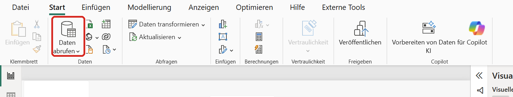
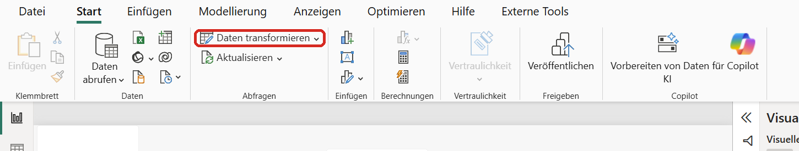
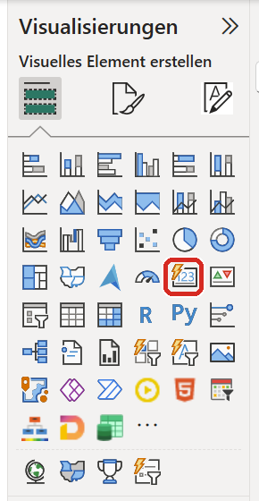
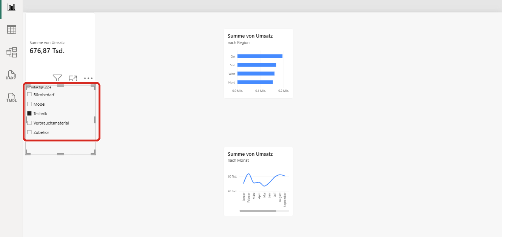
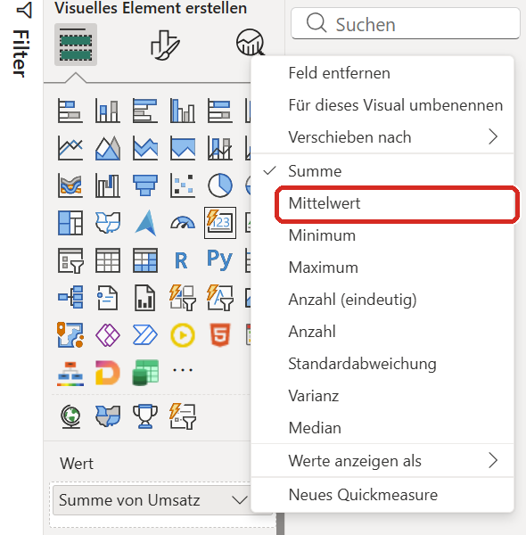
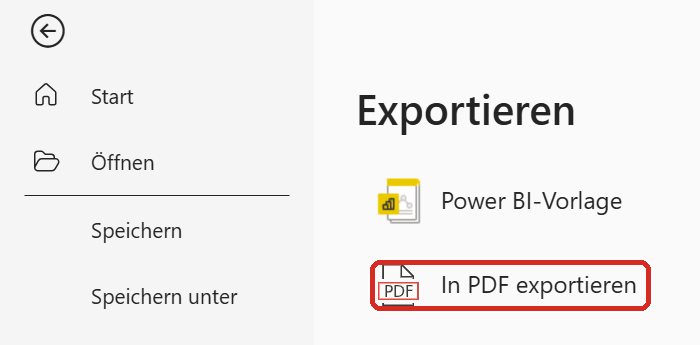

# Dein erstes Dashboard — Power-BI-Praxis-Pfad

> Markdown-Fassung von [powerbi_praxis_pfad.html](../powerbi_praxis_pfad.html) · https://datenwgknowledgekitchen.com/powerbi_praxis_pfad.html · generiert mit scripts/build_md.py — bei Abweichungen gilt die HTML-Fassung.

Praxis-Pfad · Power BI · Für absolute Anfänger

Von der Installation bis zur fertigen Auswertung — in gut zwei Stunden. Kostenlos, ohne Konto, ohne Vorkenntnisse. Du kannst jederzeit pausieren.

7 Module · ≈ 2 Stunden · Kein Konto nötig · Rettungsdatei je Kapitel · Stand Oktober 2026

> **⚠️ Du brauchst einen Windows-Rechner.** Power BI Desktop gibt es nicht für Mac, nicht fürs iPad und nicht fürs Handy (Voraussetzung: Windows 10 oder neuer). Das ist eine Entscheidung von Microsoft. Wenn du am Mac sitzt: Lies gern mit. Im Browser (`app.powerbi.com`) kann Power BI inzwischen vieles, auch Datenmodell und Power Query — das braucht aber ein Geschäfts- oder Schulkonto, und die Menüs weichen von diesem Pfad ab.

> **So liest du die Menüpfade:** Alles steht so, wie es in einem deutschen Power BI Desktop heißt — bei den wichtigsten Stellen mit dem englischen Namen dahinter. Microsoft erneuert Desktop jeden Monat; Bildschirmfotos und Knopfnamen können bei dir leicht abweichen. Die Kontrollpunkte zeigen dir jeweils, ob du auf Kurs bist.

## Modul 0 · Power BI installieren

*Etwa 15 Minuten · Du brauchst dafür kein Konto und musst nichts bezahlen.*

> ⚠️ **Nur für Windows.** Power BI Desktop gibt es nicht für Mac und nicht fürs Tablet (Voraussetzung laut Microsoft: Windows 10 oder neuer, 64-Bit). Wenn du an einem Mac sitzt, kannst du hier leider nur mitlesen.

### Deine Aufgabe

Deine Chefin bittet dich, die Verkaufszahlen des letzten Jahres anzuschauen. Du bekommst dafür eine Datei aus dem System. Am Ende kannst du sagen: wie viel, wer, wann — und was auffällt.

### Ziel dieses Moduls

Power BI Desktop ist installiert und startet.

### So geht's

1. Öffne den **Microsoft Store** (Windows-Taste drücken, `Store` tippen, Enter).
2. Suche im Store nach **Power BI Desktop** und klicke auf **Installieren**. Das dauert ein paar Minuten — der Download ist groß. Der Store-Weg hat einen Vorteil: Windows hält das Programm danach automatisch aktuell. Das ist wichtig, weil Microsoft Power BI Desktop jeden Monat erneuert und nur die jeweils neueste Version unterstützt.
3. Klappt der Store nicht (zum Beispiel auf einem Firmenrechner), lade das Programm stattdessen direkt bei Microsoft herunter: [Microsoft Download Center](https://www.microsoft.com/download/details.aspx?id=58494) → **Download** → die **64-Bit-Version** wählen. Für diesen Weg brauchst du Administratorrechte. Hast du die nicht, frag kurz deine IT — der Store-Weg braucht sie meist nicht.
4. Starte **Power BI Desktop**. Der erste Start dauert etwas länger als die späteren.
5. Je nach Version öffnet sich beim ersten Start ein Willkommens- oder Anmeldefenster. **Schließe es** — klick auf das X oben rechts im Fenster.

> 💡 **Du brauchst kein Konto.** Für alles in diesem Pfad reicht das Programm auf deinem Rechner. Ein Konto bräuchtest du erst, wenn du deine Auswertung im Internet mit anderen teilen willst — und dann muss es ein **Geschäfts- oder Schulkonto** sein (siehe Modul 6). Das machen wir hier nicht.

6. Falls ein Startbildschirm erscheint (**Power BI Home**): Klick dort auf **Neu → Bericht** oder schließ ihn einfach. Du solltest jetzt eine große leere weiße Fläche sehen, oben ein Menüband mit **Datei · Start · Einfügen · Modellierung · Anzeigen · Optimieren · Hilfe**. Je nach Version kommen weitere Reiter dazu, zum Beispiel **Design**; manche Reiter erscheinen auch nur, wenn du etwas markiert hast.

> 💡 **Fehlt dir ein Fenster oder ein Knopf?** Microsoft nennt zwei häufige Ursachen: Die Bildschirmauflösung ist zu klein (mindestens 1440 × 900) oder Windows vergrößert Texte und Apps auf mehr als 100 %. Dann bleiben manche Dialoge unsichtbar. Prüf unter Windows **Einstellungen → System → Anzeige** und stell die Skalierung testweise auf 100 %.

### ✅ Kontrollpunkt

> Power BI Desktop ist offen und zeigt eine leere weiße Fläche. Oben links steht **Datei**, daneben **Start**.
>
> Siehst du das nicht? → Häufigste Ursache: Das Anmeldefenster liegt noch darüber oder hinter dem Hauptfenster — klick es weg.

Weiter vertiefen

- Video[#001 · Power BI Desktop oder Web? Meine klare Antwort!](https://www.youtube.com/watch?v=4hap_ZZskzo)Kurzvideo (46 s): warum Desktop für den Einstieg praktisch ist — Visuals, Datenmodell und Power Query an einem Ort.
- Video[#008 · Suchst du unsere Tutorials? Hier sind sie!](https://www.youtube.com/watch?v=10jBGN2K52I)Kurzvideo (31 s): wo auf dem Daten-WG-Kanal die Power-BI- und Fabric-Tutorials als Playlisten liegen.
- Learn [Power BI Desktop herunterladen](https://learn.microsoft.com/power-bi/fundamentals/desktop-get-the-desktop) Store oder Direktdownload, Systemvoraussetzungen, Unterschiede der beiden Wege.
- Learn [Lernpfad „Get started with Power BI“](https://learn.microsoft.com/training/paths/get-started-power-bi/)Zwei Module für Einsteiger, ohne Vorkenntnisse.
- Library [Power BI Desktop in der DatenWG Library](../wissensgraph/thema/power-bi-desktop.html) Alle Stellen aus den Folgen zum Thema, mit Sprungmarken.

### Weiter

→ [Modul 1 · Daten anbinden](#modul-1)

## Modul 1 · Daten anbinden

*Etwa 15 Minuten*

### Ziel dieses Moduls

Die Datei `verkaeufe_2025.csv` liegt in Power BI und du hast einmal draufgeschaut.

### So geht's



*Menüband „Start" — der rote Rahmen zeigt „Daten abrufen". (Bildschirmfoto aus einer früheren Version: Bei dir können weitere Reiter und Knöpfe dazukommen.)*

1. Klicke im Menüband auf **Start → Daten abrufen**. Es klappt eine Liste mit den häufigsten Datenquellen auf.
2. Wähle darin **Web**. (Steht es nicht in der Liste: **Mehr…** ganz unten, dann links **Andere**, dann **Web**, dann **Verbinden**.)
3. Ein Fenster **Aus dem Web** geht auf. Steht dort eine Auswahl zwischen **Basic** (einfach) und **Erweitert**, nimm **Basic**. Kopiere diese Adresse in das Feld **URL** und klick dann auf **OK**: `https://raw.githubusercontent.com/Losveratos/powerbi-einstieg/main/data/business/verkaeufe_2025.csv`
4. Jetzt fragt Power BI, wie es sich anmelden soll. Wähle links **Anonym** und klick auf **Verbinden**. Anonym heißt: Die Datei ist öffentlich, es braucht kein Passwort.
5. Du siehst eine Vorschau der Daten. Sie sieht unordentlich aus — die Spalten heißen `Column1`, `Column2` und so weiter, und in der ersten Zeile steht Kauderwelsch. **Das ist so gewollt.** Genau das räumen wir im nächsten Modul auf.
6. Klick unten rechts auf **Laden**. Nicht auf „Daten transformieren" — das kommt gleich.
7. Rechts erscheint der Bereich **Daten**, darin die Tabelle **verkaeufe_2025**. Klick darauf, dann klappen die Spalten auf.
8. Schau dir die Tabelle einmal ganz an: Klick links am Bildschirmrand auf das **zweite** Symbol von oben — die **Tabellenansicht** (ein Gittersymbol). Jetzt siehst du die Daten wie in einer Tabelle. Die Symbole links wechseln die Ansicht: **Bericht**, **Tabelle**, **Modell** — in aktuellen Versionen darunter noch **DAX-Abfrage** und **TMDL**. Die brauchst du in diesem Pfad nicht.

> **Sieht „Daten abrufen“ bei dir ganz anders aus?** Wenn unter **Datei → Optionen und Einstellungen → Optionen → Vorschaufeatures** die Vorschau **New Power Query experience** eingeschaltet ist, öffnet sich statt der Liste ein Fenster mit Seitenleiste (Home, Neu, Zuletzt verwendet …) und Suchfeld. Tipp `Web` ins Suchfeld, dann geht es mit Schritt 3 weiter. Die Schritte danach sind dieselben.

> #### 📖 Neues Wort
>
> **Zeile und Spalte.** Eine **Zeile** ist ein einzelner Vorgang — hier: ein Auftrag. Eine **Spalte** ist eine Eigenschaft, die jeder Vorgang hat — hier zum Beispiel das Datum oder die Region. Alles, was du gleich baust, beruht auf dieser einen Idee.

> 💡 **Später mit eigenen Excel-Dateien:** Wenn du eine einzelne Excel-Datei lädst, mach im Blatt vorher eine formatierte **Excel-Tabelle** daraus (Daten markieren, **Strg + T**) und lade die Tabelle statt des ganzen Tabellenblatts. Dann reisen die Datentypen schon mit, und du hast in Power Query weniger Arbeit. Bei einem Ordner voller manuell gepflegter Excel-Dateien ist es eher umgekehrt.

### ✅ Kontrollpunkt

> Ganz unten am Bildschirmrand steht: **verkaeufe_2025 (2.405 Zeilen)**.
>
> Steht da was anderes? → Häufigste Ursache: Bei der Anmeldung war nicht **Anonym** ausgewählt, oder die Adresse wurde beim Kopieren abgeschnitten. Lösch die Tabelle rechts (Rechtsklick auf **verkaeufe_2025** im Bereich **Daten** → **Aus Modell löschen**) und fang bei Schritt 1 neu an.
>
> Geht es gar nicht? Lade die Datei stattdessen herunter ([verkaeufe_2025.csv](https://github.com/Losveratos/powerbi-einstieg/releases/latest/download/verkaeufe_2025.csv)) und binde sie über **Start → Daten abrufen → Text/CSV** ein. Der Rest der Anleitung bleibt gleich.

Weiter vertiefen

- Video[#006 · Power BI & Excel: Tabelle oder Tabellenblatt?](https://www.youtube.com/watch?v=hkUHetX61jA)Kurzvideo (54 s): Beim Excel-Import bringt eine formatierte Tabelle die Datentypen gleich mit.
- Video[#013 · Import, DirectQuery, Direct Lake oder Dual Mode — was ist eigentlich was?](https://www.youtube.com/watch?v=u5JMKAM8GB0)Kurzvideo (85 s): wo die Daten liegen, wenn Power BI zugreift. Du hast gerade im Import-Modus geladen.
- Learn [Mit Webseiten und Web-Adressen verbinden](https://learn.microsoft.com/power-bi/connect-data/desktop-connect-to-web) Der Weg Daten abrufen → Web, mit Navigator und Laden/Transformieren.
- Learn [Lernmodul „Get data in Power BI“](https://learn.microsoft.com/training/modules/get-data/)Excel, Datenbanken und mehr — und wie du beim Laden Performance sparst.
- Library [Import-Modus in der DatenWG Library](../wissensgraph/thema/import-mode.html)

### Weiter

→ [Modul 2 · Aufräumen](#modul-2)

## Modul 2 · Aufräumen

*Etwa 25 Minuten · Das ist das längste Modul. Danach wird es leichter.*

### Ziel dieses Moduls

Aus der unordentlichen Datei wird eine saubere Tabelle mit richtigen Spaltennamen und richtigen Datentypen.

### Vorher: warum überhaupt?

Rohdaten aus einem System sind nie sauber. In dieser Datei stecken fünf typische Probleme: eine Müllzeile ganz oben, fehlende Spaltenüberschriften, leere Zeilen mittendrin, Leerzeichen hinter manchen Werten und Zahlen, die Power BI für Text hält. Alle fünf reparieren wir jetzt — mit **8 Handgriffen**.

### So geht's



Klick zuerst im Menüband auf **Start → Daten transformieren**. Es öffnet sich ein neues Fenster: der **Power Query-Editor**. Hier arbeitest du das ganze Modul.

Rechts siehst du eine Liste **Angewendete Schritte**. Dort erscheint jeder Handgriff als Eintrag. Merk dir die Liste — dazu unten mehr.

**Handgriff 1 — Müllzeile weg** Klick auf **Start → Zeilen entfernen → Obere Zeilen entfernen**. Tippe **1** ein und klick **OK**. Die Zeile mit dem Kauderwelsch ist weg.

**Handgriff 2 — Überschriften setzen** Klick auf **Start → Erste Zeile als Überschrift verwenden**. Aus `Column1` wird `Auftragsdatum`, aus `Column2` wird `Region` und so weiter.

**Handgriff 3 — leere Zeilen weg** Klick auf **Start → Zeilen entfernen → Leere Zeilen entfernen**.

**Handgriff 4 — Leerzeichen abschneiden** Klick oben auf die Spaltenüberschrift **Region**, sodass die Spalte markiert ist. Dann: **Transformieren → Format → Kürzen**. Damit verschwinden die unsichtbaren Leerzeichen hinter manchen Werten. Ohne diesen Schritt wären „`Nord`" und „`Nord`" (mit Leerzeichen am Ende) später zwei verschiedene Regionen.

**Handgriff 5 — Schreibweise vereinheitlichen** Klick auf die Spaltenüberschrift **Produktgruppe**. Dann: **Transformieren → Format → Jedes Wort großschreiben**. Aus `bürobedarf` wird `Bürobedarf`. Der Hintergrund: Power Query unterscheidet Groß- und Kleinschreibung — bei Gruppierungen, Filtern und Verknüpfungen entstehen sonst schnell Dubletten. (Das Datenmodell selbst ist dabei nachsichtiger: Es behandelt „ABC" und „abc" als gleich und zeigt die zuerst geladene Schreibweise. Sauber ist es trotzdem erst nach diesem Handgriff.)

**Handgriff 6 — Datum ist ein Datum** Klick auf die Spaltenüberschrift **Auftragsdatum**. Links neben dem Namen steht ein kleines Symbol: **ABC** — das heißt „Power BI hält das für Text". Klick auf das Symbol und wähle **Datum**. Das Symbol wird zu einem Kalender.

**Handgriff 7 — Umsatz ist eine Zahl** Klick auf die Spaltenüberschrift **Umsatz**. Klick jetzt **nicht** auf das ABC-Symbol, sondern mach einen **Rechtsklick** auf die Überschrift und wähle **Typ ändern → Gebietsschema verwenden…**. Im Fenster stellst du ein:

- Datentyp: **Dezimalzahl**
- Gebietsschema: **Englisch (USA)**

Klick **OK**.

> Warum der Umweg? In der Datei stehen die Zahlen mit einem **Punkt** als Komma: `1796.80`. Dein Windows ist auf Deutsch eingestellt und liest den Punkt als Tausendertrennzeichen — aus 1796.80 € würden 179.680 €. Mit „Gebietsschema: Englisch (USA)" sagst du Power BI: *Diese Datei kommt aus einem englischsprachigen System, lies den Punkt als Komma.* Power Query nimmt sonst die Regionaleinstellung deines Betriebssystems, um Text in Zahlen und Daten umzuwandeln.

**Handgriff 8 — Marge ist eine Zahl** Dasselbe noch einmal für die Spalte **Marge**: Rechtsklick auf die Überschrift → **Typ ändern → Gebietsschema verwenden…** → Datentyp **Dezimalzahl**, Gebietsschema **Englisch (USA)** → **OK**.

**Fertig — jetzt zurück** Klick oben links auf **Start → Schließen & übernehmen**. Das Fenster schließt sich und Power BI lädt die saubere Tabelle.

### Die Schrittliste ist dein Rezept

Rechts im Power Query-Editor stand die Liste **Angewendete Schritte**. Das ist kein Protokoll, sondern ein Rezept: Power BI arbeitet diese Liste jedes Mal neu ab, wenn die Daten aktualisiert werden. Du kannst jeden Schritt anklicken und sehen, wie die Tabelle an dieser Stelle aussah, und du kannst jeden Schritt mit dem **X** davor wieder löschen. Nichts, was du hier tust, ist endgültig — und die Ursprungsdatei wird nie verändert.

> #### 📖 Neues Wort
>
> **Transformation.** Eine Transformation ist ein Handgriff, der die Form der Daten ändert, ohne die Ursprungsdatei anzufassen — zum Beispiel eine Spalte umbenennen, Leerzeichen abschneiden oder aus Text ein Datum machen.

### ✅ Kontrollpunkt

> Klick links am Bildschirmrand auf die **Tabellenansicht** (Gittersymbol). Ganz unten steht: **verkaeufe_2025 (2.400 Zeilen)**. Die Tabelle hat **6 Spalten** mit richtigen Namen, und in der Spalte **Auftragsdatum** stehen Datumsangaben, keine Textzeilen.
>
> Steht da eine andere Zahl? → Häufigste Ursache: Handgriff 1 und 2 wurden vertauscht — die Überschriften müssen gesetzt werden, *nachdem* die Müllzeile weg ist. Öffne **Start → Daten transformieren**, lösch rechts in **Angewendete Schritte** alles außer **Quelle** und **Geänderter Typ** und mach ab Handgriff 1 weiter.
>
> Oder: [Checkpoint-Datei laden](https://github.com/Losveratos/powerbi-einstieg/releases/latest/download/business_checkpoint_geputzt.pbix) und mit Modul 3 weitermachen. Öffne die Datei einfach per Doppelklick — sie ist genau auf diesem Stand.

Weiter vertiefen

- Video [Power BI Update Mai 2026 · ab 4:10](https://www.youtube.com/watch?v=psLPsI32sAs&t=250s) Power Query im Desktop übernimmt die modernere Optik des Web-Editors; danach ein Blick auf Standard-Zahlenformate (Kultur) für Berichte.
- Video [Power BI Update Juni 2025 · ab 0:00](https://www.youtube.com/watch?v=LnNoXBIG7Lc) Power Query und Modellierung im Browser: was im Web inzwischen geht — und was das für Desktop bedeutet.
- Learn [Datentypen in Power Query](https://learn.microsoft.com/power-query/data-types) Warum das Gebietsschema zählt, und „Typ ändern → Gebietsschema verwenden“ mit Beispiel.
- Learn [Lernmodul „Clean, transform, and load data in Power BI“](https://learn.microsoft.com/training/modules/clean-data-power-bi/)Datentypen, Umbenennen, Entpivotieren, Spaltenprofil.
- Library [Power Query in der DatenWG Library](../wissensgraph/thema/power-query.html)
- Guide [Power BI von A bis Z · Kapitel Power Query](../power_bi_einsteiger_guide_v4.html#pq) Der nächste Schritt, wenn dir die Handgriffe vertraut sind.

### Weiter

→ [Modul 3 · Erste Antworten](#modul-3)

## Modul 3 · Erste Antworten

*Etwa 25 Minuten*

### Ziel dieses Moduls

Drei Bilder auf der Seite, die drei Fragen beantworten: wie viel insgesamt, wer, und wann.

### So geht's

Klick links am Bildschirmrand auf das oberste der Symbole: die **Berichtsansicht**. Du siehst eine leere weiße Seite. Rechts stehen zwei Bereiche: **Visualisierungen** (die Symbolsammlung) und **Daten** (deine Tabelle).

> **Sieht bei dir rechts alles anders aus?** Zwei Dinge können abweichen. (1) Statt des Bereichs **Visualisierungen** erscheint ein Menü **Visuelles Element erstellen** direkt am Visual: Dann ist die **On-Object-Interaktion** eingeschaltet. Microsoft führt sie noch als Vorschaufunktion (**Datei → Optionen und Einstellungen → Optionen → Vorschaufeatures → On-object interaction**, danach Power BI Desktop neu starten). Wenn du diesem Pfad Schritt für Schritt folgen willst, schalte sie dort aus. Du kannst auch einfach im Reiter **Einfügen** ein Visual wählen und die Felder dann über den Knopf **Daten hinzufügen** am Visual setzen. (2) Abgerundete Ecken und graue Flächen kommen vom neuen Standard-Design (Fluent 2) für neue Berichte — an der Funktion ändert das nichts.

#### Bild 1 — die große Zahl: Wie viel insgesamt?

1. Klick auf eine leere Stelle der weißen Seite.
2. Klick im Bereich **Visualisierungen** auf das Symbol **Karte** — es sieht aus wie ein Kästchen mit den Ziffern **123** darin. Seit dem Update vom November 2025 erzeugt dieses Symbol die **neue Karte**: Sie ersetzt die frühere Einzelkarte und die Mehrfachkarte. Alte Berichte behalten ihre alten Karten.



*Der Bereich „Visualisierungen“ — markiert ist das Symbol „Karte“. (Bildschirmfoto aus einer früheren Version: Die Symbole sind bei dir vielleicht anders angeordnet. Such nach dem Namen „Karte“, wenn du mit der Maus darüberfährst.)*

(Achtung: Es gibt auch ein Symbol mit einer Weltkugel, das ebenfalls „Karte" heißt. Das ist eine Landkarte — nimm das mit den Ziffern.)

3. Auf der Seite erscheint ein leeres Kästchen.
4. Klapp im Bereich **Daten** die Tabelle **verkaeufe_2025** auf und setz das Häkchen bei **Umsatz**. In dem Kästchen erscheint eine Zahl. (Sie landet im Feld **Werte** der Karte.)
5. Die Zahl steht dort abgekürzt: etwa **2,10 Mio.** Power BI kürzt große Zahlen von sich aus — „Mio." heißt Millionen. Das ist so in Ordnung und bleibt auch so; für die Frage „wie viel insgesamt?" reicht diese Genauigkeit völlig. (Je nach Version steht dort auch **2,1 Mio.** — die Größenordnung zählt.) Willst du die volle Zahl sehen: Karte markieren → Symbol **Visual formatieren** im Bereich Visualisierungen → Reiter **Visual** → **Callout-Werte → Werte → Anzeigeeinheiten** (englisch: *Callout values → Values → Display units*) auf **Keine** stellen.
6. Schieb das Kästchen nach links oben und zieh es an einer Ecke etwas größer, damit die Zahl gut lesbar ist.

#### Bild 2 — die Balken: Wer?

7. Klick auf eine leere Stelle der Seite.
8. Klick im Bereich **Visualisierungen** auf **Gestapeltes Balkendiagramm** (waagerechte Balken).
9. Setz im Bereich **Daten** die Häkchen bei **Region** und bei **Umsatz**. Power BI legt Region auf die Y-Achse und Umsatz auf die X-Achse.
10. Power BI sortiert die Balken von sich aus nach Größe — der längste steht oben. Sollte das bei dir anders sein: Fahr mit der Maus über das Diagramm, klick oben rechts auf die **drei Punkte (…)** → **Achse sortieren** → **Umsatz**, und noch einmal **… → Achse sortieren → Absteigend sortieren**.

#### Bild 3 — die Linie: Wann?

11. Klick auf eine leere Stelle der Seite.
12. Klick auf **Liniendiagramm**.
13. Setz die Häkchen bei **Auftragsdatum** und **Umsatz**.
14. Power BI zeigt jetzt nur einen einzigen Punkt — es fasst alles zum Jahr zusammen. Schau rechts unter **Visualisierungen** in das Feld **X-Achse**: Dort steht `Auftragsdatum` mit vier Einträgen darunter — **Jahr, Quartal, Monat, Tag**. Klick bei **Jahr**, **Quartal** und **Tag** jeweils auf das **X**. Übrig bleibt **Monat** — und die Linie zeigt zwölf Punkte, Januar bis Dezember. (Diese Datumshierarchie baut Power BI automatisch aus der Datumsspalte — die Funktion heißt *Auto-Datum/Uhrzeit*. Für eigene Zeitberechnungen mit DAX nimmst du später eine eigene Datumstabelle, siehe Modul 5.)
15. Schieb die drei Bilder so, dass sie sich nicht überlappen. Ordentlich ist: die Karte oben links, das Balkendiagramm rechts daneben, die Linie darunter über die ganze Breite.

> #### 📖 Neues Wort
>
> **Dimension und Kennzahl.** Eine **Kennzahl** ist das, was du misst — hier der Umsatz. Eine **Dimension** ist das, wonach du sie aufteilst — hier die Region oder der Monat. Jedes Diagramm, das du je bauen wirst, ist eine Kennzahl, aufgeteilt nach einer Dimension.

### ✅ Kontrollpunkt

> Die Karte zeigt: **2,10 Mio.** (bzw. gerundet 2,1 Mio.) Im Balkendiagramm steht **Süd** ganz oben.
>
> Steht dort stattdessen **210,01 Mio.** → Dann wurde in Modul 2 der Umsatz ohne **Gebietsschema Englisch (USA)** umgewandelt. Power BI hat den Punkt als Tausendertrennzeichen gelesen, dadurch sind alle Beträge hundertmal zu groß. Geh zurück zu Modul 2, Handgriff 7.
>
> Steht dort eine viel kleinere Zahl oder „(Leer)"? → Dann ist statt der Summe die Anzahl eingestellt. Klick rechts im Feld **Werte** auf den kleinen Pfeil neben **Umsatz** und wähle **Summe**.
>
> Willst du es ganz genau wissen: Die Summe auf den Euro beträgt **2.100.088**. Sehen kannst du sie, indem du bei der Karte die **Anzeigeeinheiten** auf **Keine** stellst (siehe Schritt 5) — oder in der Tabellenansicht die Spalte **Umsatz** anklickst und unter **Spaltentools** die **Dezimalstellen** auf `0` stellst.
>
> Oder: [Checkpoint-Datei laden](https://github.com/Losveratos/powerbi-einstieg/releases/latest/download/business_checkpoint_geputzt.pbix) und ab Schritt 1 dieses Moduls neu anfangen.

Weiter vertiefen

- Video [Power BI Update November 2025 · ab 0:16](https://www.youtube.com/watch?v=XJZxYNIeEVc&t=16s) Die neue Karte ist generell verfügbar — ersetzt die alte Karte und die Doppelkarte, mit Kategorien und vielen Einstellungen.
- Video [Boring Charts, Better Insights · ab 6:48](https://www.youtube.com/watch?v=inko8wG9jlY&t=408s) Warum Tortendiagramme schlecht funktionieren und schlichte Balken meist besser ankommen (Gespräch auf Englisch).
- Learn [Karten-Visual in Power BI](https://learn.microsoft.com/power-bi/visuals/power-bi-visualization-card) Werte, Kategorien, Referenzbeschriftungen, Anzeigeeinheiten.
- Learn [On-Object-Interaktion (Vorschau)](https://learn.microsoft.com/power-bi/create-reports/power-bi-on-object-interaction)Visuals direkt am Visual bauen und formatieren; so schaltest du sie ein oder aus.
- Library [Visualisierung in der DatenWG Library](../wissensgraph/thema/visualisierung.html)
- Guide [Power BI von A bis Z · Kapitel Visualisierung](../power_bi_einsteiger_guide_v4.html#viz)

### Weiter

→ [Modul 4 · Filtern](#modul-4)

## Modul 4 · Filtern

*Etwa 15 Minuten · Das kürzeste Modul — und das mit dem größten Aha.*

### Ziel dieses Moduls

Du kannst mit einem Klick alle drei Bilder gleichzeitig auf einen Ausschnitt der Daten einschränken.

### So geht's

1. Klick auf eine leere Stelle der Seite.
2. Klick im Bereich **Visualisierungen** auf **Datenschnitt** — das Symbol sieht aus wie ein Trichter mit einem Regler.
3. Setz im Bereich **Daten** das Häkchen bei **Produktgruppe**. Im Datenschnitt erscheint eine Liste mit fünf Einträgen und je einem Kästchen davor.
4. Schieb den Datenschnitt an eine freie Stelle, zum Beispiel unten links.
5. Klick jetzt im Datenschnitt auf **Technik**.

**Schau auf die ganze Seite, nicht nur auf den Datenschnitt.** Die große Zahl ist kleiner geworden, die Balken sind kürzer, die Linie hat sich verändert. Alle drei Bilder haben gleichzeitig reagiert — du musstest sie nicht einzeln umstellen.



6. Klick noch einmal auf **Technik**, um die Auswahl aufzuheben. Alles ist wieder wie vorher. (Mit gedrückter **Strg**-Taste wählst du mehrere Einträge zugleich.)

#### Das geht auch ohne Datenschnitt

7. Klick im **Balkendiagramm** direkt auf den Balken **Nord**. Wieder reagiert die ganze Seite: Die Karte zeigt jetzt nur noch den Umsatz von Nord, die Linie zeigt nur noch Nords Verlauf. Jedes Diagramm ist also gleichzeitig ein Filter.
8. Lass diesen Klick einen Moment stehen — die Zahl brauchst du gleich für den Kontrollpunkt.

> 💡 **Soll ein Visual nicht mitfiltern?** Markiere das Visual, wähle im Menüband den Reiter **Format** und dort **Interaktionen bearbeiten** (englisch: *Edit interactions*). Über kleine Symbole an den anderen Visuals legst du fest, ob sie auf die Auswahl reagieren. Und: Der Datenschnitt muss keine Liste sein. Im Bereich **Format** findest du unter **Datenschnitt-Einstellungen → Optionen → Stil** zum Beispiel Dropdown, Kacheln — und bei Datumsspalten Zeitraum oder relative Datumsauswahl.

> #### 📖 Neues Wort
>
> **Filter.** Ein Filter schränkt ein, welche Zeilen gerade gezählt werden. Das Entscheidende: Er wirkt auf alle Bilder der Seite zusammen. Deshalb ist ein Bericht kein Bild, sondern ein Werkzeug — dieselbe Seite beantwortet je nach Filter Dutzende Fragen.

### ✅ Kontrollpunkt

> Bei angeklicktem Balken **Nord** zeigt die Karte: **480,98 Tsd.** („Tsd." heißt Tausend — die genaue Summe wäre 480.981; je nach Version steht dort gerundet auch 481 Tsd.).
>
> Steht da etwas anderes? → Häufigste Ursache: Es ist noch zusätzlich eine Produktgruppe im Datenschnitt ausgewählt. Klick sie ab, sodass kein Kästchen mehr markiert ist, und klick dann erneut auf den Balken.
>
> Oder: [Checkpoint-Datei laden](https://github.com/Losveratos/powerbi-einstieg/releases/latest/download/business_checkpoint_visuals.pbix) und mit Modul 5 weitermachen.

**Wichtig für das nächste Modul:** Klick zum Schluss auf eine leere Stelle der Seite, damit kein Filter mehr aktiv ist.

Weiter vertiefen

- Video [Power BI Update August 2026 · ab 2:59](https://www.youtube.com/watch?v=GWCHNmLs72M&t=179s) Der Datums-Picker im normalen Datenschnitt ist generell verfügbar; dazu das Berichtsdesign direkt im Bericht anpassen.
- Video [Power BI Update Juni 2026 · ab 1:44](https://www.youtube.com/watch?v=5xB_oKdvAwQ&t=104s) Die dynamische Datumsauswahl im Datenschnitt in Aktion, auch mit relativen Zeiträumen.
- Learn [Datenschnitt (Slicer) in Power BI](https://learn.microsoft.com/power-bi/visuals/power-bi-visualization-slicer-visual) Alle Stile — Dropdown, Liste, Kachel, Zeitraum, Datumsauswahl — und wann welcher passt.
- Learn [Lernmodul „Configure Power BI report filters“](https://learn.microsoft.com/training/modules/power-bi-effective-filters/)Filter im Bericht gestalten: was zur Entwurfszeit und was zur Lesezeit gilt.

### Weiter

→ [Modul 5 · Nicht jede Zahl darf man addieren](#modul-5)

## Modul 5 · Nicht jede Zahl darf man addieren

*Etwa 20 Minuten · Hier kommt die Antwort auf die Eingangsfrage. Der DAX-Teil danach ist optional.*

### Ziel dieses Moduls

Du siehst, was passiert, wenn Power BI automatisch summiert — und findest damit die Auffälligkeit in den Daten.

### So geht's

#### Erst der Fehler

1. Klick auf eine leere Stelle der Seite.
2. Klick auf das Symbol **Karte** (das mit den Ziffern 123) — wie in Modul 3.
3. Setz im Bereich **Daten** das Häkchen bei **Marge**.
4. Schau dir die Zahl an.

Bei dir sollte jetzt etwas Absurdes stehen — rund **763,64**. Wenn ja: perfekt, genau das soll passieren.

Eine Marge von 763,64 gibt es nicht. Was Power BI hier gemacht hat: Es hat alle 2.400 Margen **addiert**. Das tut es bei jeder Zahlenspalte automatisch, weil das bei Umsätzen ja auch richtig ist. Bei einer Marge ist es Unsinn — 30 % plus 30 % sind nicht 60 %.

#### Dann die Reparatur

5. Schau rechts unter **Visualisierungen** in das Feld **Werte**. Dort steht `Summe von Marge`. Klick auf den kleinen **Pfeil nach unten** direkt daneben.
6. Es klappt eine Liste auf: **Summe · Mittelwert · Minimum · Maximum · Anzahl (eindeutig) · Anzahl** und weitere. Wähle **Mittelwert**.



> In der Karte steht danach `Durchschnitt von Marge`. Power BI benutzt für dieselbe Sache mal „Mittelwert", mal „Durchschnitt" — gemeint ist beides Mal: alle Werte zusammenzählen und durch ihre Anzahl teilen.

7. Die Zahl ist jetzt klein, etwa `0,32`. Das stimmt zwar, liest sich aber schlecht. Also formatieren wir die Spalte einmal richtig:
  - Klick links am Bildschirmrand auf die **Tabellenansicht** (zweites Symbol, Gitter).
  - Klick oben auf die Spaltenüberschrift **Marge**.
  - Im Menüband erscheint der Reiter **Spaltentools**. Klick dort auf das **%-Zeichen** (in der Gruppe *Formatierung*).
  - Stell rechts daneben die **Dezimalstellen** von `Auto` auf **1**.
  - Zurück zur **Berichtsansicht** (oberstes Symbol links).

### ✅ Kontrollpunkt

> Die zweite Karte zeigt jetzt: **31,8 %**.
>
> Steht da etwas anderes? → Häufigste Ursache: Im Feld **Werte** steht noch `Summe von Marge` statt `Durchschnitt von Marge`. Prüf Schritt 5 und 6.
>
> Oder: [Checkpoint-Datei laden](https://github.com/Losveratos/powerbi-einstieg/releases/latest/download/business_checkpoint_visuals.pbix) und ab Schritt 8 weitermachen.

#### Und jetzt die eigentliche Frage: Was fällt auf?

8. Klick auf eine leere Stelle der Seite.
9. Klick auf **Liniendiagramm**.
10. Setz die Häkchen bei **Auftragsdatum** und **Marge**.
11. Reduziere die X-Achse wieder auf den Monat: Klick im Feld **X-Achse** bei **Jahr**, **Quartal** und **Tag** jeweils auf das **X**.
12. Stell auch hier die Aggregation um: Klick im Feld **Y-Achse** auf den Pfeil neben `Summe von Marge` → **Mittelwert**.
13. Jetzt der entscheidende Handgriff: Zieh im Bereich **Daten** das Feld **Region** mit gedrückter Maustaste in das Feld **Legende** (rechts unter *Visualisierungen*). Aus einer Linie werden vier — eine je Region.
14. Schau dir das Bild an. Bis April laufen alle vier Linien eng beieinander bei rund 34 %. Ab April bricht eine Linie nach unten weg und bleibt unten: **Nord**, bei rund 23 %. Die anderen drei bleiben bei rund 34 %.

**Das ist die Antwort auf die Eingangsfrage.** Der Umsatz in Nord ist unauffällig — deshalb wäre es in Modul 3 niemandem aufgefallen. Aber von jedem Euro Umsatz bleibt in Nord seit April deutlich weniger übrig.

> **Für Genaue:** Ein einfacher Durchschnitt über alle Aufträge gewichtet jeden Auftrag gleich — ein 50-€-Auftrag zählt so viel wie ein 5.000-€-Auftrag. Sauber ist eine nach Umsatz gewichtete Marge. Für „fällt hier etwas auf?" reicht der Durchschnitt völlig; die gewichtete Rechnung baust du gleich im optionalen DAX-Teil unten als Measure.

> #### 📖 Neues Wort
>
> **Aggregation.** Aggregation ist die Entscheidung, wie viele Zeilen zu einer Zahl zusammengefasst werden: addieren, mitteln, zählen, größten Wert nehmen. Power BI wählt automatisch „addieren" — das ist eine Annahme, keine Wahrheit. Bei jeder Kennzahl, die ein Anteil, ein Preis, eine Note oder ein Stand ist, musst du die Entscheidung selbst treffen.

### Optional · Deine ersten Measures (DAX)

*Etwa 25 Minuten · Du kannst direkt zu Modul 6 springen — die Seite aus Modul 4 ist fertig. Für diesen Teil gibt es keine Rettungsdatei.*

Bisher hat Power BI für dich gerechnet: Spalten mit dem Summenzeichen **Σ** im Bereich **Daten** werden automatisch aufsummiert. Ein **Measure** ist dagegen eine Rechenvorschrift, die du selbst schreibst — in der Formelsprache **DAX**. Es bekommt einen Namen, ein Taschenrechner-Symbol im Bereich **Daten** und rechnet immer im Zusammenhang der Seite: Klickst du einen Filter an, rechnet es neu.

> #### 📖 Neues Wort
>
> **Measure.** Ein Measure ist eine selbst geschriebene Rechenvorschrift mit Namen — zum Beispiel „Umsatz gesamt". Sie speichert kein Ergebnis, sondern wird bei jedem Filterklick neu ausgewertet.

#### Schritt 1 — Ein Measure für den Umsatz

1. Rechtsklick auf die Tabelle **verkaeufe_2025** im Bereich **Daten** → **Neues Measure**. (Dasselbe geht über **Start → Neues Measure** in der Gruppe *Berechnungen*.)
2. In der Formelleiste oben ersetzt du den Text durch diese Zeile und drückst **Enter**:

```
Umsatz gesamt = SUM(verkaeufe_2025[Umsatz])
```

[`SUM`](https://learn.microsoft.com/en-us/dax/sum-function-dax) zählt alle Werte der Spalte `Umsatz` zusammen — genau das, was Power BI vorher von allein getan hat, nur dass die Rechnung jetzt einen Namen hat und du sie in weiteren Formeln benutzen kannst. Zieh das Measure zur Probe in eine neue Karte: Sie zeigt wieder 2,10 Mio.

#### Schritt 2 — Die Marge richtig rechnen

Lege zwei weitere Measures an (wieder Rechtsklick auf die Tabelle → **Neues Measure**, eins nach dem anderen):

```
Marge in Euro = SUMX(verkaeufe_2025, verkaeufe_2025[Umsatz] * verkaeufe_2025[Marge])

Marge gewichtet = DIVIDE([Marge in Euro], [Umsatz gesamt])
```

`SUMX` geht Zeile für Zeile durch die Tabelle, rechnet je Auftrag Umsatz mal Marge (das ist der Gewinn in Euro) und zählt die Ergebnisse zusammen. [`DIVIDE`](https://learn.microsoft.com/dax/divide-function-dax) teilt den Gewinn durch den Umsatz — und liefert statt eines Fehlers einen leeren Wert, falls einmal durch null geteilt würde. So wird jeder Auftrag nach seinem Umsatz gewichtet.

Markiere das Measure **Marge gewichtet**, klick im Reiter **Measuretools** auf das **%-Zeichen** und stell die Dezimalstellen auf **1**. Zieh es in eine neue Karte.

### ✅ Kontrollpunkt

> Die Karte zeigt **30,0 %** — nicht 31,8 % wie der einfache Durchschnitt. Klickst du im Balkendiagramm auf **Nord**, steht dort **23,2 %**. (Die Marge in Euro beträgt insgesamt rund 630.600 €.)
>
> Zeigt Power BI einen Syntaxfehler? → Prüf, ob die Anführungszeichen und Klammern stimmen und ob die Namen genau so geschrieben sind wie im Bereich **Daten**. Wenn du unter **Datei → Optionen → Regionale Einstellungen** *Lokalisierte DAX-Trennzeichen* eingeschaltet hast, brauchst du Semikolons (`;`) statt Kommas zwischen den Argumenten. Standard sind Kommas.

> 💡 Du musst nicht alles selbst tippen: Die **Quick Measures** (Reiter **Start**, Gruppe *Berechnungen*) schreiben gängige Formeln nach deinen Angaben für dich — gut zum Lernen. Und bei Zahlen, die als Anteil gemeint sind, gilt immer: erst Zähler und Nenner getrennt summieren, dann teilen. Nie Prozentwerte mitteln, die schon geteilt sind.

#### Schritt 3 — Umsatz seit Jahresbeginn (YTD)

Zeitrechnungen wie „seit Jahresbeginn“ brauchen eine **Datumstabelle**: eine eigene Tabelle mit genau einer Zeile pro Tag, ohne Lücken, über ganze Jahre. Das ist die Voraussetzung für die klassischen DAX-Zeitfunktionen.

> ⚠️ **Speichere vorher eine Kopie** (**Datei → Speichern unter**, zum Beispiel `business_dax`). Sobald du eine eigene Datumstabelle als solche markierst, entfernt Power BI die automatisch erzeugten, versteckten Datumstabellen. Visuals, die auf deren Hierarchie beruhen — wie die Liniendiagramme aus Modul 3 und 5 — können danach anders aussehen oder fehlerhaft sein.

1. **Tabelle anlegen.** **Modellierung → Neue Tabelle**, dann in die Formelleiste: ``` Kalender = ADDCOLUMNS( CALENDARAUTO(), "Monat Nr", MONTH([Date]), "Monat", FORMAT([Date], "MMM") ) ``` [`CALENDARAUTO`](https://learn.microsoft.com/en-us/dax/calendarauto-function-dax) erzeugt von allein eine lückenlose Spalte `Date` mit allen Tagen der Jahre, die in deinen Daten vorkommen (hier: 1. Januar bis 31. Dezember 2025). `ADDCOLUMNS` hängt zwei Spalten an: die Monatsnummer zum Sortieren und den Monatsnamen zum Anzeigen.
2. **Beziehung ziehen.** Klick links auf das dritte Symbol, die **Modellansicht**. Zieh die Spalte `Date` aus **Kalender** auf die Spalte `Auftragsdatum` in **verkaeufe_2025**. Es erscheint eine Linie zwischen den Tabellen: eine **Beziehung**, sie leitet Filter von der Kalender- in die Umsatztabelle weiter.
3. **Als Datumstabelle markieren.** Rechtsklick auf **Kalender** im Bereich **Daten** → **Als Datumstabelle markieren** (englisch *Mark as date table*) und die Spalte `Date` wählen. Power BI prüft, ob die Daten eindeutig, ohne leere Werte und lückenlos sind.
4. **Monate richtig sortieren.** Tabellenansicht → Tabelle **Kalender** → Spalte **Monat** markieren → im Reiter **Spaltentools** auf **Nach Spalte sortieren** → **Monat Nr**. Sonst steht „Apr“ vor „Jan“.
5. **Measure anlegen** (wieder in **verkaeufe_2025**): ``` Umsatz YTD = TOTALYTD([Umsatz gesamt], Kalender[Date]) ``` [`TOTALYTD`](https://learn.microsoft.com/dax/totalytd-function-dax) summiert den Umsatz vom 1. Januar bis zum jeweiligen Datum — für jeden Monat in der Auswertung neu.
6. **Anzeigen.** Neues **Liniendiagramm**: **Kalender → Monat** auf die X-Achse, **Umsatz gesamt** und **Umsatz YTD** auf die Y-Achse.

### ✅ Kontrollpunkt

> Die YTD-Linie steigt von Monat zu Monat und endet im Dezember bei **2.100.088 €** (die Summe des ganzen Jahres). Im März steht sie bei rund **510.500 €** — das sind Januar, Februar und März zusammen. Die Umsatz-Linie daneben schwankt, die YTD-Linie nie.
>
> Steht bei jedem Monat der gleiche Wert? → Dann fehlt die Beziehung aus Schritt 2 oder sie zeigt in die falsche Richtung. In der Modellansicht muss die Linie von `Date` (Seite „1“) zu `Auftragsdatum` (Seite „*“) laufen.

> **Stand Oktober 2026:** Neben diesem klassischen Weg gibt es die *kalenderbasierte Zeitintelligenz* (Vorschau, Schalter **Enhanced DAX Time Intelligence** unter **Vorschaufeatures**). Du definierst darin einen Kalender auf der Tabelle, schreibst `TOTALYTD([Umsatz gesamt], 'Kalender')` und musst die Tabelle dafür meist nicht mehr als Datumstabelle markieren. Sie kann auch Fiskaljahre und Wochen. Für den Einstieg bleib beim klassischen Weg; `TOTALYTD` ist übrigens nur die Kurzform von `CALCULATE` mit `DATESYTD`. Details: [Zeitbasierte Berechnungen in Power BI](https://learn.microsoft.com/power-bi/transform-model/desktop-time-intelligence).

Weiter vertiefen

- Video[#003 · Das größte DAX-No-Go? FORMAT() im Measure!](https://www.youtube.com/watch?v=YxS238qvD3s)Kurzvideo (76 s): Formatierung nicht ins Measure schreiben — sonst wird aus der Zahl ein Text.
- Video [Power BI Update September 2025 · ab 7:23](https://www.youtube.com/watch?v=6gQiIbyhWEc&t=443s) Die neue Kalenderlogik für DAX-Zeitintelligenz: Kalenderoptionen, mehrere Kalendertypen, Fiskaljahr.
- Video [Visual Calculations erklärt — Prozent vom übergeordneten Wert](https://www.youtube.com/watch?v=GsLfiuPlsQE) Anteile direkt im Visual berechnen, ohne ein Measure zu schreiben — der nächste Schritt nach diesem Teil.
- Learn [Tutorial: Eigene Measures in Power BI Desktop erstellen](https://learn.microsoft.com/power-bi/transform-model/desktop-tutorial-create-measures) Formelleiste, Vorschlagsliste, Measures in Measures.
- Learn [Datumstabellen in Power BI Desktop](https://learn.microsoft.com/power-bi/guidance/model-date-tables) Anforderungen an eine Datumstabelle und die Wege, sie zu erzeugen.
- Library [DAX in der DatenWG Library](../wissensgraph/thema/dax.html)
- Guide [Power BI von A bis Z · Kapitel DAX](../power_bi_einsteiger_guide_v4.html#dax)

### Weiter

→ [Modul 6 · Fertig machen](#modul-6)

## Modul 6 · Fertig machen

*Etwa 15 Minuten*

### Ziel dieses Moduls

Dein Bericht hat einen Titel, sieht aufgeräumt aus und liegt als PDF auf deinem Rechner.

### So geht's

1. **Titel einfügen.** Klick im Menüband auf **Einfügen → Textfeld**. Es erscheint ein Kästchen. Tipp hinein: `Verkaufszahlen 2025` Markier den Text und stell in der kleinen Leiste darunter die Schriftgröße auf **28** ein. Schieb das Textfeld an den oberen Rand der Seite.
2. **Aufräumen.** Ordne die fünf Bilder so an, dass nichts überlappt und nichts über den Seitenrand ragt. Ein einfaches Raster, das immer funktioniert:
  - oben: der Titel über die ganze Breite
  - darunter links: die zwei Karten nebeneinander
  - rechts daneben: das Balkendiagramm
  - unten über die ganze Breite: die beiden Liniendiagramme nebeneinander
  - der Datenschnitt in eine freie Ecke
3. **Optional: Farben auf einmal ändern.** Im Menüband gibt es einen Reiter **Design** (je nach Version: **Anzeigen → Designs**) mit einer Galerie fertiger Designs. Ein Klick färbt alle Visuals des Berichts auf einmal um. Was du an einem einzelnen Visual von Hand eingestellt hast, behält Vorrang.
4. **Seite benennen.** Ganz unten steht ein Reiter **Seite 1**. Doppelklick darauf und tipp `Überblick`.
5. **Speichern.** **Datei → Speichern unter**, Dateiname zum Beispiel `business_fertig`, Endung `.pbix`. Speicher die Datei irgendwo, wo du sie wiederfindest.
6. **Als PDF exportieren.** **Datei → Exportieren → In PDF exportieren**. Power BI erzeugt eine PDF-Datei mit deiner Seite und öffnet sie in deinem Standard-PDF-Programm. Währenddessen lässt sich der Bericht kurz nicht bedienen.



### Und wenn ich das teilen will?

Im Menüband gibt es den Knopf **Veröffentlichen** (Reiter **Start**, Gruppe *Freigeben*). Er lädt den Bericht in den **Power BI Service** — die Online-Seite von Power BI (`app.powerbi.com`), in der andere ihn anschauen können. Der Ablauf:

1. **Start → Veröffentlichen**, bei Bedarf speichern.
2. Anmelden — mit einem **Geschäfts- oder Schulkonto**. Private Adressen wie @gmail.com oder @hotmail.com werden vom Power BI Service nicht unterstützt. (Wer nur eine private Adresse hat, legt laut Microsoft zuerst ein Microsoft-365-Testkonto an; Hinweise dazu stehen [hier](https://learn.microsoft.com/power-bi/fundamentals/service-self-service-signup-purchase-for-power-bi).)
3. Ziel wählen — zum Beispiel **Mein Arbeitsbereich** (englisch *My workspace*, dein persönlicher Bereich) → **Auswählen**.
4. Am Ende erscheint ein Link **„… in Power BI öffnen“**. Dort kannst du oben **Freigeben** wählen, um andere einzuladen.

Ob das klappt, hängt an deiner **Lizenz**. Die Lizenzen im Überblick (Stand Oktober 2026):

| Lizenz | Was du damit kannst |
| --- | --- |
| **Kostenlos** (Fabric Free) | Inhalte für dich selbst in *Mein Arbeitsbereich* bauen. Geteilte Inhalte nur ansehen, wenn sie in einer Premium- oder Fabric-Kapazität liegen. Nicht teilen, nicht in andere Arbeitsbereiche veröffentlichen. |
| **Power BI Pro** | In Arbeitsbereiche veröffentlichen, teilen, zusammenarbeiten. Die Empfänger brauchen ebenfalls Pro — außer der Inhalt liegt in einer Premium- oder Fabric-Kapazität. |
| **Premium pro Nutzer** (PPU) | Alles von Pro plus Premium-Funktionen. Teilen nur mit anderen PPU-Nutzern — außer der Inhalt liegt in einem Arbeitsbereich auf Premium-Kapazität. |

Eine Besonderheit: Leser mit kostenloser Lizenz kommen auf Inhalte, wenn diese in einer **Premium-Kapazität (P)** oder in einer **Fabric-Kapazität ab F64** liegen. Bei kleineren Fabric-Kapazitäten (F2 bis F32) brauchen auch die Leser eine Pro-Lizenz. Quelle: [Lizenzarten in Power BI und Fabric](https://learn.microsoft.com/power-bi/fundamentals/service-features-license-type) und [Teilen und Zusammenarbeiten](https://learn.microsoft.com/power-bi/collaborate-share/service-share-dashboards).

> **Und der Copilot?** Der Copilot-Knopf steht im Menüband immer da. Nutzbar ist er aber nur, wenn du Zugriff auf einen Arbeitsbereich mit bezahlter Fabric-Kapazität (ab F2) oder Premium-Kapazität (ab P1) hast, in dem Copilot aktiviert ist — oder wenn dein Unternehmen dir eine Fabric-Copilot-Kapazität zugewiesen hat. Testkapazitäten zählen nicht. Mit einer Free- oder Pro-Lizenz allein geht es nicht. Für diesen Pfad brauchst du ihn nicht; das PDF ist der Abschluss.

> #### 📖 Neues Wort
>
> **Visual.** Jedes einzelne Bild auf der Seite — Karte, Balken, Linie, Datenschnitt — heißt in Power BI ein **Visual**. Eine Seite voller Visuals, die sich gegenseitig filtern, ist ein **Bericht**.

### ✅ Kontrollpunkt

> Auf deinem Rechner liegt eine PDF-Datei mit deiner Seite darauf. Sie zeigt den Titel, fünf Bilder und den Datenschnitt.
>
> Fehlt im PDF etwas? → Häufigste Ursache: Ein Visual ragte über den Seitenrand hinaus. Zurück in Power BI, das Visual ganz auf die Seite schieben, neu exportieren.
>
> Oder: [fertigen Bericht ansehen](https://github.com/Losveratos/powerbi-einstieg/releases/latest/download/business_fertig.pbix) — so hätte es aussehen können.

Weiter vertiefen

- Video[#002 · Alle Farben im Bericht auf einmal ändern](https://www.youtube.com/watch?v=3mwlFE7TWuY) Kurzvideo (63 s): Designs im Menüband — alle Visuals auf einmal umfärben, eigene Farbe wählen.
- Video [Power BI Update Juli 2026 · ab 0:10](https://www.youtube.com/watch?v=7xYgX6lWhuQ&t=10s) Berichtsdesign direkt im Bericht anpassen: Designvorlagen und Themes ohne Umweg über das Menüband.
- Video [Daten-WG Life-Update · Fabric Architekturen · ab 4:16](https://www.youtube.com/watch?v=J-lN5JN-F5I&t=256s) Praxisbeispiel zu Lizenzen: Ein Kunde startet mit F64, um Nutzerlizenzen zu sparen.
- Video[#011 · Power BI ohne Fabric? Absolut!](https://www.youtube.com/watch?v=gMYj9UTWeWk)Kurzvideo (33 s): erst die Power-BI-Grundlagen, dann prüfen, ob Fabric dazukommt.
- Learn [Semantikmodelle und Berichte aus Power BI Desktop veröffentlichen](https://learn.microsoft.com/power-bi/create-reports/desktop-upload-desktop-files) Der Weg von Veröffentlichen bis zum Link in den Service.
- Learn [Berichte als PDF exportieren](https://learn.microsoft.com/power-bi/collaborate-share/end-user-pdf) Desktop und Service; Einschränkungen und Hinweise zum Export.
- Library [Lizenzen in der DatenWG Library](../wissensgraph/thema/lizenzen.html)
- Library [Power BI Service in der DatenWG Library](../wissensgraph/thema/power-bi-service.html)
- Guide [Power BI von A bis Z · Kapitel Service](../power_bi_einsteiger_guide_v4.html#service)

---

### 🎉 Geschafft

Du hast eine unordentliche Datei aus einem System genommen, sie sauber gemacht, drei Fragen daran beantwortet, sie filterbar gemacht und dabei etwas gefunden, das auf den ersten Blick nicht zu sehen war. Das ist der komplette Ablauf — bei jedem echten Projekt ist es genau dieser, nur mit mehr Daten.

### Dein Glossar

Sieben Wörter, die du jetzt kennst (acht, wenn du den optionalen DAX-Teil gemacht hast):

| Wort | Bedeutung in einem Satz |
| --- | --- |
| **Zeile und Spalte** | Eine Zeile ist ein Vorgang, eine Spalte eine Eigenschaft, die jeder Vorgang hat. |
| **Transformation** | Ein Handgriff, der die Form der Daten ändert, ohne die Ursprungsdatei anzufassen. |
| **Visual** | Ein einzelnes Bild auf der Seite — Karte, Balken, Linie, Datenschnitt. |
| **Dimension** | Das, wonach du aufteilst: Region, Monat, Produktgruppe. |
| **Kennzahl** | Das, was du misst: Umsatz, Marge, Anzahl. |
| **Filter** | Eine Einschränkung, welche Zeilen gerade zählen — sie wirkt auf alle Visuals gleichzeitig. |
| **Aggregation** | Die Entscheidung, wie viele Zeilen zu einer Zahl werden: addieren, mitteln, zählen. |
| **Measure** (optional) | Eine selbst geschriebene Rechenvorschrift in DAX, die bei jedem Filter neu rechnet. |

### Und weiter?

- **Optional, 10 Minuten:** [Exkurs · Warum deine Excel-Tabelle nicht passt](#exkurs)
- Nimm eine eigene Datei und mach genau dasselbe damit. Das ist die beste Übung.
- **Der nächste große Schritt:** der Guide [Power BI von A bis Z](../power_bi_einsteiger_guide_v4.html). Passend zu dem, was du gerade gemacht hast: [Power Query vertiefen](../power_bi_einsteiger_guide_v4.html#pq), [Datenmodell und Beziehungen](../power_bi_einsteiger_guide_v4.html#model), [DAX](../power_bi_einsteiger_guide_v4.html#dax), [Visualisierung](../power_bi_einsteiger_guide_v4.html#viz) und [Veröffentlichen im Service](../power_bi_einsteiger_guide_v4.html#service).

## Exkurs · Warum deine Excel-Tabelle nicht passt

*Etwa 10 Minuten · Optional. Gehört nicht zum Pfad — du kannst ihn überspringen.*

Wenn du nach diesem Pfad eine eigene Excel-Datei in Power BI lädst, passiert oft etwas Verwirrendes: Es geht nicht. Dieser Exkurs erklärt in einem Satz, warum.

### Der Kernsatz

**Menschen lesen Kreuztabellen, Maschinen lesen lange Tabellen.**

Eine Kreuztabelle sieht so aus — und für ein Auge ist sie großartig:

| Region | Januar | Februar | März |
| --- | --- | --- | --- |
| Nord | 12.400 | 11.900 | 13.100 |
| Süd | 14.200 | 15.000 | 14.800 |

Das Problem: Der Monat steht hier nicht *in* der Tabelle, sondern *über* ihr — als Spaltenüberschrift. Power BI kann aber nur mit dem arbeiten, was in Zeilen und Spalten steht. Es sieht drei Kennzahlen namens „Januar", „Februar", „März" und keine Dimension „Monat". Ein Liniendiagramm über die Zeit ist damit unmöglich.

Dieselben Daten als lange Tabelle:

| Region | Monat | Umsatz |
| --- | --- | --- |
| Nord | Januar | 12.400 |
| Nord | Februar | 11.900 |
| Nord | März | 13.100 |
| Süd | Januar | 14.200 |
| Süd | Februar | 15.000 |
| Süd | März | 14.800 |

Unhandlich zu lesen, aber jetzt gibt es eine Spalte **Monat** — eine Dimension, wie du sie in Modul 3 benutzt hast. Genau so wollen es alle Auswertungswerkzeuge.

### Der Handgriff dazu heißt Entpivotieren

Du brauchst das nicht auswendig zu lernen, nur wiedererkennen:

1. Datei in Power BI laden, **Start → Daten transformieren**.
2. Die Spalte anklicken, die *bleiben* soll — hier **Region**.
3. **Transformieren → Spalten entpivotieren → Andere Spalten entpivotieren**.

Power BI macht aus den Monatsspalten zwei neue Spalten: **Attribut** (der Monatsname) und **Wert** (die Zahl). Die kannst du dann umbenennen, und die Tabelle ist lang statt breit.

Warum **Andere Spalten** und nicht einfach alle Monatsspalten markieren? Kommen im nächsten Jahr neue Monatsspalten dazu, werden sie beim Aktualisieren automatisch mit entpivotiert. Wer die Monate einzeln markiert, muss nachbessern.

### Wenn du weitermachen willst

Dieser Pfad hatte genau **eine** Tabelle. Echte Auswertungen haben mehrere — Aufträge, Kunden, Produkte, Kalender — die über gemeinsame Schlüssel verbunden werden. Diese Verbindungen heißen **Beziehungen**, und die übliche Anordnung dafür heißt **Sternschema**: In der Mitte stehen die Ereignisse (*Faktentabelle*, hier die Aufträge), drumherum die Dinge, nach denen du filterst und gruppierst (*Dimensionstabellen*, hier zum Beispiel Kalender, Produkte, Regionen). Beziehungen siehst und baust du in der **Modellansicht** (dritte Symbol links) — mit dem Kalender aus dem optionalen DAX-Teil in Modul 5 hast du schon eine gebaut. Das ist der nächste Schritt, wenn dir eine Tabelle nicht mehr reicht.

Weiter vertiefen

- Video [Daten-WG Life-Update · Fabric Architekturen · ab 35:07](https://www.youtube.com/watch?v=J-lN5JN-F5I&t=2107s) Die „dämliche Excel-Kreuztabelle“: wie sie entpivotiert wird und warum sie in Fachbereichen so häufig vorkommt.
- Video [Denken in Tabellen · ab 8:37](https://www.youtube.com/watch?v=hbUYMyqb6r8&t=517s) Sternschema statt Flat Table: bessere Filterlogik, weniger Excel-Schmerz.
- Video[#004 · Bidirektionale Filterung? Meistens ein Fehler!](https://www.youtube.com/watch?v=WLiGuGjE5m8)Kurzvideo (61 s): Warum Filter, die in beide Richtungen laufen, schnell unvorhersehbar werden — gut zu wissen, sobald du mehrere Tabellen verbindest.
- Learn [Spalten entpivotieren](https://learn.microsoft.com/power-query/unpivot-column) Alle drei Varianten mit Beispiel und dem Verhalten bei neuen Spalten.
- Learn [Sternschema und Power BI](https://learn.microsoft.com/power-bi/guidance/star-schema) Fakten- und Dimensionstabellen, Measures, Rollen von Datumstabellen.
- Library [Sternschema in der DatenWG Library](../wissensgraph/thema/sternschema.html)
- Guide [Power BI von A bis Z · Kapitel Datenmodell](../power_bi_einsteiger_guide_v4.html#model)

### Zurück

→ [Modul 6 · Fertig machen](#modul-6)

Alle Kontrollzahlen in diesem Pfad sind aus den echten Daten berechnet (im Oktober 2026 noch einmal nachgerechnet; die Zahlen des optionalen DAX-Teils stammen aus derselben Rechnung). Menüpfade und Funktionsstatus sind gegen Microsoft Learn geprüft, Stand Oktober 2026; einzelne Bildschirmfotos zeigen noch ältere Desktop-Versionen. Die Datenquelle ist simuliert: [verkaeufe_2025.csv](https://raw.githubusercontent.com/Losveratos/powerbi-einstieg/main/data/business/verkaeufe_2025.csv).

Steckst du fest? An jedem Kontrollpunkt liegt eine fertige Datei zum Weitermachen. [Den Endstand ansehen](https://github.com/Losveratos/powerbi-einstieg/releases/latest/download/business_fertig.pbix).

[← Zurück zur Knowledge Kitchen](../index.html)
