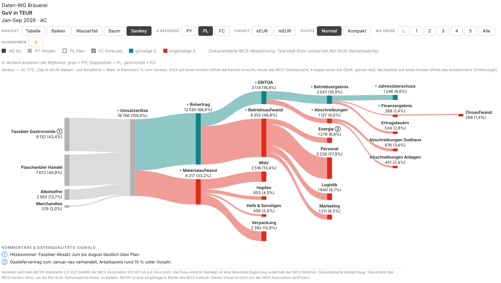

# Sankey trifft IBCS-Wasserfall

> Markdown-Fassung von [sankey-wasserfall-post.html](../sankey-wasserfall-post.html) · https://datenwgknowledgekitchen.com/sankey-wasserfall-post.html · generiert mit scripts/build_md.py — bei Abweichungen gilt die HTML-Fassung.

Post · Power-BI-Visual · Controlling

Warum die Kombination erst dynamisch richtig gut wird. Der Wasserfall erklärt, **wie viel**: Stufen, Vorzeichen, Abweichung, Anker. Der Sankey erklärt, **wohin**: Fluss, Anteile, Struktur. Im P&L-Visual sitzen beide auf derselben Datenbindung, ein Klick in der Toolbar wechselt die Erzählung.

Von **Michael Tenner** · Stand · **Oktober 2026** · Visual · **P&L Statement byDatenWG 1.7.0.0** · Lesezeit · **~7 min**

Im Monatsabschluss kommen fast immer zwei Fragen. Zuerst: *Wie viel liegen wir über oder unter Plan, und woher kommt das?* Eine Folie später: *Und wohin geht eigentlich das Geld?* Für die erste gibt es den Wasserfall, für die zweite habe ich lange eine Excel-Nebenrechnung gebraucht. Mit Version 1.6 hat das P&L-Visual einen Sankey bekommen, mit 1.7 die Schalter, die beide Ansichten zusammenbringen. Durchgespielt mit der Demo-GuV der Daten-WG Brauerei (fiktive Zahlen, Januar bis September 2026).

1 Bindung — **zwei Erzählungen.** Wasserfall und Sankey lesen dieselbe Kontendimension, dieselben Measures, dieselbe Vorzeichenlogik. Kein zweites Visual, kein zweites Layout, nichts zwischen beiden abzustimmen.

> ### Vorweg: die Grenze beim Export
>
> Solange das Visual nicht über AppSource zertifiziert ist, erscheint es im Power-BI-Service **nicht im PDF- und PowerPoint-Export und nicht in Abo-Mails**. Für die Vorstandsmappe braucht es heute einen zweiten Weg: den PDF-Export aus Power BI Desktop oder einen Screenshot.

## Wie viel: *der Wasserfall*

**Tabelle mit Abweichungs-Wasserfall (Template T04B):** AC gegen Plan mit ΔPL-Wasserfall und ΔPL%-Pins, Jan–Sep 2026 in TEUR (im Einheiten-Schalter als kEUR beschriftet — dieselbe Einheit). Darüber die Toolbar mit den fünf Ansichten.

Die Brauerei liegt nach neun Monaten mit dem Betriebsergebnis bei **2 047 TEUR, 451 über Plan** (+28 %). Die Tabelle mit Abweichungs-Wasserfall (Template T04B) zeigt, wie das zustande kommt: Fassbier in der Gastronomie +596 (der Hitzesommer, Kommentar ①), Alkoholfrei +273, dagegen Flaschenbier im Handel −158 und Merchandise −20. Auf der Kostenseite frisst der Materialaufwand 298 davon, vor allem Malz und Verpackung. Die Energie liegt 112 unter Plan, der Gasvertrag wurde zum Januar neu verhandelt (②; die 15 % im Kommentar sind gegen Vorjahr gerechnet). Jede Stufe hat ein Vorzeichen, jede Zwischensumme ankert, die Skala ist für alle Zeilen dieselbe.

> ### Lesehilfe
>
> **AC** = Ist, **PL** = Plan, **PY** = Vorjahr, **FC** = Forecast. **Teal** heißt günstig fürs Ergebnis, **Rot** ungünstig: Darum sind weniger Energiekosten (−112) teal und mehr Malz (+164) rot. **pp** sind Prozentpunkte (Rohertragsmarge −0,7 pp). **_September** bzw. **_Sep** heißt kumuliert bis September (YTD). Alle Beträge in TEUR.

## Wohin: *der Sankey*

**Ansicht Sankey:** dieselbe Bindung, ein Klick in der Toolbar. Band- und Balkenhöhe proportional zum Ist, in Klammern der Anteil am Umsatz. Teal und Rot sind hier Familienfarben (Gewinnstrang, Kosten), keine Bewertung, auch wenn die Legende noch „günstige/ungünstige Δ“ sagt.

Gleiche Zahlen, andere Frage. Von 18 746 TEUR Umsatz kommen 43 % aus dem Fassbier und 41 % aus dem Flaschenbier. Zwei Drittel bleiben als Rohertrag, das Personal nimmt allein 28 % des Umsatzes, als Betriebsergebnis bleiben 10,9 %. Das Finanzergebnis ist hier ein Aufwand (−268 Zinsen) und fließt im Sankey ab, als Jahresüberschuss bleiben 6,6 %. Das sieht man im **Abweichungs**-Wasserfall nicht, weil er Abweichungen zeigt und keine Anteile. Ein Struktur-Wasserfall auf Ist-Werten oder eine Spalte „% vom Umsatz“ zeigt Anteile auch; der Sankey zeigt sie als Fluss.

**Zu den Farben, ehrlich:** Ohne ⚡ sind Teal und Rot im Sankey Familienfarben, Gewinnstrang und Kosten, keine Bewertung. Rot auf dem Personal (+0,8 % gegen Plan) heißt „Kostenblock“, nicht „Problem“. Die Legende im Bild sagt hier noch „günstige/ungünstige Δ“; dass sie je Ansicht umschaltet, steht auf dem Backlog. Mit ⚡ bedeuten die Farben günstig und ungünstig, bei einer Markierung den markierten Teil.

Ein Klick auf einen Knoten öffnet die Detailkachel dieser Zeile mit Monatssäulen und Szenarien ([Doku](../pnl-doku.html#views)).

**Wann der Sankey nicht passt.** Im Verlustjahr mit negativen Strömen, denn ein Sankey kennt keine Vorzeichen. Bei sehr vielen kleinen Konten. Für die reine Abweichungsanalyse. Auf kleinen Kacheln und im Druck. Und eine Grenze der Metapher: Eine periodengerechte GuV ist kein Geldfluss, Abschreibungen fließen nirgendwohin. „Wohin geht das Geld“ ist bewusst bildlich gemeint.

## Erst die Dynamik *macht es wertvoll*

Zwei statische Bilder wären nett, mehr nicht. Interessant wird es mit drei Schaltern aus Version 1.7.

**⚡ Nur Ausnahmen.** Die Schwelle steht in der Toolbar: |Δ%| ≥ 5 % gegen Plan. Im Sankey behalten dann nur die Ströme Farbe, die die Schwelle reißen, jetzt in der Farbe ihrer Abweichung. Bei der Brauerei sind das 7 von 16 Konten (Fassbier, Alkoholfrei und Energie günstig, Merchandise, Malz, Verpackung und Ertragsteuern ungünstig) plus vier Summen; der Rest wird grau.

**⚡ 5 % gegen PL im Sankey:** 7 von 16 Konten plus die Summen Materialaufwand, EBITDA, Betriebsergebnis und Jahresüberschuss sind farbig. Flaschenbier Handel liegt mit −2,0 % unter der Schwelle und bleibt als einzelnes Konto grau, obwohl es absolut der größte negative Umsatzschritt ist.

Im Abweichungs-Wasserfall fasst „ausblenden“ die ruhigen Schritte je Abschnitt zusammen: 8 der 16 Kontenschritte gehen in „übrige“ oder in ihre Summe auf, die Kaskade bleibt geschlossen.

**⚡ ausblenden im Abweichungs-Wasserfall:** „übrige (2)“ im Materialaufwand, „übrige (3)“ im Betriebsaufwand, Abschreibungen und Zinsen nur als Summe. Die Fußzeile zählt mit, auch im PDF-Export aus Desktop und im Druck.

Dabei Vorsicht: **„übrige“ saldiert.** In „übrige (3)“ gleichen 37 TEUR Ersparnis im Marketing 88 TEUR Mehrkosten bei Personal und Logistik aus, übrig bleiben unauffällige +51. Deshalb setze ich beide Schwellen, etwa 5 % oder 100 TEUR (dann ist auch das Flaschenbier mit −158 farbig), und prüfe Sammelschritte im Tooltip. Und die Schwelle sortiert vor, sie urteilt nicht: Die Ertragsteuern (+33 %) folgen mechanisch dem Mehrergebnis, und Malz (+7 %) ist ohne Mengenbereinigung kaum „ungünstig“, wenn mehr Bier verkauft wurde.

**Cross-Highlight.** Markiert ein Leser in einem anderen Visual einen Teil der Daten, zeigt der Sankey den markierten Teil im grauen Ganzen. Die Demo hat keine Kanalspalte, deshalb hier der Monat: ein Klick auf „Juli“ in einem Säulendiagramm.

**Markierung „Juli“:** an jedem Knoten „markiert von gesamt“, farbig ist der markierte Teil. Alle anderen Ansichten verhalten sich wie gefiltert, nur der Sankey zeigt den Teil im Ganzen.

Der Juli bringt 15 % des Umsatzes (2 820 von 18 746 TEUR), aber 34 % des Betriebsergebnisses (691 von 2 047). Meine Lesart: der Fixkosten-Hebel eines starken Sommermonats. Das Bild zeigt die Proportion, nicht die Ursache. Mit einer Kanal- oder Regionsspalte geht dasselbe: Klick auf „Export“, und der Sankey zeigt den Export-Anteil auf jeder Ebene.

Ansicht, Δ-Referenz, ⚡-Schwelle, Wurzel und Klapp-Zustand speichert Power BI in **Lesezeichen**. Eins „Ausnahmen gegen Plan“ und eins „Struktur“ reichen für die ganze Abschlussbesprechung.

## Bestand und Fluss: *der Cashflow*

**Cashflow-Brücke (Template T05B):** Anfangsbestand → Flüsse → Endbestand als PY- und AC-Kaskaden, Monat und kumuliert bis September, in TEUR (im Bild als kEUR beschriftet — dieselbe Einheit). Eigener Demo-Datensatz, nicht mit der GuV oben abgestimmt.

Mit 1.7 kennt das Visual Bestände. Eine Bestandszeile wird nicht über die Monate summiert, sondern als Stand zum Stichtag gezeigt. In der Cashflow-Brücke (Template T05B) ankern Anfangs- und Endbestand auf der Nulllinie, dazwischen floaten die Flüsse: 600 TEUR zu Jahresbeginn, +1 373 aus dem operativen Geschäft, −715 für Investitionen, −760 für Tilgung und Dividende, 498 Ende September (Vorjahr 440).

Ehrlich eingeordnet: Die Cashflow-Demo ist ein eigener Datensatz und **nicht mit der GuV oben abgestimmt**. Der Jahresüberschuss steht dort mit 923 statt 1 246, die Abschreibungen mit 495 statt 1 127. Im echten Modell kommen beide aus denselben Konten, und genau das sollte man beim Aufbau prüfen. Der Sankey kann denselben Fluss mit Beständen als grauen Ankern zeichnen, war bei der Kasse aber schlecht lesbar. Deshalb fehlt das Sankey-Bild hier.

## Warum das im Controlling *eine echte Alternative* ist

Aus Sicht von jemandem, der den Monatsabschluss präsentiert:

- **Eine Datenbindung.** Wasserfall und Sankey sind dieselbe GuV. Kein zweiter Bericht zum Nachziehen, zwischen den beiden Ansichten kein zweiter Zahlenstand.
- **Zwei Fragen, ein Visual.** Der Wasserfall beantwortet „wie viel und woher die Abweichung“, der Sankey „wohin fließt es, welcher Kanal treibt es“.
- **⚡ als Teil der Ansicht.** Schwellen setzen kann auch die bedingte Formatierung einer Matrix, ebenso Zebra BI. Der Unterschied: ⚡ wirkt über alle fünf Ansichten, fasst Kaskaden zusammen, und Leser verstellen die Schwelle selbst und speichern sie als Lesezeichen.
- **Segmentfragen ohne neue Seite.** „Wie sieht das nur für den Export aus?“ beantwortet ein Klick im Nachbar-Visual. Hervorheben können native Visuals auch; neu ist die Darstellung als Teil im Ganzen im Sankey.
- **GuV, Cashflow, Bilanz in einer Mechanik.** Mit Bestand & Fluss (T05A Bilanz, T05B Cashflow) gilt dieselbe Bedienung für alle drei Rechenwerke. Für die Cashflow-Brücke braucht das Modell ein Cashflow-Mapping: eine Kontendimension mit Zeilentyp-Token für Bestände und Flüsse.
- **Und Zebra BI?** Fair verglichen: Zebra BI ist zertifiziert, läuft im Service-Export mit und kann Writeback und Kommentare, kostet aber eine Lizenz je Leser. Unseres ist kostenlos und offen, dafür ohne Zertifizierung und ohne Planung.
- **Kosten und Governance.** Kostenlos, Quellcode offen (MIT-Lizenz). Das Visual deklariert `privileges: []`: keine Netzwerkzugriffe, keine Downloads, kein lokaler Speicher; einzige Ausnahme ist „Doku öffnen“, das einen Link öffnet und keine Daten sendet. Bereitgestellt ohne Gewähr und ohne Support-Zusage, ein Ein-Personen-Projekt mit GitHub-Issues; eingebettete Versionen laufen in Berichten unabhängig vom Projekt weiter. Kommentare ①② kommen aus einer Kommentar-Rolle im Modell (keine Eingabe, kein Writeback), RLS und Rechte ebenso. Konsolidierung und Intercompany macht das Visual nicht, es zeigt, was das Modell liefert. Details: [Sicherheit & Betrieb](../visuals-sicherheit.html).

| Vorher | Jetzt |
| --- | --- |
| Wasserfall im Bericht, Sankey in einem zweiten Visual oder Tool | **Ein Visual, Umschalter in der Toolbar** |
| Wichtige Abweichungen per bedingter Formatierung je Visual oder von Hand markiert | **⚡ mit Schwelle über alle Ansichten**, als Lesezeichen gespeichert |
| Segment-Frage: neue Seite oder Filter, das Gesamtbild ist weg | **Cross-Highlight:** der Teil im grauen Ganzen |
| Cashflow-Brücke in Excel nachgebaut | **Cashflow-Brücke (T05B)** aus der Kontendimension, Bestände ankern |

> ### Was man vorher wissen sollte
>
> Der Sankey steht bewusst **außerhalb der IBCS-Notation**, der Footer des Visuals sagt das in dieser Ansicht auch. Für Plan-Ist-Vergleiche und Abweichungsanalysen bleiben Tabelle und Wasserfall das Werkzeug; wer nur IBCS-Formen zulassen will, schaltet den Sankey im Formatbereich ab. Der Wasserfall ist IBCS-inspiriert, nicht zertifiziert. Zum Export siehe oben. Barrierefreiheit: Im Hochkontrast arbeitet der Sankey mit Mustern (Gewinn gefüllt, Kosten umrandet bzw. schraffiert, Zuflüsse gestrichelt), ⚡ setzt dort gestrichelt statt grau ab. Rot/Teal ist für Rot-Grün-Schwäche gewählt; im Graustufendruck geht die Unterscheidung in blassen Bändern verloren.

Wer es ausprobieren will: Der [Schnellstart](../pnl-schnellstart.html) führt in zwei Minuten zur ersten GuV, die [Doku zu den Ansichten](../pnl-doku.html#views) beschreibt den Sankey im Detail.

Version 1.7.0.0 · .pbiviz

### Selbst umschalten

Der Schnellstart verlinkt die aktuelle .pbiviz und zeigt die ersten Schritte. Demo-Daten der Brauerei liegen im Repository.

[Zum Schnellstart →](../pnl-schnellstart.html) · [.pbiviz laden ↓](https://raw.githubusercontent.com/Losveratos/PowerBI-Kitchen-/main/pnlByDatenWG/dist/pnlByDatenWG3F9A7D2C51E64B08A1C4E7F0B92D6358.1.7.0.0.pbiviz) · [Zur Doku](../pnl-doku.html)

In der Doku: [Die Ansichten (Sankey)](../pnl-doku.html#views) · [⚡ Nur Ausnahmen](../pnl-doku.html#exceptions) · [Cross-Highlight](../pnl-doku.html#highlight) · [Bestand & Fluss](../pnl-doku.html#stock) · [T05A/T05B](../pnl-doku.html#t05) · [Sicherheit & Betrieb](../visuals-sicherheit.html)

Alle Abbildungen sind echte Renderings des Visuals 1.7.0.0 mit den Demo-Daten der fiktiven Daten-WG Brauerei, aufgenommen im Test-Harness des Visuals. Rückfragen und Gegenbeispiele: **Michael Tenner** · [michael.tenner84@gmail.com](mailto:michael.tenner84@gmail.com) · Issues: [github.com/losveratos/powerbi-kitchen-/issues](https://github.com/losveratos/powerbi-kitchen-/issues)

Quellcode, Änderungshistorie und Demo-Daten: [pnlByDatenWG im Repository](https://github.com/Losveratos/PowerBI-Kitchen-/tree/main/pnlByDatenWG).

Wasserfall und Tabellen sind IBCS-inspiriert (Notation nach den IBCS®-Standards der IBCS Association, CC BY-SA 4.0, ibcs.com); der Sankey ist eine bewusste Ergänzung außerhalb der IBCS-Notation. IBCS® ist eine Marke der IBCS Association. Dieses Visual ist nicht von der IBCS Association zertifiziert und steht in keiner Verbindung zu ihr.

---

## Weiterlesen

- HTML (maßgeblich): https://datenwgknowledgekitchen.com/sankey-wasserfall-post.html
- Englische Fassung: [sankey-wasserfall-post_en.html](../sankey-wasserfall-post_en.html) · [sankey-wasserfall-post_en.md](sankey-wasserfall-post_en.md)
- Doku des Visuals: [pnl-doku.md](pnl-doku.md) · Schnellstart: [pnl-schnellstart.html](../pnl-schnellstart.html)
