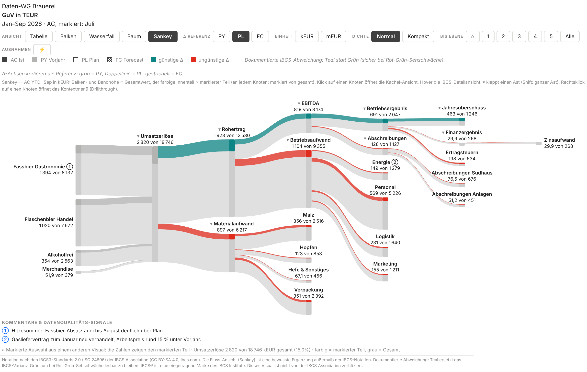

# Sankey meets the IBCS waterfall

> Markdown version of [sankey-wasserfall-post_en.html](../sankey-wasserfall-post_en.html) · https://datenwgknowledgekitchen.com/sankey-wasserfall-post_en.html · generated with scripts/build_md.py — if the two differ, the HTML version prevails.

Post · Power BI visual · Controlling

Why the pair only gets really good when it is dynamic. The waterfall explains **how much**: steps, signs, variance, anchors. The Sankey explains **where to**: flow, shares, structure. In the P&L visual both sit on the same data binding, and one click in the toolbar switches the story.

By **Michael Tenner** · As of · **October 2026** · Visual · **P&L Statement byDatenWG 1.7.0.0** · Reading time · **~7 min**

At month-end close there are almost always two questions. First: *how far are we above or below plan, and where does it come from?* One slide later: *and where does the money actually go?* The first is what the waterfall is for; for the second I long needed a side calculation in Excel. Version 1.6 gave the P&L visual a Sankey, version 1.7 the switches that bring both views together. Played through with the demo P&L of the Daten-WG brewery (fictitious figures, January to September 2026). The screenshots show the German demo data.

1 binding — **two stories.** Waterfall and Sankey read the same account dimension, the same measures, the same sign logic. No second visual, no second layout, nothing to reconcile between the two.

> ### Up front: the export limit
>
> As long as the visual is not certified through AppSource, the Power BI service **leaves it out of PDF and PowerPoint exports and subscription e-mails**. For the board pack you need a second route today: PDF export from Power BI Desktop, or a screenshot.

## How much: *the waterfall*

**Table with variance waterfall (template T04B):** AC against plan with ΔPL waterfall and ΔPL% pins, Jan–Sep 2026 in TEUR (labelled kEUR on the unit switch — the same unit). Above it the toolbar with the five views.

After nine months the brewery's operating result stands at **2,047 TEUR, 451 above plan** (+28%). The table with variance waterfall (template T04B) shows how it gets there: draught beer to restaurants +596 (the hot summer, comment ①), alcohol-free +273, against that bottled beer to retail −158 and merchandise −20. On the cost side, materials eat 298 of it, mostly malt and packaging. Energy is 112 below plan; the gas contract was renegotiated as of January (②; the 15% in the comment is against prior year). Every step has a sign, every subtotal anchors, and the scale is the same for all rows.

> ### Reading guide
>
> **AC** = actual, **PL** = plan, **PY** = prior year, **FC** = forecast. **Teal** means favourable for the result, **red** unfavourable: that is why lower energy cost (−112) is teal and more malt (+164) is red. **pp** are percentage points (gross margin −0.7 pp). **_September** or **_Sep** means cumulative to September (YTD). All amounts in TEUR.

## Where to: *the Sankey*

**Sankey view:** the same binding, one click in the toolbar. Band and bar height proportional to actuals, in brackets the share of revenue. Teal and red are family colours here (profit strand, costs), not a judgement, even though the legend still says “favourable/unfavourable Δ”.

Same numbers, a different question. Of 18,746 TEUR revenue, 43% comes from draught beer and 41% from bottled beer. Two thirds remain as gross profit, personnel alone takes 28% of revenue, 10.9% remains as operating result. The financial result is an expense here (−268 interest) and flows out in the Sankey; 6.6% remains as net income. You do not see that in the **variance** waterfall, because it shows variances, not shares. A structure waterfall on actuals or a “% of revenue” column shows shares too; the Sankey shows them as a flow.

**About the colours, honestly:** without ⚡, teal and red in the Sankey are family colours, profit strand and costs, not a judgement. Red on personnel (+0.8% against plan) means “cost block”, not “problem”. The legend in the picture still says “favourable/unfavourable Δ” here; switching it per view is on the backlog. With ⚡ the colours mean favourable and unfavourable, with a mark they show the marked part.

A click on a node opens the detail tile of that row with monthly columns and scenarios ([docs](../pnl-doku_en.html#views)).

**When the Sankey does not fit.** In a loss year with negative flows, because a Sankey knows no signs. With very many small accounts. For pure variance analysis. On small tiles and in print. And one limit of the metaphor: an accrual-based P&L is not a cash flow, depreciation flows nowhere. “Where does the money go” is meant figuratively.

## Only the dynamics *make it valuable*

Two static pictures would be nice, nothing more. It gets interesting with three switches from version 1.7.

**⚡ Only exceptions.** The threshold sits in the toolbar: |Δ%| ≥ 5% against plan. The Sankey then keeps colour only on the streams that cross the threshold, now in the colour of their variance. For the brewery that is 7 of 16 accounts (draught beer, alcohol-free and energy favourable, merchandise, malt, packaging and income taxes unfavourable) plus four totals; the rest turns grey.

**⚡ 5% against PL in the Sankey:** 7 of 16 accounts plus the totals cost of materials, EBITDA, operating result and net income have colour. Bottled beer to retail is −2.0%, below the threshold, and stays grey as a single account although it is the largest negative revenue step in absolute terms.

In the variance waterfall, “hide” folds the quiet steps of each section together: 8 of the 16 account steps merge into “other” or into their total, and the cascade stays closed.

**⚡ hide in the variance waterfall:** “other (2)” in materials, “other (3)” in operating expenses, depreciation and interest only as totals. The footer keeps count, also in PDF export from Desktop and in print.

A caveat: **“other” nets.** In “other (3)”, 37 TEUR saved on marketing offset 88 TEUR of extra cost in personnel and logistics, leaving an inconspicuous +51. So I set both thresholds, say 5% or 100 TEUR (then bottled beer at −158 has colour too), and check grouped steps in the tooltip. And the threshold sorts, it does not judge: income taxes (+33%) mechanically follow the higher result, and malt (+7%) is hardly “unfavourable” without volume adjustment when more beer was sold.

**Cross-highlight.** When a reader marks part of the data in another visual, the Sankey shows the marked part within the grey whole. The demo has no channel column, so here it is the month: a click on “July” in a column chart.

**Mark “July”:** at every node “marked of total”, colour shows the marked part. All other views behave as filtered; only the Sankey shows the part within the whole.

July brings 15% of revenue (2,820 of 18,746 TEUR) but 34% of the operating result (691 of 2,047). My reading: the fixed-cost leverage of a strong summer month. The picture shows the proportion, not the cause. With a channel or region column the same works: click “Export”, and the Sankey shows the export share at every level.

View, Δ reference, ⚡ threshold, root and fold state are saved by Power BI **bookmarks**. One bookmark “Exceptions against plan” and one “Structure” cover the whole closing meeting.

## Stocks and flows: *the cash flow*

**Cash flow bridge (template T05B):** opening balance → flows → closing balance as PY and AC cascades, month and cumulative to September, in TEUR (labelled kEUR in the picture — the same unit). A separate demo data set, not reconciled with the P&L above.

Since 1.7 the visual knows stocks. A stock row is not summed over the months but shown as the balance at the reporting date. In the cash flow bridge (template T05B) the opening and closing balances anchor on the zero line and the flows float in between: 600 TEUR at the start of the year, +1,373 from operations, −715 for investments, −760 for loan repayment and dividend, 498 at the end of September (prior year 440).

Put honestly: the cash flow demo is a separate data set and **not reconciled with the P&L above**. Net income there is 923 instead of 1,246, depreciation 495 instead of 1,127. In a real model both come from the same accounts, and that is exactly what to check when building it. The Sankey can draw the same flow with stocks as grey anchors, but for cash it was hard to read. That is why there is no Sankey picture here.

## Why this is *a real alternative* in controlling

From the point of view of someone presenting the month-end close:

- **One data binding.** Waterfall and Sankey are the same P&L. No second report to keep in sync, no second set of numbers between the two views.
- **Two questions, one visual.** The waterfall answers “how much, and where does the variance come from”, the Sankey “where does it flow, which channel drives it”.
- **⚡ as part of the view.** Conditional formatting in a matrix can set thresholds too, and so can Zebra BI. The difference: ⚡ works across all five views, folds cascades together, and readers change the threshold themselves and save it as a bookmark.
- **Segment questions without a new page.** “What does this look like for export only?” is answered by one click in the neighbouring visual. Native visuals can highlight too; what is new is the part-within-the-whole display in the Sankey.
- **P&L, cash flow and balance sheet in one mechanism.** With stocks & flows (T05A balance sheet, T05B cash flow) the same handling applies to all three statements. The cash flow bridge needs a cash flow mapping in the model: an account dimension with row-type tokens for stocks and flows.
- **And Zebra BI?** In fairness: Zebra BI is certified, appears in service exports and offers writeback and comments, but costs a licence per reader. Ours is free and open, but without certification and without planning.
- **Cost and governance.** Free, source code open (MIT licence). The visual declares `privileges: []`: no network access, no downloads, no local storage; the only exception is “Open docs”, which opens a link and sends no data. Provided without warranty and without a support commitment, a one-person project with GitHub issues; embedded versions keep running in reports independently of the project. Comments ①② come from a comment role in the model (no input, no writeback), RLS and permissions likewise. Consolidation and intercompany are not the visual's job; it shows what the model delivers. Details: [security & deployment](../visuals-sicherheit_en.html).

| Before | Now |
| --- | --- |
| Waterfall in the report, Sankey in a second visual or tool | **One visual, switched in the toolbar** |
| Important variances marked by conditional formatting per visual or by hand | **⚡ with a threshold across all views**, saved as a bookmark |
| Segment question: new page or filter, the big picture is gone | **Cross-highlight:** the part within the grey whole |
| Cash flow bridge rebuilt in Excel | **Cash flow bridge (T05B)** from the account dimension, stocks anchor |

> ### What to know beforehand
>
> The Sankey deliberately sits **outside the IBCS notation**; the visual's footer says so in this view. For plan-actual comparisons and variance analysis, table and waterfall remain the tools; if you only want to allow IBCS forms, switch the Sankey off in the format pane. The waterfall is IBCS-inspired, not certified. For export, see above. Accessibility: in high contrast the Sankey uses patterns (profit filled, costs outlined or hatched, inflows dashed), and ⚡ sets things apart with dashes instead of grey. Red/teal was chosen for red-green colour blindness; in greyscale print the distinction gets lost in pale bands.

If you want to try it: the [quick start](../pnl-schnellstart_en.html) gets you to a first P&L in two minutes, and the [documentation of the views](../pnl-doku_en.html#views) describes the Sankey in detail.

Version 1.7.0.0 · .pbiviz

### Switch it yourself

The quick start links the current .pbiviz and shows the first steps. The brewery demo data is in the repository.

[To the quick start →](../pnl-schnellstart_en.html) · [Get the .pbiviz ↓](https://raw.githubusercontent.com/Losveratos/PowerBI-Kitchen-/main/pnlByDatenWG/dist/pnlByDatenWG3F9A7D2C51E64B08A1C4E7F0B92D6358.1.7.0.0.pbiviz) · [To the docs](../pnl-doku_en.html)

In the docs: [The views (Sankey)](../pnl-doku_en.html#views) · [⚡ Only exceptions](../pnl-doku_en.html#exceptions) · [Cross-highlight](../pnl-doku_en.html#highlight) · [Stocks & flows](../pnl-doku_en.html#stock) · [T05A/T05B](../pnl-doku_en.html#t05) · [Security & deployment](../visuals-sicherheit_en.html)

All figures are real renderings of the visual 1.7.0.0 with the demo data of the fictitious Daten-WG brewery, captured in the visual's test harness. Questions and counterexamples: **Michael Tenner** · [michael.tenner84@gmail.com](mailto:michael.tenner84@gmail.com) · Issues: [github.com/losveratos/powerbi-kitchen-/issues](https://github.com/losveratos/powerbi-kitchen-/issues)

Source code, changelog and demo data: [pnlByDatenWG in the repository](https://github.com/Losveratos/PowerBI-Kitchen-/tree/main/pnlByDatenWG).

Waterfall and tables are IBCS-inspired (notation based on the IBCS® Standards by the IBCS Association, CC BY-SA 4.0, ibcs.com); the Sankey is a deliberate addition outside the IBCS notation. IBCS® is a trademark of the IBCS Association. This visual is not certified by or affiliated with the IBCS Association.

---

## Read on

- HTML (authoritative): https://datenwgknowledgekitchen.com/sankey-wasserfall-post_en.html
- German version: [sankey-wasserfall-post.html](../sankey-wasserfall-post.html) · [sankey-wasserfall-post.md](sankey-wasserfall-post.md)
- Visual documentation: [pnl-doku_en.md](pnl-doku_en.md) · Quick start: [pnl-schnellstart_en.html](../pnl-schnellstart_en.html)
