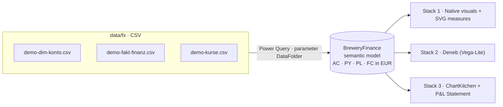

# One Model, Three Visual Stacks

**Finance Reporting in Power BI: One Model, Three Visual Stacks Compared** —
demo repository for the talk by Michael Tenner (Daten-WG) at the
Budapest BI Forum, November 2026.

Finance teams in Power BI keep asking which visual stack to use for management
reporting: the built-in visuals with a bit of DAX, Deneb with Vega-Lite, or
purpose-built custom visuals. This repo answers the question on one dataset. A
single semantic model (P&L, scenarios AC/PY/PL/FC, foreign currency) feeds
three report pages, each built with a different stack. You can see what each
stack costs to build, how far it gets you towards IBCS-style notation and what
it means for governance. Everything is plain text (PBIP: TMDL + PBIR), so you
can open it in Power BI Desktop or sync it into a Microsoft Fabric workspace
with Git integration.



```
           CSV (LC values, rates)
                    │  Power Query (DataFolder)
                    ▼
     ┌──────────────────────────────────┐
     │  BreweryFinance semantic model   │   DimKonto · FaktFinanz · DimKurs · DimDatum
     │  one set of measures, EUR (CC)   │   AC/PY/PL/FC · PL FY · AC&FC FY · FX views
     └───────┬───────────┬───────────┬──┘
             ▼           ▼           ▼
        Stack 1      Stack 2      Stack 3
      Native+SVG      Deneb     ChartKitchen + P&L
```

## Repository layout

```
workspace/                         ← connect THIS folder to Fabric Git integration
  OneModelThreeStacks.pbip         ← open this in Power BI Desktop
  BreweryFinance.SemanticModel/    ← TMDL: tables, relationships, measures, DataFolder parameter
  OneModelThreeStacks.Report/      ← PBIR: 4 pages (Overview + one page per stack)
data/
  fx/                              ← CSVs the model loads (EUR + GBP/CHF/USD export, rate table)
  euro/                            ← the same brewery in EUR only (simpler variant, not loaded)
visuals/
  chartKitchenByDatenWG…1.52.4.0.pbiviz
  pnlByDatenWG…1.5.3.0.pbiviz
  deneb-templates/                 ← the two Deneb templates used on page 3 (+ preview images)
scripts/validate_model.py          ← checks the CSVs against the data contract of the visuals
```

## Rebuild in 10 minutes

The model loads its data from the folder or URL in the parameter **DataFolder**.
The default is the `data/fx/` folder of this repository on GitHub
(`https://raw.githubusercontent.com/Losveratos/one-model-three-stacks/main/data/fx/`),
so it works out of the box while the repository is public. Point it at your own
fork or at a local folder whenever you like. Local paths and URLs both work, with
or without a trailing slash.

### A · Power BI Desktop (PBIP)

Prerequisites: a current Power BI Desktop on Windows. PBIR is the default report
format. If your Desktop version still asks, turn on *File → Options and settings
→ Options → Preview features → Store semantic model using TMDL format* and
*Store reports using enhanced metadata format (PBIR)*, then restart.

1. **Get the files.** Clone the repo or download it as a ZIP and extract it.
2. **Open** `workspace/OneModelThreeStacks.pbip`. Desktop opens the report and the
   semantic model (the report references the model by relative path).
3. **Set DataFolder (once).** *Home → Transform data → Edit parameters →
   DataFolder*. Keep the GitHub URL, or enter your local folder, for example
   `C:\repos\one-model-three-stacks\data\fx\`.
4. **Refresh.** If Desktop asks for credentials for `raw.githubusercontent.com`,
   choose *Anonymous*. Local files need no credentials.
5. **Import the two custom visuals** from `visuals/`: *Visualizations pane → … →
   Import a visual from a file*, once for each `.pbiviz`. The visuals on page 4
   render as soon as both are loaded.
6. **Deneb** (page 3) comes from AppSource. The report lists it as a public
   custom visual, so Desktop normally loads it on its own. If it doesn't, use
   *Visualizations pane → … → Get more visuals → Deneb*.
7. **Save.** Desktop now writes the imported visuals into
   `OneModelThreeStacks.Report/CustomVisuals/` and registers them in
   `report.json`. Commit those files if the report should also render in Fabric
   without a manual import.

### B · Microsoft Fabric (Git integration)

The steps follow Microsoft Learn,
[Get started with Git integration](https://learn.microsoft.com/fabric/cicd/git-integration/git-get-started)
(checked October 2026).

Prerequisites:
- A workspace on a Fabric capacity (a trial capacity is fine) or a Power BI Premium capacity.
- These tenant settings must be on: *Users can synchronize workspace items with
  their Git repositories* and, for GitHub, *Users can synchronize workspace items
  with GitHub repositories*.
- A GitHub personal access token, either fine-grained with **Contents: read and
  write** on your fork, or classic with the `repo` scope.
- Your own **fork** of this repository. Fabric commits back to the connected
  branch, so it needs write access.

Steps:
1. **Fork** the repo on GitHub, or push it to a repository of your own.
2. In Fabric, **create a new, empty workspace** on your capacity. You need to be
   a workspace admin.
3. Open **Workspace settings → Git integration**, pick **GitHub**, then
   **Add account**. Enter a display name, your personal access token and,
   optionally, the repository URL, and select **Connect**.
4. Pick the **repository URL** of your fork, the **branch** (`main`) and the
   **folder** `workspace`. Then select **Connect and sync**. The workspace is
   empty, so Fabric copies the Git content into it: the semantic model
   *BreweryFinance* and the report *OneModelThreeStacks*. Only item folders are
   synced; `OneModelThreeStacks.pbip` is a Desktop file and is ignored.
5. **Load the data.** Open the semantic model's **Settings**:
   - *Parameters → DataFolder*: use the raw URL of **your** fork, for example
     `https://raw.githubusercontent.com/<you>/one-model-three-stacks/main/data/fx/`.
     The repository has to be public for anonymous access. Otherwise put the
     CSVs somewhere the service can reach.
   - *Data source credentials → Web*: Authentication *Anonymous*, privacy level *Public*.
   - **Refresh now.**
6. **Custom visuals.** Open the report, select **Edit**, and import the two
   `.pbiviz` files (*Visualizations → … → Import a visual from a file*). As an
   alternative, your Fabric admin can add them as organizational visuals. Then
   **save**.
7. **Commit** the report from the **Source control** pane. From then on the
   visuals are stored in Git together with the report.

> Tip: change the model or report in Desktop, commit and push to your fork, then
> select **Source control → Updates → Update all** in the workspace. Edits made
> in the service go back to Git through **Source control → Changes → Commit**.

## The data

A fictitious **Daten-WG Brewery**, year 2026. Actuals run January to September,
the forecast is the "9+3" version (actuals plus three forecast months), and plan
and prior year cover all twelve months.

- **Story:** a hot summer (draught beer for gastronomy far above plan from June
  to August), a growing alcohol-free line, more expensive malt and packaging, and
  cheaper energy thanks to a new gas contract.
- **Seasonal volumes:** output in hectolitres (`Ausstoß gesamt (hl)`, `davon
  Export (hl)`), kept as separate root rows with `Einheit = hl` and filtered out
  of money visuals.
- **Chart of accounts (`DimKonto`, 29 rows):** 22 posting accounts, 4 formula
  rows (Rohertrag, EBITDA, Betriebsergebnis, Jahresüberschuss), 1 KPI row
  (Rohertragsmarge) and 2 volume rows. Level columns `L1`–`L3`, ragged (export
  accounts use a third level).
- **Foreign currency:** UK, Switzerland and USA export revenue and logistics are
  booked in **GBP, CHF and USD** (local currency, LC). `demo-kurse.csv` holds
  monthly rates per currency for the rate types **AKT** (current actual rate),
  **BUD** (budget rate) and **VJ** (prior-year rate). The quotation is foreign
  currency per 1 EUR, so CC = LC / rate.

Account names are German, as in the source data. A short glossary: *Umsatzerlöse*
revenue · *Materialaufwand* material cost · *Rohertrag* gross profit ·
*Betriebsaufwand* operating expenses · *Abschreibungen* depreciation ·
*Betriebsergebnis* operating result · *Finanzergebnis* financial result ·
*Ertragsteuern* income taxes · *Jahresüberschuss* net income.

### Column contract (short version)

| Table · column | Rule |
|---|---|
| `DimKonto[AccountID]` | unique, stable key; formula rows use mnemonic IDs (`F_EBITDA`) |
| `L1`, `L2`, `L3` | level columns, no gaps; formula and KPI rows fill `L1` only |
| `SortOrder` | running order across the whole P&L (block 10s, accounts 11, 12, …) |
| `RowType` | `Account` · `Formula` · `KPI` (also `Subtotal`, `Separator`) |
| `FormulaDef` | `[Umsatzerlöse]+[Materialaufwand]`: references row names, `+ - * /` and brackets; costs already carry −1, so the formula adds |
| `SignConvention · DisplayInvert · VarianceInvert` | revenue `1 · false · false`; **cost rows `-1 · true · false`**. Never combine −1 with `VarianceInvert = true`, because the variance colour would flip twice. |
| `Einheit` | `EUR` for money, `hl` for volumes (separate root rows) |
| `FaktFinanz` | account × month (`Datum` = month end) × `Currency`, values in LC, **costs positive**, AC empty (not 0) for open months, PY/PL/FC for all 12 months |
| `DimKurs` | every currency × period × rate type AKT and BUD (and VJ for PY as reported); EUR at 1.0 |

Check the CSVs (Python 3, standard library only):

```bash
python3 -I scripts/validate_model.py data/fx/demo-dim-konto.csv data/fx/demo-fakt-finanz.csv --kurse data/fx/demo-kurse.csv --cc EUR
python3 -I scripts/validate_model.py data/euro/demo-dim-konto.csv data/euro/demo-fakt-finanz.csv
```

Both runs report `0 ✗ · 0 ⚠`. The script checks the contract above and recomputes
the statement the way the P&L visual does. Use its numbers to check your
rebuild:

| YTD Jan–Sep 2026, kEUR | AC (reported) | AC @BUD (FX-adjusted) | PL | ΔPL reported | ΔPL FX-adjusted |
|---|---:|---:|---:|---:|---:|
| Revenue (Umsatzerlöse) | 20,853.9 | 20,891.9 | 20,086.0 | +767.9 | +805.9 |
| EBITDA | 4,174.2 | 4,205.5 | 3,682.2 | +492.0 | +523.3 |
| Net income (Jahresüberschuss) | 1,945.9 | 1,977.1 | 1,606.3 | +339.6 | +370.9 |

The weaker US dollar costs about 38 kEUR of revenue (card *FX effect on revenue*
on page 2) and 31 kEUR of EBITDA. Operationally, the brewery is doing better than
the reported figures show.

## The semantic model

`BreweryFinance` contains four import tables and one calculated table:

| Table | Content |
|---|---|
| `DimKonto` | chart of accounts as above, plus `L1Sort`/`L2Sort` (sort-by columns, built in Power Query) and `CK_RowType` (`sum`/`delta`/`pct` for waterfalls) |
| `FaktFinanz` | facts in local currency; all measures live here |
| `DimKurs` | rate table, no relationship, used for lookups only |
| `DimDatum` | months derived from the facts: `Monat` (`2026-01`), `MonthShort`, `Jahr`, `FC Flag` (1 = month without actuals) |
| `Kurssicht` | optional slicer table: `berichtet` (reported) or `zum Budgetkurs` (at budget rate) |

There are two relationships: `FaktFinanz[AccountID] → DimKonto[AccountID]` and
`FaktFinanz[Datum] → DimDatum[Datum]`.

Measures (display folders):

| Folder | Measures |
|---|---|
| 1 Roles (CC EUR) | `AC`, `FC` at rate AKT · `PL` at rate BUD · `PY` at rate VJ, converted per month × currency · `PL FY`, `AC&FC FY` (full year from the converted months) |
| 2 FX views | `AC @BUD`, `FC @BUD`, `PY @AKT`, `FX-Effekt`, `AC (Sicht)`, `FC (Sicht)` |
| 3 Local currency (LC) | `AC LC`, `PY LC`, `PL LC`, `FC LC` (only with one currency in the filter) |
| 4 ChartKitchen bridge | `AC ±`, `PY ±`, `PL ±` (signed), `AC GuV`, `PY GuV`, `PL GuV` (staircase), `Kommentar` |
| 5 Stack helpers | `Revenue AC/PY/PL/FC`, `Revenue AC&FC`, `Revenue FX effect`; Deneb: `Revenue AC&FC kEUR`, `Revenue PL kEUR`, `AC WF kEUR`, `PY WF kEUR` |
| 6 SVG (Stack 1) | `ΔPL ±`, `ΔPL %`, `SVG ΔPL Bar`, `SVG ΔPL% Pin`, `SVG AC vs PL` (data category *Image URL*) |

The model has **no YTD measures**. The P&L visual and ChartKitchen build
month, YTD and full-year blocks themselves. On the native and Deneb pages, YTD
comes from a visual filter `DimDatum[FC Flag] = 0`, which keeps only the months
with actuals.

## The three stacks

All three pages read the same measures. Only the visual layer differs.

### Stack 1 · Native visuals + SVG measures (page *Stack 1 · Native + SVG*)
Cards, a clustered column chart (revenue AC&FC vs PL by month), a bar chart
(product lines AC vs PY) and a matrix with three DAX-generated SVG images
(scenario bar, variance bar, variance pin).
- **Effort:** low to start. Every SVG is hand-written DAX string building,
  including scaling and colours.
- **Flexibility:** limited to what the built-in visuals expose. SVG works only in
  tables, matrices and cards (image URL columns).
- **IBCS-closeness:** low. There's no hatching for FC and no outlined PL bars in
  charts, and the variance colours are manual. The matrix can't calculate formula
  rows (EBITDA): it only shows the account blocks.
- **Governance:** best. No extra visuals and no tenant approval, and it works
  wherever Power BI runs (service, export, mobile).

### Stack 2 · Deneb (page *Stack 2 · Deneb*)
Two Vega-Lite specs exported from the
[Business Chart Builder](https://www.datenwgknowledgekitchen.com/business-chart-builder.html):
revenue columns with ΔPL and ΔPL% panels (FC months dashed) and a horizontal P&L
bridge YTD with ΔPY. The specs are bound to the model through the visual's
`dataset` fields. The templates themselves are in `visuals/deneb-templates/`.
- **Effort:** medium. The spec is code: about 600 lines of JSON per chart, edited in
  the Deneb editor.
- **Flexibility:** highest. Any layout and any notation, but each spec only knows
  the fields it was written for.
- **IBCS-closeness:** as close as you write it. Scenario notation, variance panels
  and bridges are all possible, but every rule lives in your spec.
- **Governance:** Deneb is a free AppSource visual. The specs themselves need
  review, versioning and someone who can read Vega-Lite.

### Stack 3 · ChartKitchen + P&L Statement (page *Stack 3 · ChartKitchen + P&L*)
**ChartKitchen byDatenWG** (revenue by month with AC, FC, PY and PL) and **P&L
Statement byDatenWG**, a full statement with level columns, formula rows,
the sign trio, month/YTD/FY blocks and comments, bound to all its roles.
- **Effort:** lowest per chart. You fill field wells and choose a mode or
  template. No code.
- **Flexibility:** within the visuals' modes (columns, bars, waterfall, table,
  cards, P&L templates T01–T04 …); outside those, fall back to Stack 1 or 2.
- **IBCS-closeness:** high out of the box: scenario notation, variance panels,
  title block, scaling, P&L logic computed in the visual from `FormulaDef` and
  the sign trio.
- **Governance:** two `.pbiviz` files to distribute (import per report or as
  organizational visuals) and keep up to date. The data contract is explicit and
  checked by `scripts/validate_model.py`.

| | Stack 1 · Native + SVG | Stack 2 · Deneb | Stack 3 · ChartKitchen + P&L |
|---|---|---|---|
| Build effort per chart | low (charts) to high (SVG) | medium to high | low |
| Flexibility | low | very high | medium (modes and templates) |
| IBCS-style notation | partial, manual | yes, hand-coded | yes, built in |
| Governance and distribution | nothing to install | AppSource visual + spec code | 2 custom visuals + data contract |

## Status and open points

- The report and model files were written as PBIR/TMDL text and checked against
  the public Microsoft JSON schemas and a structural TMDL lint. Open the project
  once in Power BI Desktop and **save**. Desktop then adds its own metadata
  (lineage tags, diagram layout, custom visual packages), which you can commit.
- **Deneb:** both visuals carry the spec and the field binding. If Deneb reports
  missing fields after a model change, **bind in Desktop**: open the Deneb editor,
  check the `dataset` fields (`Monat`, `Revenue AC&FC kEUR`, `Revenue PL kEUR`,
  `FC Flag`, or `L1`, `AC WF kEUR`, `PY WF kEUR`, `CK_RowType`), or re-create the
  visual from the template in `visuals/deneb-templates/` (*New specification →
  Create from template → Import*). Multi-part layouts may need Deneb's scaling
  setting so they fill the visual.
- **Custom visuals** are referenced by GUID in the page files
  (`chartKitchenByDatenWGD9DE0F7AD44D41058672C6FBF6F5A18D`,
  `pnlByDatenWG3F9A7D2C51E64B08A1C4E7F0B92D6358`). They render after the
  `.pbiviz` import described above.
- On the matrix in Stack 1, set the image size under *Format → Grid → Image
  size* if the SVG images appear too small (target 120 × 20 px).

## Downloads and documentation

- Visuals, quick starts and docs: **https://www.datenwgknowledgekitchen.com**:
  [ChartKitchen quick start](https://www.datenwgknowledgekitchen.com/chartkitchen-schnellstart_en.html) ·
  [ChartKitchen docs](https://www.datenwgknowledgekitchen.com/chartkitchen-doku_en.html) ·
  [P&L Statement quick start](https://www.datenwgknowledgekitchen.com/pnl-schnellstart_en.html) ·
  [P&L Statement docs](https://www.datenwgknowledgekitchen.com/pnl-doku_en.html) ·
  [Business Chart Builder](https://www.datenwgknowledgekitchen.com/business-chart-builder.html)
- Latest `.pbiviz` releases:
  [Losveratos/power-bi-custom-visuals-bydatenwg](https://github.com/Losveratos/power-bi-custom-visuals-bydatenwg)
- Deneb: [deneb.guide](https://deneb.guide/) (by Daniel Marsh-Patrick, available on AppSource)

## A note on IBCS

The ChartKitchen byDatenWG and P&L Statement byDatenWG visuals, the Business
Chart Builder templates and this demo are **IBCS-inspired**. They follow ideas
of the International Business Communication Standards (scenario notation,
variance displays), but they are **not IBCS-certified** and aren't endorsed by
the IBCS Association. IBCS® is a registered trademark of the IBCS Association.

## License

MIT, see [LICENSE](LICENSE). The demo data is fictitious. The `.pbiviz` files in
`visuals/` are released builds of the Daten-WG custom visuals. The share
repository linked above always has the latest version.
